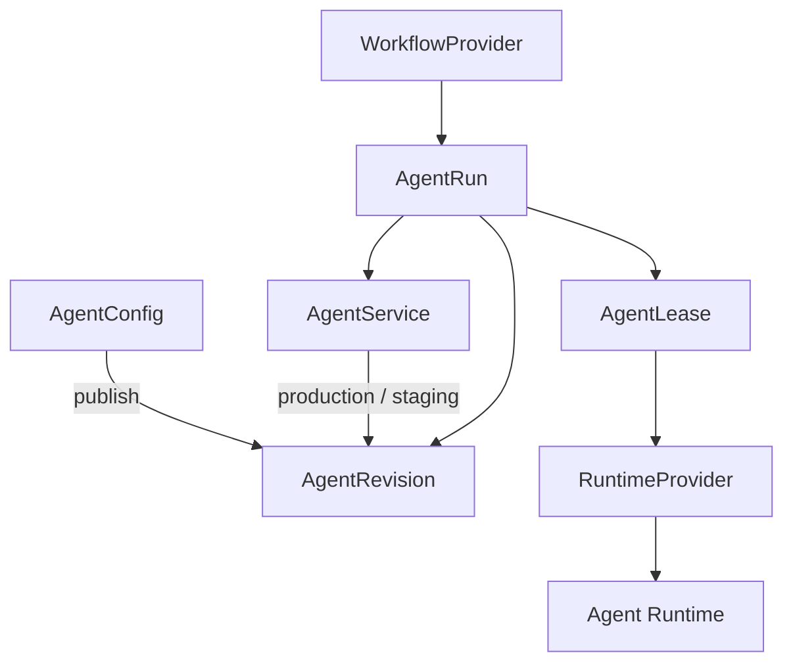

# another-agentic-platform

A Kubernetes-native platform for running **durable, versioned, independently
addressable AI agent services on disposable compute**.

> **Status: design, and the first code of the v0 operator.** Formerly the `lightbridge-agents` draft.
>
> The first operator (v0: adam-rs agents from `AgentService` and `AgentConfig` on native Kubernetes) is specified in [§59a](docs/architecture/10-control-plane-and-crds.md#59a-operator-v0-adam-rs-agents). Slices S1 to S9 are built: the Cargo workspace, the CRD types, the CRDs and the examples (S1); the pure core that validates and resolves them, with parity goldens against the adam-rs chart (S2); the provider traits and their conformance testkit (S3); the `RuntimeProvider` on native Kubernetes (S4: proven against a fake API server, and against a real one only once the `runtime-kubernetes` CI job has run); the controllers, the referenced-Secret store and `operator run` (S5: proven against a fake API server and against a bare kube-apiserver; the pods half, in kind, is *unverified* until the `operator-e2e` CI job has run); the operator-owned CloudNativePG store (S6: proven against a fake API server, and against a real CloudNativePG only once the `store-cnpg` CI job has run); the agent registry the operator serves, with its document read by the system's own reader, vendored (S7: proven against a fake directory and against a bare kube-apiserver; a pod reading it, in kind, is *unverified* until the `operator-e2e` CI job has run); the operator's image, its Helm chart and the CRDs chart, and the workflow that builds, pushes and bumps the image (S8: the `operator-image` run on `main` for `e3d164c` built and smoke-tested the image and pushed `sha-e3d164c`, which `f9168e6` bumped into the chart; an anonymous manifest request for that tag answers 200; *verified 2026-10-15*, run 37307542288 and the registry; installed from the registry on a real cluster by Argo CD, S10, it is *unverified*), and the kind end-to-end of the coder (S9: the operator, from its chart, runs the real adam-rs coder image up to its startup checks, with no model and no GitHub; its `operator-coder-e2e` job passed in that run, *verified 2026-10-15*). Of the admin dashboard ([§60a](docs/architecture/10-control-plane-and-crds.md#60a-admin-dashboard-v0)) slices D1 to D6, D7a, D7b1 and D7b2 are built. D1: the CRDs gain `access.audience`, the kinds `ModelEndpoint` and `ToolProvider` (a v0 subset), the exclusive `endpointRef` and `providerRef` fields and an optional `environment.image`, proven by tests and by hand against a bare kube-apiserver v1.35.8 (its `kind` job is *unverified* until CI has run it). D2: the operator resolves them, so a config that references an endpoint or a tool provider, or names no image, runs what the same content written inline runs; a missing object blocks the agent, naming it; the controller watches both kinds; and `operator run` takes a default agent image, a value of the chart with a pin of its own (proven by tests and by hand against a bare kube-apiserver; the `Role`'s new verbs under real RBAC are *unverified* until the kind jobs have run). D3: the registry publishes the audience of a service as the optional item attribute `audience` (a sorted set; none and `[]` are no attribute), and the contract [`agent-registry-v1`](docs/extensions/agent-registry-v1.md#audience) gains it with the consumer's rule and stays `v1`; the system's reader, vendored from before the attribute, reads such a document with nothing skipped, and the audience still reaches no pod (proven by tests and, for the registry case, by hand against a bare kube-apiserver; the `kind` job is *unverified* until CI has run it; the system's enforcement is D8). D4: the dashboard's forms and the two ports its Platform API is generic over, `AgentObjects` and `Authenticator`, each with a `Memory` implementation and a conformance macro, and the permission constants of `aap-api`: `aap-forms` turns an agent (a coder or a folder agent), a model endpoint and a tool server to and from the custom resources with the deployment's defaults filled in, names every validation error by its form field, says for any object whether a form can represent it or it is YAML only, and exports YAML through allow-lists, with the strings a YAML 1.1 reader misreads quoted; a form names a secret by reference only, and an agent's own image needs a tag or digest and an allowed registry (proven by tests, including properties over arbitrary forms, each broken on purpose; what needs an API server is D5 and an issuer D6). D5: `AgentObjects` on the API server, [`aap-objects-kubernetes`](crates/objects-kubernetes/README.md): server-side apply under `agents.vymalo.com/dashboard`, `force` off, with both applies dry-run (and the `resourceVersion` and `uid` read named in them) before either is real, so a stale token, a field another manager owns or a rule of the CRDs on either body is refused with nothing changed (the one window left, between the two real applies, is told by what changed and logged: a move of the service's version alone, which the operator causes, is repeated once and succeeds, anything else leaves the config written and answers, for the most part, `412`); a delete waits at most 5 s for the operator's finalizer and deletes the config **last**, because the operator reads it to honour `deletionPolicy` (a config deleted with the service could lose the data of a person who had just saved `Retain`), and what it leaves is an orphan config that a delete of its name removes; a GitOps object is never written or deleted; the offered keys are read from labelled `external-secrets.io/v1` ExternalSecrets and no Secret is read; the `Role` it needs is `create`, `delete`, `get`, `list`, `patch` on the four kinds and `list` on `externalsecrets`, held equal to its calls by a test. Proven by tests on a fake API server that copies the real behaviour, and by the conformance suite on a bare kube-apiserver v1.35.8 (56 cases on 2026-10-16, as an administrator and as a user that holds only that `Role`; the operator's finalizers are played by the test harness), each property broken on purpose; what a `resourceVersion` does in an apply is *verified 2026-10-16* there; the `objects-kubernetes` CI job is *unverified* until it has run. D6: the `Authenticator` of the Platform API, [`aap-auth-oidc`](crates/auth-oidc/README.md), a bearer JWT checked against the keys of an OIDC issuer as the system's orchestrator checks one, **without DPoP** (a token that carries `cnf` is accepted as a plain bearer, which is a question for the owner): RS256, RS384, ES256 and EdDSA only, `iss`, one of the configured audiences in `aud`, `exp` and `sub` required, `nbf` honoured, 60 s of leeway, the values of the configured roles claim as the person's permissions (a bad roles claim never refuses a token); a key cache that refreshes at 10 minutes, refetches on an unknown `kid` at most once in 30 s and fails closed an hour after it can no longer refresh; no error, log or source holds a token, a claim or a `kid`; an issuer on a local port in its `testkit`. Proven by tests over real HTTP, `aap_ports::authenticator_conformance!` among them, each check broken on purpose; a real Keycloak's keys and its roles claim are *unverified* until the realm is tried. D7a: the Platform API's router and its binary, [`aap-platform-api`](crates/platform-api/README.md) and [`aap-api-server`](bin/api/README.md) (binary `api`): every route of §60a under `/v1`, built from one table of routes and permissions that one middleware reads (a route outside it is a `500`); problem details (RFC 9457) with the form field of every `422`; conditional writes (`If-None-Match: *` creates, `If-Match` replaces and deletes, strong `ETag`s, `428` otherwise); `platform:secrets.pick` asked of a write whose form names a secret key; a change that would break the agents that name a model or a tool server refused (`409`); CORS for exact origins only; a log with no token, body or secret key; the binary reads one YAML file (unknown keys refused, validated at load) and drains on SIGTERM. Proven by tests on the `Memory` ports, over a real signed token and on a real socket, the route-by-permission matrix among them, each check broken on purpose (33); **the binary has not run against a real API server or a real issuer: D7b2**, the kind end-to-end through the API, is next. D7b1: the API's image ([`docker/api`](docker/api/Dockerfile)), its build, smoke test, push and tag bump in [`operator-image.yml`](.github/workflows/operator-image.yml) (one workflow for both images and one bump commit, so two pushes to `main` cannot race), and the chart's `api` component in [`deploy/operator`](deploy/operator/README.md#the-platform-api), off by default: a Deployment, a Service, its own service account and a `Role` that is exactly the one the objects crate is tested under (held equal by a check; no Secrets), a ConfigMap rendered from the values, a NetworkPolicy, and an optional Ingress whose annotations are where the edge's per-token rate limit is attached (the API implements none); the chart refuses what the binary would refuse, and CI runs the image's `api --check` on the file it renders. Proven by `render-check.sh` (194 checks), kubeconform over six renders, the release binary's `--check` on the rendered files and the workflow's smoke steps run against it; **the image build and every CI job of the slice are *unverified* until CI has run them** (no container daemon runs where it was written). D7b2: the kind end-to-end through the deployed API ([`api-e2e.sh`](deploy/operator/tests/e2e/README.md#the-kind-end-to-end-of-the-platform-api-d7b2), the job `api-e2e` of `operator-image.yml`, which the push waits for): the operator chart with the API on, the testkit's issuer as a program on the runner, and a folder agent created through the API, made `Ready` by the operator, listed, read, exported, replaced and deleted with its ETags, with no secret value in any answer or log; **the job passed on its first run** (run 38896792093, *verified 2026-10-16* in its log); after review (2026-10-16) the script refuses a context that is not `kind-*`, works in a namespace of its own, undoes only what it made, handles an orphan config after a `202` and requires the NetworkPolicy to refuse the other pod: **those changes are *unverified* until CI has run them** (no container daemon and no kind exist where they were written; the script was walked against the real router with a fake `kubectl` and `helm`). Nothing else of the architecture is built.

An agent is a stable logical service — not a Pod, a model, a workspace or a
process. It has a stable identity, immutable revisions selected through
release channels, explicitly enabled protocol surfaces (A2A, MCP, Responses),
reusable tools and environments, and compute that exists only while a lease
needs it.



## Documents

| Document | What it covers |
|---|---|
| [Architecture](docs/architecture/README.md) | The full design in 12 topic files: overview, domain model, interfaces, workflows, runtime, environments & storage, tools, security, operations, control plane & CRDs, decisions, summary |
| [MVP](docs/mvp.md) | The v0 cut (scenarios A–C, plus D for free) and build order |
| [Release-channels A2A extension](docs/extensions/release-channels-v1.md) | How any A2A client discovers and selects an agent's channels/revisions |
| [Agent registry](docs/extensions/agent-registry-v1.md) | How any client lists the fleet's A2A agents: a linkset of agent cards |

## Workspace

One Cargo workspace ([§59a](docs/architecture/10-control-plane-and-crds.md#59a-operator-v0-adam-rs-agents), "Workspace layout"); crates are prefixed `aap-`. Built so far:

| Path | What |
|---|---|
| [`crates/api`](crates/api/README.md) | `aap-api`: the `AgentService`, `AgentConfig`, `ModelEndpoint` and `ToolProvider` types, their CEL rules, `crds()`, and the dashboard's permissions as constants |
| [`crates/ports`](crates/ports/README.md) | `aap-ports`: the traits `RuntimeProvider`, `StoreProvisioner` and `AgentDirectory`, and for the Platform API `AgentObjects` and `Authenticator`, their neutral types (`RuntimeSpec`, `EnvValue`, `SecretRef`, `RuntimeStatus`, …), and with the feature `testkit` the conformance macros and `Memory` implementations |
| [`crates/forms`](crates/forms/README.md) | `aap-forms`: the dashboard's agent (coder or folder agent), model endpoint and tool server forms to and from the custom resources, with the deployment's defaults; a secret is a reference and no type holds a value; validation with a form field on every error; YAML only for an object a form cannot say; the YAML export |
| [`crates/domain`](crates/domain/README.md) | `aap-domain`: pure `validate` and `resolve` into a `RuntimeSpec` with a sha256 digest; **the env contract of `adam-coder` and `adam-agent` lives only here**, held equal to the adam-rs chart by [parity goldens](crates/domain/tests/golden/README.md) |
| [`crates/runtime-kubernetes`](crates/runtime-kubernetes/README.md) | `aap-runtime-kubernetes`: `RuntimeProvider` on native Kubernetes: a `RuntimeSpec` into StatefulSet or Deployment, Service, NetworkPolicy, ConfigMaps and claims by server-side apply, the adoption guard, `RuntimeStatus` from pods, `deletionPolicy`, `watch()`; golden YAML of the examples, a fake API server, and the conformance suite against a real cluster |
| [`crates/store-secret`](crates/store-secret/README.md) | `aap-store-secret`: `StoreProvisioner` for a referenced Secret: it reports the reference and never reads a Secret (the operator has no RBAC on Secrets) |
| [`crates/store-cnpg`](crates/store-cnpg/README.md) | `aap-store-cnpg`: `StoreProvisioner` for an operator-owned CloudNativePG `Cluster` `<service>-db`: server-side apply through the dynamic API, the reference to its `<cluster>-app` Secret (never read), readiness from its status, `deletionPolicy`, and `NotInstalled` without the CloudNativePG API |
| [`crates/objects-kubernetes`](crates/objects-kubernetes/README.md) | `aap-objects-kubernetes`: `AgentObjects` on the API server for the Platform API: server-side apply (`agents.vymalo.com/dashboard`, `force` off) of the dashboard's four kinds, both applies dry-run first with the version and `uid` read, GitOps objects never written, the spec as written, offers read from labelled ExternalSecrets, no Secret read; its `Role` is a file held equal to its calls |
| [`crates/auth-oidc`](crates/auth-oidc/README.md) | `aap-auth-oidc`: `Authenticator` for the Platform API over a bearer JWT checked against an OIDC issuer's JWKS (RS256, RS384, ES256, EdDSA; `iss`, `aud`, `exp`, `sub`, the roles claim as permissions; a key cache that fails closed; **no DPoP**); `OidcConfig` for the API's YAML file; with the feature `testkit`, an issuer on a local port for tests |
| [`crates/platform-api`](crates/platform-api/README.md) | `aap-platform-api`: the axum router of the Platform API over `/v1`, generic over `AgentObjects` and `Authenticator`: one table of routes and the permission each needs (`ROUTES`), problem details with the form field of every `422`, `ETag`/`If-Match`/`If-None-Match` preconditions (`428` without), `secrets.pick` decided from the form, `dependents_after` before a shared write, CORS for exact origins, a log that holds no token, body or secret key |
| [`crates/registry`](crates/registry/README.md) | `aap-registry`: the `agent-registry/v1` document builder and an axum router: one static bearer compared in constant time, strong `ETag` and `304`, `Cache-Control: private, max-age=30`, a refusal rather than a truncation past 500 items or 1 MiB; the system's reader is vendored in its tests |
| [`crates/controller`](crates/controller/README.md) | `aap-controller`: the `AgentService` and `AgentConfig` reconcilers (kube-rs), generic over the two providers: finalizer, `resolve`, store, runtime, conditions and state, Events, the deletion policy, back-off by error class; and `ReflectorDirectory`, the `AgentDirectory` over the reflector's cache |
| [`bin/operator`](bin/operator/README.md) | `aap-operator`, binary `operator`: `crdgen` prints the CRDs; `run` composes the Kubernetes provider, the store (CloudNativePG, with `store-cnpg`) and the controllers, with health (8081), metrics (9090) and, with a token, the registry (8080); `tests/cluster.rs` and `tests/stub` are the end-to-end against a real cluster |
| [`bin/api`](bin/api/README.md) | `aap-api-server`, binary `api`: the Platform API's composition root: one YAML configuration file (unknown keys refused, validated at load, no secret in it), `aap-objects-kubernetes` and `aap-auth-oidc` behind the router, `/healthz` and `/readyz` on their own port, a drain on SIGTERM; `--check` validates the file with no cluster; its image is [`docker/api`](docker/api/Dockerfile) and its chart the component `api` of `deploy/operator` |
| [`deploy/crds`](deploy/crds/agents.vymalo.com.yaml) | The generated CRDs, checked in; CI fails when `crdgen` prints something else |
| [`docker/operator`](docker/operator/Dockerfile) | The operator's image, `ghcr.io/vymalo/another-agentic-platform/operator`: cargo-chef on Rust 1.94.1 onto `distroless/cc-debian13:nonroot`, both pinned by tag and digest, user 65532, only the `operator` binary |
| [`docker/api`](docker/api/Dockerfile) | The Platform API's image, `ghcr.io/vymalo/another-agentic-platform/api`: the operator's Dockerfile with the package and the binary changed (same builder and base, user 65532, only the `api` binary; the build stage smoke-tests it) |
| [`deploy/operator`](deploy/operator/README.md) | The operator's Helm chart: one replica (`Recreate`, no leader election), a namespaced `Role` with exactly the verbs of the crates' READMEs (no Secrets), the registry's Service and token file only with a token (an existing Secret or an ExternalSecret), a NetworkPolicy, `bump-tag.sh`, render checks with golden renders; and, off by default, the Platform API (`api.enabled`): its own Deployment, service account, `Role` and NetworkPolicy, and an optional Ingress |
| [`deploy/operator-crds`](deploy/operator-crds/README.md) | A chart of the CRDs only (its own Argo CD app, §93): a copy of `deploy/crds`, held equal by a test |
| [`deploy/operator/tests/e2e`](deploy/operator/tests/e2e/README.md) | The end-to-end of the coder in kind (S9): `coder-e2e.sh`, `examples/coder.yaml` adapted to the real image and a Postgres the job runs |
| [`tools/adam-parity`](tools/adam-parity/regen.sh) | Regenerates the parity goldens from the adam-rs chart (by hand: needs helm and a clone of adam-rs) |
| [`examples`](examples/coder.yaml) | `coder.yaml` and `chat.yaml` (a service and its config each), [`coder-me.yaml`](examples/coder-me.yaml) (the dashboard's `ModelEndpoint` and `ToolProvider` and a coder that references them), and [`invalid/`](examples/invalid), one object per CEL rule and per bound of the dashboard's fields, each refused by an API server |

```sh
cargo fmt --all --check
cargo clippy --workspace --all-targets --locked -- -D warnings
cargo test --workspace --locked
cargo run -q -p aap-operator -- crdgen | diff deploy/crds/agents.vymalo.com.yaml -   # the drift check
```

CI is [`.github/workflows/operator.yml`](.github/workflows/operator.yml): the four checks above, and a `kind` job that applies the CRDs, the examples and the invalid examples to a real API server; and [`.github/workflows/operator-image.yml`](.github/workflows/operator-image.yml): the charts' checks, the operator's image and the Platform API's built and smoke-tested (the API's also with `api --check` on the configuration the chart renders), then on `main` pushed as `sha-<7>` and `latest`, and one commit that bumps both tags in `deploy/operator/values.yaml`. The parity goldens are *tested* in CI (against the checked-in files) but *regenerated* by hand: [`tools/adam-parity/regen.sh`](tools/adam-parity/regen.sh) needs helm and a clone of another repository.

## Related

- **another-agentic-system** — a protocol-agnostic orchestration layer (chat
  surface + stateless orchestrator). It consumes agents over A2A, MCP and
  webhooks like any other system; when an agent comes from this platform, it
  offers release selection through the extension above.
- **vymalo/another-adam-rs** — the agent harness (AD-022): `adam-coder` and
  `adam-agent`, one image, which the v0 operator runs.
- **vymalo/another-agentic-images** — the toolchain image recipe (Rust, Flutter/Dart,
  Node, agent CLIs under `/opt`) coding runtimes start from.

## License

[MIT](LICENSE). Vendored agent skills keep their own licenses; see
[third-party-notices.md](third-party-notices.md).
