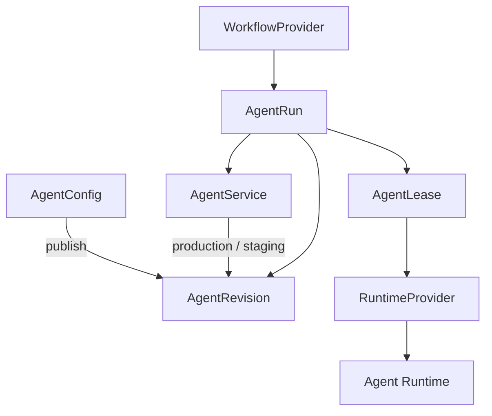

# another-agentic-platform

A Kubernetes-native platform for running **durable, versioned, independently
addressable AI agent services on disposable compute**.

> **Status: built, and CI's kind end-to-end jobs run it; no production cluster does yet.**
>
> - **Built and run by CI's kind end-to-end jobs:** the CRDs and their CEL rules, the operator (controllers, the stores, run
>   pods, the registry), the Platform API and `aapctl`.
> - **Progress:** 13 of 16 operator increments of [§59c](docs/architecture/10-control-plane-and-crds.md#59c-operator-increments-kagent-grade-minimum) are built (81 %), and the [Features](#features) table says, row by row, what is proven and what is not.
> - **Unverified:** a real cluster with a real OIDC issuer and a real CloudNativePG, Argo CD, and a production edge. [§59c](docs/architecture/10-control-plane-and-crds.md#59c-operator-increments-kagent-grade-minimum) has the detail.
>
> Formerly the `lightbridge-agents` draft.

An agent is a stable logical service — not a Pod, a model, a workspace or a
process. It has a stable identity, immutable revisions selected through
release channels, explicitly enabled protocol surfaces (A2A, MCP, Responses),
reusable tools and environments, and compute that exists only while a lease
needs it.



## Features

What is built, read against the code on `main` on 2026-11-27 (`2f6ad6d`), not against the plans. CI's evidence is the latest
`main` run of each workflow, both green at `36ca2e0`: [`operator.yml`](.github/workflows/operator.yml) run 45973874487 and
[`operator-image.yml`](.github/workflows/operator-image.yml) run 45973874969 (*verified 2026-11-27* with `gh run view`).

✅ built · ⚠️ partial · ❌ not supported · 🚧 planned · 🧪 experimental · ➖ n/a · retired · 🔒 needs a role. The icon always comes with its word; [STRUCTURE.md](docs/.vitepress/STRUCTURE.md) has what each one means. Updated with every change that moves a row.

| Area | Feature | Status | Notes |
|---|---|---|---|
| CRDs | `AgentService` and `AgentConfig`: the types, their CEL rules, `crdgen` and the examples (S1) | ✅ built | [§59a](docs/architecture/10-control-plane-and-crds.md#59a-operator-v0-adam-rs-agents); the `kind` job applies the CRDs, the examples and one invalid example per CEL rule and bound to a real API server; `crds-drift` holds the checked-in CRDs to `crdgen` |
| CRDs | `ModelEndpoint` and `ToolProvider`, named by `endpointRef` and `providerRef` (D1, D2), and the `status` the operator writes on them: `usedBy`, `Accepted`, `InUse`, `AgentsReady` (K2) | ✅ built | [§60a](docs/architecture/10-control-plane-and-crds.md#60a-admin-dashboard-v0); [`api-e2e.sh`](deploy/operator/tests/e2e/api-e2e.sh) makes a model by reference to an offered Secret key and reads its `usedBy` through the deployed API |
| CRDs | K1: `model.extraBody`, `echoReasoning`, `contextWindow`, `coder.maxAccessTier` with a ceiling the deployment sets, and `interfaces.a2a` | ✅ built | [§59a *K1*](docs/architecture/10-control-plane-and-crds.md#k1-the-crds-read-everything-adam-rss-former-operator-removed-its-adr-0046-accepted), [AD-050](docs/architecture/11-decisions.md#ad-050--the-access-tier-has-a-ceiling-the-deployment-sets); a superset test against adam-rs's vendored CRD |
| CRDs | A package cache, `environment.cache.existingClaim`, only from a claim the deployment lists (K1) | ⚠️ partial | [AD-049](docs/architecture/11-decisions.md#ad-049--a-package-cache-is-a-claim-the-deployment-lists-and-never-one-the-operator-makes); with run pods the template mounts the claim and the admission policy admits it, and that rule has not been asked of an API server: no end-to-end fixture sets a cache |
| CRDs | A bring-your-own A2A image, `harness.type: a2a` (K11a) | ✅ built | [§59a](docs/architecture/10-control-plane-and-crds.md#a-bring-your-own-a2a-image-k11a-ad-054), [AD-054](docs/architecture/11-decisions.md#ad-054--a-bring-your-own-a2a-image-is-a-harness-type-of-its-own); [`namespaces-e2e.sh`](deploy/operator/tests/e2e/namespaces-e2e.sh) runs one to `Ready` and listed |
| CRDs | The reasoning effort: the levels on `ModelEndpoint.spec.reasoning`, the pick on `AgentConfig.model.reasoningEffort` | ⚠️ partial | [§59a](docs/architecture/10-control-plane-and-crds.md#the-reasoning-effort-the-levels-on-the-endpoint-the-pick-on-the-agent-adr-0063); validated, in the forms and in `GET /v1/info`, but it **reaches no model yet**: the operator writes no variable for it |
| Operator | The `AgentService` and `AgentConfig` reconcilers on native Kubernetes: server-side apply, the adoption guard, the finalizer and `deletionPolicy`, conditions and Events, the referenced-Secret store (S4, S5) | ✅ built | [§59a](docs/architecture/10-control-plane-and-crds.md#finalizer-and-deletion); the `runtime-kubernetes` job (the provider's conformance suite on a real cluster) and `operator-e2e` ([`cluster.rs`](bin/operator/tests/cluster.rs)) |
| Operator | One configuration file, `operator run --config`, with `--check` (AD-064) | ✅ built | [AD-064](docs/architecture/11-decisions.md#ad-064--the-operator-reads-one-configuration-file-and-no-setting-is-an-environment-variable); `render-check.sh` runs `--check` on every golden render, and every kind job reads the file from the chart's ConfigMap |
| Operator | A CloudNativePG `Cluster` per agent as its store (S6) | ✅ built | [§59a](docs/architecture/10-control-plane-and-crds.md#secrets-and-databases); the `store-cnpg` job, against CloudNativePG `1.31.0-rc1`, a preview release, until a GA 1.31 ([AD-067](docs/architecture/11-decisions.md#ad-067--helm-4-only-and-kubernetes-137-minimum-a-hard-cutover)) |
| Operator | The store's size (resources, WAL storage, three Postgres parameters) and the deletion of a retained store after a retention period | ⚠️ partial | [`store-cnpg`](crates/store-cnpg/README.md), [`controller`](crates/controller/README.md); proven on a fake API server; no cluster job sizes a cluster or waits out a retention period |
| Operator | The agent registry, `agent-registry/v1`, with each agent's `audience` (S7, D3) | ✅ built | [§59a](docs/architecture/10-control-plane-and-crds.md#registry-in-v0), [the contract](docs/extensions/agent-registry-v1.md); in [`chain-e2e.sh`](deploy/operator/tests/e2e/chain-e2e.sh) a pinned orchestrator of another-agentic-system lists an agent by its audience. Whether an administrator sees every agent is still open (§60a, D3) |
| Operator | Several namespaces, one `Role` in each and never a `ClusterRole` (K6) | ✅ built | [AD-055](docs/architecture/11-decisions.md#ad-055--one-operator-may-watch-several-namespaces-with-one-role-in-each); [`namespaces-e2e.sh`](deploy/operator/tests/e2e/namespaces-e2e.sh) |
| Operator | Two replicas that elect a leader through a `Lease` (K7) | ✅ built | [AD-057](docs/architecture/11-decisions.md#ad-057--two-replicas-elect-a-leader-through-a-lease-and-only-its-holder-reconciles); [`leader-e2e.sh`](deploy/operator/tests/e2e/leader-e2e.sh) kills the holder; the `PodDisruptionBudget` under a real drain is not proven |
| Operator | The MCP probe: a `ToolProvider`'s reachability and tool names in its status (K3) | ✅ built | [AD-053](docs/architecture/11-decisions.md#ad-053--the-operator-may-reach-listed-mcp-servers-to-discover-their-tools); step 6a of [`api-e2e.sh`](deploy/operator/tests/e2e/api-e2e.sh), with a stub server on the runner |
| Operator | Tool catalogue: the read-only Kubernetes MCP server (K10a) | ✅ built | [AD-056](docs/architecture/11-decisions.md#ad-056--a-catalogue-of-read-only-tool-servers-each-licence-accepted-by-the-owner-first), [the example](examples/toolproviders/kubernetes.yaml); in [`k10-e2e.sh`](deploy/operator/tests/e2e/k10-e2e.sh) a folder agent's scripted model calls its list-pods tool |
| Operator | Tool catalogue: the Prometheus and GitHub MCP servers (K10b, K10c) | ⚠️ partial | [the examples](examples/toolproviders), held to read-only by `crates/domain/tests/tool_catalogue.rs`; neither runs in an end-to-end |
| Operator | Run pods for a coder: the template, account, quota, network policy and admission policy; size classes with limits, a size weight and admitted node types (D15a, D15b, AD-061, AD-066) | ✅ built | [§59b](docs/architecture/10-control-plane-and-crds.md#59b-the-run-pool-pods-where-work-runs), [AD-061](docs/architecture/11-decisions.md#ad-061--a-run-pods-containers-all-carry-memory-cpu-and-ephemeral-storage-limits-and-the-admission-policy-requires-them), [AD-066](docs/architecture/11-decisions.md#ad-066--a-run-pod-size-class-has-a-size-weight-on-a-fixed-grid-and-run-pods-can-be-pinned-to-the-node-types-the-deployment-admits); [`run-pods-e2e.sh`](deploy/operator/tests/e2e/run-pods-e2e.sh) with the real adam-rs coder |
| Operator | The egress proxy of run pods: deny by default, one way out through `adam-egress` and its allow-list (D15c) | ✅ built | [§59b](docs/architecture/10-control-plane-and-crds.md#59b-the-run-pool-pods-where-work-runs); step 7 of [`run-pods-e2e.sh`](deploy/operator/tests/e2e/run-pods-e2e.sh): direct connections refused, a host off the list `403` |
| Operator | The coder's git in a sidecar that holds no secret (D15d) | ✅ built | step 4b of [`run-pods-e2e.sh`](deploy/operator/tests/e2e/run-pods-e2e.sh): a repository's filter and fsmonitor run there and read none of the secrets |
| Operator | gVisor: a `RuntimeClass` for run pods and for the agents' own pods, required by the admission policy once named (K14a) | ⚠️ partial | [AD-052](docs/architecture/11-decisions.md#ad-052--gvisor-a-sandboxed-runtime-class-for-run-pods-and-for-the-agents-own-pods); the render and the admission rule are proven in kind; a sandbox start under `runsc` only on a k3d container node ([`gvisor-k3d.sh`](deploy/operator/tests/e2e/gvisor-k3d.sh), a workflow that gates nothing), where `runsc` did not enforce the pod's limits; a real node is unproven |
| Operator | gVisor on real nodes, with the coder's sidecar, egress proxy and store under the class (K14c, K14d) | 🚧 planned | [§59c](docs/architecture/10-control-plane-and-crds.md#59c-operator-increments-kagent-grade-minimum); `agent.runtimeClassName` stays empty until a run pod has started under `runsc` on a real node |
| Operator | Metrics: the operator's on 9090, the API's `aap_api_*` counters on a listener of their own, `ServiceMonitor`s off by default (K4) | ⚠️ partial | [§48](docs/architecture/09-operations.md#48-observability); `render-check.sh` and kubeconform on a vendored schema; a scrape by a real Prometheus is *unverified* |
| Operator | Traces: OTLP/HTTP JSON from the operator and the API, with a closed set of span attributes (K5) | ✅ built | [§48a](docs/architecture/09-operations.md#48a-traces-of-the-operator-and-the-platform-api-k5); step 6b of [`chain-e2e.sh`](deploy/operator/tests/e2e/chain-e2e.sh) against a pinned OpenTelemetry Collector; a private CA and other backends are *unverified* |
| Operator | Sleep when idle and wake on request: the `scaling` fields and the phase `Sleeping` (P1), the activity port and its HTTP source (P2a, P2c), the idle loop (P2b), the operator's wake path with the sleep stored in `status.sleep` (P3a-1), the activator as a library (P3b), the agent's activity listener, rendered (ANR-1030a) and wired into the operator (ANR-1030b) | 🚧 planned | [§21a](docs/architecture/05-runtime.md#21a-sleep-when-idle-the-plan), [AD-058](docs/architecture/11-decisions.md#ad-058--an-agent-sleeps-when-the-agent-says-it-is-idle-and-an-activator-wakes-it); P3a-1 is built (ANR-1067), but an agent sleeps in a deployment once `activity` is on and its coder image has the listener (ANR-1200: no pin has it yet), and **nothing writes the `wake-at` annotation until ANR-1068**; the activator's binary and chart and the kind end-to-end (P4) are to come |
| Operator | Release channels and rolling upgrades: a revision is a workload of its own | 🚧 planned | [§10a](docs/architecture/02-domain-model.md#10a-release-channels-and-rolling-upgrades-the-plan), [AD-059](docs/architecture/11-decisions.md#ad-059--a-revision-is-a-workload-of-its-own-and-an-old-one-stays-until-its-runs-end); the platform does not implement [`release-channels/v1`](docs/extensions/release-channels-v1.md) yet |
| Operator | A run's signer: a sidecar or the agent itself, a token for the issuer's audience | 🚧 planned | [AD-063](docs/architecture/11-decisions.md#ad-063--the-operator-renders-a-runs-signer-a-sidecar-or-the-agent-itself-a-token-for-the-issuers-audience-and-no-certificate-of-its-own); documentation only |
| Operator | `requireApproval` per tool (K12) | 🚧 planned | [§59c](docs/architecture/10-control-plane-and-crds.md#59c-operator-increments-kagent-grade-minimum); waits for a decision in adam-rs and in another-agentic-system |
| Platform API | The router over `/v1`: one table of routes and the permission each needs, problem details, CORS for exact origins, conditional writes with strong `ETag`s (`428`, `412`), a `409` before a shared object's change breaks an agent (D7a) | ✅ built | [§60a](docs/architecture/10-control-plane-and-crds.md#the-platform-api-ad-025-ad-027); [`api-e2e.sh`](deploy/operator/tests/e2e/api-e2e.sh) drives the deployed API |
| Platform API | Bearer JWT checked against an OIDC issuer's keys, the roles claim as permissions, fail closed, no DPoP (D6) | ✅ built | [AD-032](docs/architecture/11-decisions.md#ad-032--permissions-are-keycloak-client-roles-roles-are-composites); in `api-e2e.sh` with the testkit's issuer run as a process; a real Keycloak is *unverified* (K13 below) |
| Platform API | `AgentObjects` on the API server: server-side apply, both applies dry-run first, GitOps objects never written, no Secret read (D5) | ✅ built | [`objects-kubernetes`](crates/objects-kubernetes/README.md); its CI job runs the suite on a real API server as an administrator and as a user that holds only its `Role` |
| Platform API | Forms for a coder, a folder agent and an A2A image, secrets picked by reference, the YAML export (D4, K11b) | ✅ built | [AD-030](docs/architecture/11-decisions.md#ad-030--secrets-are-picked-never-written-in-dashboard-v0); a folder agent in `api-e2e.sh`, a coder in `chain-e2e.sh`; the A2A form by the router's and `aapctl`'s tests |
| Platform API | The Events of an agent's objects and the OpenAPI 3.1 document (K8) | ✅ built | [the contract](docs/api/README.md); a drift test holds the document to the table of routes; the Events step of `api-e2e.sh` |
| Platform API | CBOR as a second media type (AD-062) | ⚠️ partial | [AD-062](docs/architecture/11-decisions.md#ad-062--the-platform-api-speaks-cbor-as-a-second-media-type-of-the-same-schemas-json-stays-the-default); router tests only, no end-to-end step asks for CBOR |
| Platform API | An owner on `AgentService` and the owner routes under `/v1/owners/{owner}/agents` (`platform:agents.own` for the writes, `platform:agents.read.owner` for the reads, AD-072) | ⚠️ partial | [`platform-api`](crates/platform-api/README.md); router tests over the `Memory` ports only |
| Platform API | A mutual-TLS listener for workloads that serves only the owner routes (AD-065, AD-068) | ⚠️ partial | [AD-065](docs/architecture/11-decisions.md#ad-065--the-platform-api-gains-a-second-authenticator-seam-for-workload-certificates-and-reads-the-uri-san-with-x509-parser), [AD-068](docs/architecture/11-decisions.md#ad-068--the-platform-api-serves-workloads-on-a-second-mutual-tls-listener-that-mounts-only-the-owner-routes); socket tests and `render-check.sh` (`api.workload` is off by default); no kind end-to-end, no real PKI, and no revocation list yet |
| Platform API | The dashboard and an agent on the owner's own cluster, with a real Keycloak (K13, D14) | 🚧 planned | [§59c](docs/architecture/10-control-plane-and-crds.md#59c-operator-increments-kagent-grade-minimum): on hold, with no cluster to prove it on |
| aapctl | Offline: `validate -f` and `render -f`, judged and rendered as the operator does (K9) | ✅ built | [§60b](docs/architecture/10-control-plane-and-crds.md#phase-1-validate-and-render-offline-built); `render` is held byte for byte to the provider's goldens |
| aapctl | Over the Platform API: `get`, `apply`, `delete --wait`, `export agent`, `whoami`, `login --token-stdin` (K9b-1) | ✅ built | [§60b](docs/architecture/10-control-plane-and-crds.md#phase-2-over-the-platform-api-k9b-1-and-k9b-2-built-2026-11-15); step 6b of [`api-e2e.sh`](deploy/operator/tests/e2e/api-e2e.sh) |
| aapctl | `login` in the browser (authorization code with PKCE on a loopback redirect) and a refresh token (K9b-2) | ⚠️ partial | [§60b](docs/architecture/10-control-plane-and-crds.md#the-browser-sign-in-and-the-refresh-token-k9b-2-built-2026-11-15-reviewed-twice); tests against the testkit's issuer; a real Keycloak, a real browser and the opener on macOS and Windows are *unverified*; no image ships `aapctl` |
| aapctl | The release: four binaries (linux x86_64/aarch64 static on musl, darwin x86_64/arm64) signed with cosign and attested, a `SHA256SUMS`, and the Homebrew formula the tap carries (AD-071) | ⚠️ partial | [§60b *The release path*](docs/architecture/10-control-plane-and-crds.md#the-release-path-ad-071), [install `aapctl`](docs/guides/install-aapctl.md); no tag has run the job yet, and the tap pull request needs the App's rights on `vymalo/homebrew-tap` |
| Charts and images | The operator's and the Platform API's images: smoke-tested, pushed as `sha-<7>` and `latest`, both tags bumped in one commit (S8, D7b1) | ✅ built | [`docker/operator`](docker/operator/Dockerfile), [`docker/api`](docker/api/Dockerfile); `operator-image.yml` pushed `sha-36ca2e0` |
| Charts and images | The operator chart, with the Platform API as an optional component, and the CRDs chart: Helm 4 only, Kubernetes 1.37 or later, golden renders, kubeconform | ✅ built | [`deploy/operator`](deploy/operator/README.md), [`deploy/operator-crds`](deploy/operator-crds/README.md), [AD-067](docs/architecture/11-decisions.md#ad-067--helm-4-only-and-kubernetes-137-minimum-a-hard-cutover); the `chart` job runs `render-check.sh` |
| Charts and images | Releases: release-please cuts `vX.Y.Z` (one version for the workspace and both charts); the tag copies the tested `sha-<7>` images by digest to `X.Y.Z` and `X.Y` (never `latest`), cosign-signed with an SBOM and a provenance attestation, and publishes both charts as signed OCI artifacts with the images pinned; the same tag publishes `aapctl`'s four signed binaries and proposes its Homebrew formula ([AD-071](docs/architecture/11-decisions.md#ad-071--a-release-also-publishes-aapctl-four-signed-binaries-and-the-formula-in-the-tap)) | ⚠️ partial | [§59a *Releases*](docs/architecture/10-control-plane-and-crds.md#releases-ad-070), [AD-070](docs/architecture/11-decisions.md#ad-070--releases-release-please-cuts-vxyz-the-tested-sha-7-images-are-copied-by-digest-and-the-charts-are-published-with-the-releases-pins), [`release.yml`](.github/workflows/release.yml); no tag has run it yet, and it needs the owner's GitHub App and its two secrets (and its rights on `vymalo/homebrew-tap`); the dry run on pull requests and `release-pin-test.sh` are what CI runs |
| Charts and images | Installed from the registry on a real cluster by Argo CD (S10) | ⚠️ partial | [§59a](docs/architecture/10-control-plane-and-crds.md#rollout-on-netcup); *unverified* |
| End-to-end jobs | `operator-e2e` and `operator-coder-e2e`: the operator in kind with a stand-in image, and with the real adam-rs coder (S5, S7, S9) | ✅ built | [`cluster.rs`](bin/operator/tests/cluster.rs), [`coder-e2e.sh`](deploy/operator/tests/e2e/coder-e2e.sh) |
| End-to-end jobs | `api-e2e`: the deployed Platform API makes, reads, replaces and deletes an agent; `aapctl` against it; the probe and the Events (gates the push) | ✅ built | [`api-e2e.sh`](deploy/operator/tests/e2e/api-e2e.sh) |
| End-to-end jobs | `chain-e2e`: an agent made through the API, run by the operator, listed by a pinned orchestrator by audience; the traces | ✅ built | [`chain-e2e.sh`](deploy/operator/tests/e2e/chain-e2e.sh); does not gate the push |
| End-to-end jobs | `run-pods-e2e`: the real coder with run pods, the quota, the network, the egress proxy and the git sandbox | ✅ built | [`run-pods-e2e.sh`](deploy/operator/tests/e2e/run-pods-e2e.sh); does not gate the push |
| End-to-end jobs | `namespaces-e2e`, `leader-e2e` and `k10-e2e`: two namespaces and an A2A image, a leader killed and replaced, a catalogue tool called | ✅ built | [`namespaces-e2e.sh`](deploy/operator/tests/e2e/namespaces-e2e.sh), [`leader-e2e.sh`](deploy/operator/tests/e2e/leader-e2e.sh) (both gate the push), [`k10-e2e.sh`](deploy/operator/tests/e2e/k10-e2e.sh) (does not) |
| Usage | The usage port: the pod-minute event, `UsageSink` and `AccountSource`, a conformance testkit | ✅ built | [`usage`](crates/usage/README.md), [AD-069](docs/architecture/11-decisions.md#ad-069--the-platform-provides-opentelemetry-only-the-pod-minute-meter-is-a-sink-and-the-usage-ingest-is-removed); the kit and its fakes in CI's `test` job |
| Usage | The pod-minute meter, for run pods and agent pods | 🚧 planned | [AD-069](docs/architecture/11-decisions.md#ad-069--the-platform-provides-opentelemetry-only-the-pod-minute-meter-is-a-sink-and-the-usage-ingest-is-removed); its logic and its leader-gated loop are tested on a fake API server, but it is not wired into `operator run`, and no OTLP adapter or account source exists yet. The platform's own usage ingest was removed |

## Install `aapctl`

`aapctl` is the platform's command line, published with each release at the same version as the operator and the Platform API
(it ships in no image). macOS (Apple Silicon and Intel) and Linux (arm64 and x86_64, static) are provided; Windows is not.

```sh
brew install --formula vymalo/tap/aapctl
aapctl --version
```

Or take the tarball of the platform from [the releases](https://github.com/vymalo/another-agentic-platform/releases), check it
against `SHA256SUMS`, and verify who built it:

```sh
base=https://github.com/vymalo/another-agentic-platform/releases/download/v0.2.0
asset=aapctl_0.2.0_linux_x86_64.tar.gz
curl -fsSLO "$base/$asset" -O "$base/$asset.bundle" -O "$base/SHA256SUMS"
cosign verify-blob "$asset" \
  --bundle "$asset.bundle" \
  --certificate-oidc-issuer https://token.actions.githubusercontent.com \
  --certificate-identity-regexp '^https://github\.com/vymalo/another-agentic-platform/\.github/workflows/release\.yml@refs/tags/v'
gh attestation verify "$asset" -R vymalo/another-agentic-platform
```

[Install `aapctl`](docs/guides/install-aapctl.md) has the whole recipe, what a re-run signs with, and what is not provided.

## Documents

The documentation site: <https://vymalo.github.io/another-agentic-platform/> (built from `docs/`, see `docs/.vitepress/STRUCTURE.md`).

| Document | What it covers |
|---|---|
| [Architecture](docs/architecture/README.md) | The full design in 12 topic files: overview, domain model, interfaces, workflows, runtime, environments & storage, tools, security, operations, control plane & CRDs, decisions, summary |
| [MVP](docs/mvp.md) | The v0 cut (scenarios A–C, plus D for free) and build order |
| [Release-channels A2A extension](docs/extensions/release-channels-v1.md) | How any A2A client discovers and selects an agent's channels/revisions |
| [Agent registry](docs/extensions/agent-registry-v1.md) | How any client lists the fleet's A2A agents: a linkset of agent cards |
| [Platform API contract](docs/api/README.md) | The OpenAPI 3.1 document of the dashboard's API (`/v1`), generated from its table of routes and held equal to the router by tests, and a client recipe: authenticate, list, create with `If-None-Match: *`, replace and delete with `If-Match`, read status and Events, the error shape; `aapctl` is its second client |

## Workspace

One Cargo workspace ([§59a](docs/architecture/10-control-plane-and-crds.md#59a-operator-v0-adam-rs-agents), "Workspace layout"); crates are prefixed `aap-`. Built so far:

| Path | What |
|---|---|
| [`crates/api`](crates/api/README.md) | `aap-api`: the `AgentService`, `AgentConfig`, `ModelEndpoint` and `ToolProvider` types, their CEL rules, `crds()`, and the dashboard's permissions as constants |
| [`crates/ports`](crates/ports/README.md) | `aap-ports`: the traits `RuntimeProvider`, `StoreProvisioner` and `AgentDirectory`, and for the Platform API `AgentObjects` and `Authenticator`, their neutral types (`RuntimeSpec`, `EnvValue`, `SecretRef`, `RuntimeStatus`, …), and with the feature `testkit` the conformance macros and `Memory` implementations |
| [`crates/forms`](crates/forms/README.md) | `aap-forms`: the dashboard's agent (coder or folder agent), model endpoint and tool server forms to and from the custom resources, with the deployment's defaults; a secret is a reference and no type holds a value; validation with a form field on every error; YAML only for an object a form cannot say; the YAML export |
| [`crates/domain`](crates/domain/README.md) | `aap-domain`: pure `validate` and `resolve` into a `RuntimeSpec` with a sha256 digest; **the env contract of `adam-coder` and `adam-agent` lives only here**, held equal to the adam-rs chart by [parity goldens](crates/domain/tests/golden/README.md) |
| [`crates/runtime-kubernetes`](crates/runtime-kubernetes/README.md) | `aap-runtime-kubernetes`: `RuntimeProvider` on native Kubernetes: a `RuntimeSpec` into StatefulSet or Deployment, Service, NetworkPolicy, ConfigMaps and claims by server-side apply, the adoption guard, `RuntimeStatus` from pods, `deletionPolicy`, `watch()`; golden YAML of the examples, a fake API server, and the conformance suite against a real cluster |
| [`crates/store-secret`](crates/store-secret/README.md) | `aap-store-secret`: `StoreProvisioner` for a referenced Secret: it reports the reference and never reads a Secret (the operator has no RBAC on Secrets) |
| [`crates/store-cnpg`](crates/store-cnpg/README.md) | `aap-store-cnpg`: `StoreProvisioner` for an operator-owned CloudNativePG `Cluster` `<service>-db`: server-side apply through the dynamic API, the reference to its `<cluster>-app` Secret (never read), readiness from its status, `deletionPolicy`, and `NotInstalled` without the CloudNativePG API |
| [`crates/usage`](crates/usage/README.md) | `aap-usage` (AD-069): the pod-minute event, the `UsageSink` seam (`send` never waits on a network) and the `AccountSource` seam (an opaque account id, never an e-mail), with a conformance testkit and in-memory fakes; the operator's meter sends to it, and no OTLP adapter exists yet |
| [`crates/usage-kubernetes`](crates/usage-kubernetes/README.md) | `aap-usage-kubernetes` (ANR-1100, AD-073): the `AccountSource` of an agent's own pod, reading `AgentService.spec.account` (a `get` the operator's `Role` already has); no Secret, no Node, nothing logged |
| [`crates/objects-kubernetes`](crates/objects-kubernetes/README.md) | `aap-objects-kubernetes`: `AgentObjects` on the API server for the Platform API: server-side apply (`agents.vymalo.com/dashboard`, `force` off) of the dashboard's four kinds, both applies dry-run first with the version and `uid` read, GitOps objects never written, the spec as written, offers read from labelled ExternalSecrets, no Secret read; its `Role` is a file held equal to its calls |
| [`crates/auth-oidc`](crates/auth-oidc/README.md) | `aap-auth-oidc`: `Authenticator` for the Platform API over a bearer JWT checked against an OIDC issuer's JWKS (RS256, RS384, ES256, EdDSA; `iss`, `aud`, `exp`, `sub`, the roles claim as permissions; a key cache that fails closed; **no DPoP**); `OidcConfig` for the API's YAML file; with the feature `testkit`, an issuer on a local port for tests |
| [`crates/auth-workload`](crates/auth-workload/README.md) | `aap-auth-workload` (AD-065, ANR-1010): `ClientAuthenticator` for the Platform API over a **client certificate** — one configured CA bundle, the client-authentication EKU (required, not required-if-present), the validity window, and exactly one URI SAN mapped to a set of the grantable permissions (`platform:agents.own` and `platform:agents.read.owner` since AD-072) and nothing else (a non-grantable permission refused at load); `WorkloadClients` for the API's YAML file; the URI SAN is read with `x509-parser`, the chain with `rustls-webpki`; a checked-in test CA runs `client_authenticator_conformance!`. The mTLS listener (ANR-1011, AD-068) is `bin/api`'s `mtls.rs` and the chart's `api.workload`; the CRL the workload-certificate decision asks for is not built |
| [`crates/platform-api`](crates/platform-api/README.md) | `aap-platform-api`: the axum router of the Platform API over `/v1`, generic over `AgentObjects` and `Authenticator`: one table of routes and the permission each needs (`ROUTES`), problem details with the form field of every `422`, `ETag`/`If-Match`/`If-None-Match` preconditions (`428` without), `secrets.pick` decided from the form, `dependents_after` before a shared write, CORS for exact origins, a log that holds no token, body or secret key |
| [`crates/registry`](crates/registry/README.md) | `aap-registry`: the `agent-registry/v1` document builder and an axum router: one static bearer compared in constant time, strong `ETag` and `304`, `Cache-Control: private, max-age=30`, a refusal rather than a truncation past 500 items or 1 MiB; the system's reader is vendored in its tests |
| [`crates/tool-probe`](crates/tool-probe/README.md) | `aap-tool-probe` (K3b, AD-053): the MCP probe of a `ToolProvider`: `initialize` and `tools/list` over Streamable HTTP, a JSON or SSE answer, at most 64 tool names, a closed set of reasons for the `Reachable` condition, and a stub server in its testkit |
| [`crates/controller`](crates/controller/README.md) | `aap-controller`: the `AgentService` and `AgentConfig` reconcilers (kube-rs), generic over the two providers: finalizer, `resolve`, store, runtime, conditions and state, Events, the deletion policy, back-off by error class; and `ReflectorDirectory`, the `AgentDirectory` over the reflector's cache |
| [`crates/leader-kubernetes`](crates/leader-kubernetes/README.md) | `aap-leader-kubernetes` (K7a, AD-057): the `LeaderElection` of `aap-ports` over a `coordination.k8s.io/v1` `Lease` (15, 10 and 2 seconds by default); only the holder's passes write |
| [`crates/activity-http`](crates/activity-http/README.md) | `aap-activity-http` (AD-058, P2c): the `ActivitySource` over an agent's `GET /internal/activity` with the agents' bearer; an error is never idleness, no proxy and no redirect |
| [`crates/activator`](crates/activator/README.md) | `aap-activator` (AD-058, P3b): the activator as a library, an axum router over the `Waker`, `Upstream` and `CardSource` ports: the card answered with no wake, one wake per agent, each request forwarded once, `503` with `Retry-After` at the deadline; no binary, image or chart yet, so nothing wakes a real agent |
| [`bin/operator`](bin/operator/README.md) | `aap-operator`, binary `operator`: `crdgen` prints the CRDs; `run` composes the Kubernetes provider, the store (CloudNativePG, with `store-cnpg`) and the controllers, with health (8081), metrics (9090) and, with a token, the registry (8080); `tests/cluster.rs` and `tests/stub` are the end-to-end against a real cluster |
| [`crates/trace`](crates/trace/README.md) | `aap-trace` (K5, [§48a](docs/architecture/09-operations.md#48a-traces-of-the-operator-and-the-platform-api-k5)): the closed span API (an attribute is a variant of one enum: no string key, no event, no link, no status message), the bounded pipeline (`Span::end` is a `try_send`, a failed export is dropped and counted), the `SpanExporter` seam and its testkit |
| [`crates/trace-otlp`](crates/trace-otlp/README.md) | `aap-trace-otlp` (K5): the OTLP/HTTP JSON exporter on reqwest 0.12 (no SDK, no tonic), the `OTEL_*` settings (headers from a file, never a variable), a test collector; off unless an endpoint is set |
| [`crates/platform-client`](crates/platform-client/README.md) | `aap-platform-client`: a concrete client of the Platform API for `aapctl` (reqwest 0.12 with rustls and ring): the token in a type that cannot be printed, every write conditional (`If-None-Match: *` or `If-Match`), problem details read into a type, no redirect followed, `http` only for a loopback host, and a table of calls that `client_calls_are_documented` holds to `docs/api/platform-api-v1.openapi.json`; its `oidc` module is the sign-in (discovery, PKCE `S256`, the code and refresh grants, revocation: concrete code, no OIDC crate) |
| [`bin/api`](bin/api/README.md) | `aap-api-server`, binary `api`: the Platform API's composition root: one YAML configuration file (unknown keys refused, validated at load, no secret in it), `aap-objects-kubernetes` and `aap-auth-oidc` behind the router, `/healthz` and `/readyz` on their own port, a drain on SIGTERM; `--check` validates the file with no cluster; its image is [`docker/api`](docker/api/Dockerfile) and its chart the component `api` of `deploy/operator` |
| [`bin/cli`](bin/cli/README.md) | `aap-cli`, binary `aapctl` ([§60b](docs/architecture/10-control-plane-and-crds.md#60b-cli), K9 and K9b): **phase 1, offline** (no cluster, no network, no environment, no Secret read): `validate -f` and `render -f` judge the documents of the four kinds as the operator does (`aap-domain::resolve`, the operator's flags and defaults) and print what `aap-runtime-kubernetes::render`, the function the provider applies from, makes of each service, with its digest. **Phase 2, over the Platform API** (K9b): `get`, `apply`, `delete` (`--wait`), `export agent`, `whoami`, `logout` and `login`, in a browser (OAuth 2.0 authorization code with PKCE on a `127.0.0.1` loopback redirect, K9b-2, with a refresh token that is used before a token expires and once after a `401`) or with `--token-stdin`; `apply` reads each object first, writes nothing when it is unchanged, refuses an object no form says or a deployment part that differs, retries a `412` only when the operator's status write moved the tag, and a `409 already-exists` is never a replace; the token is `AAPCTL_TOKEN` or a `0600` file (refused if others can read it), never an argument and in no output; exit 0, 1 refused, 2 usage, 3 stale or conflict, 4 not allowed, 5 unreachable. It ships in no image |
| [`deploy/crds`](deploy/crds/agents.vymalo.com.yaml) | The generated CRDs, checked in; CI fails when `crdgen` prints something else |
| [`docker/operator`](docker/operator/Dockerfile) | The operator's image, `ghcr.io/vymalo/another-agentic-platform/operator`: cargo-chef on Rust 1.94.1 onto `distroless/cc-debian13:nonroot`, both pinned by tag and digest, user 65532, only the `operator` binary |
| [`docker/api`](docker/api/Dockerfile) | The Platform API's image, `ghcr.io/vymalo/another-agentic-platform/api`: the operator's Dockerfile with the package and the binary changed (same builder and base, user 65532, only the `api` binary; the build stage smoke-tests it) |
| [`deploy/operator`](deploy/operator/README.md) | The operator's Helm chart: `replicas` (1 by default, `Recreate`, no leader election; more elects a leader through a `Lease`), namespaced `Role`s, one per watched namespace, with exactly the verbs of the crates' READMEs (no Secrets), the registry's Service and token file only with a token (an existing Secret or an ExternalSecret), a NetworkPolicy, `bump-tag.sh`, render checks with golden renders; and, off by default, the Platform API (`api.enabled`): its own Deployment, service account, `Role` and NetworkPolicy, and an optional Ingress |
| [`deploy/operator-crds`](deploy/operator-crds/README.md) | A chart of the CRDs only (its own Argo CD app, §93): a copy of `deploy/crds`, held equal by a test |
| [`deploy/operator/tests/e2e`](deploy/operator/tests/e2e/README.md) | The end-to-end scripts, each a job of `operator-image.yml` in kind: `coder-e2e.sh` (S9, the real coder; `coder.yaml` is `examples/coder.yaml` adapted to the real image, with a Postgres the job runs), `api-e2e.sh` (the deployed Platform API and `aapctl`), `chain-e2e.sh` (an agent made through the API and listed by a pinned orchestrator; the traces), `run-pods-e2e.sh` (run pods, the egress proxy and the git sandbox), `namespaces-e2e.sh` (two namespaces and an A2A image), `leader-e2e.sh` (two replicas and a `Lease`) and `k10-e2e.sh` (a catalogue tool called); and `gvisor-k3d.sh`, a run pod under gVisor's `runsc` in a local k3d cluster, run by its own workflow that gates nothing |
| [`tools/adam-parity`](tools/adam-parity/regen.sh) | Regenerates the parity goldens from the adam-rs chart (by hand: needs helm and a clone of adam-rs) |
| [`examples`](examples/coder.yaml) | `coder.yaml` and `chat.yaml` (a service and its config each), [`coder-me.yaml`](examples/coder-me.yaml) (the dashboard's `ModelEndpoint` and `ToolProvider` and a coder that references them), and [`invalid/`](examples/invalid), one object per CEL rule and per bound of the dashboard's fields, each refused by an API server |

```sh
cargo fmt --all --check
cargo clippy --workspace --all-targets --locked -- -D warnings
cargo test --workspace --locked
cargo run -q -p aap-operator -- crdgen | diff deploy/crds/agents.vymalo.com.yaml -   # the drift check
```

CI is [`.github/workflows/operator.yml`](.github/workflows/operator.yml): the four checks above, and a `kind` job that applies the CRDs, the examples and the invalid examples to a real API server; and [`.github/workflows/operator-image.yml`](.github/workflows/operator-image.yml): the charts' checks, the operator's image and the Platform API's built and smoke-tested (the API's also with `api --check` on the configuration the chart renders), then on `main` pushed as `sha-<7>` and `latest`, and one commit that bumps both tags in `deploy/operator/values.yaml`. The parity goldens are *tested* in CI (against the checked-in files) but *regenerated* by hand: [`tools/adam-parity/regen.sh`](tools/adam-parity/regen.sh) needs helm and a clone of another repository.

## Related

- **another-agentic-system** — a protocol-agnostic orchestration layer (chat
  surface + stateless orchestrator). It consumes agents over A2A, MCP and
  webhooks like any other system; when an agent comes from this platform, it
  offers release selection through the extension above.
- **vymalo/another-adam-rs** — the agent harness (AD-022): `adam-coder` and
  `adam-agent`, one image, which the v0 operator runs.
- **vymalo/another-agentic-images** — the toolchain image recipe (Rust, Flutter/Dart,
  Node, agent CLIs under `/opt`) coding runtimes start from.

## Roadmap and contributing

- **Roadmap:** the product roadmap to launch, with every open piece of work as an issue, is
  [`ROADMAP.md` in another-agentic-system](https://github.com/vymalo/another-agentic-system/blob/main/ROADMAP.md).
- **Contributing:** [`CONTRIBUTING.md`](CONTRIBUTING.md).
- **Security:** report a vulnerability privately, as [`SECURITY.md`](SECURITY.md) says.

## License

[MIT](LICENSE). Vendored agent skills keep their own licenses; see
[third-party-notices.md](third-party-notices.md).
