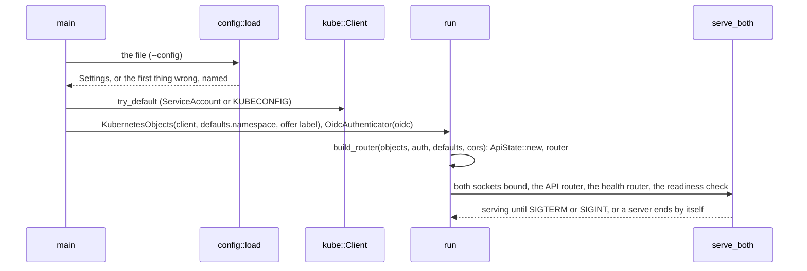
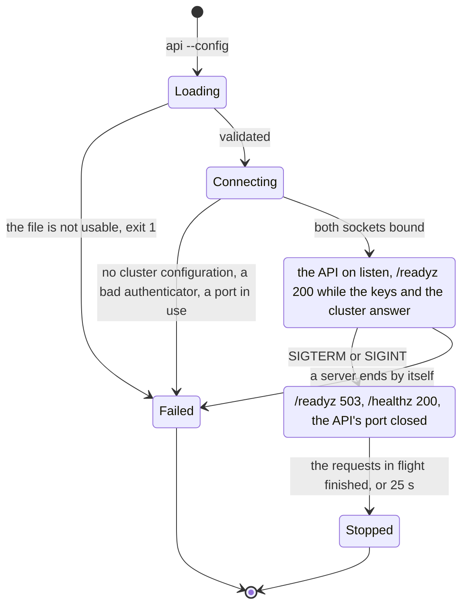

# aap-api-server

The **composition root of the Platform API** ([§60a](../../docs/architecture/10-control-plane-and-crds.md#the-platform-api-ad-025-ad-027), slice D7a, AD-020,
AD-025, AD-027): package `aap-api-server`, binary `api` (as `bin/operator` is package `aap-operator`, binary `operator`). It is the one place that
names the implementations; the router is [`aap-platform-api`](../../crates/platform-api/README.md), generic over the two ports.

```sh
api --config /etc/api/config.yaml            # serve
api --config bin/api/config.example.yaml --check   # say whether the file is usable and exit: no cluster, no issuer
```

It runs beside the operator, **not inside it** (least privilege per process, §60a): it holds the right to write the specs people edit and to list the
ExternalSecrets that offer keys, and it takes people's tokens; the operator holds neither. It is stateless and can run two replicas.

| Flag | Variable | |
|---|---|---|
| `--config <file>` | `API_CONFIG_FILE` | The configuration file (required) |
| `--listen <addr>` | `API_LISTEN_ADDR` | Where the API listens. **Wins over `listen` in the file** |
| `--health-addr <addr>` | `HEALTH_ADDR` | Where `/healthz` and `/readyz` are served. **Wins over `healthListen` in the file** |
| `--check` | | Read the file, say whether the API can work with it, exit `0` or `1` |

`RUST_LOG` sets the log filter (default `info`). The cluster is `kube::Client::try_default`: the pod's ServiceAccount, or `KUBECONFIG`.

## The configuration file

One YAML document, [`config.example.yaml`](config.example.yaml) (a test parses it, and checks it is a configuration the API can work with). **There is no
secret in it and no place for one**: tokens are checked against the issuer's public keys, the cluster is reached with the ServiceAccount, and a secret in an
agent is a reference to a Secret key. An **unknown key is refused at every level**, so a misspelt setting stops the API and never leaves a default in its place:
`deny_unknown_fields` where the types are this file's own (the top, `oidc`, `cors`, `defaults`, `defaults.coder`, `defaults.folder`, the store), and, for the types of the
CRDs below `defaults` (`aap-api`'s and `k8s-openapi`'s, whose serde is the CRDs' schema and denies nothing), by writing the defaults back and refusing any member of the
file that does not come back, with its path (`defaults.allowFrom[0].podSelectr`). An explicit `null` is absence.

| Key | | |
|---|---|---|
| `listen` | `0.0.0.0:8080` | Where the API listens |
| `healthListen` | `0.0.0.0:8081` | Where the health endpoints are |
| `oidc` | required | [`aap_auth_oidc::OidcConfig`](../../crates/auth-oidc/README.md): `issuer` (an `http(s)` URL, no credentials), `audiences` (at least one, none blank), `rolesClaim` (no default), `jwksUrl` (optional). Validated at load |
| `cors.allowedOrigins` | `[]` | Exact origins as a browser writes them, `scheme://host[:port]`. **A wildcard, `null`, anything else and the default port of the scheme (`https://host:443`) are refused**: a browser leaves that port out, so the entry would match nothing. Empty is no CORS |
| `defaults` | required | [`aap_forms::Defaults`](../../crates/forms/README.md#deployment-defaults-and-what-the-round-trip-does-with-them): the store, the A2A bearer reference, `allowFrom`, `security`, what a coder and a folder agent get, `offerLabel`, `allowedImageRegistries`. **`defaults.namespace` is the one namespace the API reads and writes** (there is no second `namespace` to disagree with it). Checked at load with `Defaults::check`: what would make the operator refuse every agent stops the API |
| `defaults.runPodSizeClasses` | optional, default none | The names of the classes of the operator's run pods (D15a): what `GET /v1/info` offers and what a coder form may pick. **The operator chart writes it** from `runPodClasses` while `runPods.enabled` (and refuses a hand-written list); written by hand it must be the classes the operator has, or the operator marks the agent `ConfigInvalid` naming the class. With classes, `defaults.coder.workVolume` is required (run pods mount it) and the binary checks at start that a coder asking for the first class is a valid one. See `config.example.yaml` |
| `defaults.allowedImageRegistries` | **required, at least one** | The registries a folder agent may pin its own image from. **The binary does not start without it** (`aap-forms` alone reads "absent" as "any registry"): a person who holds `agents.write` and not `secrets.pick` can still name an agent's image, and that pod is handed the model endpoint's API key and the A2A bearer. An entry is a registry host (and port) and **does not bound repositories**: `ghcr.io` admits every image on `ghcr.io`, so name only registries whose images you trust. A tag or a digest is always required |

## What it runs



`/healthz` is the process (liveness). `/readyz` is ready when **the issuer's keys can be had** (`OidcAuthenticator::ready`, which answers at once while a copy of the
keys can verify) **and the cluster answers a call that needs the API's own rights** in its namespace (a `list` of **one** `ModelEndpoint`, `limit=1`: a `Role` that lacks
the verb, or an API server that is down, is not ready). A check that takes longer than 3 s is not ready. **The answer is kept for 5 s and shared**: `/readyz` is open to whoever
reaches the health port, and however many probes come in a window, one check runs; the probes that arrive while it runs wait for its answer, and a failure and a timeout are
kept too, so a hung issuer is asked once and not once per probe. A pod that is draining is not ready at once, whatever the last answer was. The body of a `503` is one fixed
sentence, never the cluster's or the issuer's own words. The API server's `401` and `403` are `Unavailable` in the port, so a `Role` that is missing a verb shows as `503` on the API and as not ready here.

The `Role` it needs is [`crates/objects-kubernetes/tests/rbac.yaml`](../../crates/objects-kubernetes/tests/rbac.yaml): `create`, `delete`, `get`, `list`, `patch` on
the four kinds and `list` on `externalsecrets`, **and no right on Secrets**. The chart's `api` component grants exactly it ([below](#the-image-and-the-chart)).



A stop closes the API's listener, lets the requests in flight finish for at most 25 s, and only then closes the health port, so that a pod
that is going is *not ready* for as long as it takes. A Service takes a moment to drop an endpoint, so the chart holds the pod for 5 s before the signal
(`lifecycle.preStop.sleep`) and gives it 40 s in all: the sleep counts against the grace period, which must also hold the drain, the 2 s the health port is
given to stop after it, and 5 s of margin, so the chart refuses less than the sleep plus 32.

## Tests

`cargo test -p aap-api-server` (the loopback only; no cluster).

| Where | What |
|---|---|
| `config` (14) | the example is a configuration the API can work with and holds no secret; the defaults of the addresses; **a key that does not exist is refused at the top and in every mapping below `defaults`, with its path** (the example is walked: `security`, `allowFrom[0]`, `store.cnpg`, `a2aBearer`, `coder.gitAuthor`, `githubMcp`, `workVolume.source.persistent`, `resources`, `folder`), a misspelt `podSelectr` among them, and every optional member may be said without being taken for a typo; **`allowedImageRegistries` is required, not empty and made of hosts**; empty or blank audiences, an issuer that is not a URL, a blank or missing roles claim; a wildcard origin, `null`, a trailing slash and the default port; defaults the operator would refuse; an address that is not one; a file that is not there |
| `serve` (6) | `/healthz` and `/readyz` follow the check; **a burst of 50 probes asks the check once, and the answer is kept 5 s**; a failure and a timeout are kept; a draining pod is not ready at once and is alive; a check that never answers is not ready |
| `run` (7) | **the router comes up on a real socket with the `Memory` ports and over a real issuer**, answers, and stops when told (the port is closed); a server that ends by itself ends the API with its reason; readiness needs the keys and the cluster; **the cluster probe asks for one `ModelEndpoint` of the namespace (a client that records the request) and fails when the server refuses**; the flags win over the file |

Not a `cargo test`: the binary in a cluster is [`api-e2e.sh`](../../deploy/operator/tests/e2e/README.md#the-kind-end-to-end-of-the-platform-api-d7b2) (D7b2, CI job `api-e2e`): the
chart's `api` component installed in kind with the image of the job, the issuer a program on the runner (`cargo build -p aap-auth-oidc --example test-issuer --features testkit`), and a
folder agent created, read, replaced and deleted through the deployed API while the operator makes it Ready.

## The image and the chart

**The image** is [`docker/api/Dockerfile`](../../docker/api/Dockerfile): `ghcr.io/vymalo/another-agentic-platform/api`, built from the repository root, the operator's
Dockerfile with the package and the binary changed (cargo-chef on Rust 1.94.1 onto `distroless/cc-debian13:nonroot`, both pinned by tag and digest, user 65532, `ENTRYPOINT ["/api"]`,
no shell and no `CMD`: the file is required). The build stage runs `--version`, `--help`, `--check` on `config.example.yaml`, and a refusal of that file with a misspelt key. CI
([`operator-image.yml`](../../.github/workflows/operator-image.yml), job `api-image`) builds it, runs the same on the final image, and runs `api --check` in it on the
configuration the chart renders, and the job `api-e2e` runs the image in a kind cluster (the chart's `api` component, a real issuer, a folder agent made through the API, [D7b2](../../deploy/operator/tests/e2e/README.md#the-kind-end-to-end-of-the-platform-api-d7b2)). *Unverified* until CI has run it: no image was built where this was written (the binary was, in release mode).

**The chart** is the component `api` of [`deploy/operator`](../../deploy/operator/README.md#the-platform-api), off by default: a Deployment with its configuration mounted from a
ConfigMap at `/etc/aap-api/config.yaml` (`API_CONFIG_FILE`) and **nothing else mounted**, a Service on the API port (the health port is the pod's, for the kubelet), the `Role`
above, a NetworkPolicy and an optional Ingress. The chart owns `listen`, `healthListen` and `defaults.namespace`; the rest is `api.config`. To read what it renders with this binary:

```sh
sh deploy/operator/tests/api-config.sh /tmp/config.yaml -f deploy/operator/tests/api.values.yaml   # or tests/api-shapes.sh for all five shapes
cargo run -q -p aap-api-server -- --config /tmp/config.yaml --check
```

## Not here

* The kind end-to-end (create a folder agent through the API, see it `Ready` and listed) is slice **D7b2**, built: [`deploy/operator/tests/e2e/api-e2e.sh`](../../deploy/operator/tests/e2e/README.md#the-kind-end-to-end-of-the-platform-api-d7b2),
  the job `api-e2e` of `operator-image.yml`, which `push` needs. **The binary has still not run against a real API server or a real issuer where this was written** (no container daemon, no kind):
  the job is the first time, and it is *unverified* until CI has run it. What was run: the script, end to end, against the real router over the `Memory` ports and a real issuer with a fake `kubectl`.
* **The log carries ANSI colour codes** (`tracing_subscriber::fmt()` with no `with_ansi`, as the operator's; *observed 2026-10-16* with stderr redirected to a file): a log pipeline sees escape sequences in `route=` and the like.
  The end-to-end strips them. `.with_ansi(std::io::stderr().is_terminal())` would stop it; not changed in D7b2, for the owner.
* TLS, rate limits and request timeouts are the edge's (§60a, *Clients without a web server*): the chart makes the Ingress and passes its annotations through, where a
  per-token rate limit is attached ([the chart's README](../../deploy/operator/README.md#the-edge)).
