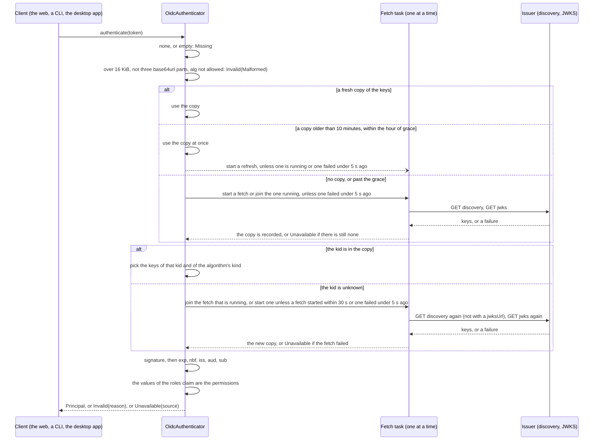

# aap-auth-oidc

The `Authenticator` of the **Platform API** ([§60a](../../docs/architecture/10-control-plane-and-crds.md#the-platform-api-ad-025-ad-027),
slice D6, AD-020, AD-025, AD-027, AD-032): a bearer JWT signed by an OIDC issuer, checked here against the issuer's keys, so that
the API is an OAuth 2 resource server and trusts no header a client can send. The values of the configured roles claim are the
person's **permissions** (`agentic_roles` on netcup); the API checks them one by one and never compares a role name.

It is the checker of another-agentic-system's orchestrator (`orch-auth-jwt`, its ADR 0033), ported: the same algorithms, the same
claims, the same key cache, the same tests where they apply. **What it leaves out is DPoP** and the user and e-mail claims (below).

```rust
use aap_auth_oidc::{OidcAuthenticator, OidcConfig};
use aap_ports::Authenticator;

let config: OidcConfig = serde_yaml::from_str(file)?;          // issuer, audiences, rolesClaim, jwksUrl
let auth = OidcAuthenticator::new(config)?;                      // validates; reads nothing, fetches nothing
auth.ready().await?;                                             // for a readiness probe: fetches the keys now
let principal = auth.authenticate(Some(bearer_token)).await?;   // Principal { subject, permissions }
if principal.holds("platform:agents.write") { /* ... */ }
```

## Where it sits

An **implementation** of the `Authenticator` port in [`aap-ports`](../ports/README.md#agentobjects-and-authenticator-d4) (AD-020),
separate from the port and from the router; the binary of the Platform API (`bin/api`, D7) composes it with
[`aap-objects-kubernetes`](../objects-kubernetes/README.md). It depends on `aap-ports` and nothing else of the workspace. The port's
conformance suite, `authenticator_conformance!`, runs against it with an issuer in the test process; the cases only a token with a
signature has are this crate's own (below).

## What it does

```mermaid
stateDiagram-v2
  [*] --> NoCopy: the process starts, nothing is persisted
  NoCopy --> Fresh: a fetch gives at least one usable key
  NoCopy --> NoCopy: the fetch fails; not again for 5 s, Unavailable meanwhile
  Fresh --> Fresh: an unknown kid; one fetch, joined by the rest, then none for 30 s
  Fresh --> Old: 10 minutes old
  Old --> Old: used at once; a refresh runs in the background
  Old --> Fresh: the refresh succeeds
  Old --> Old: the refresh fails, not again for 5 s; an unknown kid is Unavailable
  Old --> TooOld: older than 10 minutes plus an hour
  TooOld --> Fresh: a fetch succeeds, which every request waits for
  TooOld --> TooOld: the fetch fails; every token is Unavailable
```





- **Algorithms**: RS256, RS384, ES256 and EdDSA, and nothing else. `none` and the HMAC family are refused whatever key they name
  (the algorithm confusion attack), and a key only verifies tokens of its own family (an RSA key never verifies ES256). A JWKS key
  that cannot verify (symmetric, an RSA modulus under 2048 bits, `use: enc`, `key_ops` without `verify`, another curve, an `alg`
  this does not allow) is skipped, never an error for the rest of the set, and the fetch logs how many were skipped and how many are
  usable at debug, counts only. **The octets of a key are read as they are, leading zeros included**: an Ed25519 key is exactly 32
  octets, a zero in front a part of it (about one key in 256 has one); an RSA `n` and `e` are read without their leading zeros (a
  sign byte, or `AAEAAQ` for 65537), the modulus then at least 256 octets; a P-256 coordinate is read without its leading zeros,
  refused over 32 octets or empty, and given to the library in the full 32 (an issuer may cut the zeros, write them or cover them
  with a sign byte, and each verifies). A token with no `kid` takes the one key of its kind, when there is exactly one.
- **Claims**: the signature first, then in this order: `exp` required, a time, and not past; `nbf`, when there, not in the future
  (**60 seconds of leeway** for both, pinned at 55 and 65 s); `iss` **one text**, equal to the configured issuer, exactly (a list
  that holds it is refused, which `jsonwebtoken` alone would accept); one of the configured audiences among `aud` (a text, or a list
  of texts); `sub` required, text, not blank and without a control character (otherwise kept byte for byte). With several wrong, the
  word is that of the first in this order, the same every time. **`iat` is not required** (decision 2 below).
- **Permissions**: the values at the dotted path `rolesClaim` (`agentic_roles`; `realm_access.roles` for Keycloak's own). A claim whose
  own name has dots is found by that name first; a list gives its texts (anything else in it is skipped), a text is one role,
  anything else is none, and **a bad roles claim never refuses a token**: a person with no permission is a person, and the API
  answers `403` and names the permission it needed. The whole claim is kept, whatever it holds: `GET /v1/me` filters by a prefix.
- **Size**: a token over 16 KiB ([`MAX_TOKEN_BYTES`](src/config.rs)) is refused unread. A token that is not three base64url parts of
  JSON, or whose `alg` is not ours, ends before any key is looked at: **no fetch, no key**.
- **Where the keys are**: `jwksUrl`, or the `jwks_uri` of `{issuer}/.well-known/openid-configuration`, whose `issuer` must be the
  configured one (OpenID Connect Discovery 1.0, 4.3). `jwks_uri` must be `http(s)` without credentials and not plain HTTP under an
  HTTPS issuer. **No redirect is followed**, a body over 1 MiB is refused, a request times out (5 s), `HTTP(S)_PROXY` is honoured, and
  the TLS roots are the system's. There is no filter on the issuer's *address*: it is the operator's own configuration, and an
  identity provider in the cluster is a private address.
- **The key cache** is a copy this process may lose at any time. Fetched on first use and by `ready()`, refreshed once 10 minutes
  old ([`REFRESH_INTERVAL`](src/config.rs)), fetched again when a token names a `kid` the copy lacks **at most once in 30 s**
  ([`KID_REFETCH_INTERVAL`](src/config.rs): any fetch counts, so a flood of invented ids is one request to the issuer), and not
  again for 5 s after a failure ([`RETRY_INTERVAL`](src/config.rs)). **A fetch runs on a task of its own** (`tokio::spawn`, so
  `tokio` has its `rt` feature in the normal dependencies and the authenticator needs a Tokio runtime), **one at a time**, and
  **the lock on the cache is held to read or to change it and never across a request to the issuer**. Who waits for a fetch:
  a request with **no copy**, or one past its grace, waits for the fetch that is running or starts one (the concurrent first
  requests make one), and is `Unavailable` if there is still nothing to verify with (fail closed); a request whose token names an
  **unknown `kid`** waits for the fetch that is running or starts the one its budget allows, **and no other request waits**; a
  request that finds a **fresh copy** waits for nothing; a request that finds a copy **older than the refresh interval and within
  an hour of it** ([`STALE_GRACE`](src/config.rs)) **is served by that copy at once** and starts a refresh in the background if none
  is running and none failed just now. `ready()` does the same: it returns at once while a copy can verify, and waits only when
  there is none. A request that is dropped (a client that hung up, a timeout above) **leaves the fetch running**, and the keys it
  brings are recorded: the fetch is the cache's, not the request's. Each request to the issuer (discovery, then the JWKS) is
  bounded by the 5 s timeout ([`FETCH_TIMEOUT`](src/config.rs)), so a fetch lasts at most two of them. Past the grace every token is
  `Unavailable`; in between, the copy goes on verifying while the issuer is down. **A key the issuer withdraws stops verifying when
  the refresh that follows its 10 minutes is over**, not before: when the issuer is up and requests keep coming, the delay is
  10 minutes and one fetch; **a request that comes after a quiet period is verified against the copy it finds, however old it is
  within the grace (70 minutes), while the refresh runs** (decision 8 below).

### What an error is

| `AuthError` | When | Source |
|---|---|---|
| `Missing` | no token, or an empty one, whatever the state of the keys | |
| `Invalid(Malformed)` | over 16 KiB; not three base64url parts of JSON; an `alg` that is not allowed (`none`, HMAC, RS512, PS*, ES384, unknown); a signature that is not base64url; a claim of the wrong shape the library cannot read past (`exp`, `nbf` or `sub` as a list or an object) | |
| `Invalid(BadSignature)` | the key the token names does not verify it (another key's signature, a payload edited after signing) | |
| `Invalid(UnknownKey)` | the `kid` is not in the issuer's keys, even after the one fetch it earns; or no key of the algorithm's kind fits (a `kid` of an RSA key on an ES256 token; no `kid` and two keys of the kind) | |
| `Invalid(Expired)` | `exp` more than 60 s past, **or `nbf` more than 60 s ahead**: the closed set has no word for "not yet valid" (decision 4) | |
| `Invalid(WrongIssuer)` | `iss` is not the configured issuer, exactly, is not a text (a list is not), or is not there | |
| `Invalid(WrongAudience)` | none of the configured audiences is in `aud`, or `aud` is not there, not readable, or a list with something but texts in it | |
| `Invalid(MissingClaim)` | no `exp` (or one that is not a time), no `sub` (or one that is not text, is empty or only white space, or has a control character) | |
| `Unavailable(KeysUnavailable)` | the keys cannot be had: `NoCopy` (never fetched, the fetch fails), `TooOld` (the copy is past the grace, the fetch fails), `Unrefreshed` (the copy lacks the key the token names and cannot be refreshed: **a good token is not told it is bad**, decision 5) | `KeysUnavailable`, then the `FetchFailure`: a closed set of words and one status code (`the issuer answered 503`) |

**None of it holds a part of a token**: the reason of an `Invalid` is one word of a closed enum, and the source of an `Unavailable` is
made of this crate's own words, because no request to the issuer carries anything of a token (the URLs are the configured ones). The
error of the transport (an address, a resolver's message) goes to the **debug** log and nowhere else; nothing logged holds a token, a
`kid` or a claim, which `tests/logs.rs` reads in the output of a subscriber.

## Configuration

`OidcConfig` is the `auth` block of the Platform API's file (D7); `serde` reads it with these names, and an unknown key is an error.

```yaml
issuer: https://keycloak.example/realms/another-agentic       # iss must equal it exactly; discovery is {issuer}/.well-known/openid-configuration
audiences: [another-agentic, another-agentic-desktop]         # at least one; any of them in aud is enough
rolesClaim: agentic_roles                                     # no default: without it nobody holds a permission
# jwksUrl: https://keycloak.example/realms/another-agentic/protocol/openid-connect/certs   # when not in the discovery document
```

`OidcAuthenticator::new(config)` validates it and refuses, with a `ConfigError` that names the setting and never shows its value: an
issuer that is not an absolute `http(s)` URL with a host and no credentials, query, fragment or white space around it; no audience, or
a blank one; a blank `rolesClaim`; a `jwksUrl` that is not an `http(s)` URL without credentials. An `http` issuer is allowed (a
Keycloak in the cluster). The intervals above are not in the file: they are security settings (how long a withdrawn key still
verifies), and `Tuning` (a test shortens them) is not `Deserialize`.

## Features

| Feature | Default | Effect |
|---|---|---|
| `testkit` | no | `testkit::TestIdp`: an issuer on `127.0.0.1:<port>` serving its discovery document and its JWKS, with RSA 2048, P-256 and Ed25519 keys made at run time, once per process (twice: one set it publishes, one it does not until `publish_unpublished_keys()`; `withdraw_unpublished_keys()` takes it back), `mint(claims, Signing)` for the tokens the cases need (the right ones, and `alg: none`, HS256 with a public key as the secret, a key that is not published, one that signs under a published `kid`, one with no `kid`), `forge(header, claims, signature)` for the headers that must be refused unread, `set_jwks_down`, `set_discovery_down` and fetch counters; and `TestAuthenticator`, a `TestIdp` and an `OidcAuthenticator` for it, which is an `Authenticator` and an `AuthenticatorUnderTest` (`issue` gives a token with the permissions asked, `without_keys` an authenticator whose issuer answers 503). For this crate's tests and the Platform API's router tests (D7). **No private key is in the repository.** |

## Tests

`cargo test -p aap-auth-oidc` runs all of it (the crate dev-depends on itself with `testkit`, so the tests never compile to nothing).
Over real HTTP, against issuers on local ports; the cache's intervals are shortened.

- `tests/conformance.rs`: `aap_ports::authenticator_conformance!` (8 cases) through `TestAuthenticator`.
- `tests/checks.rs` (30): every word of `InvalidToken` produced by the token that deserves it; each allowed algorithm accepted; `none`, HS256 with the
  RSA public key, RS512, PS256, ES384 and the rest refused unread with no fetch; a key of another kind; another key's signature under
  a published `kid`; a payload edited after signing; an unknown `kid`; no `kid`; `exp` past (beyond and within the leeway), `nbf`;
  `iss` exactly; `aud` as text and list, one of several configured; `sub`; `exp` required; `iat` not required; `cnf` accepted;
  the time checks come after the signature; a token of exactly the cap and one step more; garbage; the roles claim (nested, named
  with dots, a text, every bad shape, only the configured claim is read).
- `tests/jwks.rs` (20): discovery and `jwksUrl`; fetched on first use and by `ready()`; refreshed when old; one fetch for concurrent first
  requests; **an unknown `kid` is one fetch for a flood and none within 30 s**; a rotated key is found and a withdrawn one is lost at the
  refresh; an unknown `kid` with the issuer down is `Unavailable`; the issuer down at the start and recovering; the retry interval; the
  stale copy and its grace (`TooOld`); a discovery document for another issuer, without a usable `jwks_uri`; a redirect never followed; an
  answer over 1 MiB; an answer that is not a key set, not JSON, or has no usable key; an unreachable issuer; unusable keys beside good
  ones; a trailing slash on the issuer.
- `tests/keys.rs` (6): real keys, as issuers write them: an Ed25519 key whose public key starts with a zero octet verifies; Ed25519 keys of
  31, 33 and no octets are not keys; a P-256 key whose `x` (and one whose `y`) starts with a zero verifies written in full, cut and with a
  sign byte; coordinates of 33 significant octets or none are not keys; an RSA key verifies with a sign byte before `n` and `e` written
  `AAEAAQ`; a 2040-bit modulus is no bigger for a sign byte.
- `tests/slow.rs` (10): an issuer that is slow or never answers. A good token is answered while a fetch for an unknown `kid` to a
  slow issuer is running (and only the request that named the unknown key waits); unknown kids that arrive while a fetch runs join
  it; a stale copy is served at once and refreshed in the background once, with the issuer hanging; `ready()` returns at once with a
  copy that can verify and waits when there is none; the first requests wait for the one fetch and fail closed at the timeout; **a
  request cancelled during a slow fetch does not lose the keys it asked for** (the next request with the rotated key is accepted); an
  unknown `kid` joins the refresh of a stale copy that is running; and every request to the issuer is bounded by the timeout: a
  discovery request that is never answered, a JWKS request that is never answered after a good discovery, and a body that drips in
  are each `FetchFailure::Timeout` after the configured time.
- `tests/provider.rs` (1, a binary of its own: the choice is made once per process): with a second crypto backend linked, two authenticators
  verify a token of each algorithm without the library's panic.
- `tests/secrets.rs` (2): the sentinel in every place a token has something to leak, in the message, the debug form and the whole chain of
  sources of an `Unavailable`; a refusal is a word.
- `tests/logs.rs` (1, a binary of its own: a callsite that another test hit first, with no subscriber, is cached as uninteresting): nothing logged holds a
  token, a `kid` or a claim, read in the output of a subscriber.
- `tests/config.rs` (4): the YAML, what it lacks or says more, what is refused at construction, and that a refusal never shows a value.
- Unit tests in `src/`: the choice of key (`keys.rs`), the claims (`claims.rs`), the `jwks_uri` rule (`fetch.rs`).

## What is left out, and what was decided

**DPoP is not in D6.** The system's web holds DPoP-bound tokens (its ADR 0054), and the orchestrator checks the proof when `auth.dpop` is
on. Here a token that carries `cnf` is **accepted as a plain bearer** (`a_token_bound_to_a_key_is_accepted_as_a_plain_bearer`): the
token is as good as its issuer's signature, and a thief who has it can use it. Whether the Platform API must require proof of
possession like the orchestrator is a question for the owner (§60a, D6 note); nothing in this crate decides it by accident.

Also left out: the user and e-mail claims, `email_verified`, the name and `expires_at` (the platform's `Principal` is the subject and
the permissions), and the user claim's lower-casing (a subject is opaque, kept as it is, byte for byte).

| # | Decision | Alternative |
|---|---|---|
| 1 | The configuration has **no default roles claim** and refuses an unknown key | `agentic_roles` as the default |
| 2 | **`iat` is not required** (§60a names `exp`); the orchestrator requires it | require it, one line in `verify` |
| 3 | **`cnf` is accepted as a plain bearer** (no DPoP) | require proof of possession (a slice of its own) |
| 4 | **`nbf` in the future is `Expired`**: the closed set has no "not yet valid" | a new word in `aap-ports` (every host and store compiles against the enum) |
| 5 | **An unknown `kid` while the issuer cannot be reached is `Unavailable`**, not `UnknownKey` (the orchestrator refuses it) | `UnknownKey`: a client holding a good token signed by a key published a minute ago signs in again for nothing |
| 6 | A missing `iss` is `WrongIssuer` and a missing `aud` is `WrongAudience` (the token does not name this API); `MissingClaim` is for `sub` and `exp`, the port's own words | `MissingClaim` for all four |
| 7 | JWS is checked by **aws-lc-rs** (through `jsonwebtoken`), TLS is **rustls with ring** (through `reqwest` 0.12): see below | `jsonwebtoken`'s `rust_crypto` backend (pure Rust, no second native library, and RSA key generation for the testkit would be slow in debug builds) |
| 8 | **A copy older than the refresh interval is served at once** while a refresh runs in the background (no request waits for a refresh while a copy can verify); a request after a long quiet is verified against a copy up to 70 minutes old | wait for the refresh (a slow issuer holds up everyone, and a hanging one for the timeout) |
| 9 | **`iss` must be one text equal to the issuer**: a list that holds it is `WrongIssuer` | the library's check, which accepts any match |
| 10 | **A `sub` that is blank or has a control character is `MissingClaim`**; any other text is kept byte for byte | any non-empty text |

### Dependencies

`jsonwebtoken` 11 has two crypto backends, `aws_lc_rs` and `rust_crypto`, and **no `ring`**; the operator's TLS (kube) is rustls with `ring`
(`docker/operator/Dockerfile`). This crate takes `aws_lc_rs` as the system's orchestrator does, and keeps the TLS stack single: `reqwest`
is 0.12 with `rustls-tls-native-roots`, which is rustls with ring (0.13's `rustls` feature is aws-lc-rs, which would put two providers in
`rustls` and leave a process with no default). So a binary that links this crate has `ring` for TLS and `aws-lc-rs` for signatures; `rustls`
itself has only `ring` in its features (`cargo tree -p aap-auth-oidc -e normal -i rustls`). No `openssl`.

**The constructor installs aws-lc-rs as `jsonwebtoken`'s process-level provider** (`jsonwebtoken::crypto::aws_lc::DEFAULT_PROVIDER.install_default()`,
*verified 2026-10-16* in `jsonwebtoken` 11.1.0, `src/crypto/mod.rs` and `src/crypto/aws_lc/mod.rs`), and ignores "already installed". The library
picks a backend from its features only when exactly one is enabled; with two (a binary that links another crate with `rust_crypto`, as D7
may) it **panics on the first verification** ("Could not automatically determine the process-level CryptoProvider"). The dev-dependencies of
this crate enable `rust_crypto` beside `aws_lc_rs`, so every test of the crate runs in that situation (this is why `Cargo.lock` holds the
RustCrypto crates, for tests only), and `tests/provider.rs` is the case on its own. A binary that wants another provider installs it before
the first authenticator is built.

## Facts

- *Verified 2026-10-16*, `jsonwebtoken` 11.1.0 read from the crates.io download (`src/validation.rs`, `src/decoding.rs`, `Cargo.toml`): `decode` verifies the
  signature and then validates the claims (so a forged token is a bad signature, whatever its `exp`); `exp`, `nbf`, `iss` and `aud` are validated as above
  and `iat` is not validated at all; a required claim that cannot be read as the type the library wants (a list where it wants text) is a JSON error
  when it is a list or an object and a missing claim when it is a scalar (`tests/checks.rs` pins both); the features are `aws_lc_rs`, `rust_crypto` and
  `use_pem`.
- *Verified 2026-10-16*, the crates.io index entry of `reqwest` 0.12.28: `rustls-tls-native-roots` is `rustls-tls-native-roots-no-provider` and `__rustls-ring`.
- *Verified 2026-10-16*, OpenID Connect Discovery 1.0, 4.3 and 4.1 (<https://openid.net/specs/openid-connect-discovery-1_0.html>): the `issuer` of the document must be
  identical to the issuer URL used as the prefix of `/.well-known/openid-configuration`, and a terminating `/` of the issuer is removed before the path is appended.
- *Verified 2026-10-16*, run once by hand and not a test (it needs the network): `OidcAuthenticator::new(OidcConfig::new("https://accounts.google.com", ..))` fetched
  Google's discovery document and JWKS over TLS (rustls with ring, native roots from `SSL_CERT_FILE`) through the sandbox's `HTTPS_PROXY`, `ready()` was `Ok`, and a
  token naming an unknown `kid` was `Invalid(UnknownKey)`. So the TLS path, the proxy variable and a real issuer's RS256 JWKS work.
- *Unverified*: a real Keycloak's JWKS (the keys it publishes, their `use`, `alg` and `kid`, the discovery document's `jwks_uri`) and that its *User Client Role*
  mapper puts the **composite-expanded** client roles in `agentic_roles` (§60a, *Permissions and roles*): both wait for a try on the realm (D14).

## See also

[`aap-ports`](../ports/README.md), [`aap-objects-kubernetes`](../objects-kubernetes/README.md), [`aap-api`](../api/README.md) (the permission constants).
