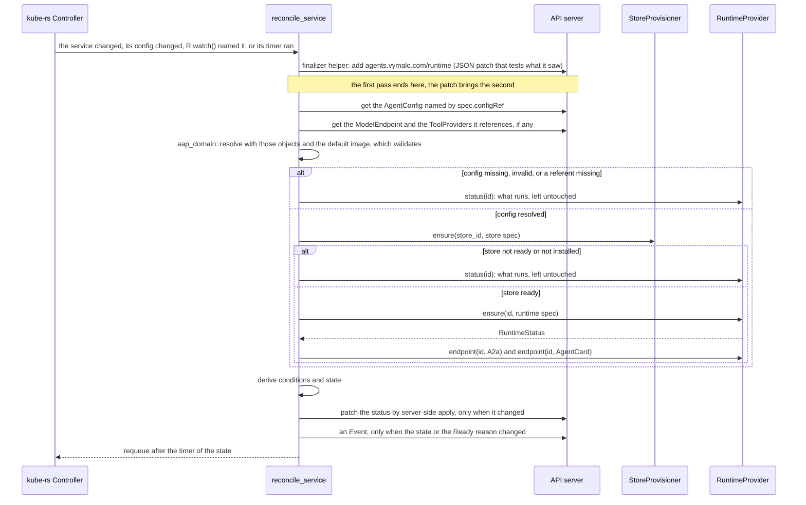
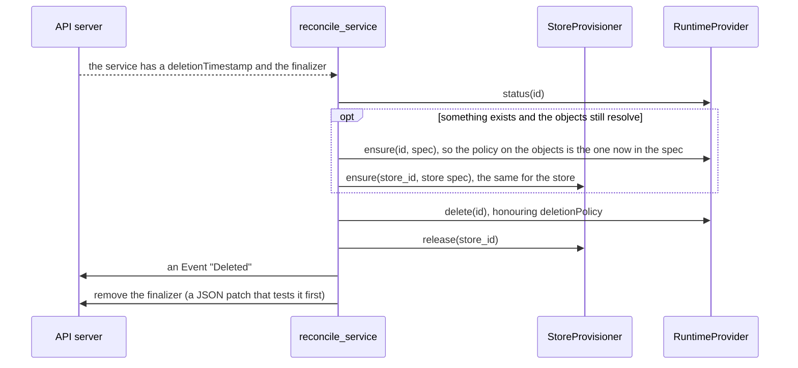
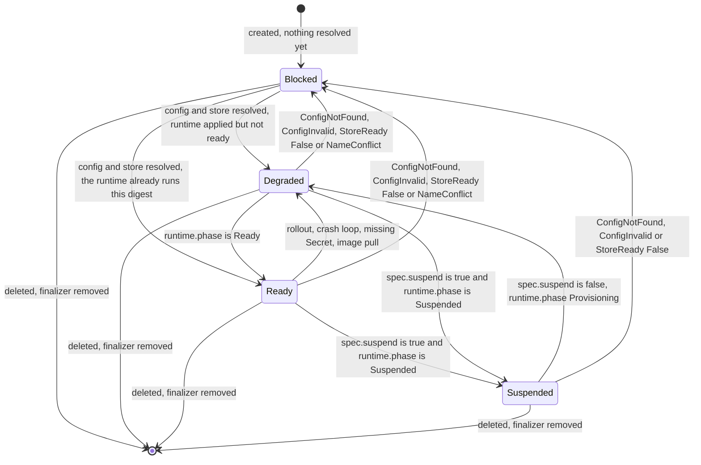

# aap-controller

The reconcilers of the v0 operator ([§59a](../../docs/architecture/10-control-plane-and-crds.md#reconciliation),
AD-020): two kube-rs controllers, one for `AgentService` and one for `AgentConfig`, generic over
`<R: RuntimeProvider, S: StoreProvisioner>` from [`aap-ports`](../ports/README.md). The binary
([`bin/operator`](../../bin/operator/README.md)) is what names the provider types.

```rust
let operator = Operator::new(client, runtime, store, owner_of, Options::default());
let (ready, metrics, directory) = (operator.readiness(), operator.metrics(), operator.directory());
operator.run(shutdown_signal).await;      // until `shutdown_signal` resolves, then the passes in flight finish
```

**No Kubernetes type is in a port's signature.** `kube` appears here, in the controller, which is its job: it reads the
two custom resources of [`aap-api`](../api/README.md) and writes their status. A provider's own notion of ownership
travels as the opaque `OwnerHandle` that the composition root's `OwnerOf` function makes from the object (see
*Deviations*).

| Item | What |
|---|---|
| `Operator::new(client, runtime, store, owner, options)` | wires the controllers of each shard to their triggers; nothing runs until `run`. `R` and `S` must be `Clone`: the `Arc<T>` impls in `aap-ports` are the escape for a provider or a store that is not |
| `Operator::with_leader(Arc<dyn LeaderElection>)`, `Operator::leader()`, `FOLLOWER_RECHECK` | **K7a**: the election this replica is a candidate of (`aap-ports`). The default is `AlwaysLeader` (one replica, every pass writes). A pass that finds this replica is not the leader returns `Ok(Action::requeue(FOLLOWER_RECHECK))` — 30 s — and **writes nothing**, for each of the four controllers; see *Leader election* |
| `Operator::run(shutdown)` | runs the controllers of **every** shard (K6b); returns after `shutdown` resolves and the passes in flight finish |
| `Operator::directory()` | a `ReflectorDirectory`: the `AgentDirectory` over the services controllers' caches, **one cache per namespace watched** (K6b), as their union |
| `Operator::readiness()`, `metrics()` | a `Readiness` handle (**every** cache of **every** namespace has listed what it watches) and the `Metrics` counters, for `/readyz` and `/metrics`. Once true it stays true: a `RoleBinding` deleted later leaves the last listing in the store while the watches retry and log (a known limit) |
| `reconcile_service`, `service_error_policy`, `reconcile_config`, `config_error_policy` | one pass of each reconciler, public so a test can drive it |
| `services_of_endpoint(services, configs, &ModelEndpoint)`, `services_of_provider(services, configs, &ToolProvider)` | the services a changed or deleted `ModelEndpoint` or `ToolProvider` concerns (slice D2): through the caches of the configs and the services, the configs of the namespace that reference it, then the services that run them. What the two extra watches of `Operator::run` map with |
| `reconcile_endpoint`, `reconcile_provider`, `endpoint_error_policy`, `provider_error_policy`, `SharedContext`, `SharedContext::with_probe`, `RESYNC` | K2 (§60a): the status of the shared kinds, `SharedStatus` of `aap-api`. A pass judges the object alone (`aap_domain::validate_endpoint`, `validate_provider`), finds its users (the services that run a config naming it, by the same two hops as `services_of_endpoint`, from the caches), and writes the status by server-side apply **only when it differs** from the object's (`status_not_patched_when_unchanged`). `usedBy` is sorted and at most 64, the rest in `usedByMore`; `AgentsReady` counts `Ready` and `Suspended` as healthy, and is `Unknown` (`NoAgents`) with no user. `Operator::run` makes the two controllers with **one reflector of `AgentConfig` and one of `AgentService` for both**, each fed by one watch whose changes (`tee`) go to the two controllers after the cache has them (a trigger from a second watcher could reach a pass before its cache had the change; what that costs beyond the services' own watches is those two watches and caches, and the two of the shared kinds themselves), maps a changed or deleted config or service to the objects its config names **and** those whose `usedBy` lists it (so a config that stops naming an endpoint updates the endpoint it left), and re-looks every ten minutes. The **services' watches of the shared kinds ignore a change that is only the status** (`generation_changes`: a changed `generation` or a deletion passes, an object with no generation passes), so the operator's own write reconciles no service (`a_status_write_on_a_shared_object_reconciles_no_service_and_a_spec_change_does`). **A service being deleted still counts as a user** (`a_service_being_deleted_still_counts_as_a_user`). A 404 on the status write is `Error::StatusNotServed` (class `Internal`: 30 s doubling to 10 minutes, a warning each time that says to install `deploy/operator-crds` first), `a_status_subresource_the_api_server_does_not_serve_is_backed_off_and_says_what_to_do`. They gate nothing: `/readyz` does not wait for them. A kind whose CRD is not installed neither stops the operator nor holds its shutdown (`until_stopped`: kube's `Controller::run` does not read its shutdown trigger before the cache of its own kind has listed the cluster, *seen 2026-11-14*; after a grace of five seconds the controller is dropped **with a warning that names it**, because the grace would also hide any other reason why it did not stop, and two tests hold that the warning is logged for a controller that does not stop and not for one that does). **K3b:** with `SharedContext::with_probe` (the operator file's `toolProbe.enabled` and `toolProbe.timeoutSecs`, off by default), a `ToolProvider` pass probes its MCP server after judging it — an invalid object is not probed, and one that names a header is `Reachable: Unknown`, reason `NeedsHeader`, with no request (AD-024) — and writes the `Reachable` condition (`aap-tool-probe`) and `probe.tools`; the status is still written only when it changes, and a model endpoint never has either. |
| `derive::{derive, Observed, ConfigOutcome, StoreOutcome}` | the pure part: what a pass saw, as conditions and a state |
| `Options { watch_namespaces, registry, registry_full, resync, concurrency, pass_timeout, instance, default_agent_image }` | the settings; `watch_namespaces` the namespaces to watch (K6b): `Some(list)` is one **shard** each — its own controllers, caches and `Api::namespaced` — and `None` is every namespace, one `Api::all` for an administrator; `Some(empty)` is no shard (never every namespace: it reconciles nothing and is never ready, and the composition root refuses one, and a duplicate); `RegistryMode::{Disabled, Enabled}`, `registry_full` an `Arc<AtomicBool>` the composition root shares with the registry (the controller depends on no registry crate), `Resync { settled, pending, not_installed }`, `pass_timeout` the longest one pass may take (60 s; *A pass that hangs*), `default_agent_image` the image of a config that names none (the file key `defaults.agentImage`, was `--default-agent-image`; `None`: no default, and such a config is `ConfigInvalid`), `run_pods` the deployment's settings for run pods (the file's `runPods`, slice D15a; `None`: the operator has none, and a config that asks is `ConfigInvalid`; the pass hands them to `validate` and `resolve` with the other `Externals`, and nothing else of the controller knows run pods) |
| `Context`, `ConfigContext` | what a reconciler is given; `with_clock`, `with_metrics`, and for the config `with_pass_timeout` |
| `FINALIZER`, `FIELD_MANAGER` | `agents.vymalo.com/runtime` and `aap-operator` |
| `Error` | each variant has a class (`aap_ports::Classify`); the error policy decides from the class. `Error::TimedOut(limit)` is a pass cut short by `Options::pass_timeout`, `Transient` |
| `backoff(class, attempt)` | the wait after a failed pass |

## One pass over an `AgentService`



Deletion is the finalizer's other branch:



A pass that fails (a provider or the API server cannot be reached) returns an `Error`, which the error policy turns
into a wait by class and a log line; the status is not rewritten, because the pass learned nothing. What a pass
*finds* is a status and the pass succeeds.

### The status

`derive` is §59a's table and state diagram:

| Condition | True | False | Unknown (not in §59a's table) |
|---|---|---|---|
| `ConfigResolved` | `Resolved` | `ConfigNotFound`, `ConfigInvalid` | |
| `StoreReady` | `SecretReferenced`, `ClusterReady` | `CNPGNotInstalled`, `ClusterNotReady` | `ConfigNotResolved`: the store is looked at once the config resolves |
| `RuntimeReady` | `Ready` | `Provisioning`, `Suspended`, `MissingSecret`, `ConfigRejected`, `DependencyUnavailable`, `ImagePull`, `CrashLoop`, `NameConflict` | `NotObserved`, `NotCreated` (no workload exists) |
| `Listed` | `Listed` | `RegistryDisabled` (no registry served: no token), `A2ADisabled`, `ServiceBlocked`, `RegistryFull` | `NoEndpoint` |
| `Ready` | `Reconciled` | the reason of the first of the first three that is not true | the same |

`RegistryFull` is the registry's (S7): `Options::registry_full`, a flag the registry sets while its document would pass a limit, is read at each pass, and a service that would be listed then says `Listed: False`, reason `RegistryFull` (one that is not listable anyway keeps `A2ADisabled` or `ServiceBlocked`). A change of the flag reaches a service at its next pass, at most one resync later. `Listed` informs and never gates `Ready`. The runtime reason is the most actionable of the issues
the provider reports (`NameConflict`, `MissingSecret`, `ConfigRejected`, `DependencyUnavailable`, `ImagePull`,
`CrashLoop`, in that order). A condition keeps its `lastTransitionTime` until its status changes, so a pass that finds
nothing new writes nothing.



The rule, as `derive::state` has it: a false or unknown `ConfigResolved` or `StoreReady`, or a `NameConflict` issue, is
`Blocked` (**the operator does not apply the desired state and leaves what runs untouched**: it asks the provider for
its `status`, never `ensure`); `spec.suspend` with phase `Suspended` is `Suspended`; phase `Ready` is `Ready`; anything
else is `Degraded`. While blocked, `status.config` and `status.endpoints` stay as they were (what runs was resolved
from them) and `status.runtime` is what the provider reports now.

### What triggers a pass

| Trigger | How |
|---|---|
| the service itself | `Controller::new` over the services (all namespaces, or one controller per name of `Options::watch_namespaces`, K6b) |
| an `AgentConfig` | `Controller::watches`, mapped through the services' reflector to every service of that namespace whose `spec.configRef.name` is the config |
| a `ModelEndpoint` or a `ToolProvider` (slice D2) | `Controller::watches_stream` over an **isolated** watch of each kind (below), mapped by `services_of_endpoint` / `services_of_provider` through the configs' reflector (the configs of the namespace that reference it) and the services' (the services that run them). **A change and a deletion both**: an edit rolls the agents that use the object, a deletion makes them `ConfigInvalid` at once, and an object created later unblocks the services that were waiting for it. An object nobody references reconciles nothing |
| a runtime changed | `Controller::reconcile_on` over `RuntimeProvider::watch()`: the id's scope and name are the service's. Ids of other namespaces (when namespaced) and of unknown services are ignored. The provider's watch is taken **once** and fanned out to the shards (`fan_out`): one call is a set of watches of the API server, and one per shard would be one set too many. **A hint, never the truth** |
| the timer | each pass returns `Action::requeue(Resync)`: 5 minutes when `Ready` or `Suspended` or when only a change of the objects can help (a missing or invalid config), 15 s when rolling out, unwell or held by a foreign object, **or when a referent (a `ModelEndpoint`, a `ToolProvider`, or their whole kind) is missing** (`ConfigOutcome::ReferentMissing`, the same condition as `Invalid`: the objects of a config are applied one request at a time, so a service can be read between two of them, and the watch that would bring the second can be lost or not open yet; without this a race between the two stores left the service blocked for the settled period), 60 s when a store backend is not installed. **The pass that adds the finalizer** (a new service) also returns the 15 s: kube's `finalizer` helper ends it with `Action::await_change()`, "the patch will cause a new reconciliation", and a watch event that never came would then leave the service without a status for ever |
| not a trigger: a Secret | §59a gives the operator no right on Secrets (AD-024), so it cannot watch them. A Secret that appears reaches the controller through the pod, and the runtime's watch |

### Failure and back-off

`Error::class()` decides, never the variant (`ErrorClass` from `aap-ports`). The wait after the *n*th failure in a row of an
object (the count resets on a pass that succeeds):

| Class | Wait |
|---|---|
| `Transient`, `Conflict` | 5 s doubling to 5 minutes |
| `NotFound` | 5 s |
| `Internal` | 30 s doubling to 10 minutes (a bug, or the operator's own RBAC: a person fixes it) |
| `Invalid`, `Unsupported` | 10 minutes (the same input never succeeds; a change of the object brings the next pass sooner) |

A 422 or 409 on the **finalizer's** JSON patch is classed `Conflict`, not `Invalid`: the patch `test`s what it saw and
fails when an earlier pass already changed the finalizers (a pass on a stale cache). The real API server does say 422
there (seen on 2026-10-05 against kube-apiserver v1.35.8, see *Tests*).

### A pass that hangs

kube's `Controller` runs one pass per object at a time and keeps the object's slot until the pass returns, so **a pass that
never returns takes the object out of the controller**: no watch event, no timer and no error policy reaches it meanwhile,
and the log says nothing, because nothing finished. kube-client 4.0 sets no timeout on a response (`Config::read_timeout`
is `None`, because a watch is a response that does not end), so a call that is never answered is such a pass.

*Seen 2026-10-16* in the `operator-e2e` job (kind v1.35.8), twice in two days, on pull requests that do not touch the
operator: a new service with `status: null` for the 60 s or 240 s a case waited, the operator's log stopping at
`the caches are synced`. *Reproduced* the same day against a bare kube-apiserver v1.35.8 (etcd 3.6.6): the real
`operator` binary, a service created while it starts, 5 stalls in 4000 services (a debug build, as in CI), none in 8000 once hyper is 1.12.0 and `want` 0.3.2. A task dump of
a stalled process (`tokio::runtime::Handle::dump`) showed the pass waiting in `hyper::client::conn::http1::SendRequest::try_send_request`
on a connection whose dispatcher was reading a chunked body: **the call was queued behind a watch**. The stall ended by
itself 290 s after the watch began (kube asks for `timeoutSeconds=290`), the call went out and the service moved on.

The cause is a race in hyper 1.11.1 (`client::dispatch`), fixed in **hyper 1.12.0 with `want` 0.3.2** (published
2026-10-06 and 2026-10-05; *verified 2026-10-16* by reading the diff of `client/dispatch.rs`, whose new comment says
what it withdraws). The sender takes the receiver's "I want a request" signal (`give()`) and then queues the request;
a receiver that polls the still empty queue in between signals `want()` again, after the `give()`, and the signal stays
once the request is taken. The connection then reports itself ready while it serves a request, `hyper-util` (0.1.21)
reads that after the response *head* of a watch, puts the connection back in its pool, and the next call that checks it
out is written behind a response that streams for up to 290 s. A trace with the pool's connection ids and the channel's
(a patched hyper that logged the three moments) showed the order: `can_send gave=true`, `poll_recv -> Pending => WANT`,
`poll_recv -> Ready`, `RESPONSE … is_ready=true … chunked`, `DROP pooled`, and the call on the same connection id.
`tests/dependencies.rs` keeps the lock file at or above the two fixed versions.

What the controller does about a call that is never answered, whatever the cause:

* **`Options::pass_timeout`** (60 s; the file's `reconcile.timeoutSecs`, was `AAP_RECONCILE_TIMEOUT_SECS`) bounds every pass, of services and of
  configs. A pass that is not done by then is dropped (its requests are cancelled, and a connection a cancelled call
  was queued on is not put back in the pool), fails with `Error::TimedOut`, class `Transient`, so that the error policy
  logs `reconcile failed: the pass did not finish within 60s …` at `warn` and tries again after 5 s. Counted by
  `aap_reconcile_timeouts_total{controller}`.
* **`debug`** (`RUST_LOG=…,aap_controller=debug`): `pass started` and `pass finished` for every pass, with its duration
  and whether it succeeded. **`warn`**: `slow pass` for one that took 10 s or more, even when it succeeded.
* The one pass of a service that used to end with no timer ends with the 15 s one.

### Events

An Event (`events.k8s.io/v1`, reporter `aap-operator`) when the `state` or the reason of `Ready` changes: reason is that
reason (`Reconciled`, `Provisioning`, `Suspended`, `ConfigInvalid`, `MissingSecret`, `NameConflict`, …), type `Normal`
for `Reconciled`, `Provisioning` and `Suspended` and `Warning` otherwise, note the condition's message, at most 1000
characters. One more on deletion (`Deleted`, which volumes and databases were kept). Events are a courtesy: a failure to
write one is logged and fails nothing.

### Deletion, and the deletion policy

The finalizer `agents.vymalo.com/runtime` is added before anything is created. On deletion the controller calls
`RuntimeProvider::delete`, then `StoreProvisioner::release`, then the finalizer is removed; a failure keeps the finalizer
and the pass is retried. The policy a provider honours is the one **of its last `ensure`**, which it remembers on the
objects it made. A person who sets `deletionPolicy: Retain` and deletes in one breath has had no pass in between, and the
provider would still hold `Delete`, which loses data. So when something exists and the objects still resolve, the
controller applies them once more before it deletes; whatever does not resolve, or is refused by a provider, leaves the
remembered policy standing. `a_policy_changed_just_before_the_delete_is_the_one_honoured` holds it, and
`a_config_that_is_gone_when_the_finalizer_runs_leaves_the_remembered_policy_standing` holds the other half: **a client that
deletes the `AgentConfig` while the service is still terminating can lose the data** (the dashboard's delete waits for the
service to go before it deletes the config, [`aap-objects-kubernetes`](../objects-kubernetes/README.md)).

## Leader election (K7a)

Two replicas of the operator may run: both keep every cache, both serve `/healthz`, `/readyz`, `/metrics` and the
registry, and **only the one that holds the election writes**. The seam is `aap_ports::LeaderElection`
(`is_leader`, `run`, `following`), the Kubernetes implementation is
[`aap-leader-kubernetes`](../leader-kubernetes/README.md) (a `coordination.k8s.io/v1` `Lease`), and the operator
is told which one it is a candidate of:

```rust
let operator = Operator::new(client, runtime, store, owner, options)
    .with_leader(Arc::new(LeaseElection::new(client.clone(), "agents", "aap-operator", CandidateId::new(pod))));
```

`Operator::run` does **not** run the campaign: the composition root does (`bin/operator` runs it beside `run`, as
one arm of its `select!`), because the campaign must stop on the same signal and release the lease before the
process goes. What `Operator::run` does is gate every pass:

| Pass | A follower's answer |
|---|---|
| `reconcile_service` | `Ok(Action::requeue(FOLLOWER_RECHECK))`, no write |
| `reconcile_config` | the same |
| `reconcile_endpoint` | the same |
| `reconcile_provider` | the same |

`FOLLOWER_RECHECK` is 30 s. The election's own changes are a stream (`LeaderElection::following`), but a
controller's passes are woken by the cluster's objects: a replica that becomes the holder must start writing
without waiting for an object to change, and one that stops being it must stop, so both look again within half a
minute. A pass that is a follower still returns `Ok`, so nothing backs off and nothing is logged as an error.

**`/readyz` does not follow the election**: a follower whose caches have listed what it watches is ready, which
is what keeps it in its `Service` and makes it the one that takes over. `Readiness` is one-way, as it was.

**What is not covered.** A pass reads `is_leader()` once, at its start, and then writes for the length of the pass
(a few requests, bounded by `Options::pass_timeout`). The lease's margin is what keeps that from being two
writers: a holder that has not renewed for `renew` demotes itself at the renew deadline, and no other candidate may
take the lease over before `lease`, so a pass that outlives the margin is the one case the design does not exclude.
With the election on the chart caps `reconcile.timeoutSecs` (was `AAP_RECONCILE_TIMEOUT_SECS`) at 4 s, below `lease - renew` (5 s with the
defaults); a longer pass needs a longer lease (K7a).

`two_replicas_one_leader` in `tests/operator.rs` holds the wiring: two operators on one fake API server and one
`MemoryElection`, one agent; the second replica writes nothing while the first holds, is `Ready`, and its directory
lists the agent from its own cache (a failover does not blank the registry), and after the first is killed the second
writes the next change. `a_follower_replica_writes_nothing` holds the other half: a replica whose campaign never runs
writes nothing at all (no finalizer, no status, for each of the four controllers) while being `Ready`, and writes the
moment its campaign holds the election.

## `ReflectorDirectory`

The `AgentDirectory` (S3) over the services controllers' reflectors, **one per namespace watched** (K6b:
`ReflectorDirectory::from_stores`, and `new` for the one-cache case). **The controller feeds it by doing what it already
does**: it patches each status, the watch brings the change into the cache, and the directory reads the cache; a read
never touches the API server. The caches must not be merged: kube 4.0.0's `reflektor` **swaps its store** when the
listing that precedes a watch is done (`InitDone`), so two watches in one store would have the second listing replace
the first's objects (*verified 2026-11-18*, `kube-runtime-4.0.0/src/reflector/store.rs`).

**The cost per namespace** (K6b): one services controller and one configs controller, the two status controllers, twelve
watch streams and nine caches; `concurrency` is per controller, so the passes in flight can reach
`4 × concurrency × namespaces`. Keep the list short, and size `tuning.concurrency` for the whole fleet.

`list()` is the **union** of the caches, ordered by namespace and then name (one order whichever cache an entry came
from), and leaves out a service being deleted. It is `DirectoryError::NotReady` until **every** cache has listed what
it watches (and for a directory of no cache at all, which has listed nothing): never an empty list that looks true. A
service the controller has not reconciled, or that is `Blocked`, is `blocked: true`, so a registry never lists what the
operator has not applied. The entry carries the service's `spec.access.audience` (D3, AD-028) **as stated**: copied, in
the service's order and with its repeats, and `[]` when it is absent or empty (a consumer reads the two alike). The
registry sorts and de-duplicates what it publishes, so this mapping interprets nothing.

**A service id that two namespaces share is listed by neither** (K6b, [`aap-registry`](../registry/README.md)): the
directory hands the registry both entries, and the registry leaves both out. The services' `Listed` condition does
**not** know it — both still say `True`, because the controller never builds the document; a `Listed: False` for this
reason would be a new condition reason the owner has not decided (a note in the K6b report).

## Retention sweep (ANR-770)

A deleted `AgentService` with `deletionPolicy: Retain` leaves its CloudNativePG `Cluster` and its volume claims. `release` and `delete`
stamp them with `agents.vymalo.com/retained-at` (Unix seconds); `ensure` removes the stamp, so a running agent's data never carries it.
The sweep (`retention.rs`, `Operator::run`, leader-gated, hourly) asks `StoreProvisioner::retained` and `RuntimeProvider::retained_volumes`
and deletes what is older than `Options::retention` (default 90 days; the file's `retention.afterDeleteDays`, was `RETENTION_AFTER_DELETE_DAYS`; `0` turns it off) through `purge` and
`purge_volumes`, which refuse anything that is not marked or has a workload. `sweep(runtime, store, scope, now, period)` is pure over a
given time: `retained_store_is_purged_only_after_the_period` and `running_agent_store_is_never_purged` drive it with `MemoryStore::set_now`.
The four new port methods have defaults (nothing retained), so no implementer breaks. Counter: `aap_retention_purged_total`.

## Metrics

`Metrics` is a few counters in Prometheus text (no client library): `aap_reconcile_total{controller,result}`,
`aap_reconcile_errors_total{controller,class}`, `aap_reconcile_timeouts_total{controller}`, `aap_status_patches_total{controller}`,
`aap_service_state_changes_total{state}`, `aap_runtime_signals_total`, `aap_services_deleted_total`.

## Traces (K5)

`Context`, `ConfigContext`, `SharedContext` and `Operator` take an `aap_trace::Tracer` (`with_tracer`; off by default, and
then a pass makes no span). `pass::bounded`, which every reconciler runs through, makes one **root span** per pass
(`reconcile agentservice`, `reconcile agentconfig`, `reconcile modelendpoint`, `reconcile toolprovider`) and runs the pass in
its task scope, so the steps are children without any argument: `config.read`, `store.ensure`, `runtime.status`,
`runtime.ensure`, `runtime.endpoints`, `status.patch`, `runtime.delete`, `store.release` (`aap_trace::step`). The root carries
the controller, the kind, the namespace and name of the object (Kubernetes names, as the log has them), `agent.service.name`
for a service, `aap.reconcile.result` (`ok`, `error`, `timeout`), `aap.service.state` and, on failure, `error.type`: the
class label (`transient`, `conflict`, ...) or `timeout`, never the error's text. No span is made in a spawned task, and no
`traceparent` goes to the API server. The attribute list is `aap-trace`'s; §48a has the rest.

## Deviations from §59a

| §59a, or the S5 brief | This crate | Why |
|---|---|---|
| "The `AgentService` controller … `RuntimeProvider::status`" | `ensure`'s returned status is the runtime's status after a pass that applied something; `status(id)` is read in every pass that did **not** (blocked ones) | `ensure` returns the status computed right after the apply, which is what `status` would say; asking again is a second list of pods. A blocked pass has no `ensure`, and it is the status of what runs untouched |
| (the brief) the controller uses `owner_handle` of `aap-runtime-kubernetes` | The controller takes an `OwnerOf` function from the composition root, which builds it with `aap_runtime_kubernetes::owner_handle` | The encoding of an owner is the provider's. A controller that imported it would no longer be generic over the provider (AD-020), and a second provider would need a second controller |
| `Controller::watches_stream` | kube's `unstable-runtime` feature (`unstable-runtime-stream-control`, which `unstable-runtime` includes: no new crate, `Cargo.lock` unchanged) | Kube's `Controller::run` puts **one** `StreamBackoff` around the merge of all its triggers, so the error of any one delays them all. `Controller::watches` hands its watcher's errors to that merge: with the CRD of a shared kind not installed (the operator rolled out before `deploy/operator-crds`) or no `list` on it in the `Role`, the list of `modelendpoints` or `toolproviders` fails for as long as that lasts, and no service is reconciled in the meantime (a service created after the backoff had grown waited 27 to 42 s, one that existed at start 11 to 16 s, *measured 2026-10-15* on the fake with kube-runtime 4.0.0, in virtual time). `isolated` in `operator.rs` takes the kind's watcher with its own `default_backoff` (800 ms doubling to 30 s, which also paces the warning it logs), keeps changes **and deletions** (`touched_objects`), logs an error and drops it, so only its own retries wait. The mappers are unchanged; `tests/operator.rs` fails on the old `watches` |
| `Controller::reconcile_on` | kube's `unstable-runtime` feature | It is the only way kube-rs 4.0.0 takes a trigger that is a stream of ids (`RuntimeProvider::watch`). *Verified 2026-10-05*, `kube-runtime-4.0.0/src/controller/mod.rs`: `reconcile_on` is behind `unstable-runtime-reconcile-on`. The version is pinned by `Cargo.lock`; the call is one line in `operator.rs`, and a stable replacement (a `watches_stream` over a stream of objects, which is also unstable) would not be simpler |
| `Listed`: `RegistryDisabled` | Every service gets `Listed: False`, reason `RegistryDisabled`, from `RegistryMode::Disabled`, which `operator run` sets when it has no registry token or no `registry` feature | Fail closed: the condition says so instead of staying absent |
| `Listed`: `RegistryFull` on "every service" | On every service that would otherwise be listed, from a flag the registry sets; a service that is not listable keeps its own reason; it follows the flag at the service's next pass | The controller cannot know the registry's byte size, and §59a gives no mechanism. The flag is the smallest one that keeps the controller free of a registry crate (AD-020) |
| the reason tables of "Status" | A provider that refuses a spec the domain accepted (`RuntimeError::InvalidSpec`/`Unsupported`, for example Kubernetes refusing a changed StatefulSet claim template) is `ConfigResolved: False`, reason `ConfigInvalid`, with the provider's words: `Blocked`, nothing applied. A store provisioner that does not serve a kind (or whose backend is absent) is `StoreReady: False`, reason `CNPGNotInstalled` | The tables have no better reason for a spec nobody can apply, and "someone has to change the objects" is what `ConfigInvalid` says |
| the reason tables | `Unknown` conditions with the reasons `ConfigNotResolved`, `NotObserved`, `NotCreated`, `NoEndpoint` | A condition not yet evaluated is `Unknown`, as Kubernetes convention has it; the reason is required and the tables name none |
| the brief: "store-secret checks the Secret and its key exist" | It does not. See [`aap-store-secret`](../store-secret/README.md) | AD-024 and §59a: the operator has no RBAC on Secrets and "cannot check that a referenced Secret exists". A missing one is the condition `RuntimeReady: MissingSecret`, from the pod |
| (not in §59a) timers and back-off | The numbers above | §59a gives none |
| (not in §59a) delete-time policy sync | Described under *Deletion* | A change of `deletionPolicy` followed at once by a delete must not lose data |
| `status` of `AgentConfig` | `observedGeneration` and the condition `Valid` (True/`Valid`, False/`ConfigInvalid`), from `aap_domain::validate_config`, a function this slice added to `aap-domain` for the config's own rules | `validate` takes both objects |
| (the brief) leader election "only if §59a asks" | **K7a added the seam** (`aap_ports::LeaderElection`), the lease-backed implementation ([`aap-leader-kubernetes`](../leader-kubernetes/README.md)) and the gate on every pass; `Operator::new`'s default is `AlwaysLeader`, so nothing changes unless a composition root elects one | §59a: one replica and `Recreate` stay the default; with `replicas > 1` the chart elects a leader through a `Lease` and only its holder's passes write (AD-057, K7a) |
| §60a: "The reconciler reads the referents through the store it already uses" | The referents are read with `get` on the API server in each pass, as the config is, **not** from a reflector. Only the mapping from a referent to services uses the caches (those of the services and the configs) | A pass sees the cluster as it is, with no cache to be stale; the mapping is a hint and the timer is the net. Two more reflectors would only be read once per pass |
| §60a: a missing referent is `ConfigInvalid` — **known behaviour, a question for the owner** | A service whose referent is missing is `Blocked`, and `ReflectorDirectory` marks a `Blocked` service `blocked`, which the registry does not list (`Listed: False`, reason `ServiceBlocked`), **while the pods keep running**. Deleting one `ModelEndpoint` delists every agent that uses it, at once (a deletion is a trigger), until the object is back. It is how an invalid `AgentConfig` has always been listed since S7; what is new is that one object is now shared by many agents. Not changed here. *Question for the owner, not decided (§93, the fifth of D2's decisions):* should a service that has run stay listed while a referent is missing, with its condition saying so? | The registry must not list what the operator could not apply; and an agent that is up but unlisted is unreachable for the people who find agents there |
| §60a: a missing referent is `ConfigInvalid` | A referent that is missing is `ConfigResolved: False`, reason `ConfigInvalid` (not `ConfigNotFound`, which is the config's own), the message naming it; the `AgentConfig`'s `Valid` condition does not read referents. **A kind whose CRD is not installed** is the same condition with a message that says to install the CRDs of `deploy/operator-crds`, not to create the object. The pass tells the two 404s apart by `details.name` (an API server names the object it did not find; for a resource it does not serve it answers the plain text `404 page not found`, which kube makes a `Status` with no details: *verified 2026-10-15* on a bare kube-apiserver v1.35.8), because `Api::get_opt` reads only the first as "not found" and would make the second a failed pass that retries for ever and says nothing in the status | As §60a says. The config is well formed; the agent cannot be made |

## Cluster rights

For the chart of S8, in the namespaces watched (the runtime provider's own are in
[its README](../runtime-kubernetes/README.md#cluster-rights)):

| Resources | Verbs |
|---|---|
| `agentservices`, `agentconfigs` (`agents.vymalo.com`) | `get list watch patch` (`patch` also writes `metadata.finalizers`) |
| `modelendpoints`, `toolproviders` | `get list watch` (read in a pass, watched; **never written**) |
| `agentservices/status`, `agentconfigs/status` | `patch` (server-side apply under `aap-operator`) |
| `modelendpoints/status`, `toolproviders/status` | `patch` (K2, the same way; the two kinds stay read-only) |
| `events` (`events.k8s.io`) | `create patch` |

**No right on Secrets**, and none on `agentservices/finalizers`: owner references are made without `blockOwnerDeletion`.

## Tests

`cargo test -p aap-controller` (nothing needs a cluster):

| File | What |
|---|---|
| `tests/reconcile.rs` | one pass at a time, the **real `kube::Client`** against a fake API server (`tests/support`: JSON patches of the finalizer with their `test`, server-side apply of `/status`, Events, 404s as the server words them) and the `Memory` providers of `aap-ports`: the first pass only adds the finalizer; create → Ready with every condition, endpoints, digest, owner, one Event; a second pass writes nothing; a changed config is a new digest; an invalid config blocks and leaves what runs untouched, and fixing it unblocks; the shared objects of the dashboard (slice D2): a referent that is not there blocks the service, the message names it, and nothing is made (no runtime, no store); a name that is not an object's (`bad name`, `x?watch=true`), in a reference or in `configRef`, blocks it before any request is made with it; the timer after a missing referent is the 15 s one and after an invalid config the 5 minute one; so does a kind whose CRD is not installed (the plain-text 404), and the message says to install the CRDs; one that is created later unblocks it; an edit of an endpoint or a provider is a new digest and a rollout, and a title or a list of aliases is not; a deleted referent blocks the service with `ConfigInvalid` naming it and leaves what runs untouched, and the same object created again is the same agent; a config with no image is blocked naming `defaults.agentImage` without a default, runs the default with one, and a new default rolls the agents that name none and not the ones that pin their own; an inline object is unaffected by the default and reads no shared kind; a missing config; a missing Secret, each runtime issue, a rollout in progress; a `NameConflict` that clears; suspend and resume; a provider without `suspend`; a spec a provider refuses; a store without CloudNativePG, a cluster not ready; a served registry lists a ready service, and a full one makes it `Listed: False` / `RegistryFull` without making it unready; delete under `Retain` and under `Delete`, a policy changed just before the delete, a service that never got a runtime, a delete that fails and keeps the finalizer; back-off by class and its reset; API failures by class; the `AgentConfig` `Valid` condition; **a request that is never answered** (`Fake::stall_next`) ends the pass as `TimedOut`, counted, with the error policy asking for another in 5 s and the next pass getting through, in virtual time; the pass that adds the finalizer asks to be looked at again; **run pods (D15a)**: a config that asks for them with settings makes the account, the quota, the binding and the parameters (the digest and the objects checked), and one that asks with none is blocked saying the operator has no run pods and leaves what runs untouched; **the status of the shared kinds (K2)**: `provider_status_lists_users_sorted`, `invalid_tool_name_is_accepted_false_naming_field` (the field named, and the other tool not), `a_url_with_credentials_is_invalid_and_leaves_them_out_of_the_status`, `unreferenced_endpoint_in_use_false` (and `AgentsReady` `Unknown`), `status_not_patched_when_unchanged` (no write on a second pass, one on a real change), `transition_time_kept_when_truth_unchanged` (an advancing clock: no write and no time moves on a pass that changed nothing, and only `AgentsReady` moves when a user becomes Ready), `observed_generation_follows_the_spec`, `touched_by_config_maps_a_config_edit_with_no_service_status_change` and `touched_by_service_reaches_the_object_that_lists_it` (unit tests in `src/shared.rs`), `deleted_config_leaves_used_by`, `agents_ready_follows_the_services` (a service with no status, then `Ready`, `Suspended` healthy, `Blocked` not) and `more_than_64_users_are_counted_not_listed`; **the MCP probe (K3b)**: `a_probe_writes_reachable_and_the_tools_sorted` (and a model endpoint has neither the condition nor `probe`), `a_provider_with_a_header_is_unknown_and_is_not_probed` (no request, and no header name or value in the message), `probing_off_writes_no_reachable_and_no_probe`, `an_invalid_provider_is_unknown_and_is_not_probed`, `an_unreachable_server_is_false`, `a_server_that_does_not_answer_in_time_is_false`, `a_server_that_lists_more_than_64_tools_is_counted`, `a_probe_that_changes_nothing_is_not_written_again`, `a_probe_that_hits_the_page_bound_says_at_least`, `a_probe_does_not_outlive_the_pass_budget`, `the_probe_and_the_status_agree_on_the_tool_bound`; **stack**: `a_whole_life_of_a_service_fits_in_a_mebibyte_of_stack` (a traced pass is boxed, so an unoptimised build does not overflow a worker's stack) |
| `tests/operator.rs` | `Operator::run` against the fake's **list and watch**: a service that appears is reconciled and listed in the directory, with the audience of the object (D3) in its entry, a changed config reconciles the services that name it, a changed, deleted or created `ModelEndpoint` or `ToolProvider` reconciles the services whose config references it and no object nobody references does (the timers are an hour, so only a trigger makes a pass), an id from `RuntimeProvider::watch()` reconciles its service (no object changed), another namespace is left alone, a deletion runs the finalizer, the controllers stop when told to; **K7a**: `a_follower_replica_writes_nothing` (a replica whose election is not held writes nothing at all — no finalizer, no status of the service, the config, the endpoint or the provider — and the same replica, once its campaign runs, writes the status) and `two_replicas_one_leader` (two operators on one fake, one `MemoryElection`: the follower's runtime reports a failure so its pass *would* write, and it writes nothing; the holder is killed, the other takes the election over and writes the next change); **with the CRDs of the two shared kinds absent** (`Fake::absent`: the 404 a real API server answers, verified on a bare kube-apiserver v1.35.8) a service that existed at start, one created after the failing watches had backed off for five minutes, and a changed config are all followed at once, a service that references the missing kinds is blocked and says to install the CRDs, and installing them later lets the failed watches find their kinds and the blocked service follow, in **virtual time** (`start_paused`: a backoff of thirty seconds costs nothing to sit through); **a new service whose first request is never answered** is Ready within 90 s of virtual time (it has no status after any amount of time without the limit on a pass); **K2**: `a_shared_object_gets_its_status_and_follows_the_agents_that_use_it` (the two controllers wired in `run`: the endpoint lists its user and says `AgentsReady`, a config that goes inline for its model updates the endpoint it left, a deleted service leaves the provider); **K6b**: `two_namespaces_are_reconciled_independently_and_nothing_is_asked_of_the_whole_cluster` (one watch of each kind per namespace — `Fake::watchers_in`, which counts the watches of one namespace — both Ready, the directory their union in one order, and **no request of the group without `/namespaces/<one of them>/`** in `Fake::calls`), `a_forbidden_namespace_leaves_the_other_reconciling_and_readiness_false` (`Fake::fail_path` answers one namespace `403`: its watches never open, `/readyz` stays false, and the namespace the operator may read still follows a change of its config), `a_namespace_whose_config_caches_have_not_listed_keeps_the_operator_unready` (only the configs of one namespace are refused: the other namespace reconciles fully, and `/readyz` still stays false — the services' cache listing is not enough), `an_operator_with_no_namespace_is_never_ready_and_asks_the_cluster_nothing` (`Options::watch_namespaces = Some([])` is no shard: no request at all, and never ready) |
| `tests/readiness.rs` (K6b) | the warning that names the namespaces whose caches have not listed, every 30 s, in a **binary of its own**: a tracing subscriber set for one thread is not safe beside other tests in one process (they rebuild the process-wide callsite interest cache from their own threads, and a callsite can be cached as "never" for this test's subscriber), so this one test runs alone. It advances virtual time past the tick and reads the captured warning: the refused namespace is named, the one that listed is not |
| `tests/spans.rs` (K5) | one root per pass with exactly the steps of a pass as a set, a blocked pass's `runtime.status` step, a pass that times out says `timeout`, the class of an error and never its text, nothing of an object's content, a collector that is down or hangs changes nothing; `tests/operator.rs` also holds that `Operator::with_tracer` reaches both controllers; `src/pass.rs` holds that `bounded` does not hold the pass by value |
| `tests/dependencies.rs` | the lock file is at hyper 1.12.0 and `want` 0.3.2 or above: with older ones a watch's connection can go back to the pool while it streams, and a call waits behind it (*A pass that hangs*) |
| `tests/pure.rs` | `derive`: the five conditions in order, the transition time kept, the state rule row by row, the first false reason on `Ready`, the issue that speaks, `Listed` with a registry (and `RegistryFull`); `backoff`; the counters' text; the directory over a reflector's cache (and, D3, the audience reaching the entry as stated: absent and `[]` empty, a star, one value, an unordered list with a repeat kept as it is, an edit following the cache); **K6b**: a directory over two caches is synced only when both have listed (and a directory of no cache is never synced), lists their union in one order, and leaves out an entry being deleted from whichever cache it came; which services a referent concerns (the namespace of each hop, the kind, the name) |

`tests/support/scripted.rs` wraps `MemoryRuntime`: the in-memory one resets a forced status on every `ensure` and speaks on
every `ensure` (which, in a running controller, is a reason to run another pass forever), so a test scripts what
the runtime reports and sends the signals of `watch()` itself.

### What is not tested here

* **A real API server.** The fake is not one: no CRD schema or CEL, no resource versions to resume a watch from, no
  server-side apply semantics beyond "the status becomes what was applied". `bin/operator/tests/cluster.rs` runs the same
  flows against a real one (and found the 422 above); read [`bin/operator`](../../bin/operator/README.md#tests) for what
  has and has not been run.
* A watch that breaks and resumes, a lost signal the timer has to find, and a reflector under load.

## The idle decision (AD-058, P2a)

`sleep.rs` is pure: `decide(policy, state, suspended, polled, now)` says `Stay` or `Sleep` and what to remember. An agent sleeps only after its own `ActivitySource` answer has said "no run held" for `scaling.idleTimeout`; **a failed poll counts as busy** and forgets the idle stretch; a `nextDueAt` within `wakeAhead` (default 2m, overdue included) keeps it awake; `spec.suspend` wins. `SleepPolicy::from_scaling` is `None` without `idleTimeout`, or with a value the CRD would not admit. Nothing polls or scales yet: the wiring is P2b.

## Idle loop (ANR-851, AD-058 P2b)

`sleeper.rs`: `Operator::with_activity(source)` turns it on (off without a source). Every `Options::sleep_poll` the leader polls each
service that sets `scaling.idleTimeout` (and not `spec.suspend`, and with no `status.sleep`) through the `ActivitySource`, decides with
`sleep::decide` and asks once more (the drain check). It then only **proposes**: `Sleepers::put_to_sleep` keeps a `wake::Mark` (the
confirmed poll's `nextDueAt`, the `wake-at` annotation as read) and nudges the services controller. The `AgentService` reconcile is the
one writer of the status: it writes `status.sleep` first, then ensures the spec with `suspend: true`, and reads the record back after a
restart. `wake.rs` is pure (`plan`, `timed_out`, `recheck`): a record wakes when the annotation `agents.vymalo.com/wake-at` differs
from `wakeAtSeen` or `now >= nextDueAt - wakeAhead`, shows `runtime.phase: Waking` until the runtime is `Ready`, and past
`scaling.wakeTimeout` says `WakeTimedOut` and keeps waking. `Operator::with_clock` fixes the time of a pass for a test. Counter:
`aap_agent_sleeps_total`. The operator binary builds the P2c source but does not hand it to `with_activity` yet (ANR-1030), and nothing
writes `wake-at` until ANR-1068.

## The pod-minute meter (ANR-673, AD-069)

`metering.rs` is pure (no clock, no client): from a pod's facts it says what the pod is (a run pod is `managed-by=adam-coder` with `component=run`, **its run the annotation `adam.vymalo.com/run-id`, the full id, never the label `adam.vymalo.com/run`, which is the id's 12-digit hash** (ANR-1160): a run pod without the annotation, or whose annotation fails the line's text rule (`aap_usage::is_line_text`: whitespace, a character outside `[A-Za-z0-9._:/-]`, over 128 bytes), is `no-identity`; an agent pod is `managed-by=aap-operator` with `agent`, `worker` or `front`; **the egress proxy and everything else is skipped**), the whole minutes it ran, what of them is still due given a per-pod cursor (at most 24 h back: older minutes are skipped and counted), its weight in quarter-units (the annotation `agents.vymalo.com/size-weight`; **an agent pod has none yet and makes no line, `no-weight`**) and its node type (the one value every required node-affinity term admits for the configured label key, else unknown; no Node is read).

**Counting.** A minute counts if the pod was Running at **any instant** in it (Pending never counts; idle Running does), and **is sent only when it is over**: the newest minute sent ended at or before `now - skew` (`MeterConfig::skew_secs`, 5 s). **`now` is this replica's own clock**; the skew is the margin for its difference with the API server's. Times have **second resolution** and the end is **exclusive** (a pod that finished at 12:03:00 did not run in 12:03). The start is the earliest of the **app** containers' (`spec.containers`) `running.startedAt`, `terminated.startedAt` and `lastState.terminated.startedAt`: **init containers and native sidecars never set it, and neither does `status.startTime`** (the kubelet's, which includes Pending and the image pull). **A pod that is not Pending and whose app containers never started (a crash loop that never ran) has no start, makes no line and is counted once as `no-start`: that under-bills it, on purpose.** The end is `finished_at` (the last `finishedAt`, once every app container has finished) and, when that is absent, `deleted_at` (`deletionTimestamp`, the end of the grace period); an end after `now - skew` is not taken as the end, so a pod being deleted is billed up to `now - skew` until its grace end has passed. A Succeeded or Failed pod with neither makes no line (`no-end`). **Under-billing is the rule, never over-billing.**

`meter.rs` is the loop: `Operator::with_meter(sink, accounts)` (off by default) lists, every `MeterConfig::period` (30 s) and **only while this replica leads**, the pods the two label selectors match (the `pods` `list` the `Role` already has), asks the `AccountSource` once per pod that has minutes due and sends one `PodMinuteEvent` per minute to the `UsageSink`, at most `max_events_per_pass` events a **period**: the pass and the close of vanished pods share one budget (the close gets what the pass left), split equally between the pods that have minutes due, and what a pod that sends nothing (an unknown account) leaves unspent is shared again by the others in the same pass. A **list, not a reflector** (and no watch). The cursor and the last facts seen of each pod are in memory, so a restart, a new leader and a second replica re-derive the same `event_id`s and times (the collector dedupes).

**The clock is read once, before the listing**, and that value stamps what the listing shows and closes what it does not (a pod listed Running was Running at some instant at or after the list began; a later time would bill a minute it may not have lived).

**A vanished pod is closed.** A pod missing from a **complete** listing is sent through the minute that contains `min(last finishedAt seen, last time it was seen Running)` (the minute it was last seen Running counts), once that minute is over, and forgotten. **The residual loss, the limit of this slice:** the minutes between the last observation and the real deletion (at most one period plus the partial minute), a pod that began and vanished between two lists, and any time the meter was not running (an outage or a failover gap: the facts are in memory). After more than one container restart a failover can still under-bill, because Kubernetes keeps only `lastState`.

**What is not sent, and how it is counted.** An unknown **account** keeps the cursor: its minutes are retried every pass, counted once as `aap_meter_unattributed_total{reason="unknown-account"}`, until they pass the 24 h bound and are skipped (`aap_meter_backfill_skipped_total`). A missing weight, node type or identity (`no-weight`, `unknown-node-type`, `no-identity`) is configuration and gives its minutes up at once; `no-end` and `no-start` count a pod once. A source that cannot answer holds the minutes (`aap_meter_account_failures_total`); a sink that refuses holds them too (`aap_meter_send_failures_total`); an event the sink calls invalid is dropped (`aap_meter_invalid_total`, the log names the field only). Also `aap_meter_events_total`.

**The meter tracks acknowledgements (ANR-1151 part 1, AD-069 amended); it does not hold anything back.** `Operator::with_meter` hands the meter the sink's `UsageSink::outcomes`: every minute handed over is **pending** by `event_id` until the sink says `Delivered` (the collector's 2xx) or `Refused` (refused for good, counted in `aap_meter_refused_total`, never re-sent). The meter settles at the start of each pass and each close, and a follower settles too, so acknowledgements are drained whoever leads. `Meter::acknowledged_through(uid)` is the first minute not known delivered (a silent collector leaves it, a 200 moves it) and `unacknowledged(uid)` says what is pending; a minute whose acknowledgement does not come within the 24 h backfill bound is forgotten and counted (`aap_meter_unacknowledged_total`), and `aap_meter_delivered_total` counts acknowledgements. A sink that answers `None` is detected at the first settle and nothing is tracked. **The cursor that decides what is sent still moves when the sink takes the event, and nothing is persisted, so a crash or failover still loses the minutes of a pod that vanished with minutes queued.** A restart in the middle of a batch leaves no gap for a pod that is still listed and repeats only by `event_id`. The durable part is ANR-1198 (the owner chose to persist the meter's facts), and `metering.enabled` stays off until it is built (AD-069 amended).

**`bin/operator` calls `with_meter` only when the file's `metering.enabled` is true** (ANR-1103, AD-069; off by default), with `aap-usage-otlp`'s sink and `aap-usage-broker`'s account source. `tests/meter.rs` runs the loop against the fake API server (which lists core `Pod`s by label selector) and drives `Meter` directly at times of its own choosing; the close of a vanished pod is proven directly (`close_vanished`), and the loop's call of it on a complete listing is not tested against a slow clock.
