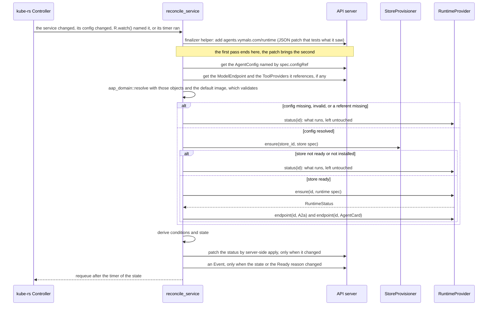
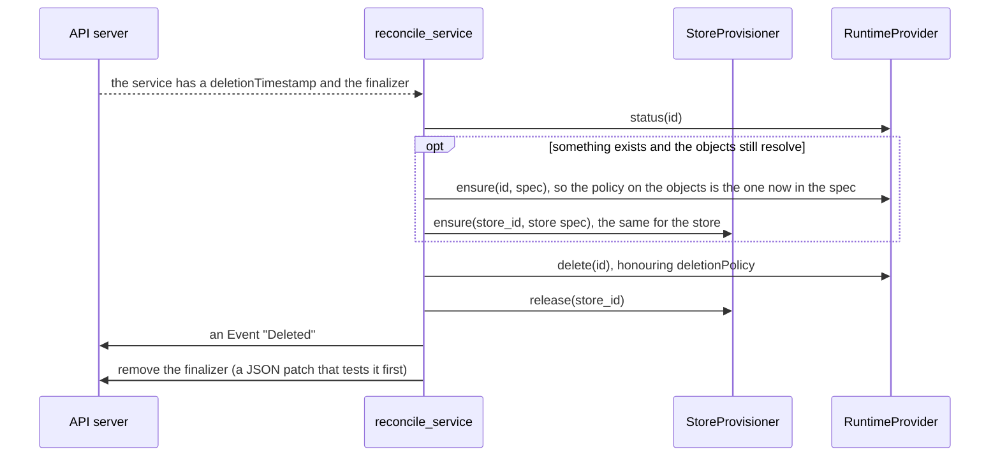
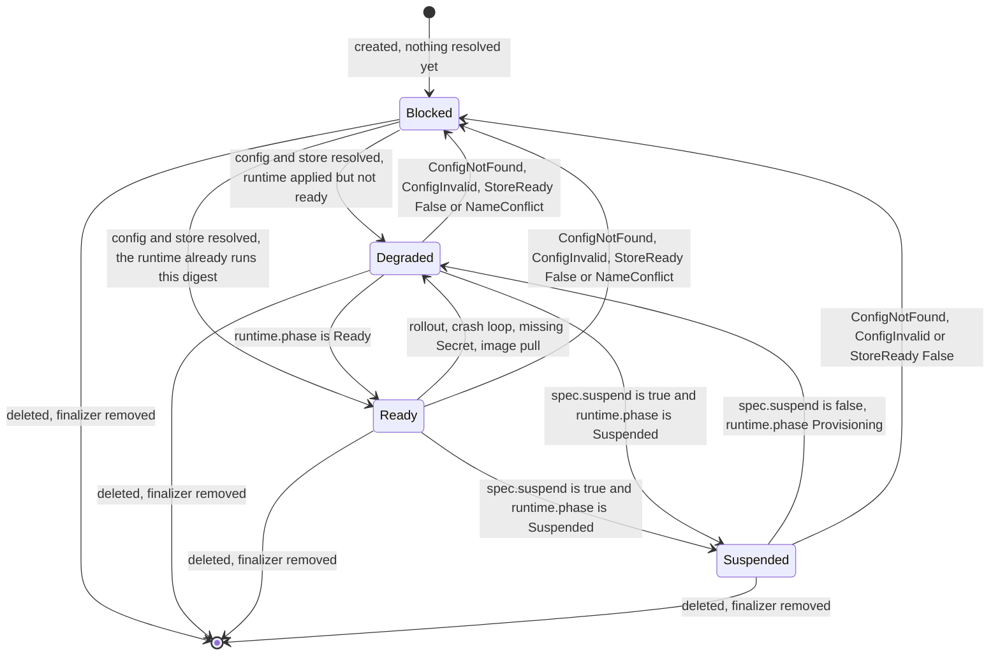

# aap-controller

The reconcilers of the v0 operator ([§59a](../../docs/architecture/10-control-plane-and-crds.md#reconciliation),
AD-020): two kube-rs controllers, one for `AgentService` and one for `AgentConfig`, generic over
`<R: RuntimeProvider, S: StoreProvisioner>` from [`aap-ports`](../ports/README.md). The binary
([`bin/operator`](../../bin/operator/README.md)) is what names the provider types.

```rust
let operator = Operator::new(client, runtime, store, owner_of, Options::default());
let (ready, metrics, directory) = (operator.readiness(), operator.metrics(), operator.directory());
operator.run(shutdown_signal).await;      // until `shutdown_signal` resolves, then the passes in flight finish
```

**No Kubernetes type is in a port's signature.** `kube` appears here, in the controller, which is its job: it reads the
two custom resources of [`aap-api`](../api/README.md) and writes their status. A provider's own notion of ownership
travels as the opaque `OwnerHandle` that the composition root's `OwnerOf` function makes from the object (see
*Deviations*).

| Item | What |
|---|---|
| `Operator::new(client, runtime, store, owner, options)` | wires both controllers to their triggers; nothing runs until `run` |
| `Operator::run(shutdown)` | runs both controllers; returns after `shutdown` resolves and the passes in flight finish |
| `Operator::directory()` | a `ReflectorDirectory`: the `AgentDirectory` over the services controller's cache |
| `Operator::readiness()`, `metrics()` | a `Readiness` handle (both caches have listed the cluster) and the `Metrics` counters, for `/readyz` and `/metrics` |
| `reconcile_service`, `service_error_policy`, `reconcile_config`, `config_error_policy` | one pass of each reconciler, public so a test can drive it |
| `services_of_endpoint(services, configs, &ModelEndpoint)`, `services_of_provider(services, configs, &ToolProvider)` | the services a changed or deleted `ModelEndpoint` or `ToolProvider` concerns (slice D2): through the caches of the configs and the services, the configs of the namespace that reference it, then the services that run them. What the two extra watches of `Operator::run` map with |
| `derive::{derive, Observed, ConfigOutcome, StoreOutcome}` | the pure part: what a pass saw, as conditions and a state |
| `Options { watch_namespace, registry, registry_full, resync, concurrency, instance, default_agent_image }` | the settings; `RegistryMode::{Disabled, Enabled}`, `registry_full` an `Arc<AtomicBool>` the composition root shares with the registry (the controller depends on no registry crate), `Resync { settled, pending, not_installed }`, `default_agent_image` the image of a config that names none (`--default-agent-image`; `None`: no default, and such a config is `ConfigInvalid`) |
| `Context`, `ConfigContext` | what a reconciler is given; `with_clock`, `with_metrics` |
| `FINALIZER`, `FIELD_MANAGER` | `agents.vymalo.com/runtime` and `aap-operator` |
| `Error` | each variant has a class (`aap_ports::Classify`); the error policy decides from the class |
| `backoff(class, attempt)` | the wait after a failed pass |

## One pass over an `AgentService`



Deletion is the finalizer's other branch:



A pass that fails (a provider or the API server cannot be reached) returns an `Error`, which the error policy turns
into a wait by class and a log line; the status is not rewritten, because the pass learned nothing. What a pass
*finds* is a status and the pass succeeds.

### The status

`derive` is §59a's table and state diagram:

| Condition | True | False | Unknown (not in §59a's table) |
|---|---|---|---|
| `ConfigResolved` | `Resolved` | `ConfigNotFound`, `ConfigInvalid` | |
| `StoreReady` | `SecretReferenced`, `ClusterReady` | `CNPGNotInstalled`, `ClusterNotReady` | `ConfigNotResolved`: the store is looked at once the config resolves |
| `RuntimeReady` | `Ready` | `Provisioning`, `Suspended`, `MissingSecret`, `ConfigRejected`, `DependencyUnavailable`, `ImagePull`, `CrashLoop`, `NameConflict` | `NotObserved`, `NotCreated` (no workload exists) |
| `Listed` | `Listed` | `RegistryDisabled` (no registry served: no token), `A2ADisabled`, `ServiceBlocked`, `RegistryFull` | `NoEndpoint` |
| `Ready` | `Reconciled` | the reason of the first of the first three that is not true | the same |

`RegistryFull` is the registry's (S7): `Options::registry_full`, a flag the registry sets while its document would pass a limit, is read at each pass, and a service that would be listed then says `Listed: False`, reason `RegistryFull` (one that is not listable anyway keeps `A2ADisabled` or `ServiceBlocked`). A change of the flag reaches a service at its next pass, at most one resync later. `Listed` informs and never gates `Ready`. The runtime reason is the most actionable of the issues
the provider reports (`NameConflict`, `MissingSecret`, `ConfigRejected`, `DependencyUnavailable`, `ImagePull`,
`CrashLoop`, in that order). A condition keeps its `lastTransitionTime` until its status changes, so a pass that finds
nothing new writes nothing.



The rule, as `derive::state` has it: a false or unknown `ConfigResolved` or `StoreReady`, or a `NameConflict` issue, is
`Blocked` (**the operator does not apply the desired state and leaves what runs untouched**: it asks the provider for
its `status`, never `ensure`); `spec.suspend` with phase `Suspended` is `Suspended`; phase `Ready` is `Ready`; anything
else is `Degraded`. While blocked, `status.config` and `status.endpoints` stay as they were (what runs was resolved
from them) and `status.runtime` is what the provider reports now.

### What triggers a pass

| Trigger | How |
|---|---|
| the service itself | `Controller::new` over the services (all namespaces, or `Options::watch_namespace`) |
| an `AgentConfig` | `Controller::watches`, mapped through the services' reflector to every service of that namespace whose `spec.configRef.name` is the config |
| a `ModelEndpoint` or a `ToolProvider` (slice D2) | `Controller::watches_stream` over an **isolated** watch of each kind (below), mapped by `services_of_endpoint` / `services_of_provider` through the configs' reflector (the configs of the namespace that reference it) and the services' (the services that run them). **A change and a deletion both**: an edit rolls the agents that use the object, a deletion makes them `ConfigInvalid` at once, and an object created later unblocks the services that were waiting for it. An object nobody references reconciles nothing |
| a runtime changed | `Controller::reconcile_on` over `RuntimeProvider::watch()`: the id's scope and name are the service's. Ids of other namespaces (when namespaced) and of unknown services are ignored. **A hint, never the truth** |
| the timer | each pass returns `Action::requeue(Resync)`: 5 minutes when `Ready` or `Suspended` or when only a change of the objects can help (a missing or invalid config), 15 s when rolling out, unwell or held by a foreign object, **or when a referent (a `ModelEndpoint`, a `ToolProvider`, or their whole kind) is missing** (`ConfigOutcome::ReferentMissing`, the same condition as `Invalid`: the objects of a config are applied one request at a time, so a service can be read between two of them, and the watch that would bring the second can be lost or not open yet; without this a race between the two stores left the service blocked for the settled period), 60 s when a store backend is not installed |
| not a trigger: a Secret | §59a gives the operator no right on Secrets (AD-024), so it cannot watch them. A Secret that appears reaches the controller through the pod, and the runtime's watch |

### Failure and back-off

`Error::class()` decides, never the variant (`ErrorClass` from `aap-ports`). The wait after the *n*th failure in a row of an
object (the count resets on a pass that succeeds):

| Class | Wait |
|---|---|
| `Transient`, `Conflict` | 5 s doubling to 5 minutes |
| `NotFound` | 5 s |
| `Internal` | 30 s doubling to 10 minutes (a bug, or the operator's own RBAC: a person fixes it) |
| `Invalid`, `Unsupported` | 10 minutes (the same input never succeeds; a change of the object brings the next pass sooner) |

A 422 or 409 on the **finalizer's** JSON patch is classed `Conflict`, not `Invalid`: the patch `test`s what it saw and
fails when an earlier pass already changed the finalizers (a pass on a stale cache). The real API server does say 422
there (seen on 2026-10-05 against kube-apiserver v1.35.8, see *Tests*).

### Events

An Event (`events.k8s.io/v1`, reporter `aap-operator`) when the `state` or the reason of `Ready` changes: reason is that
reason (`Reconciled`, `Provisioning`, `Suspended`, `ConfigInvalid`, `MissingSecret`, `NameConflict`, …), type `Normal`
for `Reconciled`, `Provisioning` and `Suspended` and `Warning` otherwise, note the condition's message, at most 1000
characters. One more on deletion (`Deleted`, which volumes and databases were kept). Events are a courtesy: a failure to
write one is logged and fails nothing.

### Deletion, and the deletion policy

The finalizer `agents.vymalo.com/runtime` is added before anything is created. On deletion the controller calls
`RuntimeProvider::delete`, then `StoreProvisioner::release`, then the finalizer is removed; a failure keeps the finalizer
and the pass is retried. The policy a provider honours is the one **of its last `ensure`**, which it remembers on the
objects it made. A person who sets `deletionPolicy: Retain` and deletes in one breath has had no pass in between, and the
provider would still hold `Delete`, which loses data. So when something exists and the objects still resolve, the
controller applies them once more before it deletes; whatever does not resolve, or is refused by a provider, leaves the
remembered policy standing. `a_policy_changed_just_before_the_delete_is_the_one_honoured` holds it.

## `ReflectorDirectory`

The `AgentDirectory` (S3) over the services controller's reflector. **The controller feeds it by doing what it already
does**: it patches each status, the watch brings the change into the cache, and the directory reads the cache; a read
never touches the API server. `list()` is ordered by namespace and name, leaves out a service being deleted, and is
`DirectoryError::NotReady` until the reflector has listed the cluster (never an empty list that looks true). A service
the controller has not reconciled, or that is `Blocked`, is `blocked: true`, so a registry never lists what the
operator has not applied.

## Metrics

`Metrics` is a few counters in Prometheus text (no client library): `aap_reconcile_total{controller,result}`,
`aap_reconcile_errors_total{controller,class}`, `aap_status_patches_total{controller}`,
`aap_service_state_changes_total{state}`, `aap_runtime_signals_total`, `aap_services_deleted_total`.

## Deviations from §59a

| §59a, or the S5 brief | This crate | Why |
|---|---|---|
| "The `AgentService` controller … `RuntimeProvider::status`" | `ensure`'s returned status is the runtime's status after a pass that applied something; `status(id)` is read in every pass that did **not** (blocked ones) | `ensure` returns the status computed right after the apply, which is what `status` would say; asking again is a second list of pods. A blocked pass has no `ensure`, and it is the status of what runs untouched |
| (the brief) the controller uses `owner_handle` of `aap-runtime-kubernetes` | The controller takes an `OwnerOf` function from the composition root, which builds it with `aap_runtime_kubernetes::owner_handle` | The encoding of an owner is the provider's. A controller that imported it would no longer be generic over the provider (AD-020), and a second provider would need a second controller |
| `Controller::watches_stream` | kube's `unstable-runtime` feature (`unstable-runtime-stream-control`, which `unstable-runtime` includes: no new crate, `Cargo.lock` unchanged) | Kube's `Controller::run` puts **one** `StreamBackoff` around the merge of all its triggers, so the error of any one delays them all. `Controller::watches` hands its watcher's errors to that merge: with the CRD of a shared kind not installed (the operator rolled out before `deploy/operator-crds`) or no `list` on it in the `Role`, the list of `modelendpoints` or `toolproviders` fails for as long as that lasts, and no service is reconciled in the meantime (a service created after the backoff had grown waited 27 to 42 s, one that existed at start 11 to 16 s, *measured 2026-10-15* on the fake with kube-runtime 4.0.0, in virtual time). `isolated` in `operator.rs` takes the kind's watcher with its own `default_backoff` (800 ms doubling to 30 s, which also paces the warning it logs), keeps changes **and deletions** (`touched_objects`), logs an error and drops it, so only its own retries wait. The mappers are unchanged; `tests/operator.rs` fails on the old `watches` |
| `Controller::reconcile_on` | kube's `unstable-runtime` feature | It is the only way kube-rs 4.0.0 takes a trigger that is a stream of ids (`RuntimeProvider::watch`). *Verified 2026-10-05*, `kube-runtime-4.0.0/src/controller/mod.rs`: `reconcile_on` is behind `unstable-runtime-reconcile-on`. The version is pinned by `Cargo.lock`; the call is one line in `operator.rs`, and a stable replacement (a `watches_stream` over a stream of objects, which is also unstable) would not be simpler |
| `Listed`: `RegistryDisabled` | Every service gets `Listed: False`, reason `RegistryDisabled`, from `RegistryMode::Disabled`, which `operator run` sets when it has no registry token or no `registry` feature | Fail closed: the condition says so instead of staying absent |
| `Listed`: `RegistryFull` on "every service" | On every service that would otherwise be listed, from a flag the registry sets; a service that is not listable keeps its own reason; it follows the flag at the service's next pass | The controller cannot know the registry's byte size, and §59a gives no mechanism. The flag is the smallest one that keeps the controller free of a registry crate (AD-020) |
| the reason tables of "Status" | A provider that refuses a spec the domain accepted (`RuntimeError::InvalidSpec`/`Unsupported`, for example Kubernetes refusing a changed StatefulSet claim template) is `ConfigResolved: False`, reason `ConfigInvalid`, with the provider's words: `Blocked`, nothing applied. A store provisioner that does not serve a kind (or whose backend is absent) is `StoreReady: False`, reason `CNPGNotInstalled` | The tables have no better reason for a spec nobody can apply, and "someone has to change the objects" is what `ConfigInvalid` says |
| the reason tables | `Unknown` conditions with the reasons `ConfigNotResolved`, `NotObserved`, `NotCreated`, `NoEndpoint` | A condition not yet evaluated is `Unknown`, as Kubernetes convention has it; the reason is required and the tables name none |
| the brief: "store-secret checks the Secret and its key exist" | It does not. See [`aap-store-secret`](../store-secret/README.md) | AD-024 and §59a: the operator has no RBAC on Secrets and "cannot check that a referenced Secret exists". A missing one is the condition `RuntimeReady: MissingSecret`, from the pod |
| (not in §59a) timers and back-off | The numbers above | §59a gives none |
| (not in §59a) delete-time policy sync | Described under *Deletion* | A change of `deletionPolicy` followed at once by a delete must not lose data |
| `status` of `AgentConfig` | `observedGeneration` and the condition `Valid` (True/`Valid`, False/`ConfigInvalid`), from `aap_domain::validate_config`, a function this slice added to `aap-domain` for the config's own rules | `validate` takes both objects |
| (the brief) leader election "only if §59a asks" | None | §59a: "One replica, `Recreate`, no leader election" |
| §60a: "The reconciler reads the referents through the store it already uses" | The referents are read with `get` on the API server in each pass, as the config is, **not** from a reflector. Only the mapping from a referent to services uses the caches (those of the services and the configs) | A pass sees the cluster as it is, with no cache to be stale; the mapping is a hint and the timer is the net. Two more reflectors would only be read once per pass |
| §60a: a missing referent is `ConfigInvalid` — **known behaviour, a question for the owner** | A service whose referent is missing is `Blocked`, and `ReflectorDirectory` marks a `Blocked` service `blocked`, which the registry does not list (`Listed: False`, reason `ServiceBlocked`), **while the pods keep running**. Deleting one `ModelEndpoint` delists every agent that uses it, at once (a deletion is a trigger), until the object is back. It is how an invalid `AgentConfig` has always been listed since S7; what is new is that one object is now shared by many agents. Not changed here. *Question for the owner, not decided (§93, the fifth of D2's decisions):* should a service that has run stay listed while a referent is missing, with its condition saying so? | The registry must not list what the operator could not apply; and an agent that is up but unlisted is unreachable for the people who find agents there |
| §60a: a missing referent is `ConfigInvalid` | A referent that is missing is `ConfigResolved: False`, reason `ConfigInvalid` (not `ConfigNotFound`, which is the config's own), the message naming it; the `AgentConfig`'s `Valid` condition does not read referents. **A kind whose CRD is not installed** is the same condition with a message that says to install the CRDs of `deploy/operator-crds`, not to create the object. The pass tells the two 404s apart by `details.name` (an API server names the object it did not find; for a resource it does not serve it answers the plain text `404 page not found`, which kube makes a `Status` with no details: *verified 2026-10-15* on a bare kube-apiserver v1.35.8), because `Api::get_opt` reads only the first as "not found" and would make the second a failed pass that retries for ever and says nothing in the status | As §60a says. The config is well formed; the agent cannot be made |

## Cluster rights

For the chart of S8, in the namespaces watched (the runtime provider's own are in
[its README](../runtime-kubernetes/README.md#cluster-rights)):

| Resources | Verbs |
|---|---|
| `agentservices`, `agentconfigs` (`agents.vymalo.com`) | `get list watch patch` (`patch` also writes `metadata.finalizers`) |
| `modelendpoints`, `toolproviders` | `get list watch` (read in a pass, watched; **never written**) |
| `agentservices/status`, `agentconfigs/status` | `patch` (server-side apply under `aap-operator`) |
| `events` (`events.k8s.io`) | `create patch` |

**No right on Secrets**, and none on `agentservices/finalizers`: owner references are made without `blockOwnerDeletion`.

## Tests

`cargo test -p aap-controller` (nothing needs a cluster):

| File | What |
|---|---|
| `tests/reconcile.rs` | one pass at a time, the **real `kube::Client`** against a fake API server (`tests/support`: JSON patches of the finalizer with their `test`, server-side apply of `/status`, Events, 404s as the server words them) and the `Memory` providers of `aap-ports`: the first pass only adds the finalizer; create → Ready with every condition, endpoints, digest, owner, one Event; a second pass writes nothing; a changed config is a new digest; an invalid config blocks and leaves what runs untouched, and fixing it unblocks; the shared objects of the dashboard (slice D2): a referent that is not there blocks the service, the message names it, and nothing is made (no runtime, no store); a name that is not an object's (`bad name`, `x?watch=true`), in a reference or in `configRef`, blocks it before any request is made with it; the timer after a missing referent is the 15 s one and after an invalid config the 5 minute one; so does a kind whose CRD is not installed (the plain-text 404), and the message says to install the CRDs; one that is created later unblocks it; an edit of an endpoint or a provider is a new digest and a rollout, and a title or a list of aliases is not; a deleted referent blocks the service with `ConfigInvalid` naming it and leaves what runs untouched, and the same object created again is the same agent; a config with no image is blocked naming `--default-agent-image` without a default, runs the default with one, and a new default rolls the agents that name none and not the ones that pin their own; an inline object is unaffected by the default and reads no shared kind; a missing config; a missing Secret, each runtime issue, a rollout in progress; a `NameConflict` that clears; suspend and resume; a provider without `suspend`; a spec a provider refuses; a store without CloudNativePG, a cluster not ready; a served registry lists a ready service, and a full one makes it `Listed: False` / `RegistryFull` without making it unready; delete under `Retain` and under `Delete`, a policy changed just before the delete, a service that never got a runtime, a delete that fails and keeps the finalizer; back-off by class and its reset; API failures by class; the `AgentConfig` `Valid` condition |
| `tests/operator.rs` | `Operator::run` against the fake's **list and watch**: a service that appears is reconciled and listed in the directory, a changed config reconciles the services that name it, a changed, deleted or created `ModelEndpoint` or `ToolProvider` reconciles the services whose config references it and no object nobody references does (the timers are an hour, so only a trigger makes a pass), an id from `RuntimeProvider::watch()` reconciles its service (no object changed), another namespace is left alone, a deletion runs the finalizer, the controllers stop when told to; **with the CRDs of the two shared kinds absent** (`Fake::absent`: the 404 a real API server answers, verified on a bare kube-apiserver v1.35.8) a service that existed at start, one created after the failing watches had backed off for five minutes, and a changed config are all followed at once, a service that references the missing kinds is blocked and says to install the CRDs, and installing them later lets the failed watches find their kinds and the blocked service follow, in **virtual time** (`start_paused`: a backoff of thirty seconds costs nothing to sit through) |
| `tests/pure.rs` | `derive`: the five conditions in order, the transition time kept, the state rule row by row, the first false reason on `Ready`, the issue that speaks, `Listed` with a registry (and `RegistryFull`); `backoff`; the counters' text; the directory over a reflector's cache; which services a referent concerns (the namespace of each hop, the kind, the name) |

`tests/support/scripted.rs` wraps `MemoryRuntime`: the in-memory one resets a forced status on every `ensure` and speaks on
every `ensure` (which, in a running controller, is a reason to run another pass forever), so a test scripts what
the runtime reports and sends the signals of `watch()` itself.

### What is not tested here

* **A real API server.** The fake is not one: no CRD schema or CEL, no resource versions to resume a watch from, no
  server-side apply semantics beyond "the status becomes what was applied". `bin/operator/tests/cluster.rs` runs the same
  flows against a real one (and found the 422 above); read [`bin/operator`](../../bin/operator/README.md#tests) for what
  has and has not been run.
* A watch that breaks and resumes, a lost signal the timer has to find, and a reflector under load.
