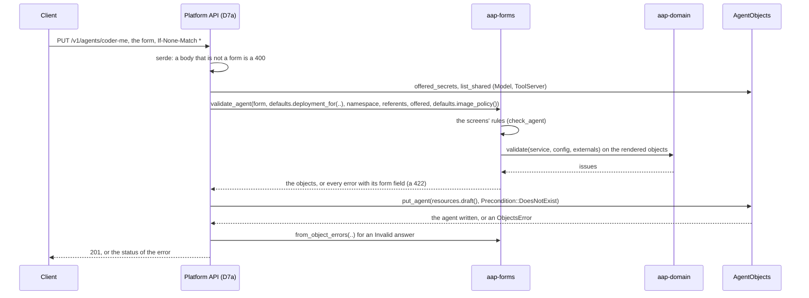

# aap-forms

The admin dashboard's forms ([§60a](../../docs/architecture/10-control-plane-and-crds.md#the-platform-api-ad-025-ad-027), slice D4):
the **agent** (a coder or a folder agent), the **model endpoint** and the **tool server**, to and from the custom resources of
[`aap-api`](../api/README.md), with the deployment's defaults filled in; the validation that names every error by its form
field; and the YAML export.

**Pure**: no async, no I/O, no Kubernetes client. It depends on `aap-api` (the objects), `aap-domain` (the operator's rules) and
`aap-ports` (the neutral objects a store holds). The Platform API ([D7a](../platform-api/README.md)) composes it with `AgentObjects` and `Authenticator`.



## Public API

| Item | What |
|---|---|
| `AgentForm { name, title, description, tags, suspend, model, tool_servers, allow_insecure_http, image, audience, agent }` | The agent form. `agent` is `AgentKindForm::Coder(CoderSettings)` or `Folder(FolderSettings)`: a coder has a GitHub App and no files, a folder agent has files and no GitHub App, and a body that mixes them is not a form |
| `ModelEndpointForm`, `BaseUrlForm::{Value, Secret}`, `ToolServerForm`, `HeaderForm` | The forms of the Models and Tool servers screens |
| `SecretPick { secret, key }`, `OfferedKeys` | How a form names a secret: **by reference only**. `OfferedKeys::from_offered(label, &[OfferedSecret])` is what a write may name; a Secret made with `dataFrom` takes any key of valid syntax (below) |
| `Defaults`, `Deployment`, `Defaults::deployment_for(kind, name)`, `Defaults::check()`, `Defaults::image_policy()` | The deployment's defaults (the API's configuration file), and the part of an agent they fill |
| `ImagePolicy::{any_registry, only}`, `check(reference)` | The rule about the image an agent pins for itself: [below](#the-image-of-an-agent) |
| `to_resources(form, deployment, namespace) -> Resources` | The two objects, with the label of the dashboard. Total: every form gives objects. `Resources::draft()` is the `AgentDraft` a store takes |
| `load_agent(&Agent) -> Loaded<AgentView>`, `ModelEndpointForm::load`, `ToolServerForm::load` | An object read as a form, or the reasons it is YAML only. `Loaded { managed_by, representation }` |
| `validate_agent`, `validate_model`, `validate_tool_server` | The screens' rules and the operator's, each error a `FormError { field, message }` |
| `from_object_errors(FormTarget, &[FieldError])` | What a store answered `Invalid` (an API server's validation), named by form field |
| `check_replace(current, new)` | What an edit may not change: the name, and the kind |
| `externals(models, tool_servers, default_image) -> Referents` | The `aap-domain::Externals` for a list of the store's shared objects, and the objects that **exist and cannot be read** (an agent that names one is told so, not that it is missing) |
| `dependents_after(SharedChange, agents, &Referents)` | What editing a shared object breaks in the agents that name it: [below](#what-editing-a-shared-object-does-to-its-agents) |
| `export_agent(&Agent)`, `export_object(&Stored)` | The YAML of the objects, without `status`, `managedFields`, server-set metadata and any label or annotation a tool wrote: [below](#the-yaml-export) |
| `AgentForm::secret_picks()`, `names_a_secret()` | The secret keys a body names: a write that names one needs `platform:secrets.pick` besides its own permission |

## The forms on the wire

Names are camelCase. A member a form does not have is **refused** (`deny_unknown_fields`): the body is not a form (`400`), and
that is how a value sent in a field called `value` or `password` is stopped, not ignored.

```json
{
  "name": "coder-me", "title": "Coder (me)", "description": "Coding task to verified pull request.",
  "tags": ["coding", "git"], "suspend": false,
  "model": { "endpoint": "gateway", "model": "coding-model" },
  "toolServers": ["websearch"], "allowInsecureHttp": true, "image": null,
  "audience": ["agent.use:coder-me"],
  "agent": {
    "kind": "coder",
    "github": {
      "appId": "Iv1.example",
      "privateKey": { "secret": "github-app", "key": "private-key.pem" },
      "owners": ["stephane-segning"]
    },
    "createRepoOwners": [], "workers": 2, "prDraft": true, "opencodeModel": "coding-model"
  }
}
```

A folder agent has `"agent": { "kind": "folder", "files": { "instructions.md": "…" } }`. A model endpoint is `{ name, title,
baseUrl: { "value": "https://…" } | { "secret": { secret, key } }, apiKey: { secret, key }, models }`; a tool server is `{ name, title, url,
headers: { "Authorization": { prefix, secret: { secret, key } } }, tools, optional }`.

**A form mirrors the objects, including whether a field may be absent.** `description`, `audience`, `workers`, `prDraft`,
`opencodeModel` and `image` are `Option`s because the objects' fields are: a form that wrote an absent field as an empty one would
change an object the person did not edit. The defaults of a *screen* (the audience `agent.use:<name>`, the OpenCode model "the same as
the model", `optional` on for a tool server) are the client's to fill in. `toolServers` is a **set** (the objects keep them by name);
its elements are named in errors by name, `toolServers[websearch]`, like `files[skills/x.md]` and `headers[Authorization]`.

## Secrets (AD-030)

There is **no type in this crate that can hold a secret's value**. Every secret in a form is a `SecretPick`: the name of a Secret and a key
of it, that the person chose among `GET /v1/secret-keys`. The objects made of a form hold it as the `{ name, key }` of an `aap-api`
`SecretKeyRef`. A write may name only an **offered** key: `validate_*` refuse any other, on the field that names it (`422`), and the message
names the offer label so that the person knows what to add to an ExternalSecret. A form that names a key needs `platform:secrets.pick`
(`names_a_secret()`).

**A Secret made with `dataFrom`** (an ExternalSecret that fetches everything a remote secret holds) has no key to list: `OfferedSecret.key` is `None` for it, and a form may name **any key
of valid syntax** in that Secret, typed by hand (§60a: "a key fetched with `dataFrom` is not listed and is typed by hand"): 1 to 253 letters, digits, `-`, `_` and `.`, not `.`, `..` or
a name that starts with `..`. A Secret that lists its keys takes only those. The message of a refusal says which of the two it is.

`tests/secrets.rs` holds it, under arbitrary input:

* at every object of every form, a member that could carry a value (`value`, `password`, `token`, …) is refused, and so is anything but
  `{ secret, key }` in every secret slot (a string, a number, `null`, an extra member);
* for arbitrary forms and defaults, **every string in the objects, and in their YAML, was given by the form, the deployment's part or
  the namespace, or is a constant of the schema**: the converters have no secret to add and add none; and every member named like a
  secret (`*SecretRef`, `privateKey…`) holds exactly `{ name, key }`;
* a secret's name and key go to the objects as that name and key, wherever a sentinel is in them.

## Deployment defaults, and what the round trip does with them

[§60a](../../docs/architecture/10-control-plane-and-crds.md#deployment-defaults): the forms show what matters to an administrator; the rest comes
from the API's configuration file. `Defaults` is that file's section (`deny_unknown_fields` on it and on the types of this crate, and the binary compares the rest of the file with what `Defaults` writes back,
because the CRD types below it deny nothing: a typo stops the API at start, and
`Defaults::check()` makes a sample agent of each kind from the defaults and asks `aap-domain::validate`, so a store with no instances or a
bearer without a key is found at start and not at the first save). It holds the namespace, the offer label, the registries an agent may pin its own image from (`allowedImageRegistries`, [below](#the-image-of-an-agent)), the store (`cnpg` or a
`secretRef` named by a pattern with `{name}`), the A2A bearer reference, `allowFrom`, `security`, and per kind: for a coder `gitAuthor`,
`allowedRepoHosts`, `githubApiUrl`, the GitHub MCP sidecar, the work volume and the resources; for a folder agent the resources.

**A default is never a field of a form and is never shown as if a person had set it.** It enters the objects as a `Deployment`, the part of an
agent's objects that no form edits, shown on the form read-only under *Deployment defaults*:

* a **new** agent gets `Defaults::deployment_for(kind, name)`;
* an **existing** agent has the `Deployment` its own objects hold (`load_agent` reads it, with the form), and **a save writes it back unchanged**.

The second rule is a decision, because §60a says only that defaults "are applied when building the CRs". Applying the *current* defaults at every
save would make an unrelated edit move an agent's store: a ledger on another database loses its runs. The rule has a price, which the caller
pays knowingly: a change of the deployment's defaults reaches an existing agent only when the caller gives its form
`deployment_for(..)` again (an explicit "apply the deployment defaults" action), and the `Deployment` of an agent can be compared with
`deployment_for` to show the difference. The alternative, refusing the form of any agent whose deployment part differs from today's defaults, would
make every agent YAML only after a change of the file.

## Which objects are a form, and which are YAML only

`load_agent` answers `Loaded { managed_by, representation }`: `managed_by` is `dashboard` or `gitops` (AD-031, `aap_ports::Owner`), and the representation is
`Form(AgentView { form, deployment })` or `YamlOnly(reasons)`. A GitOps object that a form can say is a form with `managed_by: gitops`: the client shows it and does not let it be
saved.

**The test is a re-render**: read the form and the deployment part out of the two objects, render them back with `to_resources`, and compare. They are
equal exactly when the form lost nothing; otherwise the answer is `YamlOnly` with **every field that differs**, as `AgentConfig spec.model.baseUrl:
is set, and a form has no field for it (the model is set inline; a form names a ModelEndpoint (AD-029))`. A reason names a field and the kind of difference and
**never quotes a value** (an object may hold a literal where a form holds a reference). Nothing is dropped silently: a member of the stored `spec` that the types do not
know is a reason too, found on the raw JSON, since serde would drop it.

What the forms do not carry, so that an object that sets it is YAML only: an inline model (`baseUrl`, `apiKeySecretRef`), an inline MCP server or a server's own
`optional`, a GitHub token or a pinned installation instead of an App, a folder in a ConfigMap, `scaling` other than one combined worker, `interfaces` other than A2A at
the default address, `deletionPolicy: Delete`, `extraEnv`, `terminationGracePeriodSeconds`, and the coder's tunables (`maxCheckCycles`, `checkTimeoutSecs`,
`workspaceSweepSecs`, `workspacePlacement`). The coder's run-pod size class is not a field of `aap-api` yet (it waits for adam-rs, D15), so it is in no form. `examples/coder.yaml` and
`examples/chat.yaml` are YAML only today (inline model and servers; `coder.yaml` also has the tunables), and `examples/coder-me.yaml` is a form: `tests/representability.rs`.

The laws, held by property tests over arbitrary forms and deployments: **`load_agent(to_resources(form, deployment))` is `(form, deployment)`**, and **an object is a form only
if the form writes it back unchanged** (any one change of a field no form says makes it YAML only and names the field).

## Validation, and the form field of every error

`validate_agent(form, deployment, namespace, referents, offered, images)`: the screens' rules of §60a (names, lengths, counts, ranges, the GitHub owners, the audience's shape, no
`mcp.json` in a folder, the offered keys, the image), then `aap_domain::validate` on the rendered objects with `referents.externals` (so the dashboard refuses what the operator would mark
`ConfigInvalid`), then every `aap-domain` issue named by the **form field** it is about; a field with an error of its own is not reported twice. `validate_model` and
`validate_tool_server` do the same for the shared kinds: the operator's rules for a `ModelEndpoint` or a `ToolProvider` are asked through a probe agent that names it, as the operator
reads it, and only the issues about that object are kept.

The mapping, from the words of the objects to the form (`FormTarget`, `from_object_errors` for what an API server answers):

| The object says | The form field |
|---|---|
| `AgentService metadata.name`, `spec.configRef` | `name` |
| `AgentService spec.registry.title`, `.tags[i]`, `spec.access.audience[i]`, `spec.description`, `spec.suspend` | `title`, `tags[i]`, `audience[i]`, `description`, `suspend` |
| `AgentConfig …coder.github.app.id`, `.owners`, `.privateKeySecretRef` | `agent.github.appId`, `agent.github.owners`, `agent.github.privateKey` |
| `AgentConfig …coder.workers`, `.createRepoOwners[i]`, `.opencodeModel`, `.prDraft` | `agent.workers`, `agent.createRepoOwners[i]`, `agent.opencodeModel`, `agent.prDraft` |
| `AgentConfig …agent.folder.files[path]` | `agent.files[path]` |
| `AgentConfig spec.model.model`, `.endpointRef`; `ModelEndpoint <n> …` | `model.model`, `model.endpoint` (the message says which object) |
| `AgentConfig spec.tools.mcpServers[n]…`; `ToolProvider <n> …` | `toolServers[n]`; `allowInsecureHttp` for the one rule that is about the agent (a plain `http://` server) |
| `AgentConfig spec.environment.image` | `image` |
| `AgentService spec.store`, `…bearerTokensSecretRef`, `…allowFrom`; `AgentConfig spec.security`, `…resources`, `…volumes`, `…githubMcp`, `…coder.gitAuthor`, `allowedRepoHosts`, `githubApiUrl` | `deployment.store`, `deployment.a2aBearer`, `deployment.allowFrom`, `deployment.security`, `deployment.resources`, `deployment.volumes`, `deployment.githubMcp`, `deployment.coder.…` (the person cannot edit them: the API's configuration is wrong) |
| anything else | the empty field (the form as a whole), with the object's field in the message: no error is without its place |

For the shared kinds: `ModelEndpoint spec.baseUrl.value` is `baseUrl.value`, `.secretRef` is `baseUrl.secret`, `spec.apiKeySecretRef` is `apiKey`;
`ToolProvider spec.mcp.url` is `url`, `…headers[H].prefix` is `headers[H].prefix`, `…headers[H].secretRef` is `headers[H].secret`, `…tools[i]` is `tools[i]`.

The operator's default image is its own flag, which the API does not know: `externals(.., None)` tells `aap-domain` a stand-in image, so a form with no image is not refused for it
(the operator marks such an agent `ConfigInvalid` if it has none). **A URL is never quoted** in an error (it may carry a password).

## Free text that reaches the objects and the logs

A field that takes any text can carry a secret by mistake, and the forms cannot tell. What is restricted, and what is not:

* **A header's prefix** (`headers[H].prefix`) is an authentication scheme and **one space** (`Bearer `, `Basic `, `Token `: 1 to 32 letters, digits and `-`), or nothing. A person pastes a token where they are
  asked for a prefix, and the prefix is written to the object, shown in the export and logged; the secret is picked from the Secret keys. The inline form of an `AgentConfig` (and `aap-domain`) takes any
  prefix but one with `${`; the dashboard is stricter on purpose, and what it accepts the operator accepts. No message quotes a prefix.
* **An address** (`baseUrl.value`, the tool server's `url`) is refused with a user name, a password, a query or a fragment, and never quoted. **The path is not checked**: an address with a token in its path
  (`https://search.example/mcp/<token>`) is accepted, because the dashboard cannot tell a path from a secret. It reaches the object, the export and the logs. A server that wants a credential takes it in a header.
* The title, the description, the tags, the aliases and the files of a folder are free text by design, and are not checked for secrets.
* **`Debug`** of `BaseUrlForm` and of `ToolServerForm` hides the user name, password, query and fragment of the address (`https://***@host/path?***`), since a form is logged before it is validated.

## What editing a shared object does to its agents

`validate_model` and `validate_tool_server` ask the operator's rules through a **probe agent** that names the object, with `tools.allowInsecureHttp` on because that rule is the agent's. So a tool server
changed to a plain `http://` address on another host passes, and every agent that names it and does not allow plain http becomes `ConfigInvalid` the moment the write is made, unseen. `dependents_after(change,
agents, referents)` is the check: for each of `agents` (the `Agent`s of `list_agents`) that names the changed object it asks `aap_domain::validate` **twice**, with the object as it is in `referents` and as
`change` (what `validate_model` and `validate_tool_server` give) makes it, and returns the issues the change **adds**, one `FormError` each (on no field), naming the agent. An agent that was invalid already is not
blamed on the change; one that cannot be read by this version is reported as unknown. The Platform API (D7a) calls it before a shared write, for each agent that names the object, and refuses the write (`409 breaks-agents`, with the agents) when the answer is not empty.

## The image of an agent

§60a: *Image* under *Advanced* is "a reference with a tag or a digest, an allow-list of registries being the deployment's default to set". `ImagePolicy::check` (called by
`validate_agent` for `form.image`, error on the field `image`) refuses a reference that:

* is not a reference (`[registry/]name[:tag][@sha256:digest]`, lower-case path components, a registry host with an optional port, a tag of at most 128 characters), has a space or
  a control character, or is over 512 characters;
* **has no tag and no digest** (`registry.invalid/a`): an image that can move is not pinned;
* has **userinfo** (`user:pw@registry.invalid/a:1`): `@` is only allowed in front of a digest, which is `sha256:` and 64 lower-case hexadecimal digits;
* comes from a registry that is not on the deployment's list, when there is one.

**What the list means** (`Defaults.allowedImageRegistries`, an optional list of hosts, `ghcr.io` or `registry.example:5000`; an image with no registry is `docker.io`'s): **absent**, any registry
is accepted (the deployment did not restrict them; §60a says the list is the deployment's default *to set*) and the tag or digest is still required; **a list**, only those registries;
**an empty list**, none, so no agent may pin its own image: somebody wrote it, so it fails closed. `Defaults::check()` refuses an entry that is not a host. No message **quotes the
reference** (it may carry a password); the registry of a reference that was accepted as to its shape is named. An existing agent whose image the list no longer allows is refused at its next
save, for the field `image`: a save validates the whole form.

## The YAML export

`export_agent` gives the `AgentConfig` and then the `AgentService` (the order the API applies them), `export_object` one. It is a **whitelist**: `apiVersion`, `kind`, `metadata` and `spec`, so `status`, `managedFields` and whatever a
future Kubernetes adds to `metadata` cannot reach it. Within `metadata`, **labels and annotations are filtered by an allow-list, and there is no blacklist anywhere in the crate**:

* **labels** kept: those with **no prefix** (the person's own: by the convention of Kubernetes an unprefixed key is private to the user, and "automated system components … which add labels to end-user objects must specify a prefix"),
  those with the platform's prefix `agents.vymalo.com/`, and `app.kubernetes.io/managed-by` **when it says `dashboard.agents.vymalo.com`** (an object Helm manages is not exported as the dashboard's; Argo CD's annotation makes the dashboard
  stop writing an exported object, AD-031). Every other prefixed label (Argo CD's and Flux's tracking, Helm's, `app.kubernetes.io/instance`, whatever the next tool adds) is out;
* **annotations** kept: only those with the platform's prefix `agents.vymalo.com/`. An annotation is where tools keep copies of the object (`kubectl.kubernetes.io/last-applied-configuration`), their tracking ids and their state, and a
  person's note has no prefix a tool could not also use. A GitOps export needs the spec, the name and the labels; a note is added in the repository where the object goes. *(If the owner wants a deployment's own prefixes kept, it is a
  value of `Defaults` and one argument here.)*

**The YAML is written by `src/yaml.rs`, not by a library**, because `serde_yaml_ng` writes the strings `yes`, `no`, `on`, `off`, `y`, `n`, `Y`, `N`, `12:30`, `1_000` and `2026-10-16` unquoted, which `kubectl`, Argo CD and Flux (YAML 1.1 in effect,
through go-yaml) read as a boolean, an integer or a timestamp: a string of the object would be another type in the file exported from it. The writer quotes (double quotes, JSON-like escapes) every string that is not made of a short list of safe
characters, that YAML 1.1 reads as a boolean, null, number, float or timestamp, or that **starts like a number** (it over-quotes: a version `1.2.3`), and every map key the same way; a string with lines is a literal block (`|`, `|-`, `|+`) when a block can hold
it and quoted when not. It keeps the library's layout (a sequence under a key is not indented; keys sorted, so `metadata` reads `annotations`, `labels`, `name`, `namespace` as `kubectl get -o yaml` prints it). The tests read it back with
`serde_yaml_ng` for any value (a property), and check every plain scalar it writes against a separate implementation of the YAML 1.1 resolver written from the specification's regular expressions. `tests/golden/coder-me.export.yaml` is the golden.

## Tests

`cargo test -p aap-forms` (no network, no cluster):

* `tests/round_trip.rs`: the objects of a coder are the ones of §60a; every form round-trips (also through JSON); the label; the wire forms; a new agent gets the defaults and an old one
  keeps what it holds.
* `tests/representability.rs`: `coder-me.yaml` is a form, `coder.yaml` and `chat.yaml` are YAML only and say what; every field no form and no deployment says makes the object YAML only
  and is named (the second law, as a property test); **a field the form always writes (`registry.title`, `github.app.owners`) cannot be missing from the object**; a member the version does not know is never dropped, also inside the
  elements of `allowFrom` and `volumes`; no reason quotes a value.
* `tests/secrets.rs`: the property tests above.
* `tests/validation.rs`: every rule of every screen names its field; the operator resolves what the dashboard accepts (**and at least 200 of the 256 generated forms are accepted**, so that the property cannot pass because everything was
  refused; the generators produce unicode, line breaks and the strings YAML 1.1 reads as another type where a field allows them); every error has a field; the offered key is the guard, and a `dataFrom` Secret takes any key of valid syntax; the image, the header prefix and the
  `Debug` of an address; the defaults are checked and a typo in them is refused.
* `tests/export.rs`: the whitelist, with a sentinel in every place that must not be read, in labels and annotations of tools that do not exist yet; the allow-list of labels and annotations; the listed strings quoted line by line and
  read back as strings; the golden (`AAP_UPDATE_GOLDEN=1 cargo test -p aap-forms --test export` rewrites `tests/golden/coder-me.export.yaml`, and the diff is the change of the export). `src/yaml.rs` has the unit and property tests of the writer.
* `tests/dependents.rs`: `dependents_after` (a tool server made plain http breaks the agents that do not allow it, an agent already refused is not blamed, one that cannot be read is reported), and an object that exists and cannot be read is not said to be missing.
* `tests/domain_agrees.rs`: the references the store reads from JSON are the ones `aap_domain::references` reads from the types.

## Not here

* The route-to-permission table and the status of each route are the router's ([D7a](../platform-api/src/routes.rs)); the constants are [`aap_api::permission`](../api/README.md#permissions-slice-d4).
* The Agents screen's rows (state, the first false condition, *In chat*) read the status, which is `aap-api`'s `AgentServiceStatus` over `Stored::status`.
* `runPods.sizeClass` (the run-pod size class of the Coder screen) has no field in `aap-api` until adam-rs has it (D15).
* Default values of a *screen* (see above) are the client's.
