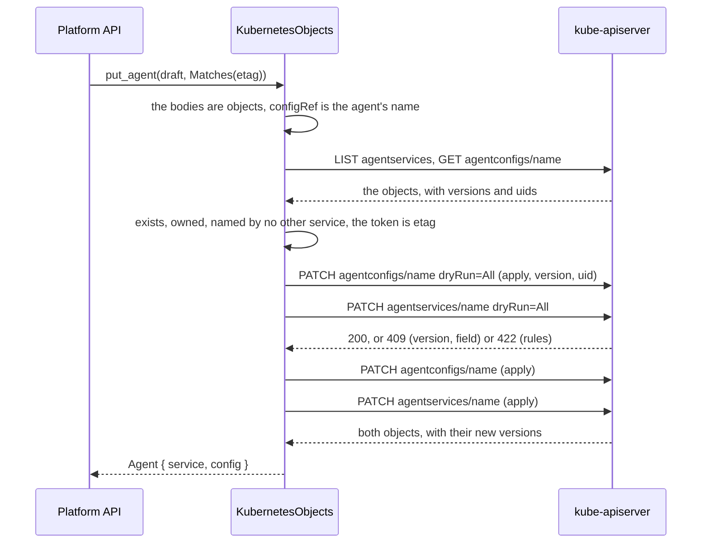
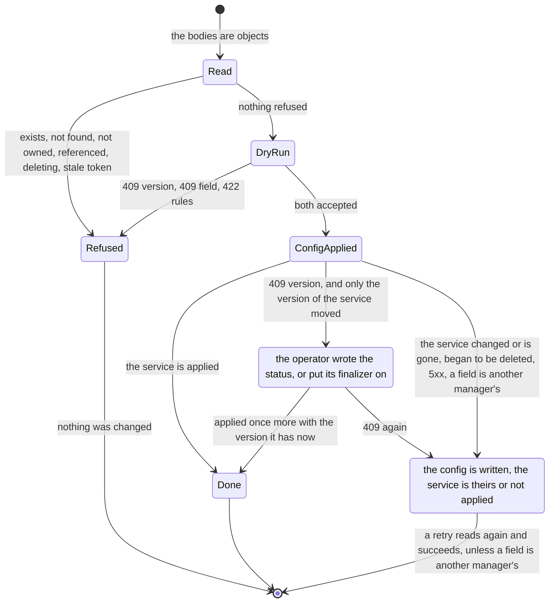
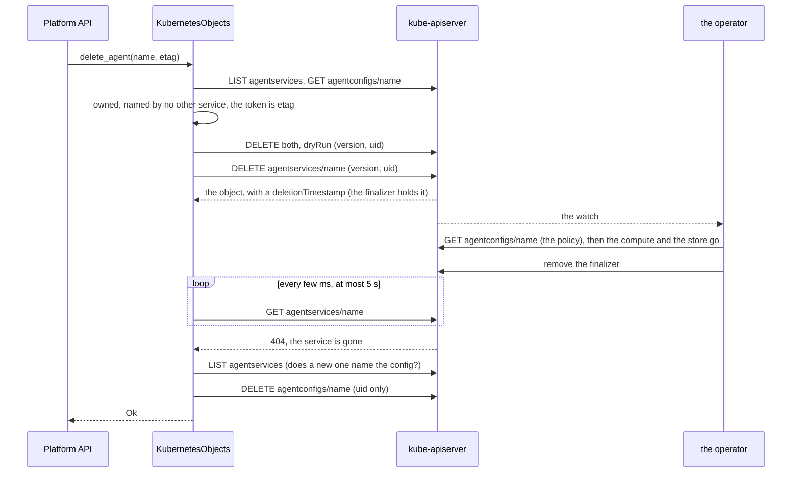
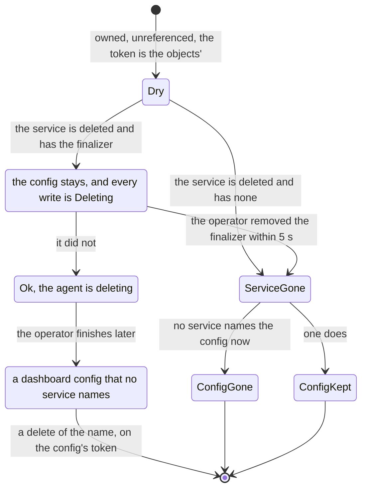

# aap-objects-kubernetes

`AgentObjects` on the **Kubernetes API server** ([§60a](../../docs/architecture/10-control-plane-and-crds.md#the-platform-api-ad-025-ad-027),
slice D5, AD-020, AD-025, AD-030, AD-031): the store behind the admin dashboard's Platform API. It reads and writes the four kinds
the dashboard owns, `AgentService`, `AgentConfig`, `ModelEndpoint` and `ToolProvider`, by **server-side apply**, and reads the
`ExternalSecret`s that offer Secret keys. The contract it keeps is [the port's](../ports/README.md#the-contract-of-agentobjects);
`agent_objects_conformance!` holds it, here against a fake API server and against a real one.

```rust
let objects = aap_objects_kubernetes::KubernetesObjects::new(client, "another-agentic-system");   // a kube::Client
let agent = objects.put_agent(&draft, &Precondition::Matches(etag)).await?;                       // both objects, or an error
```

**No Kubernetes type is in any signature the port defines**, and **no Secret is ever read**: the keys an agent may name are in the
`ExternalSecret`s, which hold no value. The crate depends on `aap-api` only for the group, version, kind and plural of the four kinds,
so they cannot drift from the CRDs; a body is read and written as the JSON the server holds.

| Call | Requests |
|---|---|
| `list_agents` | `LIST` services, `LIST` configs |
| `get_agent` | `GET` service, `GET` the config it names |
| `put_agent` | `LIST` services, `GET` config, then the writes below |
| `delete_agent` | `LIST` services, `GET` the config it names, then dry-run deletes of both, `DELETE` service, **`GET` the service until it is gone (at most [`DELETE_WAIT`](src/lib.rs), 5 s)**, `LIST` services, `DELETE` config. For a name whose service is absent: `GET` the config, `DELETE` it (an orphan) |
| `list_orphans` | `LIST` services, `LIST` configs |
| `list_shared`, `get_shared` | `LIST` or `GET` |
| `put_shared` | `GET`, then the writes below for one object |
| `delete_shared` | `GET`, `LIST` services and configs (who names it), `DELETE` |
| `offered_secrets` | `LIST` `externalsecrets` with the label selector `agents.vymalo.com/offer=true` |

## A write

Everything that can be refused from what was read is refused before the first write: the bodies are objects and the config
is the agent's (`Invalid`), the service exists or does not (`AlreadyExists`, `NotFound`), both objects are the dashboard's
(`NotOwned`), no other service names the config (`Referenced`), the token is the one of the objects read (`PreconditionFailed`).
Then **both applies are dry-run** (`dryRun=All`, the config first), each with the `resourceVersion` and the `uid` it read, so that
a token that went stale in between, a field another manager owns, and a rule of the CRDs (a CEL rule, a bound, a type) on **either**
body are all refused while nothing has changed. Only then are the config and the service applied for real.





**The one window**, and every way out of it. The API server writes one object at a time, so between the dry runs and the apply of the service the service can change, and
the config is already written. What happens is decided by what changed (`tests/api.rs` on the fake, `tests/cluster.rs` on a real API server for the first two):

| The service, when its apply comes | The answer |
|---|---|
| Only its `resourceVersion` moved: the operator wrote its `status` (it does whenever the config changes, which the write just did) or put its finalizer on | **No answer: the apply is repeated once** with the version the service has now, and the save succeeds. The service is re-read, and has to be the object that was read (same `uid`), not being deleted, with the same `spec`, labels and annotations |
| Its `spec`, labels or annotations changed (somebody saved it, or `kubectl edit`ed it) | `PreconditionFailed` (`412`): the person saved over a service that is no longer the one they read. The config stays written |
| It is another object (deleted and made again), or gone, or made in the meantime (a create) | `PreconditionFailed` for the config, `NotFound` for a replace of the service, `AlreadyExists` for a create over it |
| It began to be deleted | `Deleting` (`409`) |
| A field the apply sets is owned by another manager | `Conflict` (`409`), with the server's words. A retry is refused by the dry run, with nothing written, until they let go of the field |
| The API server fails the apply (`5xx`, a timeout) | `Unavailable` (`503`); a retry reads both again and succeeds when it is back |

In every case but the first the **config is written and the service is not**, the next read shows both objects as they are, and a create that stopped halfway leaves a dashboard-owned config that no service
names (an *orphan*: the next create takes it over, `list_orphans` lists it, a delete of its name removes it). A half-write is logged at `warn` by `tracing`
(`namespace`, `name`, `written`, `failed`, and a fixed `outcome`: names and kinds, never a value of the draft and never the server's words). The same repeat-once covers the config's own apply and a shared object's.

The tests show the first row failing against a mutant that does not repeat (`what_the_operator_writes_between_the_two_applies_does_not_stop_the_save`, on the fake and on a real server), and the second against one that compares
only the `spec`, or no label and annotation (`when_the_service_changes_between_the_two_applies_...`, `what_the_save_is_about_changing_...`).

**A create is an apply of an object that must not be there.** The API server has no "only if absent" for an apply, so the create names
a `resourceVersion` that no object has ([`NEVER`](src/lib.rs), `1`): the server ignores the version of an object that is not there and
refuses it, with a `409`, for one that is. **That `1` is observed on a v1.35.8 only**: the version of an object is a revision of etcd, and the API server writes its
own objects before anyone else's, so none has `1` there (`a_create_names_a_version_no_object_has_and_never_merges_into_one` asserts it on the real server and fails the
day one has); on a server where an object had it, a create would merge into that object, and the value would have to be another one that no object can have, found the same way. **A replace names the `uid` it read**, so a service that was deleted and made again, or
deleted, is a `409` and never a create.

The client is the caller's, and so are its timeouts (the composition root of the API builds it). Lists are not paged: a namespace holds
tens of agents. **An object the operator is deleting** (a service whose finalizer has not run) is read as it is, with `Stored::deleting` (its
`deletionTimestamp`), and is refused every write with `Deleting` until the operator releases it.

## A delete

The operator puts the finalizer `agents.vymalo.com/runtime` on every service, and what runs on its removal **reads the `AgentConfig`** to honour `deletionPolicy`
([`cleanup`](../controller/src/service.rs)): a person who saved `Retain` over `Delete` and deleted at once has had no reconcile in between, and the operator applies the
objects it can read once more before it deletes the compute, so that `Delete` to `Retain` does not lose data. **A config it cannot read leaves the policy it remembers standing**, which is `Delete`:
the volumes and the database go. A delete that removed the config one round trip after the service did exactly that (found by review, 2026-10-16; the controller test
`a_config_that_is_gone_when_the_finalizer_runs_leaves_the_remembered_policy_standing` is the premise, `a_policy_changed_just_before_the_delete_is_the_one_honoured` the guarantee). So:





* **The wait** is `DELETE_WAIT`, 5 s, polling the service with `GET` every `wait / 20` (10 to 250 ms). It is the operator's reconcile (the watch starts it at once; the compute and a database are released in
  one pass), against an HTTP request that a person waits for behind proxies that cut a request off after tens of seconds, and the page asks again every 2 seconds. It is a choice, not a measurement: `with_delete_wait`
  changes it, and 0 never waits. An API server that cannot be asked ends the wait (logged) and the delete returns: it was accepted.
* **When the operator is not done in time the delete still returns `Ok`**: a delete returns once the service is gone or is being deleted, and the config goes when the service is gone. The agent is listed
  `deleting`, with the operator's status, and refuses writes. The config the operator then leaves behind is an **orphan**.
* **An orphan** is a config the dashboard owns and no service names. `list_orphans` lists them with the token a `delete_agent` of their names takes; that call, for a name whose service is absent,
  deletes the config of that name on **its own** token (a stale one is `PreconditionFailed`, a config that went first `NotFound`). A GitOps config is `NotOwned`, and a config that **any** service names, the
  GitOps ones included, is `Referenced`: **neither is ever deleted that way**. The choice (`list_orphans` and a delete by name, against an `Agent` with no service in `list_agents`) is the port's, and its README gives the reason.
* **The services are listed again right before the config is deleted**: a service made while the delete waited that names the config keeps it. **A window of one request remains**: a service made between that list
  and the `DELETE` loses its config, and the operator reports it `ConfigNotFound` (`Blocked`, with the name). It needs a second service to name the config of an agent that was being deleted, in the same second, which
  the dashboard never does (a config is one agent's, `Referenced`); a GitOps tool can.
* The config is deleted by its **`uid`**, not its version: the operator writes the status of a config, and a version read earlier would strand a config whose service is gone. A config that is gone, or made again by somebody
  else, is left.

## Applying

| | |
|---|---|
| Field manager | `agents.vymalo.com/dashboard` (`FIELD_MANAGER`), `force` **off**: a field another manager owns is `Conflict` (`409`), never taken |
| What is applied | `apiVersion`, `kind`, `metadata.name`, `metadata.labels` = `app.kubernetes.io/managed-by: dashboard.agents.vymalo.com`, `metadata.resourceVersion` and `metadata.uid` as above, and `spec`. **Never a `status`, never an annotation** |
| Order | `AgentConfig`, then `AgentService` (the operator never sees a service whose config is not there yet). Deleted the other way round |
| Delete | both deletes are dry-run first with the version and the `uid` read; then the service with its version and `uid`; then, **once the service is gone** (see *A delete*), the config with its **`uid` only**: the operator writes the status of a config, and the version of one that is already doomed must not strand it. A config that is gone, or made again, is left |
| A service being deleted | read with `deleting`, never written (`Deleting`); a delete of it is accepted |
| Ownership | `Owner::of(labels, annotations)` of the port: the label and no Argo CD tracking annotation. A GitOps object is never written or deleted (`NotOwned`) |
| A config another service names | never written, taken over or deleted (`Referenced { kind: AgentConfig, by }`) |
| A name that is not a DNS-1123 subdomain | never put in a request path: `Invalid` at `metadata.name` for a write, nothing for a read, `NotFound` for a delete |

### What the API server does, *verified 2026-10-16*

Observed on a bare **kube-apiserver v1.35.8** (etcd 3.6.4), by `tests/cluster.rs` and by hand; the fake of `tests/support` copies it, and
`tests/fixtures/status` holds the bodies it answered. Kubernetes documents that a client that needs to detect lost updates should make its request conditional on the
`resourceVersion`, "either HTTP PUT or HTTP PATCH" ([API concepts](https://kubernetes.io/docs/reference/using-api/api-concepts/), "Updates to existing
resources", *verified 2026-10-16*: the page was fetched and read); it does not say what an *apply* does with one (the [server-side apply page](https://kubernetes.io/docs/reference/using-api/server-side-apply/)
says only that a controller "doesn't have to" specify it, *verified* the same day), which is why this is observed and pinned by a test, not assumed. **All of it is observed on v1.35.8**: another version
may differ, and a test fails when it does.

| Fact | Where it is held |
|---|---|
| An apply whose `metadata.resourceVersion` is not the object's is a **`409 Conflict`** (`the object has been modified; please apply your changes to the latest version and try again`), **also when it would change nothing**, and also under `dryRun=All` | `an_apply_that_is_not_the_version_that_was_read_is_refused_even_when_it_changes_nothing` |
| An apply of an unchanged object keeps its `resourceVersion`; a status write by the operator changes it (so the operator's writes make a client's token stale, D4's decision (4)) | `the_status_of_the_operator_makes_a_token_stale_and_a_save_that_changes_nothing_keeps_it` |
| An apply that names a version for an object that is **not there creates it** (the version is ignored); one that names a version for an object that is there is a `409` | `a_create_names_a_version_no_object_has_and_never_merges_into_one` |
| An apply that names a `uid` is a `422` `field is immutable` for another object and a **`409`** `uid mismatch ... no existing object was found` for none | `a_uid_ties_a_write_to_the_object_that_was_read` |
| A `DELETE` takes `preconditions.resourceVersion` and `preconditions.uid` in its body (`409` when they differ), also with `dryRun: ["All"]` in the body, which then deletes nothing. **With a body, the query parameter `dryRun` is ignored**: it deleted the object in the first attempt of this slice | `a_delete_dry_run_checks_its_preconditions_and_deletes_nothing` |
| A field another manager owns is a `409` with a **`FieldManagerConflict` cause**, reported before a stale version | `a_field_another_manager_owns_is_a_conflict_that_changes_neither_object` |
| A body that does not fit the schema (a string for a boolean, a field the CRD does not declare, a `spec` that is not an object) is refused by an apply with a **`500`** whose message is `failed to create typed patch object (...): .spec.suspend: expected boolean, got ...`, no reason and no causes; the rules of the CRD (CEL, bounds, `required`) are a `422` with causes | `a_body_the_schema_refuses_is_invalid_with_its_fields_and_not_a_server_error`, `tests/fixtures/status` |
| An apply creates with `patch` **and** `create` (with `patch` alone, `403` for the create, dry-run or not), updates with `patch` | [server-side apply, "Access control and permissions"](https://kubernetes.io/docs/reference/using-api/server-side-apply/) says the same ("requires the `patch` permission to edit existing resources, and also needs the `create` verb permission in order to create new resources", *verified 2026-10-16*, fetched and read); `tests/rbac.rs`; `the_identity_of_the_crate_has_the_role_and_no_right_on_secrets` |
| A `DELETE` of an object that has a finalizer answers the **object**, with a `deletionTimestamp` (and a new `resourceVersion` and `generation` the first time), not a `Status`, and keeps it until the last finalizer is removed; a second `DELETE` changes nothing; an **apply of a terminating object is accepted**; a merge patch that empties `metadata.finalizers` makes it go | `a_delete_of_an_object_with_a_finalizer_leaves_it_terminating` (a shared fact, run on the fake and on the server) |
| A stale `resourceVersion` is a `409` **before** the rules of the CRD (a body that breaks a CEL rule and names a stale version is a `409`); a body the schema refuses is a `500` before both. A `POST` stores the defaults of the schema, as an apply does | `a_stale_version_is_a_conflict_before_the_rules_of_the_crd`, `a_create_stores_the_defaults_of_the_schema` (shared facts: the fake is held to them) |
| An admission webhook that denies, a `ValidatingAdmissionPolicy` that denies, a body over the API server's, etcd's or its etcd client's limit: the `Status` bodies in `tests/fixtures/status`, mapped in *Answers* below | the unit tests of `src/failure.rs` |
| The API server stores the **defaults** of the schemas (`suspend`, `deletionPolicy`, `scaling`, `conditions: []`, ...) in every object | `the_dashboard_sees_what_it_wrote_and_the_server_stores_more` |

## What `Stored` holds

`Stored::spec` and `status` are **what people and controllers wrote**, without the defaults of the schema. The conformance suite asks it
(*the spec is what was written*), and the alternative, the stored spec with its defaults, would make a save of a form show the
administrator fields they never set. They are read through `metadata.managedFields`: a field some manager owns is there, a field nobody
set is not ([`src/stored.rs`](src/stored.rs) has the rule, with the cases: a server-side apply owns what it names and not the defaults; an
update, like `kubectl create`, owns the defaults it caused, so they are shown; a field owned as `{}` is a leaf, and for an object an empty
container; an object with no `managedFields`, or whose `spec` no manager owns, is returned whole). Nothing a person or a controller wrote
is dropped, GitOps's objects included, and **a member of a `spec` that this version of the dashboard does not know stays**, which is why
a body is read as JSON and not through the types of `aap-api` (they would drop it silently, and `aap-forms` needs it to say that an
object is YAML only). `tests/crd_assumptions.rs` fails when a CRD gains a keyed list, a set or an atomic map, which this reading does not
handle. Labels, annotations, the version, the generation and the namespace are those of the object; `Stored::version` is its
`resourceVersion`, and the port derives the `ETag` from it; `Stored::deleting` is whether it has a `deletionTimestamp`.

**What this hides.** A value the API server defaulted is not shown, and **it is persisted**: it was written into the object when the object was made, from the schema of that day. If a CRD later changes a default
(`scaling.workers` from `1` to `2`), the objects made before keep the old value in etcd, and the dashboard shows neither: not in the form, not in the YAML export, and a save does not name the field, so it stays. What an agent runs with
is what the operator resolved, not `Stored::spec`. Showing a default, or changing one on purpose, is an edit by a person of a field the form sets, never the side effect of a read or a save.

## Answers of the API server

| The API server answers | `ObjectsError` |
|---|---|
| `404` `NotFound` of an object (read: `None`; delete: `NotFound`) | |
| `404` of anything else: the plain text `404 page not found` of a kind it does not serve (the CRDs are not installed) | `Unavailable`, naming the resource; for the ExternalSecrets, an empty offer (below) |
| `409` `AlreadyExists` | (an apply never answers it) |
| `409` with a `FieldManagerConflict` cause | `Conflict`, with the server's words (the manager and the fields) |
| `409` without a cause, or a `422` about `metadata.uid` or `metadata.resourceVersion`: the object is not the one that was read | the object is read again: a service that was to be made and is there is `AlreadyExists`, a service that was to be replaced and is not is `NotFound`, anything else `PreconditionFailed` |
| `422` | `Invalid`: one `FieldError { kind, path, message }` per cause, `path` from the object (`spec.access.audience`); the cause that carries no field (`some validation rules were not checked ...`) is dropped |
| `400` or `403` `admission webhook "<name>" denied the request[: <why>]` (the code is the webhook's: `400` when it chose none), and a `ValidatingAdmissionPolicy ... denied request: <why>` (`403`, or the `422` the policy chose) | `Invalid`, one `FieldError` at **`spec`** (the body as a whole: the forms place it on the form, not on a field) in the server's words, which the cluster's administrator wrote |
| `413` `Request entity too large`, and the `500`s `etcdserver: request is too large` and `trying to send message larger than max` | `Invalid` at `spec`, the server's words: the person's body, and a retry does not cure it |
| `400` `admission webhook "<name>" does not support dry run` | **`Internal`**: the dashboard cannot write atomically through a webhook that has no dry run, a retry will not help and the person cannot fix it; the deployment must. (Not captured: `admissionregistration.k8s.io/v1` refuses the `sideEffects` that would make a webhook say it. The text is from the source, *verified 2026-10-16*.) |
| `500` `failed calling webhook` (`failurePolicy: Fail`, nobody answers) | `Unavailable`: an outage, which a retry may cure |
| `500` `failed to create typed patch object` | `Invalid`: one `FieldError` per problem the message names, **without the value the server printed** |
| `401`, `403`, `408`, `425`, `429`, any other `5xx`, and every failure of the transport | `Unavailable` (an RBAC rule that is missing or has not propagated is retried like an outage, as in the other providers). **`ObjectsError::Unavailable` does not say which of them it was**: the router (D7) must log the source (`Error::source` holds the `Status`), or a missing `Role` is read as an outage |
| anything else, and a body that cannot be read | `Internal` |

`Invalid` lists **every mistake** that can be found: when the draft has a mistake of its own (the config named is not the agent's),
the bodies are also dry-run, without a version, only to add what the server finds.

## Offered keys

`offered_secrets` lists the `ExternalSecret`s of the namespace that carry `agents.vymalo.com/offer: "true"` (`OFFER_LABEL`;
`with_offer_label` changes the key), of **`external-secrets.io/v1`**: the version the operator's chart renders, and the one the External
Secrets Operator serves and stores (*verified 2026-10-16* in the CRD of v2.11.0, `tests/crds`). Each `spec.data[].secretKey` is
`OfferedSecret { secret: spec.target.name, key: Some(..), external_secret }`; a `spec.dataFrom` that is not empty adds the Secret with
`key: None`. `target.name` defaults to the name of the ExternalSecret when absent (the CRD says so). A `target.template` is not read.
Ordered by `(secret, key, external_secret)`, no key first.

**An API server that does not serve `ExternalSecret` offers nothing: an empty list, not an error.** The offer is opt-in by label, and a
deployment without the External Secrets Operator has nothing that could have opted in; an `Unavailable` would call a state of the
deployment an outage and take `GET /v1/secret-keys` down with it. (The other choice is in `failure.rs`: `NotServed`.) A server that
cannot be reached, or that refuses the list, is `Unavailable` as for the other calls.

## Rights

The crate needs these verbs in its namespace, and the `Role` of D7 must grant **exactly** these (`tests/rbac.yaml` is the Role the
cluster test runs under; `tests/rbac.rs` turns the requests of the whole conformance suite into verbs and holds them equal to it and to
this table, row by row):

| API group | Resources | Verbs |
|---|---|---|
| `agents.vymalo.com` | `agentservices`, `agentconfigs`, `modelendpoints`, `toolproviders` | `create`, `delete`, `get`, `list`, `patch` |
| `external-secrets.io` | `externalsecrets` | `list` |

**No right on Secrets**, not even `get`: `list` on Secrets would return their values (*verified 2026-10-05*,
<https://kubernetes.io/docs/concepts/security/rbac-good-practices/>, "Listing secrets"). Against §60a's RBAC paragraph this is **fewer**:
no `watch` anywhere (nothing here watches: a page asks again every 2 seconds, §60a), and `list` only on `externalsecrets` (no `get`).
`create` is needed: an apply that makes an object is authorized as a `patch` and as a `create`. An update-only `Role` (`patch` without
`create`) would make every create a `403`, which is `Unavailable` here.

## Tests

`cargo test -p aap-objects-kubernetes` runs the unit tests, the suite against the fake, the rights and the CRD assumptions; the cluster
test skips unless `AAP_TEST_KUBECONFIG` is set.

| Test file | What |
|---|---|
| `src/*.rs` | the mapping of 29 `Status` bodies **captured from a kube-apiserver v1.35.8** (`tests/fixtures/status`, each with the request that provoked it in its README; one test fails when a body is read by none, the plain-text `404` of a kind that is not served included), the reading of three **captured objects** with their `managedFields` (`tests/fixtures/objects`), the offers |
| `tests/api.rs` | `agent_objects_conformance!` (33) on the fake, and what the suite cannot see: the dry runs come first and the config before the service, the version and uid of every apply, the label and the spec and nothing else, no `force`, no `status`, no annotation, no Secret read, every refusal makes **no write at all** (CEL on either body, a type, a stale token on either object, a field another manager owns), **the window and every way out of it** (the operator's status or finalizer between the applies, a label, an annotation or a field changed, a service that began to be deleted, a `503`, a field conflict, the log of a half-write), a create over a service made meanwhile, a replace over one deleted meanwhile, **a config made or deleted between the read and its apply** (`PreconditionFailed`, not an agent that exists or is missing), the deletes (what they are bound to, a config that goes or is made again before its delete, an orphan that goes first), **a service the operator is finalizing** (the config stays until it is gone, a delete the operator finishes in time, a service made meanwhile that names the config), outages and a kind that is not served, every mistake in one `Invalid`, names that are not names |
| `tests/rbac.rs` | **every case of the conformance suite** (`aap_ports::agent_objects_cases!`, the one list) runs on the fake, the requests of the crate become the verbs an API server authorizes them as, and those are held equal to `tests/rbac.yaml` and to the table above |
| `tests/crd_assumptions.rs` | no keyed list or atomic map in the CRDs; the checked-in CRDs are what `crdgen` prints; the ExternalSecret CRD is the pinned copy and serves the version read; the finalizer the harness plays is the one the operator puts on a service (read from its source: the crate must not depend on the operator's) |
| `tests/cluster.rs` | the same suite (33) on a **real API server**, as the identity of `AAP_TEST_API_KUBECONFIG`, and 23 cases of what only a server shows: the facts above (three of them shared with the fake, so that it cannot drift), the window and its cousins decided by the real server (the operator's status and finalizer among them), a service the operator is finalizing (the three scenarios of `tests/support/scenarios.rs`, the same code as on the fake), the CEL rules mapped to their field, the rights of the identity |

`tests/support` is the fake API server (header: what it implements and that it copies a real one) and the harness (`Harness`) that
implements `ObjectsUnderTest` with plain calls of the API, so that **one harness drives the fake and a real server**: GitOps's objects
are applied by another field manager (Argo CD's with its tracking annotation; an unlabelled one has the dashboard's label taken off by a
merge patch, which an apply cannot do), the operator's status by an apply of the `status` subresource, an orphan config by the
dashboard's own manager, the offers by `ExternalSecret`s (with and without `dataFrom`, with and without the label), the Secrets by apply.
`refused_spec` gives bodies that break a CEL rule of the CRDs (the audience `*` beside another value; an `endpointRef` beside an inline
model), so the `422` is mapped to its field on a real server.

**The fake copies the real server where the crate depends on it**, and `tests/support/facts.rs` asserts those facts against both (the finalizer that leaves an object terminating, the version that is checked before the rules of the CRD, the defaults a `POST` stores), so a
drift shows as a failure on the real server, not as a green fake. What it still is not: an API server (its header lists what it lacks). It has finalizers, `deletionTimestamp` and the operator's removal of a finalizer (`State::run_finalizer`); the harness plays the operator
(`set_finalizers`, `run_finalizer`) with the administrator's client: **the `Role` of the crate is unchanged** (the crate never touches a finalizer, and the new cases need no verb that it lacks).

### Against a cluster

| Variable | |
|---|---|
| `AAP_TEST_KUBECONFIG` | an administrator's kubeconfig. Unset, `tests/cluster.rs` skips. It installs the platform CRDs (`deploy/crds`) and the ExternalSecret CRD (`tests/crds`, a pinned copy) and the namespace `aap-test` |
| `AAP_TEST_API_KUBECONFIG` | the identity of the crate under test: a user that holds the `Role` of `tests/rbac.yaml` and nothing else. Unset, the crate runs as the administrator and the case about rights skips |
| `AAP_TEST_REQUIRE_CLUSTER` | `1`: skipping is a failure, and `AAP_TEST_API_KUBECONFIG` must be set (CI sets it) |

```sh
kind create cluster --name aap
kubectl create namespace aap-test && kubectl apply -f crates/objects-kubernetes/tests/rbac.yaml
# a ServiceAccount with that Role, and a kubeconfig for it: .github/workflows/operator.yml, job objects-kubernetes
AAP_TEST_KUBECONFIG=$HOME/.kube/config AAP_TEST_API_KUBECONFIG=/path/to/dashboard.kubeconfig AAP_TEST_REQUIRE_CLUSTER=1 \
  cargo test -p aap-objects-kubernetes --test cluster
```

**What has and has not been run.** On 2026-10-16 the 56 cases of `tests/cluster.rs` passed against a bare kube-apiserver v1.35.8 and etcd
3.6.4 started by hand with `--authorization-mode=RBAC` (no controller manager, no kubelet), twice: as the administrator, and as a user that
holds only the `Role` of `tests/rbac.yaml` (a user bound to it, as the CI job's ServiceAccount is), with `AAP_TEST_REQUIRE_CLUSTER=1` (the cases about rights
included) and four test threads, as CI; and nine more times as the second, on a cluster that earlier runs had filled (which is how a scenario that waited a fixed 200 ms for "the operator" was found to
be a race: the scenarios now wait for the `deletionTimestamp`). That proves the crate and the suite against a real API server, a real RBAC and **real finalizers on custom resources** (the harness
plays the operator: it puts the finalizer on, and takes it off), and the facts above. It does **not** prove the `kind` job (the pipeline's own run is
*unverified* until CI has run it), the real operator's cleanup and how long it takes (5 s is a choice, not a measurement; a slower operator leaves an orphan config, which the tests show), an operator that writes the status
concurrently other than as the harness's stand-in, an External Secrets Operator that reconciles the ExternalSecrets (only the CRD is installed: the offer reads the objects, not the Secrets they would make), or Argo CD
(a second field manager and its annotation stand for it).
