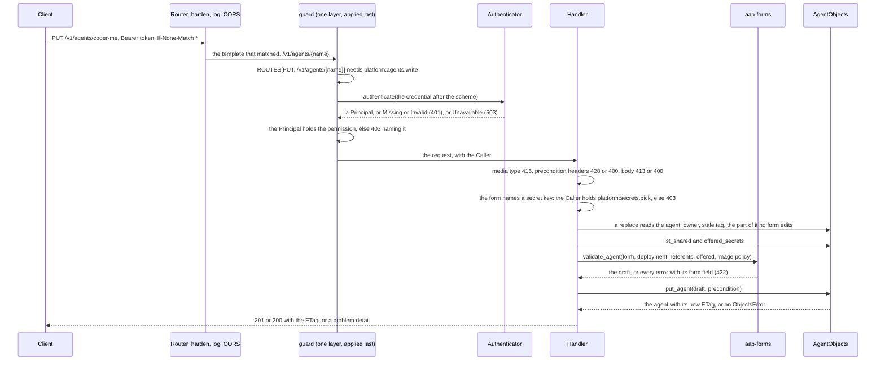
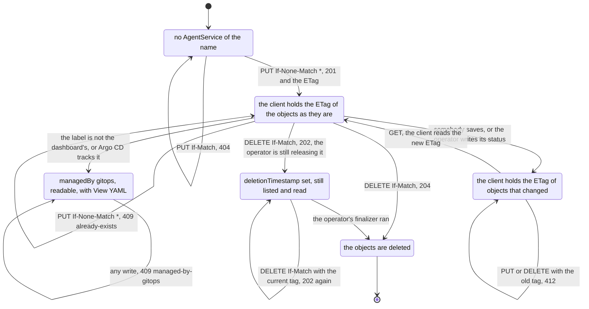

# aap-platform-api

The **Platform API** of the admin dashboard ([§60a](../../docs/architecture/10-control-plane-and-crds.md#the-platform-api-ad-025-ad-027),
slice D7a, AD-020, AD-025, AD-027, AD-030, AD-031, AD-032): an axum router over `/v1`, **generic over the two ports**
[`AgentObjects`](../ports/README.md#agentobjects-and-authenticator-d4) and [`Authenticator`](../ports/README.md#authenticator), so that no
implementation type is in any signature of this crate. [`bin/api`](../../bin/api/README.md) composes it with
[`aap-objects-kubernetes`](../objects-kubernetes/README.md) and [`aap-auth-oidc`](../auth-oidc/README.md); the tests of this crate compose
the `Memory` ports and, once, the OIDC authenticator against its testkit issuer.

```rust
use aap_platform_api::{ApiState, CorsOrigins, router};

let state = ApiState::new(objects, authenticator, defaults)?     // defaults: aap_forms::Defaults, checked here
    .with_cors(CorsOrigins::new(["https://agents.example.com"])?);
let app: axum::Router = router(state);                            // axum::serve(listener, app)
```

What it does, in one line each: **one table of routes** (`ROUTES`) says what each needs and the router is built from it; **the permission
of a route is checked by one layer over the whole router, applied last** ([*Authorization*](#authorization-one-layer-applied-last)), never by the
handler, so a route that is not in the table is never served, whoever added it and however; **every failure is a problem detail** (RFC 9457);
**every write is conditional** (`If-None-Match: *` creates, `If-Match` replaces and deletes); **a secret is a reference** and a write that
names one needs `platform:secrets.pick`; **a refusal names the agents it is about only to a caller who may read agents**; **CORS** is for the
deployment's origins and nothing wider.

## Routes

The table is [`routes.rs`](src/routes.rs) (`ROUTES`), which is §60a's table written once. The permissions are the constants of
[`aap_api::permission`](../api/README.md#permissions-slice-d4), checked **individually in the roles claim** and never a role name.

| Route | Permission | Success | What |
|---|---|---|---|
| `GET /v1/me` | a valid token | `200` | `{ "permissions": [...] }`: the values of the roles claim that start with `platform:` (an empty list is a `200`) |
| `GET /v1/info` | `platform:agents.read` | `200` | The capability document: `version`, `namespace`, `offerLabel`, `defaults` (the deployment's defaults as the forms show them), `runPodSizeClasses` (empty: adam-rs has none yet, D15), `limits.maxBodyBytes` |
| `GET /v1/agents` | `platform:agents.read` | `200` | `{ "agents": [...] }`, a row each: `name`, `title`, `description`, `kind` (`coder` or `folder`), `state`, `conditions`, `suspend`, `tags`, `audience`, `managedBy`, `deleting`, `configDigest` |
| `GET /v1/agents/{name}` | `platform:agents.read` | `200` + `ETag` | The row, `representation` (`{ "form": { "form", "deployment" } }` or `{ "yamlOnly": [reasons] }`), `status`, `configStatus` |
| `PUT /v1/agents/{name}` | `platform:agents.write` (+ `platform:secrets.pick` when the form names a secret key) | `201` + `Location` + `ETag` (create), `200` + `ETag` (replace) | The agent form (`aap-forms`), both objects |
| `DELETE /v1/agents/{name}` | `platform:agents.write` | `204`, or `202` + the row while the operator is still releasing it | `If-Match` required |
| `GET /v1/agents/{name}/yaml` | `platform:agents.read` | `200` + `ETag` | `application/yaml`: the `AgentConfig` then the `AgentService`, as `aap_forms::export_agent` writes them: never `status`, `managedFields` or a tool's annotation |
| `GET /v1/models`, `GET /v1/models/{name}` | `platform:agents.read` | `200` (+ `ETag`) | `{ "models": [...] }` / one: `name`, `title`, `managedBy`, `deleting`, `usedBy` (the agents that name it), `representation` |
| `PUT`, `DELETE /v1/models/{name}` | `platform:models.write` (+ `platform:secrets.pick`: a model always names its API key) | `201`/`200`, `204` | `ModelEndpointForm` |
| `GET /v1/tool-servers`, `GET /v1/tool-servers/{name}` | `platform:agents.read` | `200` (+ `ETag`) | `{ "toolServers": [...] }` / one, as models |
| `PUT`, `DELETE /v1/tool-servers/{name}` | `platform:toolproviders.write` (+ `platform:secrets.pick` when a header picks a key) | `201`/`200`, `204` | `ToolServerForm` |
| `GET /v1/secret-keys` | `platform:secrets.pick` | `200` | `{ "offerLabel", "keys": [{ "secret", "key", "externalSecret" }] }`: `key` is `null` for a Secret made with `dataFrom`. Never a value |

`HEAD` is `GET`. A method a path does not serve is `405` with `Allow`; a path that is no route is `404`. Neither asks for a token. Bodies
are objects, never bare lists, in camelCase.

### Authorization: one layer, applied last

[`authz.rs`](src/authz.rs) is one layer over the router, and the last thing `router()` does to it (`router.rs`: `assemble` makes the routes of the
table, `guarded` puts everything else around **whatever the router then holds**). It reads the route template that matched and the method, and
decides before anything of the router runs:

| The request | Answer |
|---|---|
| matched no route | `404` `no-such-route`. A fallback added to the router never runs |
| matched a template the table does not have | `500`, logged with the method and the template: nobody gave that route a permission, so it has no caller. Its handler never runs |
| matched a template of the table with a method the table does not have | `405` with `Allow` (the table's methods, `HEAD` after `GET`), asking for no token. A handler added for that method never runs |
| a route of the table | the token (`401`, `503`), then its one permission (`403`); then the handler, with the `Caller` |

So `.route_service`, `.merge`, `.nest`, `.nest_service` and `.fallback(handler)` added to the router before it is guarded are refused or answered
`404`/`405`/`500` and do not run, with or without a token (`router.rs`, a unit test that adds each of them). `tests/matrix.rs` is the second wall:
the source of the crate has `.route(` once, in the loop over the table, and none of those methods.

### Status codes

Every error is `application/problem+json` with `type` (`urn:vymalo:agents:problem:<slug>`), `title`, `status` and `detail`.

| Status | Slug | When | Extra members |
|---|---|---|---|
| `400` | `invalid-request` | a header or path not understood; two `Authorization` headers; two `Content-Type` headers; a malformed or unsupported `If-Match` or `If-None-Match` (a list, a value that is not a tag, both together); `If-None-Match` on a `DELETE`, with or without `If-Match` | |
| `400` | `invalid-body` | the body is not JSON of the form (a member the form does not have, a missing member, a wrong type). **It names a member and never quotes a value**: `serde_json`'s sentences quote values | |
| `401` | `missing-token` | no `Authorization`, a scheme other than `Bearer` (case-insensitive), an empty token. `WWW-Authenticate: Bearer` | |
| `401` | `invalid-token` | the token does not verify, for a word of the closed set (`expired`, `bad signature`, ...). `WWW-Authenticate: Bearer error="invalid_token"` | |
| `403` | `forbidden` | the token lacks the permission of the route, or `platform:secrets.pick` for a write that names a key. `WWW-Authenticate: Bearer error="insufficient_scope", scope="<permission>"` | `permission`: **the one** missing |
| `404` | `not-found`, `no-such-route` | an object that is not there (a read, a replace, a delete); a path that is no route | |
| `405` | `method-not-allowed` | a method the table does not have for a path it has (answered before a token is asked for) | `Allow` header |
| `409` | `already-exists` | a create of a name that exists (**not `412`**: see the decisions below) | |
| `409` | `managed-by-gitops` | the object is GitOps's (the label is not the dashboard's, or Argo CD tracks it): read-only | |
| `409` | `referenced` | a delete of a shared object agents name, or a write or delete of an agent whose config another service names | `agentCount`; `agents` **only for a caller who holds `platform:agents.read`** |
| `409` | `breaks-agents` | a change to a shared object that `dependents_after` shows the operator would refuse in agents that name it (GitOps's agents too, every one of them; a create is never asked) | `agentCount`; `agents` and `errors` (which name the agents) **only for a caller who holds `platform:agents.read`** |
| `409` | `deleting` | the agent is being deleted: the operator has not finished with its finalizer | |
| `409` | `yaml-only` | a form would replace an object that has a member no form says | `reasons` |
| `409` | `conflict` | another manager owns a field (a server-side apply conflict) | |
| `412` | `stale` | `If-Match` is not the object's token (somebody saved first, or the operator wrote its status), or it is a weak tag | |
| `413` | `payload-too-large` | a body over [`MAX_BODY_BYTES`](src/body.rs), 2 MiB, by `Content-Length` or by the bytes read | `limit` |
| `415` | `unsupported-media-type` | a write whose body is not `application/json` (UTF-8) | |
| `422` | `validation` | the form is read and is not valid: the screens' rules, the offered keys, the operator's rules (`aap-domain::validate`), or the API server's own validation, each error with its **form field** as `aap-forms` names it | `errors`: `[{ field, message }]` |
| `428` | `precondition-required` | a `PUT` with neither `If-None-Match: *` nor `If-Match`; a `DELETE` without `If-Match`; `If-Match: *` | |
| `500` | `internal` | a bug, or a route that is not in the table (its handler never runs). The cause is logged, never answered | |
| `503` | `keys-unavailable` | the issuer's keys cannot be fetched, so the token could not be checked: **never a `401`**. `Retry-After: 5` | |
| `503` | `unavailable` | the cluster's API server cannot be reached, or answered `401` or `403` (a `Role` that lacks a verb): the cause is logged. `Retry-After: 5` | |

## A request



A **shared object** write has the same steps, and between validation and the write asks `dependents_after` of every agent that names it, those of
GitOps included (a create is not asked: the port answers `already-exists` if the name is taken): a change the operator would refuse in them is
`409 breaks-agents`, listing every agent it breaks to a caller who may read agents, and nothing is written. A replace of an agent starts from the agent that was
read, so the answers come in the order a person can act on: *not yours* (`managed-by-gitops`), *being deleted*, *stale* (`412`), *YAML only*,
and only then the form's own errors (`422`).

## Preconditions

The token of an agent is `Agent::etag()`: the kind, name and `resourceVersion` of both objects. On the wire it is a **strong** entity-tag, the
token in double quotes (a byte an entity-tag may not hold is written `%XX`, which no adapter of this workspace needs). A weak tag never matches
(RFC 9110 §13.1.1). The operator writing a status moves the token, so a save may be `412` and the client reads again.



A second `DELETE` of an agent that is going is accepted again (the port accepts it): `202` and the row, as the first. The tag the client held before
the first one is stale for it (`412`). Any state: a `PUT` with no precondition, or a `DELETE` with no `If-Match`, is `428`, and nothing is read or
written; a `DELETE` that carries `If-None-Match` is `400` (a mistake of the request and not a missing precondition), also with nothing read or written.

## Decisions for the owner

§60a does not say these, or says them in other words; each is in the [D7a note](../../docs/architecture/10-control-plane-and-crds.md#60a-admin-dashboard-v0)
with its alternative. The eleven of the slice:

* **`428 Precondition Required`** for a write that is not conditional, a delete without `If-Match`, and `If-Match: *` (the port has no unconditional write).
* **A second create is `409`, not `412`.** RFC 9110 §13.1.2 would make a failed `If-None-Match: *` a `412`; §60a lists `409` for "exists" and `412` for "stale", and the client's remedy differs (choose another name, or read again).
* **The body limit is 2 MiB, not 1 MiB**, because a folder agent's files may be 1 MiB (§60a) and their JSON is larger.
* **`application/yaml`** (RFC 9512) for the export; D4 does not name a media type.
* **`GET /v1/secret-keys` needs `platform:secrets.pick` and not `platform:agents.read` as well**, as §60a's table says.
* **A shared change that breaks agents is refused** (`409 breaks-agents`, nothing written), where D4 left a warning as the other choice. The agents are changed first.
* **A form never replaces what it cannot say**: an agent or a shared object that only YAML can say is `409 yaml-only` with the reasons.
* **`DELETE` is `202` with the row** while the operator still holds the agent (the port returns once the service is gone or being deleted), `204` once it is gone.
* **The log names the route template and never a name from the path.**
* **The `type` of a problem is a URN** (`urn:vymalo:agents:problem:<slug>`), not an address.
* **`defaults.namespace` is the API's namespace**, the only one in the file ([`bin/api`](../../bin/api/README.md)).

And those the review of 2026-10-16 added, in the same note:

* **A route outside the table is `500`, not `401`**, and no handler of it runs (it is a bug of the code and not of the caller, and it is logged); nothing matched is `404` and a method the table lacks is `405`, each answered before a token is asked for.
* **Two `Content-Type` headers are `400`** (as two `Authorization` or two `If-Match`), and **a `DELETE` with `If-None-Match` is `400`**, with or without `If-Match`.
* **A 409 names the agents it is about only to a caller who holds `platform:agents.read`**; any other gets `agentCount`.
* **`defaults.allowedImageRegistries` is required and not empty in the binary's file** (`aap-forms` keeps "absent is any registry").
* **A CORS origin with the default port of its scheme is refused** when the list is read.
* **A `503` says `Retry-After: 5`.**

## What is logged

One event per request at `INFO` (`WARN` for a `5xx`) inside a span: `method`, `route` (**the template**, `/v1/agents/{name}`, `-` for a path that matched
nothing), `subject` (once the token verified), `status`, `latency_ms`. **Never**: the token, a header, a body, a name from the path, a secret key.
The cause of a `503` from the cluster, and of a `500`, is logged as the chain of its sources (the ports promise those hold no
token, claim or value). Keys that cannot be fetched are **one warning when it starts and one line when they are back**, not a line per request
(`tests/key_logs.rs`). `tests/logs.rs` holds it with a sentinel for each, in a test binary of its own (`tracing` caches a callsite per binary).

## CORS

`CorsOrigins::new` takes **exact origins** as a browser writes them (`scheme://host[:port]`, lower case, no path, no trailing slash) and refuses `*`,
anything that contains one, `null`, and anything that is not an origin. It answers the preflight (`GET`, `PUT`, `DELETE`, `OPTIONS`; request headers
`authorization`, `content-type`, `if-match`, `if-none-match`; `etag` exposed; `max-age` 600) and sends `Access-Control-Allow-Origin` for a listed origin
only. **No credentials mode** (`Access-Control-Allow-Credentials` is never sent): the token is in a header a page's script does not hold. An empty list is
no CORS. **The default port of a scheme is refused** (`https://host:443`, `http://host:80`, `wss`, `ws`): a browser leaves it out of the `Origin`, so the
entry would match nothing. Every answer of the router, a preflight and a refusal included, is `no-store` and `nosniff`: those headers are outside CORS
(`tests/cors.rs`). Rate limits are the edge's.

## Tests

`cargo test -p aap-platform-api` (no network but the loopback, no cluster).

| File | What |
|---|---|
| `src/*` (unit, 18) | the table has no route twice, and gives the `Allow` of a template; the ETag header round trip for any token, and an escape that is a percent and two hexadecimal digits (`%+f` is none); `If-Match` in every form; a media type; a body error that quotes no value; origins, and the default port; the bearer scheme; **every kind of stray route (a handler, a service, a nested router and service, a merged router, a stray method, a fallback) is refused or `404`/`405`/`500` and never runs**; every `ObjectsError` has the status of the ports table and leaks no source |
| `tests/matrix.rs` (12) | **the route-by-permission matrix**: a second, hand-written copy of §60a's table must equal `ROUTES`; every route and method with no token (`401` + challenge), a bad token, every permission but the needed one (`403` naming that one only), no permission, and the needed one; `HEAD`, `405`, `404`; the source has `.route(` once, in the loop over the table, and no other way to add a route |
| `tests/agents.rs` (34) | create, read, list, YAML; the ETag round trip, `412`, `428`, a weak tag; `409` for exists, GitOps, referenced (the agents named only to a reader of agents), being deleted (a second `DELETE` is `202` again) and YAML only; `422` with form fields; `secrets.pick`; `400` (two `Content-Type`, `If-None-Match` on a `DELETE`), `415`, `413` (by length, by one chunk and **across chunks**, to the byte); `503` from the objects and from the keys, with `Retry-After`; a save never moves the deployment part |
| `tests/lifecycle.rs` (15) | **each state of the lifecycle of §60a** (saving, blocked, degraded, ready, suspended, deleting) read from the two objects: a generation the operator has not observed, a config edited alone, no status, no state, a GitOps agent; **every member of a row and of a detail**, the order of the conditions, both statuses whole |
| `tests/shared.rs` (14) | models and tool servers: the same, `usedBy` (GitOps's agents too), a delete refused with the agents, a change that breaks agents (every one, in byte order), a create over a name that exists, `secrets.pick` per kind, the offered keys |
| `tests/cors.rs` (6) | a listed origin's preflight, an unlisted one's, simple requests, no CORS configured, a wildcard refused, **the hardening headers on a preflight, a 404, a 405 and a 401** |
| `tests/oidc.rs` (3) | a real signed token over the router: permissions, `403`, every reason for a `401`, keys down is `503` |
| `tests/logs.rs` (1), `tests/key_logs.rs` (1) | the log holds a method, a template, a status, a latency and a subject, and none of the sentinels; keys that are down are one warning and their return one line. Each in a test binary of its own |
| `tests/misc.rs` (4) | `me`, `info`, a version, defaults the operator would refuse stop the API |

## Not here

* The binary, its configuration file, health and shutdown: [`bin/api`](../../bin/api/README.md). The image, the chart's `api` component and the kind end-to-end are D7b.
* TLS, rate limits and request timeouts: the edge's (§60a, *Clients without a web server*). **DPoP** is not checked (D6's question).
* A route for the orphan configs a slow delete leaves (`list_orphans`) and the **Adopt** action of the takeover (D16): the port has them, no route does.
* The Agents screen's *In chat*: the page's own check.
