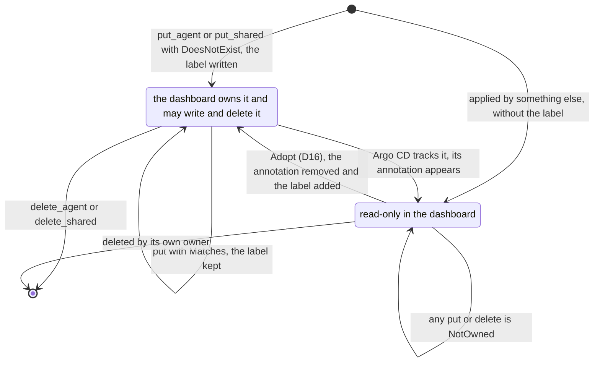

# aap-ports

The provider seams of the v0 operator ([§59a](../../docs/architecture/10-control-plane-and-crds.md#59a-operator-v0-adam-rs-agents),
[§22](../../docs/architecture/05-runtime.md#22-runtimeprovider), AD-020): three traits and the neutral
types that cross them; and the two seams of the admin dashboard's Platform API
([§60a](../../docs/architecture/10-control-plane-and-crds.md#the-platform-api-ad-025-ad-027), slice D4): `AgentObjects` and
`Authenticator`.

| Trait | Does | Implemented by (later slices) |
|---|---|---|
| `RuntimeProvider` | makes an agent's compute exist, says how it is doing, tells the controller what changed | `runtime-kubernetes` (S4); `MemoryRuntime` here |
| `StoreProvisioner` | makes the agent's run ledger exist: a referenced Secret, or an operator-owned CloudNativePG cluster | `store-secret`, `store-cnpg` (S5, S6: `CnpgStore` serves both kinds); `MemoryStore` here |
| `AgentDirectory` | lists the agents the platform runs, for the registry | the controller's reflector (S5), read by `aap-registry` (S7); `MemoryDirectory` here |
| `AgentObjects` | the dashboard's custom resources: apply, get, list and delete an agent (`AgentService` + `AgentConfig`), a `ModelEndpoint`, a `ToolProvider`; list the offered secret references (D4) | [`objects-kubernetes`](../objects-kubernetes/README.md) (D5); `MemoryObjects` here |
| `Authenticator` | a bearer token to a `Principal`: the subject and the values of the roles claim (D4) | [`auth-oidc`](../auth-oidc/README.md) (D6); `MemoryAuthenticator` here |

**No Kubernetes type, no driver type and no secret value appears in any signature.** A secret has no
field anywhere in this crate: it travels as a `SecretRef { name, key }` and a provider hands it to the
process without reading it (AD-024).

Where it sits: `aap-ports` depends on nothing of the workspace (its tests read `aap-api`, as a dev-dependency, to hold
the testkit's samples to the real CRD types). `aap-domain` depends on it for the
output of `resolve` (§59a: "the mapping of `adam-coder` / `adam-agent` onto `aap_ports::RuntimeSpec`"), and
`aap-api` knows nothing of it; the controller (S5) is generic over `<R: RuntimeProvider, S: StoreProvisioner>`. `aap-forms` (D4)
builds the bodies `AgentObjects` takes and reads the bodies it gives; the Platform API ([D7a](../platform-api/README.md)) is generic over the two traits of D4.

## The traits

All methods are **idempotent**; the id is the only identity.

```rust
trait RuntimeProvider: Send + Sync {
    fn name(&self) -> &'static str;                 // status.runtime.provider
    fn capabilities(&self) -> Capabilities;         // { suspend }
    async fn ensure(&self, id: &RuntimeId, spec: &RuntimeSpec) -> Result<RuntimeStatus, RuntimeError>;
    async fn suspend(&self, id: &RuntimeId) -> Result<RuntimeStatus, RuntimeError>;
    async fn delete(&self, id: &RuntimeId) -> Result<DeleteOutcome, RuntimeError>;
    async fn status(&self, id: &RuntimeId) -> Result<RuntimeStatus, RuntimeError>;
    async fn endpoint(&self, id: &RuntimeId, surface: Surface) -> Result<Endpoint, RuntimeError>;
    fn watch(&self) -> BoxStream<'static, RuntimeId>;
}
trait StoreProvisioner: Send + Sync {
    fn capabilities(&self) -> StoreCapabilities;    // { cnpg }
    async fn ensure(&self, id: &StoreId, spec: &StoreSpec) -> Result<StoreStatus, StoreError>;
    async fn release(&self, id: &StoreId) -> Result<ReleaseOutcome, StoreError>;
}
trait AgentDirectory: Send + Sync {
    async fn list(&self) -> Result<Vec<DirectoryEntry>, DirectoryError>;
    async fn get(&self, scope: &str, name: &str) -> Result<Option<DirectoryEntry>, DirectoryError>;
}
```

```rust
trait AgentObjects: Send + Sync {                       // D4: the Platform API's store
    async fn list_agents(&self) -> Result<Vec<Agent>, ObjectsError>;
    async fn get_agent(&self, name: &str) -> Result<Option<Agent>, ObjectsError>;
    async fn put_agent(&self, draft: &AgentDraft, when: &Precondition) -> Result<Agent, ObjectsError>;
    async fn delete_agent(&self, name: &str, when: &ETag) -> Result<(), ObjectsError>;
    async fn list_orphans(&self) -> Result<Vec<Stored>, ObjectsError>;                       // configs of the dashboard that no service names
    async fn list_shared(&self, kind: SharedKind) -> Result<Vec<Stored>, ObjectsError>;   // Model | ToolServer
    async fn get_shared(&self, kind: SharedKind, name: &str) -> Result<Option<Stored>, ObjectsError>;
    async fn put_shared(&self, kind: SharedKind, draft: &SharedDraft, when: &Precondition) -> Result<Stored, ObjectsError>;
    async fn delete_shared(&self, kind: SharedKind, name: &str, when: &ETag) -> Result<(), ObjectsError>;
    async fn offered_secrets(&self) -> Result<Vec<OfferedSecret>, ObjectsError>;
}
trait Authenticator: Send + Sync {                      // D4: a bearer token to a person
    async fn authenticate(&self, token: Option<&str>) -> Result<Principal, AuthError>;
}
```

(`async fn` is shorthand: the declared form is `fn … -> impl Future<Output = …> + Send`, see below.)

### Native async, not `async-trait`

The methods are native `async fn` in the trait, declared as `-> impl Future<Output = …> + Send`.
Reasons: no heap allocation per call and no macro; the `Send` bound is what lets a controller `spawn`
a reconcile that calls them; an implementation writes plain `async fn`. The price is that **the traits
are not object safe** (no `dyn RuntimeProvider`). §59a makes the controller generic and the provider a
build-time choice (AD-020), so nothing needs `dyn`. If a composition root ever wants one, a small
`DynRuntimeProvider` adapter with boxed futures can be added next to the trait without touching an
implementation.

### What the methods mean where §22 and §59a say little

* **`ensure`** creates, changes or wakes (there is no `activate`, AD-023). It first runs
  `RuntimeSpec::check`, so every provider rejects the same malformed spec with `InvalidSpec`.
* **A blocked runtime is not an error.** A name held by an object that is not ours (the adoption
  guard) is an `Ok(RuntimeStatus)` with an issue `NameConflict` and nothing changed; a missing Secret, a
  crash loop or an image that cannot be pulled are issues of the status too. `RuntimeError` is for calls
  that failed (`Unavailable`), not for a runtime that is unwell.
* **`delete(id)` takes no spec.** The deletion policy of the last `ensure` is on the objects the
  provider made, so a restarted controller can still delete (§59a: "the policy reaches the provider … in
  its neutral spec type"). The outcome says which persistent volumes stayed (`Retain`).
* **`status` of what does not exist is `Phase::Absent`**, not `NotFound`.
* **`RuntimeStatus.replicas`** are the ready replicas of the workloads that step runs (`Role::All` and
  `Role::Worker`), so `split` does not count the front.
* **`watch` is a hint** ("a notification is never the truth"): ids of runtimes whose state changed since
  the stream was taken, at most once, possibly also for runtimes the caller does not care about. The
  controller still reconciles on a timer and reads `status`.
* **`StoreProvisioner::ensure`** returns the Secret key that holds the connection string
  (`StoreStatus.connection`) and a `StoreState` (`SecretReferenced`, `ClusterReady`, `ClusterNotReady`).
  A cluster kind on a backend without CloudNativePG is `StoreError::NotInstalled` (the
  `CNPGNotInstalled` condition), not a status. `cnpg_connection("coder")` is `coder-db-app` key `uri`:
  the one definition of that name, used by `aap-domain` for `DATABASE_URL` and by every provisioner.
* **`AgentDirectory::list`** returns every service, listed or not, ordered by scope and name, with the
  flags the registry needs (`a2a_enabled`, `blocked`, the card URL) and the `audience` (D3, AD-028: who may use the
  agent, **as the service states it**, in its order and with its repeats; empty means none, because absent and `[]` are
  the same to a consumer, so the type is a `Vec` like `tags` and not an `Option`; the registry sorts and de-duplicates what
  it publishes, so a directory does not have to); `DirectoryEntry::listed()` is the
  rule of §59a ("A2A enabled, not `Blocked`") in one place. Before its first sync a directory answers
  `NotReady`, never an empty list that looks true.

### Errors

`thiserror` enums (`RuntimeError`, `StoreError`, `DirectoryError`, `ObjectsError`, `AuthError`), each with a class
(`Classify::class() -> ErrorClass`: `Transient`, `Conflict`, `Invalid`, `NotFound`, `Unsupported`,
`Internal`). A caller decides from the class, never from the variant, the way the sibling repository
`another-adam-rs` does with `adam_error::Classify`; the trait is small enough that it is defined here
instead of depending on that repository.

## `AgentObjects` and `Authenticator` (D4)

[§60a](../../docs/architecture/10-control-plane-and-crds.md#the-platform-api-ad-025-ad-027): the Platform API is generic over these two
traits and a router; the Kubernetes implementation ([`objects-kubernetes`](../objects-kubernetes/README.md), D5) and the OIDC one
([`auth-oidc`](../auth-oidc/README.md), D6) are other crates. **The contract below is what `agent_objects_conformance!` and `authenticator_conformance!` hold them to.**

### What crosses `AgentObjects`

**No Kubernetes type crosses it, and no type of `aap-api`** (the same rule as the other traits: the neutral vocabulary is
defined here). A body is the JSON an API server holds as `spec`, a name is a string, and what the API server adds is a field of
`Stored`. `aap-forms` is the typed side: it builds an `AgentDraft` from a form and reads a form back from an `Agent`.
(`serde_json::Value` in a port is the wire format of Kubernetes objects, not an implementation type; the alternative, `aap-ports`
depending on `aap-api` and so on `kube`, would give every provider that depends on this crate the CRD types.)

| Type | What |
|---|---|
| `Kind::{AgentService, AgentConfig, ModelEndpoint, ToolProvider}`, `SharedKind::{Model, ToolServer}` | The four kinds. Closed. `SharedKind` is the pair of routes `/v1/models` and `/v1/tool-servers` |
| `Stored { kind, namespace, name, version, generation, labels, annotations, spec, status, deleting }` | One object as the server holds it, reduced to what the dashboard needs. `status` is the operator's: the dashboard never writes it. `deleting` is `true` for an object with a `deletionTimestamp`: its finalizers have not run, and nothing is written to it. `spec` and `status` are **as written**, without the defaults that an API server adds to every object (`aap-objects-kubernetes` reads them through `managedFields`) |
| `Agent { service, config: Option<Stored> }` | An agent is its `AgentService` and the `AgentConfig` that service names (`spec.configRef.name`); the config is `None` when it is not there. One unit: read, saved and deleted together, with one `ETag`. `Agent::deleting()` is `true` when the service (or the config) is being deleted: the operator has not finished with it, and it is still listed and read, with its status, until it goes |
| `AgentDraft { name, service, config }`, `SharedDraft { name, spec }` | What the dashboard writes: the two `spec`s of an agent (both objects are named `name`; `service.configRef.name` must say so), or one. Labels are the implementation's |
| `Precondition::{DoesNotExist, Matches(ETag)}` | `If-None-Match: *` and `If-Match`. **There is no unconditional write, and no unconditional delete**: `delete_agent` and `delete_shared` take the `ETag` the caller read, so that a delete never removes what somebody changed since the list was drawn (the router answers a `DELETE` without `If-Match` itself) |
| `ResourceVersion`, `ETag` | The `resourceVersion` of one object (opaque), and the token of **every** object of a unit, derived by `Stored::etag` and `Agent::etag` from the **kind, the name and the version** of each (length-prefixed: no two units spell one token), so a token read from one object is the token of no other, whatever the backend's versions are. An object that is not there is part of the token too |
| `Owner::{Dashboard, GitOps}` | AD-031, in `Owner::of(labels, annotations)`: the dashboard owns an object with `app.kubernetes.io/managed-by: dashboard.agents.vymalo.com` and **no** `argocd.argoproj.io/tracking-id`. Anything else is GitOps's to the dashboard: read-only. On the wire `dashboard` and `gitops`, the `managedBy` of `GET /v1/agents` |
| `OfferedSecret { secret, key: Option<String>, external_secret }` | A Secret key an agent may name (AD-030). **No field for a value**, so nothing that holds one can leak a secret. `key: None` is a Secret made by an ExternalSecret that fetches with `dataFrom`: no key is listed and any key name of valid syntax is accepted (typed by hand, §60a) |
| `FieldError { kind, path, message }` | A mistake with its field: the **kind** of the object and the path from it (`spec.access.audience[2]`), typed so that the forms map it without parsing a sentence, and so that an implementation (D5) produces it from the server's answer. `Display` is `<Kind> <path>: <message>`, the words of `aap-domain`'s issues |
| `References`, `config_references(spec)`, `config_name(service_spec)` | What an `AgentConfig` names (`model.endpointRef`, `tools.mcpServers.<n>.providerRef`) and the config a service names, read from JSON. A test holds the rule equal to `aap_domain::references` (in `aap-forms`) |
| `MANAGED_BY_LABEL`, `MANAGED_BY_DASHBOARD`, `ARGO_TRACKING_ANNOTATION`, `OFFER_LABEL` | The strings of the ownership rule and of the offer (`agents.vymalo.com/offer`) |

### The contract of `AgentObjects`

* **Ownership (AD-031).** A write or a delete of an object that is not `Owner::Dashboard` is `NotOwned`, before anything changes. **An agent is
  the dashboard's only when both its objects are**: one GitOps object of the pair makes a replace and a delete `NotOwned`, naming that object's kind.
  A write adds the label to what it writes (and keeps the labels the object has). Reads return every object, the dashboard's or not.
* **A refused write changes nothing.** Every refusal (`PreconditionFailed`, `AlreadyExists`, `NotFound`, `NotOwned`, `Referenced`, `Invalid`, a `Conflict` the
  backend states) leaves **both objects of an agent exactly as they were**: every precondition of the pair is checked before the first of them is written. A refusal
  that is about the service must not have written the config, and the reverse; the cases `a_refused_write_changes_neither_object` and the suites that
  fail a store that writes one half and then refuses hold it.
* **No lost update, on a write and on a delete.** A create needs the `AgentService` to be absent (`AlreadyExists`; a dashboard-owned `AgentConfig` of the
  name, left by a create that failed halfway, is taken over; a GitOps one is `NotOwned`). A replace of what is not there is `NotFound`
  (a 404 rather than a 412: the agent was deleted, which is more to say). A replace or a delete with a stale token is `PreconditionFailed` and changes nothing.
  **A delete carries the token too**: an administrator who deletes an agent that somebody saved a minute ago would remove their work unseen, so there is no
  unconditional delete (it was `Option<&ETag>`, with `None` meaning "whatever is there"; the router (D7a) answers `428` to a `DELETE` with no `If-Match`, as it does to a `PUT` with no
  precondition, and a client with no token reads first).
* **An agent is two objects.** Written `AgentConfig` first, then `AgentService` (the operator never sees a service whose config is
  not there yet); deleted in the other order. The config of an agent has the agent's name, and a draft whose `configRef` says otherwise is
  `Invalid`.
* **A delete returns once the service is gone or is being deleted; the config goes when the service is gone.** The operator's finalizer on the
  `AgentService` releases the compute and the store, and **reads the `AgentConfig` while it does**: `deletionPolicy` is read from the objects at that moment, because
  a person who saved `Retain` over `Delete` and deleted at once has had no reconcile in between (`Delete` to `Retain` must not lose data), and a config the operator cannot read
  leaves the policy it remembers standing, `Delete` (*the premise, held by `a_config_that_is_gone_when_the_finalizer_runs_leaves_the_remembered_policy_standing`
  in `aap-controller`*). So a delete that leaves the service `deleting` leaves the config too. An implementation may wait a short, bounded time for the service to go before it returns,
  and then deletes the config in the same call; one that does not wait returns with the agent `deleting`. Deleting a service that is already being deleted is accepted.
* **An agent that is being deleted is read, and refuses every write.** `Stored::deleting` and `Agent::deleting()` say so; it is still listed and read (the operator's status says what it is
  doing). A replace of it, a create over its name (`DoesNotExist`) and a write of its config are `Deleting { kind, name }` (`409`, class `Conflict`: read again later; the name is free
  when the operator is done). A write that finds an object begin to be deleted between the read and the apply says the same.
* **A config the delete left is an orphan, and a delete of its name removes it.** What the wait above did not outwait, and what a create that failed halfway leaves, is a config the dashboard
  owns and no service names. `list_orphans` lists them (ordered by name, with the tokens a delete of their names takes: `Stored::etag`), they are not agents (`get_agent`
  and `list_agents` do not have them), and `delete_agent(name, &config.etag())` of a name whose service is **absent** deletes the config of that name, on **its own** token (`NotFound` when there is neither).
  **A config that is GitOps's (`NotOwned`) or that any service names (`Referenced`) is never deleted that way**, and a stale token is `PreconditionFailed`. This is the smallest way: the alternative,
  an `Agent` with `service: None` in `list_agents`, would make every reader of an agent handle a half that has no service. The list is for a screen of leftovers; D7a draws none, and no route lists them.
* **A config is one agent's.** The dashboard never shares an `AgentConfig` between two services (§60a, decision (f) of D4). When **another** `AgentService` names the
  config the dashboard would write, take over or delete (its `configRef.name` is the agent's name; a GitOps service can name any), the replace, the create (also of a
  config that is not there yet, and the takeover of one a half-failed create left) and the delete are all `Referenced { kind: AgentConfig, name, by }`, with the names of
  those services in byte order. **A delete refuses whole**: neither the service nor the config is deleted. (The other choice, deleting the service and keeping the
  config, leaves a dashboard-labelled config that no screen shows.) `NotOwned` would be wrong: the config may be the dashboard's.
* **The token is the kinds, names and `resourceVersion`s of the objects**, as §60a says (the `resourceVersion`s), so any write to either object makes an old token stale, **the operator's
  status writes included** (a Kubernetes API server gives an object a new `resourceVersion` when its status changes: *verified 2026-10-16*
  by D5's cluster test, `the_status_of_the_operator_makes_a_token_stale_and_a_save_that_changes_nothing_keeps_it`). The router answers `412` and the client reads again. Whether a save that changes nothing moves the token is the
  backend's (`MemoryObjects` keeps it, as a server-side apply of an unchanged object does: *verified 2026-10-16* by the same test), and callers must not depend on it. `MemoryObjects` numbers the
  versions **per object** (kept after a delete), so that two objects often share one, which is what makes the token's kind and name testable.
* **The status is the operator's.** A write never touches it.
* **References are checked on a delete, not on a write.** An agent may name a model that is not there (the operator marks it
  `ConfigInvalid`, naming it, and the API validates with `aap-domain` before it writes). Deleting a shared object some agent names is
  `Referenced { by }`: the agents (their `AgentService`s) that name it, once each, in byte order, **GitOps's included**.
* **Secrets.** `offered_secrets` lists the `data[].secretKey` of every ExternalSecret that carries the offer label, under its
  `target.name`, and, for one that also has a `dataFrom`, the Secret with `key: None`; ordered by `(secret, key, external_secret)`, the `None` first. It reads no Secret and has no
  right to; the cases plant values in the backend and fail when one reaches an answer.
* **Ownership is read from two marks, nothing else.** `Owner::of` reads the dashboard's `app.kubernetes.io/managed-by` label and Argo CD's
  `argocd.argoproj.io/tracking-id` annotation. It does **not** detect Flux (`kustomize.toolkit.fluxcd.io/…` labels) or Argo CD set to label tracking
  (`app.kubernetes.io/instance`): an object that has the dashboard's label and that one of those now syncs is still read as the dashboard's, and a save would fight it. An object
  **without** the label is GitOps's whoever applied it. Whoever hands a dashboard object to such a tool removes the label first (AD-031, *Adopt*, D16).

**What `objects-kubernetes` (D5) does** about the atomicity above, since a Kubernetes API server writes one object at a time: before the first write, **read both objects and compare the token,
the owners and the services that name the config**; run both server-side applies with `dryRun=All`, each with the `resourceVersion` it was read at, so that a stale
token on either object and a rule of the CRDs (a `422` on the service, which would come *after* the config was applied) are refused while nothing has changed; then apply the
config and the service for real, each with its `resourceVersion`. The window that is left (somebody changes the service between the two real applies) leaves the config written and
answers `PreconditionFailed`; a retry reads again and succeeds, and the create is retried over the config it left (taken over). That is the one place a refusal changes something, and `aap-objects-kubernetes` shows it, on a fake API server and on a real one.
Every outcome of that window leaves the config written, and says what happened to the service. When only its `resourceVersion` moved (the operator wrote its `status`, or put its finalizer on:
a config change makes the operator write the service's status, so this is the common case), the apply is repeated once with the new version and the save **succeeds**; when what the
save is about changed (the service's `spec`, labels or annotations, or the service is another object or gone) the answer is `PreconditionFailed` (or `NotFound` / `AlreadyExists` for the service itself); when it
began to be deleted, `Deleting`; when the API server fails the apply, `Unavailable` (a retry succeeds when it is back); when a field is another manager's, `Conflict` (a retry is refused by the dry run until they let go). The half-write is logged
at `warn`, with names and no value. A delete is the other way round: the service first, and the config only once the service is gone (above).

The ownership of an object is the one thing a write changes and a person does not see, so here is its lifecycle (AD-031; the **Adopt** action is slice D16's,
the takeover of `coder` and `chat`, and is not built):



### Errors and the status of the Platform API

Each variant has one status; `tests/objects.rs` holds this table with an exhaustive `match`, so a new variant does not compile until it has one.

| `ObjectsError` | Status | Class | When |
|---|---|---|---|
| `AlreadyExists` | 409 | `Invalid` | a create found the name |
| `NotOwned` | 409 | `Invalid` | the object is GitOps's |
| `Referenced { by }` | 409 | `Invalid` | agents still name the shared object, or another service names the config of the agent being written or deleted; the body names them |
| `Conflict` | 409 | `Conflict` | another manager owns a field (a server-side apply conflict) |
| `Deleting { kind, name }` | 409 | `Conflict` | the service or the config is being deleted (its finalizers have not run): read again later |
| `NotFound` | 404 | `NotFound` | a replace or a delete found nothing |
| `PreconditionFailed` | 412 | `Conflict` | the token is stale: somebody saved first |
| `Invalid(fields)` | 422 | `Invalid` | the backend refused the body, field by field (a CEL rule); the fields are mapped to the form by `aap-forms` |
| `Unavailable` | 503 | `Transient` | the API server cannot be reached |
| `Internal` | 500 | `Internal` | a bug |

### `Authenticator`

`authenticate(token: Option<&str>)` takes the credential after the scheme (the router reads the header). `Principal { subject, permissions }`
keeps the **whole** roles claim (it also holds `agent.use:<name>` and the orchestrator's roles, which the dashboard ignores) as a set;
`holds(permission)` is a byte-for-byte comparison, and `with_prefix("platform:")` is `GET /v1/me`. **The API checks a permission
string (`aap_api::permission`), never a role name** (AD-032): no type here compares a value to a role. A `Principal` has **no `Default`**: it is somebody a token proved,
and an empty one would be an authenticated nobody.

| `AuthError` | Status | Class | When |
|---|---|---|---|
| `Missing` | 401 | `Invalid` | no token, or an empty one, whatever the state of the keys |
| `Invalid(InvalidToken)` | 401 | `Invalid` | the token does not verify. The reason is **a closed enum** (`Malformed`, `BadSignature`, `UnknownKey`, `Expired`, `WrongIssuer`, `WrongAudience`, `MissingClaim`), each a fixed word for a log (`expired`; `auth-oidc` also says `Expired` of a token whose `nbf` is still ahead: the set has no word for "not yet valid"): it cannot hold the token or a claim, whatever an implementer forgets |
| `Unavailable(source)` | 503 | `Transient` | the issuer's keys cannot be fetched. Never a 401: a good token is not told it is bad. The source is the failure to fetch the keys: **an implementation must not put the token, a claim or a header of it in it** (a fetch for `kid` X that fails must not say X). The suite reads the message, the debug form and the whole chain of sources |

## The neutral types

| Type | What |
|---|---|
| `RuntimeId`, `StoreId` | scope (a namespace) and name of the service. The same on every call |
| `OwnerHandle` | **opaque** token the controller got from the object and a provider understands (owner references). Never read by the controller, never part of a digest |
| `SecretRef { name, key }` | the only form of a secret |
| `RuntimeSpec` | what to make: `workloads`, `file_sets`, `network`, `suspend`, `deletion`, `owner`, `run_pods` (D15a, below), and the `digest` the pods are stamped with |
| `Workload` | one set of identical pods: `role`, `replicas`, `stable_identity`, an agent `Container`, native `sidecars`, `volumes`, `security`, the grace period, a disruption budget and, with run pods, the `service_account` its pods run as |
| `Container`, `EnvVar`, `Mount`, `Probe`, `Resources` | what runs |
| `EnvValue::{Literal, Secret(SecretRef), PodName, PodNamespace}` | where a variable comes from (`PodNamespace` is the pod's own namespace, D15a: `RUN_POD_NAMESPACE`). Closed: a new source fails to compile in every provider |
| `RunPods`, `RunPodQuota`, `RunPodNetwork`, `EgressRule`, `EgressPort`, `RunPodLabels`, `RunPodGuard` | **Run pods (D15a)**: what the provider makes besides the workloads so that the workers can make pods of their own for the commands of a run, and what guards the pods they make: the account and the Role it is bound to, the priority class, the quota, the network policy, the labels the workers put on what they make, and what the guard lets a pod be (its images, its one claim, its one Secret key). The template the pods are made from is **not** here: it is a file set of the workloads (`aap-domain` makes both) |
| `VolumeSpec`, `VolumeSource::{Persistent, Files, ExternalFiles, SecretFile}`, `Sharing::{PerReplica, Shared}` | volumes; persistent ones are data |
| `FileSet` | files materialised by name (ConfigMaps); paths may contain `/` and a provider maps them |
| `Network`, `Peer`, `Selector`, `IpBlock` | the Service port, which workload it selects, and the peers of the ingress rule (the neutral form of a `NetworkPolicyPeer`) |
| `Role::{All, ControlPlane, Worker}` | adam's `ROLE`. Closed |
| `RuntimeStatus { phase, replicas, issues }`, `Phase`, `Issue { role, reason, message }`, `IssueReason` | the §59a table: `ConfigRejected`, `DependencyUnavailable`, `MissingSecret { name }`, `ImagePull`, `CrashLoop`, `NameConflict`. Closed |
| `Capabilities`, `Surface`, `Endpoint`, `DeleteOutcome` | |
| `StoreSpec`, `StoreKind::{Secret, Cnpg}`, `CnpgSpec`, `StoreStatus`, `StoreState`, `StoreCapabilities`, `ReleaseOutcome` | the store |
| `DirectoryEntry` | the directory entry type for the registry: scope, name, title, description, tags, **audience (D3)**, card URL, `a2a_enabled`, `blocked`. A public struct built with a literal: **the field `audience` broke every `DirectoryEntry { .. }` literal** (an implementer of `AgentDirectory` that builds its own entries; the literals in this repository are updated: the controller's `entry()`, the testkit's `entry()`, `tests/contract.rs` and the registry crate's test helpers; `MemoryDirectory` builds none, it keeps the entries it is given), and it is `#[serde(default)]`, so a stored entry from before reads as having none |
| `DeletionPolicy::{Retain, Delete}` | the neutral form of `aap_api::DeletionPolicy` |
| `Kind`, `SharedKind`, `Stored`, `Agent`, `AgentDraft`, `SharedDraft`, `Precondition`, `ResourceVersion`, `ETag`, `Owner`, `OfferedSecret`, `FieldError`, `ObjectsError`, `Principal`, `AuthError` | the vocabulary of `AgentObjects` and `Authenticator` (D4): [above](#what-crosses-agentobjects) |

Choices worth knowing, because §59a does not say:

* **Run pods are applied, and what a pod reads is in the digest.** `RuntimeSpec::run_pods` and `Workload::service_account` are absent from the JSON when absent (`skip_serializing_if`), so a spec without run pods is the JSON it was before the fields existed (`tests/contract.rs` holds it), and the digest leaves `run_pods` out: a bigger quota must not roll the pods. What a pod does read of run pods (its account, its variables, the template's file set) is in the workloads, and rolls them. `check()` refuses a workload that runs as an account when the spec has no run pods, an account other than the run pods' own, no workload that runs as it, and an empty name, label, class, claim, Secret reference or image list, or a quota of no pod.

* **`stable_identity`.** §59a picks a StatefulSet "when a `perReplica` persistent volume exists". A
  placement of `affinity` pins runs to a worker by `WORKER_ID` = the pod name, and then needs the name to
  survive a restart, but its volume is one shared claim. `stable_identity` says it in neutral terms
  (true for a per-replica volume *or* a pod-name variable) and a provider that has a StatefulSet picks it
  on that.
* **The digest covers what the pods run** and not scale, ownership, the deletion policy or the network
  policy (see `aap-domain`): a bigger `scaling.workers` must not roll the running pods. A provider only
  copies `RuntimeSpec::digest` onto the pods.
* **An empty `network.allow_from` makes no policy**, it does not deny everything: the bearer token is
  the gate, and an agent nobody can reach is a worse default than one that needs the token.
* **`Capabilities` has one flag**, `suspend`, because it is the only optional verb. Things that were
  tempting (`sidecars`, `shared_volumes`) are not optional for v0 and would only be flags no case could
  test.

## Feature `testkit`

Off by default (the controller and the providers depend on the traits only). With it:

* **Conformance macros**, in the style of `adam-store-testkit`:
  `runtime_provider_conformance!(make)` (14 cases), `store_provisioner_conformance!(make)` (7),
  `agent_directory_conformance!(make)` (6), `agent_objects_conformance!(make)` (33, D4; the one list of its cases is `agent_objects_cases!`, which a backend's own tests may use to run them all another way: `aap-objects-kubernetes` derives its `Role` from every request of every case) and
  `authenticator_conformance!(make)` (8, D4; its sentinel token is JWT-shaped, three base64url parts with the sentinel as `kid`, `iss`, `aud`, `sub` and signature). `make` is a path to `async fn() -> Option<T>`; `None` skips
  the suite, and `AAP_TEST_REQUIRE_BACKEND=1` turns the skip into a failure (CI sets it for the suites that
  need a cluster). The macros expand to `#[tokio::test]`, so the crate that uses them needs `tokio` with
  `macros` and `rt`.
* The type under test also implements `RuntimeUnderTest`, `StoreUnderTest` or `DirectoryUnderTest`: a
  `materialised(id)` that returns **every plain-text value the provider wrote to its backend** (literal
  variables, commands, file contents, labels), and for a directory, `put` and `remove` into its source.
  The case **"no secret value materialises"** puts a sentinel in the names of the Secrets of a spec and
  fails if it is anywhere in that text or in an issue message. It is as honest as `materialised`: a
  Kubernetes provider feeds it the real objects it applied, minus `secretKeyRef`.
* `ObjectsUnderTest` (D4) is what the objects cases need of a backend beyond the port: `seed_foreign` (an object the dashboard does
  not own, `Foreign::Unlabelled` or `Foreign::ArgoTracked`; it takes over an object of that kind and name that is there, which is how a case makes an agent whose two objects have two owners),
  `seed_orphan_config` (a dashboard-owned config and no service: what a create that failed halfway leaves), `seed_finalizer` (the operator's finalizer is on a service: a delete of it
  leaves it `deleting`), `seed_terminating` (somebody else is deleting a service, with that finalizer), `run_finalizer` (the finalizer ran: a service that was being deleted goes, **the config stays**), `set_status` (as the operator), `offer`, `decline` (an ExternalSecret
  without the label) and `plant_secret_value` (a Secret that holds a value the port must never read), and, with defaults, `unreachable` (the
  same backend made unreachable) and `refused_spec` (a `spec` the backend refuses; a backend with rules of its own, the CEL of the
  CRDs, gives one that breaks one, and the case checks that the 422 names its field). `AuthenticatorUnderTest` is `issue(subject,
  permissions)` (a token the authenticator accepts) and, with a default, `without_keys` (the same kind of authenticator that cannot fetch its keys, and a
  token it would have to verify with them).
* `sample_agent`, `sample_agent_using` and `sample_shared`: bodies of the real shape (a test reads them through the CRD types), with
  Secret names that carry the sentinel. `SECRET_VALUE` is what the cases plant as a Secret's content.
* `sample_spec_with_run_pods(id)`: `sample_spec` with run pods on (D15a).
* `sample_spec(id)`: a spec that uses every kind of thing a provider must handle (a sidecar, literal,
  secret and pod-name variables, a per-replica volume, a file set, a secret file, probes). Providers reuse
  it in their own tests.
* **`memory::{MemoryRuntime, MemoryStore, MemoryDirectory, MemoryObjects, MemoryAuthenticator}`**: in-memory implementations that pass
  their own suites (`tests/memory.rs`, with and without `suspend`, with and without CloudNativePG) and serve the
  controller's unit tests: `set_foreign` (the adoption guard), `force_status` (a crash loop),
  `set_unavailable`, `set_cnpg_installed`, `set_cluster_ready`, `set_ready`. `MemoryObjects` refuses what is not an object and a
  `configRef` that is not the agent's name, and nothing else (no CEL); a write that changes nothing keeps the version (as a server-side
  apply of an unchanged object does: *verified 2026-10-16*), and has the finalizer hooks of `ObjectsUnderTest` (a delete of a service with the finalizer leaves it `deleting`
  and does not wait) and `remove` (an object removed as an administrator would, with no precondition). `MemoryAuthenticator` is a table of tokens (`with_token`, `grant`,
  `set_unavailable`): it checks no signature.

```rust
async fn make() -> Option<MemoryRuntime> {
    Some(MemoryRuntime::new())
}
aap_ports::runtime_provider_conformance!(make);
```

## Tests

`cargo test -p aap-ports`:

* `tests/memory.rs`: the seven suites against the in-memory implementations (48 cases, then 33 for `MemoryObjects` and 8 for
  `MemoryAuthenticator`).
* `tests/contract.rs`: `RuntimeSpec::check` names each broken invariant (and each of run pods, 15), a spec round-trips through
  JSON (and a spec without run pods is the JSON it was), every error has the class that decides retrying, the suites **fail** what they must (a provider
  that materialises a secret, a `watch` that never speaks), the adoption guard, a forced status, an
  unreachable backend, a missing CloudNativePG API, `DirectoryEntry::listed`, a directory that has not
  synced.
* `tests/objects.rs` (D4): every `ObjectsError` has one status and a class (an exhaustive `match`); the ownership rule as a table
  (the label's value is compared whole; Argo's annotation beats the label); the token is made of every version, and of the kind and name of
  each object, and no two units spell one; the references of a config read from JSON; **the samples of the testkit are the shape of the real CRDs** (they are
  decoded as `AgentServiceSpec`, `AgentConfigSpec`, `ModelEndpointSpec` and `ToolProviderSpec`, with nothing lost); a principal is a set;
  and **the suites fail what they must**, one test per fault and per call, each at the assertion that names the call (a case stops at its first failure, so
  a fault that shared a test with another would be hidden by it): a store that accepts a stale token on a replace, a delete, a shared replace or a shared
  delete; one that compares only the service or only the config of the token, or accepts the token of another agent or kind; one that writes the config or the service and
  then refuses; one that replaces, deletes or creates over a GitOps agent, config or shared object, or looks at the owner of only one object of the pair; one that
  deletes what agents name, or replaces, deletes or creates an agent whose config another service names; one whose orphan config blocks a create, or whose list or get
  leaves out an agent without a config; one that does not label what it writes, or offers or reads a value; one that hides that an agent is being deleted, writes to one, deletes the config at once while the operator finalizes, lists no orphan, deletes an orphan on a stale token, lists a GitOps config as an orphan or deletes one, or deletes a config a service names. For the authenticator: unavailable keys called invalid, the
  token in an error, an empty token called invalid, permissions matched loosely.

The in-memory implementations are instant: they cannot show that a real provider's `watch` is timely
or that its `status` reflects pod conditions. Those belong to S4's envtest harness, which runs the same
macros.
