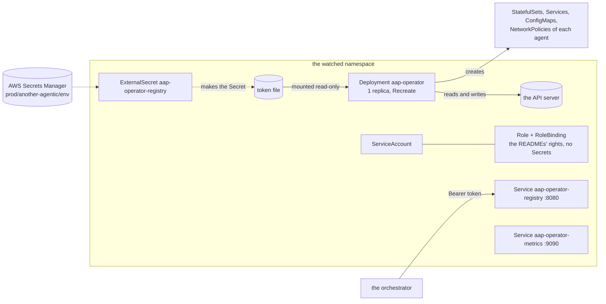
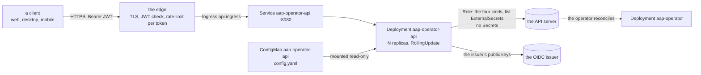

# aap-operator (the chart)

The Helm chart of the operator of [§59a](../../docs/architecture/10-control-plane-and-crds.md#the-operator-chart): **one replica**
of the `operator` binary ([`bin/operator`](../../bin/operator/README.md)), which reconciles `AgentService` and `AgentConfig` in
**one namespace** and serves the agent registry. The CRDs are another chart, [`deploy/operator-crds`](../operator-crds/README.md)
(§93: a separate Argo CD app); the agents are custom resources of their own, in adam-rs's chart `deploy/coder-agent` and the
system chart (S11, S12), not here. The chart also carries, **off by default**, a second component: the [Platform API](#the-platform-api)
(`api.enabled`), the dashboard's REST API, a Deployment of its own with a ServiceAccount and Role of its own.



| Object | What |
|---|---|
| `Deployment aap-operator` | 1 replica, `Recreate`, no leader election (a second reconciler would only race the first). `operator run`, `WATCH_NAMESPACE` the watched namespace, probes `/healthz` (startup, liveness) and `/readyz` (readiness) on 8081, `/metrics` on 9090 |
| `ServiceAccount`, `Role`, `RoleBinding` | Namespaced, in the watched namespace. Exactly the rights below. **No right on Secrets**, no `ClusterRole` |
| `Service aap-operator-registry` | ClusterIP 8080, **only with a registry token**. No Ingress |
| `Service aap-operator-metrics` | ClusterIP 9090 |
| `NetworkPolicy aap-operator` | Ingress only from who the values name; egress only to the API server's ports |
| `ExternalSecret aap-operator-registry` | Only with `externalSecrets.enabled`: the registry token from AWS Secrets Manager |
| `Deployment`, `Service`, `ConfigMap`, `ServiceAccount`, `Role`, `RoleBinding`, `NetworkPolicy` `aap-operator-api` and an optional `Ingress` | Only with `api.enabled`: [the Platform API](#the-platform-api). Nothing of it is rendered, or checked, while it is off |

## Install

```sh
helm template aap-operator-crds deploy/operator-crds | kubectl apply --server-side -f -     # once, and on a change of a type
helm upgrade --install aap-operator deploy/operator --namespace another-agentic-system \
  -f deploy/operator/examples/netcup.values.yaml
```

On netcup an Argo CD Application does this (`helm.valuesObject`, the contents of
[`examples/netcup.values.yaml`](examples/netcup.values.yaml)), and CI bumps `image.tag` ([below](#the-image)). The image tag is
`sha-0000000` until the first build of `main` bumps it: **a render of the chart before that deploys an image that does not exist**.

### Upgrading

**Install or upgrade the CRDs first, then the operator.** An operator from slice D2 onward expects all four CRDs (`agentservices`,
`agentconfigs`, `modelendpoints`, `toolproviders`): without the last two it no longer stalls (it watches those kinds apart, so a
list that fails holds no other agent back), but an agent whose config references a shared object stays `ConfigInvalid`, saying the
kind is not installed, until they are there. Never run an operator older than D1 against CRDs that store a reference
(`endpointRef`, `providerRef`): it types `baseUrl` as required and cannot decode such an `AgentConfig`. The same rule is in
[`deploy/operator-crds`](../operator-crds/README.md#upgrading), with the reasons. The two Argo CD Applications sync apart:
sequence them with the CRDs first (a sync wave, or their Application first).

## Values

| Value | Default | What |
|---|---|---|
| `image.repository`, `image.tag`, `image.digest`, `image.pullPolicy` | `ghcr.io/vymalo/another-agentic-platform/operator`, `sha-0000000`, none, `IfNotPresent` | The tag is **written by CI only** (`bump-tag.sh`), never by hand. `latest` and a malformed digest are refused |
| `imagePullSecrets` | `[]` | For a private package ([below](#the-image)) |
| `watchNamespace` | the release's namespace | The one namespace watched; the `Role` and `RoleBinding` are made there. A name, never a list or a wildcard: **there is no value that gives the operator a `ClusterRole`** |
| `defaultAgentImage` | `ghcr.io/vymalo/another-adam-rs/coder:sha-9a1fd4e@sha256:c3c178b7d73599f40d53f798616e510346abd3300a622b09b2bc233109f12b44` | The image of an agent whose `AgentConfig` names none (`DEFAULT_AGENT_IMAGE`, `operator run --default-agent-image`; AD-029): the coder image, **by tag and digest** (the chart refuses a value without both, and `latest`). Empty: no variable, no default, and such an agent is `ConfigInvalid`. **Not** moved by `bump-tag.sh`: [below](#the-default-agent-image) |
| `storeCnpg` | `true` | The right on CloudNativePG `Cluster`s (`get patch create delete`). The image is built with the `store-cnpg` feature; `false` is for a cluster that has no CloudNativePG |
| `registry.tokenSecret.name`, `.key` | none, `token` | An existing Secret that holds the registry's bearer token. The operator reads the file **once**, at start: after a rotation, restart the pod |
| `registry.publicUrl` | none | `REGISTRY_PUBLIC_URL`: the registry document's own URL, its `anchor` |
| `externalSecrets.enabled`, `.apiVersion`, `.refreshInterval`, `.secretStoreRef`, `.key`, `.properties.registryToken` | off, `external-secrets.io/v1`, `1h`, `ClusterSecretStore/ssegning-aws`, `prod/another-agentic/env`, `agent_registry_token` | The token from AWS Secrets Manager, as in the system chart: one ExternalSecret, one property. Not together with `registry.tokenSecret.name` |
| `networkPolicy.enabled` | `true` | |
| `networkPolicy.registry.allowFrom` | `[]` | NetworkPolicyPeers that may read the registry. **Required while there is a token and a policy**: an empty list would make the registry unreachable, which the chart refuses. A peer with only a `podSelector` means the pods of the watched namespace |
| `networkPolicy.metrics.allowFrom` | `[]` | Who may scrape `/metrics`. Empty: nobody |
| `networkPolicy.apiServer.ports`, `.cidrs` | `[443, 6443]`, `[]` | The API server as the pod reaches it (the Service is 443, most clusters' endpoint 6443). `cidrs`, from `kubectl get endpoints kubernetes`, narrows it to those addresses |
| `logLevel` | `info` | `RUST_LOG` |
| `tuning.concurrency`, `.resyncSecs`, `.resyncPendingSecs` | unset (the binary's 4, 300, 15) | `AAP_CONCURRENCY`, `AAP_RESYNC_SECS`, `AAP_RESYNC_PENDING_SECS`; another key is refused |
| `resources` | 50m / 64Mi requested, 256Mi limit | |
| `serviceAccount.create`, `.name`, `.annotations` | `true`, the fullname, none | |
| `podAnnotations`, `podLabels`, `priorityClassName`, `nodeSelector`, `tolerations`, `affinity` | empty | |
| `api.*` | `api.enabled: false` | The Platform API: [its own table](#the-platform-api). The operator's values above never apply to it (it has its own image, service account, resources and policy) |

**There is no `replicaCount`** (a value of that name is refused), no `crds.install` (§59a listed one before §93 decided on a
separate app) and no `values.schema.json`: neither of the sibling charts, `deploy/coder` and `deploy/chart` of
another-agentic-system, has one; [`templates/_validate.tpl`](templates/_validate.tpl) refuses what would deploy something other
than what the values say.

The pod is `runAsNonRoot` (65532, the image's user), `seccompProfile: RuntimeDefault`, with `allowPrivilegeEscalation: false`,
every capability dropped and a read-only root filesystem (the binary writes no file). It mounts the service account token, which is
how it reaches the API.

## Rights

The `Role` is the sum of the three crates' tables, no more
([controller](../../crates/controller/README.md#cluster-rights), [runtime](../../crates/runtime-kubernetes/README.md#cluster-rights),
[store](../../crates/store-cnpg/README.md#cluster-rights)); `tests/render-check.sh` compares it with this table line by line.

| Resources | Verbs |
|---|---|
| `agentservices`, `agentconfigs` (`agents.vymalo.com`) | `get list watch patch` |
| `modelendpoints`, `toolproviders` (`agents.vymalo.com`) | `get list watch` (the shared objects of the dashboard, AD-029: read to resolve a reference and watched, **never written**) |
| `agentservices/status`, `agentconfigs/status` | `patch` |
| `events` (`events.k8s.io`) | `create patch` |
| `statefulsets`, `deployments` (`apps`) | `get list watch patch create delete` |
| `services`, `configmaps`, `persistentvolumeclaims` | `get list patch create delete` |
| `networkpolicies` (`networking.k8s.io`), `poddisruptionbudgets` (`policy`) | `get list patch create delete` |
| `pods` | `list watch` |
| `clusters` (`postgresql.cnpg.io`), with `storeCnpg` | `get patch create delete` |

**No right on Secrets** (a Secret an agent names is read by the kubelet; the operator never sees a value), none on
`agentservices/finalizers`, none on `databases`, `poolers` or `clusters/status`, and nothing outside the watched namespace.

## The registry and its token

`operator run` serves the registry only with a token, and the chart follows: **no `registry.tokenSecret.name` and no
`externalSecrets.enabled` means no `REGISTRY_TOKEN_FILE`, no port 8080, no registry Service**, and every service says `Listed: False`,
reason `RegistryDisabled` ([`bin/operator`](../../bin/operator/README.md)). The token reaches the pod as a file, `/var/run/secrets/aap/registry/token`
(mode 0440, group 65532), never as an environment variable.

On netcup the token is the AWS property **`agent_registry_token`** of `prod/another-agentic/env`: random, at least 32 bytes
(`openssl rand -hex 32`). The system chart (S12) reads the same property as its orchestrator's `AGENT_REGISTRY_TOKEN`, so the two sides
cannot differ. It is **not** the agents' bearer (`AGENT_REGISTRY_AGENT_TOKEN`, a member of each agent's `A2A_BEARER_TOKENS`: the
agent token rule of §59a).

## The Platform API

The dashboard's REST API ([§60a](../../docs/architecture/10-control-plane-and-crds.md#the-platform-api-ad-025-ad-027), slice D7b1;
the binary is [`bin/api`](../../bin/api/README.md), the router [`aap-platform-api`](../../crates/platform-api/README.md)). **Off by default**
(`api.enabled: false`): with it off nothing of the component is rendered and none of its values is checked, and the three golden renders
above are byte for byte what they were before it existed. It is a Deployment of its own, not a part of the operator, for the reasons of §60a:
least privilege per process (the API may write the specs people edit and list the ExternalSecrets that offer keys; the operator may not, and
the operator writes workloads, which the API may not), exposure (the API takes people's tokens, the operator takes none) and failure (a bug in
the API never stops reconciliation).



### What a deployment must provide

| | |
|---|---|
| **An issuer** | `api.config.oidc.issuer` (an `http(s)` URL), `audiences` (at least one) and `rolesClaim` (the claim whose values are the person's permissions, `agentic_roles` on netcup). **No default**: the chart refuses `api.enabled` without them. The API only reads the issuer's public keys; nothing secret is configured |
| **The registries an agent may pin its own image from** | `api.config.defaults.allowedImageRegistries`, at least one, **no default**. A person who may write agents can name a folder agent's image, and that pod is handed the model endpoint's API key and the A2A bearer. An entry is a registry host and does **not** bound repositories: `ghcr.io` admits every image on `ghcr.io` |
| **Who may reach the API** | `api.networkPolicy.from`: NetworkPolicyPeers, which are the pods of the edge (the Ingress controller). Required while the policy is on (an empty list would make the API unreachable); `api.networkPolicy.enabled=false` for a cluster without a CNI that enforces policies |
| **Where the issuer is** | `api.networkPolicy.issuer.ports` (default 443) and `.to` (default: any address on those ports). An issuer inside the cluster over plain `http` says its own port and peer. The default DNS rule (`kube-dns` in `kube-system`) is wrong on a cluster with a node-local DNS cache: set `api.networkPolicy.dns.to` |
| **Who may call a new agent** | `api.config.defaults.allowFrom` (the peers of `access.allowFrom`, usually the orchestrator's namespace). **Empty by default: a new agent made from the dashboard can be called by nobody** |
| **The A2A bearer's Secret** | `api.config.defaults.a2aBearer` (default `agent-a2a-bearer`, key `AGENT_REGISTRY_AGENT_TOKEN`): the Secret key that must hold the orchestrator's `AGENT_REGISTRY_AGENT_TOKEN`, or the orchestrator lists an agent and cannot call it |
| **The edge** (below) | TLS, a check of the JWT, CORS passes through, and **a rate limit per token**: the API implements none of them |

### Values

| Value | Default | What |
|---|---|---|
| `api.enabled` | `false` | |
| `api.image.repository`, `.tag`, `.digest`, `.pullPolicy` | `ghcr.io/vymalo/another-agentic-platform/api`, `sha-0000000`, none, `IfNotPresent` | The tag is **written by CI only** (`bump-tag.sh <file> <tag> api`), in step with `image.tag` ([below](#the-image)); `sha-0000000` is a placeholder no image has. `latest` and a malformed digest are refused. `imagePullSecrets` (top level) apply to both images |
| `api.replicas` | `1` | The API is stateless; two are fine. The operator has no `replicaCount`: this is the API's |
| `api.port`, `api.healthPort` | `8080`, `8081` | The API, and `/healthz` and `/readyz`. The chart writes both into the file (`listen`, `healthListen`), so the probes, the Service and the file cannot disagree; they are not keys of `api.config` |
| `api.config.oidc` | none | `issuer`, `audiences`, `rolesClaim` (required), `jwksUrl` (optional) |
| `api.config.cors.allowedOrigins` | `[]` | Exact origins, `scheme://host[:port]`, lower case, no path, **no wildcard**, not the default port of the scheme (a browser leaves it out). Empty: no CORS. Refused here as the binary refuses it |
| `api.config.defaults` | cnpg store (1 instance, 5Gi), `a2aBearer`, `allowFrom: []`, `allowedImageRegistries: []` | `aap_forms::Defaults` ([the crate](../../crates/forms/README.md#deployment-defaults-and-what-the-round-trip-does-with-them)); the rest of its keys (`coder`, `folder`, `security`, `offerLabel`) are as in [`bin/api/config.example.yaml`](../../bin/api/config.example.yaml). A map is merged with the default, a list replaces it; `store` holds exactly one of `cnpg` and `secretRef`, so to switch say `cnpg: null` beside the new one. **`defaults.namespace` is the chart's**: the namespace the operator watches, where the `Role` is. A different value is refused |
| `api.serviceAccount.create`, `.name`, `.annotations` | `true`, `<fullname>-api`, none | |
| `api.terminationGracePeriodSeconds`, `api.preStopSleepSeconds` | `40`, `5` | [Below](#a-pod-that-leaves) |
| `api.ingress.enabled`, `.className`, `.host`, `.path`, `.pathType`, `.annotations`, `.tls.enabled`, `.tls.secretName` | off, none, none, `/v1`, `Prefix`, none, `true`, none | The edge's route (below). `host` is required when it is on |
| `api.networkPolicy.enabled`, `.from`, `.apiServer`, `.dns`, `.issuer` | `true`, `[]`, `443, 6443`, `kube-dns:53`, `443` | [Below](#the-networkpolicy) |
| `api.logLevel`, `api.resources`, `api.podAnnotations`, `api.podLabels`, `api.priorityClassName`, `api.nodeSelector`, `api.tolerations`, `api.affinity`, `api.topologySpreadConstraints` | `info`, 50m / 64Mi requested and 256Mi limit, empty | |

`templates/_validate.tpl` refuses, with the value's name, what the binary would refuse at start and can be seen at render time (the issuer, the
audiences, the roles claim, a wildcard or default-port origin, no registries, both or neither store, a tag `latest`, a grace period shorter than
the sleep plus 30 s) and a few things only the chart can know (a `defaults.namespace` that is not the watched one, a policy with no `from`, an
Ingress with no host). The real guard is the binary: CI runs **`api --check` on the file the chart renders** ([Tests](#tests)).

### The pod

`runAsNonRoot` (65532, the image's user), `RuntimeDefault` seccomp, no privilege escalation, every capability dropped, a read-only root file
system; the file is a ConfigMap mounted read-only at `/etc/aap-api/config.yaml` and named by `API_CONFIG_FILE` (a checksum of it is a pod
annotation, so a change rolls the pods). **It mounts no Secret and reads none**: there is none to give it. It mounts the service account token,
which is how it reaches the cluster. `RollingUpdate` with `maxSurge: 1, maxUnavailable: 0`. Probes are the operator's: `/healthz` (startup,
liveness) and `/readyz` (readiness) on the health port; `/readyz` needs the issuer's keys **and** a call that needs the API's own rights, so a
`Role` that lacks a verb shows as *not ready*.

Its pods carry `app.kubernetes.io/name: aap-operator-api` (and `component: api`), **not** the operator's `name`, so the operator's Deployment
selector, Services and NetworkPolicy, which select on `name` and `instance`, never match them (a test holds it).

#### A pod that leaves

The API's listener closes at SIGTERM, the requests in flight finish for at most 25 s (`DRAIN` in [`bin/api/src/run.rs`](../../bin/api/src/run.rs)), and
the Service takes a moment to drop the endpoint. The chart therefore holds the pod for `api.preStopSleepSeconds` (5) **before** the signal, with
`lifecycle.preStop.sleep`, the kubelet's own action: the image is distroless and has no `sleep` to run. The sleep **counts against**
`terminationGracePeriodSeconds` (*verified 2026-10-16*, [container lifecycle hooks](https://kubernetes.io/docs/concepts/containers/container-lifecycle-hooks/)),
so the grace period (40) holds the sleep, the drain and 5 s of margin, and the chart refuses less than the sleep plus 30.

**Kubernetes versions** (*verified 2026-10-16*, [feature gates](https://kubernetes.io/docs/reference/command-line-tools-reference/feature-gates/)): the
gate `PodLifecycleSleepAction` is alpha and **off** in 1.29, beta and on from 1.30, GA in 1.34; the chart's `kubeVersion` is `>=1.29.0-0`. On 1.29
enable the gate, or set `api.preStopSleepSeconds: 0`, which renders no hook (the pod then leaves the Service and drains at the same moment, and a request may be
sent to a pod that has closed its listener). What 1.29 does with a `sleep` handler while the gate is off was not tried (*unverified*).

### The edge

§60a puts the API **on the edge, at a path or host the deployment names**: it is called with a bearer token by the web (a single-page app), the desktop
app and the mobile shells, with no web server of ours in between. **Rate limits per token, TLS and, if wanted, a first check of the JWT are the edge's**; the
API does not implement a limiter (a bearer API is open to any script that holds a token). What the chart does for it:

* `api.ingress` makes an `Ingress` for `host` and `path` (`/v1` by default: every route of the API is under it) to the Service's port `http`. `className` and
  `annotations` are passed through, and **`annotations` is where the edge's policy is attached**. The API answers its own CORS preflights (`OPTIONS`,
  with no `Authorization`), so the edge must let an `OPTIONS` request through to it and not count it against a token.
* With a Traefik edge (the Ingress controller the system's chart is routed by), a rate limit per token is a `Middleware` that groups requests by the `Authorization` header,
  attached by the Ingress annotation. The Middleware's fields `rateLimit.average`, `.period`, `.burst` and `.sourceCriterion.requestHeaderName`, and the
  annotation `traefik.ingress.kubernetes.io/router.middlewares` with the value `<namespace>-<name>@kubernetescrd`, are as the Traefik documentation has them
  (*verified 2026-10-16*, doc.traefik.io, *RateLimit* and *Kubernetes Ingress*); **that grouping by the `Authorization` header gives a limit per token was not
  tried** (*unverified*), and the numbers are the deployment's:

  ```yaml
  # a Middleware, in the API's namespace (not part of this chart)
  apiVersion: traefik.io/v1alpha1
  kind: Middleware
  metadata: { name: api-ratelimit }
  spec:
    rateLimit:
      average: 20
      period: 1s
      burst: 40
      sourceCriterion: { requestHeaderName: Authorization }
  ---
  # and in the values of this chart
  api:
    ingress:
      enabled: true
      className: traefik
      host: api.agents.example.com
      annotations:
        traefik.ingress.kubernetes.io/router.middlewares: another-agentic-system-api-ratelimit@kubernetescrd
      tls: { secretName: api-agents-tls }
  ```

  NGINX's `limit-rps` annotations limit per client address, not per token; per token on NGINX needs configuration this chart does not make.
* A check of the JWT at the edge (the system's oauth2-proxy runs with `--skip-jwt-bearer-tokens`) is optional: the API checks every token itself, so the edge
  can only add a first line. Whatever the edge does must pass `Authorization` through unchanged.
* The origins that may call from a browser are `api.config.cors.allowedOrigins`, **in the API's file**, not the edge's.

### The NetworkPolicy

The operator's policy lets the API server in and nothing else out (it reaches the API server by its address and calls no other service). The API's is
different in two ways, and says so: **ingress** is the peers of `api.networkPolicy.from`, on the API port only (the kubelet's probes of the health port come
from the node, which a NetworkPolicy never blocks, as in the operator's policy; §60a's "NetworkPolicy of D7, which let only the web's pods in, is replaced by the
edge's"), and **egress** is three rules, not one: the API server (`apiServer.ports`, `.cidrs`), the cluster's DNS (`dns.to` and `.ports`, UDP and TCP), and the
issuer's keys (`issuer.to`, `.ports`), because the API resolves the issuer's name and fetches its keys. Nothing else leaves the pod. Enforcement is the cluster's
CNI's: *unverified* that the rules are enough on a cluster that enforces them (D7b2, in kind, whose CNI does).

### The rights

The `Role` `aap-operator-api` (in the watched namespace; its `RoleBinding` is to the API's own service account) is **exactly** the one
[`crates/objects-kubernetes/tests/rbac.yaml`](../../crates/objects-kubernetes/tests/rbac.yaml) holds, which that crate's tests hold equal to the calls it makes
and run its conformance suite under: `render-check.sh` reads that file and compares it with the rendered `Role`, so the two cannot drift.

| Resources | Verbs |
|---|---|
| `agentservices`, `agentconfigs`, `modelendpoints`, `toolproviders` (`agents.vymalo.com`) | `create delete get list patch` |
| `externalsecrets` (`external-secrets.io`) | `list` |

**No right on Secrets** (a `list` on Secrets would return their values), no `watch`, no workload, pod or ConfigMap, no `ClusterRole`. `/readyz`'s one call
(a `list` of one `ModelEndpoint`) is inside it. The operator's `Role` gains nothing, and has no right on ExternalSecrets.

## The image

Two images, one workflow, one commit. [`operator-image.yml`](../../.github/workflows/operator-image.yml) builds both from the same commit:
`ghcr.io/vymalo/another-agentic-platform/operator` from [`docker/operator/Dockerfile`](../../docker/operator/Dockerfile) and
`ghcr.io/vymalo/another-agentic-platform/api` (the Platform API) from [`docker/api/Dockerfile`](../../docker/api/Dockerfile). On a pull request it builds
and smoke-tests each (the API's also runs `api --check` on the configuration this chart renders) and runs the kind end-to-end of the coder; on `main`,
after all of those pass, it pushes the images **that passed** as `sha-<7>` (the same tag for both), and as `latest` unless main has moved on to a newer
build (image jobs can finish out of order), and a last job runs `bump-tag.sh` for each (`image.tag`, then `api.image.tag`) and pushes **one** commit,
`chore(deploy): bump operator and api to sha-<7>`, to `main` as `github-actions[bot]` (§93 allows it). There is one bump job so that two pushes to `main`
cannot race: the cost is that the API's image waits for the operator's end-to-end, and that both move together even when a change touches one
(the workspace is one build, so a change in a shared crate touches both anyway). A deployment pins `sha-<7>`, never `latest`.

**A new GHCR package is private until it is made public.** After the first push (owner step), for **each** of `operator` and `api`: *Packages → the
package → Package settings → Change visibility → Public*, then check the anonymous pull, from the images repository's `CLAUDE.md` (for the API, say
`api` in both places):

```sh
TOKEN=$(curl -s "https://ghcr.io/token?scope=repository:vymalo/another-agentic-platform/operator:pull" | python3 -c 'import sys,json;print(json.load(sys.stdin)["token"])')
curl -s -o /dev/null -w '%{http_code}\n' -H "Authorization: Bearer $TOKEN" \
  -H 'Accept: application/vnd.oci.image.index.v1+json, application/vnd.oci.image.manifest.v1+json, application/vnd.docker.distribution.manifest.v2+json' \
  https://ghcr.io/v2/vymalo/another-agentic-platform/operator/manifests/sha-<7>      # 200
```

Until it answers 200, a cluster that pulls it anonymously gets `ImagePullBackOff` (or set `imagePullSecrets`).

## The default agent image

An `AgentConfig` that names no `environment.image` runs the operator's default, the coder image (AD-029, [§60a](../../docs/architecture/10-control-plane-and-crds.md#deployment-defaults),
*Deployment defaults*). The chart sets it with `defaultAgentImage`, which becomes `DEFAULT_AGENT_IMAGE`. It is **a pin of its own**:
`bump-tag.sh` moves the operator's `image.tag` and nothing else (`tests/bump-tag-test.sh` holds that, with a `defaultAgentImage` line next to
it), because the operator's image and the coder's are two images with two release trains (this repository's and adam-rs's). §60a says "a
value of its chart that CI bumps by GitOps": the value is the GitOps repository's to set (`helm.valuesObject` in the Application, see
[`examples/netcup.values.yaml`](examples/netcup.values.yaml)) and to move, and this chart ships a pin that works.

* **What a change does.** A new value is a new digest for exactly the agents that name no image, and so a rollout of them; an agent that
  pins its own image is not touched. Changing it is how a new coder is rolled out to every agent made from the dashboard.
* **The pin the chart ships** is `sha-9a1fd4e` of `ghcr.io/vymalo/another-adam-rs/coder`, the image `tests/e2e/coder.yaml` runs under the
  operator in kind (the real coder, up to its startup checks: [`tests/e2e/README.md`](tests/e2e/README.md)). Its digest was read from
  ghcr.io on 2026-10-15, anonymously: HTTP 200, `sha256:c3c178b7…12b44`. **Two tests hold the two together**: `render-check.sh` and
  `cargo test -p aap-operator --test e2e_fixture` fail when the chart's value and the image of `coder.yaml` differ. A pin that has not been
  through the end-to-end is a pin nobody has seen start.
* **To move it** (by hand or from the GitOps repository's values; there is no automation):

  ```sh
  TAG=sha-<7>                    # a tag of ghcr.io/vymalo/another-adam-rs/coder that CI of adam-rs pushed
  TOKEN=$(curl -s "https://ghcr.io/token?scope=repository:vymalo/another-adam-rs/coder:pull" | python3 -c 'import sys,json;print(json.load(sys.stdin)["token"])')
  curl -s -D - -o /dev/null -H "Authorization: Bearer $TOKEN" \
    -H 'Accept: application/vnd.oci.image.index.v1+json, application/vnd.oci.image.manifest.v1+json, application/vnd.docker.distribution.manifest.v2+json' \
    https://ghcr.io/v2/vymalo/another-adam-rs/coder/manifests/$TAG | grep -i -E '^HTTP|docker-content-digest'    # 200, and the digest
  ```

  Put `repository:TAG@sha256:<digest>` in `defaultAgentImage` here and in the `ref:` of `tests/e2e/coder.yaml`, and let the end-to-end run
  In the GitOps repository only the value is set.
* **The chart refuses** a value without a tag and a digest, a short digest, white space, and a tag `latest`. The binary refuses white space
  at start. Neither checks that the image exists.

## Tests

```sh
helm lint deploy/operator && helm lint deploy/operator-crds
sh deploy/operator/tests/render-check.sh                    # needs helm
UPDATE_GOLDEN=1 sh deploy/operator/tests/render-check.sh    # after a deliberate change: rewrites tests/golden
sh deploy/operator/tests/bump-tag-test.sh
# the configuration the chart renders for the API, read by the binary (cargo build -p aap-api-server first)
sh deploy/operator/tests/api-config.sh /tmp/config.yaml -f deploy/operator/tests/api.values.yaml && target/debug/api --config /tmp/config.yaml --check
```

| File | What |
|---|---|
| `tests/render-check.sh` | the four golden renders (`tests/golden/netcup.yaml` from `examples/netcup.values.yaml`, `secret.yaml` from `tests/secret.values.yaml`, `default.yaml`, and `api.yaml` from `tests/api.values.yaml`, the Platform API on; the first three have it off and equal what they were before it existed); no Secret object, no `ClusterRole`, no host access; one replica, `Recreate`, the probes, the security context; the `Role` equal to the table above, with and without `storeCnpg`; the registry only with a token, mounted as a file; the NetworkPolicy; the ExternalSecret; every refusal of `_validate.tpl` (the default agent image's included); the shared kinds read and never written; `DEFAULT_AGENT_IMAGE` pinned by tag and digest, empty rendering none, and the chart's pin equal to the end-to-end's; and `deploy/operator-crds` equal to `deploy/crds`. For the API: its objects, pod and labels, the `Role` **equal to `crates/objects-kubernetes/tests/rbac.yaml`** (read from the file) with no right on Secrets, the Service without the health port, the policy, the Ingress and its annotations, no Secret in the render or the file, the second shape (`tests/api-secretref.values.yaml`), nothing rendered or checked while it is off, and every refusal of `_validate.tpl` for it |
| `tests/bump-tag-test.sh` | `bump-tag.sh` edits only `image.tag` (a `defaultAgentImage` line beside it is left alone) or, with `api`, only `api.image.tag` (each leaves the other, and keys that only look like it, alone), is idempotent, refuses a malformed tag and an unknown component (the test of adam-rs's `deploy/coder`, with this chart's values) |
| `tests/api.values.yaml`, `tests/api-secretref.values.yaml`, `tests/api-config.sh` | the two shapes of the API component, and the script that renders one and writes the ConfigMap's `config.yaml` to a file, which CI hands to the image's `api --check` |
| `tests/schemas/` | the `ExternalSecret` schema for kubeconform ([its README](tests/schemas/README.md)) |
| `tests/e2e/` | the kind end-to-end of the coder (S9): [`tests/e2e/README.md`](tests/e2e/README.md) |

CI also runs kubeconform in strict mode over six renders (the defaults, netcup, `secret.values.yaml`, the two API shapes, and the CRDs chart with the
`CustomResourceDefinition` kind skipped, because the schema set has none: the `kind` job of `operator.yml` applies them to a real API server).

## What is not proven

* **The Platform API component has not run on a cluster.** It is rendered, linted, checked with kubeconform, and its file is read by the binary (`api --check`,
  here and in CI); the image is built by CI (not here: this slice was written where no container daemon runs). *Unverified* until D7b2, the kind
  end-to-end through the API: that the pod starts with a read-only root file system, that the `Role` is enough under real RBAC (`/readyz` says so
  when it is not), that the NetworkPolicy's egress reaches a real issuer, that `preStop.sleep` and the grace period behave as described on a real
  cluster (the sleep action, and what 1.29 does without its gate), and the whole chain: create a folder agent through the API, see it `Ready` and listed.

* The chart has been rendered, linted and checked with kubeconform; **it has not been installed on a cluster by hand**. The first
  install is the `operator-coder-e2e` job of `operator-image.yml` (*unverified* until CI has run it), which installs this chart
  into kind and runs the real coder under it. In particular *unverified*: that a read-only root filesystem is enough for the
  binary, that the NetworkPolicy's egress is enough on a cluster that enforces it (kind's does), and that `list` without `watch` on
  `services`, `configmaps` and `persistentvolumeclaims`, as the runtime README lists them, is what the provider needs.
* That Argo CD syncs the CRDs of `deploy/operator-crds` and this chart in that order (its sync waves, or two Applications) and leaves
  an agent's objects alone while it does. The order is the one rule of [Upgrading](#upgrading); what an operator does when it is not
  kept (the watches of the shared kinds fail, and an agent that references them says so) is proven against the fake API server, and
  by hand against a bare kube-apiserver (`bin/operator/tests/cluster.rs`), not on a cluster with Argo CD.
