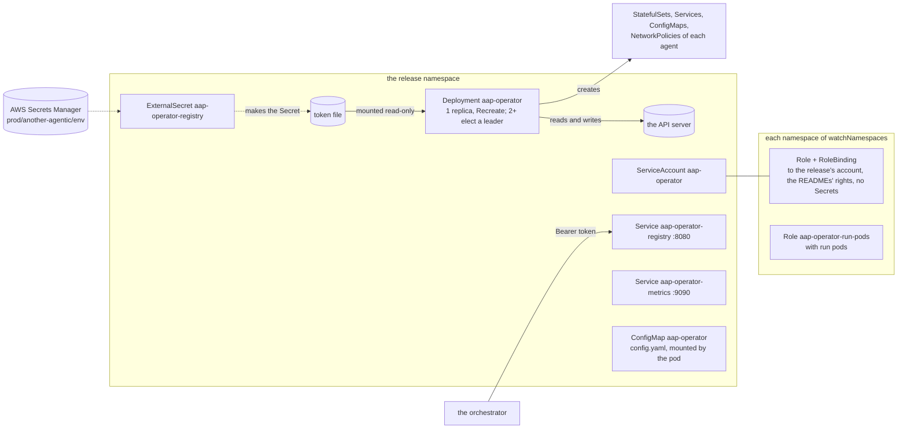
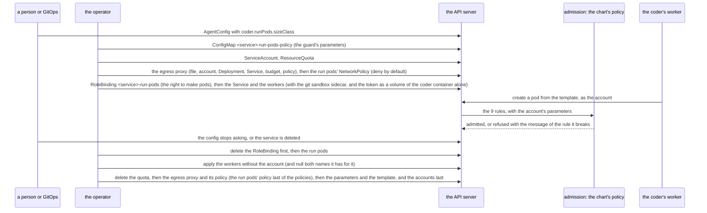
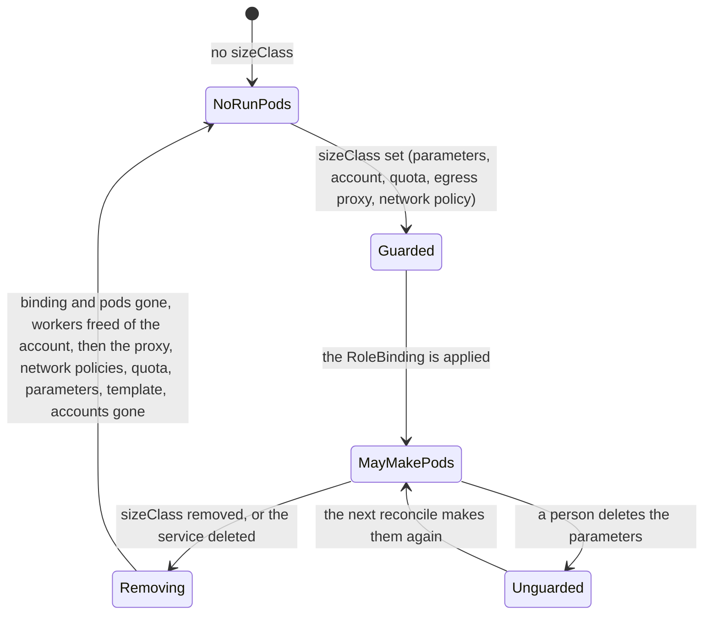
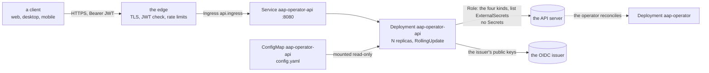

# aap-operator (the chart)

The Helm chart of the operator of [§59a](../../docs/architecture/10-control-plane-and-crds.md#the-operator-chart): **one or more replicas** (a leader election when more than one)
of the `operator` binary ([`bin/operator`](../../bin/operator/README.md)), which reconciles `AgentService` and `AgentConfig` in
**every namespace of `watchNamespaces`** (the first is the primary) and serves the agent registry. The CRDs are another chart, [`deploy/operator-crds`](../operator-crds/README.md)
(§93: a separate Argo CD app); the agents are custom resources of their own, in adam-rs's chart `deploy/coder-agent` and the
system chart (S11, S12), not here. The chart also carries, **off by default**, a second component: the [Platform API](#the-platform-api)
(`api.enabled`), the dashboard's REST API, a Deployment of its own with a ServiceAccount and Role of its own.



| Object | What |
|---|---|
| `Deployment aap-operator` | `replicas` (1 by default: `Recreate`, no leader election; 2 or more: a rolling update, the replicas campaign for a `Lease` and only its holder reconciles — [below](#leader-election-k7)). `operator run --config /etc/aap-operator/config.yaml` (ANR-962), probes `/healthz` (startup, liveness) and `/readyz` (readiness) on 8081, `/metrics` on 9090, and `POD_NAME` from the downward API (nothing else in its environment) |
| `ConfigMap aap-operator` | The operator's configuration file (`config.yaml`, ANR-962, AD-064), rendered from the values: [below](#the-configuration-file). Mounted at `/etc/aap-operator`, read once, and the pod rolls with it (one `checksum/config`) |
| `ServiceAccount`, `Role`, `RoleBinding` | The account in the release's namespace; one `Role` and one `RoleBinding` in each namespace of `watchNamespaces` (K6a). Exactly the rights below. **No right on Secrets**, no `ClusterRole` |
| `Service aap-operator-registry` | ClusterIP 8080, **only with a registry token**. No Ingress |
| `Service aap-operator-metrics` | ClusterIP 9090 |
| `NetworkPolicy aap-operator` | Ingress only from who the values name; egress only to the API server's ports |
| `ExternalSecret aap-operator-registry` | Only with `externalSecrets.enabled`: the registry token from AWS Secrets Manager |
| `Role` `aap-operator-run-pods`, `PriorityClass`, `ValidatingAdmissionPolicy` and its binding | Only with `runPods.enabled`: [run pods](#run-pods). Their settings are the `runPods` block of the operator's file. Nothing of them is rendered, or checked, while it is off, and the render is then byte for byte what it was before they existed |
| `ServiceMonitor` `aap-operator` | Only with `metrics.serviceMonitor.enabled`: [metrics](#metrics-and-servicemonitors). Nothing of it is rendered, and the CRD need not exist, while it is off |
| `Deployment`, `Service`, `ConfigMap`, `ServiceAccount`, `Role`, `RoleBinding`, `NetworkPolicy` `aap-operator-api` and an optional `Ingress` | Only with `api.enabled`: [the Platform API](#the-platform-api). Nothing of it is rendered, or checked, while it is off |

## Install

**Helm 4 and Kubernetes 1.37 or later, and nothing else (AD-067).** Both charts say `kubeVersion: ">=1.37.0-0"`, so Helm refuses an install on an older
cluster (a vendor suffix such as `v1.37.2-k3s1` passes); there is no Helm 3 path, and `tests/render-check.sh` refuses to run under Helm 3.

```sh
helm template aap-operator-crds deploy/operator-crds | kubectl apply --server-side -f -     # once, and on a change of a type
helm upgrade --install aap-operator deploy/operator --namespace another-agentic-system \
  -f deploy/operator/examples/netcup.values.yaml
```

On netcup an Argo CD Application does this (`helm.valuesObject`, the contents of
[`examples/netcup.values.yaml`](examples/netcup.values.yaml)), and CI bumps `image.tag` ([below](#the-image)). The chart's
`image.tag` is a real pin, written by `bump-tag.sh` on every green build of `main`; a deployment that follows this chart keeps it,
and one that pins a release sets `image.tag` and `image.digest` itself. New to the platform? [Get started](../../docs/get-started.md)
walks a cluster from nothing, and [Install the CRDs and the operator](../../docs/guides/deploy/install.md) explains the values.

### Upgrading

**Install or upgrade the CRDs first, then the operator.** An operator from slice D2 onward expects all four CRDs (`agentservices`,
`agentconfigs`, `modelendpoints`, `toolproviders`): without the last two it no longer stalls (it watches those kinds apart, so a
list that fails holds no other agent back), but an agent whose config references a shared object stays `ConfigInvalid`, saying the
kind is not installed, until they are there. Never run an operator older than D1 against CRDs that store a reference
(`endpointRef`, `providerRef`): it types `baseUrl` as required and cannot decode such an `AgentConfig`. The same rule is in
[`deploy/operator-crds`](../operator-crds/README.md#upgrading), with the reasons. The two Argo CD Applications sync apart:
sequence them with the CRDs first (a sync wave, or their Application first). **K2:** the operator writes the `status` of `modelendpoints` and `toolproviders`, which only a CRDs chart from K2 onward gives them a subresource for. With an older CRDs chart the API server answers `404` to every such write: the operator logs a warning that says to install the CRDs chart, retries with the back-off of an internal error (30 s, doubling, 10 minutes at most: not every 5 s) and reconciles every agent as before, so nothing is lost but the status until the chart is there.

**Activity (ANR-1030b).** What changes for an install that had `activity` in its values (or in its file):
- `activity.port` of **8080** (the old default) and any port below 1024 are now refused, **even with activity disabled**, by `helm template` and by the operator's file at load (exit 78). The default is 8081.
- `enabled: true` in the operator's file now needs `agentTokensSecret` and `operatorPod`; the chart renders both. `agentTokensSecret` defaults to `activity.tokenSecret`; with **more than one** watched namespace the chart refuses unless `activity.agentTokensSecret.name` is set explicitly, because that means "a copy of the Secret exists in every watched namespace" and the chart makes none (an agent whose Secret is missing fails with `CreateContainerConfigError`).
- `activity.to` must list the peers where the agents run, that is the namespaces of `watchNamespaces`; otherwise the polls time out, the operator logs a warning once per failure kind, and the agents stay awake.
- Turning it on **rolls every adam agent that sets `scaling.idleTimeout` once** (the activity port is in the digest).
- Agents on images without the listener (every current pin; ANR-1200 moves the coder to `sha-b5d1c7e`) stay awake: the container ignores the port.
- An adam agent with `idleTimeout` and **no `allowFrom`** now gets a NetworkPolicy that admits only A2A (8080) and the operator on the activity port, so any other ingress to the agents' pods (a metrics scraper, for one) is blocked: list it in `allowFrom` or leave `idleTimeout` off.

**Generating the activity bearer in the cluster (the owner's convention, 2026-11-27).** The one bearer the operator and every agent share can be made where it is used and pushed to AWS Secrets Manager, rather than typed into a Secret by hand:

- an External Secrets **`Password` generator** makes it in the operator's namespace (or a one-shot Job writes a Secret), with `symbols` that leave out `,`: the operator refuses a token that holds one, because an agent splits `ACTIVITY_BEARER_TOKENS` on commas;
- a **`PushSecret`** in the operator's namespace pushes that Secret to the deployment's AWS Secrets Manager path;
- one **`ExternalSecret` per watched namespace** pulls the same property back under `activity.agentTokensSecret.name`, and one for the operator's own namespace under `activity.tokenSecret.name`: the chart makes none of these Secrets and reads the operator's from the file it mounts.

*Unverified:* the generator's and `PushSecret`'s exact names and fields are External Secrets Operator's and were not checked against its documentation here; what this chart and `bin/operator` implement is the one bearer, the comma it refuses, and the names the copies must have. **The registry token is not generated by the system**: the orchestrator must know the same value, so it is provisioned, or pulled from AWS Secrets Manager as `externalSecrets.*` already does.

**K1, run pods:** the admission policy reads the parameter `claims` of each agent's `<service>-run-pods-policy` ConfigMap and falls back to `claim` when there is none, which is what an operator before K1 wrote: upgrade the chart and the operator's image together (one release). Between the new policy and the new operator's first pass over an agent its run pods are admitted for the work claim alone, not refused; the pass rewrites the ConfigMap, whatever the agent's digest.

## Values

| Value | Default | What |
|---|---|---|
| `image.repository`, `image.tag`, `image.digest`, `image.pullPolicy` | `ghcr.io/vymalo/another-agentic-platform/operator`, the chart's pin (`sha-<7 hex>`), none, `IfNotPresent` | The tag is **written by CI only** (`bump-tag.sh`), never by hand. `latest` and a malformed digest are refused |
| `imagePullSecrets` | `[]` | For a private package ([below](#the-image)). **Never a run pod**: a run pod names no pull secret (adam-rs ADR 0038), so `runPods.image` must be publicly pullable |
| `replicas` | `1` | **K7:** the operator's replicas. One: no leader election, `Recreate`. More: a rolling update, the replicas campaign for a `Lease` in the primary namespace and only its holder reconciles; a `PodDisruptionBudget` of one keeps the lease through a drain. `replicaCount` is refused |
| `leaderElection.leaseSecs`, `.renewSecs`, `.retrySecs` | `15`, `10`, `2` | **K7:** the lease's timers, in seconds, the client-go defaults. Read only when `replicas > 1`; refused unless `retrySecs < renewSecs < leaseSecs`, each at least 1 |
| `watchNamespaces` | `[]` (the release's namespace) | **K6a:** the namespaces watched; one `Role` and `RoleBinding` in each, never a `ClusterRole`. The first is the primary: the file's `watch.namespaces`, first entry (was `WATCH_NAMESPACE`), the API's `defaults.namespace`, the run pods' cluster-scoped names. A list of names, never a wildcard. **The operator watches every one (K6b).** The namespaces must exist (`--create-namespace` makes only the release's), and two releases must not name the same one: the Roles and RoleBindings would collide (Helm refuses the second), so uninstall the other release first. **A namespace that does not exist** is listed as empty (the operator may not `get` namespaces), so a typo is silent and that namespace reconciles nothing. **A namespace whose `Role` is missing, or one deleted while the operator runs, makes `/readyz` false, so the pod leaves the registry `Service`'s endpoints and every namespace is unlisted**: the operator names the namespaces still waiting every 30 s |
| `watchNamespace` | empty | One namespace, the shorthand, and the primary. Not with `watchNamespaces`: one or the other. A name, never a wildcard: **there is no value that gives the operator a `ClusterRole`** |
| `cacheAllowedClaims` | `[]` | **K1:** the claims an `AgentConfig` may name as its package cache; the file's `defaults.cacheAllowedClaims` (was `CACHE_ALLOWED_CLAIMS`). Empty: no agent may have a cache. Names the operator makes are refused whatever is listed (AD-049) |
| `maxAccessTier` | `auto` | **K1:** the highest access tier a config or a dashboard form may ask for; the file's `defaults.maxAccessTier` (was `AGENT_MAX_ACCESS_TIER`) and, with the API on, its `defaults.maxAccessTier`. `auto` renders nothing (AD-050) |
| `defaultAgentImage` | `ghcr.io/vymalo/another-adam-rs/coder:sha-b5d1c7e@sha256:5de41376a08d8452ae0c59314e0e34d35da0aae495cdbc72ad6144a9c4235d45` | The image of an agent whose `AgentConfig` names none (the file's `defaults.agentImage`; AD-029): the coder image, **by tag and digest** (the chart refuses a value without both, and `latest`). Empty: no key, no default, and such an agent is `ConfigInvalid`. **Not** moved by `bump-tag.sh`: [below](#the-default-agent-image) |
| `agent.runtimeClassName` | `""` | **K14a (AD-052):** the `RuntimeClass` of every agent's own pod (the file's `defaults.agentRuntimeClass`, was `AGENT_RUNTIME_CLASS`). Empty: no key and the pods are as they were. Named: the operator writes it into the pod template of every workload (both harnesses) and it is in the digest, so naming it rolls the agents once. The `RuntimeClass` object is the **administrator's** and this chart never makes one: [below](#the-sandboxed-runtime-k14a) |
| `runPods.enabled` and the rest of `runPods.*`, `runPodClasses.*` | off | The operator sets up run pods for a coder that asks for them (`coder.runPods.sizeClass`): [its own section](#run-pods) lists every value. On, the operator reads them from the `runPods` block of its configuration file, and the chart refuses what the operator would refuse at start |
| `storeCnpg` | `true` | The right on CloudNativePG `Cluster`s (`get patch create delete`). The image is built with the `store-cnpg` feature; `false` is for a cluster that has no CloudNativePG |
| `registry.tokenSecret.name`, `.key` | none, `token` | An existing Secret that holds the registry's bearer token. The operator reads the file **once**, at start: after a rotation, restart the pod |
| `registry.publicUrl` | none | the file's `registry.publicUrl` (was `REGISTRY_PUBLIC_URL`): the registry document's own URL, its `anchor` |
| `externalSecrets.enabled`, `.apiVersion`, `.refreshInterval`, `.secretStoreRef`, `.key`, `.properties.registryToken` | off, `external-secrets.io/v1`, `1h`, `ClusterSecretStore/ssegning-aws`, `prod/another-agentic/env`, `agent_registry_token` | The token from AWS Secrets Manager, as in the system chart: one ExternalSecret, one property. Not together with `registry.tokenSecret.name` |
| `networkPolicy.enabled` | `true` | |
| `networkPolicy.registry.allowFrom` | `[]` | NetworkPolicyPeers that may read the registry. **Required while there is a token and a policy**: an empty list would make the registry unreachable, which the chart refuses. A peer with only a `podSelector` means the pods of the operator's own namespace (the release's), not the watched ones |
| `networkPolicy.metrics.allowFrom` | `[]` | Who may scrape `/metrics`. Empty: nobody. **A peer with only a `podSelector` means pods of the operator's own namespace**: a Prometheus in another namespace needs a `namespaceSelector` |
| `metrics.serviceMonitor.enabled`, `.interval`, `.labels` | off, `30s`, `{}` | A Prometheus Operator `ServiceMonitor` for the operator's `/metrics`: [below](#metrics-and-servicemonitors). On, the chart refuses an empty `networkPolicy.metrics.allowFrom` while the policy is enabled |
| `otel.*`, `api.otel.*` | off | **K5:** traces of the operator and of the API, OTLP/HTTP JSON to a collector: [below](#traces-k5). Off, not a trace of them in any render |
| `networkPolicy.apiServer.ports`, `.cidrs` | `[443, 6443]`, `[]` | The API server as the pod reaches it (the Service is 443, most clusters' endpoint 6443). `cidrs`, from `kubectl get endpoints kubernetes`, narrows it to those addresses |
| `retention.afterDeleteDays` | unset (the operator's own 90) | **ANR-770:** days the database and volumes of a deleted agent (`deletionPolicy: Retain`) are kept before the operator deletes them; `0` keeps them for ever. Unset: no variable in the render |
| `activity.to`, `.port`, `.timeoutSecs`, `.tokenSecret`, `.agentTokensSecret`, `.dns` | `[]`, `8081`, `3`, none, the same as `tokenSecret`, kube-dns | **AD-058, ANR-1030b:** the operator asks each agent `GET /internal/activity` so an idle adam agent can sleep. Empty `to`: off, and not a trace of it in any render. **One bearer for the deployment**: the operator mounts `tokenSecret` as a file (no comma in it) and every agent's pod reads the same value from `agentTokensSecret`, a Secret of that name that **must exist in every watched namespace** (the chart makes none; a copy such as an ExternalSecret is yours). The file gets `agentTokensSecret` and `operatorPod` (the release's namespace and the operator's selector labels), so an agent's NetworkPolicy admits the listener to the operator's pods alone. `port` is 1024 to 65535 and never 8080, refused at render time. Turning it on rolls every adam agent that sets `idleTimeout` once; an a2a agent never sleeps |
| `toolProbe.to`, `.ports`, `.dns` | `[]`, `[80, 443]`, kube-dns and `[53]` | **K3a:** the MCP servers the operator may reach to probe a `ToolProvider`: [below](#the-tool-probe-k3a). Empty `to`: off, and not a rule of it in any render |
| `logLevel` | `info` | The file's `log.filter` |
| `tuning.concurrency`, `.resyncSecs`, `.resyncPendingSecs`, `.reconcileTimeoutSecs` | unset (the binary's 4, 300, 15; 4 for the pass timeout when `replicas > 1`) | The file's `reconcile.concurrency`, `resyncSecs`, `resyncPendingSecs`, `timeoutSecs`; another key is refused. `concurrency` is **per controller and per watched namespace**: up to `4 × concurrency × watchNamespaces` passes in flight. With `replicas > 1`, `reconcileTimeoutSecs` must be below `leaderElection.leaseSecs - leaderElection.renewSecs` (the margin between the renew deadline and the earliest takeover) |
| `resources` | 50m / 64Mi requested, 256Mi limit | |
| `serviceAccount.create`, `.name`, `.annotations` | `true`, the fullname, none | |
| `podAnnotations`, `podLabels`, `priorityClassName`, `nodeSelector`, `tolerations`, `affinity` | empty | |
| `api.*` | `api.enabled: false` | The Platform API: [its own table](#the-platform-api). Of the values above only three reach it: `imagePullSecrets` (the pull secrets of both pods), `watchNamespaces` (its `Role` and its `defaults.namespace` are in the first) and `nameOverride` / `fullnameOverride` (its names are `<fullname>-api`). Everything else is its own: image, service account, resources, policy, scheduling, log level. CI bumps `image.tag` and `api.image.tag` in one commit, but they are two values |

**There is no `replicaCount`** (a value of that name is refused: the key is `replicas`), no `crds.install` (§59a listed one before §93 decided on a
separate app) and no `values.schema.json`: neither of the sibling charts, `deploy/coder` and `deploy/chart` of
another-agentic-system, has one; [`templates/_validate.tpl`](templates/_validate.tpl) refuses what would deploy something other
than what the values say.

The pod is `runAsNonRoot` (65532, the image's user), `seccompProfile: RuntimeDefault`, with `allowPrivilegeEscalation: false`,
every capability dropped and a read-only root filesystem (the binary writes no file). It mounts the service account token, which is
how it reaches the API.

## Rights

The `Role` is the sum of the three crates' tables, no more
([controller](../../crates/controller/README.md#cluster-rights), [runtime](../../crates/runtime-kubernetes/README.md#cluster-rights),
[store](../../crates/store-cnpg/README.md#cluster-rights)); `tests/render-check.sh` compares it with this table line by line. **K6a:**
one in each namespace of `watchNamespaces`, each with a `RoleBinding` to the release's service account, and never a `ClusterRole`.

| Resources | Verbs |
|---|---|
| `agentservices`, `agentconfigs` (`agents.vymalo.com`) | `get list watch patch` |
| `modelendpoints`, `toolproviders` (`agents.vymalo.com`) | `get list watch` (the shared objects of the dashboard, AD-029: read to resolve a reference and watched, **never written**) |
| `agentservices/status`, `agentconfigs/status` | `patch` |
| `modelendpoints/status`, `toolproviders/status` | `patch` (K2: the status of the shared kinds, in a rule of its own with that verb alone; `render-check.sh` holds it, and that the kinds themselves stay read-only) |
| `events` (`events.k8s.io`) | `create patch` |
| `statefulsets`, `deployments` (`apps`) | `get list watch patch create delete` |
| `replicasets` (`apps`), `jobs` (`batch`) | `get` (ANR-1327: an agent pod's owner chain, by name and by uid; a `StatefulSet`'s `get` is the runtime row's. No list, no watch) |
| `services`, `configmaps`, `persistentvolumeclaims` | `get list patch create delete` |
| `networkpolicies` (`networking.k8s.io`), `poddisruptionbudgets` (`policy`) | `get list patch create delete` |
| `pods` | `list watch` |
| `clusters` (`postgresql.cnpg.io`), with `storeCnpg` | `get patch create delete` |

With `runPods.enabled` the table gains these rows, and no other (`tests/render-check.sh` compares the whole `Role`, and lists what it must not hold):

| Resources | Verbs |
|---|---|
| `serviceaccounts`, `resourcequotas` | `get list patch create delete` |
| `rolebindings` (`rbac.authorization.k8s.io`) | `get list patch create delete` |
| `roles` (`rbac.authorization.k8s.io`), **named `<fullname>-run-pods`** (`resourceNames`) | `bind` |
| `pods` | `delete` (the run pods of a service that stops asking for them or goes: `list watch` above is all it has otherwise) |

**No right on Secrets** (a Secret an agent names is read by the kubelet; the operator never sees a value), none on
`agentservices/finalizers`, none on `databases`, `poolers` or `clusters/status`, and nothing outside the namespaces it watches.

## Run pods

A coder can run the commands of a run in **pods of their own** instead of in its own container (adam-rs [#131](https://github.com/vymalo/another-adam-rs/pull/131)): it makes a pod from a template, runs `exec` in it, and deletes it. That needs, besides the coder, a template, an account that may make pods, a quota, a network policy that is **deny by default** with an **egress proxy** as the one way out (D15c, adam-rs's ADR 0042), and a guard that stops the account making any other pod. adam-rs's coder chart renders them; with `runPods.enabled` this chart and the operator do, for an `AgentConfig` that sets `coder.runPods.sizeClass`, and for no other (slices D15a and D15c, [§60a](../../docs/architecture/10-control-plane-and-crds.md), the *D15a built* and *D15c built* notes). Since D15d they also run **the coder's own git in a sidecar that holds no secret** ([below](#the-git-sandbox-of-the-coders-pod)): a repository's configuration can make git run a program, and that program must not be able to read the coder's token, key and model key.





### Turning it on

```yaml
runPods:
  enabled: true          # the image, the quota and the rest keep the defaults of values.yaml
api:
  config:
    defaults:
      coder:
        workVolume: { name: work, scope: agent, mountPath: /work, source: { persistent: { size: 20Gi, perReplica: true } } }   # with the API on
```

| Value | Default | What |
|---|---|---|
| `runPods.enabled` | `false` | Off: nothing below is rendered, checked or given a right, and an `AgentConfig` that asks is `ConfigInvalid` saying the operator has no run pods |
| `runPods.image.repository`, `.tag`, `.digest`, `.pullPolicy` | the `workspace` image of another-agentic-images, `1.98.1-8c297d3`, its digest, `IfNotPresent` | The run container. **Tag and digest are required**, and `latest` is refused: the commands of every run execute in it. *Verified 2026-11-27* in the coder chart by an anonymous manifest request |
| `runPods.container` | `run` | The container of the template the commands run in (`RUN_POD_CONTAINER`) |
| `runPods.cargoBuildJobs` | `2` | `CARGO_BUILD_JOBS`, so that a Rust build stays inside the 2Gi of `standard` |
| `runPods.extraEnv` | `{}` | More variables of the run container, text values; `MODEL_API_KEY` (a run pod holds no model key, adam-rs ADR 0038), `CARGO_BUILD_JOBS` and the six proxy variables (`HTTPS_PROXY`, `HTTP_PROXY`, `NO_PROXY`, lower case too) are refused |
| `runPods.priorityClassName` | `""` | Empty: the chart makes `<fullname>-<namespace>-run` (value 0, never preempts). A name: yours, and the chart makes none |
| `runPods.runtimeClassName` | `""` | **K14a (AD-052):** the `RuntimeClass` of a run pod, the sandbox the untrusted commands run in (gVisor's handler is `runsc`). Empty: no key of the settings, no field of the template, no eleventh rule of the policy. **Named, it is required**: the admission policy refuses a run pod of the agent's account that names another class, or none. The object is the **administrator's** and this chart never makes one: [below](#the-sandboxed-runtime-k14a) |
| `runPodClasses.<name>.runtimeClassName` | none | **ANR-402 (AD-052):** the `RuntimeClass` of the pods of ONE size class. It replaces `runPods.runtimeClassName` for them (empty or absent: the deployment's, if it names one), so a class can use another handler than the rest, or be sandboxed alone while the deployment names none. The operator reads the class of the agent's `sizeClass`, writes it into the template the workers read and into the guard's parameter, and the policy requires exactly that class of the agent's pods: one function makes both values, so the pod and its rule cannot disagree. An agent whose class names none, with no deployment-wide class, has no parameter and the rule judges nothing. Nothing sets one by default, and then no render carries a trace of it. A mode that builds images (`Build`, `Engine`) has no field in `coder.runPods`, so there is nothing to refuse beside a class: a test fails the day a CRD names one |
| `runPods.quota.limitsMemory`, `.pods` | `8Gi`, `4` | What the run pods **of the namespace's priority class** may use in all. A pod beyond it is refused (`exceeded quota`) and the coder waits (`waitSecs`) |
| `runPods.idleSecs`, `.readyTimeoutSecs`, `.waitSecs` | `300`, `600`, `1020` | A pod nobody used for this long is deleted (0: when its run ends); how long a pod may take to be ready; how long a run waits for a slot (the coder chart's 1020, adam-rs ADR 0038) |
| `runPods.nodeSelector`, `.tolerations`, `.nodeAffinity` | none | Where run pods may go, on top of what the volume needs |
| `runPods.nodeType.labelKey`, `.admitted` | `""`, `[]` (off) | **ANR-660, AD-066.** The node types run pods are pinned to: a node label's key and the values of it that run pods may run on, both or neither. Set, the operator adds `labelKey In admitted` to every required node-affinity term of the template (or makes the one term) and the admission policy gets a **twelfth rule, last**: a run pod is refused unless it sets no `spec.nodeName` and is restricted to the admitted values by `nodeSelector` or by required node affinity in every term (`Exists`, `NotIn` and `matchFields` do not count). Not a trace in any render while empty. **The policy cannot read a Node's labels: it proves a run pod is pinned to the admitted types, and that the labels are honest is yours.** A `runPods.nodeSelector`, or a required term of `runPods.nodeAffinity`, on the same key is refused. The rule falls back to these values for an agent whose parameters lack the key (an older operator), so it never fails open |
| `runPods.extraAllowedImages` | `[]` | Images a run pod may use besides the run image and the coder's own, spelled as the pod spells them |
| `runPods.networkPolicy.*` | no cluster CIDR; the RFC 1918 ranges, link-local and shared address space blocked; DNS in `kube-system` | **Deny by default (D15c)**: no ingress, egress to DNS, to the egress proxy and to `extraEgress`, and nothing else. **There is no switch**: `enabled: false` is refused, `true` is tolerated and ignored. The ranges are what the **proxy** never connects to and its own policy leaves out; name your pod and service CIDRs in `clusterCIDRs`. `extraEgress` takes `NetworkPolicy` egress rules for an in-cluster target the proxy cannot serve (the model gateway, when it is in the cluster; add its host to `egressProxy.extraNoProxy` too). **Each rule must name a `to`** (Kubernetes reads none as every destination), and its `to` is then judged as every other peer list of this chart (ANR-1339): a list, never a map, in which every peer names a `namespaceSelector`, a `podSelector` or an `ipBlock`, an empty `namespaceSelector` is refused, and an `ipBlock` that is every address is refused; a rule that is no map is refused. The operator refuses the same shapes in its configuration file (ANR-1353) and, since ANR-1355, an empty `podSelector` beside no namespace (every pod of the run pod's own namespace) and a port entry that names no `port`; the chart checks neither of those two, so the binary refuses them at start. A rule's `ports` are the operator's, judged at start, and a rule without `ports` opens every port to its peers. **A key a rule does not have, at any level, is refused rather than dropped** (ANR-1356: a misspelled `ports:` would otherwise open every port, and `matchLabel:` would select every namespace). The chart does not check unknown keys either, so a rule with a stray key — harmless or not — used to be accepted and now makes the operator exit 78 at start: fix the spelling or remove the key before upgrading. IPv4 only: no rule names an IPv6 range. Only as real as the CNI |
| `runPods.egressProxy.allow`, `.extraAllow` | the coder chart's list: npm, PyPI, crates.io, Go, GitHub, pub.dev (13 hosts; no `storage.googleapis.com`); `[]` | The hosts a run pod may reach, through the proxy and nowhere else. `example.com` is that host, `.example.com` every subdomain of it and not the apex; a bare suffix (`.com`), a URL, a port, a wildcard, an IP address and an empty list are refused at render. **A deployment setting: an `AgentConfig` cannot extend it.** A model gateway outside the cluster that run pods call goes in `extraAllow`, which survives a change of the defaults |
| `runPods.egressProxy.extraNoProxy` | `[]` | Names the tools reach without the proxy (`NO_PROXY`, after `localhost,127.0.0.1`): the host of an `extraEgress` target |
| `runPods.egressProxy.replicas`, `.ports`, `.resources` | `2` (a budget keeps one up through a drain), `[443]`, 25m / 32Mi, limit 256Mi | Pods of the proxy per agent; the ports a `CONNECT` may name and the only TCP ports the proxy's pods may reach; its container |
| `runPods.gitSandbox.resources`, `.tmpSize`, `.maxCommands` | requests 100m / 128Mi, **limit 1Gi** (required); `64Mi`; `64` | **The git sandbox (D15d)**, one per coder pod with run pods: its container's resources (the git that used to run in the coder's memory runs here; a program a filter starts is stopped by this limit and not by the node's); the size of its `/tmp`, in memory and **above zero** (a tmpfs of size 0 has no limit; the coder chart does not refuse it, this chart does); the commands it runs at once, 1 to 4096. **There is no switch**: it is on with run pods, and `gitSandbox.enabled` is refused as an unknown key |
| `runPodClasses.<name>.requests`, `.limits` | `standard`: 250m / 512Mi / 1Gi ephemeral storage; limits 2 CPU / 2Gi / 4Gi ephemeral storage | The size classes an `AgentConfig` picks by name. **ANR-660 (AD-066): a class has a size weight**, the larger of `requests.cpu` / 1 vCPU and `requests.memory` / 2 GiB, which must be exactly 0.25, 0.5, 1, 2, 4 or 8 (the operator refuses to start otherwise, never rounding; `standard` is 0.25) and is shown on the run pod template as the annotation `agents.vymalo.com/size-weight`; **`requests.cpu` and `requests.memory` are required** (the chart refuses a class without them, which reverses AD-061 decision 4's "no new required key"). **`limits.memory` is required** (the quota counts it) and must not exceed `runPods.quota.limitsMemory` (the operator refuses to start otherwise, naming the class). **AD-061: `limits.cpu`, `limits.ephemeral-storage` and `requests.ephemeral-storage` are required too**: the chart refuses a class without one at render, naming the key, because the run pods' admission policy refuses a run pod whose containers (the init container that copies the tools included, which carries 500m and 1Gi in the operator's template) lack a memory, CPU or ephemeral-storage limit. A CPU limit is a CFS quota and can throttle a build (*unverified*: no build has been timed under the default 2 CPUs); keep it well above the request. Changing the template rolls the coder pods of agents with run pods once |

**The operator's and the API's images must be from slice D15a or later** before this is turned on: an older operator has no `runPods` key in its configuration file and ignores `coder.runPods` (the agent runs without run pods, silently; an operator older than ANR-962 reads environment variables and refuses to start on this chart's pod, which is the louder failure), and an older API refuses, at start, the `defaults.runPodSizeClasses` the chart then writes (it fails closed). `image.tag` and `api.image.tag` are bumped by CI after the build of the commit that introduced this.

The chart writes the operator's settings (`runPods`, `runPodClasses`, and the names of the `PriorityClass` and the Role) into the `runPods` block of its configuration file, in the ConfigMap `<fullname>`; the Deployment mounts it at `/etc/aap-operator`, and rolls when it changes (a checksum): the operator reads it once, at start. With the API on, the chart also writes the **names of the classes** into the API's file (`defaults.runPodSizeClasses`), which is what `GET /v1/info` offers and what a coder form may pick; it refuses a list written by hand, and **requires `api.config.defaults.coder.workVolume`** (run pods mount the coder's work volume, and the API refuses to start otherwise: it checks that a coder asking for the first class is a valid one).

### What the operator makes for an agent, and what the chart made once

| Object | Made by | Name | Why |
|---|---|---|---|
| Pod template | the operator | ConfigMap `<service>-run-pod`, mounted at `/etc/adam/run-pod/pod.yaml` in the workers | `RUN_POD_TEMPLATE_FILE`; the pod is the coder chart's, from the same values |
| Account | the operator | ServiceAccount `<service>` | The workers run as it. The pod automounts no token (D15d): it is a projected volume, `kube-api-access`, mounted by the **coder container alone**, so the git sandbox and the GitHub server's sidecar have none |
| Git sandbox | the operator | the `git-sandbox` native sidecar of the coder's pod, with two `emptyDir`s (`git-sandbox`, `git-sandbox-tmp`) | The coder's local git runs there (D15d, adam-rs ADR 0041 open decision 6): the agent's own image, `tini -- adam-git-sandbox`; mounts the work volume at the coder's own path, its socket's directory and its `/tmp` and **nothing else**: no Secret, no variable from a Secret, no token, a read-only root file system, a process namespace of its own. Part of the StatefulSet: no object, no right |
| Quota | the operator | ResourceQuota `<service>-run-pods` | `pods` and `limits.memory`, scoped to the priority class |
| Network policy | the operator | NetworkPolicy `<service>-run-pods` | Selects the run pods of the service by label: no ingress, egress to DNS and to the egress proxy's pods on 3128 (and `extraEgress`), nothing else |
| Egress proxy | the operator | Deployment, Service, ServiceAccount, PodDisruptionBudget, NetworkPolicy `<service>-egress`, ConfigMap `<service>-egress-allow` | The one way out (D15c, adam-rs ADR 0042): `adam-egress` from the agent's own image accepts `CONNECT host:443` to the allow-listed hosts and nothing else, resolves the name itself and connects to public IPv4 addresses only. Its policy admits the run pods alone and reaches DNS and the internet on 443 except the blocked ranges. No token, a read-only root file system, uid 10001. Made before the policy that names it and before the right to make pods; removed before the run pods' policy |
| Right to make pods | the operator | RoleBinding `<service>-run-pods` to the Role below | Made last, removed first |
| Guard's parameters | the operator | ConfigMap `<service>-run-pods-policy`, labelled `agents.vymalo.com/run-pods-policy` | The account, the labels, the images, the claims (`claims`, one per line: the work volume's and, with a package cache (K1), the cache's; `claim` is the work volume's alone), the Secret key, and (K14a) the `RuntimeClass` the policy requires, empty when the deployment names none; read by the policy. **An upgrade from before K1:** until the operator has rewritten an agent's parameters (at its start) the policy cannot read `claims` and refuses that agent's run pods (it fails closed): they are made again at the next attempt. **An upgrade from before K14a with a class named:** the policy falls back to the chart's value, so the class is required from the first render; the parameter is what the operator then writes |
| Role | **the chart** | `<fullname>-run-pods` | `pods` create, delete, get, list, watch; `pods/exec` create, get. Nothing else. **One in each namespace of `watchNamespaces`** (K6a), and the operator's `Role` in each holds `bind` on it |
| PriorityClass | **the chart** | `<fullname>-<primary namespace>-run` | A quota cannot select pods by label, it can by priority class. Cluster-scoped, one for the deployment (the primary is the first of `watchNamespaces`) |
| Admission policy and binding | **the chart** | `<fullname>-<primary namespace>-run-pods` | One policy for every agent: the 9 rules of the coder chart's policy, with the values read from the parameters of the account that makes the pod. Cluster-scoped; its binding covers **every namespace of `watchNamespaces`** (K6a) |

### The git sandbox of the coder's pod

With run pods the coder's pod has a second container, `git-sandbox`, and the coder container sends its local `git` commands to it over a Unix socket (`GIT_SANDBOX_SOCKET`). The reason is not the run pods but what they leave behind: a repository's own `.git/config` can name a `filter.x.clean` or a `core.fsmonitor`, git runs it, and the repositories a run works in are written by the run. In the coder's container that program could read the GitHub App's key, the model key and the coder's token; in the sandbox it can read none of them. The sandbox is the agent's own image (`adam-git-sandbox`, adam-rs [#136](https://github.com/vymalo/another-adam-rs/pull/136), `05cda7f` or later), has no `Secret` volume, no variable from a `Secret`, no token (the pod automounts none; the token is a projected volume that the coder container alone mounts), no shared process namespace, a read-only root file system and a `/tmp` of its own; it mounts the work volume at the same path as the coder, because the commands carry paths, and runs as the same user. Commands that carry a credential (`fetch`, `push`, `ls-remote`) stay in the coder.

* **The agent's image must contain `adam-git-sandbox`.** The sidecar runs the agent's own image, as the egress proxy does. With an image older than adam-rs `05cda7f` the sidecar cannot start, and **neither does the coder's pod**: the sidecar is a native sidecar, the coder container starts after its startup probe (an `adam-git --version` through the socket) passes, and it never does. Unlike the proxy's, this failure is loud (the pod is `Init:0/2`, the service never `Ready`, and its status names the container once the kubelet backs off: `CrashLoop`, "container git-sandbox keeps exiting"), and the operator still does not refuse it: an image is a tag with no order, and a list of known tags would be a second copy of adam's history (§60a, *D15d built*, decision 2). **`defaultAgentImage` is not such an image** (it is `sha-b5d1c7e`, after `05cda7f`): an agent with run pods that names no `environment.image` of its own gets the sandbox. An image older than `05cda7f` still does not start: name one (tag and digest) from `05cda7f` or later, as `tests/e2e/run-pods.yaml` does.
* **Turning it on rolls the coder once.** A pod's template changes (a sidecar, three volumes, a variable, the token as a volume), so the operator that adds the sandbox rolls every coder that has run pods, and a change of `runPods.gitSandbox` rolls them again (the digest has what a pod reads). A coder without run pods does not move by one byte.
* **What it does not do** (adam-rs's own limits, all of them apply): a filter in the sandbox still sees the whole work volume, every run's files, as the coder's git did, and can write the shared mirrors (the coder puts a mirror's configuration back before a network command); it does not authenticate, the mode of the socket and of its directory do; and it does not make the coder's other commands safer (a run's commands run in run pods, which is the point of the rest of this section).
* **Asked by** the job `run-pods-e2e`, step 4b, of the pod the operator made (README of `tests/e2e`): the sandbox holds no token, key, Secret or secret variable and sees none of the coder's processes, the coder container has them (the control), a commit through the socket works, and a repository whose configuration names a filter and an fsmonitor runs them in the sandbox and reads none of the five secrets while plain git in the coder container reads all five. **Unverified until CI has run it.**

**The proxy runs the agent's own coder image, and that image must contain `adam-egress`** (adam-rs `ff10395` or later, [#134](https://github.com/vymalo/another-adam-rs/pull/134)): with an older one the proxy's pod cannot start, and a run pod, under a policy that denies the rest, reaches nothing (a command that fetches fails; one that does not, runs). The operator cannot tell (an image is a tag, and tags have no order) and does not refuse, and the proxy is no workload of the service, so a proxy that does not start does not make the service `Failed`: look at `kubectl get pods -l app.kubernetes.io/component=egress-proxy`. **`defaultAgentImage` is `sha-b5d1c7e`, after `ff10395`**: an agent with run pods that names no image of its own gets a proxy that starts. An image older than `ff10395` gets one that does not: name `environment.image` (tag and digest) from adam-rs `ff10395` or later.

The operator makes nothing cluster-scoped and has **no `ClusterRole`**; the chart makes the four objects marked *the chart* above (the `PriorityClass`, the policy and its binding are cluster-scoped, and Helm's administrator may make them). With `watchNamespaces` (K6a), the Role of run pods and the operator's Role are made in each namespace, and the policy's binding covers all of them; the `PriorityClass`, the policy and the settings ConfigMap are made once, the ConfigMap in the release's namespace, where the operator's pod mounts it (before K6a it was rendered in the watched namespace, so a `watchNamespace` other than the release's left the pod mounting a ConfigMap that did not exist: that shape never started). Every object the operator makes carries the labels, the digest annotation and the owner reference of the agent's other objects, so a deleted service takes them with it; an object of the same name that the operator did not make is a reported conflict and is left alone.

### What a person must know

1. **The operator can `bind` the Role of run pods.** It holds `bind` on that one Role, by name, and nothing of `pods`, `pods/exec` or `roles` beyond it: it cannot make a pod, `exec`, or read a Secret itself (*verified 2026-10-26* on a bare kube-apiserver v1.35.8, with `kubectl auth can-i --as` and by trying). It can bind the Role to **any** account of the namespace, itself included, and so give that account the right to make pods and `exec`. It already makes workloads that run any pod, so this is not a new class of reach, but it is not visible in the verbs a reader of its `Role` sees. The alternative, a `ClusterRole` to make a policy per agent, would let it switch admission off.
2. **The guard fails open for an account whose parameters are gone.** The binding must say `parameterNotFoundAction: Allow`: with `Deny`, a namespace in which no agent has run pods would refuse **every** pod creation in it, the operator's own included (*verified 2026-10-26*). So an account that has the right to make pods and no parameter object is not guarded. The operator makes the parameters before the right and removes the right first; the account's Role has no right on ConfigMaps; but **a person who can delete ConfigMaps in the namespace can delete the guard of an agent** until the next reconcile makes it again.
3. **The run pods of the agents of one namespace share the tighter of their quotas.** A `ResourceQuota` selects by priority class and not by label, so every agent of the namespace has the same class, and each agent's quota counts the pods of all of them. One namespace per coder keeps them apart.
4. **The account may `exec` in any pod of its namespace.** A `Role` cannot name the pods it may `exec` in. It holds no right on Secrets, ConfigMaps or Services, but another agent's pod in the same namespace is within reach. The coder chart's Role has the same reach; the namespace is the boundary.
5. **Turning `runPods.enabled` off does not clear anything.** Without the settings the operator has no right on the account, the quota and the binding, so it does not look for them: an agent that made run pods keeps their objects (and the right to make pods that its binding gives, and the guard's parameters) until the agent is deleted, when its owner reference takes them away. **Remove `coder.runPods` from the configs first**, wait for the objects to go, then turn the value off.
6. **Kubernetes 1.37 or later** (the chart's floor, AD-067) has the v1 admission policy API; the policy uses `params` in a **match condition**, which was *verified 2026-10-26* on v1.35.8 and is **unverified on 1.37 until CI has run `run-pods-e2e` on v1.37.0**. A cluster whose API server refuses the policy fails the install, not an agent.
7. **A GitHub App coder without run pods** is not refused by the operator, and the coder refuses itself. `defaultAgentImage` is now `sha-b5d1c7e`, which includes adam-rs #131: a coder with an App and no run pods exits 78 and says why unless the risk is accepted by name (`ALLOW_COMMANDS_NEXT_TO_SECRETS` in the `AgentConfig`'s `extraEnv`). A coder that names an image older than `3f714d0` does not, and the operator does not tell.
8. **A run pod reaches the internet through the proxy or not at all** (D15c, adam-rs ADR 0042). A tool that ignores `HTTPS_PROXY` gets no connection (a timeout, not a leak); plain `http://` is answered `403` by the proxy; `apt` is out (run pods are not root). curl and npm are tried by `run-pods-e2e` (*unverified* until CI has run it); git, cargo, pip and go are documented to read the variables and not tried. **Not covered:** domain fronting (a client can name an allowed host in the `CONNECT` and another in the TLS handshake), what an allowed host accepts (an upload with a credential of the attacker's own), DNS as a channel, and the proxy having no authentication (the policy says who may reach it). **Pods made before the upgrade have no proxy variables** and, under the new policy, no way out, until the idle sweep or the end of their run replaces them (at most `runPods.idleSecs`, 300 by default, after their last command). A cluster whose CNI does not enforce `NetworkPolicy` gets the proxy and no deny.

### Checking a cluster

```sh
# After an agent with run pods is Ready: the pod the coder would build from the operator's template is admitted, and 25 mutations are
# refused with the message of the rule each breaks (it creates nothing: --dry-run=server, as the agent's account; needs kubectl and jq).
sh deploy/operator/tests/run-pods-admission.sh <namespace> <service>
# The operator's account is in the release namespace (`aap-operator` is the chart's fullname there); the agent's is in the agent's.
kubectl auth can-i create pods --as system:serviceaccount:<release-namespace>:aap-operator -n <agent-namespace>   # no
kubectl auth can-i create statefulsets --as system:serviceaccount:<release-namespace>:aap-operator -n <agent-namespace>   # yes: the control that the question is asked
kubectl auth can-i create pods --as system:serviceaccount:<agent-namespace>:<service> -n <agent-namespace>   # yes
kubectl auth can-i get secrets --as system:serviceaccount:<agent-namespace>:<service> -n <agent-namespace>   # no
```

`run-pods-admission.sh` was run against a real API server (a bare kube-apiserver v1.35.8, no controller) with the objects this chart and the operator make, and against the coder chart's own policy with the same table. What a bare server cannot show is what D15b's kind end-to-end ([`tests/e2e/run-pods-e2e.sh`](tests/e2e/README.md#the-kind-end-to-end-of-run-pods-d15b), the job `run-pods-e2e`) shows: that a kubelet starts the pod, that the quota counts it, that the network policy is enforced, that the coder reads the mounted template and runs a command in the pod, that the pod sees only its own run, and that a deleted service leaves nothing. It has run green in CI (job `run-pods-e2e` of `operator-image.yml`, run 40435825771 at `0b5a67f` on 2026-10-27, and job 140423711689 of run 45973874969 at `36ca2e0` on 2026-11-27, *verified* in the jobs' logs).

## The sandboxed runtime (K14a)

A run pod runs the commands of a repository the agent did not write, and an agent's pod holds the secrets and runs our code; both share the node's kernel unless a **`RuntimeClass`** puts a kernel in user space between them and it. AD-052 makes that the deployment's choice, in two settings:

| Value | For | What the chart does |
|---|---|---|
| `runPods.runtimeClassName` | run pods | With `runPods.enabled`, the class goes into the file's `runPods`, so the operator writes it into the template the workers read and into the parameter `runtimeClassName` of each agent's `<service>-run-pods-policy`; the admission policy then **requires** it |
| `agent.runtimeClassName` | every agent's own pod | The operator's configuration file gets `defaults.agentRuntimeClass` (was `AGENT_RUNTIME_CLASS`), the operator writes the class into the pod template of **every** workload (a coder, a folder agent, an `a2a` image, both halves of a `split`), and the class is part of the config digest |

Both are **empty by default, and then not a trace is rendered**: no variable, no key of the settings, no field of a template, no tenth rule of the policy, and the seven golden renders are byte for byte what they were. A name that is not a DNS subdomain is refused at render (`_validate.tpl`) and at start (`operator run`).

**The `RuntimeClass` object is the administrator's** (AD-052 decision 4): this chart never makes one, and the operator holds no right on the kind. Make it yourself, for example with Talos's gVisor extension:

```yaml
apiVersion: node.k8s.io/v1
kind: RuntimeClass
metadata:
  name: gvisor
handler: runsc          # not runsc-kvm: the nodes are virtual machines (AD-052 decision 5)
```

**Named, a class is required.** Once `runPods.runtimeClassName` is set (or a size class names its own: the class's replaces it for that class's pods), a run pod of an agent's account that names another class, or none, is refused by the admission policy, so the sandbox cannot be skipped by whoever holds the account's token. The policy reads the class from the agent's parameter object and falls back to the chart's value, so a chart upgraded before the operator's image **refuses** rather than admits. Naming the agent's class, or the run pods', rolls the pods once: the class is in the digest, as an image is.

**What it does not do.** The **egress proxy's pod** is not under the agent's class: it is infrastructure of the deployment and not the agent's compute (a decision of this slice, for the owner to confirm). A class the cluster does not have is a pod that never starts, which the operator cannot tell from a bad image tag. And AD-052's decision 3 — the image-build modes `Build` and `Engine` refused with a class — has no field to read in this platform (`coder.runPods` is `{ sizeClass }`), so it is not implemented. **What needs a cluster:** that a kubelet starts a pod under `runsc` at all, and that the coder's `git-sandbox`, its projected token, its egress proxy and its store work under it. The admission cases of `run-pods-admission.sh` with a class named are proven (the script asks a real API server, and `run-pods-e2e.sh` runs it in-cluster); **a sandbox start is not** — measured on a throwaway kind cluster, runsc's device cgroup is refused inside a kind node's cgroup namespace, so K14b closed as the admission half and K14c/K14d carry the sandbox start (AD-052).

## The registry and its token

`operator run` serves the registry only with a token, and the chart follows: **no `registry.tokenSecret.name` and no
`externalSecrets.enabled` means no `registry.token` in the operator's file, no port 8080, no registry Service**, and every service says `Listed: False`,
reason `RegistryDisabled` ([`bin/operator`](../../bin/operator/README.md)). The token reaches the pod as a file, `/var/run/secrets/aap/registry/token`
(mode 0440, group 65532), never as an environment variable.

On netcup the token is the AWS property **`agent_registry_token`** of `prod/another-agentic/env`: random, at least 32 bytes
(`openssl rand -hex 32`). The system chart (S12) reads the same property as its orchestrator's `AGENT_REGISTRY_TOKEN`, so the two sides
cannot differ. It is **not** the agents' bearer (`AGENT_REGISTRY_AGENT_TOKEN`, a member of each agent's `A2A_BEARER_TOKENS`: the
agent token rule of §59a).

## The Platform API

The dashboard's REST API ([§60a](../../docs/architecture/10-control-plane-and-crds.md#the-platform-api-ad-025-ad-027), slice D7b1;
the binary is [`bin/api`](../../bin/api/README.md), the router [`aap-platform-api`](../../crates/platform-api/README.md)). **Off by default**
(`api.enabled: false`): with it off nothing of the component is rendered and none of its values is checked, and the three golden renders
([Tests](#tests)) are byte for byte what they were before it existed. It is a Deployment of its own, not a part of the operator, for the reasons of §60a:
least privilege per process (the API may write the specs people edit and list the ExternalSecrets that offer keys; the operator may not, and
the operator writes workloads, which the API may not), exposure (the API takes people's tokens, the operator takes none) and failure (a bug in
the API never stops reconciliation).



### What a deployment must provide

| | |
|---|---|
| **An issuer** | `api.config.oidc.issuer` (an `http(s)` URL), `audiences` (at least one) and `rolesClaim` (the claim whose values are the person's permissions, `agentic_roles` on netcup). **No default**: the chart refuses `api.enabled` without them. The API only reads the issuer's public keys; nothing secret is configured |
| **The registries an agent may pin its own image from** | `api.config.defaults.allowedImageRegistries`, at least one, **no default**. A person who may write agents can name a folder agent's image, and that pod is handed the model endpoint's API key and the A2A bearer. An entry is a registry host and does **not** bound repositories: `ghcr.io` admits every image on `ghcr.io` |
| **Who may reach the API** | `api.networkPolicy.from`: NetworkPolicyPeers, which are the pods of the edge (the Ingress controller). Required while the policy is on (an empty list would make the API unreachable); `api.networkPolicy.enabled=false` for a cluster without a CNI that enforces policies |
| **Where the issuer is** | `api.networkPolicy.issuer.ports` (default 443) and `.to` (default: **any address on those ports**, see [the NetworkPolicy](#the-networkpolicy): set it). An issuer inside the cluster over plain `http` says its own port and peer. The default DNS rule (`kube-dns` in `kube-system`) is wrong on a cluster with a node-local DNS cache: set `api.networkPolicy.dns.to` |
| **Where the API server is** | `api.networkPolicy.apiServer.cidrs`, from `kubectl get endpoints kubernetes` (default: **any address on 443 and 6443**, see [the NetworkPolicy](#the-networkpolicy): set it) |
| **Who may call a new agent** | `api.config.defaults.allowFrom` (the peers of `access.allowFrom`, usually the orchestrator's namespace). **Empty by default: a new agent made from the dashboard can be called by nobody** |
| **The A2A bearer's Secret** | `api.config.defaults.a2aBearer` (default `agent-a2a-bearer`, key `AGENT_REGISTRY_AGENT_TOKEN`): the Secret key that must hold the orchestrator's `AGENT_REGISTRY_AGENT_TOKEN`, or the orchestrator lists an agent and cannot call it |
| **The edge** (below) | TLS, a check of the JWT, CORS passes through, and **a rate limit: per address, and per token only behind a check of the JWT** (a limit keyed by the raw `Authorization` header is dodged by forging a new value each time): the API implements none of them |

### Values

| Value | Default | What |
|---|---|---|
| `api.enabled` | `false` | |
| `api.image.repository`, `.tag`, `.digest`, `.pullPolicy` | `ghcr.io/vymalo/another-agentic-platform/api`, the chart's pin (`sha-<7 hex>`), none, `IfNotPresent` | The tag is **written by CI only** (`bump-tag.sh <file> <tag> api`), in step with `image.tag` ([below](#the-image)). `latest` and a malformed digest are refused. `imagePullSecrets` (top level) apply to both images |
| `api.replicas` | `1` | The API is stateless; two are fine. The operator's count is `replicas` (top-level), not `replicaCount`: this is the API's |
| `api.port`, `api.healthPort` | `8080`, `8081` | The API, and `/healthz` and `/readyz`. The chart writes both into the file (`listen`, `healthListen`), so the probes, the Service and the file cannot disagree; they are not keys of `api.config` |
| `api.metrics.port`, `.allowFrom`, `.serviceMonitor.enabled`, `.serviceMonitor.interval`, `.serviceMonitor.labels` | `9090`, `[]`, off, `30s`, `{}` | The API's `/metrics` and its `ServiceMonitor` (K4): [below](#metrics-and-servicemonitors). The chart writes `port` into the file (`metricsListen`) only while the port is exposed; it is not a key of `api.config` |
| `api.config.oidc` | none | `issuer`, `audiences`, `rolesClaim` (required), `jwksUrl` (optional) |
| `api.config.cors.allowedOrigins` | `[]` | Exact origins, `scheme://host[:port]`, lower case, no path, **no wildcard**, not the default port of the scheme (a browser leaves it out). Empty: no CORS. Refused here as the binary refuses it |
| `api.config.defaults` | cnpg store (1 instance, 5Gi), `a2aBearer`, `allowFrom: []`, `allowedImageRegistries: []` | `aap_forms::Defaults` ([the crate](../../crates/forms/README.md#deployment-defaults-and-what-the-round-trip-does-with-them)); the rest of its keys (`coder`, `folder`, `security`, `offerLabel`) are as in [`bin/api/config.example.yaml`](../../bin/api/config.example.yaml). A map is merged with the default, a list replaces it; `store` holds exactly one of `cnpg` and `secretRef`, so to switch say `cnpg: null` beside the new one. **`defaults.namespace` is the chart's**: the namespace the operator watches, where the `Role` is. A different value is refused |
| `api.serviceAccount.create`, `.name`, `.annotations` | `true`, `<fullname>-api`, none | |
| `api.terminationGracePeriodSeconds`, `api.preStopSleepSeconds` | `40`, `5` | [Below](#a-pod-that-leaves) |
| `api.ingress.enabled`, `.className`, `.host`, `.path`, `.pathType`, `.annotations`, `.tls.enabled`, `.tls.secretName` | off, none, none, `/v1`, `Prefix`, none, `true`, none | The edge's route (below). `host` is required when it is on |
| `api.networkPolicy.enabled`, `.from`, `.apiServer`, `.dns`, `.issuer` | `true`, `[]`, `443, 6443`, `kube-dns:53`, `443` | [Below](#the-networkpolicy) |
| `api.workload.enabled`, `.port`, `.handshakeTimeoutSecs`, `.maxHandshakesPerIp`, `.maxConnections`, `.clients`, `.tls.secretName`, `.clientCa.configMap`, `.clientCa.key`, `.from` | off, `8443`, `5`, `8`, `256`, `[]`, none, none, `ca.crt`, `[]` | The mutual-TLS listener of the workloads ([below](#the-workload-listener-anr-1011)) |
| `api.extraEnv`, `api.extraVolumes`, `api.extraVolumeMounts` | `[]` | The container's extra environment (a list of `EnvVar`), volumes (`Volume`) and mounts (`VolumeMount` of them): for an issuer behind a private CA or a proxy, [below](#an-issuer-behind-a-private-ca-or-a-proxy). Refused: the chart's own variables (`API_CONFIG_FILE`, `RUST_LOG`, `API_LISTEN_ADDR`, `HEALTH_ADDR`, `METRICS_ADDR`), a volume named `config`, a mount of a volume that is not in `extraVolumes`, and any mount at or under `/etc/aap-api`, where the configuration file is |
| `api.logLevel`, `api.resources`, `api.podAnnotations`, `api.podLabels`, `api.priorityClassName`, `api.nodeSelector`, `api.tolerations`, `api.affinity`, `api.topologySpreadConstraints` | `info`, 50m / 64Mi requested and 256Mi limit, empty | |

`templates/_validate.tpl` refuses, with the value's name, what the chart can check at render time and the binary would refuse at start (the issuer
as a URL with no query, fragment or credentials and a port from 1 to 65535, the audiences, the roles claim, an origin as a browser writes it, a
registry as a host, the keys of `defaults`, a size, both or neither store, a tag `latest`, a grace period shorter than the sleep plus 32 s) and a few
things only the chart can know (a `defaults.namespace` that is not the watched one, a policy with no `from`, an Ingress with no host).

**That is not a promise that the binary accepts what is rendered.** The chart cannot check the types below `defaults` (`coder`, `folder`, `security`:
the CRDs' own, whose unknown keys only the binary finds) and a URL or a size has more rules than a template can hold. What is left the binary refuses
**at start**, naming the key, and fails closed: the new pod exits and never becomes ready (`CrashLoopBackOff`), and with `maxUnavailable: 0` the old
pods go on serving the old file. CI runs **`api --check` on the file the chart renders for each shape it is tested in** ([Tests](#tests)): that finds a
value the chart renders and the binary refuses, for those shapes; it does not prove there is none. Run `api --check` on your own values before you deploy
them (`tests/api-config.sh` writes the file).

### The pod

`runAsNonRoot` (65532, the image's user), `RuntimeDefault` seccomp, no privilege escalation, every capability dropped, a read-only root file
system; the file is a ConfigMap mounted read-only at `/etc/aap-api/config.yaml` and named by `API_CONFIG_FILE` (a checksum of it is a pod
annotation, so a change rolls the pods). **It mounts no Secret and reads none**: there is none to give it (`api.extraEnv` and `api.extraVolumes` can add one, as a
proxy URL with credentials, and then the kubelet reads it; the API's `Role` still has no right on Secrets). It mounts the service account token,
which is how it reaches the cluster. `RollingUpdate` with `maxSurge: 1, maxUnavailable: 0`. Probes are the operator's: `/healthz` (startup,
liveness) and `/readyz` (readiness) on the health port; `/readyz` needs the issuer's keys **and** a call that needs the API's own rights, so a
`Role` that lacks a verb shows as *not ready*.

Its pods carry `app.kubernetes.io/name: aap-operator-api` (and `component: api`), **not** the operator's `name`, so the operator's Deployment
selector, Services and NetworkPolicy, which select on `name` and `instance`, never match them (a test holds it).

#### An issuer behind a private CA or a proxy

The API fetches the issuer's keys with `reqwest`, and the file has no key for the certificates it trusts or for a proxy: both come from the environment, so
the chart passes one through (`api.extraEnv`, `api.extraVolumes`, `api.extraVolumeMounts`). **What the binary reads** (*verified 2026-10-16* by reading the
sources at the versions in `Cargo.lock`, **not by running it**):

| | |
|---|---|
| **Roots** | `reqwest` 0.12.28, built with `rustls-tls-native-roots` only (no `webpki-roots` in the build), fills its root store from `rustls_native_certs::load_native_certs()` (`src/async_impl/client.rs`). `rustls-native-certs` 0.8.4 (`src/lib.rs`): **if `SSL_CERT_FILE` or `SSL_CERT_DIR` is set, certificates are loaded only from there, not from the platform store**; otherwise from the platform store (on Linux, where `openssl-probe` finds `ca-certificates.crt`). So the bundle must hold every CA the issuer's certificate chain needs |
| **A wrong path** | loads no certificate and is no error: `reqwest` fails only when it found certificates and none was valid. Every fetch then fails with a certificate error, and `/readyz` stays *not ready* |
| **Proxy** | `Tuning::default()` has `use_system_proxy: true`, so `reqwest` reads `ALL_PROXY`, `HTTP_PROXY`, `HTTPS_PROXY` and `NO_PROXY`, and their lower-case names (`hyper-util` 0.1.21, `client/proxy/matcher.rs`) |
| **What they do not reach** | The cluster client of the API (`kube` 4.0.0, `Client::try_default`) trusts the service account's CA, and its in-cluster configuration has no proxy (`proxy_url: None`; `HTTPS_PROXY` is read only when a kubeconfig file is loaded, which the pod has none of). So `SSL_CERT_FILE` and a proxy affect the issuer's keys and nothing else |

Whether the image's base (`gcr.io/distroless/cc-debian13`) has a platform bundle for `openssl-probe` to find, which an issuer with a public certificate needs when
`SSL_CERT_FILE` is not set, is *unverified* (no image could be pulled where this was written). The recipe for a private CA (not tried on a cluster,
*unverified*; `render-check.sh` holds only that these values render):

```yaml
# kubectl create configmap aap-api-ca --from-file=ca-bundle.crt=./bundle.pem -n <release namespace>
#   bundle.pem: the private CA, and the public CAs the issuer's chain also needs; the API makes no other TLS call with reqwest
api:
  extraVolumes:
    - name: ca
      configMap:
        name: aap-api-ca
  extraVolumeMounts:
    - name: ca
      mountPath: /etc/aap-api-ca          # not under /etc/aap-api: the chart refuses that
      readOnly: true
  extraEnv:
    - name: SSL_CERT_FILE
      value: /etc/aap-api-ca/ca-bundle.crt
```

Behind a proxy, add `HTTPS_PROXY` and `NO_PROXY` (for an issuer in the cluster, `.svc,.cluster.local`) to `extraEnv`, take a proxy URL with credentials from a
Secret (`valueFrom.secretKeyRef`), and **point the NetworkPolicy at the proxy, not at the issuer**: `api.networkPolicy.issuer.to` and `.ports` are the proxy's
address and port, because that is what the pod connects to.

#### A pod that leaves

The API's listener closes at SIGTERM, the requests in flight finish for at most 25 s (`DRAIN` in [`bin/api/src/run.rs`](../../bin/api/src/run.rs)), and
the Service takes a moment to drop the endpoint. The chart therefore holds the pod for `api.preStopSleepSeconds` (5) **before** the signal, with
`lifecycle.preStop.sleep`, the kubelet's own action: the image is distroless and has no `sleep` to run. The sleep **counts against**
`terminationGracePeriodSeconds` (*verified 2026-10-16*, [container lifecycle hooks](https://kubernetes.io/docs/concepts/containers/container-lifecycle-hooks/)),
so the grace period must hold the sleep, the drain, the 2 s the binary then gives its health endpoints to stop (`run.rs`) and 5 s of margin, and **the chart
refuses less than the sleep plus 32** (25 + 2 + 5); the default, 40 with a sleep of 5, leaves 8 s.

**Kubernetes versions** (*verified 2026-10-16*, [feature gates](https://kubernetes.io/docs/reference/command-line-tools-reference/feature-gates/)): the
gate `PodLifecycleSleepAction` was alpha and off in 1.29, beta and on from 1.30, GA in 1.34; the chart's `kubeVersion` is `>=1.37.0-0` (AD-067), so the gate is
on wherever the chart installs. `api.preStopSleepSeconds: 0` renders no hook (the pod then leaves the Service and drains at the same moment, and a request may be
sent to a pod that has closed its listener).

### The edge

§60a puts the API **on the edge, at a path or host the deployment names**: it is called with a bearer token by the web (a single-page app), the desktop
app and the mobile shells, with no web server of ours in between. **Rate limits, TLS and, if wanted, a first check of the JWT are the edge's**; the
API does not implement a limiter (a bearer API is open to any script that holds a token, and to any script that merely sends one). What the chart does for it:

* `api.ingress` makes an `Ingress` for `host` and `path` (`/v1` by default: every route of the API is under it) to the Service's port `http`. `className` and
  `annotations` are passed through, and **`annotations` is where the edge's policy is attached**. The API answers its own CORS preflights (`OPTIONS`,
  with no `Authorization`), so the edge must let an `OPTIONS` request through to it and not count it against a token.
* With a Traefik edge (the Ingress controller the system's chart is routed by), a rate limit per token is a `Middleware` that groups requests by the `Authorization` header,
  attached by the Ingress annotation. The Middleware's fields `rateLimit.average`, `.period`, `.burst` and `.sourceCriterion.requestHeaderName`, and the
  annotation `traefik.ingress.kubernetes.io/router.middlewares` with the value `<namespace>-<name>@kubernetescrd`, are as the Traefik documentation has them
  (*verified 2026-10-16*, doc.traefik.io, *RateLimit* and *Kubernetes Ingress*); **that grouping by the `Authorization` header gives a limit per token was not
  tried** (*unverified*), and the numbers are the deployment's:

  ```yaml
  # a Middleware, in the API's namespace (not part of this chart)
  apiVersion: traefik.io/v1alpha1
  kind: Middleware
  metadata: { name: api-ratelimit }
  spec:
    rateLimit:
      average: 20
      period: 1s
      burst: 40
      sourceCriterion: { requestHeaderName: Authorization }
  ---
  # and in the values of this chart
  api:
    ingress:
      enabled: true
      className: traefik
      host: api.agents.example.com
      annotations:
        traefik.ingress.kubernetes.io/router.middlewares: another-agentic-system-api-ratelimit@kubernetescrd
      tls: { secretName: api-agents-tls }
  ```

  **This example limits nothing per attacker by itself.** The `Authorization` header the Middleware groups by is not a checked token: whoever sends the request
  chooses it, so a script that sends a different forged `Bearer` value with each request gets a fresh bucket each time and is never limited (the API refuses
  every one of those requests, but only after the edge let it through and the API spent a token check on it). The Middleware limits a client that reuses one token,
  a leaked or abusive real one included, and no more. **A per-address limit is needed as well** (a second Middleware whose `sourceCriterion` is the client's
  address, `ipStrategy`, which needs the edge to see the real address behind a load balancer; its fields were not re-read here, *unverified*), **or the edge must verify the JWT**
  before it counts (a forward authentication, as below), so that the bucket is a person's and not a string an attacker invents.
  NGINX's `limit-rps` annotations limit per client address, not per token; per token on NGINX needs configuration this chart does not make.
* A check of the JWT at the edge (the system's oauth2-proxy runs with `--skip-jwt-bearer-tokens`) is optional for correctness: the API checks every token itself, so
  the edge can only add a first line. It is what makes a limit **per token or per person** mean something, and then the limit should be keyed by a claim of the
  verified token and not by the raw header. Whatever the edge does must pass `Authorization` through unchanged.
* The origins that may call from a browser are `api.config.cors.allowedOrigins`, **in the API's file**, not the edge's.

### Metrics and ServiceMonitors

K4 (2026-11-14). Both are **off by default and then not a trace**: the four goldens that existed are byte for byte what they were, and the chart renders no
`ServiceMonitor` (a cluster without the Prometheus Operator CRDs installs as before). The two components are alike:

| | Operator | Platform API |
|---|---|---|
| The endpoint | `/metrics` on 9090, the `aap_*` counters of the controllers | `/metrics` on `api.metrics.port` (9090), `aap_api_requests_total{route,method,status}` and `aap_api_auth_failures_total{reason}` ([the crate](../../crates/platform-api/README.md#metrics)): no authentication, a listener of its own, never the API's port |
| The Service | `<fullname>-metrics`, which always exists; it carries the label `aap.vymalo.com/scrape: metrics` only while the `ServiceMonitor` is on | `<fullname>-api-metrics`, made only while the port is exposed (a peer in `api.metrics.allowFrom`, or the `ServiceMonitor`), always with that label |
| Who may scrape | `networkPolicy.metrics.allowFrom` (as before) | `api.metrics.allowFrom`: one more ingress rule of the API's policy, on the metrics port, for those peers and nobody else. Exposed, the container port `metrics` is opened, the file says `metricsListen: 0.0.0.0:<port>` and the Service exists: reachable by those peers while `api.networkPolicy` is enabled and **enforced by the cluster**, and by any pod that can reach the API's pod when it is off or not enforced. Not exposed, the file says nothing and the binary's default is the loopback (`127.0.0.1:9090`): reachable from inside the pod only |
| The `ServiceMonitor` | `metrics.serviceMonitor.{enabled, interval, labels}`: selects the Service by its name labels and the scrape label, on the port `metrics`, in the release's namespace; `labels` is what the Prometheus selects ServiceMonitors by | `api.metrics.serviceMonitor.{enabled, interval, labels}`, the same |
| Refused, by name | `metrics.serviceMonitor.enabled` with an empty `networkPolicy.metrics.allowFrom` while `networkPolicy.enabled` (the policy would drop the scrape) | `api.metrics.serviceMonitor.enabled` with an empty `api.metrics.allowFrom` while `api.networkPolicy.enabled` |

`/metrics` has no authentication. A scraper learns route templates (never a path), status counts and the reasons of authentication failures, and no name, subject or token. Peers of `api.metrics.allowFrom` follow the same rule as the operator's: a `podSelector` alone means the pods of the API's own namespace, so a Prometheus elsewhere needs a `namespaceSelector`.

Also refused: an interval that is not a duration (`30s`, `1m`), `api.metrics.port` that is not a port or equals `api.port` or `api.healthPort`, a peer with no selector, and
`METRICS_ADDR` in `api.extraEnv` (it would win over `api.metrics.port` in the file, which the Service and the policy follow). `tests/metrics.values.yaml` sets every one of
these values: CI validates its render with kubeconform against the vendored ServiceMonitor schema (`tests/schemas/monitoring.coreos.com/`) and feeds its file, which carries
`metricsListen: 0.0.0.0:9191`, to the image's `api --check`. *Unverified*: a scrape by a real Prometheus (the renders and the schema are what is checked).

### Traces (K5)

K5 (2026-11-15). The operator (`otel.*`) and the Platform API (`api.otel.*`) can send **traces** as OTLP/HTTP JSON to a collector. Two blocks of the same shape, **off by default and then not a trace**: the five goldens that existed are
byte for byte what they were (no variable, volume, mount, `POD_NAMESPACE` or rule on a collector port). What a span is, what it may and may not hold, and how a collector that is down
costs nothing: [§48a](../../docs/architecture/09-operations.md), [`aap-trace`](../../crates/trace/README.md), [`aap-trace-otlp`](../../crates/trace-otlp/README.md).

| Value (`otel.`, and `api.otel.` for the API) | Default | What |
|---|---|---|
| `enabled` | `false` | |
| `endpoint` | none | **Required when on.** The full URL of the collector's traces endpoint (`http://otel-collector.observability.svc:4318/v1/traces`), written as `OTEL_EXPORTER_OTLP_TRACES_ENDPOINT` for the API and as the file's `telemetry.otlp.endpoint` for the operator (was `OTEL_EXPORTER_OTLP_TRACES_ENDPOINT`), and used as written. An http(s) URL with no user name, password, query or fragment; **`https` when `headersSecret` is set** (a token is never sent in clear) |
| `sampler`, `samplerRatio` | `always_on`, `"1"` | `always_on`, `always_off` or `traceidratio` with a ratio from 0 to 1 |
| `resourceAttributes` | `{}` | Only `deployment.environment.name`, `k8s.cluster.name`, `service.namespace`; values `[A-Za-z0-9._-]{1,128}` |
| `headersSecret.name`, `.key` | none | An **existing Secret** whose key holds, **for the API**, `name=value,name2=value2` (at most 4 KiB) named by `AAP_OTEL_HEADERS_FILE`, and **for the operator, the value of one header alone** (`Bearer <token>`; the header is `otel.headersSecret.header`, `authorization` by default, and the operator's file names the mounted file under `telemetry.otlp.headers`, was `AAP_OTEL_HEADERS_FILE`). Mounted read-only at `/var/run/secrets/aap/otel` (mode `0440`; the API pod gets `fsGroup: 65532` for it, only then). **Upgrading the operator: rewrite the key from `name=value` to the value alone.** A value of the old shape (it starts with the header's own name and `=`, case-insensitively, as `authorization=Bearer x`; or it holds `,` followed by `name=`) turns the operator's tracing off with one warning that says it "looks like the old name=value format", which of the two it saw, and never prints the value (`ApiKey=abc` for a header named `x-api-key`, or padded base64, is a legitimate value and is accepted); the operator keeps running. **Headers are never an environment variable** (`OTEL_EXPORTER_OTLP_HEADERS` is refused by the binaries), and the chart renders no Secret. Both keys, or neither |
| `certificate.configMap`, `.key` | none | An existing ConfigMap whose key holds a PEM bundle that is the exporter's **only** trust (a private CA): mounted at `/etc/aap/otel/ca/ca.pem`, `OTEL_EXPORTER_OTLP_CERTIFICATE`. Both, or neither |
| `to`, `ports` | `[]`, `[4318]` | The collector's peers (NetworkPolicyPeers) and port. **Required while the component's NetworkPolicy is enabled**: its policy gets one egress rule to these peers on these ports, and **there is never a rule with ports and no `to`**. An `ipBlock` without a `cidr`, or whose CIDR has a `/0` prefix, is refused (for `to` and, on the operator's block, `dns.to`) |
| `dns.to`, `dns.ports` (the operator's only) | kube-dns, `[53]` | The operator's policy has no DNS rule (it reaches the API server by address), so with tracing on it gets one. The API's policy has its own |

**The API** reads the standard `OTEL_*` variables, a strict subset (**the operator no longer does: its traces are the `telemetry.otlp` section of its configuration file, AD-064, and an `OTEL_*` variable in its environment is not read**): **`OTEL_EXPORTER_OTLP_PROTOCOL` is `http/json` and nothing else** (the standard's default is `http/protobuf`; a collector in front of a backend that
wants protobuf or gRPC does that), a proxy is not used (`HTTPS_PROXY` is not read: the collector is in the cluster), a redirect is not followed. The chart also sets `POD_NAMESPACE` from the downward API
(and `POD_NAME`, which the operator already had) for `k8s.namespace.name`, `k8s.pod.name` and `service.instance.id`. The operator's `Role` is what it was: the kubelet resolves the Secret and the ConfigMap.

Refused, by name: a block that is not a map or has a key that is not a setting (`dns` is the operator's); on with no usable endpoint; no `to` while the policy is on; a `to` that is every address; no or bad ports; a bad
sampler or ratio; a `headersSecret` with a plain `http` endpoint; a resource attribute outside the list; half of `headersSecret` or `certificate`; and, in `api.extraEnv`, any `OTEL_*` or `AAP_OTEL_*` name (and `POD_NAME`, `POD_NAMESPACE` while `api.otel` is on), a volume
named `otel-headers` or `otel-ca` and a mount under `/etc/aap/otel` or `/var/run/secrets/aap/otel`. With `api.enabled` off, `api.otel` is neither rendered nor checked. `tests/otel.values.yaml` sets every
value, a different one for each block, and renders to `tests/golden/otel.yaml`; CI validates it with kubeconform and hands the environment the chart renders for the API (`tests/otel-env.sh`) to the image's
`api --check`, which must accept it and must refuse `grpc` by name; the operator reads no `OTEL_*` variable any more, so BuildKit's and `grpc` change nothing there; a `telemetry.otlp` section it cannot use (an unreadable header file, the old `name=value` shape) **warns once by name and goes on to the cluster**: a tracing setting never stops a process (§48a, P-039). The Dockerfiles' smoke steps run under `env -i`, because BuildKit injects `OTEL_*` variables into `RUN` steps.

The API's spans are made before the guard, so a request that is refused for want of a token is a root span too: a flood of them can push good spans out of the 2048-span queue (bounded, and counted under `queue_full`). **For an API that faces the internet set `api.otel.sampler: traceidratio` with a small `samplerRatio`.** Step 6b of `chain-e2e.sh` passed in CI (run 43732918179, job `chain-e2e` 132871058839, at `cd225d2`, *verified 2026-11-15* in the job's log): a pinned OpenTelemetry Collector, started by a kind kubelet with this configuration, received the spans of the operator and of the Platform API through the egress rule of each policy, and the `debug` exporter's layout read as far as the greps read it; the `DELETE /v1/agents/{name}` span it now requires and the check that no subject is in the collector's log were added after that run; the pull request's own CI is their first run. The operator of a test build overflowed its stack on its first apply against a real API server (job `operator-e2e`, run 43729018894, at `e1311b7`), fixed by boxing the traced futures (`cf3c794`), and `operator-e2e` passed at `cd225d2` (run 43732918096, job 132869222804, *verified 2026-11-15*). *Unverified*: a backend other than the OpenTelemetry Collector, a private CA (TLS to the collector).

### The NetworkPolicy

The operator's policy lets the API server in and nothing else out (it reaches the API server by its address and calls no other service). The API's is
different in two ways, and says so: **ingress** is the peers of `api.networkPolicy.from`, on the API port only (the kubelet's probes of the health port come
from the node, which a NetworkPolicy never blocks, as in the operator's policy; §60a's "NetworkPolicy of D7, which let only the web's pods in, is replaced by the
edge's"), and **egress** is three rules, not one: the API server (`apiServer.ports`, `.cidrs`), the cluster's DNS (`dns.to` and `.ports`, UDP and TCP), and the
issuer's keys (`issuer.to`, `.ports`), because the API resolves the issuer's name and fetches its keys. Enforcement is the cluster's
CNI's. kind's kindnet **enforces** them (*verified 2026-10-16*, `operator-coder-e2e` of run 38892472909 on `main` (kind v0.33.0, node v1.35.8): `ok   a pod the registry's NetworkPolicy does not name cannot read it (status 000)`), and the kind end-to-end of D7b2 installs this policy under it: a pod the policy names reaches the API through its Service, and one it does not name, which reaches the issuer, is refused (its connection is dropped; anything else fails the job, unless `AAP_E2E_CNI_MAY_IGNORE_POLICIES=1` says the cluster has no policy support). *Verified 2026-10-16*, in the log of the job `api-e2e` of run 38896792093 (head `ef0b86f`): the API's pod was Ready under enforcement, so the rules below were enough, and the other pod was refused (`status 000`); the same in run 38970194294 (*verified 2026-10-17*).

**The defaults are wider than they look, and you should narrow them.** A rule with `ports` and no `to` allows **any address** on those ports, so with the
defaults (`apiServer.cidrs: []`, `issuer.to: []`) the pod may reach **every address of the cluster and of the internet on 443 and 6443** (the API server's
rule) **and on 443** (the issuer's), not only the API server and the issuer. The chart keeps those defaults because it cannot know the addresses; they
are what makes it work on any cluster, not a restriction. A policy that is wide on the two ports a compromised pod would use is little of a barrier, so:

* **`api.networkPolicy.apiServer.cidrs`**: the API server's endpoint addresses, `kubectl get endpoints kubernetes -o jsonpath='{.subsets[*].addresses[*].ip}'`,
  one `/32` each (the policy is applied after the Service's address is translated, so it is the endpoints that count, not the Service's `10.x` address; the
  ports are then the endpoint's, usually 6443).
* **`api.networkPolicy.issuer.to`**: for an issuer on the internet, its address range as an `ipBlock` (or the egress gateway's); for an issuer inside the
  cluster, a `namespaceSelector` and a `podSelector` for its pods, with that pod's port in `issuer.ports`.

The DNS rule is narrow by default (`kube-dns` in `kube-system`, port 53) and wide only if you empty `dns.to`. `helm install` prints a reminder while either
list is empty (`templates/NOTES.txt`).

### The workload listener (ANR-1011)

`api.workload` is a second listener of the API, **mutual TLS**, for a service that calls it with a client certificate and not a token (the orchestrator; [AD-068](../../docs/architecture/11-decisions.md)).
**Off by default, and then not a trace of it in any render** (the goldens are what they were). It serves **only** `/v1/owners/{owner}/agents...` (`platform:agents.own` or `platform:agents.read.owner`): every other path is a `404`.
The person's listener (`api.port`) reads a bearer token and never a certificate; this one reads a certificate and never a token; neither falls back to the other.

```yaml
api:
  workload:
    enabled: true
    clients:                                   # REQUIRED: the certificate's exact URI SAN; only platform:agents.own and platform:agents.read.owner are grantable
      - spiffeId: spiffe://another/ns/another-agents/sa/orchestrator
        permissions: [platform:agents.own, platform:agents.read.owner]
      - spiffeId: spiffe://another/ns/another-agents/sa/staff
        permissions: [platform:agents.read.owner]
    tls:
      secretName: aap-api-workload-tls         # REQUIRED: a kubernetes.io/tls Secret you make (the chart makes none and holds no key)
    clientCa:
      configMap: aap-api-workload-ca           # REQUIRED: a ConfigMap whose `key` (default ca.crt) is the PEM bundle clients chain to
    from:                                      # REQUIRED while api.networkPolicy.enabled: the orchestrator's pods
      - namespaceSelector: {matchLabels: {kubernetes.io/metadata.name: another-agents}}
        podSelector: {matchLabels: {app.kubernetes.io/name: orchestrator}}
```

It adds a container port `workload`, a Service `<fullname>-api-workload` (the person's Service and the Ingress never name it), a NetworkPolicy ingress rule from `from` on the TLS port, the Secret
mounted read-only at `/etc/aap-api-workload/tls` (mode 0440; the pod's `fsGroup` lets the non-root user read it) and the CA key as `/etc/aap-api-workload/ca/ca.crt`, and `workloadListener` and
`workloadClients` in the configuration file. `handshakeTimeoutSecs`, `maxHandshakesPerIp` and `maxConnections` bound the listener (a peer behind a NAT or a proxy that hides addresses shares one per-address allowance: raise it). A **PKI with an intermediate** works with the root alone in the CA ConfigMap: the client sends its leaf and its intermediates. **A client certificate is always required**: a peer with none does not complete the handshake (there is no `clientAuth` value any more: the owner removed it on 2026-11-27, and a values file that still says it is refused). **The server certificate and the CA bundle are both re-read when they change (within about a minute): a renewal or a CA rotation needs no restart.** The next handshake and the next request take the new bundle together, a connection already open is not cut (its next request is judged by the new bundle), and a bundle that cannot be read or holds no usable CA keeps the old one and the API warns once. **Not built: the CRL** that the workload-certificate decision asks for,
so a revoked certificate is refused only when it expires: keep the leaf short. The chart refuses a missing client, Secret or ConfigMap, a SPIFFE id that is not `spiffe://<domain>/<path>`, an identity
twice, a permission outside the two workload ones, a port that clashes with `api.port`, `api.healthPort` or `api.metrics.port`, an empty `from` while the policy is on, a `from` ipBlock that is every address (as `api.networkPolicy.from`'s is too, since ANR-1339), an unknown key, and an
`extraVolumes` or `extraVolumeMounts` that takes `workload-tls`, `workload-ca` or `/etc/aap-api-workload`. [`tests/workload.values.yaml`](tests/workload.values.yaml) sets every value; its render is
`tests/golden/workload.yaml`, `api --check` reads its file (`tests/api-shapes.sh`), and `render-check.sh` holds the guarantees. *Unverified until a cluster has run it:* a kubelet mounting the Secret, a
client reaching the port through the NetworkPolicy, and a leaf of a real PKI.

### The tool probe (K3a, K3b)

K3a and K3b (2026-11-18; AD-053). With `toolProbe.to` non-empty the operator probes each `ToolProvider`'s MCP server (`initialize` and
`tools/list`, [`aap-tool-probe`](../../crates/tool-probe/README.md)) and writes `Reachable` and the tool names into its status; a provider
that names a header is `Reachable: Unknown`, reason `NeedsHeader`, because the operator reads no Secret (AD-024). **Off by default**:
`to` empty, and then not a rule or a variable of it is rendered and the goldens are byte for byte what they were. On, `to` lists the
peers the operator may reach (NetworkPolicyPeers: `namespaceSelector`, `podSelector`, `ipBlock`), `ports` the ports a probe may use and
`timeoutSecs` its deadline; the chart adds **one egress rule to exactly those peers on those ports and one DNS rule**, turns the probe on
(`toolProbe.enabled`) and passes the deadline (`toolProbe.timeoutSecs`). A NetworkPolicy names peers and never host names: a probe to a
server that is not covered has no route.

**The API server's own egress rule is separate.** With `networkPolicy.apiServer.cidrs` empty (the default) it already allows any address on
443 and 6443, so an https probe on 443 is bounded by `toolProbe.to` only once `apiServer.cidrs` names the API server's addresses. Narrow it
in a deployment that probes https servers; the chart cannot know the addresses.

| Value | Default | What |
|---|---|---|
| `toolProbe.to` | `[]` | The peers the operator may reach. Empty: no probe, and not a trace of it in any render. A peer needs a `namespaceSelector`, a `podSelector` or an `ipBlock`; in this and every other list of peers, an empty `namespaceSelector` selects every namespace and is refused (name `matchLabels` or `matchExpressions`); in this list and in `dns.to`, an `ipBlock` without a `cidr`, or whose CIDR has a `/0` prefix (`0.0.0.0/0`, `::/0`, `0::/0`), is refused |
| `toolProbe.ports` | `[80, 443]` | The ports a probe may use, as the provider's URL names them: 443 for an https server, 80 or the port of an in-cluster server. At least one while `to` is set |
| `toolProbe.timeoutSecs` | `5` | How long one probe may take, 1 to 60 s. A server that does not answer by then is `Reachable: False`, reason `Timeout`; the operator cuts it to five seconds under the pass's own deadline, so the pass is never dropped with no status |
| `toolProbe.dns.to`, `dns.ports` | kube-dns, `[53]` | The operator's policy has no DNS rule, so with a probe it gets one. `dns.to` is required while `to` is set and `networkPolicy.enabled`; the same `ipBlock` rule applies |

The status is the K2 `SharedStatus` with `probe.tools` (at most 64 names, sorted, each once, `toolsMore` for the rest, and `incomplete` when the server still named a cursor after five pages) and the
`Reachable` condition (`Probed`, `NeedsHeader`, `Invalid`, `Unreachable`, `NotMcp` or `Timeout`; its message holds no URL and no header
name or value). `render-check.sh` holds that the default render has one egress rule, no port 80 and no probe key, that the probe render
has DNS and exactly the listed peers and ports, the two keys of the operator's file (`toolProbe.enabled` and `toolProbe.timeoutSecs`), the `Role` unmoved, that traces and the probe stack (five rules), and
every refusal by name; `api-e2e.sh` step 6a makes a provider through the deployed API, probes a stub MCP server on the runner through this
egress, and reads `Reachable: True` and the tools back; a second provider that names a header is `Unknown`, `NeedsHeader`. `k10-e2e.sh`
probes the catalogue's Kubernetes server through it (the example's pods as the peers, `tests/e2e/k10.values.yaml`) and then has a folder agent
call its `pods_list_in_namespace` through a `ToolProvider` (K10, *verified 2026-11-21* on a throwaway kind cluster; the job `k10-e2e` is
*unverified* until CI has run it).

### The rights

The `Role` `aap-operator-api` (in the primary namespace, the first of `watchNamespaces`; its `RoleBinding` is to the API's own service account) is **exactly** the one
[`crates/objects-kubernetes/tests/rbac.yaml`](../../crates/objects-kubernetes/tests/rbac.yaml) holds, which that crate's tests hold equal to the calls it makes
and run its conformance suite under: `render-check.sh` reads that file and compares it with the rendered `Role`, so the two cannot drift.

| Resources | Verbs |
|---|---|
| `agentservices`, `agentconfigs`, `modelendpoints`, `toolproviders` (`agents.vymalo.com`) | `create delete get list patch` |
| `externalsecrets` (`external-secrets.io`) | `list` |
| `events` (the core group) | `list` (K8: `GET /v1/agents/{name}/events`; nothing wider, no `get`, no `watch`) |

**No right on Secrets** (a `list` on Secrets would return their values), no `watch`, no workload, pod or ConfigMap, no `ClusterRole`. `/readyz`'s one call
(a `list` of one `ModelEndpoint`) is inside it. The operator's `Role` gains nothing, and has no right on ExternalSecrets or on Events. The goldens that render the API's `Role` (`api.yaml`, `runpods.yaml`) moved by the rule `events: list` (K8) and the others did not.

## The pod-minute meter (ANR-1103, AD-069)

`metering` is **off by default**, and then not a trace of it is in any render (every golden but `tests/golden/metering.yaml` is unmoved). On, the chart renders the file's `metering` section, mounts the broker's bearer (`metering.broker.tokenSecret`) as the file `/var/run/secrets/aap/metering/broker-token`, and adds to the operator's NetworkPolicy DNS and exactly the peers of `metering.broker.to` and `metering.collector.to`, each on its own port. It refuses at render time what the binary would refuse at start: no run pods, a `runPods.nodeType` that does not admit exactly one value, a peer list that is empty or is every address, a URL with credentials or a query, a missing Secret, bounds out of range. Operator, collector and broker are described in [Turn on the pod-minute meter](../../docs/guides/deploy/metering.md). **It may be enabled once the OpenTelemetry Collector's dedupe on `event_id` spans at least 24 h (ANR-1101).** Since ANR-1198 the facts of a pod that vanished with minutes not acknowledged are kept in `ConfigMap`s `aap-meter-tombstones-<namespace>` in the operator's own namespace, which the Role's existing `configmaps` verbs `get list patch create delete` there already allow (no verb was added); they have no owner, so `kubectl -n <operator namespace> delete configmap -l app.kubernetes.io/component=meter-tombstones` removes them on uninstall. **Since ANR-1327 an agent pod is attributed by its owner chain**, so the meter reads the `ReplicaSet`, `Deployment`, `StatefulSet` and `Job` of a pod with a `get` by name (the Role's rows above), never by parsing a name; a chain that ends nowhere bills nothing (`no-identity`). `tests/metering.values.yaml` is its golden render, and `render-check.sh` holds each guarantee (each broken once on purpose). Not proven: a kind cluster with a real broker and collector.

## The usage ingest is removed (AD-069)

The chart had a `usageIngest` component (AD-060). It is gone, with `bin/usage-ingest`, its image and its CI jobs: the platform provides OpenTelemetry only, and the OpenTelemetry Collector routes, enriches and dedupes. **The chart refuses a values file that still sets `usageIngest`** ("usageIngest was removed (AD-069) ... delete the key"), so an old file fails at render and does not silently deploy nothing. The image already pushed to ghcr stays where it is, and `bump-tag.sh` no longer knows the component (`usage-ingest` is refused, exit 2).

## Leader election (K7)

With `replicas: 1` (the default) the chart renders what it always did: one replica, `Recreate`, no leader election. With more than
one, the replicas campaign for a `coordination.k8s.io/v1` `Lease` in the primary namespace (`<fullname>`, the one the `Role` is made
in), and **only its holder reconciles**: the others keep every watcher and cache, are `Ready` (`/readyz` still means "the caches have
listed"), and serve the registry from their own caches, so a failover does not blank the registry. A follower's passes return a 30 s
requeue and write nothing. The holder releases the lease on `SIGTERM`, so the next replica takes it without waiting for it to expire.
The timers are `leaderElection.{leaseSecs,renewSecs,retrySecs}` (15/10/2, the client-go defaults; refused unless
`retry < renew < lease`), the pod's name is the candidate, and the `Role` gains `get` and `update` on the named lease and
`create` on `leases` (no `delete`: a released lease stays, with its holder cleared), **in the primary namespace only**. A pass
is capped at `tuning.reconcileTimeoutSecs` (4 s by default with the election on, and it must be below `lease - renew`, the
margin between the renew deadline and the earliest takeover): a pass that started before the loss can still write until it
ends, so the window is bounded, not zero. The MCP probe keeps 5 s of the pass for its other steps: with the election on,
`toolProbe.timeoutSecs` needs `tuning.reconcileTimeoutSecs` of at least `timeoutSecs + 5`, or the controller would give the probe `min(probe, max(pass - 5, 1))` seconds;
the chart refuses the pair (`toolProbe.timeoutSecs (...) does not fit the pass`) and names the minimum pass, the minimum
`leaderElection.leaseSecs` (`renewSecs + pass + 1`) and one block that fits. **The defaults cannot satisfy it** (a pass of 4 s; the lease
rule holds at 15 s, 4 < 15 - 10): for the default 5 s probe use `leaseSecs: 21`, `renewSecs: 10`, `tuning.reconcileTimeoutSecs: 10`, or lower the probe
(`toolProbe.timeoutSecs: 1` with `reconcileTimeoutSecs: 6` and `leaseSecs: 17`). A `PodDisruptionBudget` of `maxUnavailable: 1` keeps one replica through
a drain. **The status shows `2/2` ready while one writes**: readiness is about the caches, and the lease is the one-writer proof; do
not gate readiness on leadership (the budget would then never allow a drain, and the registry `Service` would drop a replica that
could serve).

## The image

Two images, one workflow, one commit. [`operator-image.yml`](../../.github/workflows/operator-image.yml) builds both from the same commit:
`ghcr.io/vymalo/another-agentic-platform/operator` from [`docker/operator/Dockerfile`](../../docker/operator/Dockerfile) and
`ghcr.io/vymalo/another-agentic-platform/api` (the Platform API) from [`docker/api/Dockerfile`](../../docker/api/Dockerfile). On a pull request it builds
and smoke-tests each (the API's also runs `api --check` on the configuration this chart renders) and runs the kind end-to-ends of the coder, of the API, of several watched namespaces and of the leader election
(`api-e2e`, D7b2: this chart with the API on, a folder agent made through it), of the whole chain (`chain-e2e`, D13: the API makes a coder with an
audience, this chart's registry lists it, and a pinned orchestrator of the system lists it by audience; it is **not** among the jobs `push` waits for) and of several watched namespaces (K6b, `namespaces-e2e`, which **is** among them); on `main`,
after all of those pass, it pushes the images **that passed** as `sha-<7>` (the same tag for both), and as `latest` unless main has moved on to a newer
build (image jobs can finish out of order), and a last job runs `bump-tag.sh` for each (`image.tag`, then `api.image.tag`) and pushes **one** commit,
`chore(deploy): bump operator and api to sha-<7>`, to `main` as `github-actions[bot]` (§93 allows it). There is one bump job so that two pushes to `main`
cannot race: the cost is that the API's image waits for the operator's end-to-end, and that both move together even when a change touches one
(the workspace is one build, so a change in a shared crate touches both anyway). A deployment pins `sha-<7>`, never `latest`.

**An API failure blocks the operator's release too, and the other way round.** `push` needs every job (`dockerfile-api` and `api-image` as well as
`image` and `operator-coder-e2e`, `api-e2e`, `namespaces-e2e` and `leader-e2e`), so a red Dockerfile lint, smoke test, `--check` or end-to-end of the API's image on `main` means *no* image is pushed and *no*
tag is bumped, the operator's included, until the next green build; and the API's image is not pushed while the coder end-to-end (2.9 GB, the
flakiest job) is red. `api-e2e` is in this workflow, and not in `operator.yml`, because both images are artifacts of this one already and `push` has to wait for it. This is a decision for the owner (one workflow and one commit was chosen, §60a D7b1). The alternative is two pushes, each
after its own jobs, and a bump that moves each tag only when its own image passed (`bump-tag.sh <file> <tag> operator|api` already moves one key
alone): an API change would then never hold back the operator, at the price of a bump that has to decide, for each tag, whether its image
passed, and of the race that one commit avoids (two bumps pushed to `main` by one run each, and the "has main moved on?" test counting the other's).

**`chain-e2e` does not gate the push (D13).** It pulls two third-party images into kind (the system's orchestrator from `ghcr.io`, Postgres from `mirror.gcr.io`) and reads a pin this repository does not control
([`tests/e2e/chain-orchestrator.yaml`](tests/e2e/chain-orchestrator.yaml)), so a flake of a pull, or a pin that has gone bad, would block the operator's release for a reason that is not the operator's. A red run is a reason to look; it passed on its first run (run 38994193619 at `4929e3c`, *verified 2026-10-17*). This is a decision
for the owner (§60a, D13); to make it gate, add `chain-e2e` to the `needs` of `push`. The chart's registry is the one it reads (`registry.tokenSecret`, `networkPolicy.registry.allowFrom`): that reading, with the system's chart, is D14.

**A new GHCR package is private until it is made public.** After the first push (owner step), for **each** of `operator` and `api`: *Packages → the
package → Package settings → Change visibility → Public*, then check the anonymous pull, from the images repository's `CLAUDE.md` (for the API, say
`api` in both places):

```sh
TOKEN=$(curl -s "https://ghcr.io/token?scope=repository:vymalo/another-agentic-platform/operator:pull" | python3 -c 'import sys,json;print(json.load(sys.stdin)["token"])')
curl -s -o /dev/null -w '%{http_code}\n' -H "Authorization: Bearer $TOKEN" \
  -H 'Accept: application/vnd.oci.image.index.v1+json, application/vnd.oci.image.manifest.v1+json, application/vnd.docker.distribution.manifest.v2+json' \
  https://ghcr.io/v2/vymalo/another-agentic-platform/operator/manifests/sha-<7>      # 200
```

Until it answers 200, a cluster that pulls it anonymously gets `ImagePullBackOff` (or set `imagePullSecrets`).

## Releases

Production deploys a **release**, never a `sha-<7>` of `main` ([AD-070](../../docs/architecture/11-decisions.md#ad-070--releases-release-please-cuts-vxyz-the-tested-sha-7-images-are-copied-by-digest-and-the-charts-are-published-with-the-releases-pins), [§59a *Releases*](../../docs/architecture/10-control-plane-and-crds.md#releases-ad-070)).
[`release-please.yml`](../../.github/workflows/release-please.yml) keeps a release pull request open on `main`; merging it tags `vX.Y.Z`, and
[`release.yml`](../../.github/workflows/release.yml) then publishes, without building the images or the charts (the command line is built, AD-071):

- the images `operator:X.Y.Z` and `api:X.Y.Z` (and `:X.Y`, the highest patch; never `latest`): the `sha-<7>` digests `operator-image.yml` pushed for that
  commit after its end-to-ends, copied by digest, each signed (cosign, keyless) and attested (an SPDX SBOM and a provenance);
- this chart at `oci://ghcr.io/vymalo/another-agentic-platform/charts/aap-operator`, version `X.Y.Z`, whose packaged `values.yaml` sets `image.tag` and
  `api.image.tag` to `X.Y.Z` and `image.digest` and `api.image.digest` to those digests ([`release-pin.sh`](release-pin.sh), on a copy: it refuses the file
  git tracks), and the CRDs chart at `.../charts/aap-operator-crds`, both signed;
- the command line `aapctl`, built here for linux x86_64/aarch64 (static, musl) and darwin x86_64/arm64: the four tarballs and a `SHA256SUMS` on the
  release, each with a cosign `.bundle` and a provenance attestation, and a Homebrew formula proposed in `vymalo/homebrew-tap`
  ([install](../../docs/guides/install-aapctl.md), [AD-071](../../docs/architecture/11-decisions.md#ad-071--a-release-also-publishes-aapctl-four-signed-binaries-and-the-formula-in-the-tap)).

```sh
helm install aap-operator-crds oci://ghcr.io/vymalo/another-agentic-platform/charts/aap-operator-crds --version X.Y.Z
helm install aap-operator oci://ghcr.io/vymalo/another-agentic-platform/charts/aap-operator --version X.Y.Z -n another-agentic-system -f my-values.yaml
cosign verify ghcr.io/vymalo/another-agentic-platform/charts/aap-operator:X.Y.Z \
  --certificate-oidc-issuer https://token.actions.githubusercontent.com \
  --certificate-identity-regexp '^https://github.com/vymalo/another-agentic-platform/\.github/workflows/release\.yml@refs/(tags/v|heads/main$)'
```

A values file for a release must not set `image.tag`, `image.digest`, `api.image.tag` or `api.image.digest`: the package's are the release. **In git the
tags stay `sha-<7>`**, written by `bump-tag.sh` only, so this directory at a release tag names the `sha-<7>` of the commit before it; the version of
`Chart.yaml` is release-please's (marked `# x-release-please-version`, held to the workspace's by `tools/check-release-version.sh`), and the goldens are
rendered at 0.1.0 whatever it says. The package leaves out `tests/` and the two scripts ([`.helmignore`](.helmignore)). The first time, each chart package
is private until made public, as the images were (above). *Unverified* until the first tag has run it.

## The configuration file

`operator run` reads **one YAML file** and no setting is an environment variable (ANR-962, AD-064; the schema and every key are
in [`bin/operator/README.md`](../../bin/operator/README.md#run-the-configuration-file) and
[`config.example.yaml`](../../bin/operator/config.example.yaml)). The chart renders it into the ConfigMap `<fullname>`
(`templates/config.yaml`) from the values of this file — `watchNamespaces`, `tuning`, `registry`, `defaultAgentImage`,
`agent.runtimeClassName`, `cacheAllowedClaims`, `maxAccessTier`, `runPods`/`runPodClasses`, `toolProbe`, `retention`,
`replicas`/`leaderElection`, `metering`, `logLevel` and `otel` — mounts it at `/etc/aap-operator/config.yaml`, runs
`args: [run, --config, /etc/aap-operator/config.yaml]`, and rolls with one `checksum/config`. The pod keeps `POD_NAME` (and
`POD_NAMESPACE` with traces on) from the downward API and nothing else.

**There is no secret in it**: `registry.token` names the mounted Secret file, and each trace header names one. An unknown key
is refused at every level and `version` must be `1`, so a misspelt value is a pod that does not start rather than one that runs
on a default; `operator run --check` says whether the file is one the binary accepts, and `render-check.sh` runs it on every
golden render (`AAP_OPERATOR_BIN` names the binary; the `chart` job builds it). A chart change that renders a key the binary does
not have, or a value it refuses, fails there.

## The default agent image

An `AgentConfig` that names no `environment.image` runs the operator's default, the coder image (AD-029, [§60a](../../docs/architecture/10-control-plane-and-crds.md#deployment-defaults),
*Deployment defaults*). The chart sets it with `defaultAgentImage`, which becomes `defaults.agentImage`. It is **a pin of its own**:
`bump-tag.sh` moves the operator's `image.tag` and nothing else (`tests/bump-tag-test.sh` holds that, with a `defaultAgentImage` line next to
it), because the operator's image and the coder's are two images with two release trains (this repository's and adam-rs's). §60a says "a
value of its chart that CI bumps by GitOps": the value is the GitOps repository's to set (`helm.valuesObject` in the Application, see
[`examples/netcup.values.yaml`](examples/netcup.values.yaml)) and to move, and this chart ships a pin that works.

* **What a change does.** A new value is a new digest for exactly the agents that name no image, and so a rollout of them; an agent that
  pins its own image is not touched. Changing it is how a new coder is rolled out to every agent made from the dashboard.
* **The pin the chart ships** is `sha-b5d1c7e` of `ghcr.io/vymalo/another-adam-rs/coder`, the image `tests/e2e/coder.yaml` runs under the
  operator in kind (the real coder, up to its startup checks: [`tests/e2e/README.md`](tests/e2e/README.md)). Its digest was read from
  ghcr.io on 2026-11-27, anonymously: HTTP 200, `sha256:5de41376…235d45`. **Two tests hold the two together**: `render-check.sh` and
  `cargo test -p aap-operator --test e2e_fixture` fail when the chart's value and the image of `coder.yaml` differ. A pin that has not been
  through the end-to-end is a pin nobody has seen start.
* **To move it** (by hand or from the GitOps repository's values; there is no automation):

  ```sh
  TAG=sha-<7>                    # a tag of ghcr.io/vymalo/another-adam-rs/coder that CI of adam-rs pushed
  TOKEN=$(curl -s "https://ghcr.io/token?scope=repository:vymalo/another-adam-rs/coder:pull" | python3 -c 'import sys,json;print(json.load(sys.stdin)["token"])')
  curl -s -D - -o /dev/null -H "Authorization: Bearer $TOKEN" \
    -H 'Accept: application/vnd.oci.image.index.v1+json, application/vnd.oci.image.manifest.v1+json, application/vnd.docker.distribution.manifest.v2+json' \
    https://ghcr.io/v2/vymalo/another-adam-rs/coder/manifests/$TAG | grep -i -E '^HTTP|docker-content-digest'    # 200, and the digest
  ```

  Put `repository:TAG@sha256:<digest>` in `defaultAgentImage` here and in the `ref:` of `tests/e2e/coder.yaml`, and let the end-to-end run
  In the GitOps repository only the value is set.
* **The chart refuses** a value without a tag and a digest, a short digest, white space, and a tag `latest`. The binary refuses white space
  at start. Neither checks that the image exists.

## Tests

```sh
helm lint deploy/operator && helm lint deploy/operator-crds
sh deploy/operator/tests/render-check.sh                    # needs helm
UPDATE_GOLDEN=1 sh deploy/operator/tests/render-check.sh    # after a deliberate change: rewrites tests/golden
sh deploy/operator/tests/bump-tag-test.sh
# the configuration the chart renders for the API in each of its eight shapes (tests/api-shapes.sh lists them), read by the binary (cargo build -p aap-api-server first)
sh deploy/operator/tests/api-shapes.sh /tmp/api-config && for f in /tmp/api-config/*.yaml; do target/debug/api --config "$f" --check; done
```

| File | What |
|---|---|
| `tests/render-check.sh` | the seven golden renders (`tests/golden/netcup.yaml` from `examples/netcup.values.yaml`, `secret.yaml` from `tests/secret.values.yaml`, `default.yaml`, `api.yaml` from `tests/api.values.yaml`, the Platform API on, `runpods.yaml` from `tests/runpods.values.yaml`, run pods on, and `otel.yaml`; the first three have every optional component off and equal what they were before any existed; the seventh is `leader.yaml` from `tests/leader.values.yaml`, two replicas with the election on); **K6a: `watchNamespaces` renders one `Role` and one `RoleBinding` per namespace with the same rules, the binding to the release's account, the run pods' `Role` and the operator's `bind` in each, the policy binding over all of them and the settings once in the release, and never a `ClusterRole`; *K6b: the file's `watch.namespaces` is the list, the first being the primary, and the end-to-end's values render the Role and RoleBinding in each watched namespace and none in the release's*; `watchNamespace` and `watchNamespaces` together, a value that is not a list, a bad name and a repeated one are refused; the API keeps its one (first) namespace**; **for run pods: not a trace of them in any render while they are off, the objects they add, the operator's `Role` rule by rule (and that it cannot make a pod, `exec`, read a Secret, write a Role or `bind` any other), the Role of run pods equal to the coder chart's, the policy's ten rules (the coder chart's nine and AD-061's limits rule), the binding that denies and lets a namespace without parameters alone, the file's `runPods` block and the Deployment that reads it, the API told the names of the classes, and 32 refusals of `_validate.tpl` for them**; no Secret object, no `ClusterRole`, no host access; one replica `Recreate`, or two with the rolling update, the `PodDisruptionBudget`, the election's variables and the lease rule (and no `PodDisruptionBudget`/lease rule at one); the probes, the security context; the `Role` equal to the table above, with and without `storeCnpg`; the registry only with a token, mounted as a file; the NetworkPolicy; the ExternalSecret; every refusal of `_validate.tpl` (the default agent image's included); the shared kinds read and never written; `defaults.agentImage` pinned by tag and digest, empty rendering none, and the chart's pin equal to the end-to-end's; and `deploy/operator-crds` equal to `deploy/crds`. For the API: its objects, pod and labels, the `Role` **equal to `crates/objects-kubernetes/tests/rbac.yaml`** (read from the file) with no right on Secrets, the Service without the health port, the policy, the Ingress and its annotations, no Secret in the render or the file, the second shape (`tests/api-secretref.values.yaml`), **the full shape** (`tests/api-full.values.yaml`: the ports in the file, the container, the probes, the Service and the policy; each of the three egress rules with its peers; the extra environment, volumes and mounts), the pod's `securityContext` and the container's each by themselves, `NOTES.txt` (read through a copy of the chart that includes it), nothing rendered or checked while it is off, and every refusal of `_validate.tpl` for it |
| `tests/bump-tag-test.sh` | `bump-tag.sh` edits only `image.tag` (a `defaultAgentImage` line beside it is left alone) or, with `api`, only `api.image.tag` (each leaves the other, and keys that only look like it, alone), is idempotent, refuses a malformed tag and an unknown component (the test of adam-rs's `deploy/coder`, with this chart's values) |
| `tests/runpods.values.yaml`, `tests/golden/runpods.yaml`, `tests/run-pods-admission.sh` | run pods on beside the Platform API (two classes, a cluster CIDR, one extra egress rule, a toleration), its golden render, which `aap-domain` reads as the operator would (`RunPodSettings`, validated) and `aap-runtime-kubernetes` compares with the coder chart's policy and Role, and the admission test for a real cluster ([above](#checking-a-cluster)) |
| `tests/api.values.yaml`, `tests/api-secretref.values.yaml`, `tests/api-full.values.yaml`, `tests/api-shapes.sh`, `tests/api-config.sh` | the shapes of the API component: the golden one, a Secret per agent, and **one that sets every value the chart exposes** (ports, `apiServer.cidrs`, `issuer.to`, every key of `defaults`, the Ingress, the scheduling), and the scripts that render a shape and write the ConfigMap's `config.yaml` to a file (`api-shapes.sh` writes `golden`, `secretref`, `minimal` and `full`), which CI hands to the image's `api --check` |
| `tests/otel.values.yaml`, `tests/golden/otel.yaml`, `tests/otel-env.sh` | K5: traces of both on (every value, a different one for each block), its golden render, and the script that prints the tracing environment the chart renders for a component, which CI hands to the images |
| `tests/schemas/` | the `ExternalSecret` schema for kubeconform ([its README](tests/schemas/README.md)) |
| `tests/e2e/` | the kind end-to-ends: of the coder (S9, `coder-e2e.sh`), of the Platform API (D7b2, `api-e2e.sh` with `api.values.yaml` and `api-offer.yaml`), of the whole chain (D13, `chain-e2e.sh` with `chain.values.yaml`, `chain-orchestrator.yaml`, which holds the pin of the system's orchestrator image, and `chain-offer.yaml`) of run pods (D15b, `run-pods-e2e.sh` with `run-pods.yaml`, which holds the pin of the coder it runs, `run-pods.values.yaml`, `run-pods-support.yaml` and the scripted model `run-pods-model.js`) of several namespaces (K6b, `namespaces-e2e.sh` with `namespaces.values.yaml`) and of the leader election (K7b, `leader-e2e.sh` with `leader.values.yaml`); `render-check.sh` renders the values they install and asserts what the scripts depend on: [`tests/e2e/README.md`](tests/e2e/README.md) |

CI also runs kubeconform in strict mode over ten renders (the defaults, netcup, `secret.values.yaml`, the three API shapes, run pods on, the metrics, the traces, and the CRDs chart with the
`CustomResourceDefinition` kind skipped, because the schema set has none: the `kind` job of `operator.yml` applies them to a real API server).

## Known limitations

* **The API listens on IPv4 only.** The chart writes `listen` and `healthListen` as `0.0.0.0:<port>`, and the binary's own defaults are `0.0.0.0` too. On an
  IPv6-only cluster the pod's address is IPv6, so the kubelet's probes and the Service cannot reach a socket bound to `0.0.0.0` (a dual-stack cluster gives the
  pod an IPv4 address as well, and is fine). The address would have to be `[::]`; the chart does not offer it (it owns `listen`, and `API_LISTEN_ADDR` and
  `HEALTH_ADDR` are refused in `api.extraEnv` because they would win over the ports the probes follow), so supporting it is a change to the chart, not a value. *Not
  tried*: no IPv6 cluster was available.
* **The chart's own `version` (`0.1.0`) is moved by nothing.** The chart is installed from this repository's path (an Argo CD Application tracks it; nothing runs
  `helm package` or publishes it), and the versions that move are the images' `sha-<7>` tags, which `bump-tag.sh` writes. The git history of `Chart.yaml` has two
  commits (the chart's creation and the description that now names the API), and neither changed `version`; D7b1 changed the chart's content and left it at
  `0.1.0`, as the convention is. The `helm.sh/chart` label therefore does not change with a release.

## What is not proven

* **Run pods, the egress proxy and the git sandbox have run on a kubelet.** The chart renders, lints, passes kubeconform (strict, Kubernetes 1.37.0 schemas since AD-067; 1.31 before), the policy was run against a **bare kube-apiserver v1.35.8** with `tests/run-pods-admission.sh` (44 refusals in the shape the end-to-end installs, node types named and no runtime class, each answering with its rule's message), and the job `run-pods-e2e` has run green in CI (D15b: run 40435825771 at `0b5a67f`; D15c: run 40484065490, job 122121514621, *verified 2026-10-27* with `gh run view`, step 7, the network checks, passing after a fix to step 5's mount expectation): a real kubelet started the run pod, the quota counted it, the `exec` worked with this Role on 1.35, and step 7, which asserts that the proxy starts from the pin, that kindnet refuses a run pod a private address, a public one, the API server and another pod, and that `curl` and `npm` go through the proxy, passed. **D15d** (the git sandbox: [§60a, *D15d built*](../../docs/architecture/10-control-plane-and-crds.md)) changed the coder's pod, the script (step 4b and a few lines in steps 2, 8, 9 and 11) and the pin (`sha-581aeed`), and the job has run green with its checks (run 40520862547, job `run-pods-e2e` 122249371008, at `b8290bf`, *verified 2026-10-27* in its log), which showed that a kubelet starts the sidecar from the pinned image and the coder container after it, that the sidecar holds no token, key, Secret or secret variable and sees none of the coder's processes, that a commit through the socket works, that a filter and an fsmonitor run in the sandbox and read none of the five secrets (the control reads all five), that the coder's own git for a run (a worktree) goes through it, and that nothing about run C's mirror and worktree broke with git in another container. Also unproven: a Kubernetes older than 1.35 (`params` in a match condition), Pod Security admission, git, cargo, pip and go through the proxy, a filter in the sandbox that reads the whole work volume (it can), and an agent whose image has no `adam-egress` or no `adam-git-sandbox` (`defaultAgentImage` has both since `sha-b5d1c7e`).

* **The Platform API component has not run on a cluster where it was written.** It is rendered, linted, checked with kubeconform, and its file is read by the binary (`api --check`,
  here and in CI); the image is built by CI (not here: no container daemon runs where this was written). **D7b2 is the job that runs it**, `api-e2e`
  ([`tests/e2e/README.md`](tests/e2e/README.md#the-kind-end-to-end-of-the-platform-api-d7b2)), and it passed (*verified 2026-10-16* by its first run, run 38896792093 at `ef0b86f`, and *2026-10-17* by run 38970194294 on `main` at `2ca4454`, job 117207892113, with the script as the review of 2026-10-16 left it, in the jobs' logs):
  the pod starts with a read-only root file system, the `Role` is enough under real RBAC (`/readyz` says so when it is not), the NetworkPolicy's egress reaches an issuer, and the whole chain works: a folder agent created through the
  API, `Ready` and listed, replaced and deleted. (The hardening of its logs and diagnostics that D13's review gave `chain-e2e.sh` was then ported to the script: *unverified* until CI has run it.) **Still not proven now that it has**: a real Keycloak (the issuer is the testkit's), the edge (TLS, a JWT check, rate limits), that `preStop.sleep` and the grace period do what is described under a rolling update (the pod has the hook; nothing measures it, and what 1.29 does without its
  gate is not tried), two replicas, and a coder or a tool server made through the API.

* The chart has been rendered, linted and checked with kubeconform; **it is installed by the kind jobs** (`operator-coder-e2e`,
  `api-e2e`, `chain-e2e`, `run-pods-e2e`, `namespaces-e2e`, `leader-e2e` and `k10-e2e` of `operator-image.yml`), green on `main` at
  `36ca2e0` (run 45973874969, *verified* 2026-11-27 in the jobs' logs), which install it into kind and run the real coder and the
  Platform API under it. **Not proven by them:** that a person's own `helm install` on a production cluster behaves the same, and
  an Argo CD sync (below). The read-only root filesystem, the NetworkPolicy's egress on a cluster that enforces it (kind's does) and
  the `list`-without-`watch` rights of the provider are exercised there and by the provider's cluster suite.
* That Argo CD syncs the CRDs of `deploy/operator-crds` and this chart in that order (its sync waves, or two Applications) and leaves
  an agent's objects alone while it does. The order is the one rule of [Upgrading](#upgrading); what an operator does when it is not
  kept (the watches of the shared kinds fail, and an agent that references them says so) is proven against the fake API server, and
  by hand against a bare kube-apiserver (`bin/operator/tests/cluster.rs`), not on a cluster with Argo CD.
