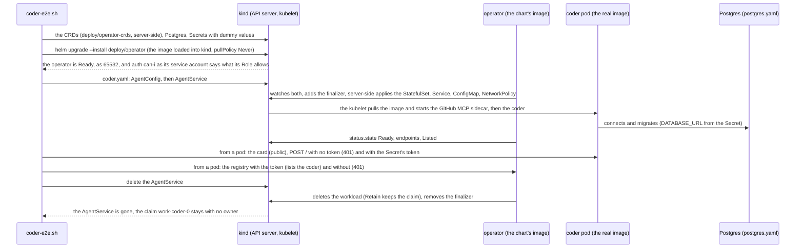
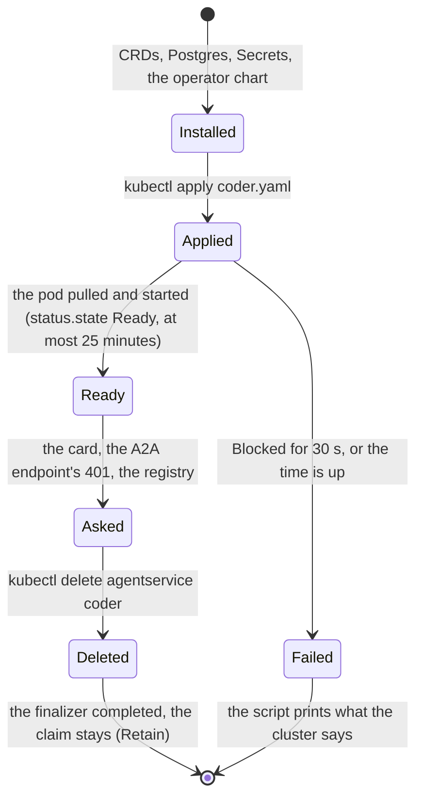
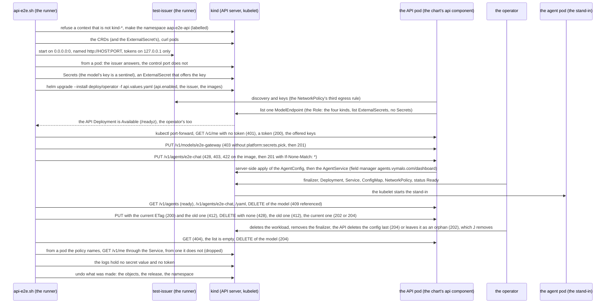
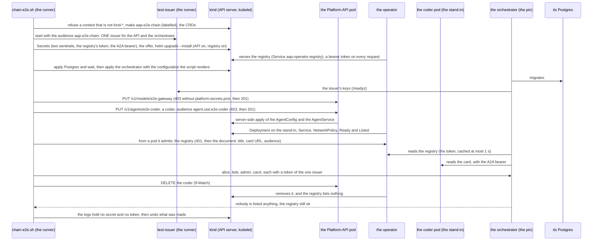
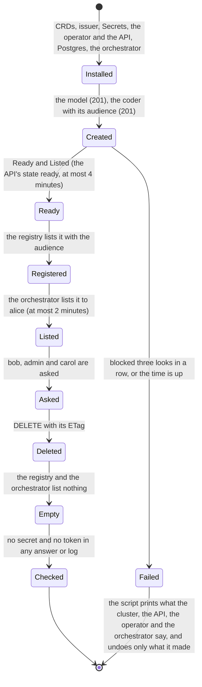
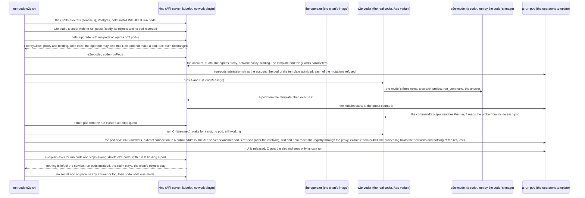
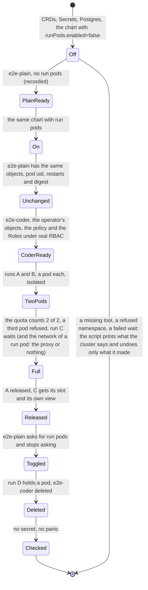

# The kind end-to-ends of the operator: the coder (S9), the Platform API (D7b2), the whole chain (D13) and run pods (D15b)

Four scripts, four jobs of [`operator-image.yml`](../../../../.github/workflows/operator-image.yml), one kind cluster each: [`coder-e2e.sh`](coder-e2e.sh)
(the operator runs the real coder, [below](#the-kind-end-to-end-of-the-coder-s9)), [`api-e2e.sh`](api-e2e.sh) (the Platform API creates an agent the
operator makes Ready, [further down](#the-kind-end-to-end-of-the-platform-api-d7b2)) and [`chain-e2e.sh`](chain-e2e.sh) (the API makes a coder with an
audience, the operator runs it and lists it, and a pinned image of the system's orchestrator lists it for the person who holds the role and for nobody
else, [further down](#the-kind-end-to-end-of-the-whole-chain-d13)) and [`run-pods-e2e.sh`](run-pods-e2e.sh) (a coder runs the commands of its runs in pods of their own, the operator having
set them up, [at the end](#the-kind-end-to-end-of-run-pods-d15b)).

## The kind end-to-end of the coder (S9)

The operator, installed from its chart, runs **the real adam-rs coder image** in a kind cluster. This is the job
`operator-coder-e2e` of [`.github/workflows/operator-image.yml`](../../../../.github/workflows/operator-image.yml); the script
[`coder-e2e.sh`](coder-e2e.sh) is all of it and runs against any kind cluster that has the operator image:

```sh
docker build -t operator:smoke -f docker/operator/Dockerfile . && kind load docker-image operator:smoke --name <cluster>
sh deploy/operator/tests/e2e/coder-e2e.sh        # kubectl on that cluster; needs helm, jq and openssl; pulls a 2.9 GB image
```





## Files

| File | What |
|---|---|
| [`coder-e2e.sh`](coder-e2e.sh) | the script: every step bounded, every assertion named, the cluster's state printed on a failure |
| [`coder.yaml`](coder.yaml) | [`examples/coder.yaml`](../../../../examples/coder.yaml) adapted: the real image by tag and digest (`sha-9a1fd4e`, the newest `main` image of adam-rs on 2026-10-05, read anonymously from ghcr.io; **it is also the chart's `defaultAgentImage`**, the operator's default for an agent that names no image (AD-029), and `render-check.sh` and `cargo test -p aap-operator --test e2e_fixture` fail when the two differ), the token variant with a dummy token, a Postgres by `secretRef`, no web search, a 1 GiB claim on kind's default storage class. Each difference is marked `# e2e:` |
| [`postgres.yaml`](postgres.yaml) | a throwaway Postgres 17.9 (Alpine 3.23, pinned by digest, from the public ECR mirror of Docker Hub) with no volume |
| [`operator.values.yaml`](operator.values.yaml) | the operator chart's values: an existing Secret for the registry's token, and only the pods labelled `aap-e2e/client` may read the registry |
| `../../../../bin/operator/tests/e2e_fixture.rs` | `cargo test`, no cluster: `coder.yaml` passes `aap_domain::resolve`, runs the pinned image with its sidecar on the token variant, and names the Secrets the script makes |

## What it proves

* The chart installs on a real cluster: the operator is Ready (`/readyz`), runs as 65532 on a read-only root filesystem, and its service
  account may do what its `Role` says and nothing else: no Secrets, no `agentservices/finalizers`, nothing cluster-wide, nothing in another
  namespace, and the shared kinds (`modelendpoints`, `toolproviders`) read, listed and watched and never written (`kubectl auth can-i`, as the service account).
  The Role's verbs on the shared kinds are asserted here and **nowhere else**: a bare API server run with `AlwaysAllow`, as `bin/operator/tests/cluster.rs` is run by hand, authorises everything.
* The operator makes a workload from `AgentConfig` and `AgentService` that **the real coder starts in**: with the GitHub MCP
  server as a native sidecar of the same image, a Postgres it migrates, and the variables the operator derived. The coder exits 78 on a
  configuration it does not accept and 69 when a dependency is down, so a Ready pod is the startup checks of `bin/adam-coder` passed.
* `status.state` is `Ready`, with `ConfigResolved`, `StoreReady`, `RuntimeReady` and `Ready` True and `Listed: Listed`, and
  `status.endpoints` are what the pod serves.
* The A2A card answers through the Service, from another pod, and names the Coder and its `coding-task` skill; the JSON-RPC
  endpoint is closed without the token and with a wrong one, and the token of the Secret is not refused (the Secret reached the pod).
* The registry, read from a pod with the token, lists the coder with its card URL, title and tags, and the card it lists is the card
  the pod serves; without the token it answers 401. A pod the registry's NetworkPolicy does not name is refused, when the cluster
  enforces NetworkPolicies (otherwise the job says so, in a warning, and does not fail: that is the CNI's, not the operator's).
* Deleting the `AgentService` completes its finalizer, removes the StatefulSet, the Service and the pod, **keeps the claim `work-coder-0` with
  no owner** (`deletionPolicy: Retain`) and the `AgentConfig`, and the registry lists nothing.

## What it does not prove

* **No model.** `MODEL_BASE_URL` is `http://model.invalid/v1`: the coder opens no connection to its model at startup (*verified by reading only, 2026-10-05*: a search of `bin/adam-coder/src`, `crates/adam-service/src` and the model crates
  of adam-rs at `588e9b5`, one commit past the image's `9a1fd4e`, finds no model call at startup), and no task is sent, so nothing ever asks it.
* **No GitHub.** `GITHUB_TOKEN` is a dummy and the GitHub App variant is not run (a real key would be a real credential): the GitHub MCP server
  of the pod is only asked for its tool list, which makes no request to GitHub (*verified 2026-10-03* by adam-rs). No clone, branch, push or pull request.
* **No run.** No A2A task reaches the coder: no journal, lease, worker or tool is exercised beyond startup. That the operator's variables make
  the coder *work* is the parity goldens' claim (`crates/domain/tests/golden`), not this job's.
* **Not the netcup coder**: one worker, 1 GiB of storage on kind's default class, no web search, no Context7, no CloudNativePG (a
  Postgres pod instead; CloudNativePG is `store-cnpg`'s job), the combined topology only (not `split`), and no cutover from the Helm chart (M3).
* The image of adam-rs is the one of `main` on 2026-10-05 and is not tracked: a bump of the pin is a deliberate change of `coder.yaml`,
  with the digest of the tag read from ghcr.io again (`adam-upgrade`, `bump-adam`).

*Unverified* until the job has run: all of the above has been checked here only as far as `shellcheck`, `actionlint`, `helm` and the
`cargo test` of `e2e_fixture.rs` can reach; no cluster, no docker daemon and no kubelet existed where the job was written. Where it
may need a fix: the size of the coder image on a runner's disk (the job frees about 25 GB first), the time of the first pull (25
minutes allowed), kindnet's handling of the operator's egress policy, whether a POST of `{}` to the JSON-RPC endpoint with the right
token is answered with something other than 401 or 403, and `busybox`-free tools: the script asks from `curlimages/curl`, pinned by digest.

## The kind end-to-end of the Platform API (D7b2)

The Platform API ([`bin/api`](../../../../bin/api/README.md)), installed from this chart with `api.enabled`, **creates a folder agent through its REST
interface**; the operator makes it `Ready`; the API lists it, reads it, exports it, refuses what it must and deletes it. This is the job `api-e2e` of
[`operator-image.yml`](../../../../.github/workflows/operator-image.yml) (it needs the jobs `image` and `api-image`, whose images it runs, and `push` needs it:
no API image is pushed that failed to serve its first agent). The script [`api-e2e.sh`](api-e2e.sh) is all of it and runs against any kind cluster that
has the images:

```sh
kind create cluster --name aap-api
docker build -t operator:smoke -f docker/operator/Dockerfile . && docker build -t api:smoke -f docker/api/Dockerfile . \
  && docker build -t aap-stub:ci bin/operator/tests/stub
kind load docker-image operator:smoke api:smoke aap-stub:ci --name aap-api
sh deploy/operator/tests/e2e/api-e2e.sh      # kubectl on that cluster; needs helm, jq, curl, openssl and cargo (it builds the test issuer)
```

The script finds the host's address on the docker network `kind` itself (`AAP_TEST_HOST_ADDR` says it when docker is not the runtime, or when the cluster is
not kind: the pods must reach the machine the script runs on). `TEST_ISSUER_BIN` names a test issuer that is already built. On a failure it prints what the
cluster says, the API's and the operator's logs and the last answer of the API, and it removes what it made (below).

**It runs only on a throwaway cluster and touches only what it made** (after the review of 2026-10-16: the first version armed its cleanup before any check and, on a
missing tool, would have run `helm uninstall aap-operator` and deleted `agent-a2a-bearer`, the chart's own default name for the real orchestrator's token, in
`another-agentic-system`):

* `kubectl`'s current context must be `kind-*`; anything else is refused **before anything is made and before the cleanup exists**. `AAP_E2E_ALLOW_ANY_CONTEXT=1` says that another
  cluster is a throwaway one (it then also applies the CRDs and the ExternalSecret CRD of the pinned copy there, which Argo CD would also leave).
* It works in a namespace of its own, `AAP_E2E_NAMESPACE` (default **`aap-e2e-api`**, not the namespace of a deployment), that **it makes with the label `aap-e2e/made-by=api-e2e`**. A namespace that exists
  without the label is never used; one that has it is a leftover of an earlier run and is used again (a terminating one is waited for, three minutes at most).
* Its Secrets and its ExternalSecret have names of their own, set in the chart's values it writes and in [`api-offer.yaml`](api-offer.yaml): `e2e-agent-models` (the model's key, the sentinel), `e2e-a2a-bearer`,
  `e2e-chat-db-app` and `e2e-agent-models-es`. Each carries the label, and **one that exists without it is never overwritten**. The two curl pods are named for the run.
* The cleanup undoes what each step recorded when it happened, in the order that lets the operator, which is still there, run the finalizer of the agent: the agent and the model if step 4 began,
  the Helm release if the install began, the namespace (and with it the Secrets, the offer and the pods) if the script made it, then the issuer. **A run that stops before any of that** (a missing tool, a failed
  build, a refused context or namespace) **uninstalls and deletes nothing**. `INT`, `TERM` and `HUP` run it too (dash does not run an `EXIT` trap for a signal by itself). The CRDs stay.

| Variable | Default | Says |
|---|---|---|
| `AAP_E2E_NAMESPACE` | `aap-e2e-api` | the namespace of the run; made by the script, or one it made before |
| `AAP_E2E_ALLOW_ANY_CONTEXT` | unset | `1`: the current context may be a cluster that is not a kind cluster's, and is a throwaway one |
| `AAP_E2E_CNI_MAY_IGNORE_POLICIES` | unset | `1`: the cluster's network plugin has no NetworkPolicy support; a pod the API's policy does not name that reaches the API is then a warning and not a failure |

**The token issuer is a program on the runner.** The API checks a bearer JWT against the keys of an OIDC issuer, so the pod has to fetch an issuer's
discovery document and keys, and the script has to get tokens for people who hold chosen permissions. [`test-issuer`](../../../../crates/auth-oidc/README.md#test-tooling-the-issuer-as-a-program)
is the testkit's issuer of `aap-auth-oidc` (RS256, a flat roles claim, throwaway keys made at start) as a process: it listens on every interface, names itself
`http://<the host's address on the docker network of kind>:<port>`, which is the `iss` of its tokens and the `issuer` of the API's configuration, and mints
tokens on a **control port bound to the loopback, which the script checks a pod cannot reach**. It is an example of the crate: in no image, in no chart.

```mermaid
stateDiagram-v2
    [*] --> Installed: CRDs, issuer, Secrets, the chart with the API on
    Installed --> Asked: tokens, 401, 403, the offered keys
    Asked --> Created: the model (201), then the agent (201, ETag, label of the dashboard)
    Created --> Ready: the operator makes it Ready (the API's state ready, at most 4 minutes)
    Created --> Failed: blocked for three looks in a row (about 10 s), or the time is up
    Ready --> Replaced: PUT If-Match, 200; the old ETag, 412
    Replaced --> Deleted: DELETE If-Match (412 for the old one, 428 for none), 202 or 204
    Deleted --> Gone: the finalizer completed, both objects and the workload gone (on a 202 the config is an orphan and J removes it)
    Gone --> Checked: the model's delete, the NetworkPolicy, no secret and no token in any answer or log
    Checked --> [*]
    Failed --> [*]: the script prints what the cluster, the API and the operator say, and undoes only what it made
```





### Files

| File | What |
|---|---|
| [`api-e2e.sh`](api-e2e.sh) | the script: every step bounded, every assertion named, the cluster's state printed on a failure |
| [`api.values.yaml`](api.values.yaml) | the chart's values for it: the API on, a Secret per agent for the ledger, `docker.io` the one registry an agent may pin its image from, the pods labelled `aap-e2e/client` the only ones the policy lets reach the API. The script adds in a second file what it knows when it runs: the images, the issuer and the egress rule that reaches it, the namespace, the Secret of the A2A bearer. `render-check.sh` renders both (in the namespace `aap-e2e-api`, with the bearer `e2e-a2a-bearer`) and asserts what the script depends on, so a change that breaks them fails the chart job and not this one |
| [`api-offer.yaml`](api-offer.yaml) | the labelled `ExternalSecret` `e2e-agent-models-es` that offers the model's API key (`e2e-agent-models`) to the forms (no External Secrets Operator in the cluster: nothing reads it but the API, which lists it) |
| `../../../../crates/auth-oidc/examples/test-issuer.rs` | the issuer and its tokens, [documented with the crate](../../../../crates/auth-oidc/README.md#test-tooling-the-issuer-as-a-program) |
| `../../../../crates/objects-kubernetes/tests/crds/external-secrets.io_externalsecrets.yaml` | the pinned copy of the ExternalSecret CRD, applied here as the crate's own cluster test applies it |
| `../../../../bin/operator/tests/stub/Dockerfile` | the agent's image: the stand-in for the adam image that `operator-e2e` runs |

### What it proves

* **The chart's `api` component installs and serves on a real cluster, as a real pod**: the API Deployment is Available, which is `/readyz`: the issuer's keys were
  fetched over the network from a process outside the cluster, **and** the API listed a `ModelEndpoint` under its own `Role`; the pod runs as 65532 on a read-only
  root file system and did not restart; its service account may do what `crates/objects-kubernetes/tests/rbac.yaml` says and nothing else (`kubectl auth can-i`
  as the service account: nothing on Secrets, `get` on ExternalSecrets or `watch` on anything, nothing on workloads, nothing in another namespace); its NetworkPolicy
  is installed with the one egress rule that reaches the issuer.
* **Authentication and authorization against a deployed API**: no token and a token that is not one are `401` with the challenge and a problem detail; a token
  without the permission is `403` naming it (`platform:agents.read`, `platform:agents.write`, `platform:secrets.pick` for a write that names a key).
* **A secret is a reference.** The key is offered by an ExternalSecret the API lists, picked by name, and written into the `ModelEndpoint` as `secretRef`; the Secret's
  value is a sentinel the script made and looks for in every answer the API gave (the YAML export included), in the API's log and in the operator's: it is in none.
  A log counts only if its `kubectl logs` succeeded, it is not empty and it holds a line only that component logs (the API's `route=/v1/agents`, the operator's `the caches are synced`):
  a log that was never read holds no secret and no panic. The diagnostics of a red run print no line that holds the sentinel or a token of the run.
* **The create, with its preconditions, on a real API server**: a write with no precondition is `428` and writes nothing; an image from a registry the deployment does
  not allow is `422` on the field `image`; the create is `201` with `Location` and an `ETag`, under the field manager `agents.vymalo.com/dashboard` and the
  label of the dashboard on both objects, the model by `endpointRef`; a second create is `409`.
* **The operator makes it Ready from what the API wrote**: the API's state `ready` (the generation observed, the status the operator wrote), the AgentService
  `Ready` with its four conditions `True`, the Deployment Available on the stand-in image, the card answering through the Service. This is the join of D5 and S5.
* **The reads**: the list row (`kind: folder`, `managedBy: dashboard`, title, tags, audience, digest), the detail with the form and the status, the YAML export
  (both objects, no `status`, no managed field, no resource version, no value), the model's `usedBy`, and the `409 referenced` of a delete of the model the agent names
  (the agent's name only to a reader of agents).
* **The conditional writes**: a replace with the current `ETag` is `200` and renames both objects; with the ETag of before it is `412` and changes nothing; a delete with
  no `If-Match` is `428`, with the old tag `412`, with the current one `202` or `204`; the operator's finalizer completes and the objects, the Deployment, the Service
  and the pod are gone; the agent is then `404` and the list is empty, and the model can go (`204`). **A `204` means both objects go** (the API deletes the config after the service). **A `202`**
  (the finalizer outlasted the API's 5 s wait) **leaves the `AgentConfig` behind as an orphan, as D5 says**: the body must say the agent is `deleting`, the `AgentService` must go, and the script reports
  the config in a `::warning::` and removes it with `kubectl`, so that the run ends clean; it does not claim an order the end state cannot show. The operator writes its status all
  the time, so a replace or a delete right after a read may be `412`: the script reads again, up to five times.
* **The NetworkPolicy**: a pod the policy names reaches the API through its Service with a token; a pod it does not name, **which reaches the issuer** (so its network works and the refusal is the policy's),
  is refused: its connection is dropped (status `000`). Anything else, a `200`, a `401` or a `5xx`, fails the job: the request got through. Kind's network plugin enforces NetworkPolicies (below), so there is no
  tolerance by default; `AAP_E2E_CNI_MAY_IGNORE_POLICIES=1` is for a cluster whose plugin does not, and then a pod that got through is a warning. Either way the API's pod was Ready with the policy installed.

### What it does not prove

* **A real Keycloak.** The issuer is the testkit's (RS256, a flat roles claim, `http`, keys that never rotate). That a real Keycloak's keys and its roles claim (the
  composite-expanded roles, a nested claim) work is D14, when the realm is tried.
* **The edge**: TLS, a check of the JWT, rate limits and the Ingress. The script reaches the API with `kubectl port-forward` and, once, through the Service from a pod.
* **NetworkPolicy enforcement is kind's, not proven by this script alone.** kind's default network plugin, kindnet, **enforced** a NetworkPolicy in the coder end-to-end (*verified 2026-10-16*, `operator-coder-e2e` of run 38892472909 on `main` (kind v0.33.0, node v1.35.8): `ok   a pod the registry's NetworkPolicy does not name cannot read it (status 000)`; its ClusterRole may list and watch NetworkPolicies, pods and namespaces: `pkg/build/nodeimage/const_cni.go` of kind v0.33.0), so this job runs under enforcement, and the API's pod being Ready then shows that its ingress rule (the health port is not in it: the kubelet's probes come from the node) and its three egress rules were enough. **The script requires the refusal** (it accepted either outcome before the review of 2026-10-16, which let the check pass without proving anything); what only a run of the job can show is that kindnet does refuse this pod on this policy. `apiServer.cidrs` is empty in these values (any address on 443 and 6443), so the rule that is narrow is the issuer's, a /32.
* **`preStop.sleep` and a rolling update.** The pod has the hook (the script checks the pod spec) and Kubernetes 1.35 has the feature on; that a request in flight survives a
  rollout, and what the sleep does for a client, is not measured.
* **A real agent image, CloudNativePG, a coder, a tool server, a suspend.** The agent is a folder agent on the stand-in (it answers `/healthz` and a card), its ledger is a
  Secret nobody opens. A coder form (which needs a GitHub App key) and the tool-server routes are the crate's tests'.
* **Two replicas, an upgrade of the API in place, a restart of the issuer** (the key cache's grace period is `aap-auth-oidc`'s tests').
* **The log's colour.** The binary's `tracing-subscriber` writes ANSI colour codes into the pod's log (`fmt()` with no `with_ansi`: `bin/api/src/main.rs`; *observed 2026-10-16* with stderr redirected to a file in the walk described below); the script strips them before it
  looks for a request line. The operator's log is set up the same way (`bin/operator/src/main.rs`). *Not changed here* (a decision for the owner, §60a).

**The job passed on its first run** (run 38896792093, head `ef0b86f`, *verified 2026-10-16* in its log: every step, a `204` on the delete, the agent `ready` after 5 s, the other pod refused with status `000`). It was written where **no container daemon and no kind exist**, and the changes the review of 2026-10-16 made to it (the guards, the namespace and the Secrets of its own, the cleanup that records what it made, the signals, the `202` branch, the strict policy step, the scan of the headers and of the pieces of a token) passed in CI on `main` too (run 38970194294, the push at `2ca4454` of 2026-10-16T21:33Z, job `api-e2e` 117207892113, *verified 2026-10-17* with `gh api` and in the job's log: the context `kind-aap-api`, the namespace `aap-e2e-api`, a `204` on the delete, the other pod refused with status `000` after the control, no secret, token or panic). What was run where they were written: `shellcheck`, `dash -n`, `actionlint`, `render-check.sh`, and **the whole script, end to end, under `dash`, against the real router of
`aap-platform-api` over the `Memory` ports, the real `OidcAuthenticator` and the real `test-issuer`, with a fake `kubectl` and a fake `helm` (scratch programs: not committed) that answer
from the objects the router wrote**: every `curl` step and `jq` filter of the API half is the real thing; every `kubectl` assertion is the fake's, and the fake says what the script
wants to hear, except where a scenario makes it say otherwise (a context that is not kind's, a namespace or a Secret that is not the script's, a missing tool, a failed build, a `202` with and without an orphan, a service that lingers, a pod the policy does not refuse, a leaked token, each of the three signals). Where the changes might have needed a fix in kind (`kubectl create -f -` of the labelled namespace and its deletion, the agents in a namespace other than `another-agentic-system`, the control that the other pod reaches the issuer), the job at `2ca4454` was green. The `202` branch with an orphan config was not taken in that run (the delete was `204`), so it is proven only by the walks.

**The D13 review's hardening, ported (2026-10-17)**, *unverified* until CI has run it (the pull request's run of `api-e2e` is the first): the review of [`chain-e2e.sh`](chain-e2e.sh) found gaps that this script, which it was modelled on, had too, and they are ported as `chain-e2e.sh` has them, without changing what this script asserts, its namespace, names, guards or cleanup. `ok`, `die` and every message that carries an answer body or other data use `printf` (dash's `echo` interprets backslashes, and a JSON body has them). Step 7 reads each log with `read_log`: the `kubectl logs` must succeed (no `|| true`, its stderr kept apart), the output must not be empty and must hold a line only that component logs (before, the operator's log was read with `2>&1 ... || true` and nothing was required of it). The diagnostics go through `redact`, which tolerates pattern files that do not exist yet or are empty and redacts before any `head -c`, so a failure that found a secret does not print it again. `HELM_KUBECONTEXT` is the context that was checked. The panic check matches `panicked at` and not the words `panic` and `backtrace`. The script has no `// []` listing fallback to harden: its empty listing is compared with `[]` exactly. *Walked, not run on a cluster*, under `dash`, with the real router over the `Memory` ports, the real `OidcAuthenticator` and `test-issuer` and a fake `kubectl` and `helm` (scratch, not committed): the whole script passes, with the operator's log in colour as the binary writes it; a `kubectl logs` of the operator that fails, that is empty or that is another pod's log fails the run at step 7 (the script before the change passed with the failing one); the sentinel planted in the logs and in a `describe` is printed by the diagnostics of the script before the change (four lines) and by the new one never; `redact` on its own passes everything through with no pattern files or empty ones and drops the lines that hold the sentinel, a token, its payload or its signature. What the walk cannot show: that the operator of this job logs `the caches are synced` (it does in `chain-e2e`'s, same image, same chart, `logLevel: info`, *verified 2026-10-17* in run 38996503582; the check is new here) and everything of the cluster half.

## The kind end-to-end of the whole chain (D13)

The Platform API, the operator and **the system's orchestrator**, in one kind cluster: the API creates a **coder with an audience**, the operator runs it and lists it in its
registry with that audience, and the orchestrator, **a published image of another repository pinned by tag and digest**, lists it for the person who holds the role and for nobody
else. This is the job `chain-e2e` of [`operator-image.yml`](../../../../.github/workflows/operator-image.yml) (it needs the jobs `image` and `api-image`, whose images it runs, and
**`push` does not need it**: it pulls two third-party images and reads a pin this repository does not control, so a red run is a reason to look and not to withhold the operator's release;
an owner decision, §60a D13, one line to flip). The script [`chain-e2e.sh`](chain-e2e.sh) is all of it and runs against any kind cluster that has the two images and the stand-in:

```sh
kind create cluster --name aap-chain
docker build -t operator:smoke -f docker/operator/Dockerfile . && docker build -t api:smoke -f docker/api/Dockerfile . \
  && docker build -t aap-stub:ci bin/operator/tests/stub
kind load docker-image operator:smoke api:smoke aap-stub:ci --name aap-chain
sh deploy/operator/tests/e2e/chain-e2e.sh    # kubectl on that cluster; needs helm, jq, curl, openssl and cargo (it builds the test issuer)
```

The cluster must reach `ghcr.io` (the orchestrator, `linux/amd64` only) and `mirror.gcr.io` (Postgres 16); the kubelet pulls both, by digest. The host's address on the docker network of kind (`AAP_TEST_HOST_ADDR`), the test issuer
(`TEST_ISSUER_BIN`) and the escape for a cluster that is not kind's (`AAP_E2E_ALLOW_ANY_CONTEXT`) are the [API's end-to-end](#the-kind-end-to-end-of-the-platform-api-d7b2)'s, and so are the timeouts' variables (`READY_TIMEOUT_SECS`, `GONE_TIMEOUT_SECS`);
`ROLLOUT_TIMEOUT_SECS` (420) bounds the two rollouts and `LISTING_TIMEOUT_SECS` (120) the wait for the orchestrator to read the registry.

**It runs only on a throwaway cluster and touches only what it made**, as `api-e2e.sh` does after its review: a context that is not `kind-*` is refused before anything is made (and the cleanup is not yet armed);
it works in a namespace of its own, **`aap-e2e-chain`** (`AAP_E2E_NAMESPACE`), that it makes with the label `aap-e2e/made-by=chain-e2e` and never uses without it; its Secrets, its ConfigMap, its ExternalSecret
and its Deployments have names of their own (`e2e-...`), carry the label, and one that exists without it is never overwritten; the cleanup undoes what each step recorded, in the order that lets the operator run
the finalizer, and `INT`, `TERM` and `HUP` run it. The API's end-to-end uses `aap-e2e-api`: two clusters, two namespaces.





### Files

| File | What |
|---|---|
| [`chain-e2e.sh`](chain-e2e.sh) | the script: every step bounded, every assertion named, the cluster's state printed on a failure |
| [`chain.values.yaml`](chain.values.yaml) | laid over `api.values.yaml` (which stays what the API's end-to-end installs): the operator's registry on, with a Secret of the script's own for its token; only the pods labelled `aap-e2e/registry-reader` may read it; the coder's defaults (an author, the hosts, the API URL, no GitHub MCP sidecar, no work volume). The script adds in a third file what it knows when it runs, as `api-e2e.sh` does. `render-check.sh` renders them in `aap-e2e-chain` and asserts what the script depends on |
| [`chain-orchestrator.yaml`](chain-orchestrator.yaml) | the orchestrator and its Postgres, no namespace in them. **The orchestrator's pin is here and nowhere else**: tag and digest, with the date it was read from `ghcr.io` and what was read; the script takes the pin from this file and `render-check.sh` holds that its digest is in no other file of `deploy/` or `.github/`. The script renders the configuration (a ConfigMap) and makes the Secrets it mounts |
| [`chain-offer.yaml`](chain-offer.yaml) | the labelled `ExternalSecret` that offers the two keys the forms name, the model's API key and the GitHub App's private key (no External Secrets Operator in the cluster: nothing reads it but the API) |
| `../../../../bin/operator/tests/stub/Dockerfile` | the agent's image, shared with the other jobs. **Its card is a valid A2A 1.0 card since D13**: the orchestrator parses the card to list the agent, and the old one (a name and a description) is "unreadable" to it |

### What it proves

* **The orchestrator takes what this repository publishes.** Its configuration (the script renders it: the operator's registry as its only source of agents, two files for the tokens, the issuer, two roles that may read and use every
  agent, `userClaim: sub`, `defaultRole: null`) is accepted, its migrations run, the issuer's keys are fetched (`/readyz`), and the pod runs the pinned image.
* **The audience is the registry's and the orchestrator enforces it.** The coder is made through the deployed API with `audience: ["agent.use:e2e-coder"]`; the `AgentService` carries it; the operator's registry, read from a pod it admits, answers `401`
  without its token and, with it, lists the coder with that audience, its title and its card URL; and the orchestrator, which reads that registry, shows the coder to the people the audience admits:
  * **alice** (roles `user` and `agent.use:e2e-coder`): `GET /api/agents` lists exactly `e2e-coder`, from the registry, with the description **of the card the stand-in serves** (so the orchestrator read the card with the A2A bearer and understood it), its capabilities are `200`, and `/api/me` says her role is `user` only;
  * **bob** (`user` and `agent.use:other`): `GET /api/agents` is `[]`, `GET /api/registry` says the platform's registry is `ok` (so the empty list is the audience and not a registry that failed), `/api/me` is alice's but for the person, and the capabilities are the `404` of an agent that does not exist, byte for byte;
  * **admin** (the role `admin`): the list holds the coder and its capabilities are `200`. **This asserts what the pinned system does** (its ADR 0045, decision 1.4: a role that holds `admin` sees every platform agent), **while the contract of the registry (its consumer's rule 4) says the opposite**: an open question for the owner (§60a, D3), which this script does not decide. If the pin moves to a system that follows the contract, this is the check that fails;
  * **carol** (`agent.use:e2e-coder` and nothing else): `403 no_access` on the list and on the capabilities, and `/api/me` says she holds no role and no permission: a value of the audience admits, it never grants.
* **The chain ends cleanly.** Deleting the coder through the API (`If-Match`) completes the operator's finalizer; the registry lists nothing, the orchestrator lists nothing to the administrator or to alice, and the registry is still `ok`.
* **The Platform API makes a coder.** `403` naming `platform:secrets.pick` for a coder that names the GitHub App's key and for a model that names the API key, then `201`; the coder is an `adam-coder` on the stand-in image (docker.io by its name, the one registry `api.values.yaml` admits) with no volume, so a Deployment; its Secrets (the ledger, the model's key, the A2A bearer, the App's key as a file) are the ones the script makes.
* **No secret value** (the model's key and the App's private key are sentinels, the registry's token and the A2A bearer are random) **and no token minted by the run is in any answer, header or log**: the Platform API's, the operator's and the orchestrator's, whose log is JSON. Each log counts only if its `kubectl logs` succeeded, it is not empty and it holds a line only that component logs (the API's `route=/v1/agents`, the operator's `the caches are synced`, the orchestrator's `database migrations applied`): a log that was never read holds no secret and no panic.

### What it does not prove

* **A real Keycloak, the edge, DPoP, the web.** The issuer is the testkit's (RS256, a flat roles claim, no e-mail: the orchestrator reads the user from `sub`); the orchestrator is asked with plain bearer tokens.
* **A message to the agent.** The coder is the stand-in: it answers `/healthz` and a card, nobody speaks A2A to it, so a thread, a job or a run on `e2e-coder` is not exercised. The real coder is `operator-coder-e2e`'s (up to its startup checks).
* **A system newer than the pin.** `sha-8df44c6` is the system's `main` at its slice D8; a bump of the pin is a deliberate change of one file, with the digest read again from `ghcr.io`.
* **The deployment's wiring** (the system's chart reading `agent-registry` through its Service name, the shared token in AWS Secrets Manager): D14.
* **Two replicas of the orchestrator**, a registry that is down (the system's `dev/registry-e2e.sh` covers it against mocks), and an audience that is narrowed while a job runs.

### What ran, and what is unverified

*Verified 2026-10-17*: the orchestrator's pin by an anonymous manifest request to `ghcr.io` (the index `sha256:2794587b...`, one `linux/amd64` image and an attestation; the config's revision label is `8df44c6f...`, user `65532:65532`, entrypoint `/orchestrator`); Postgres's by an anonymous request to `mirror.gcr.io`;
and, with the **orchestrator binary built at `8df44c6`** (the same commit, a debug build with the crate's default features, which are the image's: its `Dockerfile` adds none, and `registry-platform` and `auth-jwt` are default) on a scratch Postgres 16: the configuration the script renders, taken from the script itself, is accepted by `--print-config` and by a live start (migrations applied, `/readyz` `200`), and the tokens the testkit's issuer mints are accepted by it; alice, bob, admin and carol get the answers above
(`GET /api/agents`, `/api/registry`, `/api/me` and the capabilities).

*Run where it was written, with no container daemon and no kind*: `shellcheck`, `dash -n`, `actionlint`, `render-check.sh`, and **the whole script, end to end, under `dash`**, against the real orchestrator above (in a private mount namespace with the cluster's names in `/etc/hosts` and the Secrets as files, reading the configuration and the Secrets the script made),
the real Platform API router over the `Memory` ports with the defaults **the chart rendered from these values** (so `chain.values.yaml` is read by the API's own `Defaults`, which refuses a key it does not know), the real registry router over a directory that follows the objects, the real `test-issuer`, and a fake `kubectl` and `helm` (scratch, not committed) that answer from what the script applied.
The coder the API wrote was also resolved by the operator's own `aap_domain::resolve`: a Deployment, the stand-in image, no sidecar, and every Secret it names is one the script makes. Sixteen of the script's assertions were broken on purpose, one edit at a time in a copy of it, and each failed as written (the pin without a digest, a Secret of the manifest misnamed, an audience that is not the role's, a registry item with another title, alice without the role, bob with it, the registry's expectation for bob turned, the administrator without `admin`, carol with `user`, bob's `/api/me` made different, the 404 compared with another body, a delete that is not made, a secret value and a token planted in the answers, a registry path that does not exist, a coder written without `platform:secrets.pick`); so were the guards (a context that is not kind's, a namespace and a Secret without the label, the opt-in that lets another context through) and the stand-in's old card, and `TERM` and `INT` ran the cleanup.
**The job passed on its first run** (run 38994193619, job 117283711764, at `4929e3c`, 2026-10-17, about three minutes; *verified 2026-10-17* in its log, every `ok` line of the script), and that run proved what could not be run where it was written: the kubelet pulled the orchestrator and Postgres by digest, the orchestrator's pod became ready (`/readyz`), kindnet admitted it to the registry and to the agent (the policies), `kubectl rollout status` and the port-forward to a Service of this script worked, the operator's real status made the coder `Ready` and `Listed` after 5 s, the stand-in answered through its Service from the orchestrator's pod, the four people had the answers above, the delete emptied the registry and the orchestrator's listing, and no secret value or token was in any answer or log. It needed no fix.

**After review (2026-10-17)**, which passed in CI (run 38996503582 at the PR head `8d45dab`, job `chain-e2e` 117290340019, *verified 2026-10-17* with `gh api` and in the job's log: each of the three logs read by a `kubectl logs` that succeeded and holding a line of its own component, the registry of an empty fleet, no secret, token or panic): each log of step 7 must come from a `kubectl logs` that succeeded and hold a line only its component logs (before, `|| true` let a log that was never read pass every check); the empty registry must be the document of an empty fleet (one linkset context with the v1 profile and no `item`; before, `{}` counted as zero items); the diagnostics print no line that holds a secret value or a token of the run; helm uses the context that was checked (`HELM_KUBECONTEXT`); `printf` and not `echo` for bodies; the panic check matches `panicked at`; Postgres's probe goes over TCP (`pg_isready -h 127.0.0.1`), because the image's entrypoint first runs a server that listens on its socket only; and the orchestrator's digest is on one line of `chain-orchestrator.yaml`, which `render-check.sh` holds. Shown on the scratch walk above, with a fake `kubectl` that fails the operator's log, answers `{}` for the registry after the delete, or puts the model's key in the API's log: the old script passed the first two and printed the key in its diagnostics; the new one fails the run on each (and on an empty or misplaced log of any of the three) and prints no line that holds the key.

**Still unverified**: a real Keycloak and the system's chart reading the registry (D14), a message to the agent, a system newer than the pin, and an orchestrator with more than one replica.

## The kind end-to-end of run pods (D15b)

The operator, installed from its chart **with `runPods.enabled`**, runs **the real adam-rs coder** (the image at or after adam-rs [#134](https://github.com/vymalo/another-adam-rs/pull/134), `ff10395`, which has `adam-egress`; pinned at `7598255`, which contains #131 and #117, ADR 0041) with
`coder.runPods`. A task makes the coder run a command **in a pod of its own** that the operator's template describes; the pod sees only its own run; the quota counts it and refuses one past the limit (the coder waits); the network of the pod is deny by default and the egress proxy the operator made is its one way out (D15c); the admission policy and the Roles do what they say under the real RBAC of a real API server; a deleted service leaves nothing, run pods included; and an agent without run pods is as it was. This is the job `run-pods-e2e` of
[`operator-image.yml`](../../../../.github/workflows/operator-image.yml) (it needs the job `image`, whose operator image it runs, and **`push` does not need it**: it pulls a 3 GB image and the run pods are off by default, so a red run is a reason to look
and does not put a broken default into the release; an owner decision, §60a D15b, one line to flip). The script [`run-pods-e2e.sh`](run-pods-e2e.sh) is all of it and runs against any kind cluster that has the operator image:

```sh
kind create cluster --name aap-runpods --image kindest/node:v1.35.8   # any cluster whose network plugin enforces NetworkPolicy (kind's does), Kubernetes 1.30 or later
docker build -t operator:smoke -f docker/operator/Dockerfile . && kind load docker-image operator:smoke --name aap-runpods
sh deploy/operator/tests/e2e/run-pods-e2e.sh    # kubectl on that cluster; needs helm, jq and openssl; pulls the coder, 3 GB
```

The cluster must reach `ghcr.io` (the coder, and the run image, whose layers the coder's mostly are: the kubelet that pulled the coder pulls one layer more) and `mirror.gcr.io` (Postgres), by digest. The timeouts are the other scripts' variables
(`READY_TIMEOUT_SECS`, `ROLLOUT_TIMEOUT_SECS`, `GONE_TIMEOUT_SECS`) and `POD_TIMEOUT_SECS` (300, a pod to start) and `TASK_TIMEOUT_SECS` (240, a task to finish); `AAP_E2E_CNI_MAY_IGNORE_POLICIES=1` turns the one check that needs a network plugin
that enforces policies into a warning (step 7), as `api-e2e.sh`'s variable does; the escape for a cluster that is not kind's is `AAP_E2E_ALLOW_ANY_CONTEXT`.

**It runs only on a throwaway cluster and touches only what it made**, as the other two do: a context that is not `kind-*` is refused before anything is made (and the cleanup is not yet armed); it works in a namespace of its own, **`aap-e2e-runpods`**
(`AAP_E2E_NAMESPACE`), made with the label `aap-e2e/made-by=run-pods-e2e` and never used without it; every object it makes carries the label and one that exists without it is never overwritten; the cleanup undoes what each step recorded (the agents
first, with the operator still there to run the finalizer, then the Helm release, which takes the chart's cluster-scoped objects, then the namespace), and `INT`, `TERM` and `HUP` run it. The CRDs stay. Three clusters, three namespaces:
`aap-e2e-api`, `aap-e2e-chain` and this one.





### Files

| File | What |
|---|---|
| [`run-pods-e2e.sh`](run-pods-e2e.sh) | the script: steps 0 to 11, every wait bounded, every assertion named, the cluster's state printed on a failure (without any line that holds a secret of the run) |
| [`run-pods.yaml`](run-pods.yaml) | the two coders, `AgentConfig` and `AgentService` each: `e2e-plain` (token variant, no run pods) and `e2e-coder` (GitHub App variant, `coder.runPods { sizeClass: standard }`, four workers, a janitor every 10 s, `ALLOW_LOCAL_REPOS`). **The coder's pin is here and nowhere else**: tag and digest on two `ref:` lines that a test and `render-check.sh` hold equal, with what was read from `ghcr.io` and when. The chart's `defaultAgentImage` is **not** moved by this slice |
| [`run-pods.values.yaml`](run-pods.values.yaml) | laid over the chart: `runPods.enabled`, a quota of **two pods** (so the script can fill it), a pending service looked at every 5 s. `render-check.sh` renders it |
| [`run-pods-support.yaml`](run-pods-support.yaml) | a throwaway Postgres with two databases, and the scripted model (a Deployment of the coder's own image, so nothing else is pulled) |
| [`run-pods-model.js`](run-pods-model.js), [`run-pods-model.test.js`](run-pods-model.test.js) | the model: an OpenAI-compatible endpoint that answers every task with the same three turns (a scratch project or, with a repository, `prepare_workspace`; then `run_command` with a probe written for the task; then the answer, which holds the probe's output), keeps a journal of what it was asked (run, turn, whether the request carried a tool result) and ends the task with the probe's output. Its tests run in the workflow's `scripts` job (`node --test`) |
| `../run-pods-admission.sh` | D15a's: run here as the agent's account, against the policy the chart installed and the parameters the operator made |
| [`../../../../bin/operator/tests/e2e_run_pods_fixture.rs`](../../../../bin/operator/tests/e2e_run_pods_fixture.rs) | no cluster: the two coders pass `aap_domain::resolve` (the plain one on an operator with and without run pods, the other refused by one without and resolved by one with), the claim is `work-e2e-coder-0`, the pin is one pin, and the fixtures name the Secrets, Services and files the script makes |

### What it proves

* **The upgrade, and an agent that asks for nothing.** The chart is installed twice, first with `--set runPods.enabled=false`: the `PriorityClass`, the policy and its binding and the Role of run pods are not there, and the operator may not make a service account. `e2e-plain` is made under it (Ready, its set of objects, its pod's uid and start time and restart count, its `generation` and its config digest recorded). The second install, **the only difference being the flag**, makes those objects (the policy type-checked with no warning; its binding with the action Deny and a missing parameter allowed), and `e2e-plain` has the same objects, the same pod (not restarted) and the same digest. It gets no account, quota, network policy, binding, template or parameters, then and at the end.
* **The Roles, asked of the API server.** `kubectl auth can-i --as`, with run pods off and on. The operator's account: with them off, no service account, quota, binding, pod deletion or creation, no Secret; with them on, it may make a service account, a quota and a binding, delete pods and `bind` the Role of run pods by name, and it may not make a pod, `exec`, read or make a Secret, make a Role, `escalate`, bind another Role, or make a policy or a class. The coder's account: pods (make, get, list, watch, delete) and `exec` in its namespace, and no Secret, no ConfigMap, no `patch` of a pod, no binding, no pod in `kube-system`. The operator is a pod running as its own service account, so every reconcile of the run is also the proof that its Role is enough.
* **What the operator made for `e2e-coder`.** The account (the coder's pod runs as it, with the template mounted at `/etc/adam/run-pod`), the quota (two pods, scoped to the class), the network policy (DNS and the proxy, no address), the binding to the Role, the ConfigMaps of the template and of the guard's parameters, and the coder's log line that its commands run in a pod of their own. **`run-pods-admission.sh` runs in this cluster as that account**: the pod of the template is admitted and each of the mutations is refused with the message of its rule, so the policy and the parameters the operator made are asked, under real RBAC.
* **A command runs in a run pod, and the pod sees only its own run (ADR 0041).** Two runs hold their pods: each has a pod from the operator's template (the kubelet started it: Running, Ready, the labels, the priority class, the template's resources, the image by digest, the init container, no Secret volume and no service account token), the command ran in it (the pod's name is the host the command saw, and the lines it wrote are the lines in the run's answer), the pod mounts the run's directory of the coder's volume, and each slot of the run (a project, a worktree) as a mount of its own on top of it (adam-rs [#133](https://github.com/vymalo/another-adam-rs/pull/133): a name the pod cannot rename), **and nothing else of the volume** (checked in its spec, in its annotation, and from inside with `ls`), and B, told to look at A's directory, finds it absent, with `/work/workspaces` holding B alone. A third run, in **a repository of the coder's volume** (a local bare repository, its mirror and a worktree), sees its own mirror (read-only: a write is refused), its worktree, and neither A's nor B's nor the other mirror on the volume; git works in it.
* **The quota counts the pod and the coder waits.** `status.used.pods` is 2 of 2; a pod of the run class made by the administrator is refused with the API server's `exceeded quota`; run C is told to start and says, as a step of its stream, "Waiting for a slot for the run's environment" with the cluster's words, has **no pod**, is still `working`, and the model was asked only its first two turns. When A is released, C gets the slot.
* **The network of a run pod is deny by default, and the egress proxy is the one way out (D15c, adam-rs ADR 0042).** The operator made, beside the account and the quota, the proxy of `e2e-coder`: a Deployment of two pods of the coder's own image running `adam-egress` (uid 10001, no token, a read-only root file system, nothing mounted but its allow-list), a Service on 3128, an account, a budget, a policy (the run pods in on 3128; DNS and `0.0.0.0/0` on 443 out, the private ranges excepted) and the allow-list (the coder chart's hosts, no `storage.googleapis.com`), each owned by the service, and the script waits for its rollout (the operator does not: the proxy is no workload of the service). The run pods' policy names the proxy and no address. From the pod of A, **after the controls** (the coder's own pod, which no egress policy selects, reaches the model's pod and Service; the proxy's own pod reaches `registry.npmjs.org` on 443; DNS answers from the run pod): a direct connection (`curl --noproxy '*'`) to a public address, to the API server by its Service name and by its address, and to another pod's IP is refused, as is a packet to another port of the proxy's pod; the proxy's pods reach no public address on 80 and no pod; a pod that is not a run pod (the coder's) cannot use the proxy; through the proxy, with the environment the template gave the pod (`HTTPS_PROXY`, `HTTP_PROXY`, lower case too, `NO_PROXY`), `curl https://registry.npmjs.org/` answers 200, `npm view is-number version` answers a version, and `https://example.com/` is answered `403` by the proxy; its log has `decision=refuse` for `example.com` (host not allowed) and for the plain-HTTP request and `decision=allow` for `registry.npmjs.org`, and **no byte of what the refused requests carried** (a `Proxy-Authorization` header, a query, a path) and no secret of the run; and no policy of the namespace names an IPv6 range (kind is IPv4 only: the proof available is the absence of a rule). This needs a network plugin that enforces policies (kind's does; **the script fails where it does not**, and `AAP_E2E_CNI_MAY_IGNORE_POLICIES=1` makes the refusals warnings on a cluster known not to). A refusal is retried for up to 60 s: kindnet programs a policy a moment after it sees a pod.
* **The release.** A completes, its pod goes with its run (the coder's janitor), C and B complete and their pods go, the quota is back to zero.
* **A service that asks, and stops asking.** `e2e-plain` runs a task: the command runs in its own container and **no run pod is made**. Then it is given `coder.runPods` (the objects appear, the egress proxy's six among them, and its pod is replaced) and has it taken away (the objects go, the proxy's pods and objects with them, and its set of objects is again the one recorded at the start).
* **A deleted service takes everything.** With run D holding a pod, `e2e-coder` is deleted: the finalizer completes, the run pod goes, the StatefulSet, Service, account, quota, network policies, binding, template and parameters go, **and the egress proxy** (its pods, Service, account, budget, policy and allow-list), **only the claim `work-e2e-coder-0` stays** (`deletionPolicy: Retain`), and the chart's own objects (the class, the policy and its binding, the Role) stay.
* **No secret and no panic.** The model's key and the GitHub token are sentinels, the A2A bearer is random and the App's private key is generated for the run: none is in any answer, in the model's journal, or in the logs of the operator, of `e2e-plain`, of the model, of the egress proxy and of `e2e-coder` at its start. A log counts only if its `kubectl logs` succeeded, is not empty and holds a line only that component logs; the panic check is `panicked at`.

### What it does not prove

* **A real model, GitHub, a pull request.** The model is a script that makes the same three calls for every task; the App's id is made up and its key is generated (the coder parses it at start and never uses it); no task edits files. The coder's work with a real model is `operator-coder-e2e`'s up to its startup checks, and the shipped system's.
* **Another Kubernetes, another network plugin, Pod Security admission, a second node.** kind's node image (v1.35.8), kindnet, no Pod Security labels on the namespace, one node (a run pod on another node than the coder's, and a work volume shared by several workers, are not exercised).
* **OpenCode, Podman, devcontainers** in the run pod, and a coder whose image is not the pin. **git, cargo, pip and go reading the proxy variables** (curl and npm are tried; the others are documented to), **IPv6 egress** (kind is IPv4 only; the proof is the absence of a rule), domain fronting and what an allowed host accepts (adam-rs ADR 0042, "What is not covered"), and **an agent whose image has no `adam-egress`** (the default agent image, `sha-9a1fd4e`, is one: the operator cannot tell, §60a D15c decision 2)
* **The Platform API and the dashboard**: `agent.runPodSizeClass` is proven by the API's tests; this script makes the objects by `kubectl`.
* **A deployment**: netcup, Argo CD, External Secrets.

### What ran, and what is unverified

*Verified 2026-10-27* (D15b, the pin `sha-3f714d0` of the time; the pin of D15c is below): the coder's pin by an anonymous request to `ghcr.io` (the tag's manifest is a Docker v2 image manifest, not an index; `docker-content-digest` and the sha256 of the body are the digest in `run-pods.yaml`; 14 layers, user `10001`, entrypoint `tini -- adam-coder`, `PATH` with `/usr/local/bin`, which is where the model's `node` is found; six of the seven layers of the `workspace` run image are the coder's, so the kubelet pulls one layer more for the run pods) and what the run image has (`curl`, `getent`, `git`, a writable root and `/tmp`: the template sets no `readOnlyRootFilesystem`).

*Run where it was written, with no container daemon and no kind*: `shellcheck`, `dash -n`, `actionlint`, `node --test` on the model, `render-check.sh`, `cargo test` on the fixtures, and **the whole script, under `dash`, start to finish**, against a world made of real parts and one stand-in (scratch tooling, not committed):

| Real | Stand-in |
|---|---|
| a bare **kube-apiserver v1.35.8 with etcd** (RBAC on, the v1 admission policy API, quota admission); `kubectl` and `helm template` (v3.19.0) | the **kubelet and the controllers**: a pod gets a mount namespace with its volumes bind-mounted as its spec says (sub-paths, read-only), its account's token, `status`; the quota's `status.used`; garbage collection of owned objects; `exec` over a socket |
| **the operator, built from this branch, running as its own service account** (a token from `kubectl create token`: the Role the chart made is the only right it has) | the init container that copies the tools |
| the **coder** (`adam-coder` built from adam-rs `main`, the code of `3f714d0`) in Kubernetes mode, and a Postgres 16 | a network plugin: none; step 7 passes there only because the run pod has no route to the Service address by construction |

All eleven steps passed (44 `ok` lines, exit 0), with the real answers of the API server for the refusal of the quota (`exceeded quota: e2e-coder-run-pods, requested: pods=1, used: pods=2, limited: pods=2`), the 25 refusals of `run-pods-admission.sh`, `kubectl auth can-i`, and the real coder's own step "Waiting for a slot for the run's environment"; **the operator was refused nothing** under its own Role (no `Forbidden` in its log). The operator's log has one `WARN ... 404 page not found` per deleted agent, run pods or not: it is `kube-rs` reading the API server's plain-text `404` for the CloudNativePG `Cluster` that a cluster without that CRD does not have, which `aap-store-cnpg` treats as "there is none" (its source documents it); the script does not look at it. **That is the script's mechanics and the operator's and the coder's behaviour against a real API server. It is not a kubelet.**

*Each assertion that matters was broken on purpose*, one edit at a time in a copy of the tree or in the stand-in, a fresh world each time, and the script failed where it should (a quota of three pods in the values: step 4 refuses the quota object, and, with that one assertion neutralised, step 6 finds that the third pod was admitted; the second install with run pods off: step 3 finds no `RUN_PODS_FILE`; a stand-in kubelet that mounts the whole `workspaces` directory in a run pod: step 5 sees the other run's lock file where its own directory alone should be; a run pod that can reach the Service address: step 7 gives up after its 60 s, and with `AAP_E2E_CNI_MAY_IGNORE_POLICIES=1` the same world passes with a warning that says the enforcement was not proven; a quota named for the plain agent: step 2 finds it; a model that ends a run without the command's output: step 8 finds the answer without it; a model whose journal keeps the key it was sent: step 11 finds the secret). Two mutations did not take effect the first time (a wrong mount path in the stand-in, an address nothing reached, a stray quota the script never applied, an environment dump that leaked nothing because the stand-in gives a command a clean environment) and were redone; the walks that had run beside a leftover process of the stand-in were thrown away and run again. `render-check.sh`: each of the nine checks it gained for this end-to-end (its values render, the objects and the settings they name, no registry or API, the namespace and the image, one flag apart, the pin, the support manifest, the script's constants, the model's agreement with the script) fails when its input is broken (a flag turned off, a quota of three, a registry added, a watched namespace set, a template that renders without the flag, a tag changed, the digest copied into another file, a label removed, a name changed, the first line of the answer changed).

**Still unverified, and what only the job can show**: that a **real kubelet** pulls the coder, the run image and Postgres by digest and starts the run pod from the operator's template (the init container, uid `10001`, the mounts with sub-paths on a real volume, the readiness); that the coder's `adam-kube-exec` reaches it by the WebSocket `exec` of Kubernetes 1.35 with the Role the chart made; that **kindnet enforces the egress rule** (`ipBlock` with `except`) of a new pod, which `api-e2e.sh` has not asked of it (it asked for an ingress rule), and refuses the model's Service address while the coder's pod reaches it (*amended 2026-10-27*: the job has run green with that check, run 40435825771; D15c replaces it by the checks of the egress proxy, below); the timings; the runner's disk; the workflow's syntax in a runner (`actionlint` passes). **D15 stays open until the job has run green.** *(Amended 2026-10-27: D15b's job has run green, run 40435825771, *verified 2026-10-27*.)*

**D15c (2026-10-27), the egress proxy.** Step 4 gains the proxy's objects and their rollout, step 7 is rewritten (above), step 9 and 10 gain the proxy's six objects and pods, step 11 the proxy's log; the pin moves to `sha-7598255` (*verified 2026-10-27* by an anonymous request to `ghcr.io`: a Docker v2 image manifest, not an index, 14 layers, 3.0 GB, user `10001`, entrypoint `tini -- adam-coder`, label `org.opencontainers.image.revision` the full hash of `7598255`, and a layer in its history that copies `adam-egress` next to `adam-coder`; the image's content was not unpacked here). The new checks are adam-rs's `deploy/coder/tests/kind-run-pods.sh` at that revision, ported to the operator's objects (that script passed in adam-rs's CI, run 40471872938, *verified 2026-10-27* in adam-rs's commit message of `7598255`). **Run where it was written:** `shellcheck` 0.9.0, `dash -n`, `actionlint`; the jq programs against objects shaped like the operator's golden render; `render-check.sh` and the Rust tests that hold the fixtures. **Unverified until the job has run: all of the new step 7** (the controls, the refusals and their 60 s retry on kindnet, `npm` and `curl` through the proxy from the `workspace` image (it has `curl`, which step 7 of D15b ran, and `npm`, which its smoke test asks for: `npm config get cache`), the proxy's log lines and the absence of what the requests carried), the proxy's rollout in a cluster whose kubelet pulls the pin, and the cleanup of the six objects by the owner reference. No container daemon and no kind exist where it was written.

