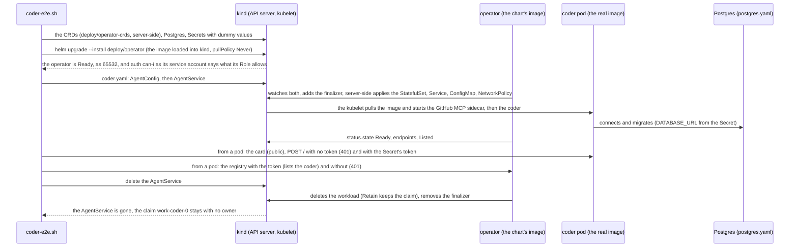
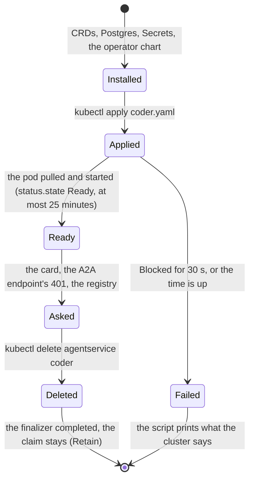
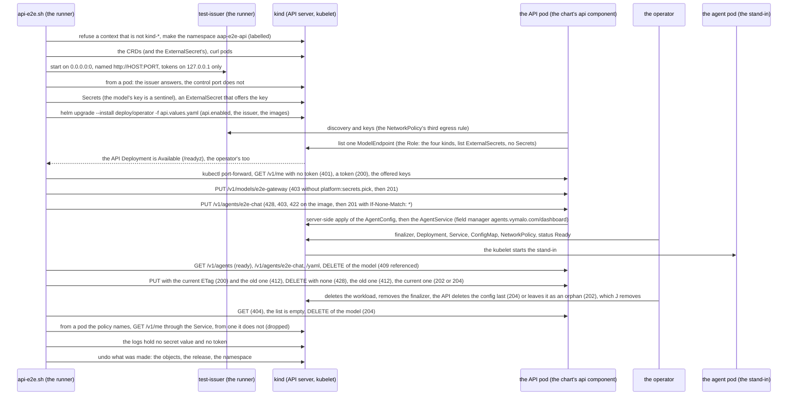

# The kind end-to-ends of the operator: the coder (S9) and the Platform API (D7b2)

Two scripts, two jobs of [`operator-image.yml`](../../../../.github/workflows/operator-image.yml), one kind cluster each: [`coder-e2e.sh`](coder-e2e.sh)
(the operator runs the real coder, [below](#the-kind-end-to-end-of-the-coder-s9)) and [`api-e2e.sh`](api-e2e.sh) (the Platform API creates an agent the
operator makes Ready, [further down](#the-kind-end-to-end-of-the-platform-api-d7b2)).

## The kind end-to-end of the coder (S9)

The operator, installed from its chart, runs **the real adam-rs coder image** in a kind cluster. This is the job
`operator-coder-e2e` of [`.github/workflows/operator-image.yml`](../../../../.github/workflows/operator-image.yml); the script
[`coder-e2e.sh`](coder-e2e.sh) is all of it and runs against any kind cluster that has the operator image:

```sh
docker build -t operator:smoke -f docker/operator/Dockerfile . && kind load docker-image operator:smoke --name <cluster>
sh deploy/operator/tests/e2e/coder-e2e.sh        # kubectl on that cluster; needs helm, jq and openssl; pulls a 2.9 GB image
```





## Files

| File | What |
|---|---|
| [`coder-e2e.sh`](coder-e2e.sh) | the script: every step bounded, every assertion named, the cluster's state printed on a failure |
| [`coder.yaml`](coder.yaml) | [`examples/coder.yaml`](../../../../examples/coder.yaml) adapted: the real image by tag and digest (`sha-9a1fd4e`, the newest `main` image of adam-rs on 2026-10-05, read anonymously from ghcr.io; **it is also the chart's `defaultAgentImage`**, the operator's default for an agent that names no image (AD-029), and `render-check.sh` and `cargo test -p aap-operator --test e2e_fixture` fail when the two differ), the token variant with a dummy token, a Postgres by `secretRef`, no web search, a 1 GiB claim on kind's default storage class. Each difference is marked `# e2e:` |
| [`postgres.yaml`](postgres.yaml) | a throwaway Postgres 17.9 (Alpine 3.23, pinned by digest, from the public ECR mirror of Docker Hub) with no volume |
| [`operator.values.yaml`](operator.values.yaml) | the operator chart's values: an existing Secret for the registry's token, and only the pods labelled `aap-e2e/client` may read the registry |
| `../../../../bin/operator/tests/e2e_fixture.rs` | `cargo test`, no cluster: `coder.yaml` passes `aap_domain::resolve`, runs the pinned image with its sidecar on the token variant, and names the Secrets the script makes |

## What it proves

* The chart installs on a real cluster: the operator is Ready (`/readyz`), runs as 65532 on a read-only root filesystem, and its service
  account may do what its `Role` says and nothing else: no Secrets, no `agentservices/finalizers`, nothing cluster-wide, nothing in another
  namespace, and the shared kinds (`modelendpoints`, `toolproviders`) read, listed and watched and never written (`kubectl auth can-i`, as the service account).
  The Role's verbs on the shared kinds are asserted here and **nowhere else**: a bare API server run with `AlwaysAllow`, as `bin/operator/tests/cluster.rs` is run by hand, authorises everything.
* The operator makes a workload from `AgentConfig` and `AgentService` that **the real coder starts in**: with the GitHub MCP
  server as a native sidecar of the same image, a Postgres it migrates, and the variables the operator derived. The coder exits 78 on a
  configuration it does not accept and 69 when a dependency is down, so a Ready pod is the startup checks of `bin/adam-coder` passed.
* `status.state` is `Ready`, with `ConfigResolved`, `StoreReady`, `RuntimeReady` and `Ready` True and `Listed: Listed`, and
  `status.endpoints` are what the pod serves.
* The A2A card answers through the Service, from another pod, and names the Coder and its `coding-task` skill; the JSON-RPC
  endpoint is closed without the token and with a wrong one, and the token of the Secret is not refused (the Secret reached the pod).
* The registry, read from a pod with the token, lists the coder with its card URL, title and tags, and the card it lists is the card
  the pod serves; without the token it answers 401. A pod the registry's NetworkPolicy does not name is refused, when the cluster
  enforces NetworkPolicies (otherwise the job says so, in a warning, and does not fail: that is the CNI's, not the operator's).
* Deleting the `AgentService` completes its finalizer, removes the StatefulSet, the Service and the pod, **keeps the claim `work-coder-0` with
  no owner** (`deletionPolicy: Retain`) and the `AgentConfig`, and the registry lists nothing.

## What it does not prove

* **No model.** `MODEL_BASE_URL` is `http://model.invalid/v1`: the coder opens no connection to its model at startup (*verified by reading only, 2026-10-05*: a search of `bin/adam-coder/src`, `crates/adam-service/src` and the model crates
  of adam-rs at `588e9b5`, one commit past the image's `9a1fd4e`, finds no model call at startup), and no task is sent, so nothing ever asks it.
* **No GitHub.** `GITHUB_TOKEN` is a dummy and the GitHub App variant is not run (a real key would be a real credential): the GitHub MCP server
  of the pod is only asked for its tool list, which makes no request to GitHub (*verified 2026-10-03* by adam-rs). No clone, branch, push or pull request.
* **No run.** No A2A task reaches the coder: no journal, lease, worker or tool is exercised beyond startup. That the operator's variables make
  the coder *work* is the parity goldens' claim (`crates/domain/tests/golden`), not this job's.
* **Not the netcup coder**: one worker, 1 GiB of storage on kind's default class, no web search, no Context7, no CloudNativePG (a
  Postgres pod instead; CloudNativePG is `store-cnpg`'s job), the combined topology only (not `split`), and no cutover from the Helm chart (M3).
* The image of adam-rs is the one of `main` on 2026-10-05 and is not tracked: a bump of the pin is a deliberate change of `coder.yaml`,
  with the digest of the tag read from ghcr.io again (`adam-upgrade`, `bump-adam`).

*Unverified* until the job has run: all of the above has been checked here only as far as `shellcheck`, `actionlint`, `helm` and the
`cargo test` of `e2e_fixture.rs` can reach; no cluster, no docker daemon and no kubelet existed where the job was written. Where it
may need a fix: the size of the coder image on a runner's disk (the job frees about 25 GB first), the time of the first pull (25
minutes allowed), kindnet's handling of the operator's egress policy, whether a POST of `{}` to the JSON-RPC endpoint with the right
token is answered with something other than 401 or 403, and `busybox`-free tools: the script asks from `curlimages/curl`, pinned by digest.

## The kind end-to-end of the Platform API (D7b2)

The Platform API ([`bin/api`](../../../../bin/api/README.md)), installed from this chart with `api.enabled`, **creates a folder agent through its REST
interface**; the operator makes it `Ready`; the API lists it, reads it, exports it, refuses what it must and deletes it. This is the job `api-e2e` of
[`operator-image.yml`](../../../../.github/workflows/operator-image.yml) (it needs the jobs `image` and `api-image`, whose images it runs, and `push` needs it:
no API image is pushed that failed to serve its first agent). The script [`api-e2e.sh`](api-e2e.sh) is all of it and runs against any kind cluster that
has the images:

```sh
kind create cluster --name aap-api
docker build -t operator:smoke -f docker/operator/Dockerfile . && docker build -t api:smoke -f docker/api/Dockerfile . \
  && docker build -t aap-stub:ci bin/operator/tests/stub
kind load docker-image operator:smoke api:smoke aap-stub:ci --name aap-api
sh deploy/operator/tests/e2e/api-e2e.sh      # kubectl on that cluster; needs helm, jq, curl, openssl and cargo (it builds the test issuer)
```

The script finds the host's address on the docker network `kind` itself (`AAP_TEST_HOST_ADDR` says it when docker is not the runtime, or when the cluster is
not kind: the pods must reach the machine the script runs on). `TEST_ISSUER_BIN` names a test issuer that is already built. On a failure it prints what the
cluster says, the API's and the operator's logs and the last answer of the API, and it removes what it made (below).

**It runs only on a throwaway cluster and touches only what it made** (after the review of 2026-10-16: the first version armed its cleanup before any check and, on a
missing tool, would have run `helm uninstall aap-operator` and deleted `agent-a2a-bearer`, the chart's own default name for the real orchestrator's token, in
`another-agentic-system`):

* `kubectl`'s current context must be `kind-*`; anything else is refused **before anything is made and before the cleanup exists**. `AAP_E2E_ALLOW_ANY_CONTEXT=1` says that another
  cluster is a throwaway one (it then also applies the CRDs and the ExternalSecret CRD of the pinned copy there, which Argo CD would also leave).
* It works in a namespace of its own, `AAP_E2E_NAMESPACE` (default **`aap-e2e-api`**, not the namespace of a deployment), that **it makes with the label `aap-e2e/made-by=api-e2e`**. A namespace that exists
  without the label is never used; one that has it is a leftover of an earlier run and is used again (a terminating one is waited for, three minutes at most).
* Its Secrets and its ExternalSecret have names of their own, set in the chart's values it writes and in [`api-offer.yaml`](api-offer.yaml): `e2e-agent-models` (the model's key, the sentinel), `e2e-a2a-bearer`,
  `e2e-chat-db-app` and `e2e-agent-models-es`. Each carries the label, and **one that exists without it is never overwritten**. The two curl pods are named for the run.
* The cleanup undoes what each step recorded when it happened, in the order that lets the operator, which is still there, run the finalizer of the agent: the agent and the model if step 4 began,
  the Helm release if the install began, the namespace (and with it the Secrets, the offer and the pods) if the script made it, then the issuer. **A run that stops before any of that** (a missing tool, a failed
  build, a refused context or namespace) **uninstalls and deletes nothing**. `INT`, `TERM` and `HUP` run it too (dash does not run an `EXIT` trap for a signal by itself). The CRDs stay.

| Variable | Default | Says |
|---|---|---|
| `AAP_E2E_NAMESPACE` | `aap-e2e-api` | the namespace of the run; made by the script, or one it made before |
| `AAP_E2E_ALLOW_ANY_CONTEXT` | unset | `1`: the current context may be a cluster that is not a kind cluster's, and is a throwaway one |
| `AAP_E2E_CNI_MAY_IGNORE_POLICIES` | unset | `1`: the cluster's network plugin has no NetworkPolicy support; a pod the API's policy does not name that reaches the API is then a warning and not a failure |

**The token issuer is a program on the runner.** The API checks a bearer JWT against the keys of an OIDC issuer, so the pod has to fetch an issuer's
discovery document and keys, and the script has to get tokens for people who hold chosen permissions. [`test-issuer`](../../../../crates/auth-oidc/README.md#test-tooling-the-issuer-as-a-program)
is the testkit's issuer of `aap-auth-oidc` (RS256, a flat roles claim, throwaway keys made at start) as a process: it listens on every interface, names itself
`http://<the host's address on the docker network of kind>:<port>`, which is the `iss` of its tokens and the `issuer` of the API's configuration, and mints
tokens on a **control port bound to the loopback, which the script checks a pod cannot reach**. It is an example of the crate: in no image, in no chart.

```mermaid
stateDiagram-v2
    [*] --> Installed: CRDs, issuer, Secrets, the chart with the API on
    Installed --> Asked: tokens, 401, 403, the offered keys
    Asked --> Created: the model (201), then the agent (201, ETag, label of the dashboard)
    Created --> Ready: the operator makes it Ready (the API's state ready, at most 4 minutes)
    Created --> Failed: blocked for three looks in a row (about 10 s), or the time is up
    Ready --> Replaced: PUT If-Match, 200; the old ETag, 412
    Replaced --> Deleted: DELETE If-Match (412 for the old one, 428 for none), 202 or 204
    Deleted --> Gone: the finalizer completed, both objects and the workload gone (on a 202 the config is an orphan and J removes it)
    Gone --> Checked: the model's delete, the NetworkPolicy, no secret and no token in any answer or log
    Checked --> [*]
    Failed --> [*]: the script prints what the cluster, the API and the operator say, and undoes only what it made
```





### Files

| File | What |
|---|---|
| [`api-e2e.sh`](api-e2e.sh) | the script: every step bounded, every assertion named, the cluster's state printed on a failure |
| [`api.values.yaml`](api.values.yaml) | the chart's values for it: the API on, a Secret per agent for the ledger, `docker.io` the one registry an agent may pin its image from, the pods labelled `aap-e2e/client` the only ones the policy lets reach the API. The script adds in a second file what it knows when it runs: the images, the issuer and the egress rule that reaches it, the namespace, the Secret of the A2A bearer. `render-check.sh` renders both (in the namespace `aap-e2e-api`, with the bearer `e2e-a2a-bearer`) and asserts what the script depends on, so a change that breaks them fails the chart job and not this one |
| [`api-offer.yaml`](api-offer.yaml) | the labelled `ExternalSecret` `e2e-agent-models-es` that offers the model's API key (`e2e-agent-models`) to the forms (no External Secrets Operator in the cluster: nothing reads it but the API, which lists it) |
| `../../../../crates/auth-oidc/examples/test-issuer.rs` | the issuer and its tokens, [documented with the crate](../../../../crates/auth-oidc/README.md#test-tooling-the-issuer-as-a-program) |
| `../../../../crates/objects-kubernetes/tests/crds/external-secrets.io_externalsecrets.yaml` | the pinned copy of the ExternalSecret CRD, applied here as the crate's own cluster test applies it |
| `../../../../bin/operator/tests/stub/Dockerfile` | the agent's image: the stand-in for the adam image that `operator-e2e` runs |

### What it proves

* **The chart's `api` component installs and serves on a real cluster, as a real pod**: the API Deployment is Available, which is `/readyz`: the issuer's keys were
  fetched over the network from a process outside the cluster, **and** the API listed a `ModelEndpoint` under its own `Role`; the pod runs as 65532 on a read-only
  root file system and did not restart; its service account may do what `crates/objects-kubernetes/tests/rbac.yaml` says and nothing else (`kubectl auth can-i`
  as the service account: nothing on Secrets, `get` on ExternalSecrets or `watch` on anything, nothing on workloads, nothing in another namespace); its NetworkPolicy
  is installed with the one egress rule that reaches the issuer.
* **Authentication and authorization against a deployed API**: no token and a token that is not one are `401` with the challenge and a problem detail; a token
  without the permission is `403` naming it (`platform:agents.read`, `platform:agents.write`, `platform:secrets.pick` for a write that names a key).
* **A secret is a reference.** The key is offered by an ExternalSecret the API lists, picked by name, and written into the `ModelEndpoint` as `secretRef`; the Secret's
  value is a sentinel the script made and looks for in every answer the API gave (the YAML export included), in the API's log and in the operator's: it is in none.
* **The create, with its preconditions, on a real API server**: a write with no precondition is `428` and writes nothing; an image from a registry the deployment does
  not allow is `422` on the field `image`; the create is `201` with `Location` and an `ETag`, under the field manager `agents.vymalo.com/dashboard` and the
  label of the dashboard on both objects, the model by `endpointRef`; a second create is `409`.
* **The operator makes it Ready from what the API wrote**: the API's state `ready` (the generation observed, the status the operator wrote), the AgentService
  `Ready` with its four conditions `True`, the Deployment Available on the stand-in image, the card answering through the Service. This is the join of D5 and S5.
* **The reads**: the list row (`kind: folder`, `managedBy: dashboard`, title, tags, audience, digest), the detail with the form and the status, the YAML export
  (both objects, no `status`, no managed field, no resource version, no value), the model's `usedBy`, and the `409 referenced` of a delete of the model the agent names
  (the agent's name only to a reader of agents).
* **The conditional writes**: a replace with the current `ETag` is `200` and renames both objects; with the ETag of before it is `412` and changes nothing; a delete with
  no `If-Match` is `428`, with the old tag `412`, with the current one `202` or `204`; the operator's finalizer completes and the objects, the Deployment, the Service
  and the pod are gone; the agent is then `404` and the list is empty, and the model can go (`204`). **A `204` means both objects go** (the API deletes the config after the service). **A `202`**
  (the finalizer outlasted the API's 5 s wait) **leaves the `AgentConfig` behind as an orphan, as D5 says**: the body must say the agent is `deleting`, the `AgentService` must go, and the script reports
  the config in a `::warning::` and removes it with `kubectl`, so that the run ends clean; it does not claim an order the end state cannot show. The operator writes its status all
  the time, so a replace or a delete right after a read may be `412`: the script reads again, up to five times.
* **The NetworkPolicy**: a pod the policy names reaches the API through its Service with a token; a pod it does not name, **which reaches the issuer** (so its network works and the refusal is the policy's),
  is refused: its connection is dropped (status `000`). Anything else, a `200`, a `401` or a `5xx`, fails the job: the request got through. Kind's network plugin enforces NetworkPolicies (below), so there is no
  tolerance by default; `AAP_E2E_CNI_MAY_IGNORE_POLICIES=1` is for a cluster whose plugin does not, and then a pod that got through is a warning. Either way the API's pod was Ready with the policy installed.

### What it does not prove

* **A real Keycloak.** The issuer is the testkit's (RS256, a flat roles claim, `http`, keys that never rotate). That a real Keycloak's keys and its roles claim (the
  composite-expanded roles, a nested claim) work is D14, when the realm is tried.
* **The edge**: TLS, a check of the JWT, rate limits and the Ingress. The script reaches the API with `kubectl port-forward` and, once, through the Service from a pod.
* **NetworkPolicy enforcement is kind's, not proven by this script alone.** kind's default network plugin, kindnet, **enforced** a NetworkPolicy in the coder end-to-end (*verified 2026-10-16*, `operator-coder-e2e` of run 38892472909 on `main` (kind v0.33.0, node v1.35.8): `ok   a pod the registry's NetworkPolicy does not name cannot read it (status 000)`; its ClusterRole may list and watch NetworkPolicies, pods and namespaces: `pkg/build/nodeimage/const_cni.go` of kind v0.33.0), so this job runs under enforcement, and the API's pod being Ready then shows that its ingress rule (the health port is not in it: the kubelet's probes come from the node) and its three egress rules were enough. **The script requires the refusal** (it accepted either outcome before the review of 2026-10-16, which let the check pass without proving anything); what only a run of the job can show is that kindnet does refuse this pod on this policy. `apiServer.cidrs` is empty in these values (any address on 443 and 6443), so the rule that is narrow is the issuer's, a /32.
* **`preStop.sleep` and a rolling update.** The pod has the hook (the script checks the pod spec) and Kubernetes 1.35 has the feature on; that a request in flight survives a
  rollout, and what the sleep does for a client, is not measured.
* **A real agent image, CloudNativePG, a coder, a tool server, a suspend.** The agent is a folder agent on the stand-in (it answers `/healthz` and a card), its ledger is a
  Secret nobody opens. A coder form (which needs a GitHub App key) and the tool-server routes are the crate's tests'.
* **Two replicas, an upgrade of the API in place, a restart of the issuer** (the key cache's grace period is `aap-auth-oidc`'s tests').
* **The log's colour.** The binary's `tracing-subscriber` writes ANSI colour codes into the pod's log (`fmt()` with no `with_ansi`: `bin/api/src/main.rs`; *observed 2026-10-16* with stderr redirected to a file in the walk described below); the script strips them before it
  looks for a request line. The operator's log is set up the same way (`bin/operator/src/main.rs`). *Not changed here* (a decision for the owner, §60a).

**The job passed on its first run** (run 38896792093, head `ef0b86f`, *verified 2026-10-16* in its log: every step, a `204` on the delete, the agent `ready` after 5 s, the other pod refused with status `000`). It was written where **no container daemon and no kind exist**, and the changes the review of 2026-10-16 made to it (the guards, the namespace and the Secrets of its own, the cleanup that records what it made, the signals, the `202` branch, the strict policy step, the scan of the headers and of the pieces of a token) are *unverified* until CI has run them. What was run where they were written: `shellcheck`, `dash -n`, `actionlint`, `render-check.sh`, and **the whole script, end to end, under `dash`, against the real router of
`aap-platform-api` over the `Memory` ports, the real `OidcAuthenticator` and the real `test-issuer`, with a fake `kubectl` and a fake `helm` (scratch programs: not committed) that answer
from the objects the router wrote**: every `curl` step and `jq` filter of the API half is the real thing; every `kubectl` assertion is the fake's, and the fake says what the script
wants to hear, except where a scenario makes it say otherwise (a context that is not kind's, a namespace or a Secret that is not the script's, a missing tool, a failed build, a `202` with and without an orphan, a service that lingers, a pod the policy does not refuse, a leaked token, each of the three signals). Where the changes may need a fix in kind: `kubectl create -f -` of the labelled namespace and its deletion, the agents in a namespace other than `another-agentic-system`, and the control that the other pod reaches the issuer.
