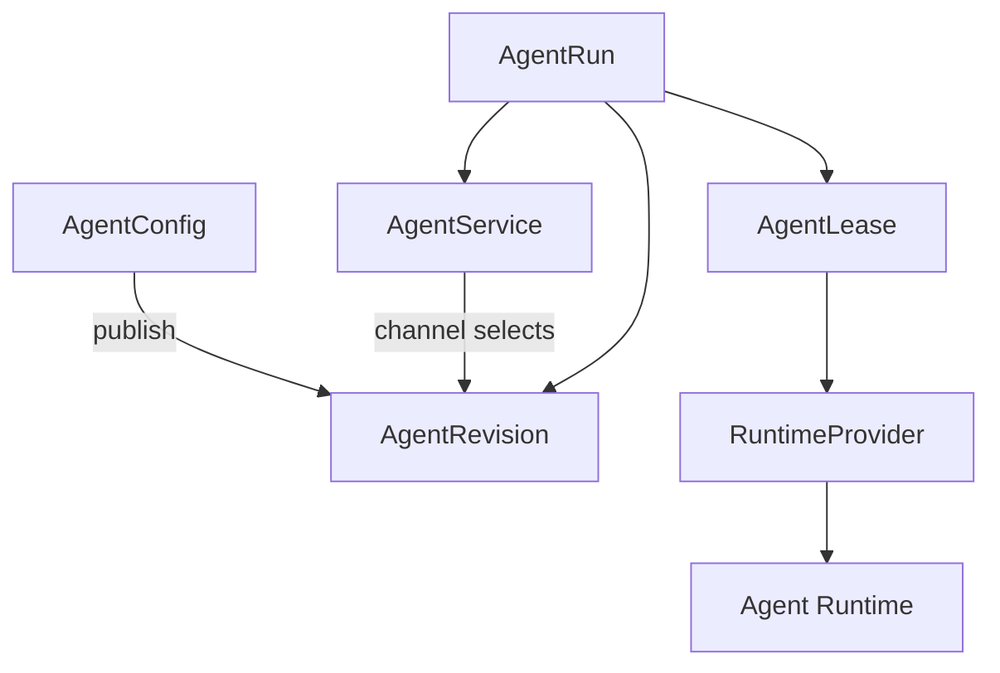
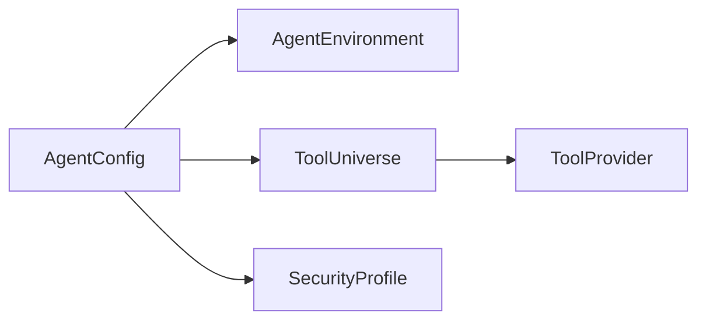
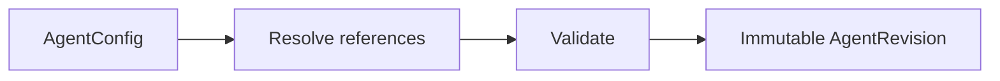
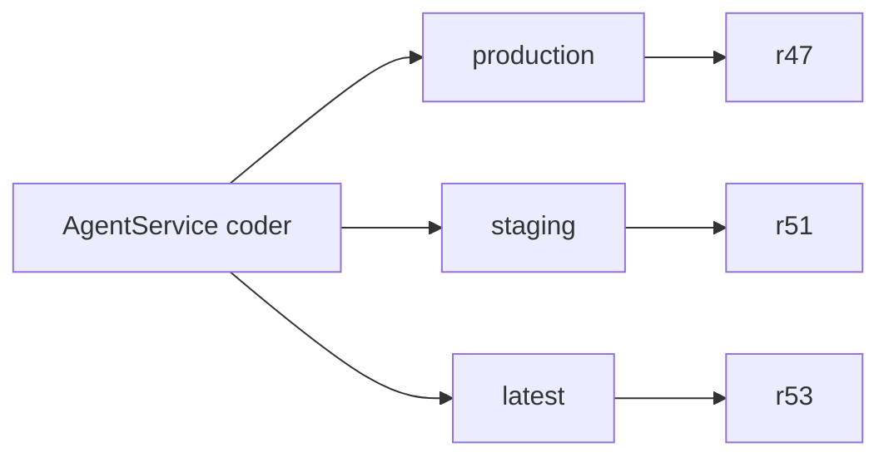
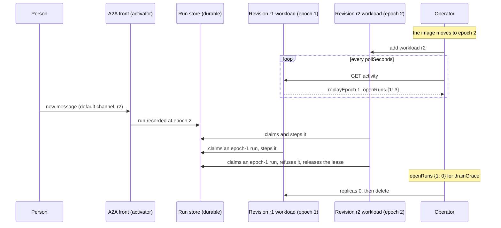
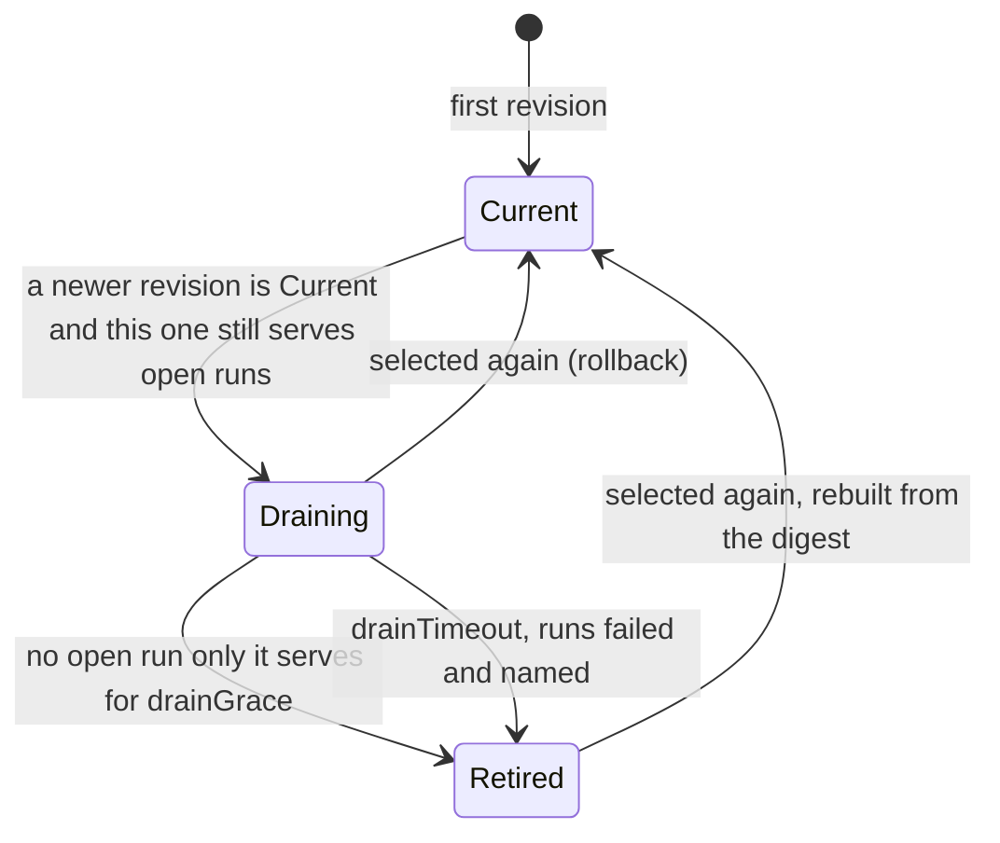

# Domain model and release channels

[← Index](README.md) · [← Previous](01-overview.md) · [Next →](03-interfaces.md)


---

## 6. Core Domain Model

The minimal core is:



Supporting reusable resources:



---

## 7. AgentService

`AgentService` represents the stable operational identity of an agent.

It answers:

> How can consumers find, invoke, route to, authorize against, scale, and select revisions of this agent?

It does **not** describe the complete internal behavior of the agent.

> **Decision (2026-10-04, AD-023):** the v0 operator implements a subset of this resource ([§59a](10-control-plane-and-crds.md#59a-operator-v0-adam-rs-agents)): `configRef`, `description` and `interfaces.a2a` (`responses` and `mcp` exist and must be `false`), plus the fields v0 adds: `scaling.topology`, `scaling.workers`, `scaling.front`, `suspend`, `store`, `access`, `registry` and `deletionPolicy`. `release`, `routes`, `authorization`, `minReplicas`, `maxReplicas` and `idleTimeout` wait until something consumes them. The example below stays the target.

Example:

```yaml
apiVersion: agents.vymalo.com/v1alpha1
kind: AgentService

metadata:
  name: coder

spec:
  configRef:
    name: coder

  interfaces:
    responses:
      enabled: true

    a2a:
      enabled: true

    mcp:
      enabled: false

  release:
    defaultChannel: production

    channels:
      production:
        revisionRef: coder-r42

      staging:
        revisionRef: coder-r49

  scaling:
    minReplicas: 0
    maxReplicas: 1
    idleTimeout: 15m

  authorization:
    policyRef:
      name: engineering-agents

  routes:
    - ref:
        name: coder-public

    - ref:
        name: coder-internal
```

Typical `AgentService` concerns:

- stable name;
- description;
- exposed protocols;
- routes;
- release channels;
- default revision/channel;
- scaling policy;
- access policy;
- runtime activation behavior;
- traffic policy.

Changing these does not necessarily produce a new agent revision.

---

## 8. AgentConfig

`AgentConfig` represents editable agent behavior.

It answers:

> What does this agent do, what does it use, and how should it execute?

> **Decision (2026-10-04, AD-022, AD-023):** `harness.type` is `adam-rs`: `adk-rust` in the example below is history. The harness names a `binary` (`adam-coder` or `adam-agent`), and OpenCode stays a capability inside `adam-coder`. In v0, `instructions` are the agent's folder (or the agent embedded in `adam-coder`), `model` carries the alias, the endpoint and a reference to the key, and `environment`, `tools` and `security` are inline instead of `*Ref` fields; `verification` and `artifacts` are left out ([§59a](10-control-plane-and-crds.md#59a-operator-v0-adam-rs-agents)).

Example:

```yaml
apiVersion: agents.vymalo.com/v1alpha1
kind: AgentConfig

metadata:
  name: coder

spec:
  instructions:
    system: |
      You are an autonomous software engineering agent.

  model:
    providerRef:
      name: default-models
    model: coding-model

  environmentRef:
    name: fullstack-development

  toolUniverses:
    - name: autonomous-coding

  securityProfileRef:
    name: restricted-coding-agent

  harness:
    type: adk-rust

    codingAgent:
      protocol: acp
      implementation: opencode

  verification:
    policyRef:
      name: standard-ci

  artifacts:
    policyRef:
      name: coding-artifacts
```

Typical configuration includes:

- instructions;
- model selection;
- agent framework;
- tools;
- environment;
- security profile;
- verification;
- artifact policy;
- runtime behavior.

`AgentConfig` is mutable.

Changing it does **not** mutate deployed revisions.

Instead:

```text
AgentConfig generation 18
         ↓
publish
         ↓
AgentRevision coder-r43
```

---

## 9. AgentRevision

`AgentRevision` is an immutable, fully resolved execution definition.

> **Decision (2026-10-04, AD-023):** not in v0. The operator computes the digest of the resolved agent and records it as `AgentService.status.config.digest`, which is what a revision's `configurationDigest` would be. Revisions wait for the open question about adam's run ledger (§93): the ledger is keyed by the agent's name, so two revisions running side by side would share or fork one.



An `AgentRevision` should record exact resolved values where reproducibility matters.

Example:

```yaml
apiVersion: agents.vymalo.com/v1alpha1
kind: AgentRevision

metadata:
  name: coder-r42

spec:
  source:
    configRef:
      name: coder
    generation: 18

  resolved:
    runtimeImage:
      ref: registry.example.com/another-agentic-platform/coder@sha256:abc123

    environmentDigest: sha256:def456

    toolsDigest: sha256:789abc

    securityDigest: sha256:123def

    harness:
      framework: adk-rust
      codingProtocol: acp
      implementation: opencode

    configurationDigest: sha256:abcdef123456
```

An existing revision cannot be modified.

A change creates another revision.

---

## 10. Release Channels

`latest` and `production` are intentionally different.

> **Decision (2026-10-04, AD-023):** not in v0. There are no channels and no `@channel` or `@revision` addressing, and the agent card carries no release-channels extension (§12a): adam serves its own card. A v0 service is one running configuration. The plan to add them, rolling upgrades first, is [§10a](#10a-release-channels-and-rolling-upgrades-the-plan) (AD-059).

Example:

```text
r47    production
r51    staging
r53    latest
```



Clients may address:

```text
coder
coder@production
coder@staging
coder@r47
```

Recommended semantics:

```text
coder
    → defaultChannel
    → normally production

coder@production
    → currently promoted production revision

coder@r47
    → immutable exact revision
```

`@latest` may also exist but should never silently replace production.

Rollback is therefore simple:

```text
production: r53
       ↓
production: r47
```

No rebuilding is required.

## 10a. Release channels and rolling upgrades: the plan

*(2026-11-25, ANR-269; documentation only, nothing here is built. The decision is [AD-059](11-decisions.md#ad-059--a-revision-is-a-workload-of-its-own-and-an-old-one-stays-until-its-runs-end), **accepted by the owner on 2026-11-26** (row 113 of `decisions-2026-11-26.md`), with the four questions at the end of this section answered as recommended.)*

### What is built, and what is not (read at plat `main`, 2026-11-25)

| Claim | State | Where |
|---|---|---|
| An `AgentConfig` has no release channel | **True.** `AgentConfigSpec` has `harness`, `model`, `tools`, `environment`, `security` and `extraEnv`; nothing names a channel or a revision. `AgentServiceSpec` has `configRef`, `interfaces`, `scaling`, `suspend`, `store`, `access` and `registry`, none a channel. A search of `crates/api/src` for "channel" finds nothing | `crates/api/src/config.rs` (`AgentConfigSpec`), `crates/api/src/service.rs` (`AgentServiceSpec`, `Scaling`) |
| §10 and §12a are text only | AD-023 defers them: no `@channel` addressing and no release-channels extension in the card (adam serves its own card) | §10 blockquote, [`extensions/release-channels-v1.md`](../extensions/release-channels-v1.md) |
| An `AgentRevision` exists | Not as an object. What exists is the **digest** of the resolved `RuntimeSpec` (sha256), which changes when anything the pod runs changes | `crates/domain` (`resolve`), §59a |
| How the operator rolls an agent today | **In place.** One workload per service, named `<service>`, applied server-side. A workload with a stable identity is a `StatefulSet` with `updateStrategy: RollingUpdate`; any other is a `Deployment` with the Kubernetes default strategy. A changed image replaces the pods of that one workload; nothing keeps an old pod for a run it holds, and a pod told to stop drains within its grace period | `crates/runtime-kubernetes/src/render.rs` (the `StatefulSet` at `update_strategy`, the `Deployment` beside it) |
| A run survives a change to the agent's step list | **No.** adam fails a replay whose step names moved with `NonDeterminism`, and its own rule is "stop every worker of the old revision first", which a rolling update cannot do. adam's [ADR 0076](https://github.com/vymalo/another-adam-rs/blob/main/docs/decisions/0076-a-run-records-the-journal-epoch-it-started-on.md) (merged as *Proposed*, 2026-11-25, ANR-254) answers it with an integer **epoch** that a run records and a worker refuses to step when its code cannot replay it | adam `crates/adam-runtime/src/ctx.rs` (`Ctx::step`), ADR 0076 decisions 1 to 4 |
| The registry and the card say anything about versions | No. The registry item is the agent's own card URL; the card is adam's | `crates/registry`, §12b |

So the platform has one revision at a time, replaced in place, and no way to say which pods may still hold a run.

### The plan

**Two things, in this order.** Rolling upgrades with versions come first, because they fix a failure that exists today (a deploy fails a run mid-transition). Named channels come second and reuse the first one's machinery; they are not needed to be safe.

**1. Rolling upgrades: a run kept on the version that started it.** adam's ADR 0076 does the replay half: a run records its `epoch`, a worker steps only the epochs `min_replay_epoch..=replay_epoch` its code serves, and refuses the rest without committing. The platform does the other half, which adam cannot: **keep workers of an old version alive while a run needs them, and retire them when none does.**

| Question | Answer (AD-059) |
|---|---|
| What is a revision? | The resolved `RuntimeSpec` digest of a service (what the operator already computes) plus the adam epoch range its image serves. The name is `<service>-r<n>`, `n` counting digests of the service in order. A revision is immutable; its workload is the only thing that changes (replicas) |
| When is there more than one? | Only when the **epoch range moves**. A change that does not bump `replay_epoch` (a prompt, a limit, a tool description) rolls in place as today: no second workload. A change that does (the image's `replay_epoch` is above the running one's, or `min_replay_epoch` rose) makes the operator **add a workload for the new revision and keep the old one** |
| How does the operator know the range? | The agent says it, as with sleep (AD-058): the activity answer gains `replayEpoch`, `minReplayEpoch` and `openRuns` (a count per epoch), read from adam's store. A revision whose answer is missing is treated as range `0..=0` and `openRuns` unknown, which keeps the old workload (fail closed: never retire on a missing answer) |
| When is the old workload retired? | When `openRuns` has no run in an epoch that only it serves, for `drainGrace` (default 5 m), or at `drainTimeout` (default 24 h) with a condition `RevisionForced` and an event that names the runs failed. Retire is `replicas: 0` then deletion; the run store is outside the pod, so nothing is lost but the pod |
| What happens to the stores and the names? | One store per service (unchanged): both revisions' workers claim from it, and adam's refusal rule keeps each to the runs it can replay. Workloads are named `<service>-r<n>` **only when `spec.release` is set**; a service without it keeps `<service>` and its goldens do not move. Pinned runs follow `WORKER_ID`, the pod name, so two workloads never share one |
| What does the status say? | `status.revisions[]`: `name`, `digest`, `epochs`, `phase` (`Current`, `Draining`, `Retired`), `readyReplicas`, `openRuns` |
| What when a rollback is wanted? | The old revision is re-selected: the operator scales its workload up (it is a digest, so a retired one is rebuilt from the same inputs) and the new one drains in turn |

**2. Channels.** A **channel** is a name that points at a revision; **the platform is the only owner of channel state** (§12a). It is a pointer, not a copy.

```yaml
spec:
  release:
    defaultChannel: production
    channels:
      production: { configRef: { name: coder-r47 } }
      staging:    { configRef: { name: coder-r51 } }
```

| Question | Answer (AD-059) |
|---|---|
| What names a revision? | A channel names an `AgentConfig` (the existing `configRef` shape), so a channel's image, model and tools are what that config says. Moving a channel is editing the pointer; **rollback is moving it back**, no rebuild (§10) |
| Where does a channel's traffic go? | New runs go to the revision the selected channel points at; the **A2A front** (the activator of AD-058, which already serves the card) reads the selection in the message metadata (`release-channels/v1`), and the default channel when it is absent. A request that continues a task needs no routing: the task is in the shared store and only a worker whose epoch range holds it steps it |
| Do channels share a run store? | In this plan, **yes: one store per service**. That is safe only for revisions of one lineage (the same agent, epochs of one journal). A `staging` that is a different agent, or a model change that a run must not see, is a different `AgentService`. This is the owner's question 1 below |
| What does the card say? | The front serves the card with the release-channels extension of §12a: `channels`, `revisions` and `defaultChannel`, from the operator's status (a channel's target is always a listed revision). The registry item is unchanged |
| What moves in the parity goldens? | **None for a service without `spec.release`**: its workload name, pod template and env are byte for byte what they were. A new golden is added for the two-revision case, drawn at the adam revision that has ADR 0076's slices 1 and 2. The adam chart's render is not touched |





### Slice table

One row per pull request, one repository per row. "plat" is another-agentic-platform, "adam" is another-adam-rs. Rows A1 to A3 are adam's ADR 0076 slices, named here so the dependency is exact; they are not duplicated.

| Row | Repo | What | Decisive test | Depends on |
|---|---|---|---|---|
| A1 | adam | ADR 0076 slices 1 and 2: `Envelope::epoch`, `replay_epoch`, `min_replay_epoch`, the worker's refusal | An epoch-1 worker leaves a run of epoch 2 unchanged (version, journal, state); a run below `min` ends `Failed` naming both epochs (adam's own test) | none (needs the owner's ruling on ADR 0076) |
| A2 | adam | ADR 0076 slice 3: the skip set, so a refused run is not claimed again at once | The refusing worker claims a refused run at most once per period over ten polls (adam's own test) | A1 |
| A3 | adam | ADR 0076 slice 6, **widened by this plan**: the activity answer of AD-058's A1 carries `replayEpoch`, `minReplayEpoch` and `openRuns` per epoch | With runs of epochs 1 and 2 open, the answer reports both counts; with none, an empty map (store conformance case) | A1, AD-058 A1 |
| R1 | plat | CRD: `spec.release.{defaultChannel, channels}`, `status.revisions[]`, CEL bounds (a channel name, at most 8 channels, `defaultChannel` among them), regenerated CRDs and API schema; the OpenAPI document and the forms say it is YAML only | A fleet with no `release` renders and validates byte for byte what it did (the seven goldens do not move); each new bound has an `examples/invalid/` file | none |
| R2 | plat | Revisions in the domain: the revision name from the digest, the epoch range from the activity answer, and the rule "a missing answer keeps the old revision" | Table test in `aap-domain`: same digest gives one revision; a changed prompt gives none; a raised `replayEpoch` gives a second; a missing answer never retires | R1, A3 |
| R3 | plat | Provider renders one workload per live revision (`<service>-r<n>`, only with `spec.release`), the Service selects both, a retired one is deleted last | Fake API server: a second revision adds a workload and leaves the first; the first is deleted only after `Retired`; a service without `release` writes the objects it did | R2 |
| R4 | plat | Drain controller: polls each revision's activity, counts `drainGrace`, retires, forces at `drainTimeout` with `RevisionForced` and an event; spec.suspend wins | Scripted activity source: `openRuns` 3 then 0 retires only after `drainGrace`; a poll error never retires; `drainTimeout` retires and names the runs | R3 |
| R5 | plat | Channels: the pointer moves a revision, the front reads the selection, the card carries the extension | Router test over `Memory` ports: no metadata goes to the default channel; `staging` reaches the staging workload; an unknown channel is an A2A error and writes nothing; the card lists every channel's target | R3, AD-058 P3 |
| R6 | plat | Kind end-to-end with the real coder at two pins whose epochs differ (*needs a cluster and CI*) | A run started on the old pin, mid-transition, is finished by the old workload after the upgrade, with each step once in the journal; the old workload is gone afterwards; no secret in any log | R4, A2 |
| R7 | plat | Docs: AD-059 confirmed or amended, `extensions/release-channels-v1.md` status line, §10's blockquote, the registry contract unchanged | `docs-check` passes | R5 |

### Questions for the owner

**Decided 2026-11-26 (row 113 of `decisions-2026-11-26.md`): all four recommendations below were accepted**, so A1 waits for adam's ADR 0076 ruling and R1 and R2 can start.

| # | Question | Recommendation |
|---|---|---|
| 1 | Do channels of one service share one run store? | Yes, for one lineage only: a different agent is a different service. A per-channel store would double the databases and cannot hand a run across a promotion |
| 2 | Is a channel a pointer to an `AgentConfig`, or a field of the config? | A pointer: the config stays one immutable-by-convention object and a promotion is an edit of one line |
| 3 | `drainTimeout` fails the runs that are left. Default 24 h, or never? | 24 h with a visible event; "never" lets one stuck run hold a workload forever |
| 4 | Who fixes the order of rows: the adam ruling on ADR 0076 first? | Yes: A1 waits for it; R1 and R2 can start before |

---

[← Index](README.md) · [← Previous](01-overview.md) · [Next →](03-interfaces.md)
