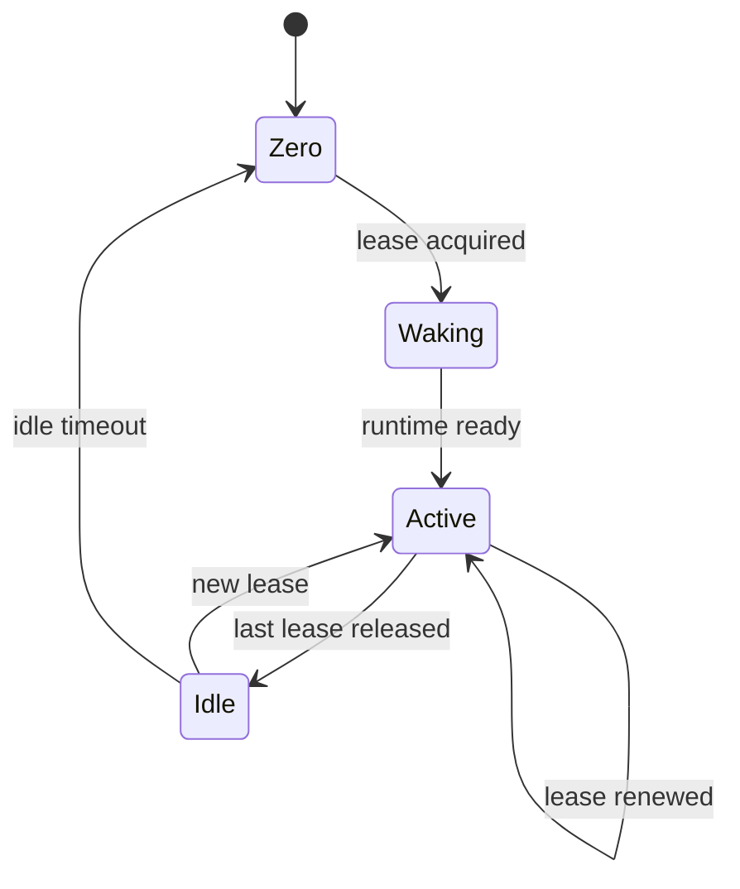
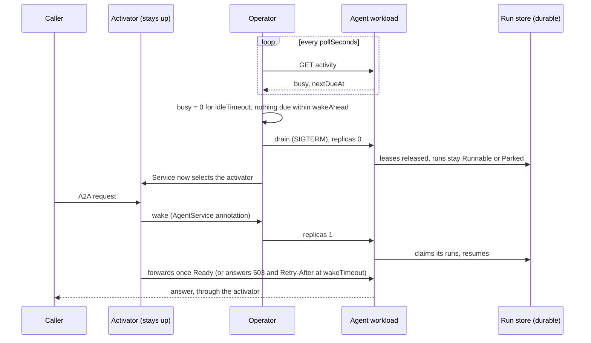
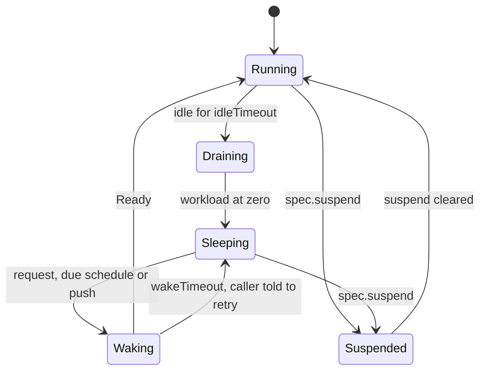
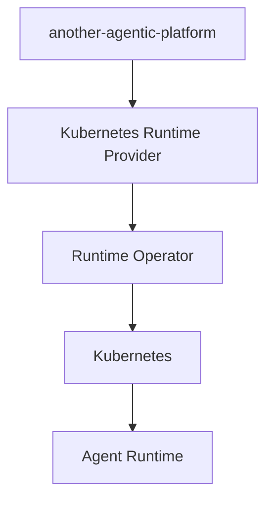
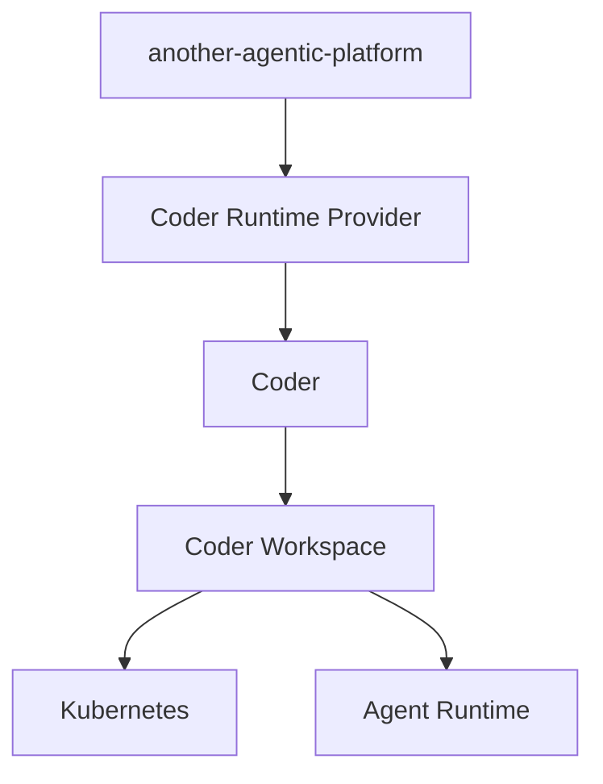
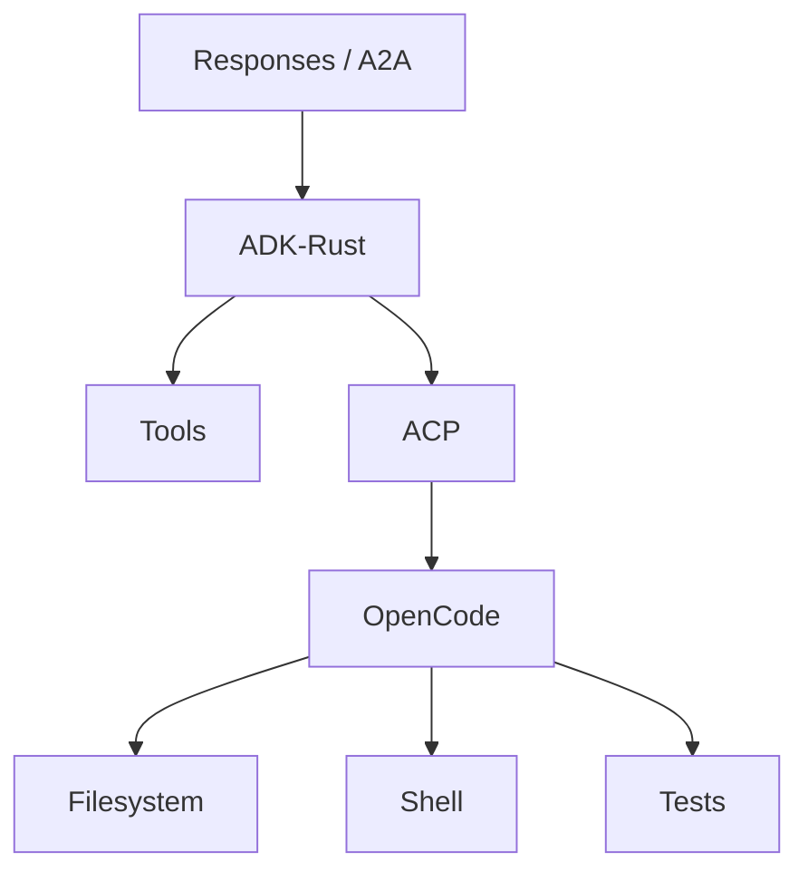
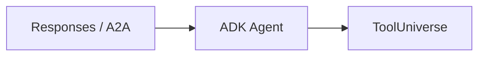
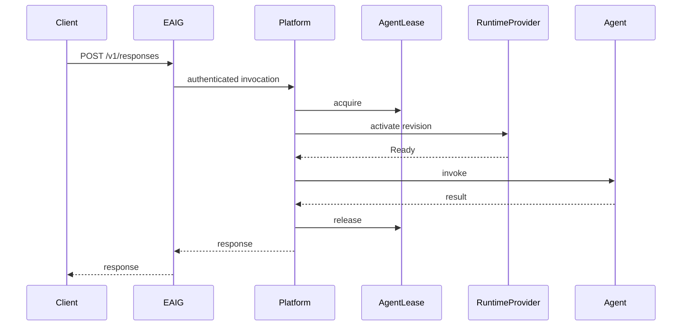

# Runtime, runs, leases and scale-to-zero

[← Index](README.md) · [← Previous](04-workflows.md) · [Next →](06-environments-and-storage.md)


---

## 18. Runtime Controller Responsibilities

The runtime controller/provider answers:

> What runtime infrastructure must exist now?

Example infrastructure states:

```text
Absent
Provisioning
Ready
Suspended
Failed
```

It should **not** contain application workflow logic such as:

```text
if PR review fails:
    ask agent to fix
    wait for CI
    reopen review
```

That belongs in Restate.

---

## 19. AgentRun

`AgentRun` represents one logical execution.

> **Review decision (2026-09-28, AD-016):** `AgentRun` is an **application-database record, not a CRD**. Runs are created per request and updated constantly; in etcd that is write churn for data Kubernetes never reconciles. The shape below is the record, shown as YAML for readability.

Example record:

```yaml
# application record (Postgres), not a Kubernetes object
kind: AgentRun

metadata:
  name: run-01kxyz

spec:
  agentRef:
    name: coder

  revisionRef:
    name: coder-r42

  input:
    type: issue

    repository:
      url: https://github.example.com/example/project

    issue:
      number: 428

status:
  phase: Running

  conditions:
    - type: RuntimeReady
      status: "True"

    - type: Completed
      status: "False"
```

`AgentRun` correlates:

```text
workflow
revision
runtime
leases
artifacts
logs
traces
Git branch
PR
cost
usage
```

---

## 20. AgentLease

`AgentLease` represents:

> This agent currently requires compute.

This is separate from HTTP request lifetime.



Lease holders may include:

```text
Responses request
background Response
AgentRun
Restate workflow
A2A request
interactive session
debug session
```

> **Review decision (2026-09-28, AD-016):** `AgentLease` is a **lease-service record in Postgres, not a CRD**. Every active holder renews its lease every few seconds; the operator reads the aggregate ("active leases per `AgentService`") instead of watching individual objects.

Example record:

```yaml
# lease-service record (Postgres), not a Kubernetes object
kind: AgentLease

metadata:
  name: run-01kxyz

spec:
  agentRef:
    name: coder

  holder:
    type: AgentRun
    name: run-01kxyz

  expiresAt: "..."
```

Leases should be renewable and short-lived.

If the holder crashes:

```text
lease expires
    ↓
idle timeout
    ↓
runtime stops
```

This avoids leaked compute.

---

## 21. Scale-to-Zero

Scale-to-zero is a semantic capability, not necessarily a Knative implementation.

> **Decision (2026-10-04, AD-023):** the v0 operator does not scale to zero ([§59a](10-control-plane-and-crds.md#59a-operator-v0-adam-rs-agents)). It has `spec.suspend`, which takes the workload to zero replicas and reports the runtime phase `Suspended`, and nothing else: no leases, no idle timeout, no activator. A source of run leases is an open question (§93): the coder's workers keep stepping a run after the A2A call has returned, so the HTTP connection says nothing about idleness.

Desired behavior:

```text
valid leases > 0
    → runtime must be active

valid leases = 0
    → wait idleTimeout
    → runtime may stop
```

The stable service continues to exist while runtime compute is absent.

---

## 21a. Sleep when idle: the plan

*(2026-11-24, ANR-255; documentation only, nothing here is built. The decision is [AD-058](11-decisions.md#ad-058--an-agent-sleeps-when-the-agent-says-it-is-idle-and-an-activator-wakes-it).)*

### What is built, and what is not (read at plat `main`, 2026-11-24)

| Claim | State | Where |
|---|---|---|
| §21 and AD-010 say scale-to-zero is lease-controlled | Text only. AD-010 is one line, "Compute lifecycle is controlled by `AgentLease`, not HTTP connection lifetime", with no status line and no amendment of its own | `11-decisions.md` (AD-010) |
| AD-023 defers leases and scale-to-zero | Decided: the v0 operator has `spec.suspend` and nothing else | `11-decisions.md` (AD-023), `05-runtime.md` §21 blockquote |
| `spec.suspend` takes the workload to zero | Built: `replicas` is 0 when set, the phase is `Suspended` | `crates/api/src/service.rs` (`suspend`), `crates/runtime-kubernetes/src/render.rs` (`replicas` on `spec.suspend`), `crates/runtime-kubernetes/src/provider.rs` (`suspend`, `Capabilities { suspend: true }`) |
| `idleTimeout`, `minReplicas`, `maxReplicas` | Not built: the CRD has no such field; the v0 table lists them as waiting | `10-control-plane-and-crds.md` §59a (the deferred-fields table), `02-domain-model.md` |
| An idle timeout exists for **run pods** | Built, and unrelated: a free run pod is released after 300 s (the run pool, not the agent's workload) | `10-control-plane-and-crds.md` (run pool `idleTTLSeconds`), commit `cb6b5bc` |
| An activator, or any front that holds a request while the agent starts | Not built, and not planned in any other row of §59c | `10-control-plane-and-crds.md` §59c |
| `AgentLease` | A record in the lease service (AD-016), not built; `RunLease` (a CRD, AD-036) is the run pool's slot, not an agent lease | `05-runtime.md` §20 |

So scale to zero is neither built nor planned with slices anywhere else. The open question in §93 (who is the source of run leases) is answered by AD-058.

### The plan

The seam is that **the agent says whether it is busy**, because the coder's workers step a run after the A2A call has returned, so a connection says nothing (AD-010). adam already holds the truth: a run is held while its status is `Runnable` and `lease_until` is in the future (`crates/adam-core/src/store/mod.rs`, `claimed`), and a schedule is a parked run with a next due time (adam ADR 0060).





| Question | Answer (AD-058) |
|---|---|
| What holds the lease, and who renews it? | **Nobody renews an agent lease.** The run store's own run leases are the truth and the workers already renew them. The workload reports `busy` (runs claimed or stepping) and `nextDueAt` (the earliest schedule firing); the operator polls it and decides. `AgentLease` (§20) is not built for this |
| What is idle? | `busy = 0` for `idleTimeout` (default 15 m, the §2 example), with no firing due within `wakeAhead`. A poll that fails counts as busy |
| What wakes a sleeping agent? | (1) The next A2A request at the **activator**, a small front that stays up; (2) a schedule: the operator wakes the workload `wakeAhead` before `nextDueAt`; (3) a push or webhook, which arrives at the same activator route as a request. The activator only asks; the operator scales |
| How does state come back on any machine? | The run store is durable and outside the pod (adam's Postgres or MongoDB store). A woken workload claims its runs again; nothing is copied |
| What must adam do? | Serve the activity answer; on SIGTERM stop claiming, let a step finish or release its lease so the run is `Runnable` for the next claimer, and exit within the grace period; resume fast enough for `wakeTimeout` (rows A1 to A3) |
| What does a caller see while it wakes? | The activator holds the request up to `wakeTimeout` (default 60 s, below a typical client's timeout) and then forwards it. At the timeout it answers `503` with `Retry-After`. The agent card is answered by the activator while asleep (from the registry the operator already serves), so discovery needs no wake. A caller never gets an answer from a half-started agent |
| What does a sleeping agent show? | `runtime.phase: Sleeping`, distinct from `Suspended` (a person's choice, never woken) |

### Slice table

One row per pull request, one repository per row. "plat" is another-agentic-platform, "adam" is another-adam-rs. A slice that needs a cluster says so; its test is the decisive one.

| Row | Repo | What | Decisive test | Depends on |
|---|---|---|---|---|
| A1 | adam | `GET /internal/activity` on the health listener: `{busy, nextDueAt}` read from the store (claimed runs, parked schedules), no secret, no run content, bearer-protected like the rest | A run claimed by a worker makes `busy` 1; a parked schedule due in an hour gives `nextDueAt`; with neither, `busy` 0 and no `nextDueAt` (store conformance case, both stores) | none |
| A2 | adam | Clean park and drain on SIGTERM: stop claiming, finish or release the step's lease, so every run is `Runnable` for the next claimer; exit within the grace period | Start a run on a scripted slow model, send SIGTERM, assert the process exits within the grace period and a second process claims the same run and finishes it with no step done twice (journal compared) | none |
| A3 | adam | Resume budget: from process start to `Ready` and the first claim, measured, with a ceiling that fails the test | The coder image started on an empty cache reaches `/readyz` and claims a waiting run under the ceiling (a number set in the PR from a measurement, not a guess) | A2 |
| P1 (built 2026-11-25) | plat | CRD: `scaling.idleTimeout`, `scaling.wakeAhead`, `scaling.wakeTimeout` (CEL bounds, off by default: absent means never sleeps), the phase `Sleeping`, regenerated CRDs and API schema | A fleet with none of the fields renders byte for byte what it did (the goldens do not move); each new bound has an `examples/invalid/` file | none |
| P2 | plat | Idle controller: polls the activity answer, counts idle time, drains and scales to zero, sets `Sleeping`; a failed poll is busy; `spec.suspend` wins | Fake API server and a scripted activity source: busy then idle for `idleTimeout` scales to zero; a poll error never scales down; a `nextDueAt` inside `wakeAhead` never scales down | P1, A1 |
| P3 | plat | Activator: the stable front. While asleep the Service selects it; it answers the card, holds a request, asks the operator to wake, forwards when `Ready`, answers `503` and `Retry-After` at `wakeTimeout`. Wakes on schedule through the operator | Router test over `Memory` ports: a request while asleep is forwarded once after the wake, a second concurrent request shares the one wake, a wake that never completes is `503` with `Retry-After`; the card is answered with no wake | P2 |
| P4 | plat | Kind end-to-end with the real coder: sleeps after `idleTimeout`, wakes on a request, continues a run parked by a schedule, state intact, no secret in any log (*needs a cluster and CI*) | The run's task id from before the sleep is answered after the wake by `GetTask`, and the journal holds each step once | P3, A2, A3 |

P2a as built (2026-11-26, ANR-850): the `ActivitySource` port (`aap-ports`, `poll(id) -> {busy, nextDueAt}`, the suite `activity_source_conformance!`, `MemoryActivity`) and the pure `decide` of `crates/controller/src/sleep.rs`, with the four rules of the row tested by name. Nothing polls or scales yet (P2b); the HTTP source is P2c.

P2c as built (2026-11-26, ANR-852): `crates/activity-http` (`aap-activity-http`), `HttpActivity`, the `ActivitySource` over `GET http://<name>.<namespace>.svc:<port>/internal/activity` with the agents' bearer. A failed, refused, oversized or malformed answer is an error, never idleness. The operator builds it from the `activity` section of its configuration file: `enabled`, `port` (8080), `timeoutSecs` (3) and `token` (a file reference; enabled without a token is refused, exit 78; was `ACTIVITY_ENABLED`, `ACTIVITY_PORT`, `ACTIVITY_TIMEOUT_SECS` and `ACTIVITY_TOKEN_FILE`); the chart's `activity` block (`to`, `port`, `timeoutSecs`, `tokenSecret`, `dns`) turns it on, mounts the bearer's Secret as a file and opens egress to those peers on that port, and renders nothing while `activity.to` is empty. The idle loop of P2b can poll it; the binary does not hand the source to the operator yet.

P2b as built (2026-11-26, ANR-851): the idle loop (`crates/controller/src/sleeper.rs`) runs when the operator is given an activity source (`Operator::with_activity`; **the `operator` binary builds the P2c source but does not hand it to `Operator::with_activity` yet**, so nothing sleeps in a deployment yet, whatever the objects say). Every `Options::sleep_poll` (30 s) the leader lists the services and, for each one with `scaling.idleTimeout` and no `spec.suspend`, polls its activity and runs `sleep::decide`. **Draining** is a second poll right before the scale-down: a run claimed in between, an error, or a schedule that came inside `wakeAhead` keeps the agent up (the port has no "stop claiming" call; A2 makes the agent park cleanly when it is stopped). **`Sleeping` reuses `RuntimeProvider::suspend`**, no new capability: the loop marks the agent (`Sleepers`, in memory), calls `suspend`, and the service reconciler then ensures the spec with `suspend: true` so a later pass does not wake it, and reports `runtime.phase: Sleeping`, `Ready` false with reason `Sleeping`, `state: Suspended` (no new state; the phase and the reason tell it from a person's suspend). The mark ends when the policy is removed, `spec.suspend` is set or the service is deleted. The mark is **not stored**: a restart of the operator wakes every sleeping agent, which sleeps again after another `idleTimeout`; waking on a request, a due schedule or a push is P3. Counter `aap_agent_sleeps_total`. Tests: `sleeper.rs` (each rule of the decision through the loop's step, the drain, a failed `suspend`), `tests/pure.rs` (the phase and reason) and `tests/operator.rs` (`an_idle_agent_sleeps_and_a_removed_policy_wakes_it`, on the fake API server and a scripted source). A real cluster is unverified until P4.

P1 as built: `scaling.idleTimeout` (`1m` to `24h`), `scaling.wakeAhead` (`10s` to `1h`) and `scaling.wakeTimeout` (`5s` to `5m`) are duration strings with CEL bounds; the last two need `idleTimeout`. All three are absent by default, so an agent never sleeps and nothing renders differently. `status.runtime.phase` gains `Sleeping`; nothing sets it until P2. Defaults (2m and 60s) are P2's and P3's to apply. The owner confirmed `idleTimeout: 10m` as the value of the hosted deployment (2026-11-25); the fields stay off by default in the CRD.

P3b as built (2026-11-27, ANR-762): the activator **as a library**, `crates/activator` (`aap-activator`) over three new ports in `aap-ports` (`Waker`, `Upstream`, `CardSource`, each with a `Memory` fake and a conformance macro): the four tests of the row pass over the `Memory` ports. The operator's wake path is ANR-1067 and the binary, image, chart and Kubernetes adapters ANR-1068; nothing wakes a real agent yet. Two premises of the row, corrected: **the registry holds no card body** (it lists each agent's card `href`), so "the card is answered from the registry the operator already serves" is false and the `CardSource` is its own seam, an adapter keeping what the agent last served; and **a scheduled wake needs a persisted `nextDueAt`**, because the operator keeps its sleep mark in memory (P2b) and a restart forgets it; that is ANR-1067. What §21a leaves open stays open (ANR-Q134 to Q137). Choices made: the activator owns the wake deadline (a setting, default 60 s) and an adapter that knows the agent's own `wakeTimeout` may answer `TimedOut` sooner; the agent is named by the `Host` header (`<name>.<namespace>`); no authentication in the activator.

### The seam the sys ADR for live connections needs

ANR-9's third gap (a live connection kept while the agent is at zero) is a system ADR that depends on this plan. It needs two things from P3 and nothing else:

1. **`Wake(agent) -> Ready | Timeout`**, the one call the activator makes to the operator, which a client-facing front in the system can make as well.
2. **A task id that survives the sleep**: the stream is re-opened with `SubscribeToTask` (or `GetTask`) on the woken agent, which works because the run store is durable. The activator never holds a stream open across a sleep; it ends it and the client resumes by task id.

---

## 22. RuntimeProvider

The platform should define a narrow runtime abstraction.

> **Decision (2026-09-28, AD-020):** providers are Rust traits in their own
> crate, with a conformance testkit; implementations (Kubernetes, Coder, …)
> are separate crates selected at build time. The sketch below is kept
> language-neutral.

Conceptually:

```go
type RuntimeProvider interface {
    EnsureRuntime(ctx, revision) error
    Activate(ctx, runtimeID) error
    Suspend(ctx, runtimeID) error
    Delete(ctx, runtimeID) error

    Status(ctx, runtimeID) (Status, error)
    Endpoint(ctx, runtimeID, service string) (Endpoint, error)
    Logs(ctx, runtimeID) (LogStream, error)
}
```

The implementation can change without changing the domain model.

Potential providers:

```text
RuntimeProvider
├── KubernetesRuntimeProvider
└── CoderRuntimeProvider
```

There is no requirement to implement both.

> **Decision (2026-10-04, AD-023):** the Rust shape of the first provider boundary lives in the crate `aap-ports` and is sketched below (S3 settles the details). **`Activate` is folded into `ensure`**: ensuring a suspended runtime wakes it, so there is no second verb to keep in step with the first, and `suspend` stays. `Logs` is not in v0: logs are read through §50. `watch` feeds the controller with the ids of runtimes that changed, so the controller never watches workloads itself. Neutral types and the issue reasons of `RuntimeStatus` are in [§59a](10-control-plane-and-crds.md#59a-operator-v0-adam-rs-agents).

```rust
// crate aap-ports (AD-020): no Kubernetes type in any signature.
pub trait RuntimeProvider: Send + Sync {
    fn capabilities(&self) -> Capabilities;

    /// Make the runtime match `spec`: create it, update it, or wake it.
    async fn ensure(&self, id: &RuntimeId, spec: &RuntimeSpec) -> Result<RuntimeStatus, RuntimeError>;
    async fn suspend(&self, id: &RuntimeId) -> Result<RuntimeStatus, RuntimeError>;
    async fn delete(&self, id: &RuntimeId) -> Result<DeleteOutcome, RuntimeError>;

    async fn status(&self, id: &RuntimeId) -> Result<RuntimeStatus, RuntimeError>;
    async fn endpoint(&self, id: &RuntimeId, surface: Surface) -> Result<Endpoint, RuntimeError>;

    /// Ids of runtimes whose state changed.
    fn watch(&self) -> BoxStream<'static, RuntimeId>;
}
```

---

## 23. Native Kubernetes Runtime

A native implementation might look like:



Responsibilities include:

- workload creation;
- volumes;
- networking;
- scale-to-zero;
- readiness;
- side services;
- runtime classes;
- scheduling;
- snapshots;
- cleanup.

This provides maximum architectural control but requires substantial engineering.

---

## 24. Coder Runtime

Coder may alternatively implement the runtime substrate.



Coder may provide:

- workspace lifecycle;
- start/stop;
- storage provisioning;
- Terraform-managed side resources;
- workspace connectivity;
- logs;
- shell access;
- port access;
- persistent resources;
- development environment support.

The rest of `another-agentic-platform` remains ours:

```text
AgentService
AgentConfig
AgentRevision
ToolUniverse
AgentRun
AgentLease
Restate
EAIG integration
A2A
MCP
Responses
tenancy
authorization
artifacts
observability
release channels
```

The architecture should avoid leaking Coder concepts into these resources.

---

## 25. Coder Architecture Trade-Off

Coder is potentially the lowest-effort runtime solution.

The cost is conceptual translation:

```text
AgentRevision
     ↓
Runtime abstraction
     ↓
Coder Workspace
     ↓
Coder Template
     ↓
Terraform
     ↓
Kubernetes
```

Native Kubernetes is more direct:

```text
AgentRevision
     ↓
Runtime abstraction
     ↓
Kubernetes
```

The decision should therefore be based on whether a **workspace** is a natural runtime abstraction for most agents.

Coding agents map naturally.

Other agents may not.

---

## 26. Agent Runtime

> **Decision (2026-10-04, AD-022):** the harness is **adam-rs**, which replaces ADK-Rust in the drawings below: `adam-coder` (a coding task to a verified pull request) and `adam-agent` (serves any agent folder), both in the image `ghcr.io/vymalo/another-adam-rs/coder`, selected by `AgentConfig.spec.harness.type: adam-rs` ([§59a](10-control-plane-and-crds.md#59a-operator-v0-adam-rs-agents)). OpenCode stays a capability inside `adam-coder`: its ACP client is the adam-rs crate `adam-acp` (*verified 2026-10-04*, adam-rs at `0391809`: `docs/architecture.md`, `crates/adam-acp/README.md`). The ADK-Rust notes after the drawings are kept as the history of the choice.

A coding runtime might contain:



A non-coding agent may simply be:



Therefore:

> ACP/OpenCode are agent capabilities, not platform requirements.

**Verified notes (2026-09-28):**

- **ADK-Rust** is [zavora-ai/adk-rust](https://github.com/zavora-ai/adk-rust), a community Rust implementation of Google's ADK (not Google's own). It claims A2A v1.0 support via its `adk-server` crate. Not yet exercised — spike before it becomes load-bearing.
- **`opencode acp`** runs OpenCode as an ACP agent over **stdio** (newline-delimited JSON-RPC). It opens no network port and starts a private OpenCode server per process ([docs](https://opencode.ai/docs/acp/)). The ADK process and OpenCode must therefore share a container/Pod — as drawn above.

---

## 42. Scale-from-Zero Request

Example flow:



For background execution, the HTTP response can end while a Restate workflow continues renewing the lease.

---

## 64. Scheduling and Admission

At small scale, the controller may immediately activate workloads.

At larger scale:

```text
AgentRun
    ↓
WAITING_FOR_CAPACITY
    ↓
admission
    ↓
runtime activation
```

Potential future integration:

```text
Kueue
```

as an optional admission implementation.

GPU and specialized device support may use Kubernetes DRA where relevant.

---

## 65. Resource Classes

Potential future model:

```yaml
kind: ResourceClass

metadata:
  name: medium

spec:
  resources:
    cpu: "4"
    memory: 8Gi

  placement:
    architecture:
      - amd64

  runtimeClass: gvisor
```

Agents can reference logical resource classes instead of embedding cluster details.

---

## 80. Runtime Cold Starts

Scale-to-zero introduces cold-start latency.

Potential mitigations:

```text
prebuilt images
shared project Git mirrors
shared dependency caches
shared code indexes
prewarming
minimum replicas for critical agents
snapshot/restore
faster runtime provider
```

The architecture should allow these optimizations without changing the `AgentService` contract.

---

[← Index](README.md) · [← Previous](04-workflows.md) · [Next →](06-environments-and-storage.md)
