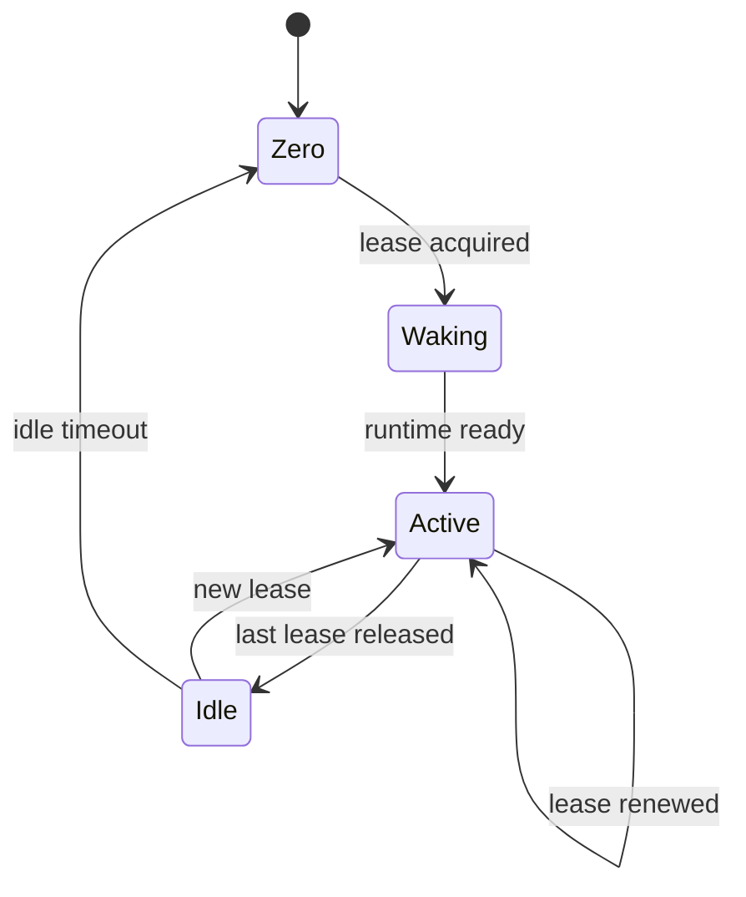
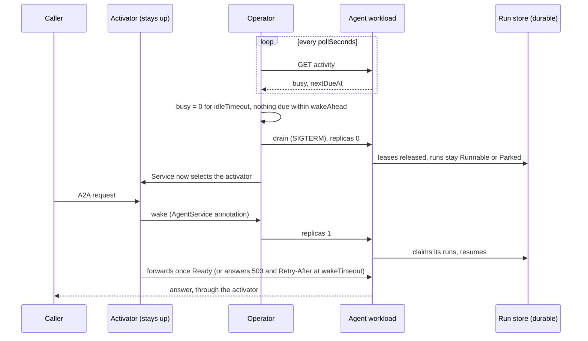
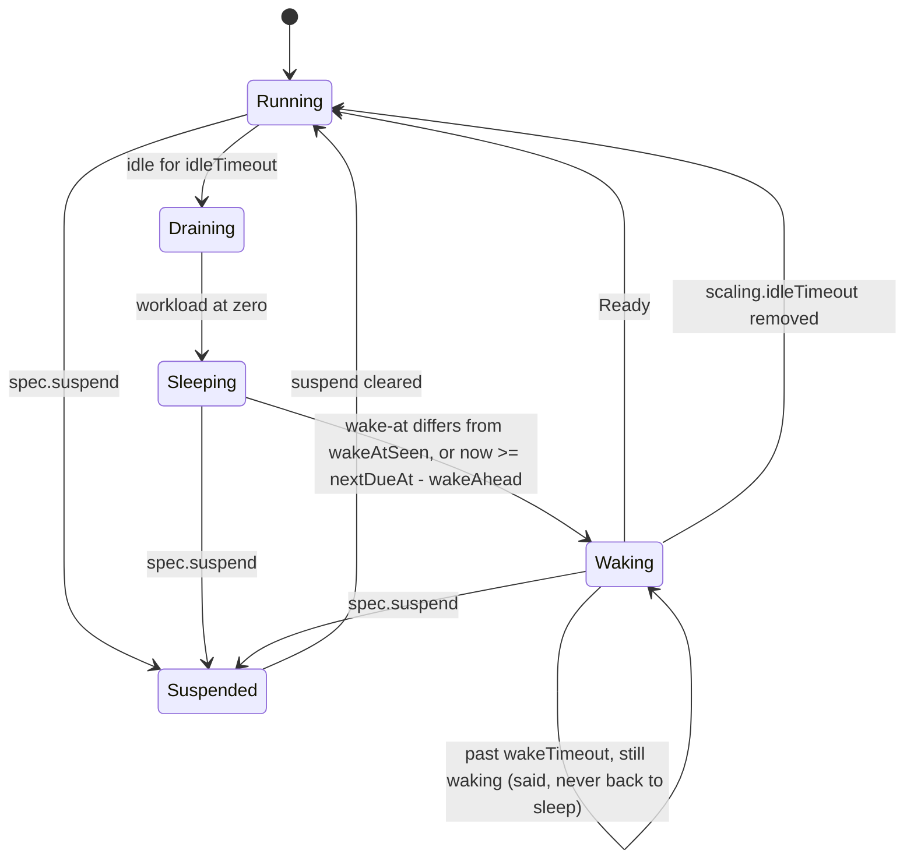
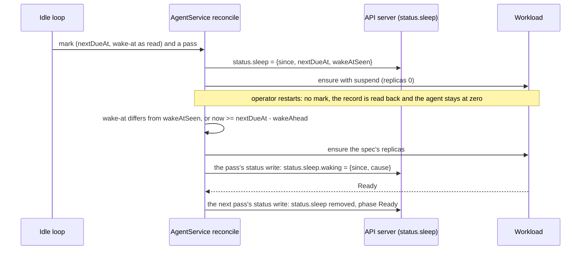
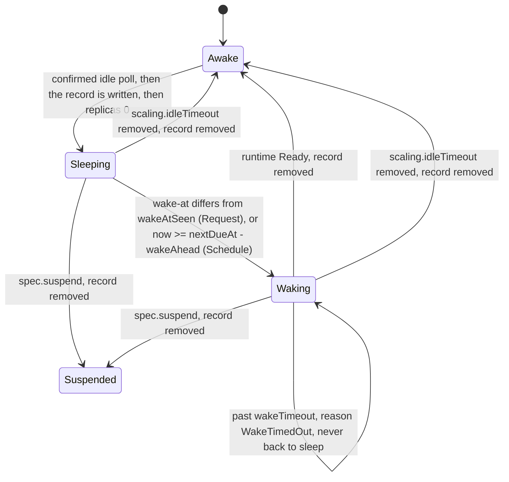
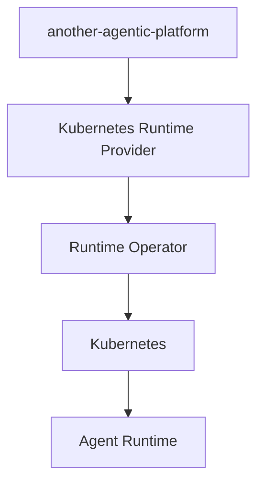
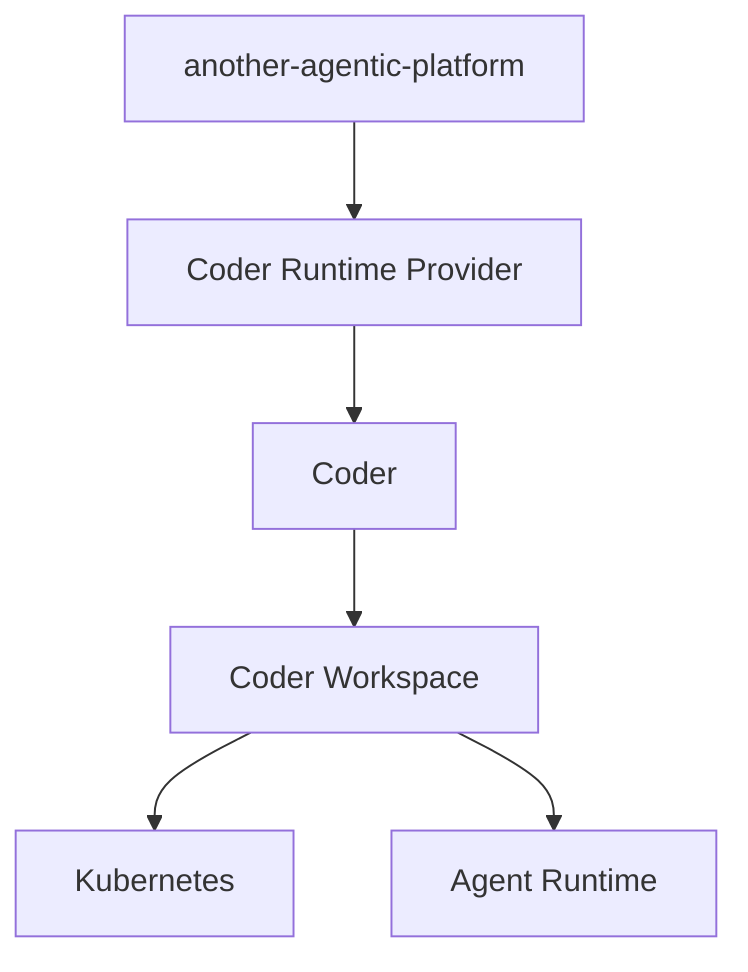
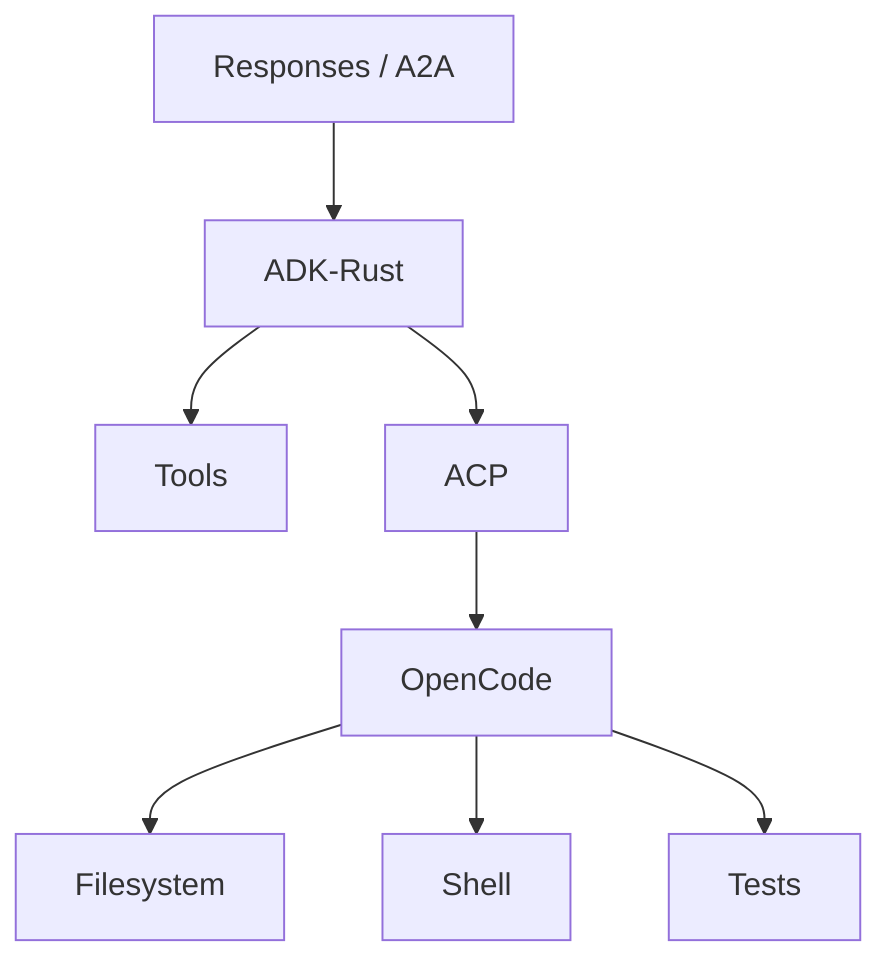
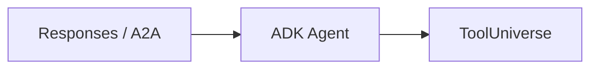
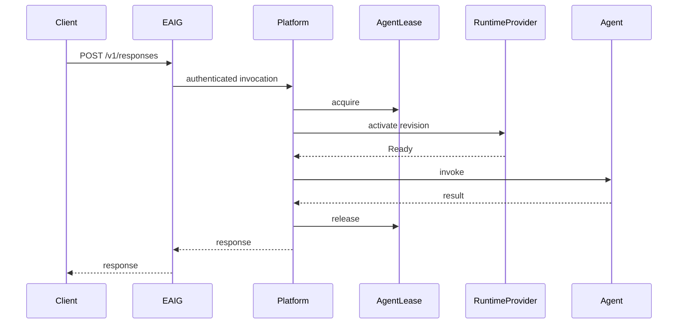

# Runtime, runs, leases and scale-to-zero

[← Index](README.md) · [← Previous](04-workflows.md) · [Next →](06-environments-and-storage.md)


---

## 18. Runtime Controller Responsibilities

The runtime controller/provider answers:

> What runtime infrastructure must exist now?

Example infrastructure states:

```text
Absent
Provisioning
Ready
Suspended
Failed
```

It should **not** contain application workflow logic such as:

```text
if PR review fails:
    ask agent to fix
    wait for CI
    reopen review
```

That belongs in Restate.

---

## 19. AgentRun

`AgentRun` represents one logical execution.

> **Review decision (2026-09-28, AD-016):** `AgentRun` is an **application-database record, not a CRD**. Runs are created per request and updated constantly; in etcd that is write churn for data Kubernetes never reconciles. The shape below is the record, shown as YAML for readability.

Example record:

```yaml
# application record (Postgres), not a Kubernetes object
kind: AgentRun

metadata:
  name: run-01kxyz

spec:
  agentRef:
    name: coder

  revisionRef:
    name: coder-r42

  input:
    type: issue

    repository:
      url: https://github.example.com/example/project

    issue:
      number: 428

status:
  phase: Running

  conditions:
    - type: RuntimeReady
      status: "True"

    - type: Completed
      status: "False"
```

`AgentRun` correlates:

```text
workflow
revision
runtime
leases
artifacts
logs
traces
Git branch
PR
cost
usage
```

---

## 20. AgentLease

`AgentLease` represents:

> This agent currently requires compute.

This is separate from HTTP request lifetime.



Lease holders may include:

```text
Responses request
background Response
AgentRun
Restate workflow
A2A request
interactive session
debug session
```

> **Review decision (2026-09-28, AD-016):** `AgentLease` is a **lease-service record in Postgres, not a CRD**. Every active holder renews its lease every few seconds; the operator reads the aggregate ("active leases per `AgentService`") instead of watching individual objects.

Example record:

```yaml
# lease-service record (Postgres), not a Kubernetes object
kind: AgentLease

metadata:
  name: run-01kxyz

spec:
  agentRef:
    name: coder

  holder:
    type: AgentRun
    name: run-01kxyz

  expiresAt: "..."
```

Leases should be renewable and short-lived.

If the holder crashes:

```text
lease expires
    ↓
idle timeout
    ↓
runtime stops
```

This avoids leaked compute.

---

## 21. Scale-to-Zero

Scale-to-zero is a semantic capability, not necessarily a Knative implementation.

> **Decision (2026-10-04, AD-023):** the v0 operator does not scale to zero ([§59a](10-control-plane-and-crds.md#59a-operator-v0-adam-rs-agents)). It has `spec.suspend`, which takes the workload to zero replicas and reports the runtime phase `Suspended`, and nothing else: no leases, no idle timeout, no activator. A source of run leases is an open question (§93): the coder's workers keep stepping a run after the A2A call has returned, so the HTTP connection says nothing about idleness.

Desired behavior:

```text
valid leases > 0
    → runtime must be active

valid leases = 0
    → wait idleTimeout
    → runtime may stop
```

The stable service continues to exist while runtime compute is absent.

---

## 21a. Sleep when idle: the plan

*(2026-11-24, ANR-255; written as a plan. Built since: P1, P2a to P2c, P3b and, 2026-11-27, **P3a-1, the operator's wake path** (ANR-1067), **ANR-1030a, the render half of the activity listener** and **ANR-1030b, the operator's wiring of it**. The plan's tables and diagrams are the plan as written; **the "as built" paragraphs below are what is true** (P2a, P2c, P2b, P3b, P3a-1), and where a row or a paragraph disagrees with a later one, the later one wins. **Since ANR-1030b (2026-11-27) the operator binary hands its activity source to the idle loop, so an adam agent can sleep once the deployment turns it on and the coder image has the listener (ANR-1200); nothing writes the wake annotation until ANR-1068.** The decision is [AD-058](11-decisions.md#ad-058--an-agent-sleeps-when-the-agent-says-it-is-idle-and-an-activator-wakes-it).)*

**The workingness contract.** The question the operator asks an agent, whether it holds work and when its next parked schedule fires, is [`activity/v1`](../extensions/activity-v1.md), and the decision is [AD-075](11-decisions.md#ad-075--workingness-an-agent-is-asked-whether-it-holds-work-over-activityv1-and-unknown-is-busy). It stands beside liveness and readiness and replaces neither. **Unknown counts as busy:** without a valid answer the agent is not scaled down. A field in the custom resource that names an agent's probe, and the operator's use of it, are later slices.

### What is built, and what is not (read at plat `main`, 2026-11-24)

| Claim | State | Where |
|---|---|---|
| §21 and AD-010 say scale-to-zero is lease-controlled | Text only. AD-010 is one line, "Compute lifecycle is controlled by `AgentLease`, not HTTP connection lifetime", with no status line and no amendment of its own | `11-decisions.md` (AD-010) |
| AD-023 defers leases and scale-to-zero | Decided: the v0 operator has `spec.suspend` and nothing else | `11-decisions.md` (AD-023), `05-runtime.md` §21 blockquote |
| `spec.suspend` takes the workload to zero | Built: `replicas` is 0 when set, the phase is `Suspended` | `crates/api/src/service.rs` (`suspend`), `crates/runtime-kubernetes/src/render.rs` (`replicas` on `spec.suspend`), `crates/runtime-kubernetes/src/provider.rs` (`suspend`, `Capabilities { suspend: true }`) |
| `idleTimeout`, `minReplicas`, `maxReplicas` | Not built: the CRD has no such field; the v0 table lists them as waiting | `10-control-plane-and-crds.md` §59a (the deferred-fields table), `02-domain-model.md` |
| An idle timeout exists for **run pods** | Built, and unrelated: a free run pod is released after 300 s (the run pool, not the agent's workload) | `10-control-plane-and-crds.md` (run pool `idleTTLSeconds`) |
| An activator, or any front that holds a request while the agent starts | Not built, and not planned in any other row of §59c | `10-control-plane-and-crds.md` §59c |
| `AgentLease` | A record in the lease service (AD-016), not built; `RunLease` (a CRD, AD-036) is the run pool's slot, not an agent lease | `05-runtime.md` §20 |

So scale to zero is neither built nor planned with slices anywhere else. The open question in §93 (who is the source of run leases) is answered by AD-058.

### The plan

The seam is that **the agent says whether it is busy**, because the coder's workers step a run after the A2A call has returned, so a connection says nothing (AD-010). adam already holds the truth: a run is held while its status is `Runnable` and `lease_until` is in the future (`crates/adam-core/src/store/mod.rs`, `claimed`), and a schedule is a parked run with a next due time (adam ADR 0060).





(As built by P3a-1 below, the operator is the one that goes to `Waking`; the activator only writes the annotation and answers `503` with `Retry-After` at its own deadline. The earlier arrow "wakeTimeout, caller told to retry" back to `Sleeping` is gone: the operator does not put a waking agent back to sleep.)

| Question | Answer (AD-058) |
|---|---|
| What holds the lease, and who renews it? | **Nobody renews an agent lease.** The run store's own run leases are the truth and the workers already renew them. The workload reports `busy` (runs claimed or stepping) and `nextDueAt` (the earliest schedule firing); the operator polls it and decides. `AgentLease` (§20) is not built for this |
| What is idle? | `busy = 0` for `idleTimeout` (default 15 m, the §2 example), with no firing due within `wakeAhead`. A poll that fails counts as busy |
| What wakes a sleeping agent? | (1) The next A2A request at the **activator**, a small front that stays up; (2) a schedule: the operator wakes the workload `wakeAhead` before `nextDueAt`; (3) a push or webhook, which arrives at the same activator route as a request. The activator only asks; the operator scales |
| How does state come back on any machine? | The run store is durable and outside the pod (adam's Postgres or MongoDB store). A woken workload claims its runs again; nothing is copied |
| What must adam do? | Serve the activity answer; on SIGTERM stop claiming, let a step finish or release its lease so the run is `Runnable` for the next claimer, and exit within the grace period; resume fast enough for `wakeTimeout` (rows A1 to A3) |
| What does a caller see while it wakes? | The activator holds the request until the agent is `Ready`, for at most the agent's `scaling.wakeTimeout` (5 s to 5 m; the CRD says 60 s when absent) and in any case at most the activator's own cap `wake_timeout` (300 s by default, an upper bound, P3b), and then forwards it. At the timeout it answers `503` with `Retry-After`. The agent card is answered by the activator while asleep (~~from the registry the operator already serves~~ (corrected, see P3b: the registry holds no card body, so the activator has its own `CardSource`)), so discovery needs no wake. A caller never gets an answer from a half-started agent |
| What does a sleeping agent show? | `runtime.phase: Sleeping`, distinct from `Suspended` (a person's choice, never woken) |

### Slice table

One row per pull request, one repository per row. "plat" is another-agentic-platform, "adam" is another-adam-rs. A slice that needs a cluster says so; its test is the decisive one.

| Row | Repo | What | Decisive test | Depends on |
|---|---|---|---|---|
| A1 | adam | `GET /internal/activity` on the health listener: `{busy, nextDueAt}` read from the store (claimed runs, parked schedules), no secret, no run content, bearer-protected like the rest | A run claimed by a worker makes `busy` 1; a parked schedule due in an hour gives `nextDueAt`; with neither, `busy` 0 and no `nextDueAt` (store conformance case, both stores) | none |
| A2 | adam | Clean park and drain on SIGTERM: stop claiming, finish or release the step's lease, so every run is `Runnable` for the next claimer; exit within the grace period | Start a run on a scripted slow model, send SIGTERM, assert the process exits within the grace period and a second process claims the same run and finishes it with no step done twice (journal compared) | none |
| A3 | adam | Resume budget: from process start to `Ready` and the first claim, measured, with a ceiling that fails the test | The coder image started on an empty cache reaches `/readyz` and claims a waiting run under the ceiling (a number set in the PR from a measurement, not a guess) | A2 |
| P1 (built 2026-11-25) | plat | CRD: `scaling.idleTimeout`, `scaling.wakeAhead`, `scaling.wakeTimeout` (CEL bounds, off by default: absent means never sleeps), the phase `Sleeping`, regenerated CRDs and API schema | A fleet with none of the fields renders byte for byte what it did (the goldens do not move); each new bound has an `examples/invalid/` file | none |
| P2 | plat | Idle controller: polls the activity answer, counts idle time, drains and scales to zero, sets `Sleeping`; a failed poll is busy; `spec.suspend` wins | Fake API server and a scripted activity source: busy then idle for `idleTimeout` scales to zero; a poll error never scales down; a `nextDueAt` inside `wakeAhead` never scales down | P1, A1 |
| P3 | plat | Activator: the stable front. While asleep the Service selects it; it answers the card, holds a request, asks the operator to wake, forwards when `Ready`, answers `503` and `Retry-After` at `wakeTimeout`. Wakes on schedule through the operator | Router test over `Memory` ports: a request while asleep is forwarded once after the wake, a second concurrent request shares the one wake, a wake that never completes is `503` with `Retry-After`; the card is answered with no wake | P2 |
| P4 | plat | Kind end-to-end with the real coder: sleeps after `idleTimeout`, wakes on a request, continues a run parked by a schedule, state intact, no secret in any log (*needs a cluster and CI*) | The run's task id from before the sleep is answered after the wake by `GetTask`, and the journal holds each step once | P3, A2, A3 |

P2a as built (2026-11-26, ANR-850): the `ActivitySource` port (`aap-ports`, `poll(id) -> {busy, nextDueAt}`, the suite `activity_source_conformance!`, `MemoryActivity`) and the pure `decide` of `crates/controller/src/sleep.rs`, with the four rules of the row tested by name. Nothing polls or scales yet (P2b); the HTTP source is P2c.

P2c as built (2026-11-26, ANR-852): `crates/activity-http` (`aap-activity-http`), `HttpActivity`, the `ActivitySource` over `GET http://<name>.<namespace>.svc:<port>/internal/activity` with the agents' bearer. A failed, refused, oversized or malformed answer is an error, never idleness. The operator builds it from the `activity` section of its configuration file: `enabled`, `port` (8080), `timeoutSecs` (3) and `token` (a file reference; enabled without a token is refused, exit 78; was `ACTIVITY_ENABLED`, `ACTIVITY_PORT`, `ACTIVITY_TIMEOUT_SECS` and `ACTIVITY_TOKEN_FILE`); the chart's `activity` block (`to`, `port`, `timeoutSecs`, `tokenSecret`, `dns`) turns it on, mounts the bearer's Secret as a file and opens egress to those peers on that port, and renders nothing while `activity.to` is empty. The idle loop of P2b can poll it; the binary does not hand the source to the operator yet.

P2b as built (2026-11-26, ANR-851): the idle loop (`crates/controller/src/sleeper.rs`) runs when the operator is given an activity source (`Operator::with_activity`; ~~the `operator` binary builds the P2c source but does not hand it to it~~ *(superseded 2026-11-27 by ANR-1030b: `compose` hands it over, below)*). Every `Options::sleep_poll` (30 s) the leader lists the services and, for each one with `scaling.idleTimeout` and no `spec.suspend`, polls its activity and runs `sleep::decide`. **Draining** is a second poll right before the scale-down: a run claimed in between, an error, or a schedule that came inside `wakeAhead` keeps the agent up (the port has no "stop claiming" call; A2 makes the agent park cleanly when it is stopped). **`Sleeping` reuses `RuntimeProvider::suspend`**, no new capability: ~~the loop marks the agent (`Sleepers`, in memory), calls `suspend`, and the service reconciler then ensures~~ *(superseded by P3a-1, 2026-11-27: the loop only proposes, the reconcile writes `status.sleep` and then ensures)* the service reconciler ensures the spec with `suspend: true` so a later pass does not wake it, and reports `runtime.phase: Sleeping`, `Ready` false with reason `Sleeping`, `state: Suspended` (no new state; the phase and the reason tell it from a person's suspend). The mark ends when the policy is removed, `spec.suspend` is set or the service is deleted. ~~The mark is **not stored**: a restart of the operator wakes every sleeping agent, which sleeps again after another `idleTimeout`; waking on a request, a due schedule or a push is P3.~~ *(superseded by P3a-1, 2026-11-27: the sleep is stored in `status.sleep`, and waking is built.)* Counter `aap_agent_sleeps_total`. A real cluster is not proven until P4.

P1 as built: `scaling.idleTimeout` (`1m` to `24h`), `scaling.wakeAhead` (`10s` to `1h`) and `scaling.wakeTimeout` (`5s` to `5m`) are duration strings with CEL bounds; the last two need `idleTimeout`. All three are absent by default, so an agent never sleeps and nothing renders differently. `status.runtime.phase` gains `Sleeping`; nothing sets it until P2. The defaults the CRD documents when a field is absent (2m for `wakeAhead`, 60s for `wakeTimeout`) are P2's and P3's to apply; the activator's own `wake_timeout` (300 s) is only an upper bound over the per-agent value (P3b). The owner confirmed `idleTimeout: 10m` as the value of the hosted deployment (2026-11-25); the fields stay off by default in the CRD.

P3b as built (2026-11-27, ANR-762): the activator **as a library**, `crates/activator` (`aap-activator`) over three new ports in `aap-ports` (`Waker`, `Upstream`, `CardSource`, each with a `Memory` fake, a conformance macro and negative tests that the suites fail broken fakes): the four tests of the row pass over the `Memory` ports. The operator's wake path is built (P3a-1, ANR-1067); the binary, image, chart and Kubernetes adapters are ANR-1068, and nothing wakes a real agent yet. Two premises of the row, corrected: **the registry holds no card body** (it lists each agent's card `href`), so "the card is answered from the registry the operator already serves" is false and the `CardSource` is its own seam, an adapter keeping what the agent last served; and **a scheduled wake needs a persisted `nextDueAt`**, because the operator kept its sleep mark in memory (P2b) and a restart forgot it; **done by P3a-1** (`status.sleep.nextDueAt`). ANR-Q134 to Q137 are decided (AD-058 amended). **Provisional choices** (every default is provisional and set by the deployment): the router's `wake_timeout` is an upper bound whose default is 5 m, the CRD's maximum for `scaling.wakeTimeout`, so an adapter answering `TimedOut` at the agent's own value decides and a request joining a wake in flight shares the first request's deadline; **the agent is named by the `Host` header (`<name>.<namespace>`, optionally ending in a configured suffix), which ANR-Q135 decided (one activator per namespace, by `Host`)**; **the activator has no authentication and is safe only behind a NetworkPolicy that admits only the callers that may reach the agents, which is a requirement on ANR-1068's chart**; `max_in_flight` bounds held requests, `forward_timeout` gives `504`, `body_read_timeout` `408`, an unknown agent `404`, a suspended one `409`. **Streaming (ANR-1069, 2026-11-27): the answer streams** (the `Upstream` returns the head and a `BodyStream`; SSE and `message:stream` reach the client chunk by chunk, with no `Content-Length`), the request stays buffered (a wake may replay it, R5 reads its metadata); `forward_timeout` covers the head (`504`), `stream_idle_timeout` (120 s, provisional), an optional `max_stream_duration` (off by default, provisional: a shared front should set it, the chart of ANR-1068 gives it a value) and an error in the stream end it with the connection, counted in `stream_ends_total` as `idle` / `max_duration` / `failed` / `abandoned`, and the `max_in_flight` permit is held until the stream ends or the client leaves.

ANR-1030a as built (2026-11-27, AD-058; `crates/domain/src/resolve.rs`, `validate.rs`, `crates/runtime-kubernetes/src/render.rs`): the **render half** of the activity listener, **inert until ANR-1030b** wires the operator and **ANR-1200** moves the coder pins to an image that has the listener (`sha-b5d1c7e`): **both pins now have it** (ANR-1200), and the operator still does not wire it (ANR-1030b). `Externals::activity` (`ActivityExternals`: the port, a Secret key for the tokens, the operator's namespace and pod labels) is `None` by default and then nothing moves: every golden and digest is byte for byte what it was. With it set, **an agent that sets `scaling.idleTimeout` and runs the adam-rs harness** gets, on the agent container of the workload the Service selects only (the one process, or the front of `split`; never a worker, never a sidecar), the variables `ACTIVITY_LISTEN_ADDR=0.0.0.0:<port>` and `ACTIVITY_BEARER_TOKENS`, a container port named `activity`, a Service port `activity`, and an ingress rule. An `a2a` agent with `idleTimeout` gets none of it (it never sleeps; the controller's event is ANR-1030b's). **The token is one deployment-wide Secret reference** (the operator reads no Secret, AD-024, so the pod takes `ACTIVITY_BEARER_TOKENS` from a `secretKeyRef` of a Secret with the deployment's name in each watched namespace and the operator sends the same value; **decided by the owner on 2026-11-27 (ANR-Q142, option A); the operator config's port default of 8081 and its refusal of 8080 (ANR-Q143, decided the same day, config stays at version 1) come in ANR-1030b**); no value is ever in a spec. Both names are in `OPERATOR_SET`, so `extraEnv` naming them is refused. A port that is 0, the A2A port 8080, or the port of the agent's own GitHub sidecar is `ConfigInvalid` naming the field (adam exits 78 on a shared port). **The policy:** an agent with the listener gets a `NetworkPolicy` even when `access.allowFrom` is empty. Rule 1 is exactly today's rule when `allowFrom` is not empty, and when it is empty the A2A port with no `from` (as open as with no policy). Rule 2 is the activity port from **one** peer entry that holds both the operator's `namespaceSelector` and its `podSelector` (two entries would be an OR and admit every pod of either). **The digest** keeps the port, in the container and in `Network::activity`, and sets aside who may reach it (`Network::activity.from`), as it does `allowFrom`: moving the operator rolls no agent, a changed port rolls them. **Preconditions and effects:** the activity Secret must exist in every watched namespace **before** the settings are enabled, or the agent pods fail with `CreateContainerConfigError` (an optional reference is no way out: adam exits 78 with an address and no tokens); enabling it **rolls every adam agent that sets `idleTimeout` once**, since the digest moves; the A2A token list must not be the same Secret key (refused) and adam exits 78 if the two lists share a value, which the operator cannot check (it reads no Secret); the operator's peer is a namespace selector and a pod selector, and **the pod labels can be worn by anyone who may create pods in the operator's namespace** (the namespace half cannot be forged), so that namespace should hold nothing else. The deployment's settings are built by a checked constructor (no empty label map, which would render `podSelector: {}`, no port below 1024 or 8080). **The policy is applied before the workloads** (`Rendered::policy_first`) so the listener is never served before it exists; `RuntimeSpec::check` holds the port to the selected workload and refuses a peer that names nothing. **Not proven:** a kubelet or a CNI enforcing rule 2, and an agent binary with the listener.

ANR-1030b as built (2026-11-27, AD-058; `bin/operator/src/config.rs`, `run.rs`, `crates/controller/src/sleeper.rs`, `service.rs`, `options.rs`, `deploy/operator`): **the operator is wired**. `compose` hands the HTTP source to `Operator::with_activity` (`Operator::has_activity`; the wiring test fails when that arm is deleted), and `Options::activity` (the `ActivityExternals` of ANR-1030a) is what `read_externals` sets on every resolve, so an agent's spec and the operator's source cannot disagree about the port. The file's `activity` block (config stays `version: 1`, ANR-Q143): `port` defaults to **8081** and 8080 or a port below 1024 is refused at load and by `--check` (78), enabled or not; new keys `agentTokensSecret {name, key}` (the Secret the agents' pods read the one deployment-wide bearer from, ANR-Q142) and `operatorPod {namespace, labels}` are **required while `enabled` and refused otherwise**, empty labels refused, and the checked constructor's error names the key; the bearer read from `token` may not contain a comma (an agent splits `ACTIVITY_BEARER_TOKENS` on commas): 78 at start. The operator sends only this token, never an A2A token.

**The bearer, generated in the cluster (the owner's convention, 2026-11-27).** The one token the operator and every agent share can be made where it is used and pushed to AWS Secrets Manager, rather than typed into a Secret: an External Secrets `Password` generator (or a one-shot Job) makes it in the operator's namespace with no `,`, a `PushSecret` pushes it, and one `ExternalSecret` per watched namespace pulls it back under `activity.agentTokensSecret.name` (and the operator's own under `activity.tokenSecret.name`). **Not proven:** the generator's and `PushSecret`'s exact fields are External Secrets Operator's and were not checked here. This repository implements one bearer, the comma it refuses, and the names of the copies. The registry token is not system-generated (the orchestrator must know it), so it is provisioned or pulled, as `externalSecrets.*` does. The chart's `activity.port` is 8081, `activity.agentTokensSecret` defaults to `activity.tokenSecret`, and `operatorPod` is rendered from the release's namespace and `aap.selectorLabels` (the API's pod carries another `name` label). **An `a2a` agent with `scaling.idleTimeout`** has no listener: the idle loop skips it without asking (before, a refused connection counted as busy for ever) and the reconcile emits one Event `NeverSleeps` per change. **Three things carried from ANR-1030a's review:** a policy `<svc>` the spec no longer renders (activity turned off, `allowFrom` empty) is deleted only once the workload is Ready or Suspended, because old pods still serve the listener and the policy is what keeps it to the operator (this holds for **every** removal of that policy, including an `allowFrom` emptied while activity is off: a stale, more restrictive policy stays until then, which is fail-closed); **a failed poll counts as busy and is now told**: the first failure of each kind (`refused` for a 401 or 403, `invalid`, and, for an agent that could not answer, the cause: `timeout`, `connect`, `status 5xx` or `other`, ANR-1303; each cause is its own kind, so a NetworkPolicy drop (`timeout`) is told from a refused connection (`connect`) and from a 5xx) per service is logged at `warn` (service, namespace and kind, never the token or a URL) until the kind changes or a poll succeeds, so a token that differs from an agent namespace's Secret copy, a missing Secret or an `activity.to` that does not list the namespaces of `watchNamespaces` is no longer silent; the chart refuses an unset `activity.agentTokensSecret.name` with more than one watched namespace; `RuntimeSpec::check` refuses an activity port on **any sidecar** and on **any container of a workload the Service does not select**, whatever its role; `aapctl render --activity-file` gives the CLI the same setting (the operator's `activity` block, judged by the same constructor), so it renders what the operator applies. **Preconditions and effects:** the agents' Secret must exist, with that name and key, in **every watched namespace** (the chart makes none and a copy in each extra namespace, such as an ExternalSecret, is the deployment's), or the pods fail with `CreateContainerConfigError`; the coder image must have the listener (ANR-1200, `sha-b5d1c7e`: **no pin of this repository does yet**, so enabling it on `defaultAgentImage` starts agents whose container ignores the port and never answers, and they stay awake); **enabling it rolls every adam agent that sets `idleTimeout` once**; an a2a agent never sleeps. **Not proven:** a kubelet and a CNI enforcing the policy's second rule, a real coder answering the poll, and the operator's `Role` under a real API server (it changes nothing there). 

P3a-1 as built (2026-11-27, ANR-1067, AD-058 amended; `crates/controller/src/wake.rs`, `sleeper.rs`, `service.rs`): the operator's wake path. **Sleep is stored in the object**, as `status.sleep` (`since`, `nextDueAt`, `wakeAtSeen`, `waking{since, cause}`), present only while the agent is asleep or waking, so a restart or a failover keeps a sleeping agent asleep (the defect P2b documented). The idle loop no longer scales: its confirmed poll makes a *mark* (the poll's `nextDueAt` and the `wake-at` annotation as it read it), asks for a pass, and the reconcile, the one writer of the status, **writes the record first and scales second**; after a restart it reads the record back, and the loop skips every agent whose record is present (a poll goes through the activator and would wake it).





The signal is the annotation `agents.vymalo.com/wake-at`: an RFC 3339 instant, **level-triggered**, never removed by the operator, ignored by an awake agent. The decision does not parse it: **any value that differs from `wakeAtSeen`** is a request (so a value that was there before the sleep is not one, and a removed annotation is not one, which is a proposal of this slice). A scheduled wake needs no event: the pass is requeued at `min(settled, max(1 s, nextDueAt - wakeAhead - now))` from the status, again at each pass. Scaling up restores the spec's replicas (`workers`, a split front), and `runtime.phase: Waking` (reason `Waking`, `state` Degraded, no new state) lasts until the runtime is `Ready`. `scaling.wakeTimeout` (60 s when absent) is read here for the first time: past it the operator **keeps waking and says so** (reason `WakeTimedOut`, a Warning Event) and never goes back to sleep (ANR-Q141, option A, decided by the owner 2026-11-27). The field names of `status.sleep` and `RuntimePhase::Waking` were accepted by the owner on 2026-11-27 (ANR-Q140) and sit in `crates/api/src/status.rs` only. **What it does not do, and what a deployment must know:** a **blocked** service (invalid config, missing referent, store not ready) cannot be woken until it is unblocked: the record is carried and the request waits. An **operator upgraded before the CRDs chart** would have `status.sleep` pruned by the API server (install the CRDs chart first, as the docs already say). Agents **asleep under the previous build wake once on upgrade** (they had no record). The sleep counter can **undercount by one**: if a persist reaches the server but the call returns an error, or the pass is cut off before the answer, the claim is given back, and a retry that reads the record counts nothing. It is counted only if the retry still reads no record while the mark is fresh. **A mark is a statement about one moment** (review of 60d4f70): it carries the time it was made on the reconcile's clock and is ignored and dropped once older than one idle-loop period plus one pass's time limit (`sleep_poll + pass_timeout`, 90 s by default; the loop then polls the agent again), and a replica that is not the leader drops every mark on each lap of the idle loop (and the reconcile claims a mark before it writes its record, so aging cannot drop one whose write is in flight). **What this guarantees:** a sleep acts only on a poll at most `sleep_poll + pass_timeout` old (90 s by default, both defaults checked: 30 s and 60 s). **A claimed mark is not aged**: its record is being, or was, written, and it keeps that sleep while the cache lags. The claim itself never makes a record — it follows the plan, and a mark the plan made no record from is dropped, not claimed — and a claim that does not reach its write is given back by a drop guard, so a pass cut off by its own timeout cannot hold a mark for ever. A mark that is **gone or replaced** by the time of the claim (aged by a loop lap, cleared on a follower, forgotten) writes no record: nothing is scaled or counted (ANR-1199). A persist that reached the server but returned `Err`, retried more than 90 s later on a lagging cache, **may** erase the record and leave the agent awake: the safe direction. The leadership clear runs once per lap, so a lease lost and regained between two laps is bounded by the age rule alone. A slow queue can keep an agent awake, which is safe; every dropped mark is logged at `debug` with the agent and the reason (`stale`, `stillborn` or `gone`). A sleep that would be **born waking** (the annotation changed since the decision, or the schedule is already inside `wakeAhead`) is never recorded or counted: the agent never slept. `wakeAtSeen` holds the annotation as is up to 64 bytes and `sha256:<hex>` (71 characters, the schema's `maxLength`) above, compared through the same function. Tests, each shown to fail with its guard removed (mutation log in PR #138): `crates/controller/tests/operator.rs` (`a_wake_at_annotation_wakes_a_sleeping_agent_through_waking_to_ready`, `a_scheduled_wake_fires_at_next_due_at_minus_wake_ahead`, `an_operator_restart_keeps_a_sleeping_agent_asleep`, `a_stale_wake_at_from_before_the_sleep_does_not_wake`, `suspend_while_waking_clears_the_record`, `waking_past_wake_timeout_keeps_waking_and_says_so`, `a_mark_left_by_a_blocked_pass_never_sleeps_a_busy_agent`, `a_mark_whose_wake_came_before_the_sleep_is_dropped_not_recorded`, `an_agent_with_three_workers_wakes_to_three_replicas_not_one`), `sleeper.rs` (`losing_leadership_drops_the_marks`, `a_mark_older_than_the_bound_is_dropped_and_the_agent_is_polled_again`), `tests/pure.rs` and `wake.rs`. **ANR-1199 adds** `sleeper.rs`'s `a_mark_dropped_between_the_plan_and_the_claim_is_gone_and_writes_no_record`, `service.rs`'s claim helper (`a_mark_dropped_before_the_claim_writes_no_record`, `a_mark_replaced_before_the_claim_is_gone_and_leaves_the_new_one_untouched`, `a_new_mark_counts_and_an_already_claimed_one_does_not`, `a_pass_that_already_has_a_record_claims_nothing`, `a_pass_with_no_plan_claims_nothing`, `a_claim_that_never_writes_is_given_back_by_the_guard`, `a_disarmed_guard_gives_nothing_back`, `the_guard_does_not_unclaim_a_newer_mark`) and `tests/operator.rs`'s `a_pass_cut_off_while_writing_the_sleep_record_gives_its_mark_back`; those were **not run on the owner's host** (no heavy jobs there, ANR-Q79), PR #178 names the mutation each is meant to catch, and CI's `Operator` job is their first run. **Unverified:** a real cluster (P4); two near-simultaneous passes can read a status a little behind the write, which re-writes the same record with a later `since` and is harmless; a wake request that arrives while the idle loop's mark is being made is kept (the annotation is read at the decision). **Not built:** the writer of `wake-at` and the activator's binary (ANR-1068), the Service switch (ANR-1182), the source in the binary (ANR-1030).

*The build records and evidence of §21a — the test lists, the review and commit ids, the verification marks — are in [the agent page](../../.agents/docs/architecture/05-runtime.md#21a-sleep-when-idle-the-plan).*


### The seam the sys ADR for live connections needs

ANR-9's third gap (a live connection kept while the agent is at zero) is a system ADR that depends on this plan. It needs two things from P3 and nothing else:

1. **`Wake(agent) -> Ready | Timeout`**, the one call the activator makes to the operator, which a client-facing front in the system can make as well.
2. **A task id that survives the sleep**: the stream is re-opened with `SubscribeToTask` (or `GetTask`) on the woken agent, which works because the run store is durable. The activator never holds a stream open across a sleep; it ends it and the client resumes by task id.

---

## 22. RuntimeProvider

The platform should define a narrow runtime abstraction.

> **Decision (2026-09-28, AD-020):** providers are Rust traits in their own
> crate, with a conformance testkit; implementations (Kubernetes, Coder, …)
> are separate crates selected at build time. The sketch below is kept
> language-neutral.

Conceptually:

```go
type RuntimeProvider interface {
    EnsureRuntime(ctx, revision) error
    Activate(ctx, runtimeID) error
    Suspend(ctx, runtimeID) error
    Delete(ctx, runtimeID) error

    Status(ctx, runtimeID) (Status, error)
    Endpoint(ctx, runtimeID, service string) (Endpoint, error)
    Logs(ctx, runtimeID) (LogStream, error)
}
```

The implementation can change without changing the domain model.

Potential providers:

```text
RuntimeProvider
├── KubernetesRuntimeProvider
└── CoderRuntimeProvider
```

There is no requirement to implement both.

> **Decision (2026-10-04, AD-023):** the Rust shape of the first provider boundary lives in the crate `aap-ports` and is sketched below (S3 settles the details). **`Activate` is folded into `ensure`**: ensuring a suspended runtime wakes it, so there is no second verb to keep in step with the first, and `suspend` stays. `Logs` is not in v0: logs are read through §50. `watch` feeds the controller with the ids of runtimes that changed, so the controller never watches workloads itself. Neutral types and the issue reasons of `RuntimeStatus` are in [§59a](10-control-plane-and-crds.md#59a-operator-v0-adam-rs-agents).

```rust
// crate aap-ports (AD-020): no Kubernetes type in any signature.
pub trait RuntimeProvider: Send + Sync {
    fn capabilities(&self) -> Capabilities;

    /// Make the runtime match `spec`: create it, update it, or wake it.
    async fn ensure(&self, id: &RuntimeId, spec: &RuntimeSpec) -> Result<RuntimeStatus, RuntimeError>;
    async fn suspend(&self, id: &RuntimeId) -> Result<RuntimeStatus, RuntimeError>;
    async fn delete(&self, id: &RuntimeId) -> Result<DeleteOutcome, RuntimeError>;

    async fn status(&self, id: &RuntimeId) -> Result<RuntimeStatus, RuntimeError>;
    async fn endpoint(&self, id: &RuntimeId, surface: Surface) -> Result<Endpoint, RuntimeError>;

    /// Ids of runtimes whose state changed.
    fn watch(&self) -> BoxStream<'static, RuntimeId>;
}
```

---

## 23. Native Kubernetes Runtime

A native implementation might look like:



Responsibilities include:

- workload creation;
- volumes;
- networking;
- scale-to-zero;
- readiness;
- side services;
- runtime classes;
- scheduling;
- snapshots;
- cleanup.

This provides maximum architectural control but requires substantial engineering.

---

## 24. Coder Runtime

Coder may alternatively implement the runtime substrate.



Coder may provide:

- workspace lifecycle;
- start/stop;
- storage provisioning;
- Terraform-managed side resources;
- workspace connectivity;
- logs;
- shell access;
- port access;
- persistent resources;
- development environment support.

The rest of `another-agentic-platform` remains ours:

```text
AgentService
AgentConfig
AgentRevision
ToolUniverse
AgentRun
AgentLease
Restate
EAIG integration
A2A
MCP
Responses
tenancy
authorization
artifacts
observability
release channels
```

The architecture should avoid leaking Coder concepts into these resources.

---

## 25. Coder Architecture Trade-Off

Coder is potentially the lowest-effort runtime solution.

The cost is conceptual translation:

```text
AgentRevision
     ↓
Runtime abstraction
     ↓
Coder Workspace
     ↓
Coder Template
     ↓
Terraform
     ↓
Kubernetes
```

Native Kubernetes is more direct:

```text
AgentRevision
     ↓
Runtime abstraction
     ↓
Kubernetes
```

The decision should therefore be based on whether a **workspace** is a natural runtime abstraction for most agents.

Coding agents map naturally.

Other agents may not.

---

## 26. Agent Runtime

> **Decision (2026-10-04, AD-022):** the harness is **adam-rs**, which replaces ADK-Rust in the drawings below: `adam-coder` (a coding task to a verified pull request) and `adam-agent` (serves any agent folder), both in the image `ghcr.io/vymalo/another-adam-rs/coder`, selected by `AgentConfig.spec.harness.type: adam-rs` ([§59a](10-control-plane-and-crds.md#59a-operator-v0-adam-rs-agents)). OpenCode stays a capability inside `adam-coder`: its ACP client is the adam-rs crate `adam-acp`. The ADK-Rust notes after the drawings are kept as the history of the choice.

A coding runtime might contain:



A non-coding agent may simply be:



Therefore:

> ACP/OpenCode are agent capabilities, not platform requirements.

**Notes** (the verification state as of 2026-09-28 is in [the agent page](../../.agents/docs/architecture/05-runtime.md#26-agent-runtime)):

- **ADK-Rust** is [zavora-ai/adk-rust](https://github.com/zavora-ai/adk-rust), a community Rust implementation of Google's ADK (not Google's own). It claims A2A v1.0 support via its `adk-server` crate. Not yet exercised — spike before it becomes load-bearing.
- **`opencode acp`** runs OpenCode as an ACP agent over **stdio** (newline-delimited JSON-RPC). It opens no network port and starts a private OpenCode server per process ([docs](https://opencode.ai/docs/acp/)). The ADK process and OpenCode must therefore share a container/Pod — as drawn above.

---

## 42. Scale-from-Zero Request

Example flow:



For background execution, the HTTP response can end while a Restate workflow continues renewing the lease.

> **Superseded (AD-058, 2026-11-27):** this lease-based flow is not what is built or planned. An agent reports its own activity, the operator scales it to zero and records that in `status.sleep`, and a front (the activator) wakes it through the annotation `agents.vymalo.com/wake-at`. See [§21a](#21a-sleep-when-idle-the-plan), *P3a-1 as built*.

---

## 64. Scheduling and Admission

At small scale, the controller may immediately activate workloads.

At larger scale:

```text
AgentRun
    ↓
WAITING_FOR_CAPACITY
    ↓
admission
    ↓
runtime activation
```

Potential future integration:

```text
Kueue
```

as an optional admission implementation.

GPU and specialized device support may use Kubernetes DRA where relevant.

---

## 65. Resource Classes

Potential future model:

```yaml
kind: ResourceClass

metadata:
  name: medium

spec:
  resources:
    cpu: "4"
    memory: 8Gi

  placement:
    architecture:
      - amd64

  runtimeClass: gvisor
```

Agents can reference logical resource classes instead of embedding cluster details.

---

## 80. Runtime Cold Starts

Scale-to-zero introduces cold-start latency.

Potential mitigations:

```text
prebuilt images
shared project Git mirrors
shared dependency caches
shared code indexes
prewarming
minimum replicas for critical agents
snapshot/restore
faster runtime provider
```

The architecture should allow these optimizations without changing the `AgentService` contract.

---

[← Index](README.md) · [← Previous](04-workflows.md) · [Next →](06-environments-and-storage.md)
