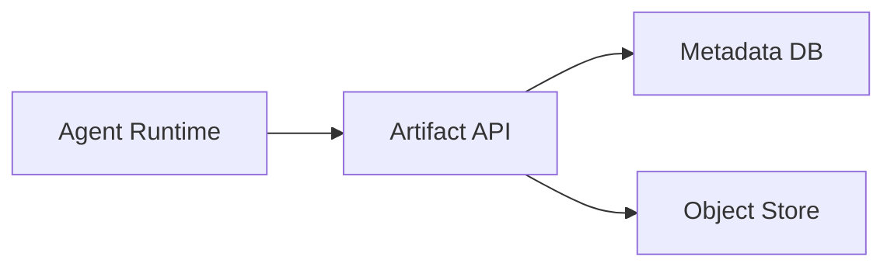
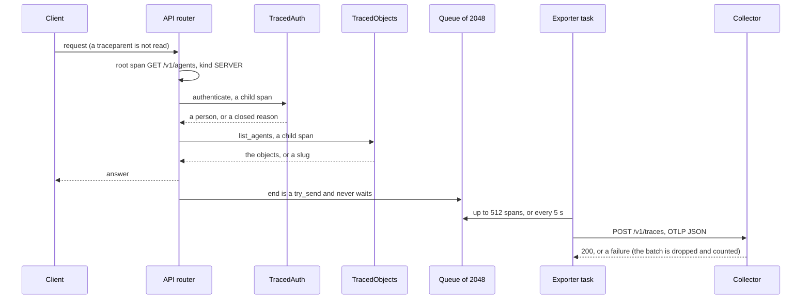
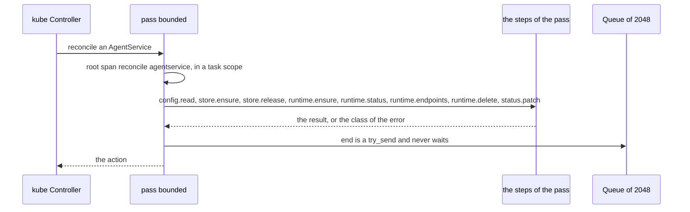
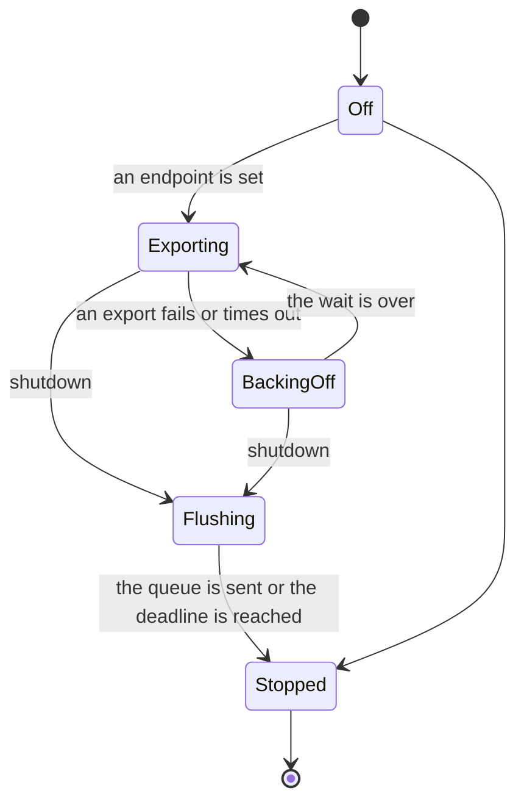
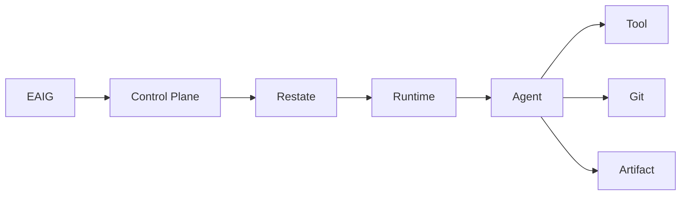

# Artifacts, observability, lifecycle, reliability and quotas

[← Index](README.md) · [← Previous](08-security.md) · [Next →](10-control-plane-and-crds.md)


---

## 46. Artifacts

Artifacts are first-class outputs.

Examples:

```text
patch
screenshot
Playwright trace
JUnit XML
coverage report
binary
SBOM
security scan
architecture report
generated documentation
benchmark result
```

An artifact should contain metadata such as:

```text
artifact ID
run ID
revision ID
producer
digest
media type
created time
retention
size
```

Storage should be content-addressable where practical.

---

## 47. Artifact Architecture



Possible object storage providers:

```text
S3
MinIO
GCS
filesystem for development
```

Important distinction:

```text
PVC
    mutable working state

Artifact store
    durable outputs

Git
    source history

Restate
    workflow history/state
```

---

## 48. Observability

Observability is mandatory.

All major operations should emit OpenTelemetry signals.

Common attributes should include:

```text
agent.tenant.id
agent.project.id
agent.service.name
agent.revision.id
agent.run.id
agent.execution.id
agent.protocol
```

Potential protocol values:

```text
responses
a2a
mcp
acp
internal
```

*Amended 2026-11-14 (K4), the Platform API's metrics:* the API of the admin dashboard (§60a) serves two counters in the Prometheus text format on a listener of its own,
`aap_api_requests_total{route,method,status}` and `aap_api_auth_failures_total{reason}`, beside the operator's `aap_*` counters (§59a). Every label value is
chosen by the API from a closed set (a template of its table of routes or `unmatched`, a method word, a status, an authentication reason); nothing from a token, a
body, a path, a user or a secret key name is a label or a value. The chart's `ServiceMonitor`s for both are in §59a, *The operator chart*. No tracing or OpenTelemetry
signal is added by this note.

*Amended 2026-11-15 (K5), traces:* the operator and the Platform API emit OpenTelemetry **traces**, off by default: [§48a](#48a-traces-of-the-operator-and-the-platform-api-k5). The attributes listed above are the target of §48 as a whole; §48a's closed list is what these two components emit: `agent.service.name` is there, and `agent.tenant.id`, `agent.project.id`, `agent.revision.id`, `agent.run.id` and `agent.execution.id` are **not**, because v0 has no tenant or project, an AgentService has no revisions yet, and runs and executions belong to adam-rs. Metrics (the K4 note) and logs (`tracing`) are unchanged, and `tracing` is not bridged to traces.

---

## 48a. Traces of the operator and the Platform API (K5)

*(2026-11-15, slice K5. Proven on the fake API server, the `Memory` ports, a collector in the tests and renders; the end-to-end step passed in CI (run 43732918179, job `chain-e2e` 132871058839, at `cd225d2`, *verified 2026-11-15* in the job's log); a backend other than the Collector and a private CA are **unverified**: [Proof](#48a-proof). Decisions for the owner: P-037 to P-039.)*

The operator and the Platform API can send **traces** to an OpenTelemetry Collector (AD-015, §48). They are two crates and two blocks of chart values, **off by default**:

| | |
|---|---|
| [`aap-trace`](../../crates/trace/README.md) | the closed span API, the bounded pipeline, the `SpanExporter` seam (AD-020) and its testkit (`MemoryExporter`, `exporter_conformance!`, `assert_clean`); no HTTP, no OpenTelemetry library |
| [`aap-trace-otlp`](../../crates/trace-otlp/README.md) | the OTLP/HTTP **JSON** exporter on the workspace's reqwest 0.12 (rustls with ring), the `OTEL_*` settings, a `TestCollector` |
| `otel.*`, `api.otel.*` | the chart: off, and then not a trace in any render (the five goldens that existed are what they were) |

There is **no OpenTelemetry SDK, no tonic and no `tracing` bridge**, and `Cargo.lock` gains no third-party package (`tools/check-dependencies.sh`, gates 1 to 4, is the gate in CI: the TLS rule and one reqwest; there is no standing list of packages a pull request may add, and gate 5, a lock-file diff against a base ref, is an opt-in for local use). The reason is in P-037; the cost is that a backend that accepts only protobuf or gRPC needs a Collector in front of it, which is the usual deployment.

### What a span is





* **Operator.** One root span per pass, made in `pass::bounded` (`crates/controller/src/pass.rs`), through which all four reconcilers run: `reconcile agentservice`, `reconcile agentconfig`, `reconcile modelendpoint`, `reconcile toolprovider`. The pass runs in a `tokio::task_local` scope, so a step is a child span without an argument: `config.read`, `store.ensure`, `store.release`, `runtime.ensure`, `runtime.status`, `runtime.endpoints`, `runtime.delete`, `status.patch` (the closed enum `Step`). A span made in a `tokio::spawn` is not linked: none is made. Nothing is propagated to the API server.
* **API.** One SERVER span per request, outside the metrics and the guard (`crates/platform-api/src/trace.rs`), named `{METHOD} {template}` with the table's own template, `{METHOD}` for a request that matched nothing and `HTTP` for a method outside the closed set. **The raw path is never read.** The two ports are decorated inside the crate (`TracedAuth`, `TracedObjects`), so no handler changed: `authenticate` and `objects.<method>` (eleven) are children. A request is always a root: no inbound `traceparent` is read, because the API faces the internet (P-038).

### The attributes: closed keys, restricted values

An attribute is a variant of the enum `Attr`. `Span::set` takes an `Attr` and nothing else: there is no string key, **no span event, no link and no status message** (a span is ok or failed, and a failure carries a class), and at most 16 attributes. The list is the table of [`crates/trace/README.md`](../../crates/trace/README.md), which a test holds equal to `Attr::ALL_KEYS`. **What the types enforce, exactly:** the keys are closed; a value is a closed enum, a Kubernetes name (`K8sName`), a number, or a static label of a restricted alphabet, built only by a constructor that checks it (no public way to make one from an unchecked string; a value that fails is not set, and a debug build asserts). A label (`error.type`, `aap.problem.type`, `aap.auth.result`, `aap.permission.missing`) is 1 to 64 characters of `[a-z0-9_.:-]`: no space, no `@`, no `?`, no `=`, no `/`, no upper case, so a sentence, an e-mail address, a URL (credentials, query or path) and a `Bearer ...` header cannot be one; a short opaque lower-case token could, which is why the argument is a `&'static str` the program wrote. A route template is a `/` and at most 127 characters of `[A-Za-z0-9/{}._-]`: no space, `@`, `?`, `=`, `:` or `%`; the alphabet cannot tell a template from a path a person typed, and that is held by the one place that builds it, the table of routes (`crates/platform-api/src/routes.rs`), which maps a matched path to the table's own string. A span name is a method and a template, a step or a controller, or a static name of `[a-z0-9_.: -]` (at most 64).

| Key | Holds |
|---|---|
| `http.request.method`, `http.route`, `http.response.status_code` | the method (a closed set), the table's template, the status |
| `error.type`, `aap.problem.type` | the class label of an error (`transient`, `conflict`, `invalid`, `not_found`, `unsupported`, `internal`, `timeout`) or a slug of a problem answer or of an objects error: never the error's text |
| `aap.auth.result`, `aap.permission.missing` | `ok` or the closed reason of a refusal; the one permission a `403` named |
| `aap.controller`, `aap.object.kind`, `aap.step`, `aap.service.state`, `aap.reconcile.result` | closed enums |
| `k8s.namespace.name`, `aap.object.name`, `agent.service.name` | an RFC 1123 name (`K8sName`): **the operator's spans carry the names of the objects, which a dashboard user chose (as its log does)**; the API's carry none |

Resource attributes, set once: `service.name`, `service.version`, `service.instance.id` and `k8s.pod.name` (`POD_NAME`), `k8s.namespace.name` (`POD_NAMESPACE`), `telemetry.sdk.*`, and the three keys a deployment may add (`deployment.environment.name`, `k8s.cluster.name`, `service.namespace`).

**Never in any span:** a token or a header value; a request or response body or a form field's value; a secret key's name or a Secret's; a model's URL; an agent's instructions, a tool's name or argument; `url.path`, `url.query`, `url.full`, `user_agent.original`, `client.address`; **the subject or e-mail, not even hashed** (a hash of `sub` is a stable pseudonym, a weak `sub` can be brute-forced, and traces go to a backend with other retention than the logs); and, in the API, an agent's name. `tracing` is **not bridged** (a bridge would make every field of every dependency's spans an attribute, and the API's own log span records the subject): it stays the log. The tests: a `compile_fail` doctest (`span.set("user.email", ..)` does not compile), the README table, `assert_clean` (a key outside the list, a sentinel, a value that looks like a credential: the pattern of `render-check.sh`) over every route of the API with sentinels in the body, a header, the query, the path and the token, and over the controller's passes with sentinels in the config's instructions, a model's URL and a Secret's name.

### Configuration

The standard `OTEL_*` variables, a strict subset, read by one pure function (`TraceSettings::from_env`, `crates/trace-otlp/src/settings.rs`) that both binaries call **before** they connect to anything; the API's `--check` validates them too and reads none of the files they name.

**A tracing setting never stops the process (P-039).** Platforms inject `OTEL_*` variables generically (BuildKit does, into every `RUN` step: *verified 2026-11-15* in the CI log of pull request 52, run 43729018865, where the API's build-stage smoke test failed on a `grpc` protocol nobody had set), and a Secret rotated to an invalid headers file would otherwise prevent a restart. So at run time any settings error (an unsupported protocol, a bad endpoint or sampler, a refused variable, a headers file or CA bundle that is unreadable or invalid, headers with a plain `http` endpoint) makes the binary log **one** `warn` line, `tracing is off: a tracing setting was refused`, with the variable's name and a fixed reason and never a value, and run with tracing off; it never exits for tracing. **`api --check`** keeps the refusal (non-zero, the variable named) so that a rendered configuration is still validated in CI, and reads no file. `/metrics` carries `aap_trace_enabled` (1 or 0) **only when at least one tracing variable was set**, so a process that is configured and off is visible; with none the text is what K4 prints. Tracing is not in the API's YAML file. The table is in [`aap-trace-otlp`'s README](../../crates/trace-otlp/README.md): `OTEL_EXPORTER_OTLP_TRACES_ENDPOINT` (as written) or `OTEL_EXPORTER_OTLP_ENDPOINT` (`/v1/traces` appended), no user name, password, query or fragment; **`OTEL_EXPORTER_OTLP_PROTOCOL` is `http/json` and `grpc` and `http/protobuf` are refused** (the standard's default is `http/protobuf`); the sampler is `always_on`, `always_off` or `traceidratio`, and a parent-based sampler is its root sampler because no parent is ever read; **`OTEL_EXPORTER_OTLP_HEADERS` is refused**, and the headers come from the file `AAP_OTEL_HEADERS_FILE` names (at most 4 KiB, values marked sensitive, no type prints them; **only with an `https` endpoint**, so a token is never sent in clear, and not the headers the exporter or the connection own: `host`, `content-type`, `content-length`, `traceparent`, `content-encoding`, `connection`, `transfer-encoding`, `te`, `upgrade`, `proxy-authorization`, `cookie`, `user-agent`, `accept-encoding`, `expect`); `OTEL_EXPORTER_OTLP_CERTIFICATE` is the exporter's only trust. An error names the variable and a fixed reason, never the value. The exporter follows no redirect and uses no proxy. A sampler that drops every root (`always_off`, a ratio of 0) makes a span without any random draw; `traceidratio` between 0 and 1 draws the trace id first, because the decision is a function of it, and the span id only for a trace that is kept.

### When the collector is down, and when the process stops



`Span::end` is a `try_send` on a queue of 2048 spans: a full queue drops the span and counts it, and nothing blocks. One task exports batches of up to 512 spans, or every 5 s. A failed export (a refused connection, a timeout, a status that is not a success, a redirect) **drops its batch and counts it; there is no retry**, and the exporter says so **once per back-off episode** in one `warn` line (the host and a fixed reason, nothing of an answer), not once per batch, and the wait before the next export doubles from 1 s to 60 s while exports keep failing (the queue drops meanwhile); a success resets it. An export that takes 30 s is a failed one, and the exporter's own timeout (10 s by default) is shorter. `partialSuccess.rejectedSpans` is counted as dropped, and its `errorMessage` is read by nobody. Memory is bounded by the queue and one batch. With tracing on, each binary's `/metrics` also has `aap_trace_spans_exported_total` and `aap_trace_spans_dropped_total{reason="queue_full"|"export_failed"|"rejected"|"shutdown"|"flush_deadline"}` (`shutdown`: a span that ended after the shutdown began; `flush_deadline`: spans still queued or in a batch when the flush ran out of time) and the gauge above; off and with no tracing variable, the text is what it was. A step whose future is dropped before it finishes (a pass cut by its time limit) ends failed with `error.type=timeout`, and does not look successful.

**Shutdown:** the API flushes for at most 3 s **after** its 25 s drain, at the same time as the 2 s stop of its health and metrics servers, so the chart's floor for the grace period (the preStop sleep plus 32 s) does not move. The operator flushes after its controllers have stopped, **on every way out that returns**, an error included, inside `terminationGracePeriodSeconds: 30`; **it does not flush when the main future panics** (the process ends and the queue with it). A flush that does not finish is given up on at its deadline.

**Unauthenticated requests are spans too.** The span layer wraps the guard, so each request, a refused one included, makes a root span: a flood of them can push legitimate spans out of the queue. That is bounded (the queue is 2048 and `queue_full` counts the loss) and safe, but for an API that faces the internet set `api.otel.sampler: traceidratio` with a small `samplerRatio`.

### The chart

`otel` (the operator) and `api.otel` (the API), the same shape (`deploy/operator/README.md`, *Traces (K5)*): `endpoint` (required when on), `sampler`, `samplerRatio`, `resourceAttributes`, `headersSecret` (an existing Secret: a read-only volume at mode `0440`, never a variable, never a Secret the chart makes; **refused with a plain `http` endpoint**), `certificate` (an existing ConfigMap), `to` and `ports`. With the component's NetworkPolicy enabled, `to` is **required** and its policy gains egress to those peers on those ports and to nothing else: the operator's, which had one rule, gains DNS and the collector; the API's gains a fourth. **No rule is ever rendered with ports and no `to`**, and `0.0.0.0/0` and `::/0` are refused. The operator's `Role` gains nothing (the kubelet resolves the Secret and the ConfigMap). `_validate.tpl` refuses what the binaries refuse; `render-check.sh` holds all of it, each check broken on purpose in a copy of the tree.

<a id="48a-proof"></a>

### Proof, and what is not proven

Proven by `cargo test` (the pipeline in paused time; the exporter and the settings against a collector in the tests that checks the shape of the vendored `examples/trace.json` of opentelemetry-proto; the controller on the fake API server; the router on the `Memory` ports; both binaries on a socket and as processes with BuildKit's variables, which `run` survives with one warning and `--check` refuses), by `render-check.sh`, and by `tools/check-dependencies.sh`. **Passed in CI:** the end-to-end step (`deploy/operator/tests/e2e/chain-e2e.sh`, step 6b: a pinned OpenTelemetry Collector, pulled and started by a kind kubelet with this configuration, receives the spans of both services through the egress rule of each policy, and step 7 scans its log for the secrets and the tokens), run 43732918179, job `chain-e2e` 132871058839, at `cd225d2`, *verified 2026-11-15* in the job's log; the text of the Collector's `debug` log as far as the step's greps read it. The operator of a test build overflowed its stack on its first apply against a real API server (job `operator-e2e`, run 43729018894, at `e1311b7`), fixed by boxing the traced futures (`cf3c794`), and `operator-e2e` passed at `cd225d2` (run 43732918096, job 132869222804, *verified 2026-11-15*). The step's `DELETE /v1/agents/{name}` span (required, no longer skipped) and its check that the collector's log holds no subject were added after that run: the pull request's own CI is their first run. **Unverified:** any backend other than the Collector; a private CA (a TLS collector is not in the tests: no certificate library is in the lock file, and *no test holds that the CA bundle is the exporter's only trust*); `HTTPS_PROXY` is deliberately not read (and a test holds that: the exporter sends nothing through a proxy named by the environment). The exporter follows no inbound `traceparent` and sends none to the API server or to an agent: an agent's own traces need adam-rs.

---


## 49. End-to-End Trace



The UI should be capable of presenting a safe timeline such as:

```text
12:01:00 Request accepted
12:01:01 Runtime activation requested
12:01:14 Runtime ready
12:01:15 Agent started
12:01:19 Repository inspected
12:04:30 Tests executed
12:04:47 Tests failed
12:09:10 Files modified
12:11:42 Tests passed
12:12:05 Patch artifact created
12:12:20 Pull request created
```

This is operational information.

The platform should not attempt to expose hidden model chain-of-thought.

---

## 50. Logs

Two paths are useful.

### Live logs

The UI may stream logs directly through a trusted backend:

```text
Browser
   ↓
Next.js / Control Plane
   ↓
Kubernetes logs or runtime provider
```

The browser never receives Kubernetes credentials.

### Historical logs

Historical logs should be stored in the observability backend because runtime Pods/workspaces are disposable.

---

## 66. Lifecycle and Garbage Collection

The platform must explicitly manage retention.

Resources include:

```text
revisions
runs
runtime Pods
volumes
snapshots
branches
worktrees
artifacts
leases
routes
temporary credentials
side services
```

Example policies:

```text
successful run filesystem:
    delete after 1h

failed run filesystem:
    retain 24h

artifacts:
    retain 30d

successful AgentRuns:
    retain metadata 90d

production revisions:
    retain indefinitely

old unreferenced revisions:
    keep last 20
```

Kubernetes `ownerReferences` should handle Kubernetes-owned resources.

Finalizers should be used only where external cleanup is necessary.

Examples:

```text
delete Git branch
revoke credential
delete object-store data
remove external route
```

---

## 67. Events

The platform should use stable versioned events.

A CloudEvents-inspired envelope is appropriate:

```json
{
  "id": "...",
  "type": "agent.run.completed.v1",
  "source": "...",
  "subject": "...",
  "time": "...",
  "data": {}
}
```

Possible events:

```text
agent.run.created.v1
agent.run.started.v1
agent.run.completed.v1
agent.run.failed.v1

agent.revision.created.v1
agent.revision.promoted.v1

agent.runtime.started.v1
agent.runtime.suspended.v1

artifact.created.v1
```

Transport should remain replaceable.

Potential transports:

```text
Restate
NATS
Kafka
HTTP
```

The event contract should outlive the transport implementation.

---

## 78. Reliability Principles

A Pod or runtime may disappear at any time.

The system must therefore tolerate:

```text
runtime crash
node failure
operator restart
control-plane restart
network interruption
agent crash
OpenCode crash
tool timeout
model provider failure
```

Durability comes from:

```text
Restate
control-plane database
Git
artifact store
immutable revisions
```

not from process memory.

---

## 79. Failure Example

Suppose:

```text
run-123
```

has:

```text
implemented changes
committed branch
started CI
```

and the runtime crashes.

Recovery can be:

```text
Restate resumes
    ↓
workflow state says WaitingForCI
    ↓
no need to rerun implementation
    ↓
check CI
    ↓
continue review stage
```

This is a major reason workflow state must remain separate from runtime state.

---

## 86. Quotas

Quotas may be enforced at:

```text
Tenant
Project
AgentService
User
```

Examples:

```text
maximum concurrent AgentRuns
maximum active runtimes
maximum CPU
maximum memory
maximum model spend
maximum stored artifacts
```

---

[← Index](README.md) · [← Previous](08-security.md) · [Next →](10-control-plane-and-crds.md)
