# Control plane, CRDs, operator and UI

[← Index](README.md) · [← Previous](09-operations.md) · [Next →](11-decisions.md)


---

## 56. CRD Inventory

Recommended first-class CRDs:

| CRD | Responsibility |
|---|---|
| `AgentService` | stable agent service identity |
| `AgentConfig` | editable agent behavior |
| `AgentRevision` | immutable resolved agent definition |
| `AgentEnvironment` | runtime/environment requirements |
| `ToolProvider` | where tools come from |
| `ToolUniverse` | reusable sets of effective tools |
| `SecurityProfile` | reusable execution security |
| `AgentRoute` | optional routing/exposure |

`AgentRun` and `AgentLease` are application records, not CRDs (§19–20, AD-016).

> **Decision (2026-10-04, AD-023):** v0 implements two of these, `AgentService` and `AgentConfig` ([§59a](#59a-operator-v0-adam-rs-agents)). The inline `environment`, `tools` and `security` of an `AgentConfig` have the shape of the specs of `AgentEnvironment`, `ToolUniverse` / `ToolProvider` and `SecurityProfile`, so those CRDs can come later as exclusive `*Ref` fields. `AgentRevision` and `AgentRoute` wait; `status.config.digest` is the seed of the first.

Potential later CRDs:

```text
ResourceClass
CredentialBinding
ArtifactPolicy
VerificationPolicy
RuntimeProviderConfig
RouteProviderConfig
```

They should only become CRDs if Kubernetes reconciliation is useful.

> **Decided (2026-10-05, AD-029; was P-010):** the dashboard of [§60a](#what-the-custom-resources-gain) adds `ModelEndpoint` (new) and a v0 subset of `ToolProvider` (one remote MCP server), referenced from `AgentConfig` by exclusive `endpointRef` and `providerRef` fields, so a model or a tool server is set once and named by every agent that uses it.

---

## 57. Things That Should Probably Not Be CRDs

Not every domain object benefits from Kubernetes reconciliation.

Likely application database objects:

```text
Tenant
Project
User
Role
Permission
Conversation
Response
AgentRun
AgentLease
AuditEvent
Artifact metadata
billing records
model usage
workflow history
```

The platform should avoid using Kubernetes as a general-purpose database.

---

## 58. CRD Reference Model

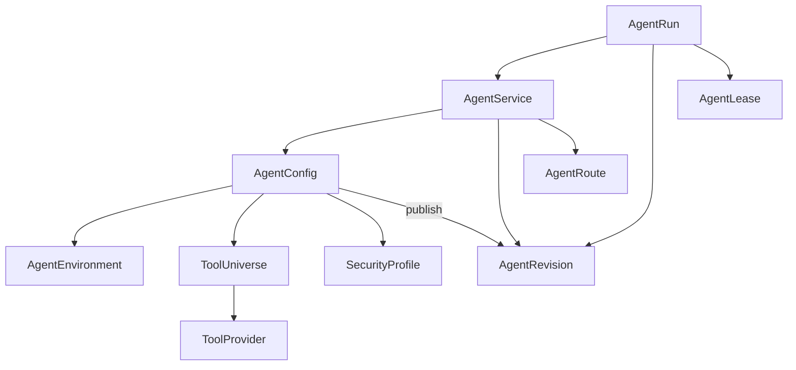

Not every arrow is a Kubernetes `ownerReference`.

`AgentRun` and `AgentLease` appear here as application records, not CRDs (AD-016).

Many are normal object references.

Shared resources such as:

```text
ToolUniverse
AgentEnvironment
SecurityProfile
```

must not be deleted simply because one consuming agent is deleted.

---

## 59. Operator Design

The operator should be deliberately boring.

It should reconcile desired infrastructure.

It should not implement business workflows.

For example:

```text
active leases > 0 (from the lease service)
    ↓
ensure runtime active

active leases = 0
    ↓
wait idle timeout
    ↓
ensure runtime stopped
```

Not:

```text
run agent
wait PR
check CI
ask reviewer
retry implementation
merge
```

The latter belongs in Restate.

> **Decision (2026-10-04, AD-023):** the first operator is deliberately smaller than this design: two CRDs, adam-rs agents, native Kubernetes, no leases and no scale-to-zero. It is specified in [§59a](#59a-operator-v0-adam-rs-agents); the text above stays the target.

---

## 59a. Operator v0: adam-rs agents

> **Status: design only (2026-10-04); slices S1 to S9 are built (2026-10-05, the blockquotes below).** Slice S0 is this text.

> **S1 built (2026-10-05):** the workspace, `aap-api`, `crdgen` and the examples, in [`crates/api`](../../crates/api/README.md) and [`bin/operator`](../../bin/operator/README.md). The `kind` job in CI is what proves the CEL rules against a real API server (*unverified* until it has run).

> **S2, S3 built (2026-10-05):** [`aap-domain`](../../crates/domain/README.md) with parity goldens against the adam-rs chart at `0391809` (*verified 2026-10-05*, `helm template`; the folder agent's golden is hand-written from its README, *verified by reading only*, because the chart renders `adam-coder` only) and [`aap-ports`](../../crates/ports/README.md) with its testkit. What this section leaves open, and where the crates deviate from it, is in their READMEs.

> **S4 built (2026-10-05):** [`aap-runtime-kubernetes`](../../crates/runtime-kubernetes/README.md): `RuntimeProvider` on native Kubernetes. It renders a `RuntimeSpec` into its objects (golden YAML of `examples/coder.yaml`, combined and split, and `examples/chat.yaml`), applies them by server-side apply under `aap-operator`, guards adoption, maps pods to `RuntimeStatus`, honours `deletionPolicy` on delete and watches the owned kinds. Proven locally against a fake API server (`tests/api.rs`); **the proof against a real API server is *unverified* until the `runtime-kubernetes` job of `operator.yml` has run**: no cluster was available where it was written. Where it differs from this section, and why, is in the crate's README (*Applying*, *Status*) and below, at *Owned objects*.

> **S5 built (2026-10-05):** [`aap-controller`](../../crates/controller/README.md) (the reconcilers over the two provider seams, kube-rs), [`aap-store-secret`](../../crates/store-secret/README.md) (the `StoreProvisioner` for a referenced Secret) and `operator run` in [`bin/operator`](../../bin/operator/README.md) (health 8081, metrics 9090, `WATCH_NAMESPACE`, no leader election). Proven against a fake API server that has list and watch (`crates/controller/tests`), and by `bin/operator/tests/cluster.rs` against **a bare kube-apiserver v1.35.8 and etcd, run by hand on 2026-10-05, with the test playing the controller manager**; **the proof with real pods, in kind (the `operator-e2e` job of `operator.yml`), is *unverified* until CI has run it** (no cluster, docker daemon or kubelet existed where S5 was written). The controller's README lists every place it differs from this section and why: the reasons of a condition that is `Unknown`, a spec a provider refuses (`ConfigResolved: False`), `Listed: RegistryDisabled` until S7, the timers and back-off, the owner handle passed in by the composition root, and **`aap-store-secret` not checking that a Secret exists**, because *Secrets and databases* below gives the operator no right on Secrets.

> **S6 built (2026-10-05):** [`aap-store-cnpg`](../../crates/store-cnpg/README.md): the `StoreProvisioner` for `store.postgres.cnpg`. It server-side applies a `postgresql.cnpg.io/v1` `Cluster` `<svc>-db` through the dynamic API (no CloudNativePG crate), reports the Secret reference `<svc>-db-app` / `uri` (never reading it), reads readiness from the Cluster's status, honours `deletionPolicy` on release, and maps a missing CloudNativePG API to `CNPGNotInstalled`; feature `store-cnpg` (default on) of `operator run`. Proven against a fake API server (`crates/store-cnpg/tests/api.rs`) and, for the missing-API case and its deletion, against a bare kube-apiserver v1.35.8; **the proof against a real CloudNativePG 1.30.1 in kind (the `store-cnpg` job of `operator.yml`) is *unverified* until CI has run it**. Where it differs from this section: the Cluster has **no owner reference** (data, as *Owned objects* says), a Cluster of that name that is not ours is `ConfigInvalid` (the store seam has no `NameConflict`), and a referenced Secret is served by the same provisioner. The crate's README has the facts checked (*verified 2026-10-05*).

> **S7 built (2026-10-05):** [`aap-registry`](../../crates/registry/README.md): the `agent-registry/v1` document builder and an axum router, served by `operator run` on 8080 (feature `registry`, default on; `REGISTRY_TOKEN_FILE`). One static bearer compared in constant time (`401` with no body, and **no token, no registry**: fail closed, and every service is `Listed: False`, reason `RegistryDisabled`), a strong `ETag` with `304`, `Cache-Control: private, max-age=30`, `Vary: Authorization`, `HEAD`, and `503` rather than a truncated document past 500 items or 1 MiB, when every service that would be listed is `Listed: False`, reason `RegistryFull` (a flag shared with the controller). A listed service is `Listed: True`, reason `Listed`. The document is read by **the system's own reader, vendored with its test vectors** (`crates/registry/tests/vendored`, at another-agentic-system `e5da0a4`; re-vendored at `8df44c6` by D8, see *D8 built* in §60a), with no item skipped, and by a property test over arbitrary entries. Proven against a fake directory and, host side, against a bare kube-apiserver v1.35.8; **a pod reading the registry and the card it lists, in kind (the `operator-e2e` job), is *unverified* until CI has run it**. Where it differs from this section: *Registry in v0* below, and the crate's README (*Deviations*).

> **S8 built (2026-10-05, *unverified* until CI has run it):** [`docker/operator/Dockerfile`](../../docker/operator/Dockerfile) (cargo-chef 0.1.77 on Rust 1.94.1, Debian trixie, onto `gcr.io/distroless/cc-debian13:nonroot`; both pinned by tag and digest, *verified 2026-10-05*; user 65532; only the `operator` binary), the chart [`deploy/operator`](../../deploy/operator/README.md), the chart [`deploy/operator-crds`](../../deploy/operator-crds/README.md) and [`.github/workflows/operator-image.yml`](../../.github/workflows/operator-image.yml). The chart has been **rendered, linted and checked with kubeconform and its own render checks, and not installed on a cluster**; the image has been **built by nobody**: no docker daemon existed where S8 was written, so the Dockerfile is only hadolint-clean and its smoke commands were run on the binary built on the host. Both are *unverified* until the workflow has run. Where it differs from *The operator chart* below is in the *Amended* note there.

> **S9 built (2026-10-05, *unverified* until CI has run it):** the kind end-to-end of the coder, the job `operator-coder-e2e` of [`operator-image.yml`](../../.github/workflows/operator-image.yml) and [`deploy/operator/tests/e2e/`](../../deploy/operator/tests/e2e/README.md). It installs the CRDs chart and the operator chart with the image built in the job (loaded into kind), applies `examples/coder.yaml` adapted (the real adam-rs coder image `sha-9a1fd4e` by tag and digest, *verified 2026-10-05*, anonymous pull; a Postgres the job runs behind `store.postgres.secretRef`; dummy Secrets), and asserts that the AgentService is `Ready`, that the coder's card answers through the Service from a pod, that the registry lists it, and that a deletion completes the finalizer and keeps the claim under `Retain`. **It proves the operator runs the real coder up to its startup checks; it proves no model call and no GitHub call, sends no task, and runs the token variant, not the GitHub App** (§59a's *Testing* asked for a throwaway App key: a key is a credential and the App is not what an operator-made pod differs in). The job has not run.

The first operator the platform ships. It is smaller than the design of §59 on purpose: it manages **adam-rs agents** (AD-022) from two CRDs, `AgentService` and `AgentConfig`, on native Kubernetes (AD-023), and it keeps secrets out of the custom resources (AD-024).

It exists because of one request from the owner (2026-10-04): *"that coder, I wanted to have a k8s operator to manage it automatically using CRDs"*. The owner's defaults, which this section follows:

- it lives in this repository, in Rust with kube-rs;
- the coder first, then folder agents;
- it runs next to the existing charts until it is proven.

What it does, in one paragraph: a controller reads an `AgentService` and the `AgentConfig` it names, validates them, resolves them into one neutral `RuntimeSpec` with a digest, and has a `RuntimeProvider` make a workload, a Service, a NetworkPolicy and storage for an adam-rs agent (`adam-coder` or `adam-agent`, one image). It reports conditions and a state, and it lists the agent in the [agent registry](../extensions/agent-registry-v1.md) (§12b). It reconciles infrastructure and nothing else, as §59 asks: no run, no workflow, no lease.

The adam-rs side is cited at revision `0391809`, the source of the coder image the netcup deployment pins (*verified 2026-10-04*, read at that revision in [vymalo/another-adam-rs](https://github.com/vymalo/another-adam-rs)): `deploy/coder/templates/statefulset.yaml`, `_validate.tpl`, `networkpolicy.yaml` and `extra-mcp-configmap.yaml` ([chart](https://github.com/vymalo/another-adam-rs/tree/0391809/deploy/coder/templates)), `bin/adam-coder/README.md` and `bin/adam-agent/README.md` ([environment tables](https://github.com/vymalo/another-adam-rs/blob/0391809/bin/adam-agent/README.md#configuration)), `docker/coder/Dockerfile` ([entrypoint](https://github.com/vymalo/another-adam-rs/blob/0391809/docker/coder/Dockerfile)).

### Workspace layout

One Cargo workspace in this repository. Crates are prefixed `aap-` (owner question in §93).

| Path | Crate | What |
|---|---|---|
| `crates/api` | `aap-api` | The CRD types only: kube `CustomResource` plus schemars, CEL rules, `fn crds()` |
| `crates/domain` | `aap-domain` | Pure: `validate`, `resolve` into a `ResolvedAgent` with a sha256 digest, and the mapping of `adam-coder` / `adam-agent` onto `aap_ports::RuntimeSpec`. **The env contract of the two binaries lives only here** |
| `crates/ports` | `aap-ports` | The traits `RuntimeProvider`, `StoreProvisioner`, `AgentDirectory` and their neutral types. Feature `testkit`: the conformance macros and `Memory` implementations |
| `crates/runtime-kubernetes` | `aap-runtime-kubernetes` | `RuntimeProvider` on native Kubernetes (§23) |
| `crates/store-secret` | | `StoreProvisioner` for a referenced Secret |
| `crates/store-cnpg` | `aap-store-cnpg` | `StoreProvisioner` for an operator-owned CloudNativePG `Cluster` (also serves a referenced Secret, so one type is the store) |
| `crates/registry` | `aap-registry` | The `agent-registry/v1` document builder and an axum router: bearer, `ETag` / `304`, `Cache-Control: private, max-age<=60`, `Vary` |
| `crates/controller` | | The reconcilers, generic over `<R: RuntimeProvider, S: StoreProvisioner>`: status, conditions, events, the finalizer, and an `AgentDirectory` backed by a reflector |
| `crates/testsupport` | | Fixtures and the API-server harness |
| `bin/operator` | | The composition root (AD-020). Features `runtime-kubernetes`, `store-cnpg`, `registry`; subcommands `run` and `crdgen`; ports 8080 (registry), 8081 (health), 9090 (metrics) |
| `deploy/operator` | | The Helm chart |
| `examples/` | | `coder.yaml`, `chat.yaml` |

Libraries: `kube` 4.0.0 (features `runtime`, `derive`), `k8s-openapi` 0.28.0, `schemars` 1 (*verified 2026-10-04*, kube-rs documentation). CEL rules through `x_kube(validation = …)` are *unverified*: S1 proves them against a real API server, and a rule that cannot be expressed moves into the reconciler's validation (below).

**AD-020 in practice.** No Kubernetes type appears in a trait signature. `RuntimeSpec` is made of neutral types (`EnvValue::{Literal, Secret(SecretRef), PodName}`, `VolumeSpec`, …). Ownership travels as an opaque `OwnerHandle` the controller got from the object, so a provider can set owner references without the controller knowing what they are. `RuntimeProvider::watch()` feeds the controller with the ids of runtimes that changed: the controller never watches StatefulSets itself. The trait is in [§22](05-runtime.md#22-runtimeprovider).

`RuntimeStatus` is `{ phase: Absent | Provisioning | Ready | Suspended | Failed, replicas, issues[] }` (the phases of §18), where an issue is `{ role, reason, message }` and the reason is one of:

| Issue reason | Means | Seen as |
|---|---|---|
| `ConfigRejected` | the agent process refused its configuration | exit code 78 |
| `DependencyUnavailable` | a dependency of the agent is unreachable (database, an MCP server) | exit code 69 |
| `MissingSecret{name}` | a referenced Secret or key does not exist | `CreateContainerConfigError` |
| `ImagePull` | the image cannot be pulled | `ErrImagePull`, `ImagePullBackOff` |
| `CrashLoop` | the container keeps exiting for another reason | `CrashLoopBackOff` (amended 2026-10-16: or a non-zero exit other than 78 and 69 of a container that has been restarted at least once, because between two restarts the kubelet can keep reporting the last exit, `Terminated` with reason `Error`, and not `CrashLoopBackOff`; a first exit and exit code 0 are no issue; *verified 2026-10-16*, CI run 38857024797 of `operator.yml`, job `runtime-kubernetes`, kindest/node v1.35.8: a pod running `sh -c "exit 1"` was `Terminated`, `Error`, exit code 1, restart count 5 after 240 s) |
| `NameConflict` | an object with the name the runtime needs exists and is not ours | adoption guard |

Exit codes 78 and 69 are adam's (`adam_service`: 0 clean shutdown, 78 configuration, 69 a dependency is unreachable; *verified 2026-10-04*, `bin/adam-agent/README.md`, "The process").

### The v0 CRDs

Group `agents.vymalo.com`, version `v1alpha1` (§62), **namespaced**. Two kinds. Where a field exists in §7 or §8 it keeps its name and meaning; the fields §7 and §8 draw that v0 does not implement are in [What v0 leaves out](#what-v0-leaves-out), and the fields v0 adds (`store`, `access`, `registry`, `deletionPolicy`, the inline `environment`, `tools` and `security`) are the ones adam-rs and the operator need today. A **secret is never a value** in either kind (AD-024): a field that needs one names a Secret and a key.

#### `AgentService`: the netcup coder

```yaml
apiVersion: agents.vymalo.com/v1alpha1
kind: AgentService
metadata: { name: coder, namespace: another-agentic-system }
spec:
  description: Coding task to verified pull request.
  configRef: { name: coder }
  interfaces:
    a2a:
      enabled: true
      bearerTokensSecretRef: { name: coder-secrets, key: A2A_BEARER_TOKENS }
      publicUrl: ""          # empty: http://<name>.<ns>.svc:8080/
    responses: { enabled: false }   # v0: CEL refuses true
    mcp: { enabled: false }         # v0: CEL refuses true
  scaling:
    topology: combined     # combined | split
    workers: 1
    front: { replicas: 1 } # split only; a PodDisruptionBudget when > 1
  suspend: false
  store:
    postgres:
      secretRef: { name: coder-db-uri, key: uri }
      # or an operator-owned CloudNativePG cluster:
      # cnpg: { instances: 1, storage: { size: 5Gi, storageClass: longhorn } }
  access:
    allowFrom:
      - namespaceSelector: { matchLabels: { kubernetes.io/metadata.name: another-agentic-system } }
  registry: { title: Coder, tags: [coding, git] }
  deletionPolicy: Retain   # Retain | Delete
```

#### `AgentConfig`: the netcup coder

```yaml
apiVersion: agents.vymalo.com/v1alpha1
kind: AgentConfig
metadata: { name: coder, namespace: another-agentic-system }
spec:
  harness:
    type: adam-rs
    adam:
      binary: adam-coder         # adam-coder | adam-agent
      agent: { embedded: {} }
      coder:
        workers: 4
        maxCheckCycles: 3
        checkTimeoutSecs: 900
        workspaceSweepSecs: 300
        workspacePlacement: ""   # "" | shared | affinity | isolated
        allowedRepoHosts: [github.com]
        githubApiUrl: https://api.github.com
        prDraft: true
        gitAuthor: { name: "bored-giant-panda[bot]", email: "337696346+bored-giant-panda[bot]@users.noreply.github.com" }
        createRepoOwners: []
        opencodeModel: coding-model
        github:
          app:
            id: Iv23li4m1ZrQ8wdwjnQH       # the App's client ID: public, not a secret
            owners: [vymalo]               # or installationId: 12345 (exactly one of the two)
            privateKeySecretRef: { name: coder-github-app, key: private-key.pem }
          # token: { secretRef: { name: coder-secrets, key: GITHUB_TOKEN } }   # instead of app, never both
  model:
    model: coding-model
    baseUrl: { secretRef: { name: coder-secrets, key: MODEL_BASE_URL } }   # or { value: https://…/v1 }
    apiKeySecretRef: { name: coder-secrets, key: MODEL_API_KEY }
  tools:
    githubMcp: { sidecar: true, port: 8082, host: "" }
    mcpServers:
      websearch:
        url: http://another-agentic-websearch.another-agentic-system.svc:8080/mcp
        headers:
          Authorization: { prefix: "Bearer ", secretRef: { name: coder-secrets, key: SEARCH_MCP_TOKEN } }
        optional: true
      context7:
        url: https://mcp.context7.com/mcp
        headers:
          Authorization: { prefix: "Bearer ", secretRef: { name: coder-secrets, key: CONTEXT7_API_KEY } }
        optional: true
    allowInsecureHttp: true
  environment:
    image: { ref: ghcr.io/vymalo/another-adam-rs/coder:sha-0391809@sha256:814d8ee329a5e4d8634e8a82532c035999c4be27aac086508b742a635449ea40 }
    resources: { requests: { cpu: 500m, memory: 1Gi }, limits: { memory: 6Gi } }
    volumes:
      - name: work
        scope: agent
        mountPath: /work
        source: { persistent: { size: 20Gi, storageClass: longhorn, perReplica: true } }
    terminationGracePeriodSeconds: 120
  security: { runAsUser: 10001, runAsGroup: 10001, fsGroup: 10001, fsGroupChangePolicy: OnRootMismatch }
  extraEnv: {}
```

The model alias is a placeholder here: the real alias is the deployment's. The gateway URL is a Secret key in this example because the netcup deployment keeps it out of git (adam-rs `config.modelBaseUrlFromSecret`); a plain `value` is the other form.

#### A folder agent: `chat`

An agent that is only a folder (the `adam-agent-folder` case) needs the same two kinds and no volume. The service:

```yaml
apiVersion: agents.vymalo.com/v1alpha1
kind: AgentService
metadata: { name: chat, namespace: another-agentic-system }
spec:
  description: A chat assistant.
  configRef: { name: chat }
  interfaces:
    a2a:
      enabled: true
      bearerTokensSecretRef: { name: chat-secrets, key: A2A_BEARER_TOKENS }
  scaling: { topology: combined, workers: 1 }
  store:
    postgres:
      secretRef: { name: chat-db-app, key: uri }   # the system chart's CNPG Secret of the `agent` database
  registry: { title: Chat, tags: [chat] }
```

and its config:

```yaml
apiVersion: agents.vymalo.com/v1alpha1
kind: AgentConfig
metadata: { name: chat, namespace: another-agentic-system }
spec:
  harness:
    type: adam-rs
    adam:
      binary: adam-agent
      agent:
        folder:
          files:                                  # relative path -> content; mounted at /etc/adam/agent (ADAM_AGENT_DIR)
            instructions.md: |
              ---
              name: chat
              description: A chat assistant.
              card:
                name: Chat
              ---
              Your name is Chat.
              In one sentence: I talk things through with you.
          # or: configMapRef: { name: chat-agent }   (exactly one of files and configMapRef)
  model:
    model: chat-model
    baseUrl: { value: https://gateway.example.invalid/v1 }
    apiKeySecretRef: { name: chat-secrets, key: MODEL_API_KEY }
  tools:
    allowInsecureHttp: true     # the orchestrator's thread tools are plain http on another host, inside the cluster
  environment:
    image: { ref: "ghcr.io/vymalo/another-adam-rs/coder:sha-0391809@sha256:<digest>" }   # tag and digest
    resources: { requests: { cpu: 100m, memory: 256Mi }, limits: { memory: 512Mi } }
```

There is no `volumes`, so the operator renders a Deployment. `files` is the whole folder inline, and ConfigMaps hold 1 MiB, which is the folder's size limit in v0. A path with a `/` in it (`skills/…`) is stored under a mangled ConfigMap key and mounted at its path with `items`. The adam-agent folder format is [`docs/authoring.md`](https://github.com/vymalo/another-adam-rs/blob/0391809/docs/authoring.md) in adam-rs.

#### Validation

Two layers, so a bad object is refused at the earliest place that can know.

- **CEL on the CRD** (shape, no other object needed): `interfaces.responses.enabled` and `interfaces.mcp.enabled` must be `false` in v0; exactly one of `store.postgres.secretRef` and `store.postgres.cnpg`; exactly one of `github.app` and `github.token`; exactly one of `app.installationId` and `app.owners`; exactly one of `agent.folder.files` and `agent.folder.configMapRef`, and exactly one of `folder` and `embedded`; `binary: adam-coder` needs `embedded` and the `coder` block, `binary: adam-agent` needs `folder` and no `coder` block; `scaling.front` only with `topology: split`.
- **The reconciler** (`aap-domain::validate`, cross-object, reported as `ConfigInvalid`): the rules of the adam-rs chart's [`_validate.tpl`](https://github.com/vymalo/another-adam-rs/blob/0391809/deploy/coder/templates/_validate.tpl), mirrored so the same mistakes fail the same way: a placement is one of `""`, `shared`, `affinity`, `isolated` (`a2a-only` is refused for the coder); more than one worker needs a placement; `shared` and `affinity` need the `work` volume to be a single ReadWriteMany claim (`perReplica: false`) and `isolated` needs it per replica; `githubMcp.port` is 1 to 65535; an MCP server URL is `http` or `https`, with no user name, password or `${…}` in it; a header name is an HTTP token and its prefix is plain text; a plain `http://` URL to another machine needs `tools.allowInsecureHttp` (adam refuses such a server at startup otherwise); `extraEnv` may not name a variable the operator sets.

### What each field becomes

The field-to-environment contract. It is the only place in the operator that knows adam's variable names (`aap-domain`); the parity goldens (below) hold it equal to what the adam-rs chart renders. Variable names and meanings are those of `bin/adam-coder/README.md` and `bin/adam-agent/README.md` (*verified 2026-10-04*, revision `0391809`).

| Field | Becomes | Notes |
|---|---|---|
| `AgentService.spec.interfaces.a2a.bearerTokensSecretRef` | `A2A_BEARER_TOKENS` from `secretKeyRef` | Not set on a worker of `split`. No token, no server (the agent fails closed) |
| `…a2a.publicUrl` | `PUBLIC_URL` | Empty: `http://<name>.<ns>.svc:8080/`. Not set on a worker of `split` |
| `…scaling.topology` | `ROLE` | `combined`: unset (the binary runs `all`). `split`: `control-plane` on `<svc>-front`, `worker` on the StatefulSet or Deployment `<svc>` |
| `…scaling.workers` | replicas of `<svc>` | The adam *workers* as pods. Not the `WORKERS` variable (below) |
| `…scaling.front.replicas` | replicas of `<svc>-front` | `split` only |
| `…suspend` | replicas 0, `runtime.phase: Suspended` | The only scale-to-zero in v0 |
| `…store.postgres.secretRef` | `DATABASE_URL` from `secretKeyRef` | |
| `…store.postgres.cnpg` | `DATABASE_URL` from `<svc>-db-app`, key `uri` | The Secret CloudNativePG makes for the cluster `<svc>-db` |
| `…access.allowFrom` | NetworkPolicy `<svc>`, ingress on 8080 | No egress rule: the agent needs git hosts, the model gateway and registries |
| `…registry`, `…description`, `…access.audience` | the registry item (`title`, `tags`, `service`, and since D3 `audience`) | Nothing reaches the pod |
| `…deletionPolicy` | the finalizer's behaviour | [Finalizer](#finalizer-and-deletion) |
| `AgentConfig…adam.binary` | the container command | `adam-coder`: the image's entrypoint. `adam-agent`: `tini -- adam-agent` (the image says so in its `Dockerfile`) |
| `…adam.agent.folder` | `ADAM_AGENT_DIR=/etc/adam/agent`, a ConfigMap `<svc>-agent-<hash8>` mounted read-only | `files` gives the ConfigMap, `configMapRef` mounts the named one. `embedded` sets nothing |
| `…adam.coder.workers` | `WORKERS` | Runs advanced at once, per process |
| `…coder.maxCheckCycles`, `checkTimeoutSecs`, `workspaceSweepSecs` | `MAX_CHECK_CYCLES`, `CHECK_TIMEOUT_SECS`, `WORKSPACE_SWEEP_SECS` | |
| `…coder.workspacePlacement` | `WORKSPACE_PLACEMENT`, and `WORKER_ID` from `metadata.name` for `affinity` and `isolated` | `""`: not set. `WORKSPACE_ROOT` is the mount path of the volume `work` |
| `…coder.allowedRepoHosts`, `githubApiUrl`, `prDraft` | `ALLOWED_REPO_HOSTS` (comma-joined), `GITHUB_API_URL`, `PR_DRAFT` | |
| `…coder.gitAuthor` | `GIT_AUTHOR_NAME`, `GIT_AUTHOR_EMAIL` | |
| `…coder.createRepoOwners` | `CREATE_REPO_OWNERS` (comma-joined) | Not set when empty: the tool stays off |
| `…coder.opencodeModel` | `OPENCODE_MODEL` | |
| `…coder.runPods.sizeClass` (D15a) | `RUN_ENVIRONMENT=kubernetes` and seven `RUN_POD_*` variables, the template (a ConfigMap `<svc>-run-pod` mounted at `/etc/adam/run-pod`, `RUN_POD_TEMPLATE_FILE`), the account the workers run as with its token, a `ResourceQuota`, a `NetworkPolicy` and a `RoleBinding` `<svc>-run-pods`, and a ConfigMap `<svc>-run-pods-policy` for the chart's admission policy | Absent: none of it, and the digest does not move. The class is a key of the operator chart's `runPodClasses`; the rest is the deployment's (*D15a built*) |
| `…coder.github.app.id`, `owners`, `installationId` | `GITHUB_APP_ID`, `GITHUB_APP_OWNERS`, `GITHUB_APP_INSTALLATION_ID` | Exactly one of the last two |
| `…coder.github.app.privateKeySecretRef` | a Secret volume at `/var/run/secrets/github-app` (mode 0440) and `GITHUB_APP_PRIVATE_KEY_PATH` | The key is a file, never a variable. See the gap in AD-024 |
| `…coder.github.token.secretRef` | `GITHUB_TOKEN` from `secretKeyRef` | Not with `app` |
| `…model.model` | `MODEL` | |
| `…model.baseUrl` | `MODEL_BASE_URL`, a value or a `secretKeyRef` | |
| `…model.apiKeySecretRef` | `MODEL_API_KEY` from `secretKeyRef` | |
| `…tools.githubMcp` | a native sidecar `github-mcp`, `GITHUB_MCP_URL=http://127.0.0.1:<port>`, and `GITHUB_HOST` on the sidecar when `host` is set | The sidecar holds no credential: the coder sends the credentials of each call. Loopback only |
| `…tools.mcpServers` | a ConfigMap `<svc>-mcp` (`mcp.json`, mounted at `/etc/adam/extra-mcp`), `ADAM_EXTRA_MCP_FILE`, and one variable per header Secret | The file holds `${VAR}` references only. The variable is named by the Secret key (`SEARCH_MCP_TOKEN`), and the file refers to it |
| `…tools.allowInsecureHttp` | `MCP_ALLOW_INSECURE=true` | Covers every MCP server of the agent and the endpoints a sender announces. Never automatic |
| (fixed for `adam-coder`) | `MCP_ALLOW_STDIO=true` | Parity with the chart, which keeps it for one release for folders written before the GitHub server became a sidecar. Not set for `adam-agent` |
| (fixed) | `LISTEN_ADDR=0.0.0.0:8080` | |
| `…environment.image`, `resources` | the container's image and resources | The sidecar has its own small defaults |
| `…environment.volumes` | volume mounts, a `volumeClaimTemplate`, or the shared claim | [Owned objects](#owned-objects) |
| `…environment.terminationGracePeriodSeconds` | the pod's | |
| `…security` | the pod's `securityContext` (`runAsUser`, `runAsGroup`, `fsGroup`, `fsGroupChangePolicy`) | Everything else of the security context is fixed, below |
| `…extraEnv` | literal variables | Names only the adam binaries do not own; never a secret |

The only variables that carry a secret are the ones the adam binaries know (`MODEL_API_KEY`, `A2A_BEARER_TOKENS`, `GITHUB_TOKEN`, `DATABASE_URL`, `MODEL_BASE_URL` when it is a Secret key) and the ones the extra MCP file names. The operator never invents a secret variable.

### Reconciliation

One controller per kind. The `AgentConfig` controller validates the object and sets its `Valid` condition. The `AgentService` controller does the work: it is triggered by its own object, by `RuntimeProvider::watch()`, and by a change of an `AgentConfig` (mapped to every service that references it).

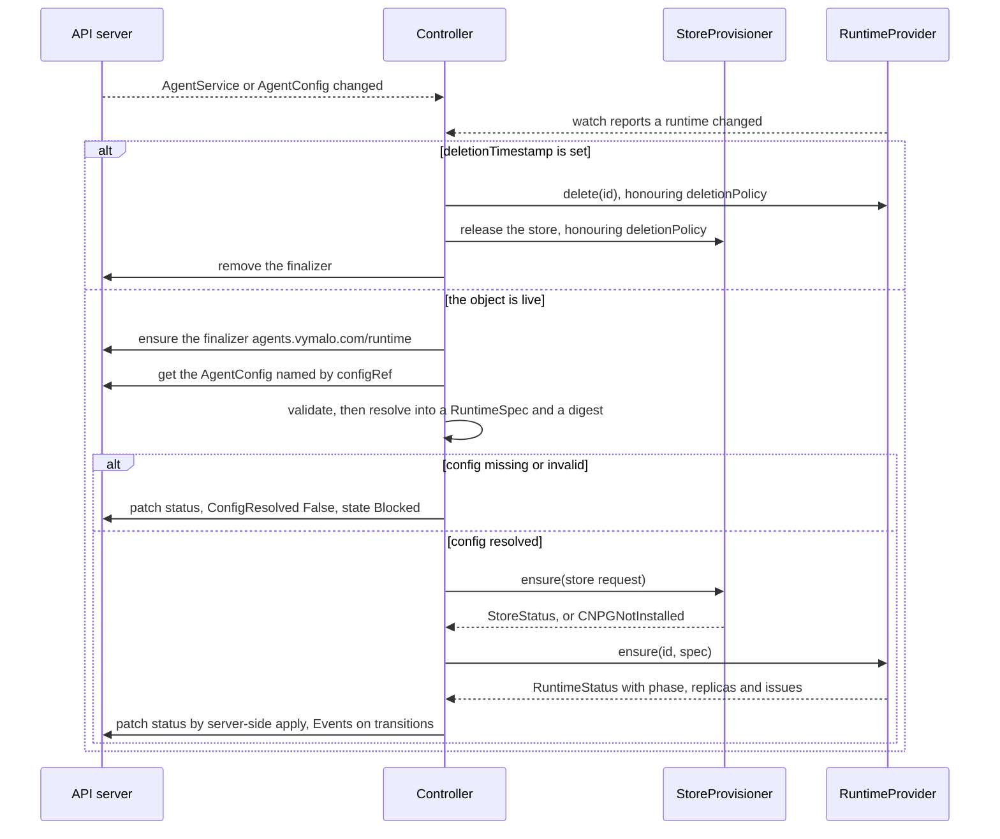

The state the controller derives and writes to `status.state` (§88), with the phase of the runtime beneath it (§18):

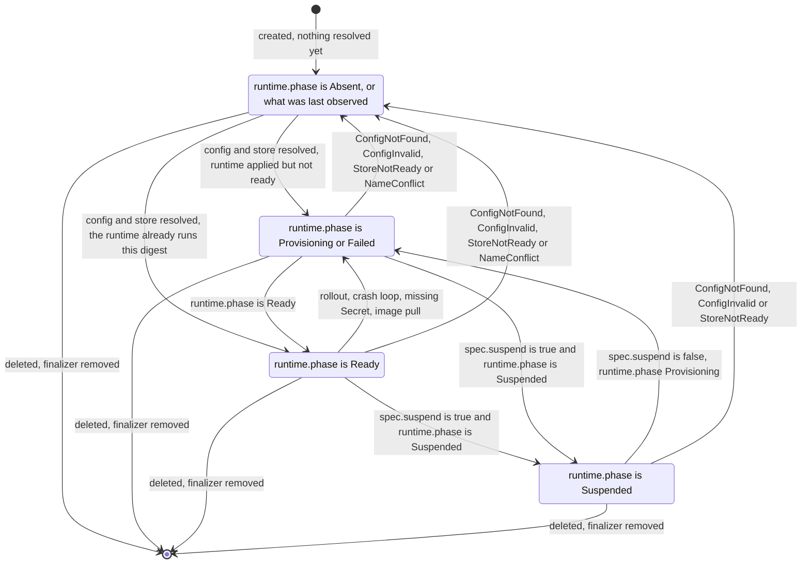

The rule, in order: a false `ConfigResolved` or `StoreReady`, or a `NameConflict` issue, is `Blocked` (the operator did not apply the desired state, and **it leaves what runs untouched**); `spec.suspend` with phase `Suspended` is `Suspended`; phase `Ready` is `Ready`; anything else is `Degraded`, and the reason says which (`Provisioning` for a rollout in progress, or the issue's reason). As in §88, the service state is distinct from the runtime's: `Suspended` is healthy.

Steps of one pass:

1. **Finalizer** `agents.vymalo.com/runtime`, added before anything is created.
2. **Fetch and validate the config.** `ConfigNotFound` or `ConfigInvalid`, with the cross-object rules above.
3. **Ensure the store.** A referenced Secret needs nothing; `cnpg` makes the Cluster `<svc>-db`, whose Secret `<svc>-db-app` (key `uri`) is the connection string. `CNPGNotInstalled` when the CloudNativePG API is absent.
4. **Resolve, then `RuntimeProvider::ensure`.** `resolve` turns the two objects into a `ResolvedAgent`: the `RuntimeSpec` and its sha256 digest. The pods are annotated `agents.vymalo.com/config-digest`, so a changed folder, MCP file, image or variable is a rollout (adam reads its files at startup only).
5. **Patch the status** by server-side apply, and emit Events on transitions.

#### Owned objects

Applied by server-side apply under the field manager `aap-operator`, each labelled `app.kubernetes.io/managed-by: aap-operator` (and `app.kubernetes.io/instance: <svc>`, which the adoption guard checks too).

*Amended 2026-10-05 (S4):* this said `agents.vymalo.com/operator` and `agents.vymalo.com`. The S4 brief names `aap-operator` for both, which is what [`aap-runtime-kubernetes`](../../crates/runtime-kubernetes/README.md) writes (`names::FIELD_MANAGER`, `names::MANAGED_BY_VALUE`); a Helm release's `managed-by` is its tool's name, and this one is ours in the same style. One constant each to change if the owner prefers the first. **Every apply is forced** (this section said nothing about `force`): the provider is the one writer of the fields it sets and moves `replicas` itself on `suspend`, so a conflict with its own earlier patch or a `kubectl scale` must be resolved by taking the field back, and the adoption guard, which runs before any apply, is what protects objects that are not ours.

| Object | Name | When |
|---|---|---|
| StatefulSet | `<svc>` | A `perReplica` persistent volume exists: its `volumeClaimTemplate` is named after the volume (`work`) |
| Deployment | `<svc>` | Otherwise |
| Deployment, PodDisruptionBudget | `<svc>-front` | `topology: split` (the budget when the front has more than one replica) |
| Service | `<svc>` | Always: port 8080, selecting the front in `split` |
| ConfigMap | `<svc>-agent-<hash8>` | Folder `files`: immutable, named by the first 8 hex digits of its content hash; superseded ones are deleted after the rollout |
| ConfigMap | `<svc>-mcp` | `tools.mcpServers`: the extra MCP file, `${VAR}` references only |
| NetworkPolicy | `<svc>` | `access.allowFrom`: ingress on 8080, no egress rule |
| PersistentVolumeClaim | `<svc>-work` | Placement `shared` or `affinity`: one ReadWriteMany claim for all workers |
| Cluster (CloudNativePG) | `<svc>-db` | `store.postgres.cnpg` |

Compute objects carry an owner reference to the `AgentService` (through the `OwnerHandle`). **Data objects do not** (the claim `<svc>-work`, the Cluster `<svc>-db`, and the claims a StatefulSet makes): garbage collection must not take them with the service, so the finalizer deletes them explicitly, and only under `deletionPolicy: Delete`.

**Pod template.** The same as the adam-rs chart's `statefulset.yaml` (*verified 2026-10-04*, revision `0391809`), so the workload that replaces a Helm release behaves like it:

- no service-account token (`automountServiceAccountToken: false`); `runAsNonRoot`, uid and gid from `security` (10001 for the adam image), `seccompProfile: RuntimeDefault`; every container drops all capabilities and refuses privilege escalation;
- `/healthz` startup, liveness and readiness probes on the `http` port, with the chart's periods;
- the `github-mcp` sidecar as a **native sidecar** (an init container with `restartPolicy: Always`), probed by an `exec` startup probe on loopback, because the kubelet's TCP probe connects to the pod IP and the server listens on loopback only (adam-rs #86);
- `WORKER_ID` from the downward API (`metadata.name`) when the placement pins runs to a worker;
- the annotation `agents.vymalo.com/config-digest`, and `OrderedReady` with `RollingUpdate` for the StatefulSet.

The goldens in *Testing* hold the parity, not this list.

#### Adoption guard

The operator never takes over an object that has the name it needs but not its `managed-by` label: it reports `NameConflict` (a `RuntimeStatus` issue, so `state: Blocked`) and changes nothing. This is what makes running next to an existing Helm release safe: a Helm object carries `app.kubernetes.io/managed-by: Helm`, so the operator waits until that release's object is gone (*Rollout on netcup*).

#### Finalizer and deletion

Deleting an `AgentService` runs `RuntimeProvider::delete` and releases the store, as the sequence above shows, then removes the finalizer. `deletionPolicy` decides what happens to data:

- `Retain` (default): the compute (workloads, Service, NetworkPolicy, ConfigMaps) is removed; the work volumes and an operator-owned database stay, with their labels, so an `AgentService` of the same name later finds them again (the adoption guard accepts its own label).
- `Delete`: the data goes too.

The policy reaches the provider and the provisioner in their neutral spec types, so `delete(id)` has what it needs without a Kubernetes type in its signature.

#### Status

```yaml
status:
  observedGeneration: 3
  state: Ready                 # Ready | Degraded | Suspended | Blocked
  config: { name: coder, observedGeneration: 7, digest: "sha256:…" }
  runtime: { provider: kubernetes, phase: Ready, replicas: 1 }
  endpoints:
    a2a: http://coder.another-agentic-system.svc:8080/
    agentCard: http://coder.another-agentic-system.svc:8080/.well-known/agent-card.json
  conditions:
    - { type: ConfigResolved, status: "True", reason: Resolved }
    - { type: StoreReady, status: "True", reason: SecretReferenced }
    - { type: RuntimeReady, status: "True", reason: Ready }
    - { type: Listed, status: "True", reason: Listed }
    - { type: Ready, status: "True", reason: Reconciled }
```

| Condition | `True` reason | `False` reasons |
|---|---|---|
| `ConfigResolved` | `Resolved` | `ConfigNotFound`, `ConfigInvalid` |
| `StoreReady` | `SecretReferenced`, `ClusterReady` | `CNPGNotInstalled`, `ClusterNotReady` |
| `RuntimeReady` | `Ready` | `Provisioning`, `Suspended`, `MissingSecret`, `ConfigRejected`, `DependencyUnavailable`, `ImagePull`, `CrashLoop`, `NameConflict` |
| `Listed` | `Listed` | `A2ADisabled`, `ServiceBlocked`, `RegistryFull`, `RegistryDisabled` |
| `Ready` | `Reconciled` | the reason of the first false condition above, in this order |

`Ready` is true when the first three are; `Listed` informs and does not gate it, so a full registry never makes an agent unready. The runtime reasons come from pod status: `CreateContainerConfigError` is `MissingSecret`, an exit with code 78 is `ConfigRejected`, 69 is `DependencyUnavailable`, `ImagePullBackOff` is `ImagePull`. Because the operator has **no RBAC on Secrets**, it cannot check that a referenced Secret exists: the kubelet's answer in the pod's status is how it learns. `status.config.digest` is the seed of AgentRevision (§9): the digest a revision would record as its `configurationDigest`, with nothing yet that publishes or promotes it.

#### Secrets and databases

- **References only (AD-024).** A custom resource names a Secret and a key; the operator copies a reference into the pod spec as a `secretKeyRef`, and never reads or writes a value. It has no RBAC on Secrets and creates no ExternalSecret. The conformance macros include "no secret value ever materialises": no `RuntimeSpec`, status, Event, log line or ConfigMap holds one.
- **Two store modes** behind the `StoreProvisioner` seam (AD-020): `secretRef` (a Secret someone else owns) and operator-owned `cnpg` (a `Cluster` `<svc>-db` per service, owned by it, data kept by `Retain`). "A `Database` in someone else's Cluster" is deferred: server-side-apply co-ownership of that Cluster's `managed.roles` is *unverified*, and the operator must not fight the Cluster's owner for the field.
- **`store` sits on `AgentService`, not on `AgentConfig`** (owner question in §93): a config can be shared by services, and two services must not share a ledger. adam keys a run by the agent's name, and several processes with the same name are replicas of one agent (*verified 2026-10-04*, `bin/adam-agent/README.md`, "Several agents, one database").

### Registry in v0

The operator binary serves `GET /registry/v1/agents` ([§12b](03-interfaces.md#12b-agent-registry), [the contract](../extensions/agent-registry-v1.md)) from the cache of its own reflector, through the `AgentDirectory` trait, until a control plane exists. The document has one item per service that has A2A enabled and is not `Blocked`: `href` is `status.endpoints.agentCard`, `service` the object's name, `title` and `tags` from `spec.registry` and, since D3, `audience` from `spec.access.audience` (a sorted set; none and `[]` are no attribute: [§60a](#who-may-use-an-agent-ad-028)), in name order, with the linkset headers of the contract, an `ETag` over the document (`304` on a match), `Cache-Control: private, max-age=30` and `Vary: Authorization`.

Deviations from the contract and from §12b, all of them v0 only:

| The contract | v0 |
|---|---|
| Served by the control plane | Served by the operator binary (feature `registry`, port 8080, ClusterIP); no ingress |
| The platform API's bearer token, `401` or `403`, the list filtered per caller (`agent.invoke`, §52) | **One static bearer** read from a file and compared in constant time; `401` only; **no per-caller filtering**, every holder sees every listed service. Open question in §93 |
| `max-age` of 60 seconds or less | 30 |
| At most 500 items and 1 MiB; a client never truncates | The operator **refuses rather than truncates**: past either limit it answers `503` and every service gets `Listed=False` `RegistryFull` |
| HTTPS outside a trusted cluster network, rate limiting | In-cluster plain HTTP behind a NetworkPolicy; no rate limit |
| The card is served by the control plane, so it never wakes compute | The agent serves its own card (adam does), and nothing scales to zero yet (below), so nothing wakes |
| Releases on each card (§12a) | No release-channels extension in v0 |

*Amended 2026-10-05 (S7), what the built registry does where this section is silent:* the token is read once from the file named by `REGISTRY_TOKEN_FILE` (a mounted Secret) and **no usable token means no registry** (the port is not opened, every service is `Listed: False`, reason `RegistryDisabled`, and the operator keeps reconciling); a request before the reflector has synced is `503`, never an empty list; `RegistryFull` reaches the services through a flag the registry sets and the controller reads, so it lands at the service's next pass (at most one resync later), and only on services that would otherwise be listed; a service name used in two namespaces is listed once (the contract forbids a duplicate `service`); a card URL that a reader would skip (not absolute `http(s)`, or with credentials) is not listed; `anchor` is sent when `REGISTRY_PUBLIC_URL` is set. The crate's README has the whole table.

**The agent token rule.** A consumer sends one token to every agent a registry lists; another-agentic-system names it `AGENT_REGISTRY_AGENT_TOKEN` (its `orch-registry-platform` crate, *verified 2026-10-04*, `orchestrator/crates/registry-platform/README.md` in [vymalo/another-agentic-system](https://github.com/vymalo/another-agentic-system)). For that to work, the token must be one of each listed service's `A2A_BEARER_TOKENS`. The operator cannot check it (no Secret RBAC), so it is a deployment rule, and the consumer test of the registry crate does **not** cover it (it reads the document and knows nothing of tokens): nothing in the operator can check it, because it has no right on Secrets.

### What v0 leaves out

Each item is additive later, and the third column says how it stays so.

| Left out | Why | Stays additive because |
|---|---|---|
| `AgentRevision`, channels, the release-channels card extension | Nothing consumes them yet. adam's ledger is keyed by the agent name, so revisions running side by side would share or fork one ledger. adam serves the card itself | `status.config.digest` is already the content of a revision |
| `minReplicas`, `maxReplicas`, `idleTimeout`, leases, scale-to-zero | They need a lease service, an activator and a control-plane card, and the coder's workers keep stepping a run after the A2A call returns, so no HTTP-bound signal means "idle" | `spec.suspend`, the phase `Suspended` and a reserved capability exist. adam's store has run leases (`lease_until`) for v1 (open question in §93) |
| `interfaces.responses` and `interfaces.mcp` | adam serves A2A only | The fields exist, and CEL refuses `true` |
| `AgentEnvironment`, `ToolUniverse`, `ToolProvider`, `SecurityProfile`, `AgentRoute`, `authorization.policyRef` | They are reuse mechanisms, and nothing is shared yet | The inline `environment`, `tools` and `security` have the shape of those CRDs' specs, so a later `*Ref`, exclusive with the inline form, is additive |
| An admission webhook | It needs cert-manager | CEL on the CRD plus validation in the reconciler cover v0 |
| Per-caller registry filtering | There is no platform API yet | The registry is behind `AgentDirectory`; the filter joins when the control plane serves it |
| Credential broker, SPIFFE | §39 and §40 are not built | AD-024 records the gap; the broker is designed in §39a (AD-042), still not built |

*Amended 2026-10-15 (D1, resolved by D2):* of these, a v0 `ToolProvider` (one remote MCP server) is now built, with `ModelEndpoint`, which was never on the list: both are named from an `AgentConfig` by an exclusive `*Ref` field, as the row says, and §60a, *What the custom resources gain*, has them. The rest stay out.

### Testing

- `aap-domain`: table tests, and **parity goldens**: what the adam-rs chart renders for the same inputs, vendored into this repository with the adam-rs commit they came from.
- Render goldens of the owned objects, checked with kubeconform in strict mode.
- Reconciler unit tests with `tower_test::mock` and the `Memory` implementations of the ports.
- The conformance macros of `aap-ports` (`testkit`), run by every provider and provisioner, including "no secret value ever materialises".
- An envtest-like harness: a real kube-apiserver and etcd, for the CRDs, the CEL rules and server-side apply.
- The registry contract tests, and a **consumer test** that reads the document with another-agentic-system's `orch-registry-platform` parser.
- A kind end-to-end in CI: a stub agent; `adam-agent` with a WireMock model; and the coder with a throwaway GitHub App key.

*Amended 2026-10-05 (S9):* the stub agent is `bin/operator/tests/stub` (S5, in `operator.yml`); the coder's end-to-end runs the real image with a **dummy GitHub token** and a model address nothing answers, because the pod only needs to start (a dummy key would be refused when parsed, a real one is a credential); `adam-agent` with a WireMock model is not built (the stub stands for it).

### The operator chart

`deploy/operator`, next to the existing charts until the operator is proven.

- `kubeVersion: ">=1.29"`, for the native sidecar of the pod template (*unverified* that sidecar containers are on by default from 1.29, and that netcup's cluster is that new, see *Risks*).
- The image `ghcr.io/vymalo/another-agentic-platform/operator`, tag `sha-0000000` until CI bumps it (`bump-tag.sh`); built with cargo-chef onto a distroless base, non-root 65532.
- Values: `crds.install`, `watchNamespace`, the registry's settings and the Secret (or ExternalSecret) of its bearer token.
- **One replica, `Recreate`, no leader election.** A second reconciler would only race the first; the cost is a short gap in reconciling during an upgrade, and a running agent is not touched by it.
- A namespaced `Role`: the two kinds and their `status` and `finalizers`, the owned kinds, `pods` for status, `events`, and the CloudNativePG `Cluster` when `store-cnpg` is built in. **No right on Secrets.**
- Render checks, goldens, vendored schemas, as in the other charts of the family.
- CI: `rust.yml` (fmt, clippy, test, deny, MSRV, a check that the generated CRDs match the committed ones) and `operator.yml` (helm, kubeconform, hadolint, build, then the kind end-to-end, then push the image that passed, then the bump job).

*Amended 2026-10-05 (S8), what the built chart does where this section is silent or differs:*

- **The CRDs are not in this chart** (§93, decided the same day: a separate Argo CD app), so there is no `crds.install`. They are the chart `deploy/operator-crds`, which holds a copy of `deploy/crds` read with `.Files` (a Helm chart reads only its own directory) and which `render-check.sh` and `cargo test -p aap-operator` hold equal to it.
- **The workflows**: `operator.yml` is the Rust and cluster half and was not changed in what it runs; the image, the chart checks, the push and the bump are their own workflow, `operator-image.yml` (the shape of adam-rs's `coder.yml`). No `cargo deny` or MSRV job is in either: neither is part of S8.
- **Values**: `watchNamespace` (empty: the release's namespace; the `Role` and `RoleBinding` are made in the watched namespace; **no value gives the operator a `ClusterRole`**), `storeCnpg` (the right on CloudNativePG `Cluster`s, on by default because the image is built with the feature), `registry.tokenSecret` or `externalSecrets` (the system chart's style: `ssegning-aws`, `prod/another-agentic/env`, one property, default `agent_registry_token`), `networkPolicy` (below) and `tuning` for the three timers and the concurrency. There is no `replicaCount` (a value of that name is refused) and no `values.schema.json`: neither sibling chart has one, and `_validate.tpl` refuses what would deploy something other than what is said.
- **The registry**: without a token the chart renders no `REGISTRY_TOKEN_FILE`, no port 8080 and no registry Service, as the binary serves none. With one, the token is a file (mode 0440, `fsGroup` 65532), never an environment variable; it is read once, so a rotation is a pod restart.
- **The NetworkPolicy** (not in this section): ingress is closed except the registry to the peers of `networkPolicy.registry.allowFrom` (required while there is a token: an empty list is refused) and `/metrics` to those of `networkPolicy.metrics.allowFrom`; egress is the API server's ports (443 and 6443, optionally only given addresses) and nothing else. Kubelet probes come from the node, which a NetworkPolicy never blocks.
- **The pod**: `runAsNonRoot` 65532, `seccompProfile: RuntimeDefault`, no privilege escalation, every capability dropped, a read-only root filesystem (the binary writes no file: *unverified* until it runs in kind), `Recreate`, one replica.
- **The image** is built on Debian 13, not on the `rust` image of adam-rs, and pushed as `sha-<7>` and `latest`; the tag the chart pins is `sha-<7>` and is written by `bump-tag.sh` only. A new GHCR package is private until made public (owner step, in the chart's README).

### Rollout on netcup

Next to the existing charts, one step at a time. The coder stays on its Helm chart until M3.

| Step | What |
|---|---|
| M0 | In home-os, an app for the CRDs (project `infrastructure`, source `deploy/operator-crds` of this repository, `ServerSideApply=true`) and an app for the operator (project `another-agentic`, source `deploy/operator`, namespace `another-agentic-system`, with the values of [`examples/netcup.values.yaml`](../../deploy/operator/examples/netcup.values.yaml) as `helm.valuesObject`; `image.tag` is bumped on `main` by CI and is not set there). Before it: the AWS property `agent_registry_token` in `prod/another-agentic/env` (random, at least 32 bytes), and the package `ghcr.io/vymalo/another-agentic-platform/operator` made public once the first image is pushed (the chart's README, *The image*) |
| M1 | The system chart's registry wiring. **The coder stays a static agent**: only static agents carry the `agent-checks` gate in the system, and a registry agent does not |
| M2 | A shadow, `coder-next`, an `AgentService` of its own with its own CloudNativePG cluster, beside the Helm coder |
| M3 | The cutover. Snapshot the `work-coder-0` volume. Mark the objects that hold data `Prune=false` and keep them. The home-os source moves to adam-rs `deploy/coder-agent`. The operator reports `NameConflict` until Argo prunes the Helm objects, then creates the StatefulSet `coder` and **reattaches the claim `work-coder-0`**. The Service name and the database are unchanged. No fixed downtime window: made when no run is active (decided in §93, 2026-10-05) |
| M4 | The rollback recipe, written with the cutover. Under `Retain`, deleting the `AgentService` keeps the volume and the database |
| M5 | `chat`: `chat.runtime: agentservice` in the system chart |
| M6 | Retire `deploy/coder` and the chat Deployment path |

*Unverified:* that Argo CD leaves the claims of a StatefulSet's `volumeClaimTemplates` alone when it prunes (M3 depends on it), and that netcup's Kubernetes is 1.29 or newer.

*Amended 2026-10-05 (the owner's decisions of that day, AD-031, AD-033; §60a):*

- **The coder is renamed `coder-vymalo`** at M3, with the **same database** and the **same GitHub App installation**, and an alias `coder` for one release so old threads continue. The StatefulSet, the Service and the registry item are therefore named `coder-vymalo`, not `coder`: M3's "the StatefulSet `coder`" and "the Service name … unchanged" read as `coder-vymalo` for the first two, and the database is the one that stays. A StatefulSet's claim is named after it, so `work-coder-0` is **not** reattached under the new name by itself; whether the work volume is carried over or a fresh one is accepted is an open question (§93). How the alias is implemented is open there too. `coder-me`, for the GitHub owner `stephane-segning`, is a second coder with its own GitHub App, database and A2A token.
- **`coder` and `chat` leave GitOps** after their cutovers (M3, M5): the Argo applications are removed without cascade and the dashboard adopts the objects (§60a, *GitOps and the dashboard*). Their configuration then lives only in the cluster, and a backup or export of it is an open question (§93).

### Slices

| Slice | Repository | What |
|---|---|---|
| S0 | platform | this documentation change |
| S1 | platform | the workspace, `aap-api`, `crdgen`, the examples |
| S2 | platform | `aap-domain` with the parity goldens |
| S3 | platform | the ports and the testkit |
| S4 | platform | `runtime-kubernetes`, with the envtest harness |
| S5 | platform | the controller and the operator binary, with `secretRef` stores |
| S6 | platform | `store-cnpg` |
| S7 | platform | the registry |
| S8 | platform | the Dockerfile, the chart and `operator.yml` with the kind end-to-end |
| S9 | platform | the kind end-to-end of the coder |
| S10 | home-os | the CRD and operator apps |
| S11 | adam-rs | `deploy/coder-agent` |
| S12 | system | the registry values and `chat.runtime: agentservice` |
| S13 | home-os | the shadow `coder-next` |
| S14 | home-os | the coder cutover |
| S15 | system and home-os | the chat cutover |
| S16 | all | retire the old paths |

### Risks

| Risk | Handling |
|---|---|
| adam's env contract is copied into `aap-domain` | Parity goldens against adam-rs renders; adam-rs could publish a configuration schema |
| The cutover collides with the Helm objects, and Argo might prune a volume | `NameConflict` instead of adoption; `Prune=false`; a snapshot; the shadow first |
| The registry deviates from its contract (one bearer, no filtering) | Listed above; the consumer fails closed |
| §38 says the GitHub App key never enters an agent runtime, and the coder holds it in its pod | AD-024 records the gap; closed by the credential broker (§39) |
| A secret leaking into an environment, an Event or a log | The conformance test "no secret value ever materialises" |
| `v1alpha1` with no conversion webhook | Breaking changes are made before the first deployment is proven; a conversion path comes with `v1beta1` (§62) |
| One replica of the operator | A short reconcile gap on upgrade; agents keep running |
| A folder over 1 MiB does not fit a ConfigMap | A clear `ConfigInvalid`; an artifact source later |
| netcup's Kubernetes version and Argo's pruning behaviour are unverified | Checked in M0 and on the shadow, before M3 |
| kube-rs churn | Pinned versions; the controller sits behind the ports |
| A bot pushing tag bumps to this repository's `main` against its governance check | Allowed by the owner (§93, decided 2026-10-05); the bump commits follow the other repositories' |

### Facts checked

- *Verified 2026-10-04*, adam-rs at `0391809`: the variable names, defaults and rules of the table above (`bin/adam-coder/README.md`, `bin/adam-agent/README.md`), the chart's pod template, `_validate.tpl`, network policy and extra MCP file, and the image's two binaries and entrypoint (`docker/coder/Dockerfile`).
- *Verified 2026-10-04*, kube-rs documentation: `kube` 4.0.0, `k8s-openapi` 0.28.0, `schemars` 1.
- *Unverified*: CEL rules through `x_kube(validation = …)`; server-side-apply co-ownership of a CloudNativePG Cluster's `managed.roles`; Argo CD pruning of `volumeClaimTemplates` claims; netcup's Kubernetes version.

---

## 59b. The run pool: pods where work runs

> **Status: design only, decided by the owner (2026-10-06).** Nothing here is built. The owner's decisions are AD-034 to AD-039, AD-043 (containers in a run, below, added 2026-10-06), AD-045 (a replicated volume of a pod's own, added 2026-10-06 after the cluster probes, amended the same day: it is the default) and AD-046 to AD-048 (files and git over exec, a namespace for pods with a daemon, a user namespace for every run pod: decided 2026-10-06); where this section recommends something the owner did not decide, it is a proposal (P-013 to P-015 and P-018, §92) and says so. It extends adam-rs [ADR 0019](https://github.com/vymalo/another-adam-rs/blob/main/docs/decisions/0019-a-runs-processes-in-a-pod-of-their-own.md) (*verified 2026-10-06*, read on adam-rs `origin/main`), which it does not replace: both modes coexist (*Migration*).
>
> The examples below keep the object name `coder-vymalo`, written before the owner renamed the coder **Adam** on 2026-10-06 (the agent ids become `adam-vymalo` and `adam-me`; AD-033, amended). The technical names move at the operator cutover.

### Why

Today the coder process makes one pod per run, itself (`adam-env-kubernetes`, `RUN_ENVIRONMENT=kubernetes`; ADR 0019). The pod has a 2Gi limit, no owner reference, and a PriorityClass-scoped `ResourceQuota` is the only cap. To do that the coder's ServiceAccount holds `pods` create and delete, and a `ValidatingAdmissionPolicy` is what stops a compromised coder from making a privileged pod. The pod sees the whole work volume, so it is no isolation between runs (ADR 0019, *Consequences*). The `Environment` and `EnvSession` traits it implements are `crates/adam-workspace/src/environment.rs` in adam-rs (*verified 2026-10-06*): `ensure`, `release`, `held_runs`, and `prepare`, `kill`, `secret_ref` on the session.

The owner's decisions turn this around: **the operator makes and owns the pods, and the coder asks for a slot.**

### Decisions in one table

| # | The owner (2026-10-06) | Becomes | Record |
|---|---|---|---|
| 1 | The operator, not the coder, creates and owns the pods where work runs | Pods owned by a `RunEnvironment`, run under a dedicated ServiceAccount with no token and no RBAC. The coder loses `pods/create`, keeps `pods/exec` | AD-034 |
| 2 | Everything is configurable on that object | The `RunEnvironment` spec, below | AD-035 |
| 3, 4 | Pods are reused across runs of one environment; the coder asks for a slot with a `RunLease` | Pooling, bin-packing, reaping, the lease lifecycle | AD-036 |
| 5 | Reuse across repos only "if the agent can be modular enough and the files strictly separated; so that one agent cannot read repos it's not supposed to read… So even across the same owner, no" | Never across owners; within an owner only with strict per-lease file isolation | AD-037, P-013 |
| 6 | A shared RWX volume plus a git clone on lease | Pod-private directories on one RWX claim; the coder clones into them | AD-038 |
| 7, 8 | Seams (AD-020); both modes coexist, per-run stays the default | `PooledEnvironment` in adam-rs, the pool logic behind a trait in the platform | AD-039 |
| 9 | *"Some of those environments need docker; e.g. for building… How do we do?"* (later the same day) | `containers: { mode: None \| Build \| Engine }` on the `RunEnvironment`: a BuildKit or a Podman sidecar in a user-namespaced pod | AD-043, AD-047, P-018 |
| 10 | *"Also I think we can go with normal RWO volumes too, replicated"* (after the cluster probes) | `storage.mode: PodVolume \| SharedClaim`: a run pod may have a replicated `ReadWriteOnce` volume of its own, **in addition to** the shared claim (made the default by decision 13). Files and git then cross `pods/exec` | AD-045, AD-046 |
| 11 | *"P-019 is fine"* (2026-10-06) | Under a pod volume, files and git cross `pods/exec` as bundles; credentials stay in the coder | AD-046 |
| 12 | *"go with its own namespace"* (2026-10-06) | Run pods with a container daemon live in the namespace `<coder namespace>-run`, at Pod Security `privileged`, guarded by an admission policy; the operator works in two namespaces | AD-047 |
| 13 | *"PodVolume should become default"* (2026-10-06) | `storage.mode` defaults to `PodVolume`; `SharedClaim` stays available | AD-045 (amended) |
| 14 | Asked whether every run pod should get its own user namespace by default, not only pods with a daemon: *"Yes, default on"* (2026-10-06) | `isolation.userNamespace` defaults to `true`; `SharedClaim` therefore requires `false` | AD-048 |

*Amends AD-016 for one object:* `RunLease` is a CRD, not an application record. It is one object per run, renewed every `renewSeconds` (default 60), not per request, which is why etcd carries it; `AgentLease` (§20) stays a record.

### The two kinds

Group `agents.vymalo.com`, `v1alpha1`, namespaced, in the same namespace as the coder (a `SharedClaim`'s claim must be in the pods' namespace). Run pods with a container daemon are the exception: they live in a namespace of their own (AD-047, *Containers in a run*), while the `RunEnvironment` and every `RunLease` stay in the coder's. `RunEnvironment` is **not** `AgentEnvironment` (§27, deferred): that describes how an agent's own runtime is built, this is the compute where its *work* runs. It is not called `Environment` either, which is adam's trait.

```yaml
apiVersion: agents.vymalo.com/v1alpha1
kind: RunEnvironment
metadata: { name: coder-vymalo, namespace: another-agentic-system }
spec:
  image:                                  # optional: the operator's default workspace image (a value of its chart, which GitOps sets: AD-029, amended 2026-10-15)
    ref: ghcr.io/vymalo/another-agentic-images/workspace:1.98.1-ee2273e@sha256:9b2670fc45f50b7b7b8f959fe5caa06e630cba86c0229b2a7d33bee7f26d752a
  sizeClass: standard                     # a name of the operator chart's runPodClasses (AD-031)
  pool:
    maxPods: 4                            # hard cap; at most the chart's runPodMaxOrdinal
    minWarm: 1                            # free pods kept ready (bound or not)
    maxLeasesPerPod: 1                    # >1 needs isolation.mode UidPerLease
    idleTTLSeconds: 900                   # a free pod above minWarm is deleted after this
  lease:
    ttlSeconds: 180                       # without renewal, a lease expires
    renewSeconds: 60                      # how often the holder renews (a hint to the holder)
    maxDurationSeconds: 28800             # hard cap, renewed or not
    maxRepos: 8
  isolation:
    mode: PodPerLease                     # PodPerLease (default) | UidPerLease (strict, P-013)
    userNamespace: true                   # default (AD-048); false only with SharedClaim. hostUsers: false; required by UidPerLease
  containers:
    mode: None                            # None (default) | Build | Engine (AD-043); not None requires isolation.userNamespace: true (the default) and storage.mode: PodVolume (the default)
  storage:
    mode: PodVolume                       # PodVolume (default, AD-045 amended) | SharedClaim (AD-038; needs isolation.userNamespace: false)
    mountPath: /work
    podVolume:                            # PodVolume: one ReadWriteOnce claim per run pod, an ephemeral volume of the pod
      storageClassName: longhorn          # replication is the class's (Longhorn replicas)
      size: 20Gi
    # claimName: coder-vymalo-work        # SharedClaim: an existing ReadWriteMany claim the coder mounts too (placement shared)
  scheduling:
    nodeSelector: { kubernetes.io/arch: amd64 }
    tolerations: []
  serviceAccountName: ""                  # empty: the operator makes <env>-run (no token, no Role)
  securityContext: { runAsUser: 10001, runAsGroup: 10001, fsGroup: 10001, seccompProfile: RuntimeDefault }
  network: { denyCIDRs: [], allowCIDRs: [] }   # egress: DNS and the internet minus private ranges, plus these
  requesters:                             # who may lease; enforced by an admission policy the chart renders
    - serviceAccount: coder-vymalo
  deletionPolicy: Retain                  # as AgentService (§59a)
status:
  observedGeneration: 2
  pods: { total: 3, free: 1, leased: 2, starting: 0 }
  leases: { pending: 0, bound: 2 }
  conditions:
    - { type: Ready, status: "True", reason: Reconciled }
    - { type: Saturated, status: "False", reason: CapacityAvailable }
```

```yaml
apiVersion: agents.vymalo.com/v1alpha1
kind: RunLease
metadata:
  name: run-3f9a1c0b27de                 # run-<12 hex of the sha256 of the run id>, as ADR 0019 names pods
  namespace: another-agentic-system
spec:
  environmentRef: { name: coder-vymalo }
  runId: 01J9ZK3QWXJ0V7R2N8S4T5A6BC
  owner: { kind: User, id: 5c1b0e5e-0f3a-4e57-9d1e-2f7a5b7c9a11 }   # User | Org: the identity the work is for (§53), never a GitHub login
  repos:
    - { host: github.com, owner: vymalo, name: another-adam-rs, access: Write }
  holder: { name: coder-vymalo-0, uid: 7c3f1e0a-9d2b-4a61-8e7d-6a1b2c3d4e5f }   # the coder pod now holding it; a worker taking the run over patches it
  renewedAt: "2026-10-06T09:41:12Z"       # written by the holder
status:
  phase: Bound                            # Pending | Bound | Releasing | Expired | Failed | Denied
  podName: coder-vymalo-run-2
  podNamespace: another-agentic-system    # the pod's namespace: the coder's own, or <namespace>-run for a pod with a daemon (AD-047); the holder execs there
  directory: /work/pods/coder-vymalo-run-2-k3x9q/run-3f9a1c0b27de
  uid: null                               # UidPerLease only
  expiresAt: "2026-10-06T09:44:12Z"       # the operator's clock, from when it saw the last renewal
  conditions:
    - { type: Assigned, status: "True", reason: PodAssigned }
    - { type: HolderAlive, status: "True", reason: Renewed }
```

**Who writes what.** The holder writes `spec` (it holds `runleases` and nothing else: no `status`), so it cannot forge the pod or the directory it is given. The operator writes `status` (`podNamespace` with `podName` is where the holder execs), and judges liveness by when *it* last saw `renewedAt` change, not by comparing the holder's clock to its own.

#### CEL rules (CRD) and reconciler rules

| Where | Rule |
|---|---|
| CEL | `pool.minWarm <= pool.maxPods`; `pool.maxPods >= 1` |
| CEL | `pool.maxLeasesPerPod == 1 \|\| isolation.mode == 'UidPerLease'`; `maxLeasesPerPod <= 8` |
| CEL | `isolation.mode == 'UidPerLease'` requires `isolation.userNamespace == true`; `PodPerLease` requires `securityContext.runAsUser > 0` |
| CEL | `isolation.userNamespace == true` requires `storage.mode == 'PodVolume'`, and so `storage.mode == 'SharedClaim'` requires `isolation.userNamespace == false` (AD-048: the field defaults to `true`, so an environment that chooses `SharedClaim` says `false` and the refusal names the cause) (AD-045: a Longhorn RWX claim cannot be idmapped, *verified 2026-10-06* on netcup, *Cluster facts* below); `containers.mode == 'None' \|\| storage.mode == 'PodVolume'` (implied by the two rules around it, stated so that the refusal names the cause) |
| CEL | `containers.mode == 'None' \|\| isolation.userNamespace == true` (AD-043); `containers.mode == 'None' \|\| pool.maxLeasesPerPod == 1` (one daemon is never shared by two leases: it can mount any directory the pod mounts) |
| CEL | `lease.ttlSeconds` in 30..3600; `lease.renewSeconds * 2 <= lease.ttlSeconds`; `lease.maxDurationSeconds >= lease.ttlSeconds`; `pool.idleTTLSeconds` in 60..86400 |
| CEL | `storage.mode`, `storage.claimName` and `storage.mountPath` immutable (`self == oldSelf`); `mountPath` absolute; `storage.mode` defaults to `PodVolume` and `isolation.userNamespace` to `true` |
| CEL | `storage.podVolume` is required if and only if `storage.mode == 'PodVolume'`, and `storage.claimName` if and only if `SharedClaim`; `podVolume.size` is a quantity above zero. A change to `podVolume` applies to pods made afterwards: an existing volume is not resized |
| CEL | `requesters` has at least one item (fail closed: nobody may lease an environment that names nobody) |
| CEL | `securityContext.seccompProfile` is `RuntimeDefault` or `Localhost`; nothing here can add a capability, set `privileged`, or turn off `readOnlyRootFilesystem` |
| CEL, `RunLease` | `spec.environmentRef`, `spec.runId` and `spec.owner` immutable; `spec.repos` has at most 16 items and may only grow (`oldSelf.all(r, self.exists(x, x == r))`); `spec.holder.uid` may change (adoption by another worker) |
| Reconciler (`ConfigInvalid`) | `sizeClass` names a class of `runPodClasses`; `image.ref` passes the deployment's registry allow-list (AD-029); for `SharedClaim`, the claim exists and is `ReadWriteMany`; for `PodVolume`, the StorageClass exists; `maxPods` is at most the chart's `runPodMaxOrdinal`; a named ServiceAccount exists; for `containers.mode != None`, the run namespace exists and its admission policy is bound (AD-047) |
| Reconciler (`Denied`) | the lease's requester is not in `requesters`; `repos` exceeds `lease.maxRepos`; the environment is not `Ready` |

*Unverified:* that CEL expresses the transition rule on `spec.repos` and `request.userInfo` in an admission policy for `requesters`. Both are proved against a real API server in the kind job (as the S1 note of §59a).

### What the operator makes

| Object | Name | Notes |
|---|---|---|
| Pod | `<env>-run-<n>`, `n` below `maxPods`, in the coder's namespace, or in `<coder namespace>-run` when `containers.mode != None` (AD-047) | A **bare pod** with a controller `ownerReference` to the `RunEnvironment` (`controller: true`, `blockOwnerDeletion: true`): deleting the environment collects the pods and fails their leases. Ordinal names are on purpose (P-014); a name still terminating is requeued, not an error |
| ServiceAccount | `<env>-run` | Owned by the environment; `automountServiceAccountToken: false`; **no Role or RoleBinding is ever made for it** |
| NetworkPolicy | `<env>-run` | No ingress; egress from `network` (the shape of ADR 0019's, OD-K6) |
| PriorityClass | `<env>-run` | Value 0, `preemptionPolicy: Never`, so the namespace's priority-scoped quota (ADR 0019) still caps the pool |
| PersistentVolumeClaim | `<pod name>-work-<suffix>`, only for `storage.mode: PodVolume` (AD-045) | **Not made by the operator:** the pod declares a **generic ephemeral volume** named `work-<suffix>` from `podVolume` (StorageClass, size, `ReadWriteOnce`), and Kubernetes' ephemeral volume controller makes the claim `<pod name>-<volume name>`, owned by the pod and deleted with it (stable since v1.23, *verified 2026-10-06*, the ephemeral-volumes page of kubernetes.io). The random suffix keeps a re-made ordinal from meeting its predecessor's claim while that one is still being deleted (the controller uses only a claim made for *this* pod). Mounted at `<mountPath>/pods/<pod name>-<suffix>`, the path of `SharedClaim`'s pod directory |

**The pod, fixed, not configurable:** `automountServiceAccountToken: false` on the pod too; `enableServiceLinks: false`; no host network, PID or IPC; not privileged; `allowPrivilegeEscalation: false`; every capability dropped (`UidPerLease` adds `SETUID`, `SETGID`, `CHOWN`, `FOWNER` and nothing more); `readOnlyRootFilesystem: true`; the only writable paths are the pod's private directory (below) and `emptyDir` tmpfs mounts for `/tmp` and `$HOME`. The init container of ADR 0019 (copies `adam-exec` and `opencode` into an `emptyDir` at `/opt/adam/bin`) is kept. Annotations: `agents.vymalo.com/env-digest` (a changed image or class replaces **free** pods only; a leased pod finishes first), `agents.vymalo.com/owner` (the binding, below), `agents.vymalo.com/dir`.

*Amended 2026-10-06 (AD-048):* with `isolation.userNamespace: true`, **the default**, every run pod is made with `hostUsers: false`, so root inside it is an unprivileged user on the node, in an id range of 65536 of the pod's own (the kubelet's; *verified 2026-10-06* on netcup, the probe mapped root to host uid 130154496). That needs `storage.mode: PodVolume`, the default; `SharedClaim` cannot (*Cluster facts*). The floor above is unchanged and still applies to the run container: non-root uid 10001, no capabilities, read-only root.

*Amended 2026-10-06 (AD-043, AD-047):* with `containers.mode` other than `None`, the pod is made in the namespace of its own with `hostUsers: false` (as every run pod is by default) and gains one sidecar whose security context the operator renders itself; the floor above stays for the run container. See *Containers in a run*.

*Amended 2026-10-06 (AD-045):* with `storage.mode: PodVolume` the pod's private writable path is its own volume (the claim above), not a directory of the shared claim, and the coder does not mount it. See *Pod volume: files and git over exec*.

**The operator's own RBAC grows** (§59a *The operator chart*, "pods for status"): `pods` create, delete, patch; `serviceaccounts`, `networkpolicies` create and patch; `persistentvolumeclaims` get, list, watch only, to report a claim that does not bind (AD-045: the ephemeral volume controller makes and deletes them); `runenvironments` and `runleases` with `status` and `finalizers`. The operator works in **two namespaces** (AD-047): the coder's, and `<coder namespace>-run` for pods with a daemon, each with a Role of its own, and it watches both. Still namespaced, still no right on Secrets, still no `pods/exec`.

**The coder's RBAC shrinks:** `runleases` (create, get, list, watch, patch, delete) and `pods/exec` (create, get); in the run namespace of AD-047 it holds **only `pods/exec`** (the leases stay in the coder's namespace, and `status.podNamespace` says where the pod is). **No `pods` create or delete**, so the admission policy of ADR 0019 stops being the thing that holds a compromised coder back. `pods/exec` is limited by `resourceNames` to the ordinal pod names the chart renders from `runPodMaxOrdinal` (P-014); *unverified* that RBAC honours `resourceNames` on a subresource (the RBAC page of kubernetes.io, read 2026-10-06, does not say, and the answer comes from the kind job). If it does not, the coder can exec into any pod of its namespace, as ADR 0019 already lets it, and that is stated as a risk, not hidden.

### The lease

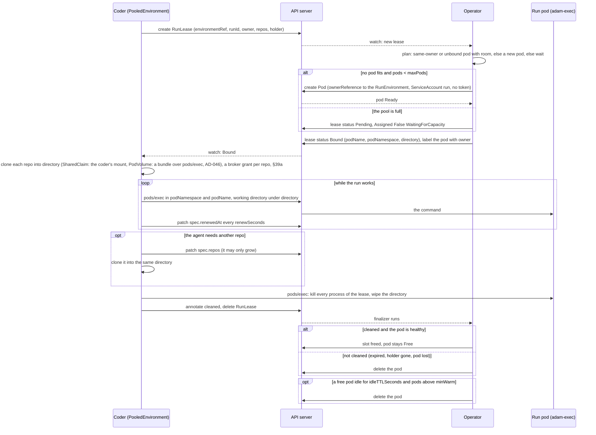

```mermaid
stateDiagram-v2
    [*] --> Pending: created
    Pending --> Denied: unknown environment, requester not allowed, too many repos
    Pending --> Pending: waiting for capacity or for the pod to start
    Pending --> Bound: a slot is assigned
    Bound --> Bound: renewed
    Bound --> Expired: no renewal for ttlSeconds, or maxDurationSeconds passed, or the holder pod is gone and nobody adopted
    Bound --> Failed: the pod is lost (evicted, node gone, deleted)
    Bound --> Releasing: the holder deletes the lease
    Expired --> Releasing: the operator frees the slot
    Failed --> Releasing: the operator frees the slot
    Denied --> Releasing: the holder deletes the lease
    Releasing --> [*]: finalizer removed; a cleaned pod is Free, any other is deleted
```

Prose for what they cannot say:

- **Binding to an owner is the pod's, once.** A pod serves no lease until it is Free; its first lease sets `agents.vymalo.com/owner`, and from then on it is offered only to leases of that owner. It is never re-bound; it is reaped. Leases are served in order of creation. When the pool is full and only pods bound to other owners are Free, the operator deletes the longest-idle one to make room.
- **Packing.** A lease goes to a pod bound to its owner that has room (most loaded first, so the others go idle and are reaped), then to an unbound Free pod, then to a new pod. With `maxLeasesPerPod: 1` this is "reuse after release".
- **Expired and Failed leases stay visible** for ten minutes with their reason (the holder reads it), then the operator deletes them. A lease whose holder pod disappeared is `Expired` only after `ttlSeconds` unless a worker adopts it first (the run is durable and may move to another worker: it patches `spec.holder`).
- **Cleaned is the holder's claim, and a bad claim costs only that owner.** Anything but a clean release deletes the pod, so a crashed coder never leaves residue for the next lease. Only a *wrong* "cleaned" can, and it can only reach the same owner's next lease (the binding above).
- **The clone line is both modes'.** Under the default `PodVolume` the clone, the work and the push cross `pods/exec` as bundles (AD-046), the pod is made with its own volume and takes it with it when it goes (*Pod volume: files and git over exec*); only `SharedClaim` clones into a mount the coder shares with the pod.
- **Parking.** Under `PodVolume`, the default, parking is a bundle in the coder's storage (AD-046). Under `SharedClaim`, a run that waits hours for a person releases its lease; the coder first moves the directory to `/work/parked/<run-hash>`, a path no run pod mounts, and moves it back into the next lease's directory. This works for a **full clone** and not for a worktree of a shared mirror, whose `.git` file holds an absolute path (*unverified*, `git worktree repair` aside), so the pool uses full clones. v0 of the pool does not share a mirror (below).

### Isolation (AD-037, P-013)

The owner's rule, kept whole: **no pod is ever shared across owners.** Inside an owner, files of different leases are shared in one pod only if the separation is strict.

**What the platform can and cannot do.** A pod's mounts are fixed when it is created, so *a kubelet mount cannot follow a lease*. Strict separation of a reused pod therefore comes from one of two places: the **pod's private mount** (one lease at a time), or a mechanism **inside** the pod (a user id or a mount namespace per lease).

| | A. One lease per pod, pod-private mount (`PodPerLease`) | B. A user id per lease, `0700` directories (`UidPerLease`) | C. A mount namespace per lease, alone |
|---|---|---|---|
| How | The pod mounts only `subPath: pods/<name>-<suffix>` of the RWX claim, at `/work/pods/<name>-<suffix>`; the suffix is random per pod creation, so a re-made ordinal never sees an old directory. The coder mounts the whole claim. Under `PodVolume` the private mount is the pod's own volume, at the same path, and the coder mounts nothing | One pod, up to `maxLeasesPerPod` leases, each under its own uid in `…/<lease-id>` mode `0700`, own `TMPDIR` and `HOME` | `unshare -m` per lease and bind-mount its directory |
| Reads another lease's files | **Stopped** by the kubelet mount: the other directories are not in the pod | Stopped by file modes, **unless root or `CAP_DAC_OVERRIDE`** | Stopped by the path, **but not by `/proc/<pid>/root` or `/cwd` of a same-uid process** (*unverified*, from proc(5) and ptrace access rules) |
| Sees or signals another lease's processes | Stopped (pod PID namespace) | Signals and `ptrace` stopped (other uid); `/proc` still lists their command lines, and `hidepid` needs a mount the pod cannot make | Not stopped |
| Network | Stopped (pod network namespace) | **Not stopped**: one network namespace, so `127.0.0.1` services and abstract unix sockets are shared | Not stopped |
| Memory, CPU, OOM | Per-pod limits per lease | **One lease's build can OOM-kill another's** | Same |
| Needs | Nothing special. Under `PodVolume` it now runs in a user namespace by default (`hostUsers: false`, AD-048); under `SharedClaim` it cannot, and runs in the host's | A root-capable helper (`SETUID`, `SETGID`) in the pod, so `hostUsers: false`: stable since Kubernetes v1.36 and needs Linux 6.3 or later, containerd 2.0 or later, and idmap mounts on every volume (*verified 2026-10-06*, the user-namespaces page of kubernetes.io). **It therefore requires `storage.mode: PodVolume` (AD-045), which is the default:** a pod with `hostUsers: false` cannot mount Longhorn's RWX claim (`failed to set MOUNT_ATTR_IDMAP … invalid argument`, *verified 2026-10-06* on netcup, the owner's probe, consistent with mount_setattr(2), which lists no NFS among the idmap-capable filesystems, <https://man7.org/linux/man-pages/man2/mount_setattr.2.html>); a Longhorn RWO ext4 volume mounts idmapped. The one `PodVolume` of a pod is shared by its leases, each in its own `0700` uid directory | `CAP_SYS_ADMIN` or a user namespace; the default seccomp profile blocks `mount` and `unshare` (*unverified*) |
| Does not stop | Residue between sequential leases (so wipe or delete, above); a kernel escape (the node's kernel is shared by every container); the coder, which sees every directory by design | A compromise of the helper (it can become any uid); a kernel escape | Most of it alone |
| Cost | A pod per concurrent lease | Packs many leases per pod: the cheapest | Cheap, and weakest alone |

**Recommendation (P-013):** make **A** the default and the only mode until B is proven. A needs no privilege in the pod, its guarantee is the kubelet's and the kernel's rather than ours, and reuse is **sequential reuse after a wipe** for the same owner. Ship B as `isolation.mode: UidPerLease` for density **only after the isolation suite passes in the cluster** (the testkit's isolation test: a lease tries to read another's files, `/proc/<pid>/environ`, `ptrace` it, signal it and reach its `127.0.0.1` port, and each must fail). Treat C as an addition *to* B (per-lease mount namespace plus uid), never alone. In every mode: never across owners. If the owner wants a fresh pod for every lease (no sequential reuse at all), `minWarm` spares plus delete-on-release give it; a field for that (`recycle: Wipe | Delete`) is not in v0 (open question, §93).

### Storage and clones (AD-038, `SharedClaim`)

This subsection is `storage.mode: SharedClaim`, which is no longer the default (AD-045, amended); the default is *Pod volume*, below.

```text
/work                          the whole RWX claim: the coder mounts it all
├── pods/<name>-<suffix>/      what ONE run pod mounts (and only this), at the same path
│   └── <lease-id>/<repo>/…    a full clone per repo, by the coder, on lease
└── parked/<run-hash>/…        parked runs; no run pod mounts it
```

- **Paths mean the same in the coder and the pod** (adam-rs ADR 0010's rule, kept): the pod's mount path is the claim's path, so the coder's file tools and its git stay where the credentials are, and **no credential is in a run pod**. The coder clones with a broker grant for that repo and lease (§39a): short-lived, scoped to the repository, never a long-lived key.
- **The agent may clone another repo mid-run** into its own lease directory: the coder patches `spec.repos` (the operator checks only the count; **authority is the broker's**, which refuses a repo no connection grants, §39a), and clones it. The person's yes for a second repository (the system's `workspace-e2e.sh`) stays the coder's gate.
- **The claim is Longhorn RWX.** *Verified 2026-10-06, the owner's probe on netcup:* the class serves RWX through an NFS share-manager, and a pod with `hostUsers: false` cannot mount it (*Cluster facts*, below). *Unverified:* its speed for `target/` and `node_modules` (§29); measuring it is the first open question below. A pod's private directory holds builds, so a slow RWX makes slow builds. A `PodVolume` (AD-045), the default, is one answer; `emptyDir` for caches with the clone on RWX is not designed here.
- **No shared git mirror or package cache across leases in v0.** A mirror that holds repository X would be readable by a lease that was granted only repository Y; a per-owner cache is a later decision (open question).
- **Wipe.** The holder wipes at release (above); the coder's janitor removes `pods/<dir>` of a pod that no longer exists, as it does for `held_runs` today. The operator never mounts the claim.

*Amended 2026-10-06 (the owner: "Also I think we can go with normal RWO volumes too, replicated"; AD-045, AD-046):* everything above is `storage.mode: SharedClaim`. The owner then said *"PodVolume should become default"*: **`PodVolume` is the default and `SharedClaim` stays available** (AD-045, amended). An environment that wants the shared claim names it, and sets `isolation.userNamespace: false` (AD-048). `PodVolume` is a `ReadWriteOnce` volume of the pod's own. The coder cannot mount another pod's RWO volume, so under `PodVolume` the bullets above that say the coder mounts the claim, clones into it or janitors it do not apply; the next subsection says what replaces them.

### Pod volume: files and git over exec (AD-045, AD-046)

The owner, 2026-10-06, after the cluster probes: *"Also I think we can go with normal RWO volumes too, replicated."* **Too:** an addition, not a replacement; *amended 2026-10-06:* the owner then said *"PodVolume should become default"*, so it is the default and `SharedClaim` is the alternative (AD-045). The reason it is needed is a verified fact: a pod with `hostUsers: false` cannot mount Longhorn's RWX claim, and a Longhorn RWO ext4 volume mounts idmapped (*Cluster facts*, below).

**What the pod gets.** One `ReadWriteOnce` claim per run pod, a generic ephemeral volume of the pod (*What the operator makes*): Kubernetes makes it with the pod and deletes it with the pod, and it is mounted where `SharedClaim`'s pod directory would be, so a lease directory has the same path in both modes. **Replication is the StorageClass's**: the `longhorn` class has `numberOfReplicas: "2"` (*verified 2026-10-06*, the owner's `kubectl get sc longhorn -o jsonpath='{.parameters.numberOfReplicas}'`), so a `PodVolume` from it has 2 replicas on netcup. **Sequential reuse after a wipe works as before** (the holder wipes the lease directory; the pod goes back to Free). A pod deleted for any other reason, an idle reap, a lost lease, a changed `env-digest`, **takes its volume with it**, so nothing outlives the pod to be found by another owner. The volume attaches wherever the pod schedules, so it does not pin a pod to a node; how long a Longhorn attach takes when a new pod starts is *unverified*.

**What the coder can no longer do, and what replaces it (AD-046, from P-019).** The coder mounts nothing of a `PodVolume`. Its file tools and its git therefore cross `pods/exec`, and **no credential enters the pod**, so P-015 holds unchanged. *Decided 2026-10-06 (the owner: "P-019 is fine"): AD-046.*

- **Files.** The coder's file tools act through the environment session (`pods/exec`), not through the coder's own filesystem. This is an adam-rs change (*What adam-rs must change*).
- **Clone.** The coder fetches the repository into **a bare mirror of its own**, with a broker grant for that repository and lease (§39a), makes a `git bundle` of it and streams the bundle into the pod on stdin of an exec, into a file of the lease directory; `git clone` (or `git fetch`) in the pod reads the bundle. The mirror is the coder's, per owner and repository; no run pod sees it, so the objection of *Storage and clones* to a shared mirror does not apply.
- **Push.** The pod writes `git bundle create` of the branch to stdout, the coder fetches the bundle into its mirror and **pushes with a grant**. **Incremental bundles** (`^<basis>`, the last commit the other side has) keep later transfers small.
- **Image.** An image built in the pod reaches the coder as the OCI archive streamed over exec, and the coder pushes it (P-018, amended).
- **Parking.** A run that waits hours for a person releases its lease. Before that the coder has the pod commit the work in progress, **untracked files included and ignored ones left out**, to a private ref (`refs/adam/park/<run-hash>`), and keeps a bundle of that ref in its own storage. The next lease restores it into a pod, which may be another. **Ignored build outputs are rebuilt**: that is the price of not copying `target/` and `node_modules` through exec.
- *Unverified:* the exact git invocations (`git bundle create` with `^<basis>` and `-` for stdout, `git clone` and `git fetch` from a bundle file, committing untracked files to a private ref through a temporary index), the throughput and the size limits of an exec stream, and what a bundle costs on a large monorepo.

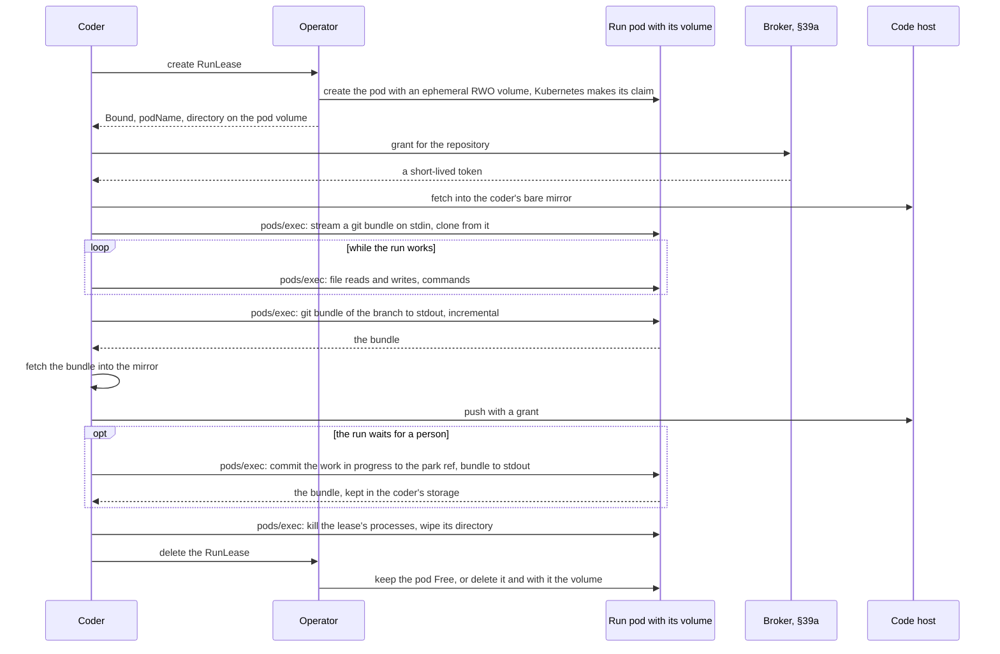

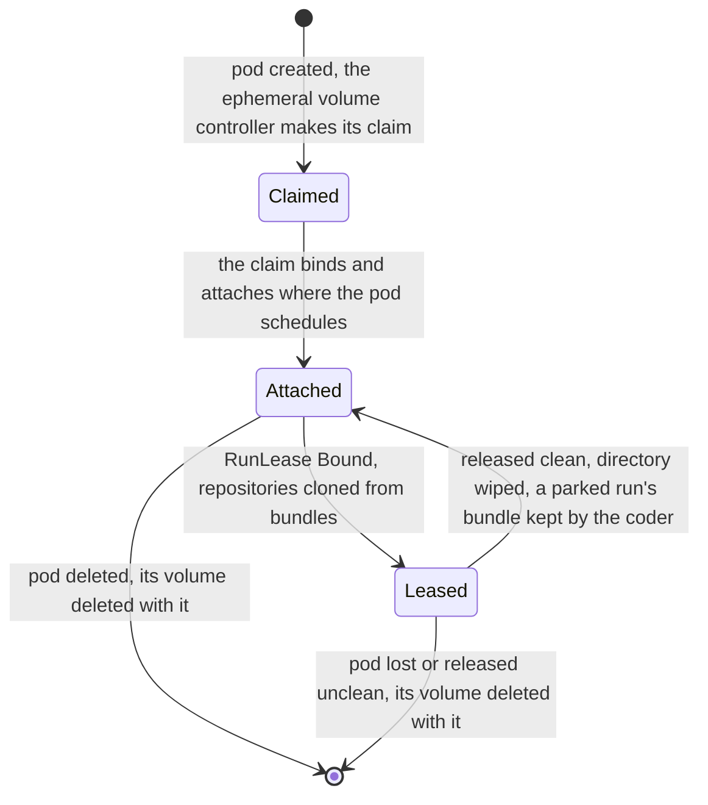

Prose for what they cannot say: the coder's mirror and its parked bundles are the coder's own storage, so a coder that loses them loses only parked runs, never a pushed branch; and under `UidPerLease` the one volume of a pod holds each lease in its own `0700` uid directory (*Isolation*).

### Containers in a run (AD-043, AD-047, P-018)

The owner, 2026-10-06: *"some of those environments need docker; e.g. for building… How do we do?"* A run pod holds no container engine, and giving it one is the most dangerous thing a pool can do, so the answer is one field, off by default: `containers.mode` on the `RunEnvironment`.

| `mode` | What the pod gets | For |
|---|---|---|
| `None` (default) | Nothing: the pod of the tables above | Most runs |
| `Build` | A **BuildKit** sidecar. The run reaches it with `docker buildx` through a socket on an `emptyDir` shared only inside the pod (a `remote` builder on that socket; the exact flags are *unverified*) | Building images: `docker build`, `buildx bake` |
| `Engine` | A **Podman** sidecar serving a Docker-compatible socket on the same kind of `emptyDir`; privileged only inside the pod's user namespace (below) | `docker run`, compose, Testcontainers, devcontainers |

**The rules, all of them in code or CEL, none a field:**

- **`mode != None` requires `isolation.userNamespace: true`** (`hostUsers: false`, the default, AD-048), **`storage.mode: PodVolume`** (an RWX claim cannot be mounted in a pod with `hostUsers: false`, AD-045) and `pool.maxLeasesPerPod: 1` (CEL, above). A daemon can bind-mount anything the pod mounts, so it is never shared by two leases; **one daemon per pod, and never across owners** (AD-037 holds as it did).
- **Never the host's Docker or containerd socket**, never a `hostPath`. **Never `privileged` unless the pod has `hostUsers: false`**: the operator renders the sidecar's security context itself (the floor of *What the operator makes* is for the run container, which keeps it; the sidecar gets the least its daemon needs). The object cannot loosen it. *Verified 2026-10-06 on netcup:* both daemons start with `privileged: true` **inside the user namespace**, in a namespace whose Pod Security level is `privileged`. The Pod Security Standards' `baseline` forbids `privileged: true` (that `hostUsers: false` does not relax it is *unverified*; the probes did not try `baseline`). So **pods with a daemon need a namespace at level `privileged`**, and that level is the namespace's: it applies to every pod there. *Decided 2026-10-06 (the owner: "go with its own namespace"; AD-047, from P-018):* such run pods live in a **namespace of their own** (`<coder namespace>-run`, configurable in the operator chart), at level `privileged`, where nothing but the operator makes pods, and the chart renders a `ValidatingAdmissionPolicy` there that admits a pod only if its requester is the operator's ServiceAccount, it has `hostUsers: false`, and its only `privileged` container is the sidecar of the chart's pinned image. The coder's namespace keeps its level. The coder's `pods/exec` and `runleases` are granted in that namespace too, the operator works in and watches both, and a lease stays in the coder's namespace while its pod is in the other (`status.podNamespace`). The cost is the second namespace and its policy (the `pods/exec` risk row names it). Whether a smaller set of capabilities, seccomp and AppArmor than `privileged` is enough is *unverified* and decided by the kind job.
- **`Build` runs BuildKit rootful inside the pod and mapped to an unprivileged host user by the user namespace.** Rootless BuildKit cannot run inside a user namespace, so rootful BuildKit mapped to a high uid is the pattern (*verified 2026-10-06*, <https://kubernetes.web.cern.ch/blog/2025/06/19/rootless-container-builds-on-kubernetes/>), and Kubernetes' own announcement names "builders like buildkit with `hostUsers: false`" (*verified 2026-10-06*, <https://kubernetes.io/blog/2026/04/23/kubernetes-v1-36-userns-ga/>, user namespaces stable in v1.36). *Verified 2026-10-06 on netcup, the owner's probe:* `moby/buildkit`, `privileged: true` inside the user namespace, `--root` on an `emptyDir`, built a two-line Dockerfile and exported an OCI archive.
- **`Engine` is Podman**, the engine adam-rs and the system already chose for a repository's devcontainer: adam-rs [ADR 0010](https://github.com/vymalo/another-adam-rs/blob/main/docs/decisions/0010-a-run-works-in-its-repositorys-devcontainer.md) and the system's [ADR 0028](https://github.com/vymalo/another-agentic-system/blob/main/docs/decisions/0028-devcontainer-json-is-the-workspace-environment-contract.md). There it is one Podman service of the dev stack beside the coder (*verified 2026-10-06*, both records); here it is a sidecar of each run pod, inside the pod's user namespace, so the devcontainer path of ADR 0010 keeps its socket and changes only where the service runs. *Verified 2026-10-06 on netcup:* Podman 5.8.7 (`quay.io/podman/stable`) ran busybox with `privileged: true` inside the user namespace, storage on an `emptyDir`, `--cgroup-manager=cgroupfs --events-backend=file`. That is **rootful Podman inside the user namespace**, privileged only there and mapped to an unprivileged host uid range; **rootless Podman inside the user namespace is *unverified***, and so is Podman's Docker-compatible API for Testcontainers.
- **Kaniko is not chosen:** its original repository was archived in June 2025 and only forks remain (*verified 2026-10-06*, <https://ideas.harness.io/feature-request/p/kaniko-project-is-archived-how-do-we-build-images-in-un-privileged-mode>).
- The sidecar images are values of the operator chart, pinned by tag and digest, like the workspace image. The sidecar's `ephemeral-storage` and memory come from the size class, and the object has no field for them.

**Storage and cache.** The daemon's own snapshot store is an `emptyDir` of the sidecar (*verified 2026-10-06 on netcup* for both daemons; overlay snapshots on an NFS-backed claim are *unverified* and probably unsupported, and no such claim is mountable here anyway). The **build cache lives on the pod volume or in a registry**: `docker buildx build --cache-to type=local` writes it to the lease directory on the `PodVolume` (so it is wiped with the lease, and a lost pod or a parked run loses it, AD-046), and `type=registry` is the way across runs. Across leases there is **no shared cache in v0**, for the reason of *Storage and clones* (a cache holds what another lease's repository held); a per-owner one is the existing open question (§93), and a registry cache is per owner and repository.

**Credentials and pushes (reconciling P-015).** The run pod holds no credential (AD-038), and `Build` needs none to *build*: base images from public registries, and the result stays in the pod. To **push** an image the shape is P-015's: the build writes an OCI archive (`--output type=oci,dest=<lease dir>/image.tar`) into the lease directory on the pod volume, **the coder reads it over `pods/exec`** (the archive streamed on stdout, P-018 amended) and **the coder pushes it** with a registry grant from the broker (§39a), short-lived and scoped to the repository path, never a long-lived key and never in the pod. Git writes and image pushes are therefore both the coder's. A push from inside the build (`buildx --push`) or a pull of a private base image needs a credential in the pod; that is a **short grant** (minutes, one repository path, passed as a `buildx --secret` from tmpfs and never as an environment variable, an image layer or a file of the claim), and it is the one place this design puts a credential in a run pod. It is proposed, not decided, and off until the owner says (P-018). The broker has no registry connection kind yet (§39a covers code hosts and MCP servers), and which registry and which credential is open (§93).

**A pod with a daemon is not reused (P-018).** Containers, images, volumes and networks of a daemon are residue that the coder's wipe of a directory does not reach, so in v0 a pod with `mode != None` is **deleted at release**, never returned to the pool, and `minWarm` counts it as a new pod. Reuse, after the isolation suite covers the daemon, is a later decision.

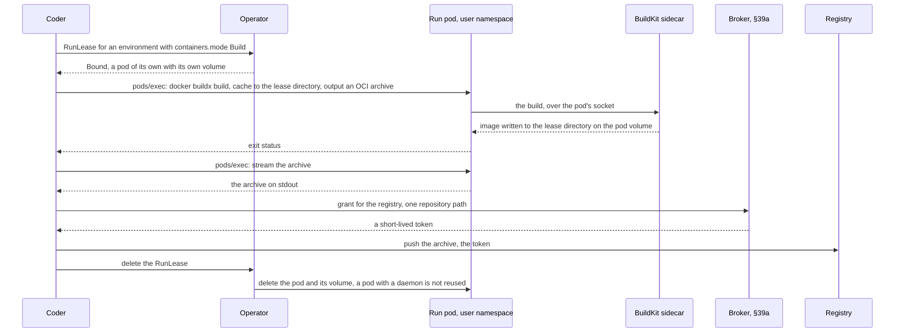

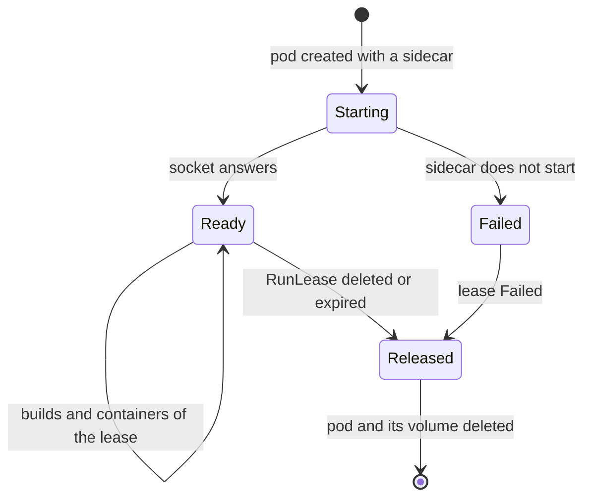

*Amended 2026-10-06 after the cluster probes (AD-043, AD-045, AD-047):* the sidecar shapes are **proven on netcup** (*Cluster facts*, below): BuildKit rootful and Podman, each `privileged` inside the user namespace and on an `emptyDir`. What changed: `mode != None` now requires `storage.mode: PodVolume`; such pods live in a namespace of their own that allows Pod Security `privileged` (AD-047; the operator renders the sidecar's context; the run container keeps its floor); the OCI archive is streamed to the coder over exec. *Still unverified, and decided in the kind job:* Podman's Docker-compatible API for Testcontainers and devcontainers; rootless Podman inside the user namespace; the exact `buildx` flags.

### Cluster facts (verified 2026-10-06)

*Verified 2026-10-06*, the owner's run of two probe scripts on the netcup cluster. The first five answer the question of §93 *Run pool*; the probes follow.

| Fact | Value |
|---|---|
| Nodes | 5 Talos v1.13.6, Kubernetes v1.36.1, kernel 6.18.38-talos, containerd 2.2.5 |
| User namespaces | `user.max_user_namespaces` is 15000: no Talos change is needed |
| CNI | Cilium 1.19.6, which enforces NetworkPolicy |
| Runtime classes | None: no gVisor, no Kata |
| Addresses | Pod CIDR 10.244.0.0/16 (a /24 per node); the `kubernetes` service is 10.96.0.1 |
| Allocatable | About 47.75 CPU and 107 GiB memory over the 5 nodes; the control-plane node has about 4 CPU and 7 GiB |
| StorageClasses | Only `longhorn` (default, `numberOfReplicas: "2"`) and `longhorn-static`, both `driver.longhorn.io` |

| Probe (a pod with `hostUsers: false`) | Result |
|---|---|
| 1. An `emptyDir` volume | **Works**: root in the pod maps to host uid 130154496, range 65536 |
| 2. A Longhorn **RWX** claim (NFS share-manager) | **Fails to start**: `failed to set MOUNT_ATTR_IDMAP on …/volumes/kubernetes.io~csi/pvc-…/mount: invalid argument`. Consistent with mount_setattr(2), which does not list NFS among the idmap-capable filesystems (*verified 2026-10-06*, <https://man7.org/linux/man-pages/man2/mount_setattr.2.html>) |
| 3. A Longhorn **RWO** claim (block device, ext4) | **Works**: mounted `ext4 (rw,seclabel,relatime,idmapped)` |
| 4. Rootful BuildKit (`moby/buildkit`, `privileged: true` inside the user namespace, `--root` on an `emptyDir`) | **Works**: built a two-line Dockerfile and exported an OCI archive |
| 5. Podman 5.8.7 (`quay.io/podman/stable`, `privileged: true` inside the user namespace, storage on an `emptyDir`, `--cgroup-manager=cgroupfs --events-backend=file`) | **Works**: ran busybox |

Probes 4 and 5 ran in a namespace at Pod Security `privileged`; `baseline` was not tried (*Containers in a run*). Probes 2 and 3 are why AD-045 exists; probe 1 is what AD-048 rests on (a user namespace per pod, with a 65536-id range of its own); probes 4 and 5 are why AD-043's sidecars are offered.

### Seams (AD-039, AD-020)

| Seam | Where | What |
|---|---|---|
| `PoolPlanner` | `aap-domain` (pure) | `plan(&EnvSpec, &Observed, now) -> Plan { assign, create, delete, expire, deny }`: the whole pool policy (owner binding, packing, reaping, expiry, denial) with no I/O and no clock of its own |
| `PodProvider` | `aap-ports`, implemented by `aap-runpool-kubernetes` | `create(env, NewPod)`, `delete`, `list(env)`, `watch()` over neutral types: no Kubernetes type in a signature |
| Testkit (`aap-ports/testkit`) | `planner_properties!`, `pod_provider_conformance!`, a `Memory` provider | See the list below |

The testkit asserts: **never two owners on one pod**; never more than `maxPods`, nor `maxLeasesPerPod` per pod; reuse before create; a Free pod above `minWarm` is reaped after `idleTTLSeconds` and not before; an expired lease frees its slot and deletes the pod; a lease from a requester not listed is `Denied`; `repos` over the limit is `Denied`; no secret value ever materialises in a `Plan`, a pod spec or a status (as §59a's macro). The Kubernetes provider additionally proves, against a real API server, the owner reference, the ServiceAccount's `automount: false`, that no Role is made, and (AD-045) that a `PodVolume` pod's claim is made by the ephemeral volume controller, binds, and goes with the pod. The planner is a pure function, so property tests cover it.

**What adam-rs must change** (its own ADR, amending 0019; this repository decides nothing there):

- a **new crate**, e.g. `adam-env-pool`, implementing `Environment`: `ensure` creates or finds the `RunLease` and waits for `Bound`; `release` cleans, then deletes it; `held_runs` lists leases by label; `prepare` and `kill` reuse the exec client of `adam-env-kubernetes` (`adam-kube-exec`);
- a **`RUN_ENVIRONMENT` value**, `pool` (default stays `local`, and the per-run value `kubernetes` stays), with `RUN_POOL_ENVIRONMENT` (the `RunEnvironment` name) and the lease timings from the object, not variables;
- **the run's workspace path comes from the lease** (`status.directory`), not from the coder: the coder must lease before it makes the workspace. That changes the order inside `ensure`. A defaulted method on `Environment` (say `workspace_root`) breaks no implementer; a *required* one would, and adam-rs's Rule 2 says to flag it;
- **`pods/exec` only** in its chart's RBAC, no `pods` verbs, and `runleases` (`pods/exec` also in the run namespace of AD-047, nothing else there); the `runPods` block's template, quota and admission policy are not used in pool mode;
- **file access through the environment session** (`pods/exec`), not the coder's filesystem, and **git by bundles over exec** with the coder's own bare mirror, for `storage.mode: PodVolume`, the default (AD-045, AD-046): `SharedClaim` keeps the coder's own filesystem and git. A defaulted method again, so that no implementer breaks, and the same flag under adam-rs's Rule 2;
- the coder's **`owner`**: a stable id of the person the run is for, which today's thread-tools grant does not carry (§39a open question).

### Migration (AD-039)

| Step | What | Mode in use |
|---|---|---|
| R0 | This text | per-run (ADR 0019) |
| R1 | CRD types, planner and testkit in `aap-api`, `aap-domain`, `aap-ports` | per-run |
| R2 | `aap-runpool-kubernetes`, the controller, the chart (`runPool.enabled: false`) | per-run |
| R3 | adam-rs `adam-env-pool` and its ADR | per-run |
| R4 | kind e2e with the isolation suite; a shadow coder on `pool` | per-run for every real coder |
| R5 | A coder is switched to `pool` when the owner decides the proof is enough | `pool` per coder |
| R6 | `kubernetes` per-run mode is retired only by a new decision | |

Both modes work in one cluster: they use different pod names, labels, and RBAC, and the pool's PriorityClass is its own. Switching a coder is a value in its `AgentConfig` plus its RBAC, and rolls back the same way.

### Risks

| Risk | Handling |
|---|---|
| Longhorn RWX is slow for builds (*unverified*) and **cannot be mounted with `hostUsers: false`** (*verified 2026-10-06*) | Speed is measured before R5; A needs no user namespace; a user namespace (`UidPerLease`, `containers.mode`) needs `PodVolume` (AD-045) |
| `PodVolume`: git and files through exec are slower than a shared mount, and it is a new adam-rs seam; a Longhorn attach when a new pod starts adds latency (*unverified*) | It is the default (AD-045, amended; `SharedClaim` stays available); incremental bundles; the file tools and bundles are adam-rs's change (AD-046); the attach time is measured in the kind job and on netcup |
| Sequential reuse leaves residue | Read-only root, writable paths only the private mount and tmpfs, wipe and kill at release, delete on anything but a clean release |
| The coder, which mounts everything, is the weak point | As today; mediation of writes is P-015 (§39a) |
| `pods/exec` on any pod of the namespace if `resourceNames` is not honoured | Proved in kind; otherwise all run pods move to the namespace of their own (AD-047), which the operator already works in for pods with a daemon |
| Every run pod in a user namespace (AD-048) needs Kubernetes with user namespaces (stable in v1.36), Linux 6.3 or later and containerd 2.0 or later (*Isolation*) | *Verified 2026-10-06* on netcup (*Cluster facts*); a cluster that lacks them sets `userNamespace: false`, and then `SharedClaim` is its only storage |
| A lease CRD adds etcd writes | One renewal per `renewSeconds` per active run; open question on the default |
| The operator now creates pods | Its Role is namespaced, no Secrets, no `exec`; pods are fixed-hardened and the object cannot loosen them |
| A container daemon in a run pod widens the blast radius | Off by default; `userNamespace` required by CEL; never the host's socket; one daemon per pod and owner; the pod is deleted at release; its namespace admits only the operator's pods (AD-047); no credential in the pod unless the short grant of P-018 is turned on; the kind job proves the daemon starts and that a build cannot reach another lease's files |

---

## 60. UI Architecture

Administrators should not need to touch CRDs.

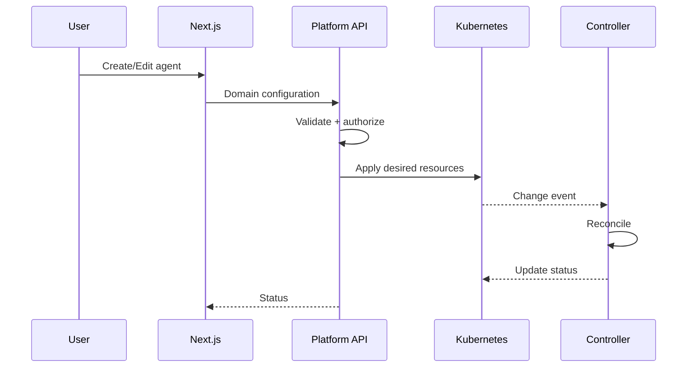

The beginner UI may expose:

```text
Name
Description
Model
Environment
Tools
Responses
A2A
MCP
CPU
Memory
Volumes
Security profile
Scaling
Routes
```

Advanced mode can expose:

```text
View YAML
Export YAML
GitOps configuration
status conditions
revision digest
runtime status
```

> **Decision (2026-10-05, AD-025):** v0 of this UI is the admin dashboard of [§60a](#60a-admin-dashboard-v0): an `/admin` area of another-agentic-system's chat web over a Platform API that writes `AgentService` and `AgentConfig` (AD-026, AD-027). The beginner fields above that v0 has no CRD field for (Responses, MCP exposure, routes) are not shown.

---

## 60a. Admin dashboard v0

> **Status: decided (2026-10-05); slices D1, D2, D3 and D4 are built (2026-10-15), D5, D6, D7a, D7b1 and D7b2 (2026-10-16) and D13 (2026-10-17), the rest is design only (D8 is built in another-agentic-system).** Slice S0 of the dashboard is this text. The decision to build it is AD-025; the owner answered the questions of *Dashboard v0* in §93 the same day, and P-007 to P-012 (§92) became AD-026 to AD-031, with the permission model AD-032 and the coders per GitHub owner AD-033. Where the owner changed a recommendation (who may configure agents, who may use an agent, the takeover of `coder` and `chat`), the text below is the changed one. The names of the permissions are proposed, not final (§93).

> **D1 built (2026-10-15):** the custom resources of *What the custom resources gain*, in [`aap-api`](../../crates/api/README.md): `AgentService.spec.access.audience`; the namespaced kinds `ModelEndpoint` and `ToolProvider` (the v0 subset: `mcp: { url, headers, tools, optional }`, no status); `AgentConfig.spec.model.endpointRef` and `mcpServers.<n>.providerRef`, each exclusive with the inline form by a CEL rule; and `environment.image` optional. `crdgen` and the CRDs chart print four CRDs; `examples/coder-me.yaml` is the example below as objects that reference each other, and `examples/invalid/` has one object per CEL rule and per bound of the fields D1 added (48 in all: `tests/examples.rs` fails when a bound has none, and proves each example states the message of its own bound). Proven by `cargo test`: the generated schema holds every rule and bound, the examples round-trip through the types and lose nothing, each invalid example is refused for the reason it states, the audience reaches no pod (the resolved agent and the digest are equal with any audience), and the parity goldens and the pinned digest did not move. **The CEL rules were run against a real API server by hand on 2026-10-15** (a bare kube-apiserver v1.35.8 with etcd 3.6.4, objects created with strict field validation): the four CRDs are admitted, the valid examples are accepted and every invalid example is refused with its stated reason; and the new CRDs applied server-side over the ones of `main`, with `main`'s `coder` and `chat` stored under them, leave those four objects updatable and valid as new objects (`kubectl` v1.35.8, the steps the `kind` job now has). **The `kind` job of `operator.yml`, the pipeline's own proof, is *unverified* until CI has run it.** Nothing resolved a reference at D1 (D2 does, below): `aap-domain` refused a config that used `endpointRef`, `providerRef` or no image with a `ConfigInvalid` that named the field and said it was D2, so `coder-me.yaml` was accepted by an API server and blocked by the operator. Where D1 differs from the text below:
>
> - **"Visible characters" is visible ASCII** (`!` to `~`, no space, control or non-ASCII character), the stricter reading; **confirmed by the owner on 2026-10-15** (`^[!-~]+$`). The count and the lengths are bounds of the schema; a rule over a list needs them to be priced, and `tools.mcpServers` gets `maxProperties: 32` for the same reason (kube-apiserver refused the CRD without it), the one bound D1 puts on a field that existed (an `AgentConfig` stored with more than 32 servers would be refused on its next change); **the owner confirmed on 2026-10-15 that an agent has at most 32 extra MCP servers, existing configs included**. The new kinds are bounded too, and nothing inline is: a title is 1 to 128 characters, a provider's URL 1 to 2048, and the aliases, the allow-list of tools and the headers at most 32 each (values and reasons in the crate's README).
> - **Two CEL rules are added that §60a does not list**: the fields that an endpoint reference makes optional (`baseUrl`, `apiKeySecretRef`, `url`) were `required`, and the schema cannot say "required unless", so a rule keeps the guarantee (`model` is an `endpointRef` or both inline fields; a server has a `url` or a `providerRef`). The message of the `BaseUrl` rule lost its `model.` (it is also a `ModelEndpoint`'s).
> - **`ToolProvider.spec.mcp.optional` defaults to `false`**, as the inline field does (the form's "default on" is the form's), and `tools` has no inline counterpart: D2 decides what the operator does with it and how a server's own `optional` meets the provider's.
> - The refusal in `aap-domain` and the rest of the operator were untouched at D1: no controller watched the new kinds, and the operator chart's `Role` had no verbs on them (D2 changes all three).

> **D2 built (2026-10-15):** the operator resolves the references and the default image. **`aap-domain`** ([README](../../crates/domain/README.md#references-and-the-default-image-slice-d2-ad-029)): `resolve` and `validate` take an `Externals` (the `ModelEndpoint` and `ToolProvider` objects the config names, by name, and the operator's default image) and **read the references into the config before anything else**, so the rest is the code that reads an inline one: an endpoint with the address and key of an inline model gives the same variables, the same MCP file, the same pods and the same digest (`tests/references.rs` compares whole resolved agents, on both examples, on the §60a example and on every `optional` case). The crate stays pure: `references(config)` names what to read, and a composition root reads it. The digest moves with the content of a referent (an address, a key's Secret, a URL, a header, `optional`, `tools`) and with the default image of the configs that name none, and not with a title or a list of aliases. A referent that is missing, or in another namespace, is `ConfigResolved: False`, reason `ConfigInvalid`, the message naming it (`ModelEndpoint "gateway" was not found in namespace …`), and nothing is made from half an agent. A referent is **checked as the inline form is**, each issue naming the referent (`ToolProvider websearch spec.mcp.url`), and its sentence is the inline form's word for word: `parse_http_url` (no user name, password or `${VAR}` in a provider's URL, no user name or password in an endpoint's), `is_http_token`, the prefix, the Secret references, plain `http` against `tools.allowInsecureHttp`, and the header-variable clash. **After review, four more rules:** an issue never carries a URL whole (it reaches the status and the Events of every service that uses the object): a refused URL is shown as its scheme and host, `***` for a user name and password and `/…` for the rest (`shown_url`); a reference's name, and `configRef`'s, must be a DNS-1123 subdomain, or the service is `ConfigInvalid` naming the field before any request is made with it (the CRD asks for one character only, and a name goes into the path of the GET: `bad name` failed the pass for good and `x?watch=true` added a query; not a CRD pattern, which would tighten `configRef`); an MCP server's name is adam-rs's `server_name_ok` (at most 64 characters, no `__`, not ending in `_`: *verified 2026-10-15* by `git show` at `0391809`, identical at `9a1fd4e`, **not run**), because the loader refuses the file of a server named otherwise at every start; and a service blocked by a missing referent (not by an invalid config) is read again in the `pending` period, 15 s, not the settled 5 minutes, because the two objects of a config are applied one request at a time. **`aap-controller`**: a pass reads the referents with `get`, live, as it reads the config; the controller **watches both kinds** and maps a change *or a deletion* to the services that run a config that references the object, through the configs' and the services' caches; an edit rolls the agents that use the object, a deletion makes them `ConfigInvalid` at once and leaves what runs untouched, and a referent created later unblocks them. **The two watches are isolated from the services' own triggers**: kube's `Controller` puts one backoff around all of its triggers, so a kind whose CRD is not installed (or that the `Role` cannot list) would have delayed every service by a backoff's length, thirty seconds and more (*measured 2026-10-15* on the fake, in virtual time: 11 to 16 s for a service that existed at start, 27 to 42 s for one created later); each watch has its own backoff, logs and drops its errors, and finds its kind when the CRD appears. A referent of a kind the cluster does not serve (the API server answers the plain text `404 page not found`, which `get_opt` would call an error and fail the pass for) is `ConfigInvalid` with a message that says to install the CRDs of `deploy/operator-crds`, not to create the object. **`operator run --default-agent-image`** (`DEFAULT_AGENT_IMAGE`): a config with no image gets it, in every container that takes the image; with none configured such a config is `ConfigInvalid`, naming the flag; a new value rolls the agents that name none and no other. **The chart** ([README](../../deploy/operator/README.md#the-default-agent-image)): `Role` gains `get`, `list` and `watch` on `modelendpoints` and `toolproviders` and no write; `defaultAgentImage` is rendered as `DEFAULT_AGENT_IMAGE` and ships the coder image `sha-9a1fd4e` by tag and digest (`sha256:c3c178b7…12b44`, *verified 2026-10-15*, anonymous manifest request to ghcr.io, HTTP 200), the one the kind end-to-end of the coder runs; the chart refuses a value without a tag and a digest, and `latest`. Proven by `cargo test`: the parity goldens and the pinned digest of the inline examples **did not move**; the domain's table tests (22 new cases in `tests/references.rs`, and the invalid examples of the shared kinds now asked of `validate`); the reconciler on the `Memory` ports and the fake API server (a referent created after the config unblocks it, an edit rolls the digest and a title does not, a deletion blocks naming it and the pod spec is what ran, the default image and its bump); the running operator against the fake's list and watch (change, deletion and creation of either kind reconcile the right services, an object nobody references reconciles none); `render-check.sh` (the Role line by line, the variable, the refusals) and `bump-tag-test.sh` (the bump leaves `defaultAgentImage` alone). **Each property was broken on purpose and a named test failed** (the resolution equivalence in three ways, the referent validation in four, the `optional` rule in three, the default-image rules in three, the watch mapping in five). **The new case of `bin/operator/tests/cluster.rs` was run by hand against a bare kube-apiserver v1.35.8 and etcd on 2026-10-15** with the test playing the controller manager, with the other twelve: 13 of 13 passed; and, after the review, a case that deletes the two shared CRDs (run alone, `AAP_TEST_DROP_SHARED_CRDS=1`) passed against a new bare kube-apiserver: a plain service is `Ready` and follows its config, a service that references the kinds says they are not installed, and it goes `Ready` once the CRDs and the objects are there (`AlwaysAllow` authorisation: it proves the reads, the watches, the digest and the block against a real API server, and nothing of the `Role`). The decisions D2 took, **for the owner to confirm**:
>
> - **`optional`: the server is optional when either the agent's entry or the provider says so** (`agent.optional || provider.optional`). The agent's field has a default (`false`), so a rule cannot tell "absent" from "false"; letting the agent's entry win would make a provider's `optional: true` unreachable from a plain `providerRef`, and letting the provider win would let a provider silence an agent that asked for the server to be required. *If the owner would rather the agent's entry win, the schema needs the field to have no default, which is a change of D1's.*
> - **`ToolProvider.mcp.tools` is mapped, not refused.** adam-rs supports a per-server `tools` allow-list in the file `ADAM_EXTRA_MCP_FILE` names, which the operator writes (*verified 2026-10-15*, read with `git show` at `0391809`, the revision of the parity goldens, **not run**; and **kept at `9a1fd4e`**, the revision of the coder image the chart ships, *verified 2026-10-15* with `git show` and `git grep` there, **not run**: four of the five files below are byte-identical at both revisions (`git diff --stat 0391809 9a1fd4e` over them is empty), `raw.tools` is read in `crates/adam-agent-fs/src/load/mcp.rs` and `"tools": ["echo"]` is in `crates/adam-assembly/tests/extra_mcp.rs`, which asserts `the allow-list applies`; `bin/adam-agent/README.md` changed elsewhere (a hardening bullet, the log filter) and its `ADAM_EXTRA_MCP_FILE` row, line 174 at `9a1fd4e`, still says "Same parser, `${VAR}`, `tools`, `optional` and policy as `mcp.json`"): `crates/adam-agent-fs/src/schema/mcp.rs` (`tools: Option<Vec<String>>`, "the allow-list of tools (an adam extension); `None` allows all"), `crates/adam-agent-fs/src/load/mcp.rs` (each entry must become `<server>__<tool>`: not empty, not starting with `_`, ASCII letters, digits, `-` and `_`, the name at most 64 characters), `bin/adam-agent/README.md` ("same parser, `${VAR}`, `tools`, `optional` and policy as `mcp.json`"), `deploy/coder/templates/_helpers.tpl` (`coder.extraMcpJson` writes `tools` when the list is not empty) and `crates/adam-assembly/tests/extra_mcp.rs` (the allow-list applies to the extra file's server). A non-empty list is written as the server's `tools`, sorted and once each (a set: the order typed must not roll the pods); an empty list writes no key, which is every tool, and is then the inline server; an entry adam would refuse is `ConfigInvalid` on `ToolProvider … spec.mcp.tools[i]`. Never ignored. At run time an allow-listed tool the server lacks skips an **optional** server and stops a **required** one (adam's rule, from the chart's comment).
> - **The header-variable rule is the inline one, for every server of the agent.** §60a says "two providers of one agent whose keys have the same name are `ConfigInvalid`"; D2 reads it as the rule §59a already has: a variable is named by its Secret key, and two headers that want the same variable from **different** Secrets are refused, the issue naming who wants it. The same Secret and key wanted twice is one variable and is accepted, as it is inline (refusing it would make a provider unusable beside an inline server that shares its Secret). A provider's header and an inline server's clash the same way.
> - **The default image is a value of the operator chart with a pin of its own**, `defaultAgentImage`, the chart rendering it as the variable `DEFAULT_AGENT_IMAGE` (every setting of the chart is an environment variable; the flag is `--default-agent-image`). The chart ships the pin the end-to-end proves and **two tests hold the two equal** (`render-check.sh`, `cargo test -p aap-operator --test e2e_fixture`). It is **not** moved by `bump-tag.sh`, which is the operator's own `image.tag` and stays the only writer of it (`bump-tag-test.sh` holds that): the operator's image and the coder's have two release trains. The GitOps repository sets the value to roll every agent that names none onto a new coder; to move the chart's own pin, read the digest from ghcr.io (the README has the request), change it here and in `tests/e2e/coder.yaml`, and let the end-to-end run. The chart refuses a value without a tag and a digest; the binary refuses white space at start.
>
> **Known behaviour, and a question for the owner (*not decided*): a missing referent delists the agents that use it.** A referent that is missing makes every service whose config names it `Blocked` (`ConfigResolved: False`, reason `ConfigInvalid`), and a `Blocked` service is not listed by the registry (`Listed: False`, reason `ServiceBlocked`), so the orchestrator stops offering it, **while its pods keep running** and still answer a caller that has their card URL and a token. Deleting one `ModelEndpoint` therefore delists every agent that uses it, at once (a deletion is a trigger), until the object is back; the same holds for a `ToolProvider`, and for any config that is `ConfigInvalid`, which is how the registry has worked since S7. The blast radius is new with D2, because one object is now shared by many agents. The alternative is that a service that has run stays listed while a referent is missing and the condition says so, which makes the registry say an agent is there that the operator could not recreate. *D2 does not change the behaviour; the owner is asked which one they want* (the fifth of D2's decisions to confirm, §93).
>
> Where D2 differs from §60a: **(a)** the controller reads the referents with `get` in each pass and not from a reflector (§60a: "through the store it already uses"; the config is read the same way, and the cache is only used to map a referent to services); **(b)** the default image is "a value of its chart that CI bumps by GitOps" in §60a, and here it is a value of the chart that the GitOps repository sets and that CI's bump does not touch (above); **(c)** the header-variable sentence is read as above; **(d)** the doc comments of `aap-api` that said D2 was future were rewritten and the CRDs regenerated: only `description` text changed, no schema keyword; **(e)** `ModelEndpoint.baseUrl.value` is checked as the inline `model.baseUrl.value` is (no user name or password; a `$` is allowed), not by the Models screen's stricter rule (no query or fragment), which is the form's (D4). *Unverified:* the `Role`'s verbs on the shared kinds under real RBAC, and the whole chain in kind (the `operator-e2e`, `operator-coder-e2e` and `kind` jobs have not run on this change; the end-to-end asserts the verbs with `kubectl auth can-i`); that the chart's `defaultAgentImage` is accepted by an Argo CD Application's `helm.valuesObject` as written; that Argo CD syncs the CRDs chart before the operator's (the order is the deployment's, the chart READMEs say so: **the CRDs first, always**, since a D2 operator expects all four; what the operator does when they are not there is above).

> **D3 built (2026-10-15):** the registry publishes the audience. **The data path**: `AgentService.spec.access.audience` → `aap_ports::DirectoryEntry.audience` (a `Vec<String>`, **as the service states it**: copied by `ReflectorDirectory`, `[]` for an absent list and for an empty one) → `aap_registry::document::build`, which writes the optional item attribute `audience`. **The contract** ([`agent-registry-v1.md`](../extensions/agent-registry-v1.md#audience)) is edited, not versioned: the *Item* table, the limits, rule 5, the client-flow diagram, *Serving* and *Versioning* say it, a new *Audience* section holds the shape (at most 32 strings of 1 to 64 visible ASCII characters, or `"*"` alone), the three cases a server publishes and the consumer's rule as the section above states it, and the header note that waited for D3 is now *Amended 2026-10-15 (D3)*; the contract stays `v1`, because an optional attribute is additive. **The three cases**: no audience and an empty one are **no attribute** (a consumer reads absent, empty and malformed alike, as administrators only, so the document says none of the three); `["*"]` is published as it is; values are published **as a set, each once, in byte order**. **Size**: the 1 MiB and 500-item limits are measured on the document, so the audience is already inside them: 500 items of 32 values of 64 characters are 1,132,365 bytes and the registry refuses the whole document (`503`, `RegistryFull`), never a value; 29 values on each of 500 services fit (1,031,865 bytes) and 30 do not (*measured*, services named `a0` to `a499`); a test lands a body on exactly 1 MiB, which is accepted, and on one byte more, which is refused. A realistic fleet, one use permission per agent, adds a few dozen bytes per item. **Proven by `cargo test`**: a fleet with no audience is **byte for byte what it was** (the old golden and its `ETag` did not move; a second golden holds the audiences, the coder's two in an order that is not the published one); the §60a item exactly; none and `[]` the same bytes; `["*"]`; all 24 orders of four values, each said twice, the same body and `ETag`, and any change of the values another one; the bounds published whole; eight malformed audiences withheld; two property tests (the published audience equals the contract's rule over arbitrary lists, and in any order or said twice it is the same bytes); the router (a reordering is still `304`, a change is `200` and a new `ETag`; audiences that pass 1 MiB are `503` with the flag raised, and cleared once they fit); the controller (the value travelling from the object through the reflector, and through the fake API server's list and watch, as stated); the contract's example, read from the contract, equals its fixture and what the builder writes. **The consumer test with the system's parser**: the reader vendored at `e5da0a4` (2026-10-05, from before the attribute) makes **exactly the same list** of a document whose items carry audiences as of the same fleet without them, with nothing skipped, and keeps an item whatever its `audience` member holds (a string, a number, `null`, an object): it reads only the members it knows and rejects none it does not (*verified 2026-10-15*, `read_item` in `crates/registry/tests/vendored/consumer_linkset.rs`). It is **not re-vendored**: D8 does that, when the system's parser reads the attribute (re-vendored 2026-10-17 at `8df44c6`: *D8 built* below). **Each property was broken on purpose and named tests failed**: the attribute dropped (14 tests), the order not normalised (7), an empty list published (9, the old golden among them), the audience put in every pod's environment (`the_audience_reaches_no_pod`, alone), a directory that sorts (the new testkit case), a mapping that drops it (two controller tests), and the cluster case with the attribute dropped. **The registry case of `bin/operator/tests/cluster.rs` was run on 2026-10-15 against a bare kube-apiserver v1.35.8 and etcd v3.6.4** ([the operator's README](../../bin/operator/README.md) has the run): a service with `["agent.use:chat", "agent.use:admin"]` is listed with `["agent.use:admin", "agent.use:chat"]`; the file's other cases passed, one of them in a second run after it failed once on a cold API server (not investigated). The audience **reaches no pod**: `the_audience_reaches_no_pod` and the parity goldens did not change. The doc comment of `access.audience` said it would go to the registry, so the two CRD files are regenerated (one sentence of a description; nothing else in them moves). **Unverified**: the `kind` job and the pod part of the registry case have not run; that the deployed orchestrator of another-agentic-system ignores the attribute (the vendored reader at `e5da0a4` is the only evidence, and the deployed version is not known to this repository); that D8 reads the contract's *malformed* as the contract says. Four decisions §60a left open, **for the owner to confirm**:
>
> - **The values are sorted and de-duplicated, not shown in the stored order.** The `ETag` is strong, a new one makes every reader fetch the document again, and a dashboard that saves the same values in another order, or `kubectl apply` of the same object written by hand, is not a change; an audience is read as membership, so its order means nothing. Tags keep their order because theirs is a display order. *If the owner wants the stored order shown, the `ETag` follows every reordering.*
> - **The normalising is the builder's, not the controller's mapping**, because the builder writes the bytes and `AgentDirectory` is a port that any implementation may back.
> - **The contract defines "malformed"**, which the consumer's rule uses and §60a does not define: not an array, an element that is not a string, a string that is not 1 to 64 bytes each in `0x21` to `0x7E`, more than 32 *distinct* values, or `"*"` beside another *distinct* value. The array is read as a set, so a repeat is a repeat and `["*", "*"]` is `["*"]`, which is what the builder publishes. It is the CRD's own shape restated, so that a client cannot read `["*", "x"]` as "everybody"; the CRD is **stricter at one point**: it refuses `["*", "*"]` too (its rule counts the elements), so only a directory that is not the controller's can hand the builder that list. The CRD refuses all the other malformed lists; a builder fed by another directory **withholds** them, keeps the item listed (a consumer would read it as none) and says so in `Built::audience_withheld` and in the log.
> - **`Vec`, not `Option`, in the neutral type**, like `tags`: the registry does not care about absent versus empty, and the CRD's `Option` stays the CRD's. It **breaks every `DirectoryEntry { .. }` literal** of an implementer (the `Memory` directory needs nothing, it keeps entries whole). The testkit gains a sixth case, *the audience is kept as the service states it*, which a directory that sorts or drops it fails.
>
> Where D3 differs from §60a: **(a)** §60a says "an empty one or a malformed one" without saying what malformed is, and the contract now does (above); **(b)** §60a says "an array of strings (as `tags`)", and the values here are a sorted set while `tags` keep their order (above); **(c)** the contract's rule gives an administrator no exception for an item with an audience, where one sentence of §60a's page states says an administrator sees every listed agent (the question below).
>
> **After review (2026-10-15):** the contract's *Audience* section now states the consumer's rule so that D8 can implement it literally: the audience is read as a set (`["*", "*"]` is `["*"]`; only `*` beside another *distinct* value is malformed), a roles claim that is missing, not an array or holding a non-string means no roles, values are compared byte for byte, the value grammar is bytes `0x21` to `0x7E` and not a regular expression with `$` (which accepts a trailing newline in PCRE, Perl, Python and Java: *verified 2026-10-15* by running them), and a name used with the convention `agent.use:<name>` is at most 54 characters (the dashboard's are at most 40, so values of at most 50). §12b and §59a now name the attribute, and `Built` is `#[non_exhaustive]`; the CRDs are regenerated for one sentence of a description.
>
> **A question for the owner (*not decided*): does an administrator see every listed agent, or only the agents whose use permission they hold?** The contract takes the second reading: an item whose audience is not *none* is shown to an administrator only when their roles hold `*` or one of its values, and "administrators only" is what *none* means (AD-028: "an agent with no audience is for administrators only"). It follows from what was decided: the orchestrator's check stays "the audience intersects the person's roles", composite roles give people their use permissions (AD-028, AD-032), and no code compares a role name. AD-032 says the `admin` composite includes every dashboard permission and that `agent.use:<name>` is *not* one of them, so an administrator holds an agent's use permission only if the deployment adds it to the administrators' composite, which an administrator makes in Keycloak with the role itself (§93, the question on who makes the role). A sentence in §60a's page states, "an administrator sees every listed agent, AD-028", reads the other way, and AD-028 does not say it. *If the owner wants administrators to see every listed agent whatever its audience, the consumer's rule gains "or the person is an administrator" (the contract and D8), and an agent an administrator can see is no longer evidence that anyone else can.*

> **D8 built (2026-10-17, in another-agentic-system):** the system's orchestrator enforces `audience` (its ADR 0045, decision 1; PR #263, main `8df44c6`): for an agent the platform registry lists, a person may read or use it only when a role of theirs grants the permission over its id **and** its audience holds `"*"` or one of the values of their roles claim; an item with none, `[]` or a malformed audience is for administrators only. **This repository re-vendored its reader at that commit** ([`consumer_linkset.rs`](../../crates/registry/tests/vendored/consumer_linkset.rs), which now parses `audience`; the changes from upstream, each listed in the file's header and in `UPSTREAM`, are the definitions of `is_valid_agent_id` and `MAX_AGENT_ID_LEN` (private here, `pub` upstream; the doc comments of both are shorter), of `AgentAudience`, `AudienceRoles` and `from_values` (verbatim, with their unit tests, the contract's malformed vectors), the `//!` comment as `//`, and a file-level `#![allow(dead_code, clippy::unwrap_used, clippy::expect_used, missing_docs)]`) and refreshed the one fixture that comes from the system, its mock registry's `agents.json`, now four agents with audiences. **The round trip is tested**: the document the builder publishes reads through that reader as **the same audiences** (`["*"]` as everybody, values as the same set whatever their order and repeats, none, `[]` and an audience the builder withholds as malformed all as administrators only, and never a static one), by an example and two property tests; broken on purpose, they failed (the attribute dropped: 15 tests of the file; only the first value published: 12; a star allowed beside another value: 5; a value of 65 characters allowed: 5; a DEL (`0x7F`) allowed in a value: 4; published unsorted with repeats: 8, none of them the round trip, since the reader takes a set), *verified 2026-10-17* ([the crate's README](../../crates/registry/README.md#the-consumers-reader)). The D3 test that an old reader makes "exactly the same list" with and without audiences now says "the same list but for the audience", and what D3 left unverified, that D8 reads the contract's *malformed* as the contract says, is verified for the **reader** (its vectors, run here, read each malformed shape as none and keep the item), not for the system's use of it. The contract's *Versioning* sentence about the tested reader was corrected: it now says that the copy vendored since 2026-10-17 is the system's reader of its slice D8 (`8df44c6`), which parses `audience`; the consumer's rules (rule 2 and rule 4) are not changed, until the owner decides the question above.
>
> Two differences between the system and the contract, **for the owner**. Both are in how the system *uses* the audience, so neither shows in the reader or the round trip, and neither is decided here:
>
> - **Administrators.** The system follows its ADR 0045 decision 1.4: a role that holds `admin` sees and may use every listed agent whatever its audience (still needing a role that grants the permission over the id). The contract's consumer rule 4 says the opposite, and it is unchanged. This is the open question above, *does an administrator see every listed agent, or only the agents whose use permission they hold?*; the system has taken the first reading for its own deployment, and a deployment that wants the contract's rule gives no role `admin` there. If the owner answers it, rule 4 or the system's decision 1.4 moves.
> - **The roles claim.** The contract's rule 2 reads a roles claim with an element that is not a string as **no roles at all**; the system's reader skips such an element, keeps the strings and reads a claim that is one string as one role. Keycloak's mapper is expected to write arrays of strings, so it shows only for another issuer or a malformed claim (its ADR 0045 marks that *unverified* on the realm).

> **D4 built (2026-10-15):** the forms, and the two ports the Platform API is generic over. **`aap-api`**: `permission`, the five permissions of AD-032 as compile-time constants (`AGENTS_READ`, `AGENTS_WRITE`, `MODELS_WRITE`, `TOOLPROVIDERS_WRITE`, `SECRETS_PICK`, their prefix, `ALL` and the `agent.use:<name>` convention), held equal by a test to the two tables of this section. **`aap-ports`** ([README](../../crates/ports/README.md#agentobjects-and-authenticator-d4)): `AgentObjects` (list, get, put and delete an agent, which is an `AgentService` and its `AgentConfig` with **one `ETag` made of both `resourceVersion`s**; the same four for the two shared kinds; `offered_secrets`) and `Authenticator` (a bearer token, or none, to a `Principal`: the subject and the whole roles claim as a set), each with a `Memory` implementation and a conformance macro, `agent_objects_conformance!` (22 cases) and `authenticator_conformance!` (8), which `objects-kubernetes` (D5) and `auth-oidc` (D6) are held to. **`aap-forms`** ([README](../../crates/forms/README.md)), pure: the agent form in two kinds, the model endpoint form and the tool server form, each to and from the custom resources, with the deployment's defaults filled in; the validation of the screens and the operator's rules (`aap_domain::validate`) with **every error named by its form field**; the YAML export. **Proven by `cargo test`** (68 tests in `aap-forms`, 30 more in `aap-ports`' memory suites, 24 in its `tests/objects.rs`, 4 in `aap-api`): every form round-trips, as a property over arbitrary forms and deployments, through the objects and through JSON; an object is a form **only if the form writes it back unchanged** (any one change of a field no form says makes it YAML only and names the field); `examples/coder-me.yaml` is a form, `coder.yaml` and `chat.yaml` are YAML only and say why; a member of a stored `spec` this version does not know is a reason, found on the raw JSON; **no secret value is in a form, in an object or in a YAML export, under arbitrary input** (a member that could carry a value is refused at every object of every form, every secret slot takes `{ secret, key }` and nothing else, and every string in the objects and their YAML was given by the form, the deployment or the namespace or is a constant of the schema); every rule of every screen names its field, and an agent the dashboard accepts the operator resolves; the export is a whitelist and a sentinel in `status`, in the annotations a tool writes and in the rest of `metadata` never reaches it. The `AgentObjects` tests also run the suites against stores with a fault (a stale token accepted, a GitOps object written, a referenced object deleted, no label, a value in an offer) and authenticators with one (unavailable keys called invalid, a token in an error), and require the suites to fail. **Each property was broken on purpose and named tests failed**: a round-trip field dropped (`every_form_round_trips` and seven more for `description`; `a_form_with_every_optional_field_set_round_trips` and the property for `createRepoOwners`; the model endpoint's `models`), a literal credential added to the objects (`the_objects_hold_only_what_they_were_given` among four), the annotation a tool writes kept in the export (four tests, the golden among them), a secret slot that accepts an unknown member (two), the offered-key check off (four), the memory store accepting a write over a GitOps agent or shared object (`a_gitops_agent_is_read_and_never_written`, `a_gitops_config_blocks_the_create_of_its_name`, `a_gitops_shared_object_is_read_and_never_written`), accepting a stale token (`a_stale_token_is_refused_and_nothing_changes`; on a shared object `shared_objects_have_the_same_life`), deleting a referenced model or tool server (`a_shared_object_that_agents_name_is_not_deleted` and `a_shared_object_nobody_names_is_deleted`), the `ETag` that ignores the config (three), the ownership rule that ignores Argo CD's annotation (five), an offer that lists the key without the label, unavailable keys called invalid, the re-render of the config left out of `load_agent` (five), the check for a member the types do not know left out (two), and the deployment part read from the defaults and not from the objects (eleven). **Unverified**: everything that needs a Kubernetes API server or an issuer, which is D5 and D6: that a server gives a new `resourceVersion` to an object whose status changed (so the operator's status writes make a token stale), that a server-side apply of an unchanged object keeps it, that the CEL answers of the CRDs map to the `FieldError` paths `aap-forms` reads, that the offered keys can be listed from the ExternalSecrets with the right verbs. Decisions D4 took, **for the owner to confirm**:
>
> - **The port speaks JSON, so `aap-ports` still depends on nothing of the workspace.** A body is the JSON of a `spec` (`serde_json::Value`), a name a string, and what the server adds a field of `Stored`; the typed side is `aap-forms`'. The alternative, `AgentObjects` over `aap-api`'s types, is simpler to read and gives the testkit the real types, but it makes `aap-ports`, and so `aap-store-secret` and `aap-registry`, depend on `kube`; a test holds the testkit's samples to the real CRD types instead (`aap-api` is a dev-dependency of `aap-ports`).
> - **A save never moves what the person did not edit: an existing agent keeps the deployment part its objects hold, and the defaults fill a new agent.** §60a says defaults "are applied when building the CRs"; applying today's defaults at every save would make an unrelated edit move an agent's store (a ledger on another database loses its runs), and refusing the form of any agent that differs from today's defaults would make every agent YAML only after a change of the file. A change of the defaults reaches an existing agent only when the caller gives the form `deployment_for` again, an explicit action. *If the owner wants every save to converge on the defaults, `to_resources` already takes the deployment as an argument: the API passes `deployment_for` always, and the store is the field to guard.*
> - **A form mirrors the objects, including whether a field may be absent** (`description`, `audience`, `workers`, `prDraft`, `opencodeModel` and `image` are `Option`s); the screen's defaults ("the audience `agent.use:<name>`", "OpenCode's model, default the same", `optional` on) are the client's. A form that wrote an absent field as an empty one would change an object the person did not edit.
> - **The `ETag` of §60a is the `resourceVersion`s as said, so the operator's status writes make it stale** and the router answers `412` until the client reads again. The alternative is the two `metadata.generation`s, which only spec changes move; a server takes a `resourceVersion` as a precondition and, as far as is known, not a generation (*unverified*), so the check would be a read and a write with a window. *If status churn makes `412` common, that is the field to change.*
> - **A write that names a key that is not offered is a `422`, even when the object already held it.** A key that stopped being offered must be picked again. The alternative is to accept a key the saved object already holds.
> - **A create needs the `AgentService` to be absent**; a dashboard-owned `AgentConfig` of the name, left by a create that failed halfway, is taken over, and a GitOps one is `NotOwned`. A replace of an agent that is not there is `404`, not `412`.
> - **The GitHub MCP sidecar is a deployment default** (`coder.githubMcp`), which the list in *Deployment defaults* above does not name: a coder without it cannot read GitHub (§59a).
> - **Which objects are YAML only is decided by a re-render**, so a hand-made coder that sets a tunable of the coder (`maxCheckCycles`, `checkTimeoutSecs`, `workspaceSweepSecs`, `workspacePlacement`), `scaling`, `extraEnv`, `deletionPolicy: Delete` or a non-default `interfaces` is YAML only. **This includes the netcup `coder` as `examples/coder.yaml` has it, which the takeover (AD-031, D16) must edit: the tunables are in no form and in no default.** *The owner decides whether the tunables become deployment defaults.*
> - **The permission constants are in `aap-api`, and the table of routes to permissions waits for D7**, where each route's test can hold it; the constants and their routes are in `aap-api`'s README.
>
> Where D4 differs from §60a: **(a)** the Coder screen's *run-pod size class* has no field, because `aap-api` has none until adam-rs has it (D15; *amended 2026-10-26*: D15a added `agent.runPodSizeClass`); **(b)** the Agents screen's rows (state, first false condition, *In chat*) are not built here: they read `Stored::status`, and the status types are `aap-api`'s; **(c)** `GET /v1/info`'s offer label and defaults are `aap_forms::Defaults`, with `check()` for the API's start; **(d)** the shared kinds' validation by the operator's rules is asked through a probe agent that names the object (`aap-domain` has no entry for a referent alone), and the operator's default image, which the API does not know, is a stand-in so that a missing image stays the operator's `ConfigInvalid`; **(e)** a PUT with neither `If-None-Match` nor `If-Match` has no value in `Precondition`: the router answers it (the port has no unconditional write); **(f)** a delete of an agent deletes the config the service names, and the dashboard never shares a config between two services.

> **After review (2026-10-16):** a review of D4 found twenty-five gaps, most of them proved by a mutant that the suites passed. Each was checked against the code before it was changed; one was not a defect (below). The testkit is the contract D5 and D6 are held to, so the new cases matter more than the `Memory` fixes, and **each new case was shown to fail against the mutant that proved its gap** (a scratch edit of `MemoryObjects`, `Agent::etag` or the writer, restored after; or, where the fault is one a `Memory` store cannot be made to have, a store with that fault in `aap-ports/tests/objects.rs`, which is now **one test per fault and per call**, each required to fail at the assertion that names the call, since a case stops at its first failure). Counts now: 96 tests in `aap-forms`, 36 in `aap-ports`' memory suites (28 for `AgentObjects`, 8 for `Authenticator`), 56 in its `tests/objects.rs`.
>
> - **`AgentObjects` (`aap-ports`).** *A refused write changes neither object*: said in the contract, held by a case that makes the token stale on the service only and the draft change the config only (and the reverse), and by the stores that write one half and then refuse; **D5 must read both objects, dry-run both server-side applies with `dryRun=All` and each `resourceVersion` (so a stale token on either and a CEL rule on the service, which would come after the config was applied, are refused while nothing has changed), and only then apply for real**; the window that is left (the service changed between the two applies) leaves the config written and answers `412`, and a retry takes it over (README of `aap-ports`). *The `ETag` binds the kind, the name and the version of each object*, and `MemoryObjects` numbers versions per object so that a token that did not bind them would fail the case (an API server's are global, which is why this was invisible); the old token is replayed after a change of only the config and of only the service, by a replace and by a delete. *A delete takes the token* (`delete_agent` and `delete_shared` took `Option<&ETag>`). *An `AgentConfig` that another `AgentService` names is never written, taken over or deleted*: `Referenced { kind: AgentConfig, by }` for a replace, a create (also of a config nobody has yet, and the takeover of an orphan) and a delete, which **refuses whole**; the testkit gained `seed_orphan_config`, so that the takeover of a dashboard-owned orphan config, documented in D4, is tested. A pair with one GitOps object is GitOps's for a replace and a delete (each of the two objects, each of the two calls); a service with no config is listed and read; `no_read_carries_a_secret_value` offers a key (it could not fail before); `FieldError` is `{ kind, path, message }` (D5 produces it; the forms stopped parsing a sentence); `OfferedSecret.key` is an `Option`, `None` being a Secret made with `dataFrom`, whose keys are typed by hand and accepted when valid, as the text above says (*implemented*, not recorded as a deviation). The ownership doc now says what `Owner::of` reads: the dashboard's label and Argo CD's tracking annotation, and not Flux or Argo CD's label tracking.
> - **`Authenticator`.** `AuthError::Invalid` carries `InvalidToken`, a closed enum (`Malformed`, `BadSignature`, `UnknownKey`, `Expired`, `WrongIssuer`, `WrongAudience`, `MissingClaim`), not a string; `Unavailable` keeps its source, and the contract says an implementation must not put the token, a claim or a header in it; the testkit's sentinel token is JWT-shaped (the sentinel as `kid`, `iss`, `aud`, `sub` and signature, base64url) and the case reads the message, the debug form and the whole chain of sources; `Principal` lost its `Default`.
> - **The agent's image (`aap-forms`).** §60a says "a reference with a tag or a digest, an allow-list of registries being the deployment's default to set"; `aap-domain` only refused a space. `ImagePolicy` refuses a reference that is not one, has no tag and no digest, has userinfo or an `@` that is not a digest, or is from a registry not in `Defaults.allowedImageRegistries`, on the field `image`, never quoting the reference. *The list is the deployment's to set*: **absent, any registry (the tag or digest is still required); a list, only those; an empty list, none**, so no agent may pin its own image (it fails closed, since somebody wrote it).
> - **The export.** Labels and annotations are filtered by an **allow-list** (no blacklist remains in the crate): of the labels, the unprefixed ones (the person's, by the convention of Kubernetes), the platform's `agents.vymalo.com/…` and `managed-by` when it says the dashboard; of the annotations, only the platform's. And the YAML is written by `src/yaml.rs`: *verified 2026-10-16* by writing them, `serde_yaml_ng` 0.10.0 emits `yes`, `no`, `on`, `off`, `y`, `n`, `Y`, `N`, `12:30`, `1_000`, `1,000` and `2026-10-16` unquoted, which a YAML 1.1 reader reads as a boolean, an integer or a timestamp. The writer quotes whatever such a reader would read as another type, and anything that starts like a number; it is tested against a separate implementation of the YAML 1.1 resolver, written from the specification's regular expressions (**not** run through `kubectl`, go-yaml or Argo CD: *unverified*).
> - **Free text and logs.** A header's prefix is a scheme and one space (the inline form takes more; the dashboard is stricter on purpose), and no message quotes it. An address's path is **not** checked for a secret, and the README says so. The `Debug` of a form hides the address's userinfo, query and fragment.
> - **Shared objects.** `externals()` gives `Referents`: an object that exists and this version cannot read is not said to be missing. `dependents_after(change, agents, referents)` asks the operator's rules twice for each agent that names a changed model or tool server, and returns what the change adds (the probe agent that validates a tool server allows plain http, so a tool server made `http://` broke its agents unseen). The function is 55 lines, with its tests in `crates/forms/tests/dependents.rs`; **D7 must call it before a shared write** and decide between a `422` and a warning.
> - **Tests.** A field the form always writes cannot be missing from the object (`registry.title`, `github.app.owners`); unknown members inside the elements of `allowFrom` and `volumes` make the object YAML only. *The array branch of `collect_dropped` was correct*; what was missing was a test that fails without it (the finding asked to fix it; the branch already named `allowFrom[0].futureField` and `volumes[0].futureField`). The property "the operator resolves what the dashboard accepts" counts the forms it accepted (about 245 of 256) and requires 200, so that it cannot pass because everything was refused, and the generators produce unicode, line breaks and the strings YAML 1.1 reads as another type.
>
> Decisions this review took, **for the owner to confirm**: **(1)** *`DELETE` carries `If-Match` like `PUT`*, so there is no unconditional delete in the port; the alternative is `Option<&ETag>`, where a client that holds no token deletes whatever is there. **(2)** *An empty `allowedImageRegistries` forbids every image, an absent one allows any registry*; the alternative reads both as "no restriction". **(3)** *The export keeps no annotation of a person and only the unprefixed labels*: a note is added in the repository the object goes to; a deployment's own prefixes could be a value of `Defaults`. **(4)** *A config another service names makes the whole delete `409`*, and not "delete the service, keep the config", which would leave a dashboard-labelled config that no screen shows. **(5)** *The prefix of a header is a scheme and a space.* A **question**: should `dependents_after` refuse the write (`422`, the person edits the agents first) or only warn (the write is made and the agents go `ConfigInvalid`)? The port can do either; the Platform API (D7) must pick one. *Not decided.*

> **D5 built (2026-10-16):** `AgentObjects` on the API server, in [`aap-objects-kubernetes`](../../crates/objects-kubernetes/README.md). **Applying**: server-side apply under `agents.vymalo.com/dashboard` with `force` off; what is applied is the `managed-by` label, the `spec` and the version and `uid` it was read at, and never a `status` or an annotation; `AgentConfig` first. **Atomicity**, as the port's README says: a replace reads both objects and refuses what can be refused from them (the service is there or not, both objects are the dashboard's, no other service names the config, the token), **dry-runs both applies** (`dryRun=All`, each with the `resourceVersion` and the `uid` it read) and only then applies for real, so a stale token on either object, a field another manager owns and a rule of the CRDs on either body (a CEL rule, a bound, a type) are refused with **nothing changed**. A delete is dry-run for both objects too, then the service goes with its version and `uid`, and the config with its `uid` only (the operator writes a config's status; its version must not strand a config whose service is gone). **(Changed by the review below: the config is deleted only once the service is gone, because the operator reads it while it finalizes.)** The window that remains (somebody saves the service between the dry runs and the apply of the service) leaves the config written and answers `412`, and a retry succeeds: shown on a fake and on a real API server. **(Refined by the review below: a move of the service's version alone, which the operator causes, is repeated once and succeeds; every other outcome is told and logged.)** **What a `resourceVersion` does in an apply, *verified 2026-10-16*** on a bare kube-apiserver v1.35.8 with etcd 3.6.4 (Kubernetes documents that `PUT` and `PATCH` may be made conditional on it, <https://kubernetes.io/docs/reference/using-api/api-concepts/>, and says nothing of an apply, so it was observed): a stale one is a `409 Conflict`, also when the apply would change nothing and also under a dry run; one named for an object that is **not there is ignored** and the object is made; a `metadata.uid` is a `422` for another object and a `409` for none; a delete takes both as preconditions in its body, also with `dryRun` in the body (**with a body the query parameter `dryRun` is ignored**: the first attempt of this slice deleted an object with it). So a create names a version no object has (`1`), and an object made in the meantime is a `409`, never merged into; a replace names the `uid` it read, and a service deleted in the meantime is a `409`, never made again. **The answers of the API server** are mapped from `Status` bodies **captured from the real thing** (20, in `tests/fixtures/status`), and three are not what the conventions suggest: **a body the schema refuses (a type, a field the CRD does not declare, a `spec` that is not an object) is a `500` from an apply**, with no reason and no cause, only `failed to create typed patch object (...): .spec.suspend: expected boolean, got ...`, which is read as `Invalid` with its paths (and without the value the server printed); a stale `resourceVersion` and a field another manager owns are both `409 Conflict`, told apart by the `FieldManagerConflict` cause (`Conflict`) or its absence (a lost race: the object is read again, and the answer is `AlreadyExists`, `NotFound` or `PreconditionFailed`); a `uid` is a `422` or a `409`. The CEL rules of the CRDs are a `422` with the field they name, which `aap-forms` maps to a form field. **`Stored::spec` and `status` are as they were written**: the CRDs give a default to many fields and the API server stores them, so a save would show the administrator what they never set, and the conformance suite says *the spec is what was written*; they are read through `metadata.managedFields` (a field some manager owns is there, a default is not; a member this version does not know stays, which is why the bodies are read as JSON and not through the types), and a test fails when a CRD gains a keyed list or an atomic map, which that reading does not handle. **Offered keys** are the `data[].secretKey` of the `external-secrets.io/v1` ExternalSecrets that carry `agents.vymalo.com/offer: "true"` (`v1` is served and stored by the External Secrets Operator v2.11.0, *verified 2026-10-16* in its CRD, a pinned copy of which the cluster test installs), `dataFrom` as the Secret with no key; **no Secret is read**, and the cluster test runs the whole suite as a user that holds only the `Role` above. **Proven by `cargo test`** (first build: 23 unit tests, 43 on the fake, 3 + 3 on the rights and the CRDs; the counts now are in the review note below): the mapping of the 20 captured bodies and the reading of 3 captured objects; the conformance suite (28) on a fake API server that copies the real behaviour; the dry runs come first and the config before the service; every apply names the version and the `uid` read and a create names the version nobody has; every apply is the label and the spec and nothing else, never forced; **every refusal makes no write at all** (a CEL rule of either body, a type, a stale token on either object, a field another manager owns); the window; a create over a service made meanwhile; a replace over one deleted meanwhile; no Secret is read; the verbs of the crate, derived from every request of the suite, are equal to the `Role` and to the README. **Run against a real API server on 2026-10-16**: the 44 cases of `tests/cluster.rs` (the 28 of the suite, and 16 of what only a server shows, the window among them through a client that lets an administrator get in first) passed against a bare kube-apiserver v1.35.8 and etcd 3.6.4 started by hand with `--authorization-mode=RBAC`, twice: as the administrator, and as a ServiceAccount that holds only the `Role` (`AAP_TEST_REQUIRE_CLUSTER=1`, four test threads, as the CI job). That also verifies what D4 listed as unverified: a status write by the operator gives an object a new `resourceVersion` (so it makes a client's token stale and the router's `412` will be common), an apply of an unchanged object keeps it, the CEL answers map to the `FieldError` paths the forms read, and the offered keys can be listed with `list` on `externalsecrets` alone. **Each property was broken on purpose and named tests failed**, on the fake and on the real server: the `resourceVersion` dropped (`a_create_never_merges_into_a_service_made_between_the_read_and_the_apply` and `when_the_service_changes_between_the_two_applies_...` on both, `every_apply_names_the_version_and_the_uid_...` on the fake), the `uid` dropped (`a_replace_never_brings_back_a_service_deleted_...` on both), the dry runs skipped so that the config is applied before a refused service (`a_refusal_makes_no_write_of_any_kind`, `a_replace_is_two_dry_runs_...` on the fake; `a_field_another_manager_owns_is_a_conflict_that_changes_neither_object` and `a_body_the_schema_refuses_...` on the server), the ownership check skipped (four cases of the suite, `a_gitops_agent_is_read_and_never_written`, `a_gitops_config_blocks_the_create_of_its_name`, `a_gitops_shared_object_is_read_and_never_written` and `a_pair_with_one_gitops_object_is_gitops`, on both), `force` on every apply (`what_is_written_is_the_label_and_the_spec_and_nothing_else`, `a_create_never_merges_...` and the conflict case), a Secret read (`nothing_reads_a_secret_...`, the two rights tests, and under the `Role` three cases of the suite: a `403`), and the defaults not hidden (nine tests of the fake suite, two unit tests and eight cases on the server). **Unverified**: the `objects-kubernetes` job of `operator.yml` (the pipeline's own run, on kind, with the ServiceAccount made by `kubectl create token`: its steps were replayed by hand against the bare API server, except the CA from `certificate-authority-data`); an operator that writes the status while the dashboard writes (only a second manager stands for it); an External Secrets Operator that reconciles the ExternalSecrets (only the CRD is installed, and the offer reads objects, not Secrets); Argo CD (a second manager with its tracking annotation stands for it); how a service that the operator is deleting (a finalizer that has not run) looks to the dashboard. Decisions D5 took, **for the owner to confirm**:
>
> - **`Stored::spec` and `status` are as written, not as stored.** The alternative, the object with the defaults of the schema, is simpler and shows everything, and makes the conformance suite's *the spec is what was written* false against a real server (the suite would have to compare modulo defaults, which is a change of the testkit and not D5's to make). The reading through `managedFields` is exact for a server-side apply (the dashboard's, Argo CD's) and shows the defaults of an object made by an update (`kubectl create`), which owns what it caused.
> - **A create names the version `1`** to turn an apply into "only if absent". The API server ignores the version of an object that is not there; it is the behaviour of v1.35.8 and **not documented** (that the version is cleared before a write, whatever the store, is a belief from memory of the apiserver code, *unverified*), so `a_create_names_a_version_no_object_has_and_never_merges_into_one` pins it on every bump of the cluster's version. The alternative is a read and an apply, which merges into an object made in the meantime and, if it had no dashboard label, takes it.
> - **`401` and `403` are `Unavailable`** (`503`), as in the other providers: an RBAC rule that has not propagated is retried like an outage. A `Role` that lacks `create` makes every create a `503`; `tests/rbac.rs` is what keeps D7's `Role` and the crate in step.
> - **A cluster without the External Secrets Operator offers nothing** (an empty list), not an error: the offer is opt-in by label, and an `Unavailable` would call a state of the deployment an outage and take `GET /v1/secret-keys` down. The alternative is `Unavailable`, which tells the administrator why the picker is empty.
> - **`Invalid` lists every mistake that can be found**: when the draft has one of its own (the config named is not the agent's), the bodies are also dry-run, without a version, to add the server's.
> - **The config is deleted with its `uid` only**, after the service with its version and `uid`; the dry runs check both versions first. The alternative, the config's version too, would leave a config behind whenever the operator writes its status between the two deletes.
> - **A name that is not a DNS-1123 subdomain never reaches a request path** (a read is `None`, a delete `NotFound`, a write `Invalid` at `metadata.name`), because the name is put into the path and `x?watch=true` would be a query.
>
> A **question** for the owner (*not decided*; **the port part is answered by the review below**, which gave `Stored` the field): `Stored` has no deletion timestamp, so a service that the operator is deleting (its finalizer runs until the volumes and the database are released) is listed and read as it is, with the operator's status, until it goes; a `create` of its name is `AlreadyExists` meanwhile. Should the dashboard show it as *Deleting*? It needs one field in the port.
>
> Where D5 differs from §60a: **(a)** the `Role` is smaller (above); **(b)** "typed `aap-api` resources" are used for the group, version, kind and plural only, and a body is read as JSON, because the types drop a member they do not know and the forms need it; **(c)** the optimistic check is not only "`resourceVersion` in the apply patch where Kubernetes supports it": it is also the `uid`, the create's version, the dry runs and the comparison with the token, for the reasons above; **(d)** the answers of the CRDs' rules are a `422`, and a body the schema refuses is a `500`, which §60a's "CEL rules come back as 422" does not say.

> **After review of D5 (2026-10-16):** a review found one defect that could lose data, seven others and some nits, and reproduced each. Each was checked against the code before it was changed, and **each new test was shown to fail against the mutant that proved its gap** (a scratch edit of the crate, restored after; on the fake, and on a bare kube-apiserver v1.35.8 where the case also runs there). Counts now: 29 unit tests, 64 on the fake (33 of the suite), 56 on a real API server (33 of the suite, 23 of what only a server shows), 3 on the rights, 4 on the CRDs (one of them holds the finalizer the harness plays equal to the operator's); 33 cases per `AgentObjects` suite (89 in `aap-ports`' `tests/memory.rs`, 65 in its `tests/objects.rs`); 29 captured `Status` bodies; 34 in `aap-controller`'s `tests/reconcile.rs`.
>
> - **Blocking (M1): a delete could lose data.** `delete_agent` deleted the `AgentConfig` one round trip after the `AgentService`, while the service was still `Terminating` on the operator's finalizer. The operator's `cleanup` re-applies the current objects before it deletes the compute, so that "Delete -> Retain must not lose data", **but only when the config resolves; a config it cannot read leaves the policy it remembers standing**, `Delete`. A person who saved `Retain` and deleted before the operator reconciled therefore lost the volumes and the database. Reproduced two ways: `a_policy_changed_just_before_the_delete_is_the_one_honoured` of the controller fails ("data not kept") when the config goes right after the service, and on the real API server the service stayed `Terminating` with no config, a `put_agent` meanwhile re-created one, and `delete_agent` then called the leftover `NotFound`. Fixed in the port, its testkit, the memory adapter and the Kubernetes adapter: **(1) the port knows an agent that is being deleted**: `Stored::deleting` (the `deletionTimestamp`), `Agent::deleting()`, and the new `ObjectsError::Deleting { kind, name }` (`409`, class `Conflict`: read again later) for a replace of one, a create over its name and a write that finds an object begin to be deleted between the read and the apply; a deleting agent is still listed and read, with the operator's status. **(2) A delete returns once the service is gone or is being deleted, and the config goes when the service is gone**: the dry runs, then the service, then a `GET` of it every few milliseconds for at most `DELETE_WAIT` (**5 s**: the operator's reconcile starts at once from its watch and releases the compute and a database in one pass, against an HTTP request that a person waits for behind proxies that cut it off after tens of seconds, and a page that asks again every 2 seconds; a choice, not a measurement), then the services are listed again and the config is deleted by its `uid`. When the operator is not done in time the delete returns `Ok`, the agent is `deleting`, and the config stays. **(3) Orphans**: a dashboard-owned config that no service names (what that leaves, what a create that failed halfway leaves) is listed by the new `list_orphans` with the token a `delete_agent` of its name takes, and **a delete of a name whose service is absent deletes that config on its own token** (`NotFound` when there is neither); a GitOps config (`NotOwned`) and a config that any service names (`Referenced`) are never deleted that way. This is the smaller of the ways (the other, a half-agent with `service: None` in `list_agents`, would make every reader of an agent handle a half that has no service). **(4) The services are listed again right before the config is deleted**, so a service made while the delete waited keeps its config; **a window of one request remains** (a service made between that list and the `DELETE` loses its config, and the operator reports it `ConfigNotFound`), and it needs a GitOps tool to name the config of an agent that is being deleted, in that second. **(5) Finalizers in the tests**: the fake API server has them (`259f6e7`: a delete of an object that has some answers the object with a `deletionTimestamp`, moves its version and generation and keeps it until the last is removed; an apply of such an object is accepted: all *observed* on the v1.35.8, and asserted against both by `tests/support/facts.rs`), and three scenarios run by the same code on the fake and on the real server: the config stays and every write is `Deleting` until the finalizer is removed (and the policy the person saved is the one in the service the operator reads), a delete the operator finishes in time removes the config, a service made meanwhile that names the config keeps it. The harness plays the operator with the administrator's client, so the crate's `Role` is unchanged. **Shown to fail** against the old immediate delete: four tests on the fake and the same four on the real server; against a delete that does not wait, two; against one that does not list again, one; against one that accepts a write to a deleting agent, two (each the same on the real server; and the testkit's `a_deleting_agent_refuses_a_write` in `aap-ports`, with one faulty store per property: a store that hides `deleting`, writes to a deleting agent, deletes the config at once, lists no orphan, lists a GitOps config as one, deletes an orphan on a stale token, deletes a GitOps config or one that a service names). The controller has the premise as a test: `a_config_that_is_gone_when_the_finalizer_runs_leaves_the_remembered_policy_standing`, which fails the day the operator no longer needs the config, so that this crate's rule can be looked at then. The testkit has 33 cases (28 before: five new) and `agent_objects_cases!` is the one list of them.
> - **m1: a half-written replace.** When the service apply failed after the config apply had succeeded (a `409`, a `5xx`, a timeout, a field conflict) the config stayed written with no word, and the operator itself races here: a config change makes it write the service's `status`, which gives the service a new `resourceVersion` between the two applies (and so does it when it puts its finalizer on). **A `409` about the version of an object that was read is now looked into once**: the object is read again, and when it is the same object (the `uid`), not being deleted, with the same `spec`, labels and annotations, the apply is repeated with the version it has now; otherwise `PreconditionFailed` (`NotFound` or `AlreadyExists` for the service itself, `Deleting` if it began to be deleted). Every outcome is in the crate README, its state diagram and the port's contract, and each has a test on the fake (the status and the finalizer: the save succeeds; a label, an annotation, a field of the spec: `412` with the config written; a `503`: `Unavailable` with the config written and a retry that succeeds; a field another manager took: `Conflict`, and the retry is refused by the dry run until they let go; a service that began to be deleted: `Deleting`); the first runs on the real server too. **A half-write is logged** at `warn` (`namespace`, `name`, `written`, `failed` and a fixed `outcome`: names and kinds, never a value of the draft and never the server's words; a test looks for the draft's values and the server's words in the log and finds none). Shown to fail against a mutant that does not repeat (fake and real server), one that compares only the `spec`, and one that compares no label or annotation.
> - **m3: two rules without a test.** `lost_race` treats only the primary kind (the service, a shared object) as `AlreadyExists` and `NotFound`: **a config made or deleted between the read and its apply is a stale token, `PreconditionFailed`**, and not an agent that exists or is missing (two tests; both fail against a mutant that makes every kind primary). The swallow branch of the config delete (`NotFound` and `PreconditionFailed` are the agent gone, which is what was asked) has two tests, a config that goes before its delete and one that is made again by somebody else (left alone, with another `uid`), and a third for the orphan that goes first (`NotFound`, which is not swallowed); each fails against the mutant that removes the branch.
> - **m5: the mapping of the API server's answers.** From bodies captured on the v1.35.8 (nine new, in `tests/fixtures/status`): **an admission webhook that denies** (`admission webhook "<name>" denied the request[: <why>]`, a `400` when the webhook chose no code, a `403` when it did) **and a `ValidatingAdmissionPolicy` that denies** (a `403`, or the `422` the policy chose) are `Invalid`, one `FieldError` at `spec` (the body as a whole, a form-level error) in the server's words; **`413` and the `500`s of etcd (`etcdserver: request is too large`) and of the API server's client of etcd (`trying to send message larger than max`)** are `Invalid` too, the person's body; **a webhook that cannot be reached** (`failed calling webhook`, a `500`) stays `Unavailable`; **a webhook that does not support a dry run** (a `400`, from the source: `admissionregistration.k8s.io/v1` accepts no `sideEffects` that would make a webhook say it, so it could not be captured) is **`Internal`**: the dashboard cannot write atomically through it, a retry will not help and the person cannot fix it. `401` and `403` stay `Unavailable` (the captured RBAC `403` is a test), and `ObjectsError::Unavailable` does not say which it was, so **D7's router must log the source**. One test per case, each failing against the mutant that breaks it (the denial taken for an outage, the size taken for an outage, a refusal to dry-run taken for a denial). The webhook text is from `k8s.io/apiserver` v0.35.8 (`pkg/admission/plugin/webhook/errors/statuserror.go`, *verified 2026-10-16*, fetched and read).
> - **m6: the fake and `NEVER`.** The fake ran the `resourceVersion` check before the schema and the CEL refusals, and its `POST` did not store the defaults, unlike the real server; `259f6e7` copies the real order (the schema's `500`, the fields another manager owns, the version, the `uid`, the rules) and the defaults, and the three facts are asserted against both the fake and the real server. `NEVER = "1"` is **pinned on v1.35.8 only**: the crate documentation, the README and a comment say so, and the real-server test asserts that no object has that version.
> - **m7: `Stored::spec` hides a default, and it is persisted.** If a CRD later changes a default, the objects made before keep the old one in etcd, and the dashboard shows neither (not in the form, not in the export; a save does not name the field). Stated in the crate README and in `stored.rs`. It is the consequence of the decision above, not a new one.
> - **Nits.** The module header of `failure.rs` cited a `tests/status.rs` that does not exist (its tests are in the file). `tests/rbac.rs` and the README said "the whole conformance suite" and ran 14 of 28 cases: it now runs **every case**, through `agent_objects_cases!`. The README counted 20 `Status` bodies and one of them, `unserved-kind.404.txt`, was read by no test: it is read by the fake and a unit test, and one test now fails when a body is read by none. The Kubernetes documentation quotes of the crate documentation are marked: the API concepts page and the server-side apply page were **fetched and read on 2026-10-16** (*verified*: a client that needs to detect lost updates should make its request conditional on the `resourceVersion`, "either HTTP PUT or HTTP PATCH"; the page does not say what an apply does with one; `create` is needed to create with a server-side apply). `Cargo.lock` gained `tracing` and `tracing-subscriber` on `aap-objects-kubernetes` (the log of a half-write and its test; both were in the lock already, for the operator), and the forms' test support builds `Stored` with the new field.
> - **Now verified** (it was *unverified* above): how a service that the operator is deleting looks to the dashboard, on a real API server with real finalizers (a bare kube-apiserver honours them on custom resources; the harness plays the operator). **Still unverified**: that 5 s is long enough for the real operator's cleanup (the reconcile's time was not measured, and the wait does not need it to be: a delete that outwaits it still succeeds and leaves an orphan), and the `kind` job.
>
> Decisions this review took, **for the owner to confirm**: **(1)** the wait is 5 s and an operator that is slower leaves an orphan config (the alternative is to wait for the operator with no bound, which holds a worker and an HTTP request, or never to wait and always leave the config to a later delete by name); **(2)** orphans are cleaned by a delete of the config's name, on its own token (the alternative is a half-agent with `service: None` in the list, or the operator deleting a dashboard-owned config that no service names); **(3)** a save over a service whose only change since the read is the operator's status or finalizer goes through (the alternative, `412` for any change of the version, makes every save race the operator); **(4)** a webhook's or a policy's denial reaches the person in the cluster administrator's own words, at `spec`; **(5)** `Deleting` is its own error, `409`, class `Conflict`, and not `Conflict` or `PreconditionFailed` (the person should read again later, not resolve a field). **Questions** (*not decided*): who deletes an orphan, a person from a list of leftovers (a screen in D7 or later) or the operator (it would need the right to delete configs, which it does not have)? And does the dashboard show *Deleting*, with the operator's status, for the seconds an agent takes to go?

> **D6 built (2026-10-16):** the `Authenticator` of the Platform API, in [`aap-auth-oidc`](../../crates/auth-oidc/README.md): another-agentic-system's `orch-auth-jwt` (ADR 0033 there), ported with its tests, **without DPoP** and without the user and e-mail claims (the platform's `Principal` is the subject and the permissions). **What it checks**, in this order: a token over 16 KiB is refused unread; one that is not three base64url parts of JSON, or whose `alg` is not RS256, RS384, ES256 or EdDSA (`none`, the HMAC family, RS512, PS\*, ES384 are refused whatever key they name), ends before any key is looked at, **with no request to the issuer**; the keys are the JWKS keys of the token's `kid` and of the algorithm's kind, every one of them tried (a key never verifies another family; a JWKS key that cannot verify is skipped, never an error for the rest; no `kid` takes the one key of its kind); then the signature, and only then, in this order, `exp` required and not past, `nbf` honoured (60 s of leeway for both), `iss` one text equal to the configured issuer, one of the configured audiences in `aud`, `sub` required, not blank and without a control character; the permissions are the values at the dotted path `rolesClaim` (a claim whose own name has dots is found by that name first, a list gives its texts, a text is one, anything else is none, and **a bad roles claim never refuses a token**). **The key cache** is the system's: fetched on first use and by `ready()`, refreshed at 10 minutes, fetched again for an unknown `kid` at most once in 30 s whatever the number of tokens, not again for 5 s after a failure, one fetch at a time, on a task of its own and with no lock held across it, a copy older than 10 minutes served at once while it is refreshed, a copy that keeps verifying for an hour past its refresh while the issuer is down and then **fails closed** (`Unavailable`, `503`, never a `401`); the keys come from `jwksUrl` or from the discovery document, whose `issuer` must be the configured one (OpenID Connect Discovery 1.0, 4.3, *verified 2026-10-16*, <https://openid.net/specs/openid-connect-discovery-1_0.html>, which also says a terminating `/` of the issuer is removed before `/.well-known/openid-configuration` is appended), a redirect is never followed, a body over 1 MiB is refused, a request times out at 5 s. **What an error holds**: a refusal is one word of `InvalidToken`; the source of an `Unavailable` is the crate's own `KeysUnavailable`, over a `FetchFailure` that is a closed set of words and one status code, because no request carries anything of a token; the transport's own message goes to the debug log and nowhere else, without the URL. `OidcConfig` (`issuer`, `audiences`, `rolesClaim`, optional `jwksUrl`, camelCase, an unknown key is an error, no default for the roles claim) is what D7's YAML file reads and `OidcAuthenticator::new` validates; the intervals are `Tuning`, not in the file. **The feature `testkit`** is an issuer on a local port (`TestIdp`: discovery, JWKS, RSA, P-256 and Ed25519 keys made at run time, tokens signed as a case says, the forged ones included) and `TestAuthenticator`, which is an `AuthenticatorUnderTest` (D7's router tests get tokens for people who hold the permissions a case needs). **Dependencies** (*verified 2026-10-16* by reading `jsonwebtoken` 11.1.0 as downloaded and the crates.io index entry of `reqwest` 0.12.28): `jsonwebtoken` has two backends, `aws_lc_rs` and `rust_crypto`, and no `ring`; the workspace's TLS is rustls with ring (kube), so JWS is checked by aws-lc-rs as in the system and TLS stays single: `reqwest` is **0.12** with `rustls-tls-native-roots` (rustls with ring; 0.13's `rustls` feature is aws-lc-rs and would put two providers in `rustls`). `cargo tree -p aap-auth-oidc -e normal` shows `ring` (rustls), `aws-lc-rs` (jsonwebtoken) and `openssl-probe` (a helper of `rustls-native-certs`, not OpenSSL), and no `openssl`; `bin/operator` does not depend on the crate, so the operator's image is unchanged. **Proven by `cargo test`** (76 tests when D6 was built, 101 after the review below; over real HTTP against issuers on local ports): the port's `authenticator_conformance!` (8); every word of `InvalidToken` produced by the token that deserves it, each algorithm accepted, `alg: none`, HS256 signed with the RSA public key and the other algorithms refused with no fetch, another key's signature under a published `kid`, a payload edited after signing, an unknown `kid`, no `kid`, `exp` past (beyond and within the leeway), `nbf`, `iss`, `aud` (text, list, several configured), `sub`, a token of exactly 16 KiB accepted and one step more refused, garbage, the roles claim in every shape (30); rotation (a rotated key found, a withdrawn key lost at the refresh), an unknown `kid` is one fetch for a flood and none within 30 s, the issuer down at the start and recovering, the stale copy and its grace, one fetch for 24 concurrent first requests, a discovery document for another issuer or without a usable `jwks_uri`, a redirect never followed, an answer over 1 MiB, not a key set, no usable key, unusable keys beside good ones (20); the sentinel in every place a token has something to leak, in the message, the debug form and the chain of sources, and in everything logged (3); the YAML and what construction refuses (4); unit tests of the key choice, the claims and the `jwks_uri` rule (11). **Each check was broken on purpose and named tests failed** (41 scratch edits, one at a time, restored after; the first run of the log mutant passed and showed that tracing caches a callsite that another test of the same binary hit first with no subscriber, so that test is now a binary of its own): the algorithm allow-list off (`algorithms_that_are_not_allowed_are_refused_unread`, `hs256_signed_with_a_public_key_is_refused_as_an_algorithm_that_is_not_accepted`), the key-family check off (four), the signature not verified (eleven), `aud` not validated or not required (`one_of_the_audiences_must_be_in_aud`), `iss` not validated or not required (`the_issuer_must_match_exactly`), `exp` not validated or not required (`a_token_past_its_exp_is_expired_beyond_the_leeway_of_60_seconds`, `exp_is_required_and_must_be_a_time`), `nbf` not validated, the leeway 0 or an hour, `iat` required (`iat_is_not_required`), the refetch for an unknown `kid` not rate limited or never made (`an_unknown_kid_fetches_the_keys_again_once_and_no_more_within_the_interval`, `a_rotated_key_is_found_once_published`), an unknown `kid` with the issuer down called invalid (`an_unknown_kid_while_the_issuer_cannot_be_reached_is_unavailable_and_not_a_refusal`), a stale copy that verifies for ever or never (`keys_that_cannot_be_refreshed_go_on_verifying_for_the_grace_and_no_longer`), a failed fetch retried at once (`a_failed_fetch_is_not_repeated_within_the_retry_interval`), no single flight (`concurrent_first_requests_make_one_fetch`), the roles claim's exact name not tried first (ten), a bad roles claim that refuses the token (`a_bad_roles_claim_is_no_permission_and_never_refuses_the_token`), a text that is not a role, a list item that is not text refusing, `sub` not required, **the `kid` in the source of an `Unavailable` (ten tests, the port suite's `an_error_does_not_carry_the_token` among them) and in a log (`nothing_the_authenticator_logs_holds_a_token_or_a_claim`)**, unavailable keys called an invalid token (eleven, the port suite's `keys_that_cannot_be_fetched_are_unavailable_not_invalid` among them), the discovery `issuer` not compared, redirects followed, the body not capped, the token not capped (`a_token_of_16_kib_is_read_and_one_byte_more_is_not`), an empty token not `Missing` (the port suite's `no_token_is_missing_whatever_the_state_of_the_keys`), `nbf` and a bad signature and a missing `aud` given another word, a JWKS key for encryption used, an RSA key under 2048 bits used, an unusable key spoiling the set, no `kid` taking any key, `ready()` that does not fetch. **Run once by hand, not a test of the repository** (it needs the network): against Google's issuer, `https://accounts.google.com`, on 2026-10-16 through the sandbox's `HTTPS_PROXY` and CA bundle, the discovery document and the JWKS were fetched over TLS (rustls with ring, native roots), the document's `issuer` matched, the real RS256 keys were read, and a token with an unknown `kid` was refused as `UnknownKey`; so the TLS path, the proxy variable and a real issuer's JWKS are *verified*, a Keycloak's are not. **Unverified**: that Keycloak's *User Client Role* mapper puts the composite-expanded client roles in `agentic_roles` (§60a, *Permissions and roles*; the plan was to try it before the API is built, and it is still to be tried on the realm, D14), a Keycloak's JWKS (its `use`, `alg` and `kid`) and discovery document, the mapping of the reasons to the API's status codes and problem details (D7), a run of the crate in CI (`aws-lc-sys` builds from C: it did here on stable and 1.94.1, and `ubuntu-latest` has a compiler), and the 5 s timeout and the `HTTP(S)_PROXY` variable beyond the one request above. Decisions D6 took, **for the owner to confirm**:
>
> - **`iat` is not required.** §60a names `exp` only; the system's orchestrator requires `exp` and `iat`. A token without `iat` is accepted. *If the owner wants the system's rule, it is one line in `verify` and one case.*
> - **A token that carries `cnf` is accepted as a plain bearer, and there is no DPoP.** The system's web holds DPoP-bound tokens (its ADR 0054) and its orchestrator checks the proof when `auth.dpop` is on; §60a says the API checks a token "as the orchestrator does" and names no proof of possession. A thief who has a bound token can use it here. *The owner decides whether the Platform API must require proof of possession; it would be a slice of its own (the proof's checks, a replay cache, the public origins of the API behind the edge, and the Tauri and web clients sending the proof).*
> - **`nbf` in the future is `InvalidToken::Expired`.** The closed set has no word for "not valid yet", and the caller's remedy is the same, another token; the doc of `Expired` in `aap-ports` now says so. *If the owner wants a word of its own, `NotYetValid` is a variant added to the port: every host and store compiles against the enum (that is its purpose), and `ALL` and `as_str` change.*
> - **An unknown `kid` while the issuer cannot be reached is `Unavailable` (`KeysUnavailable::Unrefreshed`), not `UnknownKey`.** The system's orchestrator refuses the token; here a person whose good token was signed with a key the issuer published a minute ago would be told it is bad and sign in again for nothing, which is what the port's `Unavailable` forbids. A key that is unknown while the last fetch succeeded is still `UnknownKey`.
> - **A missing `iss` is `WrongIssuer` and a missing `aud` is `WrongAudience`**; `MissingClaim` is for `sub` and `exp`, the two claims the port names. The alternative is `MissingClaim` for all four. A claim of the wrong shape that the library cannot read past (`exp`, `nbf` or `sub` as a list or an object) is `Malformed`, one it can (`exp` as text) is `MissingClaim`.
> - **JWS is aws-lc-rs and TLS is ring**, so a binary that links the crate has both libraries; `rustls` has only ring in its features (above). The alternative is `jsonwebtoken`'s `rust_crypto` backend, which is pure Rust and brings no second native library, and costs the testkit its fast RSA keys (generating and signing with RSA keys in the pure-Rust `rsa` crate in a debug build is slow, *not measured here*, and the testkit signs hundreds of tokens) and gives the tree the `rsa` crate. `reqwest` is pinned to 0.12 on the same ground; moving to 0.13 is a change of the TLS provider of the process, not of this crate.
> - **The configuration has no default roles claim and refuses an unknown key**, so that a misspelt `audiences` does not leave the API on a default, and the issuer, the JWKS URL and the audiences are compared as written (white space around them is refused at construction, since the URL parser would drop it and `iss` would never match).
> - **A copy of the keys older than the refresh interval is served at once** while a refresh runs in the background (added by the review, below). A request waits for a refresh only when there is no copy that can verify, or when its token names a `kid` the copy lacks. The cost: a key the issuer withdrew keeps verifying until the refresh that follows is over, and a request that comes after a long quiet is verified against the copy it finds, up to 70 minutes old (10 minutes and the hour of grace). *The alternative is to wait for the refresh, with which a slow issuer holds up every request and a hanging one holds them for the timeout.*
> - **`iss` must be one text equal to the configured issuer** (added by the review). A list that holds it is `WrongIssuer`: `jsonwebtoken` accepts any match, so a token that named another issuer beside ours passed. `aud` is checked here too (a text, or a list of texts, one of the configured audiences among them).
> - **A `sub` that is blank, or has a control character, is `MissingClaim`** (added by the review); any other text is kept byte for byte. The alternative is any non-empty text.
>
> A **question** for the owner (*not decided*): should the Platform API require proof of possession (DPoP) for the tokens the web sends it, as the orchestrator can? The second decision above is the cost of saying no: a bound token works as a bearer; the cost of saying yes is the slice above and every client of the API signing a proof.
>
> Where D6 differs from §60a: **(a)** §60a says "keys that cannot be fetched are 503"; they are, and so is a token whose key the copy lacks while the keys cannot be fetched (above); **(b)** §60a says nothing of `sub` or `nbf`: `sub` is required and `nbf` honoured, as in the system; **(c)** "the values of the configured claim" is a dotted path (`agentic_roles` is a flat claim, `realm_access.roles` a nested one), as in the system; **(d)** the mapping to `401`, `403` and `503`, and the problem details, are D7's: this crate returns the port's `AuthError`.

> **After review of D6 (2026-10-16):** a review found one major defect, several others and some nits, and reproduced each. Each was checked against the code before it was changed, and **each fix is proven by a test that failed on the previous code** (named below; run against the code before the fix, none left behind as a mutant). Counts now: 101 tests in the crate (76 before): 15 unit (11), 8 of the port's `authenticator_conformance!`, 32 in `tests/checks.rs` (30), 21 in `tests/jwks.rs` (20), 7 in `tests/keys.rs`, 10 in `tests/slow.rs`, 1 in `tests/provider.rs`, 2 in `tests/secrets.rs`, 1 in `tests/logs.rs` and 4 in `tests/config.rs`.
>
> - **Major: the lock was held across the fetch of the keys, and every request took it first.** One token with an invented `kid`, with the issuer slow, stalled every request (2.8 s for a good token behind a JWKS that took 3 s), and a request that was dropped during a fetch had spent the 30 s budget of an unknown `kid` without the new keys being recorded. A fetch now runs **on a task of its own**, one at a time; the lock is held to read or to change the state and never across a request to the issuer. No copy, or one past the grace: the request waits for the fetch and fails closed. A fresh copy: it waits for nothing. **A copy older than 10 minutes and within the grace is served at once** and refreshed in the background (the first of the three decisions above marked as added by the review). An unknown `kid` starts or joins a fetch and only that request waits. A request that is dropped leaves the fetch running, and the keys it brings are recorded. `ready()` returns at once while a copy can verify. Tests of `tests/slow.rs` that failed on the previous code: `a_good_token_is_answered_while_an_unknown_kid_fetch_to_a_slow_issuer_is_running` (2.49 s), `a_stale_copy_is_served_at_once_and_refreshed_in_the_background_once` (3.0 s with the issuer hanging), `ready_returns_at_once_while_a_copy_can_verify_and_waits_when_there_is_none` (0.8 s), `a_request_cancelled_during_a_slow_fetch_does_not_lose_the_keys_it_asked_for` and `an_unknown_kid_joins_the_refresh_of_a_stale_copy_that_is_already_running`. The timeout of each request to the issuer, which no test touched, is pinned (a discovery never answered, a JWKS never answered after a good discovery, a body that drips in: each `FetchFailure::Timeout` after the configured time); the behaviour was right.
> - **A key that is valid could be skipped, and a key that is not could be admitted.** The size checks stripped leading zero octets before counting, so an Ed25519 key whose public key starts with a zero octet (about one in 256) was counted 31 and skipped, and every token it signed was `UnknownKey`; RSA integers and P-256 coordinates with a leading zero, cut below 32 octets or covered by a sign byte were admitted and never verified (`BadSignature`). An Ed25519 key is now exactly 32 raw octets; RSA `n` and `e` and the P-256 coordinates are read without their leading zeros and given to the library normalised (each coordinate left-padded to 32 octets, refused over 32 or empty). 5 of the 6 first tests of `tests/keys.rs` (real keys, as issuers write them), 2 unit tests and the log of a set with no usable key failed on the previous code. The size check was ported from the system's `orch-auth-jwt`, which has the Ed25519 defect too (*verified 2026-10-16*: another-agentic-system `orchestrator/crates/auth-jwt/src/keys.rs` at `4527a9e`, lines 108 and 153, the same `skip_while` and `!= 32`; a finding to carry to that repository, which this change does not touch). The fetch also logs how many keys it skipped and how many are usable, at debug, counts only.
> - **No crypto provider was installed.** `jsonwebtoken` picks its backend from its features only when exactly one of `aws_lc_rs` and `rust_crypto` is enabled; with two, as in a binary that links another crate using the other (the Platform API will), the first verification panics. The constructor installs aws-lc-rs once per process and ignores "already installed"; the dev-dependencies of the crate link both backends, so every test runs in that situation, and `tests/provider.rs` is the case on its own (without the install every verification of every test panicked).
> - **`iss` as a list was accepted; a blank `sub` was accepted; the word depended on a hash set.** The library accepts a list that holds the issuer, so a token that named another issuer beside ours passed; `iss` and `aud` are checked here now (the decisions above), and `sub` blank after trimming, or with a control character, is `MissingClaim`. With several claims missing the word came from the iteration order of a set inside the library and could change from one request to the next; the order is `exp`, `iss`, `aud`, `sub`, every time. The 60 s leeway was untested: it is pinned at 55 s (accepted) and 65 s (refused) for `exp` and `nbf`. Failed on the previous code: `tests/checks.rs` `a_sub_that_is_blank_or_holds_a_control_character_is_a_missing_claim`, `when_several_required_claims_are_missing_the_word_is_always_the_same`, `the_issuer_must_match_exactly` (a list that holds the issuer), and the leeway cases of `a_token_past_its_exp_is_expired_beyond_the_leeway_of_60_seconds` and `a_token_before_its_nbf_is_refused_beyond_the_leeway_of_60_seconds` (with `LEEWAY_SECS` at 30 the 55 s cases fail, at 120 the 65 s cases).
> - **Two keys under one `kid` verified only for the first.** The key selection took the first key of the token's kind and `kid`, so a JWKS that holds two (a rotation that kept the name, two sets merged) refused every token the second signed. Every key of that `kid` and kind is tried now and the token is good if one signed it; only a bad signature moves on to the next, and a token with no `kid` still needs exactly one key of its kind. Failed before: `tests/keys.rs` `every_key_of_a_shared_kid_is_tried_and_not_only_the_first` (`BadSignature` for the second key's token).
> - **All the trailing slashes of the issuer were removed** to find the discovery document; OpenID Connect Discovery 1.0, 4 removes a terminating `/`, one. Failed before: `tests/jwks.rs` `only_one_terminating_slash_of_the_issuer_is_removed_to_find_the_discovery_document` (two slashes asked for `/.well-known/...` instead of `//.well-known/...`).
> - **A URL was in a debug log.** The line for a failed request printed the `reqwest` error, which writes the whole URL, query included, and a `jwksUrl` is the operator's own and may carry a secret (`?key=...`). The error is logged `without_url()`; every other `tracing` call of the crate holds a closed word or a count. An issuer (or a `jwksUrl`) over plain `http` is now **warned about once at construction**, in a line that names no URL (not a refusal: a Keycloak in the cluster is often reached that way on purpose). Failed before, in `tests/logs.rs` `nothing_the_authenticator_logs_holds_a_token_or_a_claim`: one warning for an `http` issuer (0 lines), and the secret of a `jwksUrl` in the log of a connection that fails.
> - **Hermeticity.** Two clients the tests built for themselves (`tests/jwks.rs`, `tests/logs.rs`) read the proxy variables; the authenticator under test never did (`Tuning::use_system_proxy` is `false` in the tests and the testkit). Every client takes no proxy now, and the suite passes with `HTTP_PROXY` and `HTTPS_PROXY` set to a closed port and no `NO_PROXY` (*run 2026-10-16*). Production is unchanged and honours the proxy: an identity provider on a private address is reached through it unless `NO_PROXY` names it, which a deployment that sets a proxy must do (the crate's README says so).
> - **Nits.** `RUSTDOCFLAGS='-D warnings' cargo doc` failed on a redundant explicit link and passes; three statements of `tests/checks.rs` that existed only to use imports are gone and the imports are fixed; the README's diagrams, counts and the roles-claim section follow the code (the unknown-`kid` branch redoes discovery when there is no `jwksUrl`, a copy another request has already replaced is used at once, the claim order, one terminating slash, duplicate `kid`s, the `http` warning, the test files; and that a key which itself contains a dot below the top level of the roles path cannot be named, beyond the rule that the exact name is tried first, as in the system).
>
> Decisions this review took, **for the owner to confirm**: **(1)** a copy older than the refresh interval is served at once, so a withdrawn key may verify for the time of one refresh and a request after a quiet period is verified against a copy up to 70 minutes old; **(2)** `iss` must be one text equal to the issuer; **(3)** a `sub` that is blank or has a control character is `MissingClaim`; **(4)** plain `http` is warned about and allowed. All four are in the decision list above except the last, which is a log line. Still *unverified*: a CI run of the crate after these changes (`aws-lc-sys` and the second backend build from C and Rust), and everything the D6 note lists as unverified.

> **D7a built (2026-10-16):** the Platform API's router and its binary: [`aap-platform-api`](../../crates/platform-api/README.md) (package `aap-platform-api`) and [`aap-api-server`](../../bin/api/README.md) (package `aap-api-server`, binary `api`, as `bin/operator` is package `aap-operator`, binary `operator`). D7 is two pull requests: **D7a** is these two, **D7b** is the image, its CI build, the chart's `api` component and the kind end-to-end. **The router** is generic over `AgentObjects` and `Authenticator` and names no implementation. Every route of *Routes* is under `/v1` and is built from **one table**, `ROUTES` (method, template, the permission of *The permission of each route* as a constant of `aap_api::permission`, and whether the body may name a secret key); one layer over the whole router, applied last (after review: it was a `route_layer`, which does not cover what is added after it), reads it by the template that matched, authenticates the bearer token and checks the one permission, so a handler never decides who may call it, and **a route that is not in the table is a `500` and is never served, however it was added** (nothing matched is `404` and a method the table lacks is `405`, each answered before a token is asked for). The scheme of `Authorization` is case-insensitive and anything else is no credential (`401`, `WWW-Authenticate: Bearer`, plus `error="invalid_token"` for a token that does not verify, RFC 6750 §3); two `Authorization` headers are `400`; keys that cannot be fetched are `503`, never `401`; a token without the permission is `403` whose problem detail, and `WWW-Authenticate: Bearer error="insufficient_scope", scope=…`, name that permission and no other; a write whose **form** names a secret key (`names_a_secret`, not a scan of the text) also needs `platform:secrets.pick`. Every error is a problem detail (RFC 9457, `application/problem+json`, `type` a URN): a `422` carries `errors: [{ field, message }]` with the form fields `aap-forms` names (the API server's own `Invalid` answers are mapped by `from_object_errors`), a `409` for a shared object that agents name carries `agents`, and **a `400` for a body that is not a form names a member and quotes no value** (`serde_json`'s sentences quote them). `PUT` takes `If-None-Match: *` (create, `201`, `Location`) or `If-Match` (replace, `200`) and answers the new `ETag`; `DELETE` takes `If-Match`; the `ETag` is the port's token as a **strong** entity-tag (a byte an entity-tag may not hold is written `%XX`), and a weak tag never matches. A replace of an agent reads it first, so that the answers come in the order a person can act on: not yours (GitOps), being deleted, stale (`412`), YAML only, and only then the form's own errors; **the deployment part of the objects it read is what the save writes back** (D4's decision, held by a test that changes the router's defaults between the create and the save), and today's defaults fill a new agent. A write to a shared object asks `dependents_after` of every agent that names it and refuses what the operator would refuse in them. `GET /v1/info` is `version`, `namespace`, `offerLabel`, `defaults` (the deployment's defaults as the forms show them), `runPodSizeClasses` (empty until adam-rs has them, D15) and `limits`; `GET /v1/agents/{name}/yaml` is `aap_forms::export_agent` as `application/yaml`; CORS is `tower-http`'s layer over **exact** origins (a wildcard, `null`, anything that is not an origin as a browser writes it and, after review, the default port of the scheme, which a browser leaves out, are refused when the list is read), `GET`, `PUT`, `DELETE`, `OPTIONS`, the request headers `authorization`, `content-type`, `if-match` and `if-none-match`, `etag` exposed, `max-age` 600, no credentials, and no list is no CORS; every answer is `no-store` and `nosniff` (after review, a preflight too). **The log** is one event per request in a span with the method, the route **template**, the subject, the status and the latency, and never the token, a header, a body, a name from the path or a secret key. **The binary** reads one YAML file (`--config`, `API_CONFIG_FILE`; an unknown key refused at every level (after review: the CRD types below `defaults` deny nothing, so the file is compared with what they write back, and `defaults.allowedImageRegistries` is required); `oidc`, `cors.allowedOrigins` and `defaults` validated at load, `--check` does only that, with no cluster), composes `aap-objects-kubernetes` and `aap-auth-oidc`, serves the API on `listen` and `/healthz` and `/readyz` on `healthListen` (the flags `--listen` and `--health-addr` win over the file), and on SIGTERM or SIGINT turns `/readyz` to `503`, closes the API's port, lets the requests in flight finish for at most 25 s and then closes the health port. `/readyz` asks the authenticator's `ready()` (which answers at once while a copy of the keys can verify) and a `list` of one `ModelEndpoint` (after review; before, of all of them), which needs the API's own rights in its namespace, and keeps the answer for 5 s. **Proven by `cargo test`** (80 tests in `aap-platform-api`, 17 in `aap-api-server` when built; 108 and 27 after the review; loopback only): **the route-by-permission matrix** (a second, hand-written copy of this section's table must equal `ROUTES`, and each of the 16 routes is asked with no token, a token that does not verify, every permission but the needed one (`403` naming that one only), none at all, and the needed one; `.route(` appears in the source once, in the loop over the table; a route outside the table is refused in a unit test); the ETag round trip, `412` after a save and after the operator's status write, `428`, a weak tag, `409` for exists, GitOps, referenced (with the agents), being deleted and YAML only, `422` with form fields, `415`, `413` by `Content-Length` and by the bytes read, `400` with no value quoted (sentinels), `503` from the objects and from the keys; `secrets.pick` for an agent, a model and a tool server; a change that breaks the agents that name a tool server; preflights from listed and unlisted origins; **a real signed token over the router** (`aap-auth-oidc`'s testkit issuer: every reason for a `401`, keys down is `503`); the log of requests with a sentinel token, secret key, value, path and title holds none of them (a test binary of its own, as D6's); and, in `aap-api-server`, the example file is parsed and holds no secret, every kind of bad file is refused naming the setting, and **the router comes up on a real socket** with the `Memory` ports and over a real issuer, answers, and stops when told. **Each check was broken on purpose and a named test failed** (33 scratch edits, one at a time, restored after; none committed): the permission check removed, a route's permission changed in the table, `secrets.pick` not required for an agent and for a shared write, a `PUT` with no precondition taken for a create, a `DELETE` with no `If-Match` accepted, a weak tag accepted, the stale tag checked after the form, CORS answering any origin and a wildcard accepted at config time, `NotOwned` answered `412` and the owner not read before the form, keys down answered `401`, `dependents_after` not asked, a route outside the table served, the body error quoting serde's sentence, the token logged, any scheme read as a bearer, a form replacing a YAML-only object, no body limit, no media-type check, the path's name and the form's name allowed to differ, `HEAD` not read as `GET`, a save writing today's defaults, a delete that hides the operator still releasing, the `ETag` made weak, the `403` naming every permission, `GET /v1/me` listing every role, the cache header dropped, and in the binary a wildcard origin accepted, an unknown key accepted, the issuer not validated at load, and readiness that does not ask the keys. Two survived the first run, and each got the test it lacked (the body limit was taken from the constant it was meant to hold; a replace that wrote today's defaults was not noticed). **Unverified**, all of it until **D7b's kind end-to-end**: that the binary runs against a real API server and a real issuer (it has not: `--check` and the tests are all that ran; `aap-objects-kubernetes` and `aap-auth-oidc` are proven against their own fakes and a bare kube-apiserver, not through this router); the `Role` of the chart under real RBAC; that the readiness call is cheap enough on a real cluster; that a Keycloak token carries the roles claim with the composites expanded (D14, D6's note); that a browser reads these CORS headers as intended (they are asserted on the response, not with a browser) and which origins each Tauri webview sends; the behaviour of the kube client on a stalled connection (no timeout of the API's own is set; timeouts are the edge's). Decisions D7a took, **for the owner to confirm**:
>
> - **`428 Precondition Required`** for a `PUT` with neither `If-None-Match: *` nor `If-Match`, for a `DELETE` without `If-Match`, and for `If-Match: *`. §60a names no `428`, and the port has no unconditional write; `If-Match: *` ("whatever is there") is the unconditional write in another spelling, so it is refused too. The alternative is `400`, which says less (RFC 6585 §3 is this case).
> - **A second create of a name is `409` (`already-exists`), not `412`.** RFC 9110 §13.1.2 makes a failed `If-None-Match: *` a `412`. §60a's status list says `409` for "exists" and `412` for "stale", and AD-031 says "a create whose name exists is 409"; the client's remedies differ (another name, or read again), and a client that keeps `412` for "read again" is simpler. *If the owner wants the RFC, `AlreadyExists` becomes `412` in one arm of `Problem::from_objects` and the matrix of statuses follows.*
> - **The body limit is 2 MiB, not 1 MiB.** §60a lets a folder agent's files be 1 MiB, and the JSON of 1 MiB of text (quotes, line breaks and non-ASCII characters are escaped) is larger; 2 MiB leaves room, and the API server's own limit for one object (etcd's 1.5 MiB by default) is what a larger folder meets next, as a `422`. `GET /v1/info` says it (`limits.maxBodyBytes`).
> - **`application/yaml`** (RFC 9512) is the media type of `GET /v1/agents/{name}/yaml`, with no `charset`; D4's export documents none. The two objects are two YAML documents, the `AgentConfig` first.
> - **`dependents_after` refuses.** D4 left the choice between a `422` and a warning the person confirms (*not decided*): a change to a model or a tool server that would make the operator refuse an agent that names it is **`409 breaks-agents`**, naming the agents and the rule (`agents`, `errors`), and nothing is written; the person changes the agents first (for an `http://` server, by allowing plain http in the agent, which is its own decision). There is no override. The alternative leaves agents `ConfigInvalid` (and delisted, the question of D2) at the click of one person. A delete has no `dependents_after`: the port refuses a delete of an object agents name (`409 referenced`, with them).
> - **A form never replaces what it cannot say.** An agent or a shared object with a member no form says (`load_agent` and `*Form::load` say `YamlOnly`) is **`409 yaml-only`** with the reasons for a `PUT`; a form would write back without it. This includes the netcup `coder` as `examples/coder.yaml` has it, until the owner decides whether the coder's tunables become deployment defaults (D4's decision).
> - **`GET /v1/secret-keys` needs `platform:secrets.pick` and not `platform:agents.read` as well**, as the table of *The permission of each route* says; `GET /v1/info`, the lists and `usedBy` need `platform:agents.read`. A model's write always needs `platform:secrets.pick` (its API key is a reference to an offered key), so a person who may edit models and may not pick a key cannot edit them.
> - **`DELETE` is `202` with the agent's row while the operator still holds it** (the port returns once the service is gone *or is being deleted*; the page asks again), and `204` once it is gone. A delete of an orphan config by its name is possible in the port and has **no route** (nothing lists the orphans' tokens to a client): D5's question, who deletes an orphan, is still open.
> - **The log names the route template and never a name from the path**, and logs the subject. The names of agents are not secret; a path that matched nothing is whatever a client sent. *If the owner wants the name in the log, it is one field.*
> - **The `type` of a problem is a URN** (`urn:vymalo:agents:problem:<slug>`), not an address: RFC 9457 asks a consumer not to dereference it and the repository has no site to put documents on. The slugs are a table in the crate's README.
> - **`defaults.namespace` is the API's namespace**, the only one in the file; there is no top-level `namespace` to disagree with it. The flags `--listen` and `--health-addr` win over the file. `--check` is added.
>
> **Questions** for the owner (*not decided*): **(1)** should an administrator be able to override a `409 breaks-agents` (a `force`), knowing which agents it will break? The router has no way to say "I know"; the agents would go `ConfigInvalid` and be delisted at once. This includes an agent of GitOps that is valid today and would break: it blocks the write, and nothing here can change that agent. **(2)** Secret *references* (a Secret's name and key, never a value) are readable with `platform:agents.read` alone, in `GET /v1/agents/{name}` and in the shared objects: `platform:secrets.pick` gates *choosing* a key, not seeing which one an agent uses. Is that what is meant? **(3)** A coder's body always names its GitHub App key, so a token without `platform:secrets.pick` cannot suspend or resume a coder (the rule is literal: "any write whose body names a secret key"). The alternative asks for `secrets.pick` only when a pick *differs* from the one stored. **(4)** `dependents_after` is best effort: it reads the agents once, so an agent saved at the same moment can still end `ConfigInvalid` (the same window as D5's two applies).
>
> Where D7a differs from §60a: **(a)** §60a's D7 row has the chart's `api` component (the `Role`, the `Service`, the edge route, the NetworkPolicy), the image and the kind end-to-end in the same slice: they are D7b; **(b)** the status list gains `413`, `415` and `428`; **(c)** `GET /v1/info` has no run-pod size classes to list (an empty array), and carries `limits`; **(d)** the Agents screen's *In chat* is the page's own check, and the *Adopt* action (D16) and the orphan list have no route; **(e)** `HEAD` is served as `GET`.
>
> **After review of D7a (2026-10-16):** a review found three major defects, several others and some nits, and reproduced each. Each was checked against the code before it was changed, and **each fix is proven by a test that failed on the previous code** (named below; where the code was right and a mutant survived, the test now kills it, and the mutants are listed instead; none left behind). Counts now: 108 tests in `aap-platform-api` (80 before: 18 unit (15), 34 in `tests/agents.rs` (29), 12 in `matrix.rs`, 15 in `lifecycle.rs` (new), 14 in `shared.rs` (11), 6 in `cors.rs` (5), 4 in `misc.rs`, 3 in `oidc.rs`, 1 in `logs.rs` and 1 in `key_logs.rs` (new)) and 27 in `aap-api-server` (17: `config` 14, `serve` 6, `run` 7); the workspace passes, 1116 tests, and the crates' suites three times in a row.
>
> - **Major: "unknown keys refused at every level" was false for most of `defaults`.** The types below it (`aap-api`'s `Security`, `Cnpg`, `GitAuthor`, `GithubMcp`, `Volume`, `SecretKeyRef`, `k8s-openapi`'s `ResourceRequirements` and `NetworkPolicyPeer`) are the CRDs' schema and do not deny unknown fields, so a typo in any of them passed `api --check` and left the default: a misspelt `podSelectr` in `defaults.allowFrom[0]` made a NetworkPolicy peer broader. The CRD types' serde is untouched; after the typed parse, the defaults are written back to JSON and every member of the file that does not come back is refused **with its path** (`defaults.allowFrom[0].podSelectr`); an explicit `null` is absence, and a complete file that says every optional member is accepted. Failed before: `config::tests::an_unknown_key_is_refused_at_every_level_of_defaults_and_names_its_path` (walks every mapping of the example) and `a_misspelt_peer_of_allow_from_is_refused_and_not_a_broader_policy`.
> - **Major: authorization was a `route_layer`, so what was added after it was served with no token.** A `.route_service`, `.merge`, `.nest` or `.fallback(handler)` added after it was not wrapped, and the matrix test only scanned for `.route(`. The router is built in two steps (`assemble`: the table's routes; `guarded`: the one layer, CORS, the log and the headers around whatever the router then holds), so there is no "after", and the layer answers before anything else of the router runs: nothing matched is `404` (a fallback never runs), a template the table lacks is `500` (logged), a method the table lacks on a template it has is `405` with `Allow` and no token, and a route of the table needs its token and its permission. Failed before: `router::tests::nothing_that_is_not_in_the_table_runs_whoever_calls_and_whatever_it_is_added_with` (with a `route_layer` over the table's routes, a fallback added to them answered `200` to a call with no token); three scratch edits of the layer (nothing matched passes on, an unknown template passes on, a stray method passes on) each fail it. `tests/matrix.rs` also refuses `.route_service`, `.merge`, `.nest`, `.nest_service`, `.fallback` and `.method_not_allowed_fallback` in the source.
> - **Major: the lifecycle state and the members of a row were untested** (the reviewer's scratch edits of `view.rs` survived). `tests/lifecycle.rs` pins each state of *An agent's lifecycle, as the dashboard shows it* from the two objects (a generation the operator has not observed, a **config edited alone**, which does not move the service's generation, no status, a status with no state, each of the four states, `Deleting` before everything, a GitOps agent) and each member of a row and of a detail (`title`, `description`, `tags`, `suspend`, `audience`, `kind`, `managedBy`, `configDigest`, the order of `conditions`, `status` and `configStatus` whole). The code was right; killed now: `service_seen` forced true, `config_seen` forced true or false, `Suspended` read as `Ready`, `Blocked` as `Degraded`, no status or no state read as `Ready`, `Deleting` dropped, and every member above dropped.
> - **The cumulative body limit was untested.** `a_stream_of_chunks_that_are_each_under_the_limit_and_together_over_it_is_413` (a stream of three chunks of a third of the limit each, and the limit to the byte); the check of the count across chunks, replaced by one per chunk, now fails it.
> - **A create over an existing name could answer `breaks-agents`, and a 409 named agents to a token that cannot read them.** A `PUT` with `If-None-Match: *` ran `dependents_after` and could answer `breaks-agents` (with the agents) where the port answers `already-exists`; a create changes nothing that exists, so no agent is asked. `breaks-agents` and `referenced` named the agents (in `agents`, `errors` and `detail`) to a token that may hold only `platform:models.write` or `platform:agents.write`; now **the names are in the problem only for a caller who holds `platform:agents.read`** (a member `agentCount` is always there), from the agents, models and tool servers handlers, and a call site that forgets says no name. Failed before: `a_create_over_a_name_that_exists_is_already_exists_and_asks_the_operators_rules_nothing`, `the_agents_a_409_names_are_named_only_to_a_token_that_may_read_agents` and `the_agents_that_name_a_config_are_named_only_to_a_token_that_may_read_agents`. `every_agent_a_change_breaks_is_reported_and_so_is_one_that_gitops_owns` (every broken agent and not the first, byte order, GitOps's agents in `usedBy` and in the agents a change breaks) found the code right and kills the mutants that reported the first, or ignored GitOps's agents.
> - **Preflights lacked the hardening headers.** CORS answers a preflight itself and was outside the layer that sets `no-store` and `nosniff`. The headers are now outside the log and CORS, so every answer of the router, a preflight, a 404, a 405 and a 401 included, carries them and the CORS headers stay on the refusals. Failed before: `every_answer_carries_the_hardening_headers_a_preflight_and_a_refusal_included`.
> - **`/readyz` did real work per hit, and was open to anyone who reaches the health port.** Each GET ran the key check and a `list` of all the `ModelEndpoint`s. The answer is now kept 5 s and shared: probes that arrive while the check runs wait for its answer and start none, a failure and a timeout are kept too (a hung issuer is asked once), a draining pod is not ready at once. The cluster call is a `list` of one object (`limit=1`), made by the binary with `kube::Api` (the `AgentObjects` port has no way to say "one", and its list is the API's own). Failed before: `a_burst_of_probes_asks_the_check_once_and_the_answer_is_kept_for_a_few_seconds` (50 checks for 50 probes), `a_failure_is_kept_too_and_a_check_that_timed_out_is_not_asked_again_at_once` and `the_cluster_probe_lists_one_model_endpoint_of_the_namespace_and_no_more` (a client that records the request).
> - **`allowedImageRegistries` absent meant any registry.** A person with `agents.write` and not `secrets.pick` can name a folder agent's own image, and its pod is handed the model endpoint's API key and the A2A bearer. The binary now **refuses a file without `defaults.allowedImageRegistries`, or with an empty list**; `aap-forms` keeps "absent is any registry" (a library cannot know the deployment). The example says why, and that an entry is a registry host and **does not bound repositories**. Failed before: `the_registries_an_agent_may_pin_its_image_from_are_required_and_not_empty`.
> - **CORS origins with a default port never matched.** `https://x:443` and `http://x:80` (and `wss`, `ws`) are refused when the list is read, with a message that says to drop the port; a port with a leading zero is no origin. Failed before: `an_origin_with_the_default_port_of_its_scheme_is_refused_because_a_browser_never_sends_it` and the same in the binary's `config`.
> - **Two `Content-Type` headers and a `DELETE` with `If-None-Match`.** Two `Content-Type` headers were `415`; they are `400` (`invalid-request`), as two `Authorization` or two `If-Match` are. A `DELETE` that carries `If-None-Match` was `400` and untested (a mistake of the request, not a missing precondition, so not `428`; also with `If-Match`; nothing deleted): `a_delete_with_if_none_match_is_a_mistake_of_the_request_and_deletes_nothing` kills the mutant that accepted it. Failed before: `two_content_type_headers_are_an_error_of_the_request_and_not_a_pick_of_one`.
> - **Nits.** The warning for keys that cannot be fetched was a line per request: it is now one when it starts and one line when they are back, and a `503` carries `Retry-After: 5` (failed before: `keys_that_are_down_are_one_warning_and_their_return_is_one_line`, 25 warnings for 25 requests, and the two 503 tests). `%+f` in an `If-Match` was read as the byte `0x0f` because `from_str_radix` takes a sign: only two ASCII hexadecimal digits are an escape (`an_escape_is_a_percent_and_two_hexadecimal_digits_and_nothing_else`). `tower` is a workspace dependency of the two crates (six other crates of the workspace still write their own pin; not changed here). The README said a second `DELETE` of an agent that is going is `409`; it is `202` and the row again, as the port accepts it (`a_second_delete_of_an_agent_that_is_going_is_accepted_again_and_a_put_is_not`), and the READMEs, the state diagram, the table of crates and this note are corrected.
>
> Decisions this review took, **for the owner to confirm**: **(1)** a route outside the table is `500` and not `401`, with no handler run, and nothing matched or a stray method is answered by the layer before a token is asked for; **(2)** two `Content-Type` headers and a `DELETE` with `If-None-Match` are `400`; **(3)** a refusal names agents only to a holder of `platform:agents.read` (any other gets `agentCount`, and no `errors`); **(4)** `defaults.allowedImageRegistries` is required and not empty in the binary's file, an entry being a host that bounds no repository (the owner may relax it); **(5)** a CORS origin with the default port of its scheme is refused; **(6)** the readiness answer is kept 5 s and its cluster call is a `list` of one object; **(7)** a `503` says `Retry-After: 5`, and keys that are down are logged when that changes; **(8)** a create asks no agent. Three questions are added to the one above and it is extended (they are numbered there). Still *unverified*: everything the D7a note lists as unverified, which waits for D7b.

> **D7b1 built (2026-10-16, the image and the CI jobs *unverified* until CI has run them):** the Platform API's image, its CI build, push and tag bump, and the chart's `api` component. D7b is two pull requests; **D7b2**, the kind end-to-end through the API, is the one that runs the binary against a real API server and a real issuer. **The image** ([`docker/api/Dockerfile`](../../docker/api/Dockerfile)) is the operator's with the package and the binary changed: the same cargo-chef builder and distroless base, by the same tags and digests (not re-read: unchanged from *verified 2026-10-05*), user 65532, `ENTRYPOINT ["/api"]`, no shell; the build stage runs `--version`, `--help`, `--check` on `bin/api/config.example.yaml` and a refusal of the same file with a misspelt key, which must name it. **The chart** ([README](../../deploy/operator/README.md#the-platform-api)): `api.enabled`, **off by default, and then nothing of it is rendered or checked and the three golden renders are byte for byte what they were**. When on: a `Deployment` (`RollingUpdate`, `maxSurge: 1`, `maxUnavailable: 0`; the operator's pod security; probes `/healthz` and `/readyz` on the health port; the file mounted read-only from a `ConfigMap` and named by `API_CONFIG_FILE`, a checksum of it a pod annotation), a `ClusterIP` `Service` on the API port that does not expose the health port, **its own `ServiceAccount`, `Role` and `RoleBinding`**, a `NetworkPolicy`, an optional `Ingress`. **The `Role` is exactly [`crates/objects-kubernetes/tests/rbac.yaml`](../../crates/objects-kubernetes/tests/rbac.yaml)**: `render-check.sh` reads that file and compares its two rules with the rendered `Role`, so they cannot drift; no right on Secrets, none on `watch`, none on a workload, and the operator's `Role` gains nothing. **The file** is rendered from `api.config` (`oidc`, `cors`, `defaults`); the chart owns `listen`, `healthListen` (from `api.port` and `api.healthPort`, which the probes and the Service use) and `defaults.namespace` (the namespace the operator watches; a different value is refused). **`_validate.tpl`** refuses, naming the value, what the binary would refuse at start and can be seen at render time (the issuer, the audiences, the roles claim, a wildcard or default-port origin, no registries, both or neither store, a tag `latest`, a grace period shorter than the sleep plus 32 s) and what only the chart knows (a policy with no peer that may reach the API, an Ingress with no host); **the issuer, an audience, the roles claim, the registries and the peers have no default** (each is asserted on its own). **The CI** (`operator-image.yml`, one workflow, [the README's "The image"](../../deploy/operator/README.md#the-image)): the job `api-image` builds the image, smoke-tests it like the operator's, and runs **the image's `api --check` on the file the chart renders** for each shape of values the chart is tested in (`deploy/operator/tests/api-shapes.sh` writes the files: the golden one, a Secret per agent, the least a deployment must say, and one that sets every value), which finds a shape the chart renders and the binary refuses and does not prove there is none: the chart refuses what it can check at render time, and the binary refuses the rest at start and fails closed (a pod that never becomes ready, the old ones still serving); `push` pushes `sha-<7>` and `latest` of both images; **one `bump` job sets `image.tag` and `api.image.tag` and pushes one commit**, `chore(deploy): bump operator and api to sha-<7>` (`bump-tag.sh <file> <tag> [operator|api]` is still the only writer of either). **Proven here**: the release binary built (`cargo build --release --locked -p aap-api-server`, 3 min 20 s) and, from it, the Dockerfile's whole smoke sequence, `--check` on the three rendered files (the golden shape, the Secret-per-agent shape with `cnpg: null`, and the least a deployment must say), and the workflow's smoke and chart steps run as written (the listing of the image's file system excepted) with a stand-in for `docker` that runs that binary; `hadolint` on both Dockerfiles, `actionlint` on the workflows, `shellcheck`, `helm lint` and kubeconform v0.7.0 (the pinned release, its checksum equal to CI's) over six renders (46 valid, the four CRDs skipped); `render-check.sh`, 194 checks (91 before), the API's refusals each asserted by name; `bump-tag-test.sh`, 53 checks (26 before). **Each guarantee was broken on purpose and a named check failed** (18 scratch edits in copies of the chart, none committed): a `watch` or `secrets` in the API's `Role`, a verb dropped, a writable root file system, the API's pods carrying the operator's `name` label, the health port in the Service or the policy, `maxUnavailable: 1`, no `preStop`, a wildcard origin accepted, the registries not required, the API on by default, a secret key in the file, the API using the operator's service account, and a default for the registries, the audience and the roles claim (the first run of that last kind **survived** and got the test it lacked, for all five values that have none); the bump script, with the block match broken (9 failures). **Not proven here, *unverified*:** the image itself, because **no container daemon runs where this was written** (the build is CI's proof; `aws-lc-sys` 0.46.0, which `jsonwebtoken` pulls in, builds with the C compiler alone on x86_64 Linux, *verified 2026-10-16* by reading its `builder/main.rs` at that version, not by building it in the cargo-chef image); every CI job of this slice; the pod running in kind against a real API server and a real issuer (D7b2: a read-only root file system is enough, the `Role` is enough under real RBAC, `/readyz` goes green, the policy's three egress rules reach a real issuer); that `lifecycle.preStop.sleep` and the grace period behave as described on a real cluster; that a Traefik `Middleware` grouping by the `Authorization` header gives a limit per token (its fields and the annotation that attaches it are *verified 2026-10-16* against doc.traefik.io); and that the first bump commit is accepted on `main` (as for the operator's). The Kubernetes sleep action is a feature gate that is alpha and **off** in 1.29, beta and on from 1.30 and GA in 1.34 (*verified 2026-10-16*, kubernetes.io feature gates), and the chart's floor is 1.29: `api.preStopSleepSeconds: 0` renders no hook. Decisions D7b1 took, **for the owner to confirm**:
>
> - **One workflow, one bump job, one commit for both images.** Two workflows would each push a bump to `main` and race, and the operator's "has main moved on?" test, which reads the subjects of the commits after its own, would count the API's bump as a newer build and skip its own. The cost: the API's image is pushed only after the operator's coder end-to-end (2.9 GB, the flakiest job), both tags always move together, and **a failure of the API's jobs (its Dockerfile lint, its smoke test, its `--check` of the rendered files) blocks the operator's release as well**: `push` needs all of them, so no image is pushed and no tag bumped until the next green build. The subject of the bump commit changes from `bump operator to` to `bump operator and api to`, and both subjects are ignored by the test. *If the owner wants the API released apart, it needs its own workflow, its own bump key and a rebase-and-retry on a shared `concurrency` group, and a pending bump can be replaced by a newer one there.* The alternative that keeps one workflow is **two pushes, each after its own jobs, and one bump that moves each tag only when its own image passed** (`bump-tag.sh` already moves one key alone): an API failure would then not hold back the operator, at the price of a bump that decides per tag. *Open for the owner: the coupling stays until they say otherwise.*
> - **The API's pods carry a `name` label of their own (`aap-operator-api`) and `component: api`.** The operator's Deployment, Services and NetworkPolicy select on `name` and `instance` only, and a Deployment's selector cannot change, so the operator's pods keep their labels and the API's must differ or the operator's Deployment and policy would select them (a check holds it).
> - **`defaults.namespace` is not a value.** The API writes what the operator reconciles, so it is the namespace the operator watches (`watchNamespace`, else the release's), and the `Role` is there; the chart refuses another.
> - **`allowFrom` of a new agent is empty by default**: an agent made from the dashboard can be called by nobody until the deployment says who. The chart does not guess the orchestrator's namespace; the other defaults (`cnpg`, one instance, 5Gi; `agent-a2a-bearer` / `AGENT_REGISTRY_AGENT_TOKEN`) are `config.example.yaml`'s, without netcup's storage class and coder settings.
> - **The NetworkPolicy has three egress rules** (the API server, the cluster's DNS, the issuer) where the operator's has one, because the API resolves the issuer's name and fetches its keys. The issuer rule is any address on `issuer.ports` (443) by default, **and so is the API server's** (`apiServer.cidrs` is empty by default: any address on 443 and 6443, the cluster and the internet, not only the API server; the chart cannot know the addresses, so it keeps the defaults, says so in the README, the values and `NOTES.txt`, and recommends setting both; *amended after the review below*). The ingress rule is the peers of `from`, on the API port only, refused when empty. The health port has no rule (the kubelet's probes come from the node, as for the operator).
> - **A rolling update that loses no pod, one replica by default, a 5 s `preStop` sleep, a 40 s grace period.** The sleep counts against the grace period, the binary drains for up to 25 s and then gives its health endpoints up to 2 s to stop (`bin/api/src/run.rs`), and the chart refuses less than the sleep plus 32 (25 + 2 + 5 s of margin; it was 30, which left 3 s and not the 5 s the text claimed); the default, 40, leaves 8 s.
> - **The Ingress is off by default, `/v1` with `Prefix`, TLS on.** Rate limits, TLS and a first check of the JWT are the edge's, as §60a says (a limit keyed by the raw `Authorization` header is dodged by sending a new forged value each time, so a limit per token needs the edge to verify the JWT first, and a limit per address is needed as well: the README's *The edge*): the chart passes `annotations` through, documents a Traefik `Middleware`, and implements no limiter. NGINX's annotations limit per address, not per token.
>
> **After review of D7b1 (2026-10-16):** the review found seven things and six nits; all are fixed or recorded, each fix proven by a check that failed before it (a scratch copy of the chart with the fix reverted, none committed).
>
> - **"The chart can never render a file the binary refuses" was false, and is gone** (workflow, `api-config.sh`, `_validate.tpl`, `values.yaml`, the chart README and this note). What is true: the chart refuses what it can check at render time; CI runs `api --check` on the file rendered for each of **four shapes** (`tests/api-shapes.sh`: the golden one, a Secret per agent, the least a deployment must say, and a new **full** one, `tests/api-full.values.yaml`, that sets every value the chart exposes to something other than its default: ports, `apiServer.cidrs`, `issuer.to`, every key of `defaults`, the Ingress, the scheduling, the extra environment); anything else the binary refuses at start and fails closed (a pod that never becomes ready, the old ones serving under `maxUnavailable: 0`). That finds a shape the chart renders and the binary refuses; it does not prove there is none. The shapes the review named were all accepted by the chart and refused by the binary (an issuer with a query, a fragment or a port above 65535; a registry `ghcr.io.` or `a..b`; an origin with a port above 65535 or an underscore; `store.cnpg.instances: 0`, `storage.size: lots`, an unknown key of `defaults`, a bad `allowFrom` peer, an `offerLabel` with a space, a `secretRef` without `{name}`), and `_validate.tpl` now reads the issuer, the origins and the registries as `aap-auth-oidc`, `aap-platform-api` and `aap-forms` do and checks those keys (26 checks that fail on the previous template; the binary was run on the accepted edge of each). Not checkable by the chart: the types below `defaults` (`coder`, `folder`, `security`).
> - **Test gaps (mutants that survived)** are closed: `apiServer.cidrs` and `issuer.to` ignored in the policy, `checkPeers` dropped for `issuer.to`, `listen` and `healthListen` written as constants, and the pod-level `runAsNonRoot` removed (only the golden saw it, because the container's own satisfied the pattern) each fail a named check now, as do the same on `dns.to`, the container ports, the Service port and the policy's ingress port, and the pod's `runAsGroup` and seccomp profile; the pod's `securityContext` and the container's are extracted apart. Four checks that joined `check` to a second command with `&&` (one of them in the first commit of the slice) would have aborted the script under `set -e` instead of failing, and are functions now.
> - **`helm lint` of the Secret-per-agent shape logged ten `[INFO] Fail`** and exited 0: lint coalesces the values twice, so the second pass puts back the chart's default `cnpg` for a key set to `null` (reproduced with a four-line chart on helm v3.19.0); `helm template`, which Argo CD and install run, deletes it. That shape is no longer linted, with the reason in the workflow; render-check, `api --check` and kubeconform read it.
> - **New values** `api.extraEnv`, `api.extraVolumes` and `api.extraVolumeMounts` (an issuer behind a private CA or a proxy). What the binary reads, *verified 2026-10-16* by reading `rustls-native-certs` 0.8.4, `reqwest` 0.12.28, `hyper-util` 0.1.21 and `kube-client` 4.0.0 (not run): `SSL_CERT_FILE` or `SSL_CERT_DIR` **replaces** the platform store (the bundle holds every CA the chain needs), a wrong path loads nothing without an error and `/readyz` stays not ready, `ALL_PROXY`, `HTTP_PROXY`, `HTTPS_PROXY` and `NO_PROXY` are honoured by the issuer fetch only (the cluster client trusts the service account's CA and has no proxy in cluster), and behind a proxy `issuer.to` and `issuer.ports` must name the proxy. The chart refuses the variables it owns (`API_CONFIG_FILE`, `RUST_LOG`, and `API_LISTEN_ADDR` and `HEALTH_ADDR`, which would win over the ports the probes follow), a volume named `config`, a mount of an unlisted volume and any mount at or under `/etc/aap-api`. The recipe was **not tried** on a cluster; that the image's base has a platform bundle for the case with no `SSL_CERT_FILE` is *unverified*.
> - **Smaller:** the rate-limit example groups by the raw `Authorization` header, so a forged value gets a fresh bucket each time (the README says so, and that a per-address limit or a JWT check at the edge is needed; Traefik's `ipStrategy` was not re-read, *unverified*); a null `api.networkPolicy`, `api.ingress`, `api.image`, `api.serviceAccount`, `api.ingress.tls` or a block of the policy is a named refusal and not a nil pointer; `podLabels` cannot repeat a selector label nor `podAnnotations` the checksum; `NOTES.txt` names the API's Service and says the edge must route `/v1` to it; the grace-period floor is the sleep plus 32 and not 30 (25 s of drain, 2 s for the health port, 5 s of margin: 30 left 3 s where the text claimed 5; the default 40 leaves 8); the README's `api.*` row says which operator values reach the API (`imagePullSecrets`, `watchNamespace`, the name overrides) and the layout row says four golden renders. **Recorded, not changed:** the API listens on `0.0.0.0` (IPv4 only, the binary's default too), so an IPv6-only cluster would need `[::]`, which the chart has no value for; and the chart's own `version` (0.1.0) is moved by nothing (it is installed from the repository's path, `Chart.yaml` has never changed it), so D7b1 leaves it.
> - **Counts now:** `render-check.sh` 298 checks (194 before), `bump-tag-test.sh` 53 (unchanged), kubeconform over seven renders (60 valid, the four CRDs skipped; 46 over six before), `api --check` on four shapes, all `ok` with the release binary built for the first review.
>
> New decisions for the owner to confirm:
>
> - **An API failure blocks the operator's release, and the other way round** (`push` needs the jobs of both images): the coupling of the first decision stays, and is now stated; the alternative is two pushes and a bump that moves each tag only when its own image passed.
> - **The egress defaults stay open and are announced, not refused**: with `apiServer.cidrs` and `issuer.to` empty the pod may reach any address on 443 and 6443. The stricter choice, which the chart does not make, is to refuse an empty list while the policy is on, so that every deployment must name the addresses; the chart prints a warning at install instead (`NOTES.txt`).
> - **The grace-period floor is the sleep plus 32**, a stricter floor than the first build's 30.
> - **`api.extraEnv` may carry a `secretKeyRef`, and `extraVolumes` may hold anything**: the chart refuses only the names and the path it owns. A deployment that wants the pod to mount no Secret and nothing of the node (the first build's guarantee for the defaults) must not use these lists for it; the default render still has none, and the render check holds that.


> **D7b2 built (2026-10-16; the job passed on its first run, run 38896792093 at `ef0b86f`, *verified 2026-10-16* in the job's log; what the review below changed in the script passed in CI on `main` too, run 38970194294 at `2ca4454`, job `api-e2e` 117207892113, *verified 2026-10-17* with `gh api` and in the job's log; the port of the D13 review's hardening into the script, last paragraph below, is *unverified* until CI has run it):** the kind end-to-end through the deployed API: **the Platform API creates a folder agent, the operator makes it `Ready`, and the API lists, reads, exports, replaces and deletes it**, in a kind cluster, with the image that passed the smoke test. It is [`deploy/operator/tests/e2e/api-e2e.sh`](../../deploy/operator/tests/e2e/README.md#the-kind-end-to-end-of-the-platform-api-d7b2) and the job `api-e2e` of `operator-image.yml` (it needs `image` and `api-image`, whose images it runs; **`push` needs it**, so no API image is pushed that failed to serve its first agent, and the one `bump` job still moves both tags in one commit). **The issuer** is a program on the runner, not a pod: the example `test-issuer` of `aap-auth-oidc` (`required-features = ["testkit"]`, in no image) is the testkit's issuer (`TestIdp::start_at(bind, public_host)` names it `http://<the host's address on the docker network of kind>:<port>`, which is the `iss` of its tokens and the API's `oidc.issuer`; `token_with_roles` makes a token that holds roles) with a **control port bound to the loopback, which the script checks a pod cannot reach**, where it asks for tokens by subject and roles. **The script**: the CRDs (and the ExternalSecret CRD, the pinned copy of `aap-objects-kubernetes`' tests), the Secrets (the model's API key is a sentinel), a labelled ExternalSecret that offers it, the chart with `api.enabled` and the images loaded into kind (`tests/e2e/api.values.yaml` plus what it writes when it runs); then, through `kubectl port-forward` with tokens of the issuer: `401` without a token and for one that is not (a problem detail and the challenge), `403` naming the permission, `/v1/me`, `/v1/info`, the offered keys; a model by reference to the offered key (`403` without `platform:secrets.pick`, then `201`); a folder agent that pins the stand-in image of `operator-e2e` (`428` with no precondition and nothing written, `403` for a reader, `422` on the field `image` for a registry the deployment does not allow, `201` with `Location`, an `ETag`, the field manager `agents.vymalo.com/dashboard` and the label of the dashboard on both objects, `409` for a second create); the operator makes it `Ready` (the API's state, and `kubectl`'s: four conditions, an Available Deployment on the stand-in, the card through the Service); the list row, the detail, the YAML export (both objects, no `status`, no managed field, no value), the model's `usedBy` and `409 referenced` for its delete; a replace with the current `ETag` (`200`, both objects renamed) and with the old one (`412`, nothing changed); a delete with no `If-Match` (`428`), the old tag (`412`) and the current one (`202` or `204`), the operator's finalizer completing, the objects and the workload gone, the agent `404`, and then the model's delete (`204`). The operator writes its status all the time, so a replace or a delete right after a read may be `412`: the script reads again, up to five times. **Also asserted**: the API's pod runs as 65532 on a read-only root file system, did not restart and has its `preStop` hook; its service account has exactly the `Role` of `crates/objects-kubernetes/tests/rbac.yaml` (`kubectl auth can-i` as the service account: nothing on Secrets, no `watch`, nothing on workloads or outside the namespace); its NetworkPolicy has the one `/32` rule to the issuer; a pod the policy names reaches the API through its Service, and one it does not name is refused (*as built*: **if the cluster enforces policies**, otherwise a warning and no failure; *since the review below*: always, unless `AAP_E2E_CNI_MAY_IGNORE_POLICIES=1`); the sentinel and the tokens are in no answer, no export and no log. `render-check.sh` renders the values of the end-to-end with what the script adds and asserts what the script depends on (seven checks, each broken on purpose), so a change that breaks them fails the chart job and not a kind cluster (`render-check.sh` 305 checks, 298 before).
>
> **What was run where this was written (no container daemon, no kind):** `shellcheck`, `actionlint`, `helm template` of the values and the built `api --check` on the file it renders, the `test-issuer` by hand (the discovery document names the issuer, a token carries the claims asked for, `--control 0.0.0.0:0` is refused), and **the whole script against the real router of `aap-platform-api` over the `Memory` ports, the real `OidcAuthenticator` and the real `test-issuer`, with a fake `kubectl` (scratch, not committed) that answers from the objects the router wrote**: both branches of the policy check, the `412` retry (the status churned every 120 ms), and a red run (the diagnostics print, the issuer is killed). That walk found two faults of the script, both fixed: the NetworkPolicy filter took the DNS rule's peers (no `ipBlock`) for the issuer's, and the detail's `configStatus` is `null` until the operator writes one. Every `curl` step and `jq` filter of the API half ran against the real handlers; every `kubectl` assertion is the fake's, so **none of the cluster half ran**: the stand-in starting, the finalizer, `can-i` as a service account, the port-forward, the policy.
>
> **Unverified, still, when the job is green:** a real Keycloak (the issuer is the testkit's: RS256, a flat roles claim, plain `http`), the netcup edge (TLS, a JWT check, rate limits), that the API's NetworkPolicy lets the pod be Ready under enforcement (*verified 2026-10-16* by the first run of the job, below: it did, and refused the other pod; kind's kindnet enforces a NetworkPolicy, as `operator-coder-e2e` of run 38892472909 on `main`, kind v0.33.0 and node v1.35.8, had shown), `preStop.sleep` under a rolling update (the pod has the hook; nothing measures it), two replicas, and a coder or a tool server made through the API. One thing the walk showed that nobody asked about: **the binary's log carries ANSI colour codes** (`tracing_subscriber::fmt()` with no `with_ansi`, as the operator's; observed with stderr redirected to a file), so a log pipeline sees escape sequences inside `route=`. The end-to-end strips them; the binaries are not changed.
>
> Decisions this slice took, **for the owner to confirm**: **(1)** the end-to-end is a job of `operator-image.yml` and `push` needs it, so the coupling of D7b1 grows: a flake of the API's end-to-end blocks the operator's release too (the alternatives are a job of `operator.yml` that builds the images itself and gates nothing, or the two pushes with a bump that moves each tag when its own image passed); **(2)** the issuer is a process on the runner reached at the gateway of the docker network of kind, with a control port on the loopback, where the alternatives are a pod in the cluster (an image to build and pin) or a real Keycloak (D14, which proves the claim of a realm and not the API); **(3)** it is an example of `aap-auth-oidc`, not a crate or a binary of its own; **(4)** the agent pins its own image (`aap-stub:ci`, Docker Hub's by its name, so `allowedImageRegistries: [docker.io]` is what admits it) and names no `defaultAgentImage`, because the chart requires that default to be a tag and a digest and a local image has none: the path of an agent that names no image is not run here; **(5)** *as built:* the NetworkPolicy check accepts both outcomes (a warning when the cluster does not enforce) and does not require enforcement, though kind's does; *changed by the review below:* it requires the refusal and accepts a pod that got through only behind `AAP_E2E_CNI_MAY_IGNORE_POLICIES=1`; **(6)** the log's colour codes are left as they are.


> **After review of D7b2 (2026-10-16):** the script had two major faults and six minor ones that its first green run did not touch. *Verified 2026-10-16*, in the log of the job `api-e2e` of run 38896792093 (head `ef0b86f`, read through the GitHub API): every step passed; the delete was `204`; the agent was `ready` after 5 s; the policy step printed `a pod the API's NetworkPolicy does not name cannot reach the API (status 000)`, so **the job runs under enforcement and the API's pod is Ready under it**. Fixed, in the order of the review:
>
> - **The cleanup was destructive and armed before any check (major).** The trap was set before step 0, which could still fail (a missing `jq`, a failed `cargo build`), and then ran `helm uninstall aap-operator` and deleted `secret/agent-a2a-bearer`, the chart's own default name for the real orchestrator's token, in `another-agentic-system`, and `kubectl apply` replaced any Secret of those names. Now: a `kubectl` context that is not `kind-*` is refused before anything is made and before the trap exists (`AAP_E2E_ALLOW_ANY_CONTEXT=1` says that another cluster is a throwaway one); the run works in a namespace of its own, `aap-e2e-api` (`AAP_E2E_NAMESPACE`), that **it makes with the label `aap-e2e/made-by=api-e2e`** and that is refused if it exists without the label; its Secrets (`e2e-agent-models`, `e2e-a2a-bearer`, `e2e-chat-db-app`) and the ExternalSecret (`e2e-agent-models-es`) have names of their own, carry the label, and one that exists without it is never overwritten; and the cleanup undoes what each step recorded (`objects_made`, `installed`, `ns_made`): a run that stops before the namespace exists uninstalls and deletes nothing. The values the script writes carry the namespace and the bearer's Secret, and `render-check.sh` renders them in `aap-e2e-api` and asserts that neither `another-agentic-system` nor `agent-a2a-bearer` is named. *Proven against fakes of `kubectl` and `helm` (scratch, not committed) with a real router, a real issuer and the real script:* a missing `jq`, a failed build, a context `minikube` or none, and a namespace without the label end with no `helm`, no delete and nothing made; a Secret without the label is not applied over (the run deletes only the namespace it made); the opt-in runs as before; a terminating leftover of ours is waited for; and **the script before the change, on the same fakes, ran `helm uninstall` and deleted `secret/agent-a2a-bearer` for a missing `jq` and for a failed build.**
> - **A `202` on the agent's delete was accepted, and then both objects were required to be gone (major).** The API answers `202` when the operator's finalizer outlasts its 5 s wait (`DELETE_WAIT`) and does not delete the config then (D5: an *orphan*), so the wait could not end. On `204` both objects still must go; on `202` the body must say `deleting`, the `AgentService` must go, and a config that stays is reported in a `::warning::` and removed with `kubectl`, so the run ends clean and the model can go. The final line says what is checked, not an order the end state cannot show. Walked: `204`, a forced `202` with and without an orphan and with a service that lingers 5 s; a `204` with an orphan fails.
> - **The NetworkPolicy check could pass vacuously.** A pod that got a `200` only warned and any other status counted as enforced. Kind's kindnet enforces (above), so the default is now a dropped connection (`000`) and anything else, a `401` or a `5xx` included, fails, after a control: the pod must reach the issuer, or its refusal proves nothing. `AAP_E2E_CNI_MAY_IGNORE_POLICIES=1` is the lenient reading for a cluster whose plugin has no policy support. Walked: unenforced, `401`, `503`, no status and a pod with no network fail; enforced passes; the opt-in warns and passes.
> - **No signal trap.** dash does not run the `EXIT` trap when a signal ends the script, so `^C`, a cancelled job or `TERM` left the release, the namespace and the issuer. `INT` is now `exit 130`, `TERM` and `HUP` `exit 143`, and the cleanup ignores a second signal. Walked under `dash` against the fakes: the three signals run the cleanup (and the old script died with `-15`, leaving the issuer running).
> - **Smaller:** `until_ok` keeps the last attempt's output and prints it when it gives up; `gone` takes only the API server's `NotFound` for "gone" (any other error is not, and is shown), as does the check that the agent's pod is gone; the two curl pods are named for the run (a rerun within 30 s no longer collides); the minted tokens are looked for by their exact value, their payload and their signature, in the API's and the operator's logs and in the answers' **headers** as well as their bodies (walked: a planted token, payload, signature, a header and the operator's log are each found; a header segment, which every token shares, is not a leak); the `check ... && dhas` of `render-check.sh` that ended the script without a `FAIL` line are functions now (the old form passed its check and then aborted); the e2e README's "blocked for 30 s" is "three looks in a row, about 10 s", which is what the loop does; and the test issuer's command line is parsed in the testkit (`aap_auth_oidc::testkit::issuer_cli`) and covered by 11 tests, each refusal broken on purpose: a flag twice, a `--bind`, `--control` or `--public-host` that is not what it says, a control address that is not a loopback address are a message that names the flag and **exit 2**, an address it cannot listen on is exit 1 (`TestIdp::try_start_at`), and none is a panic (101).
>
> Decisions for the owner: **(7)** the script uses a namespace only if it made it (the label), so even the opt-in cannot point a run at a namespace with something in it; the alternative is a prefix check on the name, which a real namespace could carry; **(8)** its cleanup deletes the namespace it made, with everything in it, and does not wait for it (a rerun waits for a terminating one); **(9)** the exit code of a refused flag of the test issuer is 2 and not 1 (the README of the crate said 1); **(10)** the control that the pod the policy does not name reaches the issuer is a new assertion of the job. **Only CI can prove** (*verified 2026-10-17*: the job `api-e2e` passed with all of this in run 38970194294, the push to `main` at `2ca4454` of 2026-10-16T21:33Z, job 117207892113; its log shows the context `kind-aap-api`, the namespace `aap-e2e-api`, the delete `204`, the stranger pod refused with status `000` after the control, and no secret value, no token and no panic in the logs; the `202` path with an orphan config was not taken, so it stays proven only by the walks): the script in a namespace other than `another-agentic-system` (nothing in the chart names that one: `render-check.sh` renders it), `kubectl create -f -` of a labelled namespace and its deletion with the finalizers stripped, the control (the stranger pod reaches the host's address like the client pod did in step 1), and the strict policy step on kindnet again. *Not done:* the orphan config of a `202` is removed with `kubectl` and not through the API (the router of `aap-platform-api` does not mention orphans: D5's `list_orphans` is the port's); a partial token (a prefix of one) in a log is not found.
>
> **The D13 review's hardening, ported (2026-10-17), this commit, *unverified* until CI has run it** (the PR's run of `api-e2e` is the first): the review of `chain-e2e.sh` (D13, below) found gaps that `api-e2e.sh`, which `chain-e2e.sh` was modelled on, had too, and they are ported as `chain-e2e.sh` has them, without changing what `api-e2e.sh` asserts, its namespace, names, guards or cleanup. **(1)** `ok`, `die` and every message that carries an answer body or other data use `printf`: dash's `echo` interprets backslashes and a JSON body has them. **(2)** Step 7 reads each log with `read_log`: the `kubectl logs` must succeed (no `|| true`; its stderr kept apart), the output must not be empty and must hold a line only that component logs (the API's `route=/v1/agents`, the operator's `the caches are synced`, `crates/controller/src/operator.rs`, info level, which the chart's `logLevel: info` writes); before, the operator's log was read with `2>&1 ... || true` and no check at all, so a log that could not be read held no secret and passed. **(3)** The diagnostics go through `redact` (no line that holds the sentinel or a token of the run; missing or empty pattern files tolerate; redacted before any `head -c`), so a failure that found a secret does not print it again. **(4)** `HELM_KUBECONTEXT` is the checked context. **(5)** The panic check matches `panicked at`, as `chain-e2e.sh`'s, and not the words `panic` and `backtrace`; the script has no `// []` fallback to harden (its empty listing is compared with `[]` exactly, which `{}` does not pass). *Walked, not run on a cluster*, under `dash`, with the scratch walk of this review (a fake `kubectl` and `helm`, the real router over the `Memory` ports, the real `OidcAuthenticator` and `test-issuer`): the whole script passes (the operator's log with colour codes, as the binary writes it); with a `kubectl logs` of the operator that fails, that is empty or that is another pod's log the run fails at step 7 (the script before the change passed with the failing one); with the sentinel planted in the logs and in a `describe`, the diagnostics of a red run print none of it (the script before the change printed it four times); `redact` on its own passes everything through with no pattern files or empty ones and drops the lines that hold the sentinel, a token, its payload or its signature. What the walk cannot show: that the operator of the `api-e2e` job logs `the caches are synced` (it does in `chain-e2e`'s, same image and chart, *verified 2026-10-17* in run 38996503582; the check is new here) and everything of the cluster half.

> **D13 built (2026-10-17; the job `chain-e2e` passed on its first run, run 38994193619 at `4929e3c`, *verified 2026-10-17* in its log; the changes of the review of the same day passed in CI too, run 38996503582 at the PR head `8d45dab`, job `chain-e2e` 117290340019, success, *verified 2026-10-17* with `gh api` and in the job's log):** the kind end-to-end of **the whole chain**, [`deploy/operator/tests/e2e/chain-e2e.sh`](../../deploy/operator/tests/e2e/README.md#the-kind-end-to-end-of-the-whole-chain-d13) and the job `chain-e2e` of `operator-image.yml` (it needs `image` and `api-image`; **`push` does not need it**). In one kind cluster: the operator chart with the API **and the registry** on (the operator's registry with a Secret of the script's own for its token, readable only by the pods labelled `aap-e2e/registry-reader`), the testkit's issuer on the runner **as the one issuer of the API and of the orchestrator** (audience `aap-e2e-chain`, roles at `agentic_roles`), and **the system's orchestrator**, its published image pinned by tag and digest in one file ([`chain-orchestrator.yaml`](../../deploy/operator/tests/e2e/chain-orchestrator.yaml), with its Postgres 16), configured by a file the script renders: the operator's registry as its only source of agents, `auth.mode: jwt`, `userClaim: sub`, `rolesClaim: agentic_roles`, `defaultRole: null`, two roles (`user`, `admin`) that may read and use every agent, `agents.registry.maxAgeSecs: 1`, `server.environment: development` (the issuer, the registry and the cards are plain `http`). **The script** makes the Secrets (a sentinel for the model's key and one for the GitHub App's key, the registry's token, the A2A bearer the orchestrator presents and every new agent reads, the coder's ledger, the orchestrator's database), the ExternalSecret that offers the two keys, installs the chart, applies Postgres and then the orchestrator, and checks that the pod runs the pin and is ready; then, through the deployed API, a model and **a coder** (an `adam-coder` on the stand-in image, a GitHub App by id and by reference to the offered key, `audience: ["agent.use:e2e-coder"]`; `403` naming `platform:secrets.pick` first, then `201`), the `AgentService` carries that audience, the operator makes it `Ready` and `Listed`, and the registry, read from a pod it admits, answers `401` without its token and with it lists the coder with its title, its card URL and the audience. **Then the orchestrator is asked by four people with tokens of the one issuer**: **alice** (roles `user` and `agent.use:e2e-coder`) is listed exactly `e2e-coder`, from the registry, with the description of the card the stand-in serves, reads its capabilities (`200`), and `/api/me` says her role is `user` only; **bob** (`user` and `agent.use:other`) is listed `[]`, `/api/registry` says the platform's registry is `ok` (the empty list is the audience, not a failed registry), his `/api/me` is alice's but for the person, and the capabilities are the `404` of an agent that does not exist, body for body; **admin** (the role `admin`) is listed the coder and reads its capabilities (below); **carol** (`agent.use:e2e-coder` and nothing else) is `403 no_access`, and her `/api/me` holds no role and no permission: the audience admits, it never grants. The coder is then deleted through the API (`If-Match`), the registry lists nothing, and the orchestrator lists nothing to the administrator or to alice, the registry still `ok`; and no secret value (four) and no token minted by the run is in any answer, header or log of the API, the operator or the orchestrator. The guards and the cleanup are `api-e2e.sh`'s after its review (a `kind-*` context only, a namespace of its own, `aap-e2e-chain`, made with the label `aap-e2e/made-by=chain-e2e` and refused without it, names of its own, a cleanup that undoes only what it made, a signal trap). **`render-check.sh`** renders the values in `aap-e2e-chain` and asserts what the script depends on (ten checks: the registry's Service and its token, the policy's label, the coder's defaults, the namespace and the bearer, the ledger and the registry, the pin, the manifest, the offer and the script's own names; 316 checks, 306 before), **each broken on purpose**: sixteen edits, one at a time, in a copy of the tree, each failing the check it targets (for `policy`, the label of the policy and not its comment).
>
> **The stand-in's card.** The orchestrator parses the agent's card to list it (`GET /api/agents`) and an agent whose card it cannot parse stays listed with no description and a warning (*observed 2026-10-17*: `the agent card is not a valid A2A 1.0 card: missing field 'version'`). The stand-in's card was a name and a description, so `bin/operator/tests/stub/Dockerfile` now serves a full A2A 1.0 card (a version, an interface, capabilities, input and output modes, one skill) for an agent that does nothing. Nothing else reads the card (the other jobs ask `/healthz`), and the script asserts the card is one the orchestrator can read before it asks the orchestrator.
>
> **The administrator.** The assertion about `admin` is **what the pinned system does**, its ADR 0045 decision 1.4 (a role that holds `admin` sees every platform agent whatever its audience); **the registry's contract, consumer's rule 4, says the opposite**, and the question of the D3 note (*does an administrator see every listed agent, or only those whose use permission they hold?*) is still the owner's. The script says so in a comment on the assertion. If the owner answers for the contract and the system follows, the pin moves and this is the check that fails, and it moves with the answer.
>
> **Verified 2026-10-17**: the orchestrator's pin by an anonymous manifest request to `ghcr.io` (`orchestrator:sha-8df44c6` is an OCI index of `sha256:2794587bc94f657e43a65810a6a470c22baff3adf0edd526acb691fb1af8902a` with one `linux/amd64` image and an attestation; the config's `org.opencontainers.image.revision` is `8df44c6f88f0d9eb47aa7c9f5874a914765c8376`, the user `65532:65532`, the entrypoint `/orchestrator`, `LISTEN_ADDR=0.0.0.0:8080`; the package is public); Postgres's by an anonymous request to `mirror.gcr.io` (`postgres:16.15-alpine3.23` is the index `sha256:621a7610...`); and, with **the orchestrator binary built at `8df44c6`** from the system's checkout (a debug build with the crate's default features, which are the image's: its `Dockerfile` adds none) on a scratch Postgres 16: **the configuration the script renders is accepted** (`--print-config`, and a live start: migrations applied, the issuer's keys fetched, `/readyz` `200`, the registry read with the bearer token and the card with the A2A bearer), **and the tokens of the testkit's issuer are accepted** (alice, bob, admin and carol get the answers above).
>
> **What was run where this was written:** `shellcheck`, `dash -n`, `actionlint`, `render-check.sh`, and **the whole script, end to end, under `dash`**, against the real orchestrator above (in a private mount namespace with the cluster's names in `/etc/hosts` and the Secrets as files, on the configuration the script had made), the real router of `aap-platform-api` over the `Memory` ports with **the defaults the chart rendered from `chain.values.yaml`** (the API's own `Defaults` refuses a key it does not know), the real `aap-registry` router over a directory that follows the objects, the real `test-issuer`, and a fake `kubectl` and `helm` (scratch, not committed) that answer from what the script applied; it passed. The coder the API wrote was also resolved by the operator's own `aap_domain::resolve`: a Deployment (no volume, no pod-name identity), the stand-in image, no sidecar, and every Secret it names (`e2e-coder-db-app`, `e2e-agent-models` twice, `e2e-a2a-bearer`) is one the script makes. Sixteen of the script's assertions were broken on purpose, one edit at a time in a copy of it, and each failed as written (the pin without a digest, a Secret of the manifest misnamed, an audience that is not the role's, a registry item with another title, alice without the role, bob with it, the registry's expectation for bob turned, the administrator without `admin`, carol with `user`, bob's `/api/me` made different, the 404 compared with another body, a delete that is not made, a secret value and a token planted in the answers, a registry path that does not exist, a coder written without `platform:secrets.pick`); so were the guards (a context that is not kind's, a namespace and a Secret without the label, the opt-in that lets another context through) and the stand-in's old card, and `TERM` and `INT` ran the cleanup. The cluster half could not be run there, and ran in CI (below).
>
> **The job passed on its first run** (run 38994193619, job 117283711764, at `4929e3c`, 2026-10-17 from 02:18:57Z to 02:22:03Z, about three minutes; *verified 2026-10-17* in its log, every `ok` line of the script), and that run proved the half that could not be run where this was written: **the kubelet pulled both pinned images** (the pod's `imageID` is the orchestrator's digest, no restart) and **the orchestrator's pod became ready** (`/readyz`: its configuration accepted, its migrations run, the issuer's keys fetched); **kindnet admitted the orchestrator** to the registry and to the agent (alice is listed the coder, from the registry, with the description of the card the stand-in serves through its Service, so the registry was read with its token and the card with the A2A bearer); **the operator's real `Ready` and `Listed`** (the coder `Ready` after 5 s, its four conditions and `Listed` `True`, its Deployment available on the stand-in, the card answering through the Service and a full A2A 1.0 card); **the four people's answers as asserted** (alice listed `e2e-coder`, bob `[]` with the registry `ok` and the `404` of an agent that does not exist, admin listed, carol `403 no_access`); **the delete** (`204`, the objects and the pod gone about 34 s later, the registry and the orchestrator emptied, the registry still `ok`); and **no secret value and no token in any answer or log** (15803 bytes of answers read). It needed no fix.
>
> **After review (2026-10-17)**, commit `8d45dab`, which passed in CI (*verified 2026-10-17*: run 38996503582, the PR head `8d45dab`, job `chain-e2e` 117290340019, success; its log shows each of the three logs read by a `kubectl logs` that succeeded and holding a line of its own component, the registry of an empty fleet, and no secret, no token and no panic): the log checks of step 7 could pass on a log that was never read (`kubectl logs ... || true`), so each of the three logs now has to come from a `kubectl logs` that succeeded, be non-empty and hold a line only its component logs (the API's `route=/v1/agents`, the operator's `the caches are synced`, the orchestrator's `database migrations applied` in JSON lines); the empty-registry assertion counted zero items for `{}` and now requires the document of an empty fleet (one linkset context with the v1 profile and no `item`, which is what `aap-registry` writes); the diagnostics print no line that holds a secret value or a token of the run, so a failure that found one does not print it again; `HELM_KUBECONTEXT` is the context that was checked; `printf` and not `echo` for anything that can hold a body; the panic check matches `panicked at`; Postgres's readiness probe goes over TCP (`pg_isready -h 127.0.0.1`: the image's entrypoint first runs a server that listens on its socket only); and the orchestrator's digest is on one line of the manifest, which `render-check.sh` holds (316 checks still). Each was shown on the scratch walk above: before, a failed `kubectl logs` of the operator and a `{}` registry passed and the diagnostics printed a planted key; after, the first two fail the run and the third is not printed.
>
> **Unverified, still, now that the job is green:** a real Keycloak and the system's chart reading the operator's registry (D14); a message sent to the agent (the coder is the stand-in; the real one is `operator-coder-e2e`'s); a system newer than the pin; and an orchestrator with more than one replica.
>
> Decisions this slice took, **for the owner to confirm**: **(1)** `chain-e2e` **does not gate `push`** (recommended): it pulls two third-party images into kind and reads a pin this repository does not control, so a flake of those pulls, or a pin that has gone bad, would block the operator's release for a reason that is not the operator's; to make it gate, add it to `needs` of `push` (one line; the workflow's header and the comment at `push` say so); **(2)** **the shared stand-in's card changes** to a valid A2A 1.0 card, for every job that runs the stub, where the alternative is a second image or a card per job; **(3)** the administrator exception is **asserted as the pinned system builds it** and not as the contract writes it, with the comment, where the alternatives are to assert nothing about `admin` or to assert the contract's reading and fail until the system changes; **(4)** the orchestrator reads the user from `sub` (`userClaim: sub`) because the testkit's issuer mints no e-mail and the orchestrator's default is `email`, where the alternative is to teach the issuer an e-mail claim; **(5)** the coder runs on the stand-in image and the real one stays in `operator-coder-e2e` (the real image is 2.9 GB and needs a real GitHub App to do anything the stand-in cannot); **(6)** `chain-e2e.sh` **copies** the guards and helpers of `api-e2e.sh` instead of both sourcing a shared library, so that the green job's script is not touched, at the price of two copies to keep in step (the copies had drifted by the review of D13, whose hardening `api-e2e.sh` has since been given: the paragraph at the end of the D7b2 review). Also chosen, not decided: the pin's tag is the system's `main` at its slice D8 and a bump is a deliberate change of one file; the orchestrator runs with `server.environment: development`, as the system's own dev stack does for its plain-`http` issuer; Postgres is a plain pod, as the system's own CI runs one; the registry's cache is one second (`maxAgeSecs: 1`) so the wait is for the operator, not for a timer.

> **D15a built (2026-10-26):** the operator sets up run pods for a coder, the half of D15 that needs no cluster; the kind end-to-end is D15b (below). An `AgentConfig` that sets `coder.runPods.sizeClass` gets, besides its workers, the objects that adam-rs's coder chart renders for the commands of a run (adam-rs [#131](https://github.com/vymalo/another-adam-rs/pull/131) at `3f714d0`): the pod template its workers read (`RUN_POD_TEMPLATE_FILE`), a `ResourceQuota`, a `NetworkPolicy`, the account the workers run as, its `RoleBinding` and an admission policy. An `AgentConfig` that does not set it gets nothing, and **its digest, its objects and the four golden renders of the chart are byte for byte what they were** (held by tests that fail when a field is serialised as `null` or a trace of run pods appears in a render). What is built, where, and how it is proven:
>
> | Part | Where | Proven by |
> |---|---|---|
> | `coder.runPods { sizeClass }` (default `standard`); the CRDs regenerated | [`aap-api`](../../crates/api/README.md), `deploy/crds`, `deploy/operator-crds/files` | the CRD drift tests, `examples/coder-run-pods.yaml` |
> | `RuntimeSpec.run_pods` and `Workload.service_account` (absent from the JSON when absent), `EnvValue::PodNamespace`, the invariants of `check()` | [`aap-ports`](../../crates/ports/README.md) | `tests/contract.rs`: 15 broken invariants, each named; the sample without run pods is the JSON it was |
> | The deployment's settings (`RunPodSettings`, read from the file `RUN_PODS_FILE` and validated at start), the template as a file set, adam's variables, the rules a config must pass (a class the operator has, the coder's work volume, none of the variables the operator sets in `extraEnv`, no Podman beside run pods, one claim shared by several workers only if it is shared) | [`aap-domain`](../../crates/domain/README.md), the only home of adam's env contract | `tests/run_pods.rs` (22), the parity cases below |
> | The account, the quota, the network policy, the binding and the ConfigMap that holds the policy's parameters; all removed, pods included, when a service stops asking for run pods or goes | [`aap-runtime-kubernetes`](../../crates/runtime-kubernetes/README.md) | the golden `tests/golden/coder-run-pods.yaml`, `tests/run_pods.rs` (13), `tests/run_pods_api.rs` against the fake API server (8: the order of the writes, the order of the removals, an object of another owner never touched) |
> | `RUN_PODS_FILE` | [`aap-controller`](../../crates/controller/README.md), [`operator run`](../../bin/operator/README.md) | `tests/reconcile.rs`, `tests/cli.rs` |
> | `runPods` and `runPodClasses` (off by default), the `PriorityClass`, the Role of run pods, one admission policy and its binding, the operator's Role gaining exactly the rights below, a validator | [`deploy/operator`](../../deploy/operator/README.md#run-pods) | `render-check.sh` (379 checks, 62 of them in its run pods section), the golden render `tests/golden/runpods.yaml`, `api --check` on the shape with run pods on |
> | `agent.runPodSizeClass` in the coder form; `GET /v1/info` offers `runPodSizeClasses` | [`aap-forms`](../../crates/forms/README.md), [`aap-platform-api`](../../crates/platform-api/README.md), [`bin/api`](../../bin/api/README.md) | `tests/validation.rs`, `tests/round_trip.rs`, `tests/misc.rs`, `tests/agents.rs` |
>
> **Parity at adam-rs `3f714d0`.** The goldens moved from `0391809` (the pin in [`tools/adam-parity/regen.sh`](../../tools/adam-parity/regen.sh) and the goldens' README say why). At that revision a GitHub App coder refuses to start (exit 78) beside local commands unless the risk is accepted by name; the two App cases keep their meaning and accept it (`runPods.allowCommandsNextToSecrets`), the token case needs nothing, and **the env contract of a coder with run pods off did not move** (*verified 2026-10-26*: the projected renders of the three first cases differ between the two revisions only by the two keys the projection gained and the revision). Four cases are new: run pods on (defaults), sharing a ReadWriteMany claim, a split coder, and tuned settings. **The template** (the Pod, its env, volumes, security, affinity and the account of each workload) is compared in `aap-domain` with the chart's render for all four; **the quota, the network policy, the binding, the account, the Role, the `PriorityClass` and the admission policy** are compared in `aap-runtime-kubernetes` (`tests/run_pods_parity.rs`) with the chart's render, **the policy with the agent's parameters substituted into the operator chart's expressions** (so a reworded rule, a rule that moved in one chart and not the other, or a parameter that is not the value the rule reads, fails). What differs, on purpose, and is asserted to differ: the names of the cluster-scoped objects (the release's and the namespace's, not the agent's), the policy's match condition (it reads the account from the parameter: one policy, many agents), and the image digest of the coder (the operator's example pins one, the chart's case does not: the same normalisation as the workloads').
>
> **Run against a real API server** (a bare kube-apiserver v1.35.8 with etcd 3.6.4 and no controller, *verified 2026-10-26*): [`deploy/operator/tests/run-pods-admission.sh`](../../deploy/operator/tests/run-pods-admission.sh) builds the pod the coder builds from the operator's template and creates it, with `--dry-run=server`, **as the agent's account**: the pod of the template is admitted and each of 25 mutations is refused with the message of the rule it breaks (a missing label, another priority class, another image in any container, a `hostPath`, a Secret or another claim, `envFrom`, another Secret key, privileged, privilege escalation, root, the host's namespaces, the account's token), and another account's pod is not the guard's business; run once against the operator chart's policy with the objects the operator renders (*2026-10-26*, 27 cases as expected), and once against the coder chart's own objects rendered from adam-rs `3f714d0` (its policy, quota, account, Role, binding and template; the parameters the script reads written by hand to match), with the same table (27 cases as expected). On the same server: `params` is usable in a match condition; a binding with `parameterNotFoundAction: Deny` denies **every** pod creation of the namespace when no parameter exists (so the chart sets `Allow`); a deleted parameter object leaves the account unguarded (below); a Role that holds the verbs of `pods` and `pods/exec` cannot be made by an account that does not hold them (the escalation check), and an account that holds `bind` on that Role by name can bind it, cannot make a pod, `exec`, or read a Secret itself, and can bind it to any account of the namespace, itself included.
>
> **What a person must know, as the chart's README says it** ([`Run pods`](../../deploy/operator/README.md#run-pods)): **(1)** the operator's Role gains `bind` on the one Role of run pods, by name, and so the operator could give *any* account of the namespace the right to make pods and `exec` in them, itself included; it already makes Deployments that run any pod, so this is no new class of reach, but it is a reach it did not have in the verbs a reader of the Role sees. **(2)** The admission policy fails **open** for an account whose parameter object is gone, because the binding must not deny the whole namespace when an agent has none: the operator makes the parameters before the right to make pods and removes the right first, and the account's own Role gives it no right on ConfigMaps, but a person who deletes the ConfigMap by hand removes the guard. **(3)** A quota cannot select pods by label, only by priority class: the run pods of the agents of one namespace share a class, so **they share the tighter of their quotas**; one namespace per coder keeps them apart. **(4)** A Role cannot name the pods it may `exec` in: the account may `exec` in any pod of its namespace (the coder chart's Role has the same reach); it holds no Secret right, but another agent's pod in the namespace is within reach. **(5)** The policy and its binding, the `PriorityClass` and the Role are cluster-scoped or made by the chart; the operator, which is namespaced, makes none of them.
>
> **Decided without the owner (the six the issue asks for), for the owner to confirm:**
>
> 1. **The field is a struct, `coder.runPods { sizeClass }`, and absence means none.** Not a boolean, so that a later field is not a new field name; not a per-agent quota or image, which stay the deployment's (a person who may edit an agent should not widen its quota or name its run image). `sizeClass` defaults to `standard` when `runPods: {}` is written and names a class of the chart's `runPodClasses`; a class the operator does not have is `ConfigInvalid` naming the ones it has.
> 2. **The admission policy is the chart's, one for every agent, with its values in a ConfigMap per agent** (proposed as P-020, with 3). The operator is namespaced and stays so (§59a): it makes a `ConfigMap` of parameters (`<service>-run-pods-policy`, labelled `agents.vymalo.com/run-pods-policy`), and the chart's one `ValidatingAdmissionPolicy` reads it (`paramKind: ConfigMap`, a binding that selects the parameters by that label). The alternative, a `ClusterRole` for the operator to make a policy per agent, was refused: it would give the operator a cluster-scoped right to write admission policy, which can disable admission for everybody. The cost is (2) above. Kubernetes 1.30 or later is needed for the v1 API; that `params` may be used in a match condition was *verified 2026-10-26* on v1.35.8 only, and **the oldest version where it works is unverified**.
> 3. **The operator holds `bind` on the Role of run pods and nothing of `pods`, `pods/exec` or `roles` beyond it.** The Role is made by the chart (Helm runs as an administrator, who may make it); Kubernetes lets a subject make a binding to a Role it may `bind`, by name, without holding the Role's verbs. The operator also gains `get list patch create delete` on `serviceaccounts`, `resourcequotas` and `rolebindings`, and `delete` on `pods` (to clear the run pods of a service that stops asking for them or goes: it finds them by the labels its parameter object names). `render-check.sh` holds the Role rule by rule, and holds that it has no `create` on `pods`, no `exec`, no `secrets`, no `escalate` and no `roles` verb but `bind`.
> 4. **The domain decides, the provider renders, the chart writes the policy.** `aap-domain` makes the neutral `RunPods` and the template (it is adam's contract, and the contract has one home); `aap-runtime-kubernetes` turns the neutral spec into objects; the policy and the Role are the chart's because they are cluster-scoped. The settings reach the operator as a file (`RUN_PODS_FILE`, mounted from a ConfigMap the chart renders, read once at start, validated, and a change is a new pod by a checksum) and not as thirty environment variables.
> 5. **Names and labels are the coder chart's wherever the object is the agent's** (`<service>-run-pods` for the quota, the network policy and the binding; the account is the service's own name; `<service>-run-pod` for the template), so a person who knows the one knows the other, and parity can be asserted; the objects the chart makes carry the release and the namespace (`<fullname>-<namespace>-run` for the class, `<fullname>-<namespace>-run-pods` for the policy), because two releases in two namespaces share a cluster. Every object the operator makes carries the labels, the digest annotation and the owner reference of the others, so a deleted service takes them with it, and one the operator did not make is a conflict reported, not overwritten.
> 6. **`GET /v1/info` offers `runPodSizeClasses` from the API's own file, which the chart writes from `runPodClasses`; the form field is `agent.runPodSizeClass`.** The API does not read the operator: both read the chart's values (the chart refuses a hand-written list), and the API checks at start that a coder asking for the first class is a valid one (it needs `coder.workVolume` among the defaults, which the chart requires when both are on). An operator and an API configured apart can disagree; the operator's `ConfigInvalid` is then the answer, naming the class.
>
> **Also decided, for the owner to confirm:** **(7)** *an App-mode coder with no run pods is not refused by the operator*: at `3f714d0` the coder itself exits 78 and says why, `ALLOW_COMMANDS_NEXT_TO_SECRETS` is an `extraEnv` of the config (the example shows it, commented), and adding adam's rule to `aap-domain` would put a second copy of it in the contract; the alternative is a `ConfigInvalid` that names the two ways out, which turns a crash loop into a message and costs a copy of the rule. **`defaultAgentImage` was not moved** (the brief of this slice), so no agent breaks now; **the day it moves to an image that includes #131, `coder-vymalo` and `coder-me` need run pods or the acknowledgement in the same change**. **(8)** *The run image is pinned by tag and digest in the chart* (`ghcr.io/vymalo/another-agentic-images/workspace:1.98.1-e6a528f`, *verified 2026-10-11* in the coder chart by an anonymous ghcr.io manifest request; not re-checked here), and the chart refuses a tag `latest` or no digest. **(9)** *The settings of run pods are the deployment's, not the agent's*: the image, the quota, the network policy, the idle and ready times and the node placement are `runPods.*` of the operator chart; the agent picks a size class and nothing else. **(10)** *`blockedCIDRs` is a list of IPv4 ranges and the policy has no IPv6 rule*, as the coder chart's: a cluster with IPv6 egress needs `extraEgress` and a CNI that enforces it. **(11)** *The provider looks for run pod objects to clear only when the operator has settings for run pods* (`KubernetesRuntime::clearing_run_pods`, off by default): the look reads kinds the chart's Role has no right on while `runPods.enabled` is false, and a provider that looked anyway would have failed every reconcile and every delete of every agent with `Forbidden` (found in review of this slice, before any CI: the fake API server enforces no RBAC, so a test now asserts that a default provider names none of those kinds). The cost, stated in the chart's README: turning `runPods.enabled` off clears nothing, and an agent that made run pods keeps their objects until it is deleted, so remove `coder.runPods` from the configs first.
>
> **What only D15b (the kind end-to-end) can prove, and D15a does not:** that a **kubelet starts the pod** the operator's template describes and that the **quota counts** it (a fifth pod is refused with `exceeded quota` and the coder waits); that **the coder reads the mounted template** at `/etc/adam/run-pod/pod.yaml` and runs a command in the pod by `exec` (D15a proves the template is the chart's by comparing the objects, not by running adam); that **a `NetworkPolicy` is enforced** (a run pod reaches a public address and not a private one, and cannot reach the operator's registry); **the admission policy under real RBAC**, with `run-pods-admission.sh` run in kind against the policy the chart installed and the parameters the operator made, as the account the operator made; that `kubectl auth can-i --as` agrees with the Role (the operator cannot make a pod, `exec` or read a Secret; the agent's account can make and `exec` and cannot read a Secret); that **a service deleted takes everything, run pods included, with it**, and that an agent that stops asking leaves no object; that an **existing agent without the field is untouched** by the upgrade (its pods are not restarted: the digest is the same); and **the real coder at or after `3f714d0`**, in App mode with run pods, reaching its first run. D15 stays open until it has run. *(Amended 2026-10-27: D15b is built, in the *D15b built* note below; D15 stays open until its job has run in CI.)*
>
> **Unverified, still:** a Kubernetes older than 1.35 (the policy's `params` in a match condition; the `ValidatingAdmissionPolicy` v1 API from 1.30), the `exec` verb as the API server authorizes a WebSocket on 1.35 and later (the Role has `get` and `create` on `pods/exec`; *unverified*, as the coder chart's comment says), a CNI that enforces `NetworkPolicy`, Pod Security admission in the agents' namespace (a run pod runs as uid 10001 with a read-only root and all capabilities dropped, which `restricted` admits, but this was not tried), the CI jobs of this slice (`operator.yml`'s `lint`, `test` and `chart`, `operator-image.yml`'s `api-image` with the new shape of `api --check`, `docs`) before they have run, and the whole against netcup.
>
> **Run where this was written:** `cargo fmt --check`, `cargo clippy --workspace --all-targets --locked -- -D warnings`, `cargo test --workspace --locked`, `render-check.sh`, `tools/adam-parity/regen.sh --check` against a clone of adam-rs at `3f714d0`, `run-pods-admission.sh` (twice, against the two charts' policies, on the bare server above), `api --check` on the five shapes, and **mutation of each new guarantee** (an operator that renders the rules with run pods off, that can bind any Role, that can make pods, that can read Secrets; a policy that audits, that drops the rule on root, that judges every account, that fails closed on a missing parameter; a quota on another scope; a network policy without TCP on 53; a digest that includes the applied objects; a spec that serialises `null`; a provider that leaves run pods behind; a chart that accepts an unknown key or a run image with no digest, or tells the API no class; a form that drops the class; `/v1/info` that offers none): each fails a named check, listed in the pull request.

> **D15b built (2026-10-27):** the kind end-to-end of run pods, the half of D15 that needs a cluster: [`deploy/operator/tests/e2e/run-pods-e2e.sh`](../../deploy/operator/tests/e2e/run-pods-e2e.sh) and the job `run-pods-e2e` of `operator-image.yml` (it needs the job `image` and runs the operator image that passed its smoke test; **`push` does not need it**, decision 1 below). It installs the operator chart in kind **twice**, first with `--set runPods.enabled=false` and then without the flag (the upgrade, the only difference), and runs **the real adam-rs coder, pinned by tag and digest in [`run-pods.yaml`](../../deploy/operator/tests/e2e/run-pods.yaml) and nowhere else** (`ghcr.io/vymalo/another-adam-rs/coder:sha-3f714d0@sha256:3686145…`, adam-rs `main` at #131, which contains #117), as two agents: `e2e-plain`, a token-variant coder with no run pods, made *before* the upgrade, and `e2e-coder`, a GitHub App coder with `coder.runPods`. The coders talk to a scripted model, a Node script that the coder's own image runs from a ConfigMap (so nothing else is pulled), which makes the same three turns for every task (a project, `run_command` with a probe, the answer). The script shows, in this order:
>
> | Step | Shown | By |
> |---|---|---|
> | 1, 3 | With run pods off there is no `PriorityClass`, policy, binding, Role or settings, and the operator may not make a service account; after the upgrade they exist, the policy type-checks with no warning, and the operator may `bind` that one Role and may not make a pod, `exec`, read a Secret, make a Role, `escalate`, bind another Role or make a policy | `kubectl auth can-i --as` against the Roles the chart rendered |
> | 2, 3, 9 | An agent without run pods is untouched by the upgrade (the same objects, the same pod uid, start time and restart count, the same StatefulSet generation, the same config digest), runs its commands in its own container, and can ask for run pods (the objects appear, its pod is replaced) and stop asking (its set of objects is again the one it had) | recorded before, compared after |
> | 4 | The operator made, for `e2e-coder` alone, the account, the quota (two pods, scoped to the class), the network policy, the binding, the template and the guard's parameters, each owned by the service; the coder's pod runs as the account with the template mounted and says it runs commands in a pod of its own; the account may make, get, list, watch and delete pods and `exec`, and may not read a Secret or a ConfigMap, patch a pod, make a binding or make a pod elsewhere; **[`run-pods-admission.sh`](../../deploy/operator/tests/run-pods-admission.sh) runs in the cluster as that account** against the policy the chart installed and the parameters the operator made | the objects, `can-i`, the admission script |
> | 5 | Two runs hold two run pods made from the operator's template and started by the kubelet (Running and Ready, labels, priority class, template resources, the image by digest, the init container, no Secret volume, no token); the command ran in each (the pod is the host it saw, its lines are the lines of the answer); each pod mounts its run's directory of the coder's volume and nothing else of it (the spec, the annotation, `ls` from inside); the pod of B, told to look at A's directory, finds it absent | the pod's spec and a probe the command writes in the pod |
> | 6 | The quota counts two of two; a pod of the run class made by an administrator is refused with `exceeded quota`; a third run, in a repository of the coder's volume, says as a step of its stream that it waits for a slot, with the cluster's words, has no pod, is still working, and the model was asked its first two turns only | `status.used`, the API server's refusal, the coder's SSE steps, the model's journal |
> | 7 | From the pod of A, DNS and a public address answer and the model's Service address does not (`000`) while the coder's own pod reaches it | `curl`; needs a network plugin that enforces policies (kind's does); `AAP_E2E_CNI_MAY_IGNORE_POLICIES=1` makes it a warning |
> | 8 | A is released, completes, its pod goes with its run; the third run gets the slot and a pod, sees its own run, its own mirror (read-only: a write is refused), its worktree, git works, and sees neither A's nor B's nor the other mirror; B and C complete, no run pod is left, the quota counts none | the janitor of the coder, the probes |
> | 10 | With a run holding a pod, `e2e-coder` is deleted: the finalizer completes, the run pod, the workload, the service, account, quota, network policies, binding, template and parameters are gone, only the claim stays (`Retain`), and the chart's own objects stay | `kubectl get` of each |
> | 11 | None of four secrets of the run (the model's key and a GitHub token, sentinels; a random A2A bearer; the App's key, generated) and no `panicked at` is in an answer, in the model's journal or in the logs of the operator, of `e2e-plain`, of the model and of `e2e-coder` at its start (each log must come from a `kubectl logs` that succeeded and hold a line only its component logs) | grep of every log and answer |
>
> The script follows the house style of `api-e2e.sh` and `chain-e2e.sh`: it refuses a context that is not `kind-*` (`AAP_E2E_ALLOW_ANY_CONTEXT=1` for another throwaway cluster), works in a namespace of its own, `aap-e2e-runpods`, that it makes with a label and refuses if it exists without it, applies over and deletes only what carries the label, undoes only what it got as far as making (agents first, with the operator still there to run the finalizer, then the Helm release, then the namespace; a signal runs the cleanup), pins `HELM_KUBECONTEXT`, uses `printf` for anything that can hold a body, and prints no line that holds a secret of the run when it fails. `render-check.sh` renders its values and holds what the script depends on (388 checks in all, nine of them new, each broken on purpose), `bin/operator/tests/e2e_run_pods_fixture.rs` resolves its two coders with the operator's own `aap_domain::resolve` and holds the pin, and the model has seven tests of its own (`node --test`, in the workflow's `scripts` job).
>
> **Verified where it was written (2026-10-27), and what that is not.** No container daemon and no kind exist here, so the script was **walked under `dash`, start to finish, against**: a bare **kube-apiserver v1.35.8 with etcd** (RBAC on, the v1 admission policy API, quota admission), **the real operator binary built from this branch, running as its own service account** (its token from `kubectl create token`: not one reconcile of the run was `Forbidden`, so the chart's Role is enough under real RBAC), **the real `adam-coder` built from adam-rs `main`** (the code of `3f714d0`; the two later commits only bump `deploy/` tags) in Kubernetes mode, a Postgres 16, the real `kubectl` and the real `helm template` (v3.19.0), and **a stand-in for the kubelet and the controllers** (scratch, not committed): a pod gets a mount namespace in which its volumes are bind-mounted as its spec says (sub-paths, read-only), its account's token, `status`, the quota's `status.used`, garbage collection of owned objects, and an `exec` over a socket. All eleven steps passed (44 assertions printed `ok`, exit 0), with the real answers of the API server for the quota's refusal (`exceeded quota: e2e-coder-run-pods, requested: pods=1, used: pods=2, limited: pods=2`), `run-pods-admission.sh` (every case of its table as expected), `can-i` and the admission of the pod of the template, and the real coder's own steps for the wait for a slot. **That is a walk of the script's mechanics and of the operator's and the coder's behaviour against a real API server. It is not a kubelet**: the image is not pulled, no container runs under a container runtime, the init container that copies the tools is not run, **no network plugin exists (step 7 passes there only because the stand-in's run pod has no route to the Service address by construction, so the check was also run with a route, below)**, and the readiness, the timings and the 3 GB pull are CI's. The pin was **read again from `ghcr.io` anonymously on 2026-10-27** (the manifest of the tag is a Docker v2 image manifest, not an index, whose digest, `docker-content-digest` and the sha256 of the body, is the one in the file; 14 layers; six of the `workspace` image's seven layers are the coder's, so the run pods pull one layer more).
>
> **Each assertion that matters was broken on purpose, one edit at a time in a copy of the tree, and the walk failed where it should** (seven mutations of the world, each a walk of its own, each failing in the step it should: a quota of three pods in the values (step 4; and with that assertion neutralised, step 6, which finds the third pod admitted); the second install with run pods off (step 3); a kubelet stand-in that mounts the whole `workspaces` directory in a run pod (step 5); a run pod that can reach the Service address (step 7, after its 60 s; with `AAP_E2E_CNI_MAY_IGNORE_POLICIES=1` the same world passes with the warning); a quota named for the plain agent (step 2); a model that ends a run without the command's output (step 8); a model whose journal keeps the key it was sent (step 11). Four attempts did not take effect the first time and were redone, and the walks that ran beside a leftover process of the stand-in were thrown away; nine checks of `render-check.sh` are new and each fails when its input is broken (listed in the message of the commit that adds them)).
>
> **What only CI can prove, and is therefore unverified until the job has run:** that the **real kubelet** pulls the coder, the run image and Postgres by digest, starts the run pod from the operator's template (its init container, uid 10001, the mounts with sub-paths on a real volume, the readiness) and that the coder's `adam-kube-exec` reaches it by the WebSocket `exec` on Kubernetes 1.35 with the Role the chart made; that **kindnet enforces the egress rule** of the policy for a new pod after a moment (the script waits up to 60 s) and refuses the Service address of the model while it answers the coder's pod; that the **coder's volume** in kind (a PVC of the default storage class) holds `workspaces/<run>` as the template mounts it; the timings (`READY_TIMEOUT_SECS`, 1500 s by default, `POD_TIMEOUT_SECS`, `TASK_TIMEOUT_SECS`); the disk of the runner; and the workflow's syntax (`actionlint` passes here, nothing has run it).
>
> Decisions this slice took, **for the owner to confirm**: **(1)** `run-pods-e2e` **does not gate `push`** (recommended, as D13's): it pulls a 3 GB image of another repository, pinned here, and waits for pods and a quota, so a flake of those, or a pin that has gone bad, would block the operator's release for a reason that is not the operator's; run pods are off by default, so a red run does not put a broken default into the image; to make it gate, add it to `needs` of `push` (one line; the workflow's header and the comment at `push` say so). The alternative is to gate: the job then must be stable enough, and the first runs tell. **(2)** **The coder's pin is the fixture's own** (`sha-3f714d0`) and `defaultAgentImage` (`sha-9a1fd4e`) **is not moved**: moving it needs `coder-vymalo` and `coder-me` to ask for run pods or acknowledge the risk in the same change (D15a decision 7), which is the owner's. **(3)** **The model is a script that the coder's own image runs**, where the alternative is a mock image (one more pull and one more pin); the cost is that the script is Node run in the coder's image and tested with `node --test` beside the shell. **(4)** **The network check needs a plugin that enforces policies and fails otherwise**: kindnet enforces an ingress policy (*verified 2026-10-16* by `api-e2e.sh`'s policy step) but **an egress rule with `ipBlock.except`, which is what a run pod's policy is, has not been asked of it in this repository before**, so step 7 is the first time and a red run there is a finding about the plugin as much as about the chart; `AAP_E2E_CNI_MAY_IGNORE_POLICIES=1` is the escape, as the API's end-to-end's, and a warning says what was not proven. **(5)** **The third pod past the quota is made by an administrator**, with the run class, because the guard keeps the agent's own account from a pod that is not the template's, and the coder's own refusal is shown by its stream (the step that waits, with the cluster's words), where the alternative is to ask the coder to make a third pod, which it does the moment a slot is free. **(6)** **A GitHub App coder with a made-up App** (its id is not real, its key is generated for the run and parsed at start, no task names a GitHub repository) is the run-pods coder, because at `3f714d0` the App key file next to local commands is refused unless run pods hold the commands; the run in a repository uses `ALLOW_LOCAL_REPOS`, a development setting of the coder, so that no git server is needed. **(7)** **The script copies the guards and helpers of the other two** (the third copy), where the alternative is a shared library that would touch the green jobs' scripts. Also chosen, not decided: the janitor's sweep is 10 s (`workspaceSweepSecs`) so that a release is not a wait of a minute; the quota is two pods so that it can be filled; the node image is v1.35.8 by digest, as the other kind jobs'.
>
> **Unverified, still:** all of the paragraph above that only CI can prove; a Kubernetes older than 1.35 (the policy's `params` in a match condition; the v1 admission policy API from 1.30) and the `exec` verb as the API server authorizes a WebSocket on 1.35 and later, which the job shows on 1.35.8 only once it has run; Pod Security admission in the agents' namespace; a second node; a real model and a task that edits files and opens a pull request; netcup. **D15 stays open until the job has run green.**

The owner, 2026-10-05: *"The MVP worked and now we need a dashboard for configuring all these. The same one actually."*

"All these" is what is configured today in Helm values in the GitOps repository `WhyThatFunction/home-os`, in Keycloak and in AWS Secrets Manager:

- the coders, which become **one coder per GitHub owner** (`coder-vymalo`, the renamed `coder`, and `coder-me` for `stephane-segning`, AD-033), each limited to its owners by `GITHUB_APP_OWNERS` (adam-rs ADR 0017) and each with **its own GitHub App**;
- the folder agents (`chat`, `researcher`);
- who may use which agent;
- models, tool servers (web search, Context7), the size class of the per-run pod;
- sharing, and the rest of the system chart's values.

This section is the §60 UI made concrete for the v0 operator (§59a): a dashboard that writes `AgentService` and `AgentConfig` objects through a Platform API, so administrators do not touch CRDs, and humans get no Kubernetes RBAC (§52).

### The reading of "the same one" (confirmed)

"The same one" means **one dashboard inside the existing chat web app** (another-agentic-system `web/`, Next.js and assistant-ui), with the same sign-in and look: an `/admin` area of that app, not a second app. **The owner confirmed it on 2026-10-05** (AD-026).

### What the dashboard covers in v0

| Item | Set today in | v0 | How |
|---|---|---|---|
| Coders, one per GitHub owner, each with its GitHub App | home-os (adam-rs chart `deploy/coder`) | **Edited**, including `coder-vymalo` (the renamed `coder`) after the cutover | `AgentService` + `AgentConfig` with `binary: adam-coder` (AD-033) |
| Folder agents | the system chart (`chat`), `dev/` (`researcher`) | **Edited**, `chat` after the cutover | `AgentService` + `AgentConfig` with `binary: adam-agent` and inline `files` |
| The image of an agent | the adam-rs chart's `image.tag` | **Optional**: empty is the operator's default coder image, a value of the operator chart (*amended 2026-10-15, D2:* the GitOps repository sets it, CI does not bump it: AD-029); an agent may pin its own | `AgentConfig.spec.environment.image` (AD-029) |
| Who may use which agent | the orchestrator's `auth.roles.<role>.agents` and Keycloak client roles | **Edited**, per agent: the audience names the agent's use permission (`agent.use:<agent-name>`); Keycloak composite roles grant it to people | `AgentService.spec.access.audience`, published in the registry (AD-028, AD-032) |
| Models | each chart's `model` values | **Edited** | `ModelEndpoint` objects, referenced by name (AD-029) |
| Tool servers of an agent | the adam-rs chart's `mcp` values | **Edited** | `ToolProvider` objects, referenced by name (AD-029) |
| Run-pod size class | not yet (adam-rs run pods are in progress, ADR 0019 there) | **Edited** (D15a: `agent.runPodSizeClass`, one of `GET /v1/info`'s `runPodSizeClasses`, absent: no run pods) | `coder.runPods.sizeClass`, a name the operator's chart defines |
| Secret values | AWS Secrets Manager, through ExternalSecrets | **Referenced only**, never shown or written | a picker over offered Secret keys (AD-030) |
| The `coder` and `chat` that GitOps deploys today | home-os and the system chart | **Taken over by the dashboard at the cutover** (M3, M5, §59a); read-only with View YAML until then, and any other GitOps object stays read-only | one owner per object (AD-031) |
| Sharing, the tool servers a person attaches in chat, the orchestrator's roles, its title and description models | the system chart (the orchestrator reads its file at startup) | **Read-only** where the browser can already read them; otherwise not shown | `GET /api/me` (`sharing`), `GET /api/tool-servers`, `GET /api/registry`, `GET /api/config` |
| People, their roles and the permissions' definitions | Keycloak | **Out**: the dashboard never writes Keycloak; the client roles and composites of AD-032 are made there | — |
| The operator, the CRDs, the system chart, oauth2-proxy, the edge, databases of the system | home-os | **Out** | GitOps |

### Where it lives (AD-026)

An `/admin` area of the system web, with three gates:

1. **Capability-detected**, in the style of another-agentic-system's ADR 0008: the area exists only when the deployment gives the web's server a Platform API URL (`PLATFORM_API_URL`), and only while `GET /v1/info` on that URL answers, read live on each page load and never cached. Without the URL, `/admin` is a 404 and no link to it is drawn; the chat works as it does today. A Platform API that does not answer is "The platform API cannot be reached", with nothing editable (fail closed).
2. **Shown to people who hold the dashboard's permissions**: the link and the area are drawn when the Platform API's `GET /v1/me`, called with the person's bearer, lists at least `platform:agents.read` (below). This is a hint for the screen, never a check (the web's rule since ADR 0033 there). It is not the orchestrator's `admin`: the dashboard asks the permissions it needs, not a role.
3. **Enforced by the Platform API**, which authorizes every request itself (below).

Agent configuration holds no thread, file, message or listing of anybody's, so the area reads nothing another-agentic-system's ADR 0039 protects. The dashboard does not read threads, and it never shows who used an agent. The orchestrator's `admin` permission stays operational and content-free there; the administrators' composite role (AD-032) holds it beside the dashboard's permissions, but the dashboard does not look at it.

The dashboard has the chat's look (its tokens, shadcn components, the panda), its sign-in (oauth2-proxy at the edge) and its roles. The web side is the system's decision, another-agentic-system ADR 0045 (accepted 2026-10-05).

*Amended 2026-10-06:* the three gates stay, but "the web's server" is "the client" and the sign-in is not only the edge's: *Clients without a web server*, below.

### Clients without a web server (amends AD-026, AD-044, P-017)

*Amended 2026-10-06.* The owner: *"we're packing the UI into tauri for building a desktop and a mobile application."* Tauri cannot run a Node server, so the web becomes a **static export** (`output: 'export'` in Next.js, with no request-time server code and no API routes; *verified 2026-10-06*, <https://nextjs.org/docs/app/guides/static-exports>), one build for the browser, the desktop app and the mobile app. The decision of AD-026 that *the web's server calls the Platform API with the person's token, not through the public edge* **cannot hold for desktop and mobile**, and for the browser it would be the odd one out. What replaces it, for every client, whether the web as a single-page app, desktop or mobile:

- **The client calls the orchestrator and the Platform API directly with `Authorization: Bearer <JWT>`.** The API validates it exactly as the orchestrator does (another-agentic-system ADR 0033: an OAuth 2 resource server; its oauth2-proxy runs with `--skip-jwt-bearer-tokens`, so a token that verifies goes through and the service checks it again; *verified 2026-10-06*, that repository's `docs/decisions/0033-the-orchestrator-is-an-oauth2-resource-server.md` and `deploy/chart/templates/oauth2-proxy.yaml`). Nothing in *The Platform API* below changes: the same token, the same permissions, the same routes.
- **The Platform API is on the edge**, behind that JWT validation, at a path or host the deployment names. It gains **CORS restricted to the deployment's origins** (the web's origin, and whatever origin each native shell's webview sends, for example `tauri://localhost`; *unverified*, and it may differ per platform), no wildcard and no credentials mode, and **rate limits** per token at the edge, since a bearer API is open to any script that holds a token. The NetworkPolicy of D7, which let only the web's pods in, is replaced by the edge's.
- **`PLATFORM_API_URL` is a public base URL**, not a server-side setting. A client learns it from a config endpoint (the orchestrator's `GET /api/config` gains an additive public setting, the system's side) or, for desktop and mobile, at build time. The two gates of *Where it lives* keep their meaning with the client in the web server's place: no URL, no `/admin` and no link; an API that does not answer, "The platform API cannot be reached", read live.
- **The sign-in is the client's own**, and differs per platform: AD-044 and §52.
- **No token is stored by a server.** The edge no longer puts the ID token on the web's requests for this purpose; the client holds its tokens (AD-044) and refreshes them itself.

**The framework of `/admin` (P-017).** *Proposed:* **Refine**, a headless React framework for CRUD and admin applications with an official shadcn/ui integration (the chat's components, so the look is kept), an access-control provider (which maps to our permissions, fed from `GET /v1/me`: a hint only, the API checks every request) and a Vite single-page-app preset, which suits a static export (*verified 2026-10-06*, <https://refine.dev/core/docs/ui-integrations/shadcn/introduction/>; that the access-control provider fits our permissions is a design intent, *unverified* until tried). The owner decides; the web is another-agentic-system's.

### The Platform API (AD-025, AD-027)

A Rust (axum) service in this repository, **its own binary `bin/api`**, beside `bin/operator` in the same workspace and the same chart (`deploy/operator`, component `api`, off by default). Why not inside the operator binary:

- **Least privilege per process.** The API writes the specs people edit and reads ExternalSecrets; the operator writes workloads, the status and the finalizer. One process with both sets of rights is the larger target, and it would take people's tokens.
- **Exposure.** The API takes requests carrying people's tokens; the operator takes none. The operator stays one replica with `Recreate` and no leader election (§59a); the API is stateless and can run two replicas.
- **Failure.** A bad request or a bug in the API never stops reconciliation.

The cost is a second image and a second Deployment. The registry stays in the operator binary for v0 (§59a); moving it behind the API is the open question of §93 *Routing*.

**Crates** (AD-020: traits with testkits, implementations apart, the binary composes):

| Path | Crate | What |
|---|---|---|
| `crates/forms` | `aap-forms` | Pure: the dashboard's forms to and from the custom resources, with the deployment's defaults filled in. A round trip of every form is a test. An object a form cannot represent (a GitOps object with fields the form lacks) is shown as YAML only |
| `crates/ports` | `aap-ports` | Adds `AgentObjects` (apply, get, list, delete the dashboard's kinds, list offered secret references) and `Authenticator` (a bearer token to a `Principal` with roles), with `Memory` implementations and conformance macros |
| `crates/objects-kubernetes` | `aap-objects-kubernetes` | `AgentObjects` on the API server: server-side apply, the ownership rules, ExternalSecrets read (built in D5) |
| `crates/auth-oidc` | `aap-auth-oidc` | `Authenticator` for OIDC ID or access tokens checked against the issuer's JWKS (built in D6, [README](../../crates/auth-oidc/README.md)) |
| `crates/platform-api` | `aap-platform-api` | The axum router, generic over the ports (built in D7a, [README](../../crates/platform-api/README.md)) |
| `bin/api` | `aap-api-server` | The composition root, binary `api`; one YAML configuration file, secrets by reference (built in D7a, [README](../../bin/api/README.md)) |

**Authorization.** The request carries `Authorization: Bearer <JWT>`. The API checks it as another-agentic-system's orchestrator does (ADR 0033 there): signed by the configured issuer's keys (RS256, RS384, ES256 or EdDSA), `iss` equal to the issuer, one of the configured audiences in `aud`, `exp`, 60 seconds of leeway. The values of the configured claim (`agentic_roles` on netcup) are the person's **permissions**: Keycloak client roles of `another-agentic`, with the composites already expanded into the token (AD-032, *Permissions and roles* below). The API checks **individual permissions, never a role name**: each route needs the permission in the table below, a compile-time constant of `aap-api`, so no configuration lists roles. No token is 401, a token without the permission is 403 and says which one, keys that cannot be fetched are 503. The web's `GET /v1/me` hint and the API's check read the same token, so they agree; when a permission changed in Keycloak after the token was issued, the API's 403 is what the person sees until the next refresh.

**How the web gets the token today** (*verified 2026-10-05*, another-agentic-system `deploy/chart/files/Caddyfile` and `dev/Caddyfile`): every request to the web passes the edge's `forward_auth` to oauth2-proxy, which answers 202 with `Authorization: Bearer <ID token>` (`--set-authorization-header=true`, `deploy/chart/templates/oauth2-proxy.yaml`), and `copy_headers Authorization` puts it on the request that goes to the web, replacing what the browser sent. The ID token carries `aud: another-agentic` (the client id) and the roles claim `agentic_roles` (`deploy/keycloak/README.md`). So the web's server already receives the person's token on every request, and today ignores it. The dashboard's route handler, `/admin/api/[...path]`, forwards that header, unchanged, to the Platform API, and nothing else: it stores no token and logs none. `/admin/api/*` is not under `/api/*`, so the edge routes it to the web, not to the orchestrator.

*Amended 2026-10-16 (D6):* the check is built ([`aap-auth-oidc`](../../crates/auth-oidc/README.md)) and differs from the orchestrator's in three places the D6 note lists for the owner: `iat` is not required, a token bound to a key (`cnf`) is accepted as a plain bearer (there is no DPoP), and a token whose key the cached JWKS lacks is `503` rather than `401` while the keys cannot be fetched. `sub` is required, `nbf` is honoured, and the claim is a dotted path.

*Amended 2026-10-06:* that is the flow of the first web, which has a server. Static clients (*Clients without a web server*) get their bearer from their own sign-in, and the route handler `/admin/api/[...path]` does not exist: they call `/v1/...` on the Platform API's public base URL. The edge's `forward_auth` stays for the chat's pages and for a web that is still served by a Next.js server.

**Routes** (problem details on error, RFC 9457):

| Route | What |
|---|---|
| `GET /v1/me` | The person's dashboard permissions, from the token: the values of the roles claim that start with `platform:` (an empty list is a 200). The web draws `/admin` from it |
| `GET /v1/info` | The capability document: version, namespace, the deployment's defaults as the forms show them (read-only), the run-pod size classes, the offer label |
| `GET /v1/agents` | Every `AgentService` of the namespace with its config's kind, its state and conditions, and `managedBy`: `dashboard` or `gitops` |
| `GET /v1/agents/{name}` | The form, the status, and the `resourceVersion` of both objects as an `ETag` |
| `PUT /v1/agents/{name}` | Create (with `If-None-Match: *`) or replace (with `If-Match`) both objects |
| `DELETE /v1/agents/{name}` | Delete the `AgentService`, then the `AgentConfig`; `deletionPolicy` decides what happens to data (§59a) |
| `GET /v1/agents/{name}/yaml` | Both objects as YAML, without `status`, `managedFields` and server-set metadata: View YAML and Export YAML |
| `GET`, `PUT`, `DELETE /v1/models/{name}`, `GET /v1/models` | `ModelEndpoint` objects; a delete of one still referenced is 409 with the agents that use it |
| `GET`, `PUT`, `DELETE /v1/tool-servers/{name}`, `GET /v1/tool-servers` | `ToolProvider` objects; the same 409 rule |
| `GET /v1/secret-keys` | The Secret keys an agent may reference (AD-030): Secret name, key, and the ExternalSecret that makes it. Never a value |

**The permission of each route** (AD-032; names proposed):

| Permission | Routes |
|---|---|
| none beyond a valid token | `GET /v1/me` |
| `platform:agents.read` | every `GET` of `/v1/info`, `/v1/agents`, `/v1/models` and `/v1/tool-servers`, and `GET /v1/agents/{name}/yaml` |
| `platform:agents.write` | `PUT` and `DELETE` of `/v1/agents/{name}`, which includes `spec.suspend` and `spec.access.audience` |
| `platform:models.write` | `PUT` and `DELETE` of `/v1/models/{name}` |
| `platform:toolproviders.write` | `PUT` and `DELETE` of `/v1/tool-servers/{name}` |
| `platform:secrets.pick` | `GET /v1/secret-keys`, **and any write whose body names a secret key** (a model's API key, a tool server's header, a coder's GitHub App key), in addition to the write's own permission |

A write holds its own permission and, when it names a secret, `platform:secrets.pick`; a read of one object type needs only `platform:agents.read`, so a person who may edit tool servers reads agents too (the composites of AD-032 bundle them).

Status codes: 400 a body that is not a form, 401, 403, 404, 409 (exists, still referenced, owned by GitOps, or a server-side-apply conflict), 412 (`If-Match` is stale: somebody saved first), 422 (validation, each error with its form field), 503 (the API server or the issuer's keys cannot be reached).

**Applying.** The API validates the form with `aap-forms` and `aap-domain::validate` (the reconciler's rules of §59a, so the dashboard refuses what the operator would mark `ConfigInvalid`), then applies `AgentConfig` before `AgentService` by **server-side apply**, field manager `agents.vymalo.com/dashboard`, with `force: false`. The CRD's CEL rules run in the API server and come back as 422 on the field they name. Every object it writes carries the label `app.kubernetes.io/managed-by: dashboard.agents.vymalo.com`; the operator writes only `status`, so the two managers never share a field. Status and conditions are read back from the objects (§59a, *Status*); the dashboard asks again every 2 seconds while a page shows an agent that is not settled.

**RBAC of the API in Kubernetes** (a namespaced `Role`, not the permissions above): `get`, `list`, `watch`, `create`, `patch`, `delete` on `agentservices`, `agentconfigs`, `modelendpoints`, `toolproviders`; `get`, `list` on `externalsecrets.external-secrets.io`. **No right on Secrets**, like the operator (AD-024): `list` on Secrets would return their values (*verified 2026-10-05*, <https://kubernetes.io/docs/concepts/security/rbac-good-practices/>, "Listing secrets").

*Amended 2026-10-16 (D5):* the crate needs **fewer**: `create`, `delete`, `get`, `list`, `patch` on the four kinds (nothing watches, and a server-side apply that makes an object is authorized as a `patch` and as a `create`: *verified 2026-10-16*), and `list` only on `externalsecrets.external-secrets.io`. [`tests/rbac.yaml`](../../crates/objects-kubernetes/tests/rbac.yaml) is that `Role`, held equal to the calls the crate makes; D7's chart grants exactly it.

### Deployment defaults

The forms show what matters to an administrator; the rest comes from the API's configuration file (Helm values in home-os, so GitOps owns it), shown read-only on each form under *Deployment defaults*:

- the store: an operator-owned CloudNativePG cluster per agent (`store.postgres.cnpg`, instances and size), or a `secretRef` pattern;
- the A2A bearer: `interfaces.a2a.bearerTokensSecretRef`, a Secret key that **must hold the orchestrator's `AGENT_REGISTRY_AGENT_TOKEN`** (the agent token rule of §59a; without it the orchestrator lists the agent and cannot call it);
- `access.allowFrom` (the orchestrator's namespace), `gitAuthor`, `allowedRepoHosts`, `githubApiUrl`, the coder's work volume, resources and `security`. **Not the GitHub App**: there is one App per coder (AD-033), so its id and its private-key reference are fields of each coder, the key picked from the offered Secret keys.

The image is not copied into each agent (AD-029). `environment.image` is optional and the operator takes its own default, **the coder image** (`--default-agent-image`, a value of its chart that CI bumps by GitOps; *amended 2026-10-15, D2:* the chart ships a pin and the GitOps repository sets the value, and CI's bump moves the operator's own tag only), so a bump of that value rolls every agent that names none, through the config digest. The forms show the field *Image* under *Advanced*, empty by default, and **an agent may still pin its own image there** (a reference with a tag or a digest, an allow-list of registries being the deployment's default to set).

### What the custom resources gain

All additive to `v1alpha1` (§62), each a CEL rule or a reconciler rule as §59a sorts them, and none needed by an object written without the dashboard.

```yaml
apiVersion: agents.vymalo.com/v1alpha1
kind: AgentService
metadata:
  name: coder-me
  namespace: another-agentic-system
  labels: { app.kubernetes.io/managed-by: dashboard.agents.vymalo.com }
spec:
  description: Coding task to verified pull request, for stephane-segning's repositories.
  configRef: { name: coder-me }
  access:
    allowFrom:                                   # §59a: the NetworkPolicy
      - namespaceSelector: { matchLabels: { kubernetes.io/metadata.name: another-agentic-system } }
    audience: ["agent.use:coder-me"]             # AD-028: the agent's use permission, a Keycloak client role; ["*"]: everyone; absent or []: administrators only
  registry: { title: Coder (me), tags: [coding, git] }
  # interfaces, scaling, store: the deployment defaults
```

```yaml
apiVersion: agents.vymalo.com/v1alpha1
kind: AgentConfig
metadata: { name: coder-me, namespace: another-agentic-system }
spec:
  harness:
    type: adam-rs
    adam:
      binary: adam-coder
      agent: { embedded: {} }
      coder:
        workers: 2
        prDraft: true
        github:
          app:
            id: "<the id of the one GitHub App>"   # one App for every Adam (AD-033 amended 2026-10-06)
            owners: [stephane-segning]           # GITHUB_APP_OWNERS
            privateKeySecretRef: { name: github-app, key: private-key.pem }   # the one offered key, the AWS property github_app_private_key
        runPods: { sizeClass: standard }         # D15a: absent, no run pods; a class of the operator chart's runPodClasses
  model:
    endpointRef: { name: gateway }               # AD-029: exclusive with baseUrl and apiKeySecretRef
    model: coding-model
  tools:
    mcpServers:
      websearch: { providerRef: { name: websearch } }   # AD-029: exclusive with url and headers
    allowInsecureHttp: true                      # never automatic (§59a); the form asks
  # environment.image absent: the operator's default coder image (AD-029); an agent may pin its own
```

```yaml
apiVersion: agents.vymalo.com/v1alpha1
kind: ModelEndpoint
metadata: { name: gateway, namespace: another-agentic-system }
spec:
  title: Gateway
  baseUrl: { secretRef: { name: agent-models, key: GATEWAY_BASE_URL } }   # or { value: https://…/v1 }
  apiKeySecretRef: { name: agent-models, key: GATEWAY_API_KEY }
  models: [coding-model, chat-model]             # the aliases the forms offer; informative
---
apiVersion: agents.vymalo.com/v1alpha1
kind: ToolProvider
metadata: { name: websearch, namespace: another-agentic-system }
spec:
  title: Web search
  mcp:                                           # v0 subset of §32: one remote MCP server
    url: http://another-agentic-websearch.another-agentic-system.svc:8080/mcp
    headers:
      Authorization: { prefix: "Bearer ", secretRef: { name: agent-tools, key: SEARCH_MCP_TOKEN } }
    tools: []                                    # empty: every tool of the server
    optional: true
```

- **Resolution is the operator's** (built in D2). `aap-domain::resolve` reads the referenced `ModelEndpoint` and `ToolProvider` into the same `RuntimeSpec` the inline form gives, so the pod is unchanged and the digest moves when the referenced object changes: an edit of an endpoint rolls out every agent that uses it. A missing referent is `ConfigResolved=False`, reason `ConfigInvalid`, with a message that names it. The controller maps a change of either kind to the services whose config references it, as it does for `AgentConfig`.
- **`audience`** is a list of at most 32 strings of 1 to 64 visible characters (visible ASCII, `^[!-~]+$`: decided by the owner on 2026-10-15); `"*"` only alone. By convention a value is a use permission, `agent.use:<agent-name>` (at most 50 characters, since a name is at most 40). It reaches no pod: it goes to the registry item (below) and nowhere else.
- **`runPods.sizeClass`** names a class of the operator chart's `runPodClasses` (`standard: { requests: { cpu: 250m, memory: 512Mi }, limits: { memory: 2Gi } }`), the seed of §65's `ResourceClass`. The operator turns it into the resources of the run-pod template adam-rs reads (`RUN_POD_TEMPLATE_FILE`, on adam-rs `main` since the revision D15a read, `3f714d0`: *verified 2026-10-26* by rendering its chart; it was *unverified* at `ea570d6`). This field is the last slice (D15), built in two parts (*D15a built*): the operator makes the template as a file set of the workers, reads the classes from the file `RUN_PODS_FILE` that its chart renders, and refuses a class it does not have. With the run pool (§59b), the class is `RunEnvironment.spec.sizeClass` and the operator makes the pods, not a template adam-rs reads.
- A `ToolProvider`'s header variable is named by its Secret key (§59a, *What each field becomes*); two providers of one agent whose keys have the same name are `ConfigInvalid`.

### Who may use an agent (AD-028)

Today, another-agentic-system decides per role: `auth.roles.<role>.agents` in the orchestrator's configuration file lists agent ids or `"*"`, and the roles come from Keycloak client roles in the token (*verified 2026-10-05*, `docs/api/config.md` "Roles and permissions", `orchestrator/crates/app/src/authz.rs`). Two ways to make it a dashboard setting:

| | (a) The dashboard edits Keycloak and the orchestrator's file | (b) The access list is on the `AgentService`, published in the registry, enforced by the orchestrator |
|---|---|---|
| Writes | Keycloak's admin API, and the system chart's values (a commit to home-os, or a ConfigMap) | One field of a custom resource the API already writes |
| Takes effect | After a restart of the orchestrator (it reads its file once) | Within the registry's `max-age` (30 s in v0), no restart |
| Credentials the API needs | A Keycloak admin client, and write access to GitOps or the system's namespace | None more |
| Two writers of one file | GitOps and the dashboard on the orchestrator's configuration | No |

**Decided: (b)** (the owner, 2026-10-05, adding that *"RBAC should normally answer this"*). It keeps the dashboard out of Keycloak and out of the orchestrator's file. **RBAC answers it through use permissions:** each agent has a Keycloak client role of `another-agentic` named `agent.use:<agent-name>`, its audience lists that name, and composite roles (*Permissions and roles*, below) grant it to people, so who may use `coder-me` is decided in Keycloak and not in git. The client's role mapper puts every client role, composites expanded, in `agentic_roles` (*verified 2026-10-05* for the mapper: another-agentic-system `deploy/keycloak/README.md`; the expansion is *unverified*, below). The orchestrator's check stays what it was, **"the audience intersects the person's roles"**: it needs no new code for composites. The orchestrator's own roles do not change per agent: a role with `agent.read` and `agent.invoke` over `"*"` (the netcup `user`) stays, and `audience` narrows it; the per-coder `auth.roles[].agents` entries of today's system chart become unnecessary for the agents the registry lists.

**The registry attribute.** The item of `agent-registry/v1` gains an optional extension target attribute `audience`, an array of strings (as `tags`, RFC 9264 §4.2.4.3):

```json
{ "href": "http://coder-me.another-agentic-system.svc:8080/.well-known/agent-card.json",
  "type": "application/json", "title": "Coder (me)", "service": ["coder-me"],
  "tags": ["coding", "git"], "audience": ["agent.use:coder-me"] }
```

- **The consumer's rule** (in the contract since D3, [*Audience*](../extensions/agent-registry-v1.md#audience)): a client that offers listed agents to people shows an item to a person, and lets them invoke it, only when `audience` holds `"*"` or one of the values of the person's roles claim; an item with no `audience`, an empty one or a malformed one is for the client's administrators only. **Fail closed**: an agent the dashboard has just made, with no audience yet, is seen by administrators, who can try it, and by nobody else. A client that offers nothing to people (a script) may ignore it.
- **Additive under the contract's Versioning**: an optional item attribute, which clients that do not know it ignore. The risk is that such a client shows a restricted agent to everybody; the only consumer is another-agentic-system, which ships the rule (ADR 0045 there, slice D8) before any agent with an `audience` exists.
- **Listing is still not a grant** (the contract's *Serving*): the agent itself checks only the orchestrator's bearer, so for people the orchestrator is the enforcement point, as it is today for `auth.roles`. The platform's own per-caller filtering (§12b, rule 1 of the contract) remains the target for clients that read the registry with a person's token.

### Permissions and roles (AD-032)

The owner, 2026-10-05, asked *"can we break down into permissions and let roles provide mappings?"* and chose **Keycloak composite roles**. The names below are **proposed, not final** (§93); a name is in tokens and in every `audience`, so they are confirmed before anything is built.

- **Permissions are client roles** of the client `another-agentic`: fine-grained, one thing each, named `<area>:<noun>.<verb>`, like the orchestrator's `noun.verb` names (`agent.read`, `thread.delete`; *verified 2026-10-05*, another-agentic-system `docs/api/config.md`, "Roles and permissions") with a prefix so that a dashboard permission never collides with an orchestrator role (`user`, `admin`).

| Permission (proposed) | Grants |
|---|---|
| `platform:agents.read` | Read the dashboard: agents, models, tool servers, deployment defaults, View YAML. Draws `/admin` |
| `platform:agents.write` | Create, edit, suspend, resume and delete agents, including their audience |
| `platform:models.write` | Create, edit and delete `ModelEndpoint`s |
| `platform:toolproviders.write` | Create, edit and delete `ToolProvider`s |
| `platform:secrets.pick` | See the offered Secret keys and name one in a write (AD-030) |
| `agent.use:<agent-name>` | Use one agent in chat. **Not a dashboard permission:** it is what that agent's `audience` lists (AD-028), and the orchestrator reads it. One per agent, made in Keycloak |

`agent.use:<agent-name>` keeps the orchestrator's `agent.*` family and the colon separates the instance. It is a **role name in the token**; the orchestrator's `agent.read` and `agent.invoke` permissions over the agent's id stay what `auth.roles` gives, and the audience narrows them.

- **Roles are composites** that bundle permissions, made in Keycloak by an administrator of the realm. Proposed: `platform-viewer` (`platform:agents.read`), `agent-editor` (`platform-viewer` plus `platform:agents.write` and `platform:secrets.pick`) and **`admin`, which becomes a composite that includes every dashboard permission** beside what it grants the orchestrator today. The use permissions are bundled the same way: `user` or a group's role is a composite that includes `agent.use:chat`, `agent.use:researcher`; a coder's group role includes `agent.use:coder-me`. The composites are the deployment's to define, and the platform names none of them in code.
- **Keycloak expands composites into the token**: the roles claim (`agentic_roles` on netcup) holds the permissions a person has through any composite. *Unverified:* that the *User Client Role* mapper of the client's configuration (system `deploy/keycloak/README.md`) includes composite-expanded client roles on the realm's Keycloak version. The Keycloak administration guide's section on composite roles does not say it (checked 2026-10-05, <https://www.keycloak.org/docs/latest/server_admin/index.html>); the owner's decision rests on it, so it is tried on the realm before the API is built (D6, D14). *Amended 2026-10-16 (D6):* D6 is built without that try (its tests use an issuer of their own, which puts the roles where they are told to), so the fact is still *unverified*; it is tried on the realm in D14, before the API is switched on in netcup, and the decision on composites rests on it until then.
- **Consequence for the system's repository**: its `deploy/keycloak/` exports (`roles-and-groups.json`, the client) gain these client roles and composites when the dashboard is built (D14). They are not edited by this decision.
- **No role name in code**: `aap-api` knows the permission strings; it never compares a role name, and its configuration lists no role. A deployment that wants another bundle changes a composite in Keycloak and nothing else.

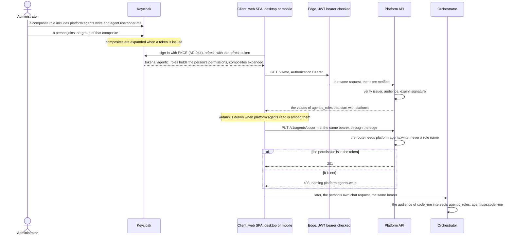

A change in Keycloak (a person added to a group, a permission added to a composite) reaches the API and the orchestrator at the person's next token, within the 15 minutes of the access token's lifetime (system `deploy/keycloak/README.md`, *verified 2026-10-05*). The lifecycle of a permission is Keycloak's, not the platform's, so no state diagram is drawn.

### Secrets (AD-030)

The dashboard **never shows, reads or writes a secret value** (AD-024).

- **v0, decided: pick a reference.** A field that needs a secret (an API key, a header token, a base URL kept out of git) offers the keys of `GET /v1/secret-keys`: the `data[].secretKey` of every ExternalSecret in the namespace that carries the label `agents.vymalo.com/offer: "true"`, under its `target.name`. An ExternalSecret holds no value (*verified 2026-10-05*, <https://external-secrets.io/latest/api/externalsecret/>), so the API needs no right on Secrets. A key fetched with `dataFrom` is not listed and is typed by hand. The value is put in AWS Secrets Manager and the ExternalSecret in home-os, as today; the dashboard says where.
- **The offer label is the guard.** A form may reference only an offered key; the API refuses anything else (422). Without it, anyone who may configure agents could point an agent's `MODEL_API_KEY` at the orchestrator's database Secret and a model URL of their own, and read it from the requests: the operator and the kubelet would mount any Secret of the namespace that a custom resource names.
- **v1, not now (the owner kept it out of v0):** a write-only form that writes a Kubernetes Secret (the API then needs `create` and `update` on Secrets, which in Kubernetes come with nothing that stops it reading them back, and the value then lives outside AWS, where GitOps does not know it), or a write to AWS Secrets Manager through an IAM role scoped to one prefix (`prod/another-agentic/agents/*`) and to `PutSecretValue`, with an ExternalSecret made per secret. Either is a credential with write power held by a process that takes browser traffic, and needs its own decision.

### GitOps and the dashboard (AD-031)

Argo CD in home-os owns the infrastructure: the CRDs, the operator and the system chart. §59a's rollout first puts `coder` (adam-rs `deploy/coder-agent`) and `chat` (the system chart) in charts, **and the owner decided on 2026-10-05 that the dashboard then takes them over**: their Argo applications are removed at the cutover (M3 and M5, §59a), and the dashboard owns them like the agents it makes. **One owner per object:**

- **Argo prunes only what it tracks.** It tracks an object by its own annotation (`argocd.argoproj.io/tracking-id`, the default method; *verified 2026-10-05*, <https://argo-cd.readthedocs.io/en/stable/user-guide/resource_tracking/>), and an object of no Application is an orphan, which it can show and warn about but does not delete (<https://argo-cd.readthedocs.io/en/stable/user-guide/orphaned-resources/>). The `another-agentic` AppProject has `orphanedResources: { }`, so the dashboard's objects appear in Argo's orphan list; an ignore rule by kind can quiet that.
- **The dashboard writes only its own objects.** It writes an object only when it carries its `managed-by` label and no Argo tracking annotation. Anything else is **read-only** in the dashboard, marked *Managed by GitOps*, with View YAML. A create whose name exists is 409.
- **An agent defined in both places.** If a chart later renders an object with the name of a dashboard object, Argo applies over it and its tracking annotation appears: the dashboard sees the annotation, stops writing, and shows the object as GitOps's with a warning. The reverse, a dashboard save over a GitOps object, never happens (the rule above). With `selfHeal` on (home-os sets `automated: { prune: true, selfHeal: true }` for both another-agentic apps), a dashboard edit of a GitOps object would be undone within a sync, which is why it is refused.
- **Moving an agent between owners.** Dashboard to GitOps: Export YAML, commit it, sync. GitOps to dashboard: mark the objects `Prune=false`, remove the Argo application without cascade, remove the tracking annotation, then an **Adopt** action adds the label. Adopt is in v0 for the takeover of `coder` and `chat`, and takes only an object that no Argo application tracks any more. *Unverified*: the exact sequence that keeps the objects, the volume and the database through it; it is rehearsed on the shadow (M2).
- **What the takeover costs.** Once `coder` and `chat` leave git, **their configuration lives only in the cluster**: a lost cluster or a bad edit has no commit to go back to. v0 has Export YAML (manual) and the config digest; a backup or export of dashboard-owned objects is an open question (§93), not decided. Nothing of the fleet stays GitOps's afterwards, so *Managed by GitOps* appears only for an object somebody puts under Argo again.

### Revisions

§61 (immutable revisions, channels, promotion) is **out of dashboard v0**: the operator has no revisions (AD-023) and nothing consumes them. An edit applies at once, as an edit of the custom resource does. What the dashboard gives instead: the config digest (`status.config.digest`) on each agent, **View YAML** and **Export YAML** for GitOps users, and an `If-Match` on every save so two administrators never overwrite each other silently.

### Screens

Every screen lists what the API returns; a GitOps object is read-only everywhere. Every field error is the API's 422, shown on its field.

| Screen | Fields and validation | Writes |
|---|---|---|
| **Agents** (`/admin`) | One row per `AgentService`: name, title, kind (coder or folder), state (the lifecycle below), the first false condition's reason and message, owners (coders), audience, *Managed by GitOps*, *In chat*. Actions: New coder, New folder agent, Edit, Suspend or Resume, Delete (confirm by typing the name; says what `deletionPolicy` keeps) | `spec.suspend`; delete |
| **Coder** (new, edit) | Name: `^[a-z][a-z0-9-]{0,38}[a-z0-9]$`, at most 40 characters so every derived name fits 63, unique, fixed after create. Title (1 to 80), description (at most 500). Tags (at most 16, each 1 to 64, lower-case words and dashes). **GitHub App** (one per coder, AD-033): its id, and its private key as an offered secret key (`platform:secrets.pick`). **GitHub owners**: at least one GitHub login (`^[A-Za-z0-9](?:[A-Za-z0-9-]{0,38})$`), no `*`. Owners who may get new repositories: a subset of the owners, default none. **Model**: an endpoint and one of its aliases (or a typed alias); OpenCode's model, default the same. **Run-pod size class**: one of `GET /v1/info`'s classes (D15a), hidden while there are none; absent means no run pods. Runs at once: 1 to 16. Pull requests as drafts. **Tool servers**: any `ToolProvider`s; an `http://` one to another host asks for *Allow plain http*, which covers every server of the agent. **Image** under *Advanced*: empty is the operator's default coder image (AD-029). **Access**: the audience, defaulting to `agent.use:<name>` | `AgentService`: `metadata.name`, `description`, `registry.title`, `registry.tags`, `access.audience`. `AgentConfig`: `environment.image`, `coder.github.app.id`, `coder.github.app.privateKeySecretRef`, `coder.github.app.owners`, `coder.createRepoOwners`, `model.endpointRef`, `model.model`, `coder.opencodeModel`, `coder.runPods.sizeClass`, `coder.workers`, `coder.prDraft`, `tools.mcpServers.<n>.providerRef`, `tools.allowInsecureHttp`; the rest from the deployment defaults |
| **Folder agent** (new, edit) | Name, title, description, tags, as above. **Instructions**: `instructions.md` in a text editor, with its front matter; more files by relative path (`skills/…`); the folder at most 1 MiB; no `mcp.json` (tools come from the Tool servers screen). Model, tool servers, access, as above | `AgentConfig`: `adam.binary: adam-agent`, `agent.folder.files`, `model`, `tools`; `AgentService` as above |
| **Models** | Name (`^[a-z][a-z0-9-]{0,62}$`), title, base URL as a value (`http` or `https`, a host, no user, password, query or fragment) or an offered secret key, the API key (an offered secret key), the aliases (at most 32). *Used by*: the agents that reference it. Delete is refused while it is used | `ModelEndpoint` |
| **Tool servers** | Name (`^[a-z][a-z0-9-]{0,30}$`, the prefix of its tools as `<name>__<tool>`), title, URL (the same URL rules), headers (an HTTP token as name, a plain-text prefix, an offered secret key), tools allow-list, optional (default on). *Used by*. A second, read-only list: the tool servers a person can attach in chat, from the orchestrator's `GET /api/tool-servers`, marked *set in the system chart* | `ToolProvider` |
| **Access** | A table: agents by rows, the audience values in use by columns (the use permissions `agent.use:<name>`, and `*`). A cell toggles a value for one agent. A note says that **the use permission and the composite roles that grant it are made in Keycloak**, not here, and that the orchestrator's own roles are in the system chart. An object under GitOps is shown and not editable | `AgentService.spec.access.audience` |
| **Deployment** | Read-only: the sharing cap (`GET /api/me`), the registry's state (`GET /api/registry`), the public `ui` settings (`GET /api/config`), the deployment defaults (`GET /v1/info`), and where each is changed | nothing |

### Create a coder

From the form to the person's agent picker. The Platform API, the client's `/admin` area (calling the API directly, *Clients without a web server*) and the registry's `audience` attribute: the custom resources of D1, the operator's references of D2, the registry's attribute of D3 and the forms and ports of D4 are built, D5 to D9 are planned; the operator, the registry, the orchestrator's registry reader and `GET /api/agents` are §59a's slices and another-agentic-system's built code.

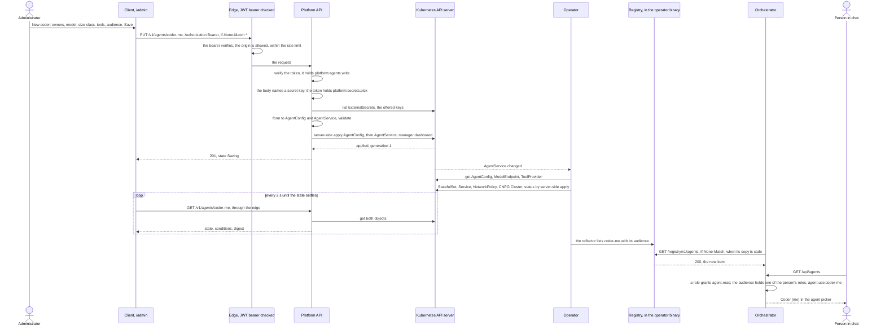

The person sees the agent at most the registry's `max-age` plus the orchestrator's cap after it is listed (30 s and 60 s; *verified 2026-10-05* for the orchestrator: `orchestrator/crates/registry-platform/README.md` and `orchestrator/crates/app/src/app.rs`, `list_agents` reads the registry on every call). No restart: `dev/registry-e2e.sh` (b) asserts that an agent added to a mock registry is listed within 10 seconds (the script exists; it was not run for this text).

### An agent's lifecycle, as the dashboard shows it

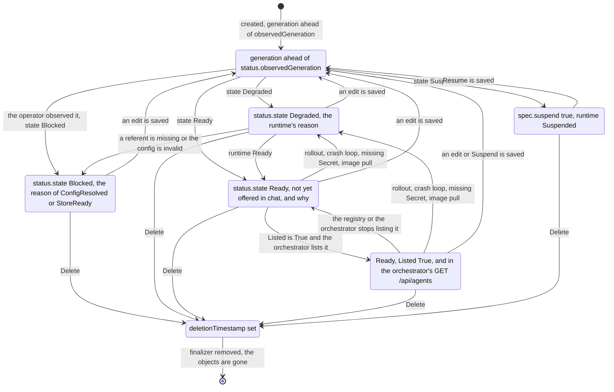

`Saving` to `Blocked`, `Degraded`, `Ready` and `Suspended` are §59a's states once the operator has observed the generation; `InChat` is the page's own check, `GET /api/agents` read by the browser (an administrator sees every listed agent, AD-028). A GitOps object goes through the same states and is read-only.

### Slices

After the operator slices they need (§59a, *Slices*): S5 (the controller), S7 (the registry) and S12 (the system reads the registry). Each slice is one pull request in one repository.

| Slice | Repository | What | Tests | Needs |
|---|---|---|---|---|
| D1 | platform | `aap-api`: `access.audience`, `ModelEndpoint`, `ToolProvider` (v0 subset), `model.endpointRef`, `mcpServers.<n>.providerRef`, optional `environment.image`; CEL; crdgen; examples | the CEL rules against a real API server, invalid examples | S1 |
| D2 | platform | `aap-domain` resolves the references and the default image; the controller watches the two new kinds | table tests, parity goldens unchanged for inline objects, reconciler tests on the `Memory` ports | S5, D1 |
| D3 | platform | The registry item's `audience`; the contract's *Item* table and consumer rule edited | the contract tests, the consumer test with the system's parser | S7, D1 |
| D4 | platform | `aap-forms`; `AgentObjects` and `Authenticator` in `aap-ports` with testkits | form round trips, property tests (no secret value in a form, a CR or a YAML export) | D1 |
| D5 | platform | `objects-kubernetes`: server-side apply, the ownership rules, ExternalSecrets read | the envtest-like harness: apply, conflict, the Argo annotation, a GitOps object refused | S4, D4 |
| D6 | platform | `auth-oidc` | the conformance suite against an in-process issuer: algorithms, `aud`, expiry, unknown `kid`, roles claim | D4 |
| D7 | platform | `platform-api` and `bin/api`; the chart's `api` component (Role without Secrets, NetworkPolicy from the web's pods only); `GET /v1/info` | router tests on the `Memory` ports; kind end-to-end: create a folder agent through the API, see it `Ready` and listed | S8, D2, D5, D6 |
| D8 | system | The orchestrator enforces `audience` (ADR 0045): the reader parses it, every agent check applies it; the mock registry's items get one | unit and property tests of the predicate, conformance, `dev/registry-e2e.sh` extended (a person without the role does not see the agent; an administrator does) | D3 |
| D9 | system | Web: the `/admin` area, `PLATFORM_API_URL`, the route handler, the gates, the Agents screen read-only; a mock Platform API in `web/mock` | Playwright with axe on the mock: hidden without the URL, hidden without `platform:agents.read`, unreachable API, a 403 from the API, the header forwarded and never logged | D7 |
| D10 | system | Web: the coder and folder-agent forms, Suspend, Delete, View and Export YAML | Playwright: create, a 422 on its field, a 412 on a stale save, a GitOps agent read-only | D9 |
| D11 | system | Web: Models, Tool servers, Access, Deployment | Playwright, as D10; `pnpm screens` | D10 |
| D12 | system | The chart: `web.platformApiUrl`, the web's egress to the API | `deploy/chart/tests/render-check.sh` | D9 |
| D13 | platform | kind end-to-end of the whole chain: the API creates a coder with an audience, the operator runs it, a pinned orchestrator image lists it for a person who holds the role and not for one who does not | the job `chain-e2e` of `operator-image.yml` (built 2026-10-17, the *D13 built* note above; **passed on its first run, run 38994193619 at `4929e3c`, *verified 2026-10-17***, and the review's changes passed too, run 38996503582 at `8d45dab`, *verified 2026-10-17*; it does not gate `push`) | D7, D8 |
| D14 | home-os and system | The `api` component on, its configuration, the offer label on the agents' ExternalSecrets, `web.platformApiUrl`; in the system's `deploy/keycloak/` exports, the client roles of AD-032 (the dashboard's permissions, one `agent.use:<name>` per agent) and the composite roles that bundle them, `admin` among them | the first agent made on netcup | S10, S12, D12, D13 |
| D16 | home-os | The takeover (AD-031): the Argo applications of `coder` and `chat` removed without cascade, the objects adopted by the dashboard; `coder` renamed `coder-vymalo` with its alias, `coder-me` made (AD-033) | the dashboard edits `coder-vymalo` and `chat`; an old thread of `coder` continues | S14, S15, D14 |
| D15 | platform and adam-rs | `runPods.sizeClass` and the chart's `runPodClasses`, once adam-rs's run pods (ADR 0019 there) are merged | goldens of the run-pod template | D2, adam-rs ADR 0019 |
| D15a / D15b | platform | **D15a** (built, the *D15a built* note above): the operator sets up run pods (the template, the quota, the network policy, the account and its binding, the admission policy), the chart's `runPods` and `runPodClasses`, the form field and `runPodSizeClasses` in `GET /v1/info`; **D15b** (built, the *D15b built* note above, its job unverified until CI has run it): the kind end-to-end of the coder with run pods | D15a: the parity goldens at adam-rs `3f714d0`, `render-check.sh`, `run-pods-admission.sh` on a real API server, mutation of each guarantee; D15b: `run-pods-e2e.sh`, the job `run-pods-e2e` of `operator-image.yml`, walked against a real API server and the real operator and coder with a stand-in for the kubelet | D2, D5, D7, D15 (adam-rs #131) |

*Amended 2026-10-06 (clients without a web server):* D7 gains the edge route to the API, CORS for the deployment's origins and a rate limit, and its NetworkPolicy lets the edge in, not only the web's pods; D9 becomes the `/admin` area of the static export, with the API's public base URL (a config endpoint or build time) and **no route handler** (and, if P-017 is taken, Refine); D12 becomes the chart's edge route and the public setting, not `web.platformApiUrl` for a server. The desktop and mobile shells, and their sign-in, are the system's (its ADR 0047, *to be added*) and are not slices of this repository.

*Amended 2026-10-16 (D7a):* D7 is two pull requests. **D7a** (built) is `crates/platform-api` and `bin/api`: the router, the table of routes to permissions with its matrix test, `GET /v1/info`, CORS, and the binary with its configuration file, health and shutdown (the *D7a built* note above). **D7b** is the rest of the row: the image and its CI build, the chart's `api` component (the `Role` of `crates/objects-kubernetes/tests/rbac.yaml`, no Secrets; the `Service`; the edge route, with its NetworkPolicy and rate limit) and the kind end-to-end, which is also the first time the binary runs against a real API server and a real issuer.

*Amended 2026-10-16 (D7b1):* D7b is two pull requests. **D7b1** (built, the *D7b1 built* note above) is the image, its CI build, push and bump, and the chart's `api` component: the `Role` (the objects crate's `rbac.yaml`, held equal by a check), the `Service`, the `NetworkPolicy` whose ingress is the edge's peers, the optional `Ingress` and the `ConfigMap`. The rate limit stays the edge's: the chart passes the Ingress annotations through and does not implement one. **D7b2** is the kind end-to-end through the API, the first time the pod runs against a real API server and issuer.

*Amended 2026-10-16 (D7b2):* D7b2 (built, the *D7b2 built* note above) is the kind end-to-end: `deploy/operator/tests/e2e/api-e2e.sh` and the job `api-e2e`, which `push` needs, with the testkit's issuer as a program on the runner. D7's last column is met by the job once CI has run it; D13 (the whole chain, with an orchestrator that lists the agent) is still to come.

*Amended 2026-10-17 (D13):* D13 (built, the *D13 built* note above) is a job of `operator-image.yml`, **`chain-e2e`**, and not of `operator.yml` as this row said: both images are artifacts of that workflow, which is where the API's end-to-end already is; and it **does not gate `push`** (an owner decision, below the note), because it runs another repository's image, pinned in one file of this one. It needs D7 (the API, the registry on) and D8 (the orchestrator that enforces the audience: the pin is its main at `8df44c6`). D14, which turns the `api` component on in the deployment, is still to come, and the wiring of the two deployments (the system's chart reading the registry through the operator's Service, the one shared token) is its.

*Amended 2026-10-26 (D15a):* D15 is two pull requests. **D15a** (built, the *D15a built* note above) is everything that needs no cluster: the field, the neutral spec, the settings, the objects and their order, the chart (the Role, the `PriorityClass`, the admission policy and its parameters), the form and `GET /v1/info`, parity with the coder chart at adam-rs `3f714d0` and the admission test against a real API server. **D15b** is the kind end-to-end: the operator chart installed in kind with `runPods.enabled`, a coder with run pods running the real image, a command run in a pod by `exec`, the quota, the network policy and `run-pods-admission.sh` run in the cluster, and the deletion of everything. The row's dependency on adam-rs's ADR 0019 is met by adam-rs `main` (#131, `3f714d0`); the *Risks* row below is amended. The run pool of §59b (the operator making and leasing the pods) is unchanged by this: D15 is the per-run pods of adam-rs's chart, which AD-039 keeps as the default.

*Amended 2026-10-27 (D15b):* **D15b is built** (the *D15b built* note above): the script, its fixtures and its job exist and were walked against a real API server, the real operator running as its own service account and the real coder, with a stand-in for the kubelet and no network plugin. **D15 stays open until the job `run-pods-e2e` has run green in CI.**

### Risks

| Risk | Handling |
|---|---|
| Whoever may configure agents can make a pod read any Secret its custom resource names | The offer label (AD-030) and the permission `platform:secrets.pick` that every secret reference needs: only keys of labelled ExternalSecrets are accepted. A namespace of their own for agents is the stronger fence, later (owner question in §93) |
| The web gains its first server-side call and setting; another-agentic-system says the web has none | ADR 0045 there: one route handler, one URL, the header forwarded as received, nothing stored or logged |
| *Amended 2026-10-06:* the Platform API is now reachable by any holder of a token, from any client | JWT validated at the edge and again in the API; CORS limited to the deployment's origins; rate limits; the permission checks of AD-032 are unchanged, and they, not the network, were always the guard |
| A native client's tokens leave the browser's cookie jar | OS keychain or keystore, public clients with PKCE, one Keycloak client per platform (AD-044) |
| The registry's `audience` is ignored by a client that does not know it, which then shows a restricted agent to everybody | The only consumer ships the rule (D8) before D14; the contract states the rule (D3, done 2026-10-15); D13 runs the pinned consumer against the registry the operator serves, in kind (*verified 2026-10-17*: the job passed on its first run, run 38994193619) |
| A permission or composite changed in Keycloak is not in a token yet | Tokens live 15 minutes and are refreshed by oauth2-proxy (system `deploy/keycloak/README.md`), so a change reaches the API and the orchestrator within that; the API's 403 names the permission it needed |
| Many `agent.use:<name>` roles make the roles claim, and so the ID token, large | One role per agent is a handful at v0; *unverified* where a header limit bites (oauth2-proxy, Caddy, Next.js), to be tried with a realistic token in D9 |
| After the takeover the configuration of `coder` and `chat` is only in the cluster | Export YAML by hand and the config digest in v0; a backup or export is an open question (§93) |
| GitOps and the dashboard fight over an object | One owner per object, the label and the tracking annotation checked on every write (AD-031) |
| A broken edit takes an agent down at once (no revisions) | `aap-domain::validate` before the apply; `Blocked` leaves what runs untouched (§59a); Export YAML before risky edits |
| Two administrators edit the same agent | `If-Match` on every save, 412 for the second |
| The ID token expires during a long edit | The web's session refresh (another-agentic-system ADR 0033 amendment of 2026-10-04) retries the call; the form keeps its fields |
| adam-rs's run-pod settings change before they merge | D15 is last and starts from adam-rs `main` (met: D15a read `3f714d0`, and a later change of the coder chart is a diff of the parity goldens, `tools/adam-parity/regen.sh --check`) |
| A person who deletes the policy's parameter ConfigMap, or the operator that fails between two writes, leaves an account that can make pods without the guard | The binding must allow a namespace with no parameters, or it would deny every pod there; the operator makes the parameters before the binding of the account to the Role and removes the binding first; the account's Role has no right on ConfigMaps; the README says it. Not closed: a person with `delete` on ConfigMaps in the namespace can still open it (*D15a built*, 2) |
| The operator can bind the Role of run pods to any account of its namespace | It already makes workloads that run any pod; the right is `bind` on that one Role by name (not `escalate`, not `create` on `roles`, not `pods`); `render-check.sh` holds the Role rule by rule |

### Facts checked

- *Verified 2026-10-05*, another-agentic-system at `e5da0a4`: the orchestrator reads the registry on every `list_agents` (`orchestrator/crates/app/src/app.rs`) through `CompositeRegistry<FixedRegistry, Option<Platform>>`, static agents first (`orchestrator/bin/orchestrator/src/boot.rs`); a copy lives at most `max-age`, capped at 60 s (`orchestrator/crates/registry-platform/README.md`); the roles filter agent ids (`orchestrator/crates/app/src/authz.rs`), and a credential's roles are its claim's values as spelled; `admin` is content-free (ADR 0039, `docs/api/config.md`).
- *Verified 2026-10-05*, the same revision: the edge copies `Authorization: Bearer <ID token>` onto every request to the web (`deploy/chart/files/Caddyfile`, `dev/Caddyfile`), oauth2-proxy runs with `--set-authorization-header=true`, the roles claim is `agentic_roles` and the client id `another-agentic` (`deploy/chart/values.yaml`, `deploy/keycloak/README.md`); the web makes no server-side call today (`docs/architecture.md`).
- *Verified 2026-10-05*, home-os at `12bb11d`: both another-agentic Applications sync with `ServerSideApply=true` and `automated: { prune: true, selfHeal: true }` (`charts/apps/values.yaml`); the AppProject has `orphanedResources: { }` (`charts/cd/values.yaml`); no `application.resourceTrackingMethod` is set (`charts/argocd/values.yaml`).
- *Verified 2026-10-05*, documentation: Argo CD's default tracking method is the annotation, and orphaned resources are reported, not deleted (the two Argo CD pages above); an ExternalSecret holds no value (external-secrets.io); `list` on Secrets returns their contents (kubernetes.io).
- *Verified 2026-10-05*, adam-rs at `ea570d6`: `deploy/coder/values.yaml` has `github.app.owners` (`GITHUB_APP_OWNERS`) and the `mcp.websearch` and `mcp.context7` servers the forms replace; no run-pod setting is on `main`.
- *Verified 2026-10-06*: a Next.js static export has no request-time server code or API routes (<https://nextjs.org/docs/app/guides/static-exports>); another-agentic-system runs oauth2-proxy with `--skip-jwt-bearer-tokens=true` (`deploy/chart/templates/oauth2-proxy.yaml`, ADR 0033); Refine's shadcn/ui integration (<https://refine.dev/core/docs/ui-integrations/shadcn/introduction/>).
- *Verified 2026-10-16*: OpenID Connect Discovery 1.0, 4.3 (the `issuer` of the document must be identical to the issuer URL used as the prefix of `/.well-known/openid-configuration`) and 4.1 (a terminating `/` of the issuer is removed before the well-known path is appended), <https://openid.net/specs/openid-connect-discovery-1_0.html>; `jsonwebtoken` 11.1.0 (features `aws_lc_rs` and `rust_crypto`, no `ring`; the signature is verified before the claims; `iat` is not validated), read from the crates.io download; `reqwest` 0.12.28 (`rustls-tls-native-roots` is rustls with ring), from the crates.io index; Google's issuer fetched over TLS by `aap-auth-oidc` through `HTTPS_PROXY` (D6 note). *Unverified*: a Keycloak's JWKS and discovery document, and the composite-expanded roles in `agentic_roles`.
- *Verified 2026-10-16*, kubernetes-sigs/kind at v0.33.0, `pkg/build/nodeimage/const_cni.go`: the default CNI is `kindnetd` (image `kindest/kindnetd:v20260820-69b56db7`) and its ClusterRole may list and watch `networkpolicies`, `pods`, `namespaces` and `nodes`. *Verified 2026-10-16*, CI run 38892472909 on `main` (job `operator-coder-e2e`, kind v0.33.0, node image v1.35.8): kindnetd **enforces** NetworkPolicies, since `ok   a pod the registry's NetworkPolicy does not name cannot read it (status 000)` was printed by `coder-e2e.sh`, which prints a warning instead when the pod got through; and the operator's pods are Ready under a policy that admits ingress only to the registry's and metrics' ports (the kubelet's probes of the health port pass).
- *Amended 2026-10-26 (D15a)*: what was *unverified* in the next line is *verified 2026-10-26* at adam-rs `3f714d0` by rendering its chart (`tools/adam-parity/regen.sh`): `RUN_POD_TEMPLATE_FILE`, the template, a 2Gi limit in the chart's default class, the quota, the policy and the Role. Not verified: that the coder reads what the operator mounts (D15b). *Amended 2026-10-27 (D15b):* the real coder, at adam-rs `main` (the code of `3f714d0`), reads the template the operator made and makes a pod from it, in the walk of `run-pods-e2e.sh` against a real API server; with a real kubelet it is CI's (unverified until the job has run).
- *Unverified*: adam-rs ADR 0019 and its settings (`RUN_POD_TEMPLATE_FILE`, a 2Gi limit), seen only as uncommitted work in a local working copy; the Argo CD version on netcup (installed by hand, unpinned) and so its tracking method; that `dev/registry-e2e.sh` passes today (not run); that a StatefulSet name over 52 characters fails (the reason for the 40-character cap). *Unverified, 2026-10-06*: the origins each Tauri platform's webview uses (CORS), and Refine's Vite preset and access-control provider beyond the page above.

---

## 61. Draft → Revision → Promotion UX

Recommended workflow:

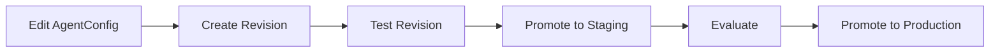

The UI can display:

```text
Coder

Production      r47
Staging         r51
Latest          r53

Revision    Status      Created
r53         Ready       5m ago
r52         Ready       1d ago
r51         Staging     2d ago
r47         Production  8d ago
```

Editing production in-place is impossible because revisions are immutable.

> **Note (2026-10-05):** out of the dashboard's v0 ([§60a](#revisions)): the operator has no revisions yet (AD-023). The dashboard offers the config digest, View YAML and Export YAML instead (owner question in §93, *Dashboard v0*).

---

## 62. API / CRD Versioning

Initial resources should use:

```text
agents.vymalo.com/v1alpha1
```

Evolution path:

```text
v1alpha1
   ↓
v1beta1
   ↓
v1
```

Resources should follow Kubernetes conventions:

```text
spec
status
conditions
observedGeneration
```

Where conversion becomes necessary, conversion webhooks can support multiple served versions.

---

## 63. Provider Interfaces

The architecture should prefer a small number of meaningful provider boundaries.

Per AD-020, each is a Rust trait with a conformance testkit, implemented by
separate crates and selected at build time (Cargo features + configuration, or
a developer's own composition root). Nothing outside the trait's crate may
depend on an implementation's types.

Possible interfaces:

```text
RuntimeProvider
WorkflowProvider
RouteProvider
IdentityProvider
SecretProvider
ArtifactProvider
AdmissionProvider
```

Each provider can advertise capabilities.

Example:

```text
scale-to-zero
persistent-volumes
volume-snapshot
shared-rwx-storage
gpu
runtime-class
direct-exec
multi-container
spiffe
```

An `AgentEnvironment` may require capabilities.

If the selected provider does not support them, validation should fail clearly.

---

## 87. Suggested CRD Status Pattern

Example:

```yaml
status:
  observedGeneration: 12

  conditions:
    - type: Ready
      status: "True"
      reason: Reconciled

    - type: RuntimeAvailable
      status: "False"
      reason: ScaledToZero

  currentRevision:
    name: coder-r53

  productionRevision:
    name: coder-r47
```

Conditions should describe state rather than burying errors in arbitrary text fields.

---

## 88. Possible `AgentService` State

Logical service state may include:

```text
Ready
Degraded
Suspended
Blocked
```

This is distinct from runtime state.

An agent can be:

```text
AgentService: Ready
Runtime: Suspended
```

because scale-to-zero is healthy.

---

## 89. Possible `AgentRun` State Machine

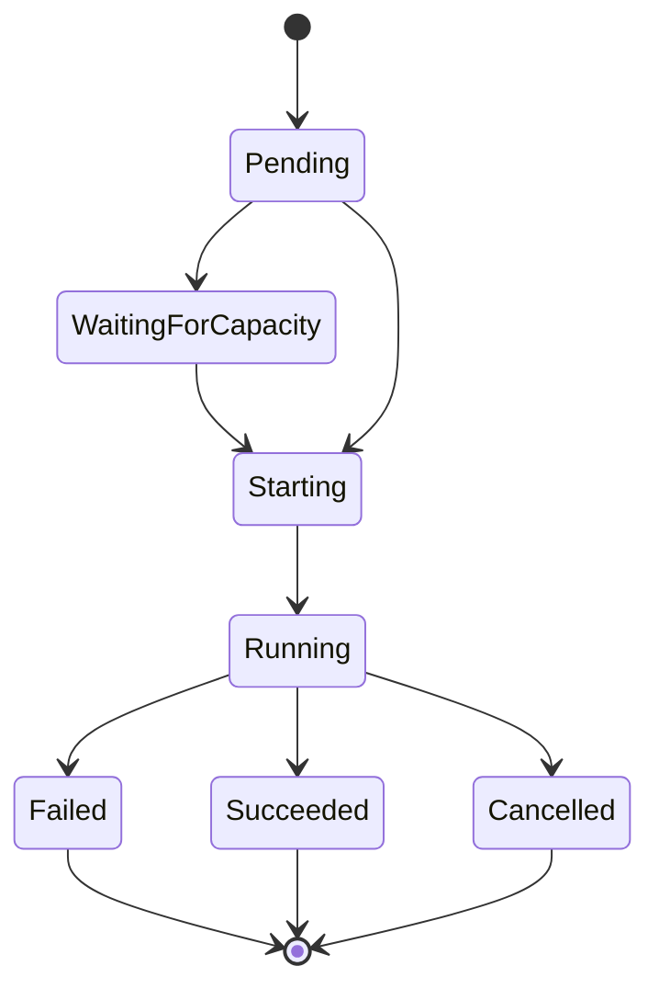

Application-specific workflow state remains in Restate.

---

## 90. Naming

Suggested API group:

```text
agents.vymalo.com
```

Potential resource names:

```text
AgentService
AgentConfig
AgentRevision
AgentEnvironment
ToolUniverse
ToolProvider
SecurityProfile
AgentRun
AgentLease
AgentRoute
```

Resource naming should avoid tying the project to a specific underlying agent framework.

---

[← Index](README.md) · [← Previous](09-operations.md) · [Next →](11-decisions.md)
