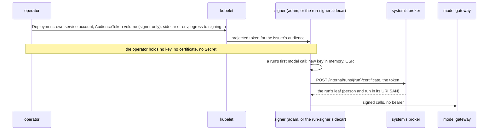
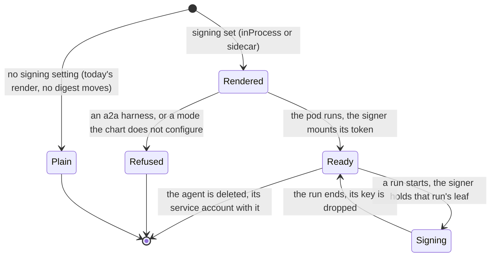
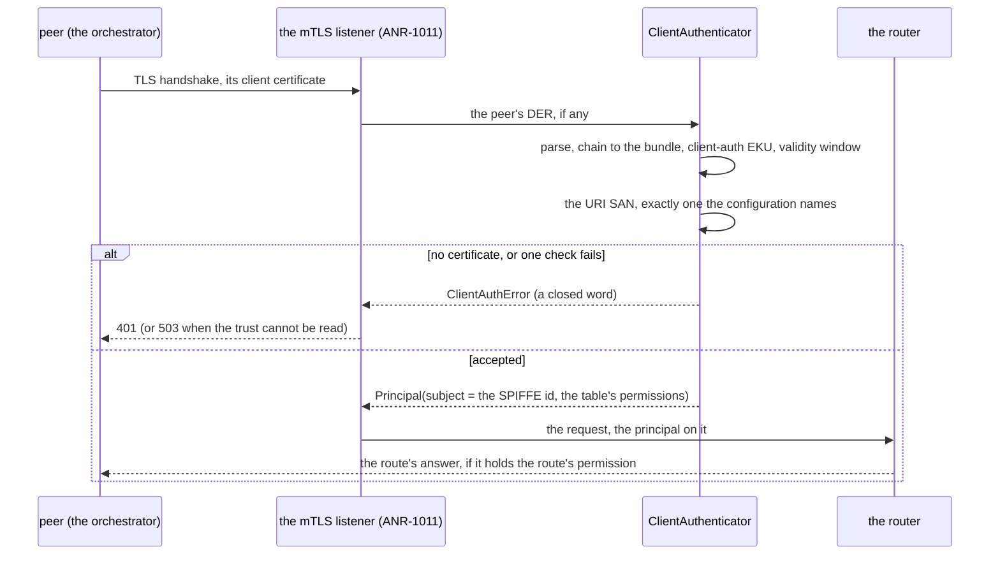
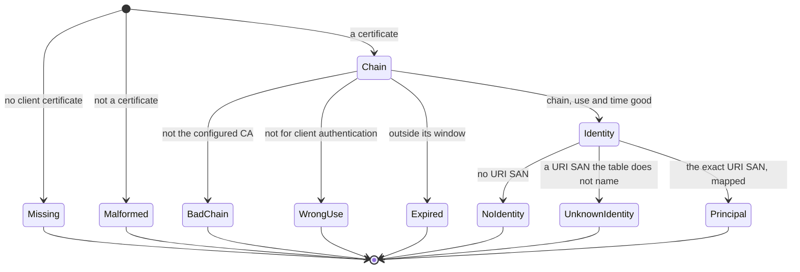

# Decisions and open questions

[← Index](README.md) · [← Previous](10-control-plane-and-crds.md) · [Next →](12-summary.md)


---

## 91. Architecture Decision Summary

### Accepted

#### AD-001 — Stable service identity

`AgentService` is separate from execution runtime.

#### AD-002 — Config/revision split

`AgentConfig` is mutable.

`AgentRevision` is immutable.

#### AD-003 — Production is explicit

Production may point to any valid revision and does not imply latest.

#### AD-004 — Responses is optional

Responses API is disabled by default and must be explicitly enabled.

#### AD-005 — No Chat Completions shim

`/v1/chat/completions` is intentionally unsupported.

#### AD-006 — Per-agent APIs

Each agent has its own service/API surface.

#### AD-007 — API discovery

Each `AgentService` exposes:

```text
/.well-known/api-catalog
/openapi.json
/docs
```

#### AD-008 — ToolUniverse is reusable

Agent tools are represented through reusable tool configuration resources.

#### AD-009 — Workflows and infrastructure are separate

Restate handles durable workflow progression.

Runtime controllers handle infrastructure.

#### AD-010 — Scale-to-zero uses leases

Compute lifecycle is controlled by `AgentLease`, not HTTP connection lifetime.

#### AD-011 — Persistent storage is optional

No mandatory workspace PVC exists.

#### AD-012 — Volumes are explicit lists

An environment can have zero, one, or many volumes at arbitrary mount paths.

#### AD-013 — Shared project state is allowed

Project-level caches and repository data may be shared across agents.

Mutable worktrees remain isolated per run.

#### AD-014 — Multi-tenancy exists from day one

Tenant and Project are core application concepts.

#### AD-015 — Observability is mandatory

Every run must be traceable end-to-end.

*Amended 2026-11-15 (K5):* the operator and the Platform API emit traces ([§48a](09-operations.md#48a-traces-of-the-operator-and-the-platform-api-k5), P-037 to P-039); the traces of an agent's own runs need adam-rs.

#### AD-016 — Runs and leases are application records

`AgentRun` and `AgentLease` live in the application database, not etcd (§19–20).

*Amended 2026-10-06 (AD-036):* `RunLease`, the slot a run asks of a run pool (§59b), is a CRD. `AgentRun` and `AgentLease` stay records.

#### AD-017 — Workflow engine behind a provider boundary

`WorkflowProvider` (§17a): a Rust state machine on Postgres first; Restate optional.

#### AD-018 — Gateways are replaceable OpenAI-compatible endpoints

EAIG / Agent Router, AISIX or others; no gateway-specific dependency (§41).

#### AD-019 — Release channels are projected onto A2A

Through the release-channels agent-card extension (§12a).

#### AD-020 — Swappable implementations, selected at build time

Every provider boundary (§63) — and every other infrastructure seam: stores,
lease service, credential broker, artifact store, model client — is a Rust
trait in a dedicated crate, with a conformance testkit every implementation
must pass. Implementations are separate crates; binaries (operator, control
plane) are only compositions. Built-in implementations are Cargo features
selected by configuration; a developer swaps in their own by writing a
composition root against the same traits, without forking. No runtime plugins
(Rust has no stable dylib ABI; out-of-process plugins would turn every
boundary into a wire contract) — revisit only if third parties must ship
implementations without compiling. Same decision as another-agentic-system
ADR 0009. Accepts P-001 (§22, §63).

#### AD-021 — The fleet's agents are listed as a linkset of agent cards

The control plane lists the A2A agents it provisions in a versioned contract,
`agent-registry/v1` (`https://agents.vymalo.com/registry/v1`): a JSON linkset in
the RFC 9727 `api-catalog` shape with one agent-card URL per `AgentService`,
its id and optional tags (§12b). Releases stay on each card (AD-019) and the
registry carries no UI concept; the platform provisions agents and knows nothing
about its clients. First consumer: another-agentic-system ADR 0022.

#### AD-022 — The harness is adam-rs

*(2026-10-04.)* The harness of the platform's agents is **adam-rs**
([vymalo/another-adam-rs](https://github.com/vymalo/another-adam-rs)): two
binaries in one image, `ghcr.io/vymalo/another-adam-rs/coder`: `adam-coder`
(a coding task to a verified pull request) and `adam-agent` (serves any agent
folder). It replaces ADK-Rust, which §26 recorded as *not yet exercised*, and
which was never spiked: adam-rs exists and is what runs the netcup coder.
OpenCode stays a capability inside `adam-coder` (the adam-rs crate `adam-acp`),
so ACP and OpenCode remain agent capabilities, not platform requirements
(§26). The harness is selected by `AgentConfig.spec.harness.type: adam-rs`,
and `harness.adam.binary` names the binary. Amends §8 (`adk-rust` becomes
`adam-rs`), §9 (the example revision's harness), §26 and the Harness row of
[mvp.md](../mvp.md); the history text stays. Cost, accepted: adam's environment
contract is copied into the operator's `aap-domain` and held equal by parity
goldens (§59a, *Risks*).

#### AD-023 — The first operator runs adam-rs agents from AgentService + AgentConfig

*(2026-10-04.)* The first operator is **one Rust binary on kube-rs**, in this
repository, specified in §59a. It reconciles two CRDs, `AgentService` and
`AgentConfig`, into a workload, a Service, a NetworkPolicy and storage for an
adam-rs agent (AD-022). The **native Kubernetes `RuntimeProvider` comes first**,
which answers P-002: Coder is not first. Deferred, each with an inline
equivalent that keeps the move additive: revisions and channels, leases,
scale-to-zero, and the supporting CRDs (`AgentEnvironment`, `ToolUniverse`,
`ToolProvider`, `SecurityProfile`, `AgentRoute`). `status.config.digest` is the
seed of revisions. Until a control plane exists, **the operator binary serves
the §12b registry**, with one static bearer and no per-caller filtering in v0.
The Rust shape of `RuntimeProvider` lives in the crate `aap-ports`, and
`Activate` is folded into `ensure` (§22). Amends §7, §8, §9, §10, §12b, §21,
§22 and §56 as v0 subsets (blockquotes there); the target text stays.

#### AD-024 — Secrets are references

*(2026-10-04.)* A custom resource **names a Secret and a key and never holds a
value**. The operator has **no RBAC on Secrets** and **creates no
ExternalSecret**: how a Secret gets into the namespace is the deployment's
business (§38). A pod receives only the variables the adam binaries know
(`MODEL_API_KEY`, `A2A_BEARER_TOKENS`, `GITHUB_TOKEN`, `DATABASE_URL`,
`MODEL_BASE_URL`) and the ones the extra MCP file names; the operator never
invents a secret variable, and a conformance test checks that no secret value
ever materialises. A run store is either a referenced Secret or an
operator-owned CloudNativePG `Cluster`, behind the `StoreProvisioner` seam
(AD-020). **Known gap, recorded and not hidden:** the coder still holds the
GitHub App private key in its pod, as a file from a Secret, which contradicts
§38 ("GitHub App private key … must never enter agent runtimes") until the
credential broker (§39) exists.

*Amended 2026-10-06 (AD-042):* the broker that closes this gap is designed in §39a. It is not built, so the gap stands.

#### AD-025 — Agents are configured from a dashboard over a Platform API

*(2026-10-05.)* On the owner's request of that day ("we need a dashboard for
configuring all these"), administrators configure the fleet's agents from a
**dashboard**, the UI of §60, specified in §60a. The dashboard calls a
**Platform API** that authorizes the person (`agent.configure`, §52), validates
with `aap-domain`, and writes the agents' custom resources by server-side apply;
it reads their status and conditions back. **The custom resources stay the only
store of agent configuration** (AD-016): the dashboard and the API keep no
database of their own, and humans get no Kubernetes RBAC (§52). Secrets stay
references (AD-024). Where the dashboard lives, how the API is packaged, how
access per agent, secrets, models, tool servers and GitOps ownership work are
proposed as P-007 to P-012 and asked of the owner in §93 (*Dashboard v0*);
**the owner answered on 2026-10-05**, and they are AD-026 to AD-033 below
(P-007 to P-012 became AD-026 to AD-031, amended where the owner changed
something; the permission model is AD-032 and the coders per GitHub owner are
AD-033).

#### AD-026 — The dashboard is an `/admin` area of the system's chat web

*(2026-10-05. Was P-007; owner's questions 1 to 3 of *Dashboard v0*.)* "The same
one" is **confirmed**: one dashboard inside another-agentic-system's web, with its
sign-in and look, not a second app. The area exists only when the web's server
has a Platform API URL (`PLATFORM_API_URL`) and the API answers
(capability-detected, read live, fail closed). The web's server calls the
Platform API **with the person's bearer**, which the edge already puts on every
request to the web, and nothing else: not through the public edge, so the API is
reached only from the web's pods. **Amended by the owner's answer to question 2
and by AD-032:** the area is **drawn for people who hold the dashboard's
permissions**, not for a single `admin` role. The web learns them from the
Platform API (`GET /v1/me`), not from `admin` in the orchestrator's
`GET /api/me`; it stays a hint, and the API checks every request itself (§60a).
The system's side: its ADR 0045 (accepted 2026-10-05).

*Amended 2026-10-06 (the owner: "we're packing the UI into tauri for building a desktop and a mobile application"):* Tauri cannot run a Node server, so the web is a **static export** (`output: 'export'`, no request-time server code, no API routes; *verified 2026-10-06*, <https://nextjs.org/docs/app/guides/static-exports>), and **"the web's server calls the Platform API with the person's bearer, not through the public edge" no longer holds**, for desktop and mobile and so for the web. The **client**, whether the web as a single-page app, desktop or mobile, calls the orchestrator and the **Platform API directly with a bearer JWT**, which the API validates like the orchestrator (the system's ADR 0033: an OAuth 2 resource server, oauth2-proxy skipping a JWT bearer that verifies). The Platform API is therefore **on the edge**, behind JWT validation, with **CORS restricted to the deployment's origins** (`tauri://localhost` or whatever each platform uses: *unverified*) and **rate limits**. `PLATFORM_API_URL` becomes a **public base URL** the client learns from a config endpoint or at build time. The gates, the permissions and the routes are unchanged. The original text above stands as decided on 2026-10-05. §60a, *Clients without a web server*; sign-in: AD-044. The system's side: its ADR 0047 (*to be added*).

#### AD-027 — The Platform API is its own binary

*(2026-10-05. Was P-008; owner's question 4: as recommended.)* `bin/api` beside
`bin/operator`, in the same workspace and chart: least privilege per process (the
API writes specs and reads ExternalSecrets, the operator writes workloads), a
process that takes people's tokens apart from the one that reconciles, and a
stateless API that can run two replicas while the operator stays one (§60a).

#### AD-028 — Who may use an agent is on its `AgentService`, and RBAC answers it

*(2026-10-05. Was P-009; owner's question 6: (b) as recommended, with
"RBAC should normally answer this".)* `AgentService.spec.access.audience` is
published in the registry (the optional attribute `audience`, additive to
`agent-registry/v1`) and **enforced by the orchestrator**; an agent with no
audience is for administrators only (fail closed). **Amended by the owner:** each
agent has a **use permission**, a Keycloak client role of the client
`another-agentic` named `agent.use:<agent-name>`, and that permission is what the
agent's audience lists. Composite roles (AD-032) grant it to people. The
orchestrator's check stays "the audience intersects the person's roles", because
Keycloak puts the expanded composites in the token. Who may use `coder-me` is then
decided in Keycloak, not in git. The dashboard writes neither Keycloak nor the
orchestrator's configuration. The system's side: its ADR 0045 (accepted).

#### AD-029 — Shared settings are named objects or operator defaults, never copies

*(2026-10-05. Was P-010; owner's question 7: as recommended; plus the owner's
decision on images.)* A model endpoint is a `ModelEndpoint` and a remote MCP
server a `ToolProvider` (a v0 subset of §32), referenced from `AgentConfig` by
exclusive `endpointRef` and `providerRef` fields and resolved by the operator, so
one edit rolls every agent that uses it. **Images:** an agent that names no image
uses **the operator's default coder image**, a value of the operator's chart that
CI bumps (GitOps); `environment.image` is optional, and **an agent may still pin
its own image in the dashboard**. Additive to `v1alpha1` (§56, §60a).

*Amended 2026-10-15 (slice D2, §60a):* the default image is **not bumped by CI**. It
is a value of the operator's chart with a pin of its own (`defaultAgentImage`, tag and
digest), which **the GitOps repository sets** to roll every agent that names no image
onto a newer coder, and which `bump-tag.sh` never touches: that script writes only the
operator's own `image.tag`, because the operator's image and the coder's have two
release trains. Whether CI should move the default too (a workflow that opens a change
when adam-rs publishes a coder image) is an open question in §93 (*Dashboard v0*, the
fourth of D2's decisions to confirm), *not decided*.

#### AD-030 — Secrets are picked, never written, in dashboard v0

*(2026-10-05. Was P-011; owner's question 8: as recommended.)* A secret field
offers only the keys of ExternalSecrets labelled `agents.vymalo.com/offer: "true"`;
the API refuses any other reference and has no right on Secrets. Values stay in
AWS Secrets Manager. A write-only form needs its own decision (§60a).

#### AD-031 — One owner per object, and the dashboard takes over `coder` and `chat`

*(2026-10-05. Was P-012; owner's questions 9 to 13.)* The dashboard writes only
objects that carry its `managed-by` label and no Argo CD tracking annotation;
every other object is read-only in it. **Amended by the owner (question 9):** the
dashboard **takes over `coder` and `chat`**. They leave GitOps at the operator
cutover (M3 for the coder, M5 for `chat`, §59a): their Argo applications are
removed then. **Consequence, stated and not hidden:** their configuration then
lives only in the cluster. A backup or export story for dashboard-owned objects is
an open question (§93), not decided; the dashboard's Export YAML helps and is
manual. Also decided: dashboard agents live in the namespace
`another-agentic-system` (question 10); revisions and promotion (§61) are out of
v0, with the config digest, View YAML and Export YAML instead (question 11);
run-pod size classes come from the operator chart's `runPodClasses` and are picked
by name (question 12); the orchestrator's own settings stay in the system chart,
read-only in the dashboard (question 13).

#### AD-032 — Permissions are Keycloak client roles; roles are composites

*(2026-10-05. Was §93 *Dashboard v0*, question 5, which recommended the one role
`admin`; the owner asked "can we break down into permissions and let roles provide
mappings?" and chose **Keycloak composite roles**.)* Fine-grained **permissions are
client roles** of the client `another-agentic`. Human-facing **roles are composite
roles** that bundle permissions; `admin` becomes a composite that includes all of
them. Keycloak expands composites into the token, so **the Platform API checks
individual permissions, never a role name**, and the same holds for the
orchestrator's use permissions (AD-028). The v0 set, **proposed names, not final**
(§93): `platform:agents.read`, `platform:agents.write`, `platform:models.write`,
`platform:toolproviders.write`, `platform:secrets.pick`, and one
`agent.use:<agent-name>` per agent (§60a, *Permissions and roles*). The system's
`deploy/keycloak/` exports gain these client roles and composites **when the
dashboard is built**; they are not edited by this decision. The system's side: its
ADR 0045.

#### AD-033 — One coder per GitHub owner, one GitHub App each

*(2026-10-05.)* The coder is **renamed `coder-vymalo`** (same database, same GitHub
App installation), with an alias `coder` for one release so old threads continue.
**`coder-me`** is added for the GitHub owner `stephane-segning`. There is **one
GitHub App per coder**, each with its own private key in AWS Secrets Manager
(`prod/another-agentic/env`), so the App's id and key reference are fields of the
coder, not deployment defaults (§60a). Property names are proposed (§93). The
system's side and the details: its ADR 0045 and the amendment of 0041.

*Amended 2026-10-06 (the owner chose the name **Adam** for the agent called coder):* the visible names change now, that is the card, the display name and the agent ids: `coder-vymalo` and `coder-me` become **`adam-vymalo`** and **`adam-me`**, and the old ids stay as aliases so that old threads continue. The technical names, the binary `adam-coder`, the image `ghcr.io/vymalo/another-adam-rs/coder` and the chart `deploy/coder`, move later, **at the operator cutover**. Until then the examples of §59a, §59b and §60a keep the name `coder-vymalo`.

*Amended 2026-10-06 (the owner: "From now on, I won't place a private key into AWS SM for a github app anymore. It's too cumbersome for me, plus we already have one"):* **one GitHub App for every Adam**, not one each. The existing App (its key already in AWS SM) is made installable on any account and installed on each owner the Adams serve; each Adam stays limited to its own owners by `GITHUB_APP_OWNERS` (adam-rs), so `adam-me` acts only on `stephane-segning` and `adam-vymalo` only on `vymalo`. The second key, `github_app_private_key_coder_me`, is dropped. What one key costs: whoever holds it can act on every installation, so the key stays in the coder's pod until the broker holds it (AD-042), as AD-024 records.

#### AD-034 — The operator, not the coder, creates and owns the pods where work runs

*(2026-10-06; owner's decision 1 of the run pool.)* Run pods are made by the
operator, owned (controller `ownerReference`) by a configurable `RunEnvironment`,
and run under a dedicated ServiceAccount: no API token, and no Role or RoleBinding
made for it. The coder loses `pods/create` and keeps `pods/exec` on the pods the
chart names, plus `runleases`. Extends adam-rs ADR 0019, whose coder-made pods
stay the default until the pool is proven (AD-039). §59b.

#### AD-035 — Everything about a run pool is configurable on the `RunEnvironment`

*(2026-10-06; decision 2.)* Image (default: the operator's workspace image), size
class (`runPodClasses`, AD-031), idle time-to-live, warm minimum, maximum pods,
maximum leases per pod, node selector and tolerations, the ServiceAccount and the
security context, with CEL rules where a rule needs no other object. The floor of
the pod's hardening is fixed in code and cannot be loosened by the object. A
dashboard form is a later slice (§60a). §59b.

#### AD-036 — Pods are pooled per environment and a slot is a `RunLease`

*(2026-10-06; decisions 3 and 4.)* Pods are reused across runs that use the same
`RunEnvironment`: not one per run, not one per workspace. The operator bin-packs
leases onto pods, keeps the warm minimum and reaps idle pods after their
time-to-live. The coder asks for a slot with a `RunLease` CR naming the
environment, the run, the owner and the repos; the operator assigns a pod and
reclaims the slot when the lease ends, its holder disappears or its TTL expires.
**Amends AD-016 for this object only:** `RunLease` is a CRD (one per run,
renewed once a minute); `AgentLease` (§20) stays an application record. §59b.

#### AD-037 — Never share a pod across owners; within an owner, only with strict file isolation

*(2026-10-06; decision 5, the owner's words:)* reusing a pod across different
repos is acceptable *"if the agent can be modular enough and the files strictly
separated; so that one agent cannot read repos it's not supposed to read… So even
across the same owner, no"* (no sharing unless isolation is strict). A pod is bound
to one owner by its first lease and never re-bound. Within an owner, one lease per
pod is the safe default until a strict mode is proven (P-013). §59b, *Isolation*.

#### AD-038 — Storage is one shared RWX volume plus a git clone on lease

*(2026-10-06; decision 6.)* The coder and the run pods share a `ReadWriteMany`
claim (Longhorn RWX; *unverified* on this cluster). The coder clones the lease's
repositories into the lease's directory, and may clone another repository
mid-run into the same directory. Clones use short-lived grants from the credential
broker (§39a), never a long-lived key, and **no credential is put in a run pod**.
§59b, *Storage and clones*.

*Amended 2026-10-06 (AD-045):* the shared claim stays the default (`storage.mode: SharedClaim`). A run environment may instead choose `PodVolume`, a replicated `ReadWriteOnce` volume per run pod, because a pod with `hostUsers: false` cannot mount the Longhorn RWX claim (*verified 2026-10-06* on netcup). Under `PodVolume` the coder cannot mount the storage, so files and git cross `pods/exec` (P-019). The "Longhorn RWX; *unverified* on this cluster" above is now: it exists and is an NFS share-manager (*verified*); its speed is still *unverified*.

*Amended 2026-10-06 (AD-045, amended):* `PodVolume` is now the default, so the shared claim of this record is `storage.mode: SharedClaim`, an alternative, and the clone into a directory the coder mounts is that mode's. Under the default the coder clones into its own mirror and the pod receives a bundle over `pods/exec` (AD-046).

#### AD-039 — The run pool is behind traits, and per-run pods stay the default

*(2026-10-06; decisions 7 and 8; AD-020.)* In adam-rs, a new `Environment`
implementation (`PooledEnvironment`, `RUN_ENVIRONMENT=pool`, its own crate)
creates and watches a `RunLease`; adam-rs decides its side in an ADR of its own. In
the platform, the pool policy is a pure `PoolPlanner` and the cluster is behind
`PodProvider`, each with a testkit. The pool and ADR 0019's per-run pods coexist;
**per-run stays the default** until the owner decides the pool is proven. §59b.

#### AD-040 — An agent's MCP servers are fixed; users add their own, per user

*(2026-10-06; decisions 1 and 2 of connections.)* An agent's MCP servers come from
its folder or `AgentConfig` and users cannot change them. A user can add MCP
servers from the UI on top of them, with auth `oauth2` (authorization code with
PKCE, following the MCP authorization specification), `api_key` (header name
configurable), `bearer` or `none`, stored per user and optionally shared to an
organisation later. The owner asked to *"mimic how LibreChat is doing their
stuff"*: §39a records what that means and where it differs. §39a.

#### AD-041 — Code hosts are connections: GitHub App, GitLab and Bitbucket

*(2026-10-06; decision 3.)* A user connects GitHub (an App the user installs),
GitLab and Bitbucket (OAuth). The connections feed adam-rs's `CodeHost` and
`GitCredentials`, which have only GitHub today. Whether one App per coder (AD-033)
remains is open (§93). §39a.

#### AD-042 — A credential broker holds the secrets and hands out short-lived scoped grants

*(2026-10-06; decisions 4 and 5.)* Refresh tokens and keys are stored encrypted
per user and per connection. A run gets a short-lived, scoped token **per request,
per run, per connection**; revocation is one action; nothing secret goes into
agent pods, files or logs. The port is `CredentialBroker` over a `SecretVault`,
each with a testkit (AD-020); the candidate backends are listed and **none is
chosen** (§93). Ownership is per user and, later, per organisation, and pods are
never shared across owners (AD-037). **Closes, once built, the gap AD-024
records.** §39a.

#### AD-043 — Run environments may offer containers: `None`, `Build` or `Engine`

*(2026-10-06; the owner: "some of those environments need docker; e.g. for building… How do we do?")* The `RunEnvironment` gains `containers: { mode: None | Build | Engine }`, **`None` by default**. `Build` is a **BuildKit** sidecar, rootful inside a pod with `hostUsers: false` (rootless BuildKit cannot run inside a user namespace), used through `docker buildx`; `Engine` is a **rootless Podman** sidecar with a Docker-compatible socket, for `docker run`, compose, Testcontainers and devcontainers (adam-rs ADR 0010, the system's ADR 0028). **Never** the host's Docker socket, **never `privileged` without `hostUsers: false`**, **one daemon per pod, never shared across owners**. CEL: `mode != None` requires `isolation.userNamespace == true`. The build cache lives on the RWX claim or in a registry cache. Push credentials come from the broker (§39a) and are used by the coder, or by a short grant (P-018), reconciled with P-015. Kaniko is not chosen (archived upstream in June 2025). §59b, *Containers in a run*.

*Amended 2026-10-06 after the cluster probes:* the sidecar shapes are **proven on netcup** (the owner's probes, *verified 2026-10-06*): BuildKit rootful and Podman, each with `privileged: true` inside the user namespace and its store on an `emptyDir`. So `Engine` is Podman in the pod's user namespace, privileged only there (rootless inside the user namespace is *unverified*). `mode != None` **now requires `storage.mode: PodVolume`** (AD-045; an RWX claim cannot be mounted in a pod with `hostUsers: false`), and the run pods' namespace must allow Pod Security `privileged` for such pods; the operator renders the sidecar's context and the run container keeps its floor. The build cache `type=local` goes to the lease directory on the pod volume, and the OCI archive is streamed to the coder over exec (P-018). "The build cache lives on the RWX claim" above no longer holds.

*Amended 2026-10-06 (AD-047, AD-048):* the namespace that must allow Pod Security `privileged` is a namespace of its own, `<coder namespace>-run`, where only the operator makes pods (AD-047). `isolation.userNamespace` now defaults to `true` for every run pod (AD-048), so the CEL rule above fails only for an environment that sets it `false`.

#### AD-044 — Every client is a public OAuth client with PKCE (RFC 8252)

*(2026-10-06; owner-driven, with the Tauri clients of AD-026's amendment.)* Web, desktop and mobile are **public OAuth clients using PKCE**, following RFC 8252 (OAuth 2.0 for Native Apps), and each sign-in uses the **system browser or an in-app browser tab, never an embedded webview**: **web** by redirect; **desktop** by the system browser and a **loopback redirect** `http://127.0.0.1:<port>` (for example tauri-plugin-oauth, <https://www.lib.rs/crates/tauri-plugin-oauth>; its maintenance status is *unverified*); **mobile** by an in-app browser tab (ASWebAuthenticationSession on iOS, Custom Tabs on Android) with an app-claimed https link or a custom scheme. Tokens are kept in the **OS keychain or keystore**. **One Keycloak public client per platform**, so redirect URIs and token policy are separate. The details live in another-agentic-system's ADR 0047 (*to be added*; the decisions folder is <https://github.com/vymalo/another-agentic-system/blob/main/docs/decisions/>); this record keeps the platform's side: what the Platform API accepts (a JWT of that issuer with an audience it knows, §60a). §52.

#### AD-045 — Run pods may use a replicated RWO volume of their own instead of the shared RWX claim

*(2026-10-06; the owner, after the cluster probes: "Also I think we can go with normal RWO volumes too, replicated".)* **"Too": an addition.** `RunEnvironment.spec.storage.mode` is `SharedClaim` (the default, AD-038) or `PodVolume`. `PodVolume`: each run pod gets **one `ReadWriteOnce` claim as a generic ephemeral volume**: Kubernetes makes it with the pod and **deletes it with the pod** (stable since v1.23, *verified 2026-10-06*, kubernetes.io), named `<pod name>-work-<suffix>` so a re-made ordinal never meets its predecessor's claim, and mounted at the same path as `SharedClaim`'s pod directory; the StorageClass (`storageClassName`, `size`) is the environment's, and replication is the class's: `longhorn` has `numberOfReplicas: "2"` (*verified 2026-10-06*, the owner's `kubectl get sc longhorn -o jsonpath='{.parameters.numberOfReplicas}'`), so a `PodVolume` from it has 2 replicas. The reason is verified: a pod with `hostUsers: false` cannot mount Longhorn's RWX claim (`MOUNT_ATTR_IDMAP`, invalid argument) and can mount an RWO ext4 volume, idmapped (*verified 2026-10-06* on netcup). CEL: `isolation.userNamespace == true` requires `PodVolume`, so `UidPerLease` and `containers.mode != None` (AD-043) require it; `storage.mode` is immutable. The coder cannot mount another pod's RWO volume: its files and git cross `pods/exec` (P-019). The operator makes no claim: it only reads them, to report one that does not bind. §59b, *Pod volume: files and git over exec*.

*Amended 2026-10-06:* `PodVolume` is the default; `SharedClaim` stays available. (The owner: "PodVolume should become default".) So "`SharedClaim` (the default, AD-038)" above reads "`PodVolume` (the default)", an environment that wants the shared claim names it, and with it sets `isolation.userNamespace: false` (AD-048). The coder's files and git cross `pods/exec` by default (AD-046, decided from P-019). The measurement of builds on both, once the first question of §93 *Run pool*, is now only about `SharedClaim`'s speed.

#### AD-046 — Under a pod volume, files and git cross `pods/exec`; credentials stay in the coder

*(2026-10-06; the owner: "P-019 is fine".)* Under `storage.mode: PodVolume` (AD-045), the default, the coder cannot mount the run pod's volume, so: its **file tools act through `pods/exec`**, an adam-rs change (file access through the environment session, not the coder's filesystem); **git moves as bundles over exec**: to clone, the coder fetches into a **bare mirror of its own** with a broker grant and streams a `git bundle` into the pod, and to push, the pod writes a bundle of the branch to stdout, the coder fetches it into its mirror and pushes with a grant, with **incremental bundles** (`^<basis>`) to keep later transfers small; **no credential enters the pod**, so P-015 holds unchanged; an **image built in the pod** is streamed to the coder as an OCI archive and the coder pushes it (P-018); **parking** is a commit of the work in progress (untracked files included, ignored ones left out) to a private ref `refs/adam/park/<run-hash>`, kept as a bundle in the coder's storage, and ignored build outputs are rebuilt. The exact git flags and the size limits of an exec stream are *unverified*. §59b, *Pod volume: files and git over exec*.

#### AD-047 — Pods with a container daemon run in a namespace of their own

*(2026-10-06; the owner: "go with its own namespace", on P-018.)* The operator puts the run pods with `containers.mode != None` (AD-043) in the namespace **`<coder namespace>-run`** (configurable in the operator chart), at Pod Security **`privileged`**, where nothing but the operator makes pods. A `ValidatingAdmissionPolicy` there admits a pod only if **its requester is the operator's ServiceAccount**, it has **`hostUsers: false`**, and its **only `privileged` container is the sidecar of the chart's pinned image**. The coder's namespace keeps its level. The coder holds **only `pods/exec`** in that namespace, and the operator works in and watches both namespaces. A `RunLease` stays in the coder's namespace and its pod is in the other, so `status.podNamespace` is added to the lease and the holder execs there. §59b, *Containers in a run*.

#### AD-048 — Run pods run in a user namespace of their own by default

*(2026-10-06; asked whether every run pod should get its own user namespace (`hostUsers: false`) by default, not only pods with a daemon, the owner: "Yes, default on".)* **`isolation.userNamespace` defaults to `true`.** With `PodVolume`, the default (AD-045), every run pod gets `hostUsers: false`, so root inside a run pod is an unprivileged user on the node, with a 65536-id range of its own per pod, assigned by the kubelet (*verified 2026-10-06* on netcup: the probe mapped root to host uid 130154496). **`SharedClaim` cannot**: an RWX claim cannot be idmapped (*verified 2026-10-06* on netcup, mount_setattr(2) lists no NFS), so `storage.mode: SharedClaim` requires `isolation.userNamespace: false` (CEL; the converse of the rule that a user namespace requires `PodVolume`). The run container keeps its floor: non-root uid 10001, no capabilities, a read-only root. §59b, *What the operator makes*, *Isolation*.

#### AD-049 — A package cache is a claim the deployment lists, and never one the operator makes

*(2026-11-14, slice K1; review.)* `AgentConfig.spec.environment.cache.existingClaim` (adam-rs ADR 0040) names a PersistentVolumeClaim **of the agent's namespace**, which the pod mounts read-write at `/cache` and which a run pod may mount too. adam-rs leaves the name to the deployment; here several tenants write configs, so a name is a control: **the operator's `cache.allowedClaims` (chart value, `CACHE_ALLOWED_CLAIMS`) lists the claims that may be a cache, empty by default, and a claim that is not on it is `ConfigInvalid`** naming the field and the list; with an empty list the refusal says how a deployment allows one. **Whatever the list says**, `validate` refuses a name the operator or CloudNativePG makes: this agent's own work claim names (`<volume>-<service>-<n>`, `<service>-<volume>`), its database's (`<service>-db`, `<service>-db-<n>`, `-wal`), and any name shaped like one (`<x>-<n>`, `work-<x>`, `<x>-work`, `<x>-db-<n>`, `<x>-db`), because another agent's data would otherwise be a cache. The run pods' guard admits the cache's claim only as the one the config named and `validate` let through (`RunPodGuard::cache_claim`; the parameter `claims`). The Platform API's forms carry no cache field, so they have no list. **Not decided here:** whether the list should be per namespace or per agent; one list for the operator is what a namespaced operator has.

#### AD-050 — The access tier has a ceiling the deployment sets

*(2026-11-14, slice K1; review.)* `coder.maxAccessTier` (adam-rs `MAX_ACCESS_TIER`) is the highest tier a person may pick for a message, and `bypass` renames and deletes repositories with no consent form. adam-rs leaves it to the deployment's values; here any `agentconfigs` writer, and any dashboard user through the form, could set it. **The operator has a ceiling, `maxAccessTier` of its chart (`AGENT_MAX_ACCESS_TIER`), `auto` by default, and the Platform API's `defaults.maxAccessTier` carries the same value**: a config above it is `ConfigInvalid` and a form above it is refused, naming `agent.maxAccessTier`. The variable on the pod is the lower of the config's tier (or `auto`) and the ceiling: it is written when the config names a tier, or when the ceiling is below `auto` (which the adam-rs chart cannot express: the one difference of the parity goldens, listed in their README). With the default ceiling a config that names none gets no variable, as before.

#### AD-051 — `VolumeSource::ExistingClaim` is a new variant of a closed enum

*(2026-11-14, slice K1.)* `aap-ports`' `VolumeSource` is closed on purpose (AD-020): a volume the provider did not understand must fail to compile, not be dropped. K1 adds `ExistingClaim { name }`, a claim someone else owns, mounted by name and never created, owned, resized or deleted by a provider, whatever the deletion policy says. **It breaks every implementer of `RuntimeProvider` that matches `VolumeSource` exhaustively**, which the `aap-ports` README says; `Memory` and the conformance sample carry it, and `RunPodGuard` gains an optional field that is absent from the serialised spec when absent, so no agent's digest moves.

#### AD-052 — gVisor: a sandboxed runtime class for run pods and for the agents' own pods

*(2026-11-16, an owner decision on P-040; slice K14, of which **K14a is built (2026-11-19)** and **K14b is closed as the admission half (2026-11-20)**, the sandbox start being unproven.)* The owner accepted P-040 as proposed, with one change: **the agent's own pod runs under the sandboxed runtime too**, not only its run pods. So: (1) the operator chart names the class for run pods (`runPods.runtimeClassName`) and for the agents' pods (`agent.runtimeClassName`), each **empty by default and then not a trace in any render**; (2) once a class is named for run pods, the admission policy **requires** it: a run pod of an agent's account that names another class, or none, is refused; (3) the image-build modes (`Build`, `Engine`) are refused together with a class until they are proven under it; (4) the `RuntimeClass` object is the administrator's, never the operator's; (5) the default handler is `runsc`, not `runsc-kvm`. **What the owner's change adds to prove before it is on:** the coder's pod under the class with its `git-sandbox` sidecar (a process namespace of its own, a Unix socket on an `emptyDir`), the egress proxy's pod, the projected account token, and the store's connections; the agent's class is a setting of its own so that run pods can be sandboxed before the agents are. **K14a built (2026-11-19):** the two chart values (`runPods.runtimeClassName`, `agent.runtimeClassName`), each empty by default and then not a trace in any render (the seven goldens unmoved), `AGENT_RUNTIME_CLASS`, `Workload::runtime_class_name` and `RunPods::runtime_class_name` (absent from the serialised spec, and so from the digest, when unnamed), the pod template of every workload and the run pod template, and the admission policy's tenth rule, which **requires** the class once named (the parameter `runtimeClassName` of each agent's ConfigMap, the chart's value as fallback so that a skew refuses). Decision 3 — the build modes `Build` and `Engine` refused with a class — is **not** built: this platform's `coder.runPods` has no build mode to read. **K14b closed as the admission half, by the owner's decision of 2026-11-20:** the proof K14b carries is the *rendering* and the *admission refusals* — the two values, the pod templates that carry the class, the policy's tenth rule, and `run-pods-admission.sh`'s refusals ("another runtime class", "no runtime class") asked of a real API server and run in-cluster by `run-pods-e2e.sh`. **A sandbox start under `runsc` is not proven, and this decision says so plainly.** *Measured 2026-11-20 on a throwaway kind cluster (`kindest/node` v1.37.0, containerd 2.3.4, a privileged node with every capability, seccomp and AppArmor unconfined, `/dev/kvm` visible):* gVisor `release-20261116.0` installs into the node and its handler registers, but a pod under the `RuntimeClass` never starts — `OCI runtime create failed: creating container: configuring device cgroup: loading device filter: operation not permitted`. **The mechanism:** runsc attaches an eBPF device filter to a cgroup it creates, and a kind node's cgroup namespace root holds the node's own processes (systemd, containerd, kubelet), so cgroup v2's "no internal processes" rule refuses a child there and the filter load answers `EPERM`. It is not capabilities and not the platform (KVM fails identically, before any sandbox starts). The shim's `options.Config` did not deliver runsc's `-ignore-cgroups` in either spelling, and `runsc -ignore-cgroups do …` only gets past it to fail on the `do` command's own `ip netns` setup. **What would prove it:** a node that is not a container, or one whose cgroup namespace is the host's (`--cgroupns=host`, which `kind` does not expose) — or, for a self-hosted runner, mounting the host's `/sys/control` tree into the node, which this repository will not ship. **K14c and K14d stay planned**, with the sandbox start still to prove on such a node: the coder's `git-sandbox` sidecar, the egress proxy, the projected account token and the store's connections under the class. *Unverified:* everything about gVisor beyond the Talos extension's README cited in P-040; that any hosted CI runner can start a sandboxed pod in a kind node.

*Amended 2026-11-24, the owner's decision on the order:* **run pods first; the agents' own pods after run pods are proven.** Asked whether P-040's "run pods only at first" is a step toward this decision or a change to it, the owner answered that it is the first step: this decision stands, both pods are sandboxed in the end, and the order is fixed. So a deployment names `runPods.runtimeClassName` first and leaves `agent.runtimeClassName` empty until a run pod has started under `runsc` on a real node, the proof K14c still carries. Nothing built changes: both values already exist and are empty by default, which is why the agent's class was kept a setting of its own.


*Amended 2026-11-25 (ANR-402), within the owner's ruling and building nothing it does not say:* **a size class may name its own `RuntimeClass`** (`runPodClasses.<name>.runtimeClassName`), which replaces `runPods.runtimeClassName` for the pods of that class. The operator takes the class of the agent's `sizeClass` and writes the one value into the template the workers read and into the guard's parameter (one function, so the pod and the rule that judges it cannot disagree); the policy's rule is present when the deployment or any class names a class, strict when the deployment does, and silent for an agent whose parameter names none. Decision 2 stands as written (a class, once it applies to a pod, is required of it). **Decision 3 (`Build` and `Engine` refused with a class) is left alone, with a test:** `coder.runPods` has no build mode, so no mode can be set beside a class, and `run_pods_have_no_build_mode_for_a_runtime_class_to_be_refused_with` fails the day a CRD names one. Unnamed anywhere, no render, golden or template moves.

#### AD-053 — The operator may reach listed MCP servers to discover their tools

*(2026-11-16, an owner decision on P-024; slices K3a and K3b.)* The owner accepted P-024 as proposed. The operator may probe a `ToolProvider`'s URL (MCP `initialize` and `tools/list`) and write its reachability and tool names into its status. It is **off by default**, reaches only the hosts the operator chart lists (`toolProbe.to`, which also opens the operator's `NetworkPolicy` egress to exactly those), and a server that needs a header is reported `Unknown`: the operator still reads no Secret (AD-024). **K3a and K3b built (2026-11-18):** the chart's `toolProbe.to` (NetworkPolicyPeers), `toolProbe.ports`, `toolProbe.timeoutSecs` and `toolProbe.dns`, and the operator's egress to exactly those peers on those ports, plus DNS; empty, the default, and not a rule or a variable of it is rendered, the six goldens byte for byte what they were. `render-check.sh` holds it, each check broken on purpose. **K3b** is [`aap-tool-probe`](../../crates/tool-probe/README.md) (`initialize` and `tools/list` over Streamable HTTP, a JSON or SSE answer, at most 64 names) and the `Reachable` condition and `probe` in the `ToolProvider` status, off by default; a server that needs a header is `Unknown`, `NeedsHeader`, and the operator still reads no Secret. The crate's stub server and the controller's tests hold it, and `api-e2e.sh` step 6a probes a stub on the runner through the chart's egress and reads the tools back through the deployed API; **the step passed in CI** (run 44325222462, job `api-e2e` 134879022830, at `56fc23e`, *verified 2026-11-18* in its log: `Reachable True` with the stub's three tools, and the header provider `Unknown`, `NeedsHeader`).

#### AD-054 — A bring-your-own A2A image is a harness type of its own

*(2026-11-16, an owner decision on P-025; slice K11, built as K11a on 2026-11-19 — see the note at the end.)* The owner accepted P-025 as proposed. `AgentConfig.spec.harness.type: a2a` names an image, a port, the card's path and environment variables that are each a plain value or a `secretKeyRef`. The operator runs it with the pod hardening, store and registry entry of an adam-rs agent and invents no variable. **This amends AD-022** (adam-rs stays the default harness; this is the second, opt-in) **and AD-024** (a value is still never in the resource; the list of references is the only way a secret reaches such a pod). **K11a built (2026-11-19):** `harness.a2a` is `{ image, port, cardPath, healthPath, env[] }`; `harness.adam` and `spec.model` became optional (the model is required of `adam-rs` by CEL), and the two blocks are exclusive by CEL. The operator runs one workload with the image's own entrypoint, only the declared variables **plus `A2A_BEARER_TOKENS` from the service's `interfaces.a2a.bearerTokensSecretRef`** (the registry contract is that a listed agent accepts the orchestrator's token), probes on `healthPath`, no volume, no sidecar, no cache and no run pods, and still provisions the store without inventing `DATABASE_URL`. `Network.card_path` carries the card's path to the registry's `href` (absent for adam, so no digest moves). Proven by tests, an a2a render golden, and the kind job `namespaces-e2e` of run 44487393662 (job 135436059044), where an a2a agent was `Ready` in 6 s and listed at its card URL. What it does not prove: a real third-party A2A image, and that the image authenticates the token the way the platform's callers expect.

#### AD-055 — One operator may watch several namespaces, with one `Role` in each

*(2026-11-16, an owner decision on P-026; slices K6a, K6b and K7.)* The owner accepted P-026 as proposed. A `watchNamespaces` list in the operator chart makes one `Role` and `RoleBinding` per namespace, with today's verbs; the operator watches each; a registry id that two namespaces share is listed for neither. **Never a `ClusterRole`** (§59a stands). **K6a built (2026-11-18):** the chart's `watchNamespaces` (a list; `watchNamespace` is the one-namespace shorthand, and not both) renders one `Role` and one `RoleBinding` per namespace with today's verbs, the run pods' `Role` in each, the admission policy's binding over all of them, and the run pods' settings, the admission policy and the `PriorityClass` once; the first namespace is the primary (the API's `defaults.namespace`, the run pods' cluster-scoped names and `WATCH_NAMESPACE`), and the operator binary watched that one until **K6b** (built the same day, below), which makes it watch the list, makes a duplicate registry id listed for neither and proves it in kind. `render-check.sh` holds K6a, each check broken on purpose. **K6b built (2026-11-18):** the operator watches `WATCH_NAMESPACES` (a comma-separated list; `WATCH_NAMESPACE` is the primary, and must be one of them), with one set of controllers and caches per namespace and **never a merged reflector** (kube's reflector swaps its store when a listing ends, so one relist would drop another namespace's objects); every cache is synced before `/readyz` says yes, and a namespace whose `Role` is missing leaves the others reconciling while readiness stays false. A registry id that two namespaces share is listed for **neither** (both in `Built::skipped`), and the survivor is listed as soon as the other is gone. `namespaces-e2e` proves it in kind: two namespaces, one `Role` and `RoleBinding` in each, no `ClusterRole`, both agents reconciled, the shared id absent, then the survivor. The `Listed` condition still says `True` for both halves of a shared id: a reason for it is an owner decision. **Fixed in passing:** the settings ConfigMap used to be rendered in the watched namespace, so a `watchNamespace` other than the release's left the operator's pod mounting a ConfigMap that did not exist in its own namespace (the run-pods shape could not start); it is in the release's namespace now, and no migration is needed because that shape never ran.

#### AD-056 — A catalogue of read-only tool servers, each licence accepted by the owner first

*(2026-11-16, an owner decision on P-027; slice K10, planned, not built.)* The owner accepted P-027: `examples/toolproviders/` will hold example `ToolProvider`s and the manifests of the servers they name (a read-only Kubernetes server and a Prometheus server, then GitHub), each image pinned by tag and digest. **Nothing is added before the owner has accepted that server's licence**: the implementer lists each candidate with its licence, *verified* at its source with the date, and the owner answers per server. Accepted licences go into `third-party-notices.md`. **The owner accepted all three on 2026-11-19** — `containers/kubernetes-mcp-server` (Apache-2.0), `pab1it0/prometheus-mcp-server` (MIT) and `github/github-mcp-server` (MIT), each licence *verified* that day at its repository — and **K10a built (2026-11-19)**: `examples/toolproviders/kubernetes.yaml` is the first server of the catalogue (the image pinned by tag and digest, `read_only = true` and `toolsets = ["core"]` in its own TOML, the built-in `view` ClusterRole as its account, a NetworkPolicy that admits the namespace on 8080 and lets it reach the API server and DNS, and a `ToolProvider` whose allow-list is the server's read-only tools and nothing else), with `crates/domain/tests/tool_catalogue.rs` holding the read-only claims (every image pinned, every granted verb get/list/watch, every allowed tool one the server documents as read-only, a Service on the provider's port, a NetworkPolicy). **K10b built (2026-11-19)**: `examples/toolproviders/prometheus.yaml` is the second — `ghcr.io/pab1it0/prometheus-mcp-server:1.4.2` pinned by tag and digest, its HTTP transport on the image's own default bind, the image's `/health` as the probe, **`automountServiceAccountToken: false` and no RBAC at all** (it reads a Prometheus, not the cluster), a NetworkPolicy whose egress is that Prometheus and DNS, and a `ToolProvider` whose allow-list is the five query and discovery tools (`execute_query`, `execute_range_query`, `get_metric_metadata`, `get_targets`, `list_metrics`) and not `health_check`. The catalogue's test now keys its read-only claims **by the image the file runs**, so a new example cannot borrow another server's list, and a file whose image has no row fails. **K10c built (2026-11-19)**: `examples/toolproviders/github.yaml` is the third — `ghcr.io/github/github-mcp-server:v2.2.0` pinned by tag and digest, its `http` subcommand with `--read-only` and `--toolsets repos,issues,pull_requests`, **no credential in the pod** (the server takes the caller's token from `Authorization: Bearer` and answers 401 without it) and the token named **by reference** in the `ToolProvider`'s `Authorization` header, a fine-grained PAT with read scopes being the deployment's decision; no service account token; TCP probes (the server has no health route); egress to `api.github.com` on 443 and DNS; sixteen read tools. The operator's probe reads no Secret, so it reports this provider `Unknown`, `NeedsHeader`, which is the honest state of a server whose token is the caller's. The catalogue's test gained a second guarantee: **every server is told to refuse its own writes**, in the place its row names. **K10's kind end-to-end built (2026-11-21)**: `deploy/operator/tests/e2e/k10-e2e.sh` and the job `k10-e2e` of `operator-image.yml` (which `push` does not need) apply the Kubernetes example as it stands (its namespace and its one cluster-scoped name made the run's), install the chart with `toolProbe` on, and run a folder agent (`adam-agent`, the coder's pin) whose scripted model asks for `kubernetes__pods_list_in_namespace`: the provider is `Accepted` (`Valid`), `Reachable: True` (`Probed`) with the server's 14 tools, `InUse` with `usedBy: [k10]` and `AgentsReady: AllReady`; the operator's `mcp.json` holds the provider's URL and exactly its 11 tools, sorted; the tool's answer — the namespace's pods, as the server words them — reaches the model, which answers `K10-PROBE <ns> found <pod>`; the deletion leaves no object of the service; no secret and no panic is in any log. The model (`k10-model.js`) has five `node --test` tests, and `render-check.sh` holds three checks of the slice's values and script, each broken on purpose. *Verified 2026-11-21* by the whole script on a throwaway kind cluster (kindest/node v1.35.8; the operator image made from this tree's binary — a debug build, the release image being CI's — and the coder's pin, the catalogue's image and Postgres pulled by the kubelet); the job `k10-e2e` is *unverified* until CI has run it. **K10 is built: 13 of 16 increments, 81 %.**

#### AD-057 — Two replicas elect a leader through a `Lease`, and only its holder reconciles

*(2026-11-19, slice K7a; the owner's decisions to confirm are at the end.)* The operator chart gains `replicas` (1 by default: no
leader election, `Recreate`). With more than one, the replicas campaign for a `coordination.k8s.io/v1` `Lease` in the primary
namespace (`<fullname>`), through a `LeaderElection` seam (AD-020: a trait with its conformance macro, a `Memory` implementation and
`aap-leader-kubernetes`), and **only the holder's passes write**: the others keep every watcher and cache, are `Ready` (so the
`PodDisruptionBudget` of `maxUnavailable: 1` can move the lease), and serve the registry from their own caches, so a failover does
not blank it. The timers are 15/10/2 s (the client-go defaults), and a pass is capped at 4 s with the election on
(`tuning.reconcileTimeoutSecs`), below `lease - renew` (5 s), the margin between the renew deadline and the earliest takeover: a
pass that started before the loss can still write until it ends, so the window is bounded, not zero. The `Role` gains `get` and
`update` on the named lease and `create` on `leases`, **in the primary namespace only**; a lease is never a Secret. A killed leader
costs `lease` (15 s) plus at most the follower's 30 s requeue before the new holder writes; a graceful stop releases the lease at
once. Every follower runs the four controllers' passes every 30 s and writes nothing. **K7b proves it in kind** (`deploy/operator/tests/e2e/leader-e2e.sh`, the job `leader-e2e`, which `push` needs; *verified 2026-11-19* by the whole script three times — locally on kindest/node v1.37.0, and in CI in job `leader-e2e` of run 44458607529 and, after the review's fixes, of run 44460925046 (job 135347490361) on v1.35.8, each green with the same numbers): with a holder SIGKILLed and its pod force-deleted (no release, and no container of that pod left to restart in place) the Lease is renewed by a living pod 15 to 16 s after the kill — the bound is 10 s, the earliest possible 13 s — and `leaseTransitions` counts it once (0 -> 1), the survivor writes nothing in between (an agent applied at that moment has no `Deployment` for 8 s) and its own registry still lists the first agent, the new holder reconciles what the follower parked (21 s), and a holder stopped with SIGTERM passes the Lease to another pod within 10 s (0 s) — the release, not the 15 s expiry. The takeover is a race between the survivor and the Deployment's replacement: the replacement won in the first two runs and the survivor in the third. What it does not prove: that two writers never overlap (the lease is the mechanism; the conformance and cluster suites hold that), that the follower's own pass ran and declined, and the `PodDisruptionBudget` under a real drain.
**For the owner to confirm:** (1) readiness stays "the caches have listed" for both replicas (the alternative — leadership in
readiness — makes the budget self-blocking and blanks the registry on every change); (2) every replica serves the registry (the
alternative, the leader alone, has the same blank); (3) the lease is in the primary namespace, not the release's (the operator has a
`Role` there; the release's may have none); (4) the timers 15/10/2 and the 4 s pass cap (a longer lease makes failover slower; a
longer pass risks a write after the loss); (5) `replicas: 1` stays the default and `Recreate` at one (the six goldens unmoved);
(6) `replicaCount` stays refused, the key is `replicas`; (7) the lease is named `<fullname>`. **K7b's three:** (8) the kind end-to-end
**gates `push`**, like `api-e2e` and `namespaces-e2e`, because it pins nothing outside this repository — so a flake of a job whose claims are
timed in seconds holds the operator's release; (9) it **kills the holder through the kind node** (`docker exec` + `crictl` + `kill -9`), not
through the API, because a `kubectl delete` still sends SIGTERM and the operator would release the Lease — the crash it must simulate is one
that releases nothing, and the script already refuses a context that is not kind's; (10) the bounds are **8 s** inside the lease, **10 s** as
the floor of a takeover, **45 s** as its ceiling and **60 s** for the parked agent, each with the measured value well inside it (8, 15, 15, 21).


#### AD-058 — An agent sleeps when the agent says it is idle, and an activator wakes it

*(2026-11-24, ANR-255; documentation only: the plan and its slice table are in [§21a](05-runtime.md#21a-sleep-when-idle-the-plan), only row P1 is built (2026-11-25, ANR-756). **Accepted 2026-11-25, confirmed by the owner (ANR-Q108).**)* It builds on AD-010 (compute follows leases, not connections) and AD-023 (v0 has only `spec.suspend`) and does not change either. Decisions: **(1)** no `AgentLease` is written for sleep; the agent reports `busy` and `nextDueAt` from its own run store and the operator decides, which answers the §93 question about the source of run leases; **(2)** a failed poll counts as busy, so a fault never puts a working agent to sleep; **(3)** an **activator** (a small front that stays up) holds a request while the operator wakes the workload, answers the agent card without waking it, and answers `503` with `Retry-After` at `wakeTimeout`; **(4)** a schedule wakes the agent `wakeAhead` before it is due; **(5)** `Sleeping` is a phase of its own, and `spec.suspend` always wins and is never woken; **(6)** sleep is off unless `scaling.idleTimeout` is set, so no existing agent changes. Rows A1 to A3 are adam's, P1 to P4 are this repository's.
#### AD-059 — A revision is a workload of its own, and an old one stays until its runs end

*(2026-11-25, ANR-269; documentation only: the plan and its slice table are in [§10a](02-domain-model.md#10a-release-channels-and-rolling-upgrades-the-plan), none is built. Awaiting the owner's confirmation.)* It builds on adam's ADR 0076 (a run records the journal epoch it started on; *Proposed*) and on AD-058's activity answer, and changes neither AD-023 (v0 has no channels) nor AD-019 (channels are projected onto A2A). Decisions: **(1)** a revision is the resolved `RuntimeSpec` digest plus the epoch range its image serves, and a second workload exists only when the **epoch range moves**; a change that keeps it rolls in place as today; **(2)** the old workload is kept while the agent's own activity answer (`replayEpoch`, `minReplayEpoch`, `openRuns`) says a run needs it, a missing answer keeps it, and `drainTimeout` (24 h) retires it with a visible event; **(3)** one run store per service, safe only for one lineage; **(4)** a channel is a named pointer to an `AgentConfig`, and rollback is moving the pointer; **(5)** the A2A front of AD-058 routes new runs by channel and serves the card with the release-channels extension, and a continuing task needs no routing; **(6)** everything is off unless `spec.release` is set, so no existing agent and no golden changes. Rows A1 to A3 are adam's, R1 to R7 this repository's.


#### AD-060 — Pod-minutes are taken in by an ingest of our own, once, and carry no rate

*(2026-11-25, ANR-710 and ANR-728; the owner's decision of 2026-11-25, rows 6 to 8. Slice 1 is built: the port, its testkit and a fake; the binary, the database adapter and the chart are the next slices.)* The meter's events are not taken in by another-backend's usage service. A small ingest of this repository does it. Decisions: **(1)** the event is a CloudEvents structured-JSON event of type `com.vymalo.agents.pod-minute.v1`, its `id` the hash of the pod's uid and the minute, so every replica of the meter reports the same minute under the same id; **(2)** it is taken in **once** on `(source, id)` and the first copy stands; **(3)** the ingest stores weighted minutes per account and node type and **no rate and no amount**: the ledger's settlement pulls spend by ingestion window, with a lag, and gives the minutes their value; **(4)** every text is a closed alphabet of at most 128 bytes, so no free text and no personal data is stored; **(5)** the seam is `UsageStore` in `aap-usage` (AD-020), with a conformance testkit and an in-memory fake. Contract: [`usage-ingest-v1.md`](../api/usage-ingest-v1.md). *Question:* the lag's value, set with the ledger's owner when the settlement is built.


#### AD-061 — A run pod's containers all carry memory, CPU and ephemeral-storage limits, and the admission policy requires them

*(2026-11-25, ANR-329; the owner's decision of 2026-11-21 on the resource-governance plan, "yes for all pods", is the source. Built: the chart's classes and refusals, the policy's tenth rule, the operator's template; the agents' own pods, the `LimitRange` and the per-person run-pod count are other slices, not built.)* Decisions: **(1)** every `runPodClasses` entry carries `limits.cpu`, `limits.memory`, `requests.ephemeral-storage` and `limits.ephemeral-storage`, and `_validate.tpl` refuses a class without one at render, naming the key (the default class is 250m / 512Mi / 1Gi requested and 2 CPU / 2Gi / 4Gi limited: the CPU limit is eight times the request, so that a CFS quota throttles a runaway process and not an ordinary build); **(2)** the run pods' admission policy gains a **tenth rule, last**: every container, init containers included, sets `limits.memory`, `limits.cpu` and `limits.ephemeral-storage`, so a pod made by the account without them is refused whatever the chart said; the coder chart's policy (adam-rs) has the first nine and the parity test holds the tenth apart; **(3)** the operator's own template gives the init container that copies the tools the same three (500m, 256Mi, 1Gi; 64Mi of ephemeral storage requested), otherwise every run pod would be refused by decision 2; this is the one difference from the coder chart's template and the parity test asserts it as exactly that; **(4)** the operator itself does not require the new keys of a class (its own validation is unchanged, and the parity fixtures are the coder chart's classes): the chart is where the policy lives and so where the requirement is checked, so an operator run without the chart's policy accepts a smaller class. Not decided here: the agents' own pods' CPU limit and the `LimitRange` (the plan's next slice), run pods per person, and `AgentConfig` budget fields. **Risk, unverified:** a CPU limit throttles a build that bursts above it; no build has been timed under the default limit (the kind end-to-end's value is recorded when it is). A change of the template moves the config digest of every agent with run pods, which rolls the coder pod of each once. *Proof:* `render-check.sh` (three refusals and the rule's expression, each broken on purpose), the golden renders, `crates/domain/tests/parity.rs` and `crates/runtime-kubernetes/tests/run_pods_parity.rs`, and `deploy/operator/tests/run-pods-admission.sh`, whose ten new cases were run against a bare kube-apiserver v1.35.8 (all denied with the rule's message, and all allowed when the rule is removed from the policy).


#### AD-062 — The Platform API speaks CBOR as a second media type of the same schemas; JSON stays the default

*(2026-11-26, ANR-843; the owner's decision of 2026-11-26: "Yes, I'm OK with CBOR", for the system and the platform, which talk OpenAPI and not CrateStack.)* `application/cbor` is accepted as `Content-Type` and offered as `Accept` on every JSON body of `/v1`, with the schemas, status codes, preconditions and permissions unchanged. **Not protobuf:** the contract is the generated OpenAPI document, a CBOR body is the same data model as JSON, and no second schema language or code generator comes in. One layer (`crates/platform-api/src/negotiate.rs`), outside the guard, turns a CBOR request into the JSON the handlers read and a JSON answer into CBOR through `serde_json::Value`, so no handler and no route of the table knows it and the same request in either encoding answers equal values. Decided details:

- **Negotiation.** No `Accept`, `*/*`, `application/*`, `application/json` or `application/problem+json` is JSON; `application/cbor` is CBOR; the first supported entry wins and `q=0` skips one; a header that lists types and none is supported is `406`. A `Content-Type` that is neither is `415` (the handlers' existing rule). Every answer carries `Vary: Accept`. `GET /v1/openapi.json` and the YAML export stay what they are.
- **Problems** keep the RFC 9457 members; in CBOR they are `application/cbor`, and `application/problem+cbor` is not invented.
- **`ETag`** is computed over the stored object, so a JSON and a CBOR read carry the same one.
- **Limits.** The same 2 MiB body; nesting deeper than 64 and malformed CBOR are `400 invalid-body` with a sentence that quotes no value. **Indefinite-length items are decoded like definite ones and not refused** (ciborium gives no hook to tell them apart; the decoded value is what the handlers see, so nothing is bypassed).
- **Binary fields: none.** Every member is text, number, boolean, array or map with text keys; a byte string, a non-text map key or a tag the JSON model cannot hold is `400`. A NaN or infinity is not a JSON number and is refused as JSON is.
- **`ciborium` is pinned `=0.2.2`** (*verified 2026-11-26*: latest on crates.io) and adds `ciborium-io`, `ciborium-ll`, `half` and `crunchy` to the lock file; no HTTP or TLS stack.
- **Clients.** `aap-platform-client` has `Options::encoding` (JSON default) and `aapctl` `--encoding json|cbor` (`AAPCTL_ENCODING`); the token, redirect and proxy rules are unchanged.

#### AD-063 — The operator renders a run's signer: a sidecar or the agent itself, a token for the issuer's audience, and no certificate of its own

*(2026-11-26; documentation only, nothing built. On the owner's direction of 2026-11-26, recorded in another-agentic-system's [ADR 0101](https://github.com/vymalo/another-agentic-system/blob/main/docs/decisions/0101-a-cloud-runs-model-calls-are-signed-for-the-run-and-the-injector-stays-for-custom-cases.md) (accepted 2026-11-26). AD-062 is the CBOR entry above, so this entry is AD-063.)* The owner: *"We can have an intermediary certificate per user in the cloud for their agents, each agent getting a final certificate per run. Then we go with signatures only. A bring-your-own A2A doesn't use our gateway anyways. And for models not using adam or not signing yet, we proxy with a small signature injector, local to the cloud run and that's it. We own the deployment right? We can do that. We just need the -system and -platform to be modular enough. We can even keep the injector for completely custom use-cases, let's be creative"*. On the cloud path a run's model calls go from the run's pod straight to the model gateway, each signed with a certificate **of that run** whose URI SAN names the person and the run; the system's credential broker issues it once per run from a CSR the signer sends. This entry is the platform's half: what the operator renders so that a signer exists in the pod and can ask for its certificate. It builds on AD-024 (secrets are references; the operator reads no Secret), AD-037 (a pod is never shared across owners) and the git sandbox of slice D15d (a native sidecar the operator renders), and changes none of them.

Decisions *(accepted 2026-11-26: the owner accepts them by merging; the names marked proposed are the slices' to fix)*: **(1)** **off by default**: an agent with no `signing` setting renders exactly what it renders today and no digest moves; the deployment's setting is a block of the operator chart (*proposed:* `signing.issuer.url`, `signing.issuer.audience`, `signing.sidecar.image` pinned by tag and digest like `defaultAgentImage`, `signing.to` for the egress peers), and an agent picks a mode (*proposed:* `AgentConfig.spec.signing.mode`, `inProcess` or `sidecar`, the deployment's default when absent); **(2)** **in-process** (an adam that signs its requests): the agent container gets the issuer's URL and a token file (*proposed names, adam's to fix:* `RUN_CERT_ISSUER_URL`, `RUN_CERT_TOKEN_FILE`), its `MODEL_BASE_URL` is the model gateway's and **no `MODEL_API_KEY`** is rendered; **(3)** **sidecar** (an agent that does not sign yet: an older adam, or a harness that is not adam): a **native sidecar** `run-signer` from the chart's pinned image, listening on loopback, holding each run's key and leaf **in memory**; the agent's `MODEL_BASE_URL` points at it and its upstream is the model endpoint's URL; it requires `X-Run-Id` and the prompt headers from the agent (adam-rs ADR 0067 and 0077) and adds `Turn-Signature`; it has a read-only root file system, no volume but its token, and no other container mounts that token; **(4)** in both modes the agent runs as a **service account of its own**, bound to no `Role`, and the signer alone mounts a **projected service-account token for the issuer's audience** (a new variant of the closed enum `VolumeSource`, *proposed* `AudienceToken { audience, expiration_secs }`, which unlike `AccountToken` names an audience other than the API server's and may be mounted by the sidecar, but by one container only), so the broker can tell which agent asks (its `TokenReview` names the service account); **(5)** the registry item publishes two optional attributes (*proposed:* `workload`, the agent's service-account identity in the SPIFFE shape the deployment's PKI uses, and `signing`, `in-process` or `sidecar`), from which the orchestrator matches the caller to the run's binding and picks the run's signing path; the contract stays `agent-registry/v1`, as `audience` did (D3); **(6)** the agent's `NetworkPolicy` gains egress to exactly the peers of `signing.to` (the model gateway and the broker's internal listener), and nothing wider; **(7)** **the operator holds no certificate, no key and no Secret, sees no run and asks no issuer** (AD-024 holds): the token is the kubelet's, the key is the signer's, the leaf is the broker's answer to the signer; **(8)** run pods never get the token, the key or the sidecar: a run pod's commands reach no model; **(9)** an `a2a` harness (AD-054) is out of scope: a bring-your-own image does not call the deployment's gateway, and `signing` on one is refused, naming the field.

**Amended (2026-11-26, the owner's two answers to the open questions of system ADR 0101):** *(a) The PKI is decided: one shared agents intermediate.* The owner: *"Certificate choice: One shared intermediate"*. There is one agents intermediate, and **the person and the run are named in each run's leaf certificate** (its URI SAN); the sentence of the owner's direction above about an intermediate per person is **not** what is built. An intermediate per person is a **rejected alternative**: OpenBao recommends one issuer per mount, there is one CRL per issuer, and a per-person intermediate isolates nothing, because one service, the system's broker, issues for every person. For this entry nothing changes: the operator renders a token volume, a container and an egress rule, and holds no certificate, key or Secret (decision 7), whichever intermediate signs. *(b) The orchestrator's own model calls* (thread titles and descriptions) are signed with the orchestrator's own certificate, not sent through the injector; that is the system's and the gateway's, and renders nothing in the operator. Decisions 1 to 9 stand.

*How the certificate reaches the pod, the options weighed:* **an OpenBao agent or a CSI driver** in the pod gives the pod the right to sign any SAN the role allows (any person, any run) and issues per pod, not per run: rejected. **The operator asks the orchestrator** and mounts what it gets: the operator would carry key or certificate material it has no business with, against AD-024, and it sees no run: rejected. **The signer asks the broker with a projected token** (chosen): the key never leaves the signer's memory, the broker checks the run's binding and the caller, and the operator renders only a token volume, a container and an egress rule. *Unverified:* the issuance latency at run start (no signature against the deployed PKI has been timed), and that a kubelet's projected token for a custom audience reaches a native sidecar as it reaches the agent container (it should: both are containers of one pod).





Slices *(proposed)*: G1, the `AudienceToken` variant and the spec's rule that one container mounts it (the parity goldens unmoved); G2, the chart's `signing` block, `_validate.tpl`'s refusals and a golden render; G3, the in-process render; G4, the sidecar render; G5, the registry's two attributes; G6, a kind end-to-end with a stub issuer and a stub gateway that verifies the signature. The sidecar's image is built where the request signature is (the owner's question in ADR 0101).


---

#### AD-065 — The Platform API gains a second authenticator seam for workload certificates, and reads the URI SAN with `x509-parser`

*(2026-11-26, ANR-1010; the owner's decision of 2026-11-26 — row 116 of that day's decisions, another-context#177 — and [ADR-0042](https://github.com/skyengpro/another-backend/blob/main/docs/adr/0042-the-orchestrator-calls-the-platform-api-with-a-workload-certificate.md) of another-backend, accepted the same day. Built: the seam, `crates/auth-workload`, the checked-in test CA and the conformance suite. **The listener that presents it is ANR-1011's**, and the live PKI is ANR-714's.)*

The Platform API's `Authenticator` is a bearer-token seam: `authenticate(Option<&str>)`, and the guard reads `Authorization: Bearer` (`crates/ports/src/auth.rs`, `crates/platform-api/src/authz.rs`). The orchestrator is a **service**: its OpenBao workload leaf is presented over mutual TLS, and the identity that matters is the leaf's **URI SAN** (its SPIFFE id), not a claim of a token. Adding a certificate to the bearer seam would make every implementer of it — and the conformance suite of each — answer a second kind of credential it was never asked about, and it would let a listener fall back from one kind to the other. ADR-0042 decision 5 says the opposite: two listeners, neither falls back.

Decisions: **(1) a second, additive seam.** `aap_ports::ClientAuthenticator` takes `Option<&Certificate>` (DER bytes in a type whose `Debug` says only how long it is) and answers a `Principal` or a `ClientAuthError` from a closed set: `Missing`, `Invalid(InvalidCertificate)` with the words `Malformed`, `BadChain`, `WrongUse`, `Expired`, `UnknownIdentity` and `NoIdentity`, and `Unavailable`. `authenticator_conformance!` is untouched; `client_authenticator_conformance!` is its counterpart, with the same rule that each case is broken once. **(2) what it checks, in one order, each with one cause:** the certificate parses; it chains to the **one configured CA bundle**; its extended key usage names **client authentication** — and the extension must be **present**, because `webpki`'s check is required-if-present and a leaf of the same CA that carries no EKU at all would pass it (the implementation requires it by hand, and the suite has the leaf that proves it) — so the prompt-signing leaf of the same PKI is refused here, as this leaf is refused there; it is inside its validity window; it carries **exactly one** URI SAN (none is `NoIdentity`, two or more is `UnknownIdentity`: the identity is ambiguous), and the configuration names that exact URI. **(3) the URI SAN is read with `x509-parser`**, the owner's choice: `rustls-webpki` verifies the chain, the EKU and the time but exposes no SAN, and a hand-written DER walk is a parser to own. `x509-parser` adds `asn1-rs`, `oid-registry` and `time` (and their deps) to the lock file and **no TLS stack**: `rustls-webpki` and `tokio-rustls` are already there, with `ring` as the provider the dependency gate requires. **(4) only `platform:agents.own` is grantable this way**, and a permission outside that set is refused when the configuration is loaded, not when a request arrives: a workload never gets a person's permission, and a typo in the table is a process that does not start rather than one that grants more than it should. **(5) the table is the file's:** `workloadClients.clients` is a list of `{ spiffeId, permissions }` (`deny_unknown_fields`), and an empty identity, an identity named twice and a non-grantable permission are refused at load. **(6) the trust is one bundle**, refused at load when it is not PEM, holds no certificate or holds one whose `basicConstraints` does not say CA — `webpki` would accept a leaf as an anchor, so the CA bit is read here. **(7) a checked-in test CA** and its leaves (valid, unknown identity, another CA, server authentication, expired) are the suite's fixtures, generated once by `tests/fixtures/generate.sh`; a suite that minted its own CA would not prove that a real bundle loads.

*Not decided here:* the **CRL** of ADR-0042 decision 2 (fetched at most 2 h ago, fail closed when it cannot be read) — this card's checklist names the chain, the EKU and `notAfter`, and a CRL needs a source to fetch from, which is the deployment's; the **listener, the second router and the chart** (ANR-1011); and whether a person's listener should also refuse a client certificate explicitly (it presents no verifier, so it does).

*Proof:* `cargo test -p aap-auth-workload` — 13 tests. The conformance suite's 9 cases (a certificate is its identity and permissions; no certificate is `Missing`; another CA is `BadChain`; a server-authentication leaf is `WrongUse`; an expired leaf is `Expired`; an unknown identity is `UnknownIdentity`; garbage is `Malformed`; an error carries neither the certificate nor its identity; only the configured permissions are granted), and the 4 load-time refusals (a permission other than `platform:agents.own`, a duplicated identity, an empty one, a bundle that is not a CA or is empty). The suite runs against the real fixtures and each refusal has a single cause.





## 92. Proposed Decisions

These still deserve architecture review.

### P-001 — Runtime provider boundary

Keep runtime implementation behind a small provider interface.

*Accepted as part of AD-020 (2026-09-28).*

### P-002 — Coder as first runtime provider

Coder may provide the lowest-effort runtime implementation while preserving the platform's domain semantics.

*Not taken for v0: native Kubernetes first (AD-023).*

### P-003 — SPIFFE/SPIRE

Adopt workload identity based on SPIFFE where operationally justified.

### P-004 — DevContainer compiler

Support Dev Containers as one environment authoring format.

### P-005 — Kueue

Use Kueue only if/when queued execution becomes necessary.

### P-006 — Shared project storage

Formalize `run`, `agent`, and `project` volume scopes.

### P-007 — The dashboard is an `/admin` area of the system's chat web

"The same one" is read as one dashboard inside another-agentic-system's web,
with its sign-in, look and roles. The area exists only when the web's server
has a Platform API URL and the API answers (capability-detected, fail closed),
is drawn for people whose `GET /api/me` lists `admin` (content-free,
another-agentic-system ADR 0039), and is enforced by the API. The web's server
forwards the person's bearer, which the edge already puts on every request to
the web, and nothing else (§60a). The system's side: its ADR 0045 (proposed).

*Accepted 2026-10-05 as AD-026, amended: drawn for people who hold the dashboard's permissions, not for `admin` alone (AD-032).*

*Amended 2026-10-06 (AD-026): the client calls the Platform API directly with its bearer; there is no web server in between.*

### P-008 — The Platform API is its own binary

`bin/api` beside `bin/operator`, in the same workspace and chart: least
privilege per process (the API writes specs and reads ExternalSecrets, the
operator writes workloads), a process that takes people's tokens apart from the
one that reconciles, and a stateless API that can run two replicas while the
operator stays one (§60a).

*Accepted 2026-10-05 as AD-027.*

### P-009 — Who may use an agent is on its `AgentService`, published in the registry

`AgentService.spec.access.audience` lists values of the consumer's roles claim
(`"*"` is everyone). The registry item carries it as the optional attribute
`audience` (additive to `agent-registry/v1`). A consumer that offers agents to
people enforces it and fails closed: an item without an audience is for its
administrators only. The dashboard writes neither Keycloak nor the orchestrator's
configuration (§60a). The system's side: its ADR 0045 (proposed).

*Accepted 2026-10-05 as AD-028, amended: the audience lists each agent's use permission, a client role `agent.use:<agent-name>`, and composite roles grant it (AD-032).*

### P-010 — Shared settings are named objects or operator defaults, never copies

A model endpoint is a `ModelEndpoint` and a remote MCP server a `ToolProvider`
(a v0 subset of §32), referenced from `AgentConfig` by exclusive `endpointRef`
and `providerRef` fields and resolved by the operator, so one edit rolls every
agent that uses it. `environment.image` becomes optional, and the operator's
default image applies. Additive to `v1alpha1` (§56, §60a).

*Accepted 2026-10-05 as AD-029, plus the operator's default coder image for an agent that names none.*

### P-011 — Secrets are picked, never written, in dashboard v0

A secret field offers only the keys of ExternalSecrets labelled
`agents.vymalo.com/offer: "true"`; the API refuses any other reference and has
no right on Secrets. Values stay in AWS Secrets Manager. A write-only form
(a Kubernetes Secret, or AWS through a narrowly scoped IAM role) needs its own
decision (§60a).

*Accepted 2026-10-05 as AD-030.*

### P-012 — One owner per object: GitOps or the dashboard

The dashboard writes only objects that carry its `managed-by` label and no
Argo CD tracking annotation; every other object is read-only in it. Argo CD
prunes only what it tracks, so it leaves the dashboard's objects alone. An
object that gains Argo's annotation becomes GitOps's. The existing `coder` and
`chat` stay GitOps's in v0 (§60a).

*Accepted 2026-10-05 as AD-031, amended: the dashboard takes over `coder` and `chat` at the cutover, and nothing of the fleet stays read-only.*

### P-013 — Pod per lease is the default isolation; a user id per lease is the strict mode, later

Within one owner, make **one lease per pod** (`isolation.mode: PodPerLease`, the
pod mounting only its own private directory of the RWX claim) the default and the
only mode until the isolation suite passes in the cluster. Then offer
**`UidPerLease`** (a user id per lease, `0700` directories, `hostUsers: false`) for
density. A per-lease mount namespace is an addition to it, never alone. Never
across owners in any mode (AD-037). §59b, *Isolation*.

*Note 2026-10-06 (AD-045):* mode B needs `hostUsers: false`, and a pod with `hostUsers: false` cannot mount the Longhorn RWX claim (*verified 2026-10-06* on netcup), so `UidPerLease` requires `storage.mode: PodVolume`. One `PodVolume` per pod is shared by its leases, each in its own `0700` uid directory. Mode A is unchanged and works on either storage mode.

### P-014 — Run pods have ordinal names, so `pods/exec` can be listed

`<env>-run-<n>` with `n` below the chart's `runPodMaxOrdinal`, so the coder's
`pods/exec` right can name its pods (`resourceNames`). *Unverified* that RBAC
honours `resourceNames` on a subresource; the kind job decides. If not, run pods
move to a namespace of their own. §59b.

### P-015 — Git writes stay in the coder, and a trusted service may take them later

Clones and pushes are made by the coder with a broker grant, never inside a run
pod (§83 prefers a trusted platform component for pushes; that stays open). Image
pushes follow the same shape (P-018). §59b, §39a.

### P-016 — The broker is a service of its own

`aap-broker` (the traits and the testkit), one crate per vault backend, composed
by a broker binary, so that key material is in no process that takes browser
traffic or runs agents. §39a.

### P-017 — Refine is the framework of `/admin`

**Refine**, a headless React CRUD and admin framework with an official shadcn/ui integration, an access-control provider that maps to our permissions (AD-032) and a Vite single-page-app preset, for the dashboard's `/admin` area of the static-exported web (AD-026, amended). Not decided: the owner picks, and the web is another-agentic-system's. *Verified 2026-10-06*, <https://refine.dev/core/docs/ui-integrations/shadcn/introduction/>. §60a.

### P-018 — A pod with a container daemon is deleted at release, and image pushes are the coder's

With `containers.mode` other than `None` (AD-043): the pod is **deleted at release**, never reused, because a daemon's containers, images and volumes are residue the wipe of a directory does not reach. An **image is pushed by the coder** from an OCI archive in the lease directory, with a registry grant from the broker, the shape of P-015, so no registry credential is in a run pod. A push or a private-base-image pull from inside the build is a **short grant** (minutes, one repository path, a `buildx --secret` from tmpfs), proposed and off until the owner decides. §59b, *Containers in a run*.

*Note 2026-10-06 (AD-045):* under `PodVolume` the coder does not mount the lease directory, so the OCI archive is **streamed to the coder over `pods/exec`** and the coder pushes it; no credential enters the pod either way. A daemon's `privileged` sidecar needs Pod Security `privileged`, a namespace-wide level, so pods with a daemon live in a **namespace of their own** where only the operator makes pods, guarded by a `ValidatingAdmissionPolicy` (requester the operator, `hostUsers: false`, the only `privileged` container the pinned sidecar). §59b, *Containers in a run*.

*Decided 2026-10-06 (the namespace part): AD-047.*

### P-019 — With a pod volume, files and git cross `pods/exec`; credentials stay in the coder

Under `storage.mode: PodVolume` (AD-045) the coder cannot mount the run pod's volume. Proposed: (a) the coder's **file tools act through `pods/exec`**, an adam-rs change (file access through the environment session, not the coder's filesystem); (b) **git moves as bundles over exec**: to clone, the coder fetches into a **bare mirror of its own** with a broker grant, makes a `git bundle` and streams it into the pod (`git clone` or `git fetch` from a file of the lease directory); to push, the pod writes a `git bundle` of the branch to stdout, the coder fetches it into its mirror and pushes with a grant; **incremental bundles** (`^<basis>`) keep later transfers small; **no credential enters the pod**, so P-015 holds unchanged; (c) an **image built in the pod** reaches the coder as the OCI archive streamed over exec, and the coder pushes it (P-018, amended); (d) **parking**: the coder has the pod commit the work in progress, untracked files included and ignored ones left out, to a private ref (`refs/adam/park/<run-hash>`), keeps a bundle of it in its own storage, and the next lease restores it; ignored build outputs are rebuilt. The exact git flags are *unverified*. Not decided: the owner picks. §59b, *Pod volume: files and git over exec*.

*Decided 2026-10-06: AD-046.*


### P-020 — The operator binds the Role of run pods and the chart owns the cluster-scoped guard

*(2026-10-26, slice D15a; the implementer's, for the owner to confirm.)* Run pods of a coder (adam-rs [#131](https://github.com/vymalo/another-adam-rs/pull/131)) need an account that may make pods and `exec` in them, and a guard that keeps it from making any other pod. The operator stays **namespaced** (§59a), so: **(a)** the chart makes the objects that are cluster-scoped or that Helm's administrator may make and the operator may not: the `PriorityClass` the quota is scoped by, the `Role` of run pods (`pods` create, delete, get, list, watch; `pods/exec` create, get), and **one** `ValidatingAdmissionPolicy` with its binding; **(b)** the operator makes the objects of an agent: its account, the quota, the network policy, the `RoleBinding` to that Role, and a `ConfigMap` of parameters (the account, the labels, the images, the claim, the Secret key) that the one policy reads (`paramKind: ConfigMap`, parameters selected by a label); **(c)** the operator holds `bind` on that one Role **by name**, and no `create` on `pods`, no `pods/exec`, no `secrets`, no `escalate`, no `create` on `roles`: Kubernetes lets it make a binding without holding the Role's verbs, and refuses it a Role that carries verbs it does not hold. **Costs, stated:** the operator can bind that Role to any account of its namespace, itself included (it already makes workloads that run any pod); the policy must be bound with `parameterNotFoundAction: Allow`, or a namespace with no parameter denies every pod creation in it, so **an account whose parameters are deleted is unguarded** until the operator makes them again (the operator makes the parameters before the binding of the account and removes the binding first, and the account's Role has no right on ConfigMaps); a quota cannot select pods by label, so the run pods of the agents of one namespace **share the tighter of their quotas**; a `Role` cannot name the pods it may `exec` in, so the account may `exec` in any pod of its namespace (P-014's question, open for the run pool). **Alternatives refused:** a `ClusterRole` for the operator to make a policy per agent (a right to write admission policy, which can switch admission off for everybody); a policy per agent made by the chart's administrator by hand (no dashboard); the agent's own Role made by the operator (it would need `escalate` or every verb of the Role). *Verified 2026-10-26* on a bare kube-apiserver v1.35.8 (§60a, *D15a built*); the oldest Kubernetes where `params` is usable in a match condition is *unverified*. Not decided: the owner picks.

### P-021 — The operator makes an egress proxy per agent with run pods, and a run pod's network is deny by default

*(2026-10-27, slice D15c; the implementer's, for the owner to confirm.)* adam-rs closed the network of a run pod (its ADR 0042): a run pod holds the repository it works on and the model key, and a command that a prompt or a dependency's install script made hostile could send both to any public host. The `NetworkPolicy` of run pods is **deny by default** (DNS, the proxy, `extraEgress`), and the one way out is `adam-egress`, an HTTPS-only forward proxy that accepts `CONNECT host:443` to the hosts of an allow-list, resolves the name itself and connects to public IPv4 addresses only, with no TLS interception and no credential. The operator makes the same, **per agent**: the proxy runs the agent's own coder image (no image to pin), the allow-list is the **deployment's** (`runPods.egressProxy.allow` and `extraAllow` of the operator chart; an `AgentConfig` cannot extend it, so a person who edits an agent cannot widen what its run pods reach), the proxy is applied before the policy that names it and cleared before it, and the operator's Role does not change. Costs, stated: **the proxy is no workload of the service** (a proxy that cannot start leaves the service `Ready`), **an agent's image must contain `adam-egress`** (adam-rs `ff10395` or later; the operator cannot tell and does not refuse), pods made before an upgrade lose their way out until they are replaced, and what the proxy does not cover (domain fronting, what an allowed host accepts, DNS) is adam-rs's ADR 0042's "What is not covered", all of it. Alternatives left open: a field of the config for extra hosts behind a permission, a deployment-level image for the proxy, the proxy's rollout in `Ready`. §60a, *D15c built*.

### P-022 — The operator puts the coder's local git in a sidecar that holds no secret, and the pod never automounts a token

*(2026-10-27, slice D15d; the implementer's, for the owner to confirm.)* `git` runs what a repository's own configuration names (a `filter.x.clean`, a `core.fsmonitor`), git has no switch that turns this off, and the repositories a run works in are written by the run: in the coder's container that program could read the GitHub App's key, the model key and the service-account token. adam-rs closed it (issue #118; its ADR 0041, open decision 6, `05cda7f` and `581aeed`): with run pods the coder's pod has a `git-sandbox` native sidecar of the coder's own image in which the coder's local git (the commands that carry no credential) runs, with the work volume at the same path, its own socket and `/tmp`, **no Secret volume, no variable from a Secret, no token, a read-only root file system and a process namespace of its own**, and the token is a projected volume of the coder container alone. The operator makes the same for every coder with run pods: the sidecar, two `emptyDir`s, the projected volume, `GIT_SANDBOX_SOCKET`, and `automountServiceAccountToken: false` on the pod. The sidecar's resources, the size of its `/tmp` and the commands it runs at once are the deployment's (`runPods.gitSandbox`, the coder chart's defaults and checks; a size of zero is refused here, since a tmpfs of size 0 has no limit), there is **no switch**, and the operator's Role does not change. Costs, stated: **an agent's image must contain `adam-git-sandbox`** (adam-rs `05cda7f` or later; the operator cannot tell and does not refuse, and unlike the proxy's the failure is loud, since the coder's pod never becomes ready); turning it on rolls every coder that has run pods once; **a filter in the sandbox still sees the whole work volume** and can write the shared mirrors (adam-rs's "Known limits", all of them apply); and the neutral spec gains two variants of a closed enum and a field, so `Workload::service_account` no longer means "with its token mounted". Alternatives left open: a deployment-level image for the sandbox, a switch, refusing an older image by a list of tags. §60a, *D15d built*.

### P-023 — The shared kinds have a status the operator writes, and it never holds a value

*(2026-11-14, slice K2; the implementer's, for the owner to confirm.)* A `ModelEndpoint` or a `ToolProvider` is named by many agents, and until now nothing on the object said who, whether it was valid, or whether those agents were `Ready`: the Platform API computed `usedBy` for its own answers, and a person with `kubectl` had to read every config. **Both kinds get a `status` subresource** (`SharedStatus`: `observedGeneration`, `usedBy`, `usedByMore`, the conditions `Accepted`, `InUse` and `AgentsReady`, §60a). The decisions: (1) **the operator writes it, by server-side apply, only when it changes**, and its `Role` gains `patch` on the two status subresources and nothing else (no write on the kinds, still no Secret); (2) **`Accepted` judges the object alone** with `validate_endpoint` and `validate_provider`, which share their code with the inline rules of an `AgentConfig`, and leaves to the config what needs the config (`allowInsecureHttp`, the server's name in a tool's); (3) **`usedBy` is at most 64 names, sorted, with a count of the rest in `usedByMore`**, because a fleet that names one endpoint must not make its status grow without bound, and the schema carries no bound on it (only the operator writes it); (4) **`AgentsReady` is `Unknown` with the reason `NoAgents` when nothing uses the object**, not a vacuous `True`, and `Suspended` counts as healthy as it does for a service; (5) **the two controllers share one reflector of `AgentConfig` and one of `AgentService`** (first drafted as one pair each), fed by one watch whose changes are passed on to both controllers after the cache has them, because a trigger mapped from a second watcher of the same kind can reach a pass before the cache it reads has the change, and the status would be one event behind (the cost that remains: two watches and two caches beside the services controller's own, and unbounded queues between the feed and the two controllers, which drain as fast as a pass is queued); (6) a status is **never read as a gate**: no service waits for it and `/readyz` does not; (7) the Platform API passes the status through the type, so a member the type does not name is not exported. **Added by the review of the same day:** (8) **the `ETag` of a shared object is made of its kind, name, `uid`, `generation` and owner, not its `resourceVersion`**, because the operator's status write after every change would otherwise have refused the dashboard's next save (`412`); the apply keeps the `resourceVersion` it read as its precondition and is repeated once when only the status moved it; (9) **a success answer names no agent to a person who may not read agents** (counts only, `usedByCount`), as an error answer already did; (10) **a service being deleted still counts as a user**, and the status and the API's `usedBy` may differ for a moment (the API reads the cluster, the status is what the operator last observed); (11) **the services' watches of the shared kinds ignore a change that is only a status** (a `generation` filter, deletions kept), so the operator's own write reconciles no service; (12) **`Accepted` uses the object's name as the server's name** for the length of a tool's name, and says it is valid on its own; (13) **a 404 on a status write** is a warning that says to install the CRDs chart first, with an internal error's back-off, and the CRDs chart is rolled out first; (14) **a client that writes `status` through the main resource is ignored** now that the kinds have a status subresource. The five seconds of the shutdown grace end in a warning that names the controller. Undone by dropping the status and the two rules of the `Role`; nothing else reads it. *Also found by K2's tests and fixed in the same slice:* kube's `Controller::run` does not look at its shutdown trigger until the cache of its own kind has listed the cluster, so a controller of a kind whose CRD is not installed held the shutdown for ever; the shared controllers are now stopped by `until_stopped` after a grace of five seconds.

### P-024 — The operator may reach MCP servers to discover their tools, where the deployment lists them

**Decided 2026-11-16: accepted by the owner as [AD-053](#ad-053--the-operator-may-reach-listed-mcp-servers-to-discover-their-tools).** The proposal below is kept as it was written.

*(2026-11-14, slice K0; the implementer's, for the owner to confirm.)* **Proposal (K3):** the operator probes a `ToolProvider`'s URL (MCP `initialize` and `tools/list`) and writes the reachability and the tool names into its status (P-023). It is **off by default** and reaches only the hosts of a `toolProbe.to` list of the operator chart, which also opens the operator's `NetworkPolicy` egress to them; a server that needs a header is reported `Unknown`, because the operator reads no Secret (AD-024). **Alternative:** no probe; the tools a provider lists are the ones its author wrote (`mcp.tools`), and the dashboard cannot say whether a server is up. **Blocks:** K3.

### P-025 — A bring-your-own A2A image is a harness type of its own, with secret variables only by reference

**Decided 2026-11-16: accepted by the owner as [AD-054](#ad-054--a-bring-your-own-a2a-image-is-a-harness-type-of-its-own).** The proposal below is kept as it was written.

*(2026-11-14, slice K0; the implementer's, for the owner to confirm.)* **Proposal (K11):** `AgentConfig.spec.harness.type: a2a` names an image, a port, the card's path and a list of environment variables that are each a `secretKeyRef` or a plain value. The operator runs it with the same pod hardening, store and registry entry as an adam-rs agent and invents no variable. It **amends AD-022** (adam-rs is the harness; this is the second, opt-in) **and AD-024** (a variable's value is never in the resource; the list of references is the only way a secret reaches a bring-your-own pod). **Alternative:** adam-rs stays the only harness, and another agent is reached by its card URL from the system, outside the operator. **Blocks:** K11.

### P-026 — The operator may watch several namespaces, with one `Role` in each and never a `ClusterRole`

**Decided 2026-11-16: accepted by the owner as [AD-055](#ad-055--one-operator-may-watch-several-namespaces-with-one-role-in-each).** The proposal below is kept as it was written.

*(2026-11-14, slice K0; the implementer's, for the owner to confirm.)* **Proposal (K6):** a `watchNamespaces` list in the operator chart makes one `Role` and `RoleBinding` per namespace (the same verbs as today); the operator watches each; a registry id that two namespaces share is listed for neither. **Alternative:** one operator per namespace (today), which costs a pod and a registry per namespace; or a `ClusterRole`, which §59a refuses. **Blocks:** K6 and K7.

### P-027 — A tool catalogue ships read-only servers pinned by digest, and the owner accepts their licences

**Decided 2026-11-16: accepted by the owner as [AD-056](#ad-056--a-catalogue-of-read-only-tool-servers-each-licence-accepted-by-the-owner-first), who reviews each licence before a server is added.** The proposal below is kept as it was written.

*(2026-11-14, slice K0; the implementer's, for the owner to confirm.)* **Proposal (K10):** `examples/toolproviders/` holds example `ToolProvider`s (and the manifests of the servers they name) for a read-only Kubernetes server and a Prometheus server, then GitHub; each image is pinned by tag and digest and its licence is in `third-party-notices.md`. **The owner picks the servers and accepts the licences before anything is added.** **Alternative:** no catalogue; the examples stay a `ToolProvider` for a server the owner runs. **Blocks:** K10.

### P-028 — `aapctl` is a binary of this repository: offline first, the Platform API second

*(2026-11-14, slices K0 and K9; the implementer's, for the owner to confirm.)* **Proposal:** a binary `aapctl` (`bin/cli`, package `aap-cli`). **Phase 1 (K9, built, §60b)** is offline: `validate -f` and `render -f` over the platform's four kinds, through `aap-domain` and the provider's `render`, with no cluster, no network and no Secret. **Phase 2 (K9b, planned)** is `login` (PKCE with a loopback redirect, AD-044), `get`, `apply`, `delete` and `export` over the Platform API with its ETags, so it holds no right the API does not give the person. It ships in no image in phase 1. **Alternative:** subcommands of the `operator` binary (its image would then carry a tool for people), or `kubectl` and `helm` alone. **Blocks:** K9b; phase 1 needs no decision to be useful and is easy to remove.

**Amended (2026-11-15, slice K9b-1):** phase 2 is built **without the browser sign-in**: `get`, `apply`, `delete`, `export`, `whoami`, `logout` and `login --token-stdin` over the Platform API, through a new crate `aap-platform-client`; the choices it made are P-030 to P-035 and §60b. `login` with the browser (PKCE, a loopback redirect, a refresh token) is K9b-2, planned.

### P-029 — The Platform API publishes an OpenAPI document and the Events of an agent's objects

*(2026-11-14, slice K0; the implementer's, for the owner to confirm.)* **Proposal (K8):** `docs/api/platform-api-v1.openapi.json`, checked in and held equal to the table of routes by a test, and a route `GET /v1/agents/{name}/events` (the Kubernetes Events of an agent's service, config and pods) that needs `platform:agents.read`; the API's `Role` gains `list` on `events` and nothing else. **Alternative:** no document (the table of routes in §60a stays the only contract) and no events route (the dashboard says an agent is not `Ready` and not why). **Blocks:** K8 and K9b.

**Built (2026-11-14, slice K8; the implementer's choices, for the owner to confirm).** The proposal stands as written; what the slice had to decide, with the alternative of each:

1. **The document is generated, its schemas are hand-written once.** The paths, the methods and `x-permission` are generated from `ROUTES` (never typed twice); the schemas are in `crates/platform-api/src/openapi.rs`, because `aap-forms` and `aap-api` derive no schema for their wire types and `schemars` is in the tree only for the CRD types. *Alternative:* derive `JsonSchema` on the forms (a change to two crates and their `serde` attributes, `deny_unknown_fields` and the internally tagged `kind`, for one document) or add `utoipa` (a large dependency, with its own idea of the routes beside the one table). The honesty of the hand-written schemas is held by tests (the checked-in file equals the code; every real answer of the router validates; every documented status is answered and every answer documented; every request example parses with the real form type), with a validator written in the test file: **no dependency was added**.
2. **`GET /v1/openapi.json` needs `platform:agents.read`**, the stricter precedent (`GET /v1/info`); *alternative:* a token alone (as `GET /v1/me`), which the document's content (the same for everyone, nothing of a deployment) would allow.
3. **`GET /v1/agents/{name}/events` answers an object, `{ "events": [...] }`**, not a bare array: every answer of the API is an object (a list at the top of a document can be extended by nothing).
4. **Events are read from `core/v1`**, listed for the namespace and attributed by the `involvedObject`'s kind and name to the agent whose objects they are, and **an event that two agents could own is attributed to neither**; *alternatives:* `events.k8s.io/v1` (the same store, `regarding`, one more spelling to read), or a `list` of pods by label (a right on pods that the Role does not have and should not: the API's Role stays without a right on a workload). The cost: pods the operator did not make (a coder's run pods) and volume claims are not selected, and an ambiguous name is left out.
5. **The port gains a required method, `AgentObjects::agent_events`**, which breaks every implementer; *alternative:* a small port of its own, which would have given the router a second generic parameter and every composition root a second implementation for one read. The texts are cleaned and bounded by the port's own constructor, so no backend can forget.
6. **The Role gains `list` on `events` of the core group and nothing else**; the two goldens that render the API's Role move by four lines.

**After review (2026-11-14):** the first version said an event is "never another agent's" when it only matched by the shape of a name. It is now attributed **by the names the operator gives an agent's objects**, with `uid` for the agent's own `AgentService` and `AgentConfig`, the shapes tightened to the alphabet and lengths of generated names, the store's `<agent>-db` family included, an ambiguity rule over every owned base name, `by: uid|name` on each event, and `incomplete` when the listing was cut; texts are bounded by **characters** (1,024) and stripped of control and bidirectional characters. What it does and does not guarantee is in §60a *Events*.

**Open decision 1, for the owner (blocks nothing):** whether the message length bound (1,024 characters), the count (100) and the 10 pages of 500 are right, and whether `Warning` events of other objects (a node, a volume claim) should be shown.

**Open decision 2, for the owner, with my recommendation: should the API's `Role` gain `list` on `pods` and on the workloads (`deployments`, `replicasets`, `statefulsets`, `jobs`) so that events are attributed by owner reference and uid instead of by name?** It would make "an event of the agent's own object" true instead of "an event of an object with the agent's object's name", and would let the route show the coder's run pods. **What it would expose:** the specs of every pod and workload of the namespace (images, environment variable names and any value written literally in a spec, volume and Secret names, node names), to the API's service account and so to a compromise of the API, in a namespace that holds other things; it reads no Secret value and needs no `get` on Secrets. **Recommendation: not yet.** The name-based attribution is labelled (`by`), the namespace is the dashboard's and the shapes are tight; the exposure is real and larger than the problem. Revisit when an agent is seen to show a wrong event in practice, or when the owner wants run pods in the list; then add `list` on `pods` and `replicasets` only (an owner reference from a pod to its ReplicaSet and from that to the Deployment, whose `ownerReferences` name the `AgentService`'s uid), not on `deployments`'s or `statefulsets`' specs beyond that, and move the table to uids. Until then attribution is as above. (Alternative if the owner prefers no new right: leave events out of the API and use `kubectl describe`.) **Unverified without a cluster:** that a real API server writes and serves Events as the hand-written fixture says; the new `api-e2e.sh` step; the new verb under real RBAC (`tests/cluster.rs` now asks the API server whether the identity can `list` and nothing else on `events`).

### P-030 — A Keycloak public client `aapctl` for the browser sign-in

*(2026-11-15, slice K9b; the implementer's, for the owner to confirm.)* **Proposal:** a public client `aapctl` in the realm (`deploy/keycloak/`): the standard flow with PKCE (S256), the redirect `http://127.0.0.1/*` (a loopback address and any port, RFC 8252 §7.3) and an audience mapper that puts the Platform API's audience in its access tokens (or the API's `audiences` gains `aapctl`). *Verified 2026-11-15*, <https://www.rfc-editor.org/rfc/rfc8252.txt>, §7.3 "Loopback Interface Redirection": a loopback redirect is `http://127.0.0.1:{port}/{path}` and "the authorization server MUST allow any port to be specified at the time of the request"; and <https://www.rfc-editor.org/rfc/rfc7636.txt>, §4.2 "Client Creates the Code Challenge": a client capable of `S256` "MUST use" it. That **Keycloak** matches any loopback port against that redirect is *unverified*. **Alternative:** a second redirect on the client of the desktop app (`another-agentic-desktop`). **Blocks:** nothing. *Amended 2026-11-15 (K9b-2): built as recommended, for the owner to confirm.* `aapctl login --server <url> --issuer <url>` is the authorization code with PKCE (`S256`) on `http://127.0.0.1:<port>/callback`, a public client `aapctl` (`--client-id`), no secret; **the realm's client and its audience mapper are the owner's to make** (nothing in `deploy/keycloak/` is changed), and the sign-in tells the person, when the Platform API refuses the access token the issuer gave, that the audience is the likeliest cause. Proven against the testkit's issuer only (`bin/cli/tests/signin.rs`, §60b *The browser sign-in and the refresh token*); *verified 2026-11-15*, <https://www.rfc-editor.org/rfc/rfc8252.txt> §7.3 and §8.3, and <https://www.rfc-editor.org/rfc/rfc7636.txt> §4.1 (a verifier of 43 to 128 characters) and §4.2; **unverified:** that Keycloak matches any loopback port against `http://127.0.0.1/*`, that its access token has the API's audience and its composite-expanded roles, and a real browser.

**Amended (2026-11-15, second review of K9b-2):** the client **must require PKCE `S256`** (Keycloak: *Proof Key for Code Exchange Code Challenge Method* `S256` on the client). `aapctl` now keeps the `state` out of every argument (the browser is opened with a ticket link, see §60b). The redirect stays the loopback address, `http://127.0.0.1/*`; Keycloak's matching of any port against it is *unverified*.

**Amended (2026-11-15, round two of the review of PR 51; corrects the sentence above):** requiring PKCE is still asked for, because it protects the code if it leaks on its way to the listener, but **it does not stop the injection of a code bound to a leaked challenge**: an attacker who read the challenge from the authorization URL signs in with it at the issuer, and the code they deliver redeems with the person's own verifier. The earlier sentence that a leaked `state` is harmless once PKCE is required was wrong and is withdrawn. What stops the injection is that on Linux the loopback listener serves only connections owned by the person's own uid, and where it cannot check that, `--no-browser`; a process that runs as the person is not defended against (§60b).

### P-031 — `aapctl` keeps its token in a `0600` file, and there is no keyring

*(2026-11-15, slice K9b-1; the implementer's, for the owner to confirm.)* **Proposal:** `$XDG_CONFIG_HOME/aapctl/config.yaml` (else `$HOME/.config/aapctl/config.yaml`, or `--config`), written whole or not at all with mode `0600` in a `0700` directory, **refused when group or others can read it**; the token is also read from `AAPCTL_TOKEN`, which wins and is never written; there is **no `--token` flag**. *Amended 2026-11-15 (review of K9b-1):* the file is **read through its open descriptor** (`O_NOFOLLOW`: a link is refused; a regular file, owned by the effective user, no group or other bit, at most 64 KiB), and **not at all** when the person gives both `AAPCTL_TOKEN` and `--server`; **the saved token is bound to the server it was saved with** (a `--server` that names another, compared by scheme, host, port and path, is exit 2 unless the token comes from `AAPCTL_TOKEN`); a plain-`http` **loopback server is never reached through a proxy**, whatever `HTTP_PROXY` says; the token is kept exactly as given and a token on standard input longer than 64 KiB is refused, not cut. The mode of an existing directory above the file is **not** checked. No keyring: none is in the lockfile (*verified* 2026-11-15 against `Cargo.lock`). This differs from AD-044's "OS keychain" for desktop apps, which is why it is for the owner. **Alternative:** a keyring crate once one without native libraries is found (it would become a trait with a conformance macro and a crate of its own). **Blocks:** nothing; built. *Amended 2026-11-15 (K9b-2): built as recommended, for the owner to confirm.* The **refresh token** is in the same file (`refreshToken`, with `issuer`, `clientId`, `scopes` and `tokenSource`), written the same way, **bound to its issuer** (it goes only to the token endpoint discovered from the saved `issuer`, and only after the check that the saved token is for the server), printed nowhere, and forgotten by `logout`, by `invalid_grant` and by a pasted token. The refresh writes the file only if it still holds what the process read (`save_if_unchanged`), so a second process's newer tokens are not destroyed; a write between the check and the rename is lost, which costs one sign-in.

**Amended (2026-11-15, second review of K9b-2):** the file is at most 64 KiB and `save` never writes what `load` refuses (a refresh used to be able to lock the person out); a file that is ours and unusable was replaced by `login` and removed by `logout` (**withdrawn in round two of the review of PR 51**: such a file is never deleted or overwritten without `--force`, which renames it to `<file>.unusable-<unix seconds>`, and a mapping with keys that are not `aapctl`'s is unusable); every write that reads first is under an advisory lock on `<file>.lock` (mode `0600`, never removed), waited for 2 s; the tokens are bounded (16 KiB each). A K9b-1 binary that reads a file written by K9b-2 drops `refreshToken` on its `logout` without revoking it.

### P-032 — Headless sign-in is a token on stdin or in the environment

*(2026-11-15, slice K9b-1; the implementer's, for the owner to confirm.)* **Proposal:** CI and a machine with no browser use `AAPCTL_TOKEN` or `aapctl login --token-stdin` (which asks the server before it keeps the token). No device flow (RFC 8628) in K9b. **Alternative:** a device flow, which needs the Keycloak client to allow it. **Blocks:** nothing; built. *Amended 2026-11-15 (K9b-2): built as recommended, for the owner to confirm:* a machine with no browser has no sign-in beyond these two and **no refresh token** (a pasted token has none: when it expires, pipe another); `login --no-browser` prints the URL for a browser on the same machine (a container, or a session over `ssh` with the port forwarded); the redirect is a loopback address, so a browser on another machine cannot complete it, and this is not a device flow (the README says so).

### P-033 — `aapctl export` is for agents only

*(2026-11-15, slice K9b-1; the implementer's, for the owner to confirm.)* **Proposal:** `export agent <name>` prints `GET /v1/agents/{name}/yaml` unchanged; the API has no YAML route for models and tool servers, so none is exported. **Alternative:** build their YAML on the client with `to_resource` (a second writer of the export beside the API's). **Blocks:** nothing; built.

### P-034 — `aapctl apply` reads first, writes nothing when unchanged, and never moves a deployment part

*(2026-11-15, slice K9b-1; the implementer's, for the owner to confirm.)* **Proposal:** the API takes forms and fills the deployment's part from its own defaults on a create and keeps the object's on a replace, so `apply` reads each object first: a `404` is a create (after comparing the file's deployment part with the server's defaults, and refusing a difference by field), a form equal to the file's is `unchanged` and writes nothing, and a difference is a replace with `If-Match` set to the tag just read, after refusing a GitOps-owned, deleting or YAML-only object and a deployment part that differs. A `412` is retried (at most three writes) **only when the form and the deployment are what was read**, since the operator's status writes move an agent's tag; a `409 already-exists` is never turned into a replace; `--if-match` changes only the tag the write carries (*amended 2026-11-15:* it used to skip the read, and with it the deployment comparison). An object no form says is refused whole before the first request (exit 1), as are a label other than the dashboard's, **any** annotation (*amended 2026-11-15:* the platform's own prefix no longer passes), a `metadata` member the API would drop and a config named by two services (exit 2); **a namespace that is not the API's is exit 2 after one `GET /v1/info` and before the first write**. *Amended 2026-11-15, version skew:* before anything is compared the server's form is parsed into this binary's type, written back and compared with what the server sent (key order and `null` against absent aside), as the API's own configuration loader does for its types; a member this release does not know, or one an older server did not send, is **exit 5 naming the member** (never its value) and "use the `aapctl` of the server's release", before any write of that object; `/v1/info`'s `defaults` get the same check. The first object the API refuses stops the apply, and the failure names what was applied before it. **Alternative:** send every file as a replace (`kubectl apply`'s feel, with churn in the operator's status and a deployment part that silently becomes the server's), or a `--force` that sends YAML (the API has no route for it). **Blocks:** nothing; built.

### P-035 — The exit codes of the network commands

*(2026-11-15, slice K9b-1; the implementer's, for the owner to confirm.)* **Proposal:** phase 1's 0, 1 and 2 keep their meaning; **3** is stale or conflict (`412`, `409 already-exists`, `managed-by-gitops`, `deleting`, `conflict`), **4** is not allowed (no token, `401`, `403`, the message naming the permission) and **5** is unreachable, `5xx`, an answer that is not the API's, or a `--wait` that ran out. Two cases the first plan left open: a `404` and every other `4xx` (`400`, `413`, `415`, `428`) are **1**. **Alternative:** a `404` as 2 (a usage error: the name was wrong). *Amended 2026-11-15:* a file that says what the API cannot keep (a label, an annotation, a namespace that is not the API's) is **2**, not 1; an answer this release does not read whole is **5**; a `401` is still **4** and says to sign in again. **What reaches the terminal:** `-o json` prints the answer parsed and written back with every control and bidirectional control (C0, DEL, C1, U+061C, U+200E, U+200F, U+202A to U+202E, U+2066 to U+2069) as a `\uXXXX` escape, the same JSON value; every other output and every message replaces them with a space; U+2028 and U+2029 are replaced and escaped too, the marks LRM, RLM and ALM are kept by a file (Arabic and Hebrew text holds them) and U+200C and U+200D are never touched; `export` refuses (**exit 1**: the content is refused; nothing printed; the message says which kind of character it found, never the text, and names `aapctl get agent <name> -o json`, which escapes them) a text that holds a control character other than a line feed and a tab, or a bidirectional embedding, override or isolate. **Blocks:** nothing; built.

### P-036 — What the sign-in asks for and does: no `offline_access`, a refresh on a `401`, a revocation on `logout`

*(2026-11-15, slice K9b-2; the implementer's, for the owner to confirm.)* **Proposal:** (1) the sign-in asks for the scopes the person gives and **`openid` alone by default**: `offline_access` is asked only with `--scope offline_access`, because a refresh token that outlives the session is a larger credential and the person should choose it; the default sign-in lasts as long as the access token unless the issuer gives a refresh token for `openid` (that Keycloak does is *unverified*); *alternative:* ask for `offline_access` always, which makes a long-lived credential of every sign-in. (2) **The ID token is not read and no `nonce` is sent**: the Platform API checks the access token, and a second check here would be a check of nothing the person uses. (3) **A `401` on a file token is answered with one refresh and one retry** and never a second refresh in one command, **never for a request that wrote** (a `401` is refused before any handler, so it wrote nothing; a request that succeeded is never repeated); `AAPCTL_TOKEN` is never refreshed; *alternative:* refresh only before the call, which turns a token revoked early into a failed command. (4) **`logout` revokes the refresh token once** when the issuer lists a `revocation_endpoint` (RFC 7009 §2.1, *verified 2026-11-15*), after the tokens are forgotten locally; a failure is a note and exit 0. (5) **The loopback listener** answers at most 64 requests and then ends the sign-in (exit 4), reads at most 8 KiB of a head and no body, for two seconds a connection. (6) **The browser is opened without a shell** (`rundll32 url.dll,FileProtocolHandler` on Windows) and the URL is always printed on standard error. (7) **A discovery document that names another issuer, lists PKCE methods without `S256`, or names an endpoint that is not `https` (or a loopback `http`) is exit 5** and nothing is opened. (8) **A refresh that fails with `invalid_grant` forgets the refresh token and the spent access token** (exit 4); one that cannot reach the issuer is exit 5 and leaves the file as it was. **Blocks:** nothing; built.

### P-037 — A hand-written OTLP/HTTP JSON exporter, explicit spans, no `tracing` bridge, always compiled

*(2026-11-15, slice K5; the implementer's, for the owner to confirm.)* **Proposal:** (1) no OpenTelemetry SDK, no tonic and no `tracing-opentelemetry`: the exporter is `aap-trace-otlp`, OTLP/HTTP **JSON** by hand on the workspace's reqwest 0.12 (rustls with ring), and the spans are made explicitly through a closed API (`aap-trace`). *Why:* every current SDK release's reqwest client is 0.13, whose `rustls` feature is aws-lc-rs (§60a D6: the two would sit beside kube's ring), tonic would add about ten packages and an HTTP/2 stack, and the SDK has broken its API on every minor release (that this workspace has one reqwest, 0.12, and no aws-lc-rs under rustls is *verified 2026-11-15* by `tools/check-dependencies.sh`, run on the lock file; that every current SDK release's reqwest client is 0.13, that tonic would add about ten packages, that the SDK has broken its API on every minor release and that `opentelemetry-otlp` 0.33.1 compiles with a client of our own on reqwest 0.12 are *unverified*: the crates.io index lookups of that day were not recorded as a command or a URL, and nothing was built). `Cargo.lock` gains the two first-party crates and nothing else; `tools/check-dependencies.sh` (gates 1 to 4 in CI) holds the TLS rule and one reqwest 0.12, and its gate 5, a diff of the lock file against a base ref, is an opt-in for local use: a standing list of allowed packages in a workflow would fail every later pull request that adds any package until someone edited it, which the owner did not ask for. (2) `tracing` is **not bridged**: it stays the log (a bridge would turn every field of every dependency's spans into an attribute). (3) The code is **always compiled and off at runtime** (no endpoint, no task, no queue, no random draw), as K4's metrics are: a Cargo feature would ship always-on in the operator's image (default features) and untested in the API's (none). (4) The cost: a backend that accepts only protobuf or gRPC needs a Collector in front of it, and `OTEL_EXPORTER_OTLP_PROTOCOL` is `http/json` only (the standard's default is `http/protobuf`). A hand-encoded `http/protobuf` (about ten fields) is a later slice if the owner wants it. *Blocks:* nothing; built as recommended.

### P-038 — What a span may hold: no content, no subject, no agent name in the API, no inbound `traceparent`

*(2026-11-15, slice K5; the implementer's, for the owner to confirm. This is the K5 row's own constraint, §59c, decided here.)* **Proposal:** (1) an attribute is a variant of a closed enum (`Attr`), so no code can set a key outside the list, and a text value is a closed enum, a validated Kubernetes name, a number, or a static label of a restricted alphabet (`[a-z0-9_.:-]`, at most 64; a route template `/[A-Za-z0-9/{}._-]`, at most 128) that only a checking constructor makes (there is no public way from an unchecked string; the alphabet has no space, `@`, `?`, `=` or upper case, so free text, an e-mail address and a URL cannot pass; a short opaque lower-case token could, and the argument is a `&'static str` the program wrote); there is no span event, link or status message; (2) **never** a token, a header value, a body or a form value, a secret's or a Secret's name, a URL, an agent's instructions, a tool's name or argument, the raw path, or **the subject, not even hashed** (a stable pseudonym is personal data, and traces go to a backend with other retention than the logs); (3) the **API's spans carry no agent name**, so they match the API's log and K4's labels, which hold only the template, while the **operator's carry the names of the objects**, which a dashboard user chose, as its log does (Kubernetes names, not secrets); (4) the API **reads no inbound `traceparent`** and every request is a root, because it faces the internet and a caller could choose trace ids and force sampling; no caller sends one yet (`aapctl` does not; the dashboard is another repository). *Questions:* should a later slice add the agent's name to the API's spans, accept a `traceparent` (and have `aapctl` send one)? *Blocks:* nothing; built as recommended.

### P-039 — The chart: off by default, egress only to named peers, headers from a file, two blocks

*(2026-11-15, slice K5; the implementer's, for the owner to confirm.)* **Proposal:** (1) `otel` and `api.otel` are **separate blocks of one shape**, as K4's `metrics` and `api.metrics` are, **off by default and then not a trace in any render** (the five goldens are unmoved); (2) with a component's NetworkPolicy enabled, `to` (the collector's peers) is **required** and its policy gains egress to them on `ports`, **never a rule with ports and no `to`**, and an `ipBlock` of every address is refused; the operator's policy, which has no DNS rule, gains one; (3) headers come from an **existing Secret as a read-only file** (`AAP_OTEL_HEADERS_FILE`, mode `0440`, an `fsGroup` on the API pod only for it), **never an environment variable** (`OTEL_EXPORTER_OTLP_HEADERS` is refused by the binaries), and a CA bundle from an existing ConfigMap is the exporter's only trust; the exporter uses no proxy and follows no redirect; mTLS client certificates are out of scope; (4) a failed export is dropped and counted with no retry and the default sampler is `always_on`; (5) out of scope: spans for the operator's registry server and health, and an agent's own traces (adam-rs). (6) **A tracing setting never stops the process.** At run time any settings error makes the binary log one `warn` (the variable's name and a fixed reason, never a value) and run with tracing off; `api --check` still fails on it, so a rendered configuration is validated in CI; `/metrics` has `aap_trace_enabled` only when a tracing variable was set. *Why:* tracing is not a security control, availability wins, and platforms inject `OTEL_*` variables of their own: BuildKit sets a traces protocol of `grpc` and an endpoint on a unix socket in every `RUN` step, which made the API's build-stage smoke test fail on a variable nobody had set (*verified 2026-11-15* in the CI log of this pull request, run 43729018865), and a Secret rotated to an invalid headers file would otherwise prevent a restart. The Dockerfiles' smoke steps also run under `env -i`. *Alternative:* fail at start, as the first build of K5 did. (7) Headers need an `https` endpoint (the chart and the binaries both refuse the pair), and the forbidden header names include the hop-by-hop and credential ones. (8) Unauthenticated requests make root spans (the layer wraps the guard): bounded, and `api.otel.sampler: traceidratio` is the advice for an API that faces the internet. The end-to-end step runs in `chain-e2e.sh` and not in `api-e2e.sh`, whose job gates the push: an image pull of a collector must not be able to block a release. *Blocks:* nothing; built as recommended.

### P-040 — gVisor for run pods: a runtime class the deployment names, required by the admission policy

**Decided 2026-11-16: accepted by the owner as [AD-052](#ad-052--gvisor-a-sandboxed-runtime-class-for-run-pods-and-for-the-agents-own-pods), with one change: the agents' own pods too.** The proposal below is kept as it was written.

*(2026-11-15, slice K14; planned, not built. The owner asked for gVisor to be back on the plan; what follows is the proposal to decide.)* **Why:** a run pod runs the commands of a repository the agent did not write (its build scripts, its tests, its package installs). Today it is contained by a user namespace (`hostUsers: false`, AD-043), a quota, a deny-by-default network with an egress proxy (D15c) and a git sandbox for the coder's own git (D15d); all of them share the node's kernel. gVisor puts a kernel written in user space between the container and the node, so a kernel fault reached from a repository's script meets gVisor and not the node. The design always had the field ([§65](05-runtime.md#65-resource-classes), `runtimeClass: gvisor` in a resource class); v0 never used it because the cluster had no `RuntimeClass` (§59b *Cluster facts*, 2026-10-06).

**Proposal:** (1) **run pods first**, not the agents' own pods: the untrusted code is in the run pod, and the coder's pod holds the secrets and runs our code (an `agent.runtimeClassName` can follow by the same field); (2) the operator chart gains `runPods.runtimeClassName`, **empty by default and then not a trace in any render** (the goldens unmoved), with an override per size class (`runPodClasses.<name>.runtimeClassName`), read by the operator from `RUN_PODS_FILE` and written into the run pod template; (3) **when it is set it is required**: the admission policy's parameters carry it, and a run pod made by an agent's account with another class, or none, is refused, so the sandbox cannot be skipped by whoever holds the account's token; (4) **the `RuntimeClass` object is the cluster administrator's**, as the node's handler is: the chart can make it (`runPods.runtimeClass.create`, off by default, handler `runsc`), and the operator's `Role` gains nothing; (5) **`coder.runPods` with `mode: Build` or `Engine`** (BuildKit and Podman, privileged inside the user namespace, AD-043 and AD-047) **is refused together with a runtime class until it is proven**, a condition that names both, never a silent fall back to the node's runtime; (6) the field is a `RuntimeClass` name, so Kata would use it unchanged (*unverified*, not asked for).

**Facts.** *Verified 2026-11-15* (the README of `container-runtime/gvisor` in `siderolabs/extensions`): Talos carries gVisor as a system extension; a `RuntimeClass` named `gvisor` uses the handler `runsc`, and `runsc-kvm` is the KVM platform, which needs nested virtualization or bare metal; the extension needs `user.max_user_namespaces` set (the README writes `"11255"`) and warns that this leaves a KSPP default. The owner's cluster had 15000 there and **no runtime class** on 2026-10-06 (§59b), and is down by the owner's statement of 2026-11-14, so its state is *unverified*. ***Unverified*, each to be measured before the slice is called done:** that `hostUsers: false` and a gVisor runtime class work together on containerd 2.2 and Kubernetes 1.36; that BuildKit or Podman start under gVisor (gVisor's own tutorial runs Docker in it with flags, and a report of a cluster-in-a-pod failing under it is open); the cost on a build (system calls and file I/O go through gVisor); the pod volume and `exec` under it; that a kind node on a hosted CI runner can run `runsc` at all (the system's kagent 1.x scenario starts gVisor sandboxes in kind with no KVM, by its `dev/README.md`, which suggests it can; not tried for a run pod).

**For the owner to decide:** run pods only at first (recommended); required when set, refused otherwise (recommended); `Build` and `Engine` refused with a class until proven (recommended) or left on the node's runtime; who makes the `RuntimeClass` (the administrator, recommended); `runsc` and not `runsc-kvm` by default (recommended: the nodes are virtual machines).

---

## 93. Open Architecture Questions

The following should be explicitly decided during architecture review.

**Amended (2026-11-15, second review of K9b-2):** (a) the browser is given `http://127.0.0.1:<port>/start/<ticket>`, never the authorization URL, so no `state` is in a process list; a second use of the ticket ends the sign-in (exit 4); with `--no-browser` the URL is printed on the person's terminal and nothing is opened; (b) `login` and `whoami` print who the token is (its `sub`, read and not checked, since `GET /v1/me` has none); (c) a refresh token a sign-in drops or replaces is revoked, best effort; (d) a refresh that fails for any reason but `invalid_grant` leaves the file and a token that has not expired is still used; (e) `iss` in the callback is held to RFC 9207 §2.4 and discovery's endpoints follow the issuer's scheme; (f) a note says when the issuer does not advertise PKCE. What remains: the ticket is in the process list for a moment. *(Superseded below: the ticket alone only wins a race.)*

**Amended (2026-11-15, round two of the review of PR 51):** (a) on Linux the listener serves only connections owned by the person's own uid (`/proc/net/tcp`, §60b), so another local user can neither use the link nor deliver a callback; where that check is off the ticket is single use and `--no-browser` is the safe way; (b) **a refresh token that a second sign-in replaces is not revoked** (RFC 7009 §2.1 lets a server end every token of the same grant, and the new sign-in may share the session; *unverified* against Keycloak): the earlier item (c) above is withdrawn for replacement, and revocation stays on `logout` and for a token the API refused; (c) one refresh attempt per command, whatever its outcome; (d) the lock is held while the issuer is asked, on purpose, at the cost of a 2 s wait for `login` and `logout` (exit 5, try again); (e) a connection that finds the 64 places taken waits for one.

*Verified 2026-11-15 (K5 review):* the end-to-end step of P-037 to P-039 passed in CI (run 43732918179, job `chain-e2e` 132871058839, at `cd225d2`, *verified 2026-11-15* in the job's log): a pinned OpenTelemetry Collector received the spans of both services through the egress rules and its log held no secret or token; the operator of a test build overflowed its stack on its first apply against a real API server (job `operator-e2e`, run 43729018894, at `e1311b7`), fixed by boxing the traced futures (`cf3c794`), and `operator-e2e` passed at `cd225d2` (run 43732918096, job 132869222804, *verified 2026-11-15*). The `DELETE /v1/agents/{name}` span and the check that the collector's log holds no subject were added after that run; the pull request's own CI is their first run. A real backend other than the Collector and TLS to the collector (the CA bundle as the only trust) are *unverified*.

### Runtime

- ~~Is Coder mandatory for v1?~~ Decided: no. Native Kubernetes comes first and Coder stays possible behind `RuntimeProvider` (AD-023).
- ~~Is native Kubernetes runtime required for v1?~~ Decided: yes, it is the first provider and the only one in v0 (AD-023).
- ~~Is `RuntimeProvider` an internal Go/Rust interface or an API boundary?~~ Decided: an internal Rust trait, implementations chosen at build time (AD-020).
- Do runtimes always map one-to-one with revisions? *Proposed answer 2026-11-25 (AD-059, §10a): one workload per live revision, a second only when the epoch range moves; awaiting the owner.*
- Can multiple runs reuse one live runtime? *Run pods (§59b): yes, within one owner, one lease per pod by default (AD-036, AD-037). Agent runtimes: still open.*
- Revisions against adam's run ledger: adam keys a run by the agent's name, so two revisions running side by side would share or fork one ledger. Does a revision get its own agent name and ledger, a partition of one, or a drain before the switch? (§9, §59a) *Proposed answer 2026-11-25 (AD-059, §10a): one ledger per service, a drain that ends when the agent says no open run needs the old revision, adam's epoch rule keeping each worker to what it can replay; awaiting the owner.*
- ~~What is the source of run leases for scale-to-zero? adam's store has run leases (`lease_until`), but the coder's workers keep stepping a run after the A2A call has returned, so the HTTP connection says nothing about idleness. Does the operator read adam's store, does adam export a signal, or does the agent call the lease service? (§20, §21, §59a)~~ Proposed answer 2026-11-24 (AD-058, §21a): the agent reports `busy` from its own store and the operator reads it; awaiting the owner.

### CRDs

- Which proposed resources truly need to be CRDs?
- ~~Should `AgentRun` be a CRD or application database record?~~ Decided: application record (AD-016).
- ~~Should `AgentLease` be a CRD or lease-service concept?~~ Decided: lease-service record (AD-016).
- Should `AgentRoute` be separate or embedded in `AgentService`?

### Storage

- Which Kubernetes storage classes are required?
- Is RWX available? (netcup: Longhorn only; RWX via NFS share-manager, performance unverified — §29.) *The run pool (§59b) depends on it: see Run pool below.* *Answered 2026-10-06 (the owner's probe, verified): yes, RWX exists (an NFS share-manager); a pod with `hostUsers: false` cannot mount it, so a user-namespaced pod uses a `PodVolume` (AD-045). Its speed is still unverified.*
- How are shared project Git objects implemented safely?
- How are project caches cleaned?
- Are snapshots required in v1?

### Security

- Is SPIFFE/SPIRE required initially or roadmap?
- Which credential broker is used? *Designed in §39a (AD-042); the vault backend is open: see Connections and the broker below.*
- Are Git writes mediated? *Proposed, P-015: they stay in the coder, never in a run pod; a trusted service may take them later.*
- What is the default egress policy? *Answered for run pods 2026-10-27 (P-021, D15c): deny by default, and an egress proxy with an allow-list of the deployment's is the one way out. The agents' own pods: still open (the coder pod reaches the model gateway, GitHub and the MCP servers).*
- What runtime sandbox technology is required?

### Routing

- How does EAIG discover/update AgentServices?
- Does EAIG directly implement scale-from-zero activation?
- Are internal agent-to-agent calls routed through EAIG or directly over mTLS?
- Per-caller registry filtering: which facts about a caller (§52) filter the list of §12b, and when does the registry move from the operator's one static bearer behind the platform API? (§12b, §59a)

### Restate

- ~~Is Restate mandatory?~~ Decided: no — behind `WorkflowProvider` (AD-017).
- Is it deployed in-cluster?
- Is workflow execution provider-abstracted?

### Tenancy

- namespace-per-tenant?
- namespace-per-project?
- shared runtime namespace with labels?
- cluster-per-tenant for high-isolation deployments?

### UI

- ~~Is Next.js only UI/BFF or also initial application API?~~ Decided (2026-10-05, AD-026, AD-027): UI and a thin forwarder only; the application API is the Rust Platform API (§60a).
- Does the UI directly stream Kubernetes logs through its backend?
- What authorization engine implements RBAC/ABAC?

### Operator v0 (asked of the owner, 2026-10-04)

~~Open. Each carries the recommendation made with the plan of §59a.~~ **Decided 2026-10-05:** the owner answered "go with recommendations". Every recommendation below stands. The question that carried none, the cutover window, is decided as noted on its line.

- Crate prefix `aap-` and the image `ghcr.io/vymalo/another-agentic-platform/operator`? *Recommended: yes.* **Decided (2026-10-05): as recommended.**
- Where do the agent custom resources live? *Recommended: adam-rs `deploy/coder-agent` and the system chart, which keeps the CI tag bumps; not home-os.* **Decided (2026-10-05): as recommended.**
- A namespaced operator that watches one namespace? *Recommended: yes for v0.* **Decided (2026-10-05): as recommended.**
- The CRDs installed by a separate Argo app in the infrastructure project? *Recommended: yes.* **Decided (2026-10-05): as recommended.**
- May github-actions push tag bumps to this repository's `main`? *Recommended: yes, as in the other repositories.* **Decided (2026-10-05): as recommended.**
- Registry authentication with one dedicated token in v0? *Recommended: yes.* **Decided (2026-10-05): as recommended.**
- A shadow `coder-next` with its own CloudNativePG cluster before the cutover? *Recommended: yes.* **Decided (2026-10-05): as recommended.**
- ~~A downtime window for the coder cutover (M3)? *Owner picks.*~~ **Decided (2026-10-05):** no fixed window. The cutover is made when no run is active (the coder's runs are drained first: no new task is sent to it, and M3 starts when every run has finished or parked); the expected gap is the restart of one pod. Chosen in the owner's "go with recommendations", which named none for this line; the owner can still name a window.
- `store` on `AgentService` rather than on `AgentConfig`? *Recommended: `AgentService`.* **Decided (2026-10-05): as recommended.**
- The GitHub App key stays in the coder's pod until the credential broker exists? *Recommended: yes, recorded in AD-024.* **Decided (2026-10-05): as recommended.**

### Run pool (asked 2026-10-06)

The owner decided the pool (AD-034 to AD-039). Open, the first four named by the owner:

- **Longhorn RWX performance for builds.** The run pods' private directories hold `target/` and `node_modules` on an NFS share-manager (§29, *unverified*). Measure a cold and a warm Rust and Node build on it before a coder is switched to the pool; ~~also whether it supports idmap mounts (needed only by `UidPerLease`)~~ **Answered (2026-10-06, the owner's probe): it does not**; a pod with `hostUsers: false` cannot mount it, and a `PodVolume` (AD-045) is the way. The performance part stays open, but since `PodVolume` became the default (2026-10-06, AD-045 amended) it is only about `SharedClaim`'s speed: it matters to an environment that chooses it.
- **Image pre-pull per node.** The workspace image is 2.85 GB compressed (adam-rs ADR 0019, *verified 2026-10-05* there). Does the pool keep it on every eligible node (a DaemonSet that pulls, or the nodes' own pre-pull), so that a new pod starts in seconds?
- **The lease TTL defaults.** Proposed: expire after 180 s without renewal, renew every 60 s, at most 8 h, 8 repositories, a free pod idle 15 min. Each renewal is a write to etcd.
- **How a lease's quota is accounted per owner.** `maxPods` caps an environment, not a person. Is there a per-owner cap, how are `Pending` leases ordered between owners (first come is the proposal), and may a person's idle pod be evicted to admit another's (the proposal: yes, the longest idle)?
- **Sequential reuse after a wipe: is it "strictly separated"?** The default reuses a pod for the same owner's next lease after the coder kills its processes and wipes its directory, and deletes the pod on any unclean end. Or does the owner want a fresh pod per lease (`recycle: Delete`, not a field in v0)?
- **Does RBAC honour `resourceNames` on `pods/exec`** (P-014)? If not, all run pods move to the namespace of their own, which exists for pods with a daemon and which the operator already watches (AD-047).
- **Work in a pod that is lost.** After an eviction the next lease re-clones. How much of the run does adam-rs recover from its last snapshot or push? That is adam-rs's ADR.
- **What `minWarm` means.** Free pods, bound or not. A first lease of a new owner still waits for a pod of its own unless an unbound one is free.
- **A per-owner package cache or git mirror.** None in v0 (a mirror of repository X is readable by a lease granted only Y).
- ~~**Containers in a run (AD-043).** *Cluster facts, pending the owner's script:* the netcup cluster's Kubernetes version, its kernel, containerd and runtime class are **unverified**. Until the script answers, whether `hostUsers: false` works there, and so whether `Build` and `Engine` can be offered at all, is open.~~ **Answered (2026-10-06, the owner's probe, *verified*):** Kubernetes v1.36.1, kernel 6.18.38-talos, containerd 2.2.5, no RuntimeClass; `hostUsers: false` works; BuildKit and Podman start in it (privileged inside the user namespace, on an `emptyDir`); an RWX claim cannot be mounted there (AD-045). §59b, *Cluster facts*.
- ~~**Should `PodVolume` become the default once measured?** It is block storage, likely faster than the NFS share-manager for builds (*unverified*), and it allows user namespaces; the cost is git and files through exec (P-019). Measure builds on both before the owner decides.~~ **Decided 2026-10-06 (the owner): yes, AD-045 amended.** The build measurement on both stays, as the question about `SharedClaim`'s speed only (the first bullet).
- **The default size of a pod volume**, and whether it follows the size class (`podVolume.size`, 20Gi in the example). A volume replicated twice (`longhorn`, 2 replicas) takes twice its size of the cluster's disks.
- **Which registry, and which credential, for an image push or a private base image** (AD-043, P-018). The broker has code-host and MCP connections (§39a) and no registry kind; ghcr.io and a GitHub token are the obvious candidates and *unverified*. Is the short in-pod grant of P-018 ever acceptable, or are pushes the coder's only?
- **Is a pod with a daemon never reused (P-018) the right cost?** It makes `Build` and `Engine` runs cold every time. A reuse after a daemon-aware wipe waits for the isolation suite.

### Connections and the broker (asked 2026-10-06)

The owner decided the shape (AD-040 to AD-042). Open:

- **The vault backend.** HashiCorp Vault, a KMS-envelope table in Postgres, or AWS Secrets Manager (§39a): none chosen.
- **Token lifetimes.** The broker's maximum grant lifetime and whether it caches a minted token for the rest of a run. GitHub's installation token lasts one hour and cannot be shortened by the broker; GitLab's and Bitbucket's last two (*verified 2026-10-06*, §39a).
- **Organisation sharing.** The sharing model, where an organisation's members come from (Keycloak groups, §52), and who may share a connection with it.
- **How the orchestrator relays user MCP servers.** Recommended: through the existing `thread-tools/v1` relay, which already keeps tool-server credentials out of A2A messages, with a broker grant per call, so the agent never holds a credential. The alternative is the agent calling the server itself with a grant, which puts a token in the agent's pod. Either changes the system's relay, and how a person's list is attached to a chat (each chat, or on by default) is open with it.
- **GitHub: one App per coder (AD-033) or one platform App users install (AD-041)?** The second may make the coder-per-owner split unnecessary.
- **Who may add user servers**, under which permission name (§60a), and whether an administrator keeps an allow or deny list of hosts.
- **How the coder and the orchestrator authenticate to the broker** (workload identity, §40, is not built) and how the run token gets an `owner` claim.
- **The broker as its own service and database** (P-016), and its place in the operator's chart or a chart of its own.
- **GitLab and Bitbucket scope.** The token cannot be cut to one repository (§39a), so the broker enforces the lease's repositories by policy only. Is that acceptable, or are those hosts limited to read?

### Dashboard v0 (asked of the owner, 2026-10-05)

~~Open. Each carries the recommendation made with the plan of §60a.~~ **Decided 2026-10-05:** the owner answered each question. Where the answer differs from the recommendation, the line says so and quotes the owner. The decisions are AD-026 to AD-033.

- ~~"The same one" read as one dashboard inside the existing chat web (`/admin` in another-agentic-system `web/`), with the same sign-in, look and roles, not a second app? *Recommended: yes.*~~ **Decided (2026-10-05): yes, as recommended** (AD-026).
- ~~The `/admin` area shown only when the deployment gives the web a Platform API URL and the API answers, and drawn for people whose roles hold `admin`? *Recommended: yes.*~~ **Decided (2026-10-05): yes, with one change:** the area is shown only when the web has a Platform API URL and the API answers, and it is **drawn for people who hold the dashboard's permissions** (question 5), not for a single `admin` role (AD-026, AD-032).
- ~~The web's server calls the Platform API with the person's token, which the edge already forwards to the web (`PLATFORM_API_URL`), kept optional, live and removable? *Recommended: yes*, rather than routing `/platform/*` at the edge.~~ **Decided (2026-10-05): yes, as recommended**: with the person's bearer, not through the public edge (AD-026). *Amended 2026-10-06:* the client calls the API directly with its bearer, through the edge, because the web is a static export packed into Tauri (AD-026, amended).
- ~~The Platform API as its own binary `bin/api` in this repository, in the operator's chart? *Recommended: its own binary.*~~ **Decided (2026-10-05): yes, as recommended** (AD-027).
- ~~Who may configure agents: the Keycloak client role `admin` of `another-agentic`? *Recommended: yes for v0.*~~ **Decided (2026-10-05): CHANGED.** The owner asked: *"can we break down into permissions and let roles provide mappings?"* and chose **Keycloak composite roles**. Permissions are client roles of `another-agentic`; human-facing roles are composites that bundle them; `admin` becomes a composite of all of them; Keycloak expands composites into the token; the Platform API checks permissions, never a role name (AD-032). The names are proposed: see the open questions below.
- ~~Who may use an agent: (a) the dashboard edits Keycloak roles and the orchestrator's `auth.roles`, or (b) `AgentService.spec.access.audience`, published in the registry and enforced by the orchestrator? *Recommended: (b).*~~ **Decided (2026-10-05): (b), as recommended, and the owner added that *"RBAC should normally answer this"*.** Each agent gets a use permission, a client role `agent.use:<agent-name>`, and that is what its audience lists; composite roles grant it to people; the orchestrator's check stays "audience ∩ the person's roles". Who may use `coder-me` is decided in Keycloak, not in git (AD-028, AD-032).
- ~~Models and the agents' tool servers as named objects (`ModelEndpoint`, and `ToolProvider` in a v0 subset), with the operator's default image when an agent names none? *Recommended: yes.*~~ **Decided (2026-10-05): yes, as recommended.** The owner also decided the image: an agent that names none uses the operator's default coder image, which CI bumps in the operator chart; an agent may still pin its own in the dashboard (AD-029). *Amended 2026-10-15 (slice D2): the GitOps repository sets that value and CI does not bump it; whether it should is open in §93, below; see AD-029.*
- ~~Secrets in v0: pick a key of an ExternalSecret labelled `agents.vymalo.com/offer: "true"`, never write a value? *Recommended: yes.*~~ **Decided (2026-10-05): yes, as recommended** (AD-030).
- ~~One owner per object: the dashboard writes only what carries its label and no Argo CD annotation, and the GitOps `coder` and `chat` stay GitOps's (read-only in the dashboard) in v0? *Recommended: yes.*~~ **Decided (2026-10-05): CHANGED: the dashboard takes over `coder` and `chat`.** They leave GitOps at the operator cutover (M3, §59a): their Argo applications are removed then. Their configuration then lives only in the cluster; a backup or export story is an open question below. The dashboard still writes only objects that carry its label (AD-031).
- ~~Agents made by the dashboard in the system's namespace, `another-agentic-system`? *Recommended: yes for v0.*~~ **Decided (2026-10-05): yes, as recommended** (AD-031).
- ~~Revisions and promotion (§61) out of dashboard v0, with the config digest, View YAML and Export YAML instead? *Recommended: yes.*~~ **Decided (2026-10-05): yes, as recommended** (AD-031).
- ~~Run-pod size classes defined by the deployment (the operator chart's `runPodClasses`) and picked by name, once adam-rs's run pods are merged? *Recommended: yes.*~~ **Decided (2026-10-05): yes, as recommended** (AD-031).
- ~~The orchestrator's own settings stay in the system chart in v0, shown read-only where the web can already read them? *Recommended: yes.*~~ **Decided (2026-10-05): yes, as recommended** (AD-031).

Decided the same day, outside the thirteen: the **per-owner coders** (`coder` renamed `coder-vymalo` with an alias `coder` for one release, `coder-me` added for the GitHub owner `stephane-segning`, one GitHub App each: AD-033).

Open, raised by these answers:

- **Backup or export of dashboard-owned objects.** With `coder` and `chat` taken over, their configuration lives only in the cluster (AD-031). Does the platform export them on a schedule (to git, to object storage), is Export YAML by hand enough, or does a cluster backup (Velero or the like) cover the custom resources? *Not decided.* The dashboard's Export YAML (§60a) is manual.
- **The exact permission names.** The v0 set of AD-032 is **proposed, not final**: `platform:agents.read`, `platform:agents.write`, `platform:models.write`, `platform:toolproviders.write`, `platform:secrets.pick`, `agent.use:<agent-name>`, and the composites `platform-viewer`, `agent-editor` and `admin` (§60a, *Permissions and roles*). The owner is asked to confirm or rename them before the system's exports and the API's constants are written, because a name is in tokens and in every `audience`.
- **Who makes the client role `agent.use:<name>` of a new agent.** The dashboard never writes Keycloak (§60a), so an agent made in it has no audience that anyone holds until an administrator makes the role in Keycloak and adds it to a composite. Is that manual step acceptable, or does a later version create the role through Keycloak's admin API with a narrowly scoped client?
- **The coder's rename and its volume claim.** A StatefulSet's claim is named after it, so renaming the coder to `coder-vymalo` does not reattach `work-coder-0` the way M3 says (§59a, *Amended 2026-10-05*). Is the work volume carried over (a snapshot restored into `work-coder-vymalo-0`), or is a fresh one accepted? The database stays. Also open: how the alias `coder` is implemented (in the orchestrator, or as a second registry item).
- ~~**The property names of the GitHub Apps' keys** (AD-033): `github_app_private_key_coder_vymalo` and `github_app_private_key_coder_me` are proposed. The existing property `github_app_private_key` is the first one's today; renaming it is a step in the AWS secret and in home-os.~~ **Answered 2026-10-06 (AD-033 amended): one App, one key, the existing property `github_app_private_key`.**
- **Clients (AD-026, AD-044).** The origins each Tauri platform's webview sends for CORS (*unverified*); where `PLATFORM_API_URL` is learnt (a public setting of the orchestrator's `GET /api/config`, or build time only); the edge route and rate limits of the Platform API; whether the web as a single-page app keeps the oauth2-proxy session at all.
- **Slice D2's decisions, to confirm (2026-10-15).** The text of §60a (*D2 built*) records them: **(1)** a server is optional when *either* the agent's `mcpServers.<n>.optional` or the `ToolProvider`'s `optional` says so (the agent's field has a default, so "absent" cannot be told from "false"; the alternative, the agent's entry winning, needs D1's field to lose its default); **(2)** a `ToolProvider`'s `mcp.tools` is mapped to adam-rs's per-server `tools` allow-list (*verified 2026-10-15* at `0391809` and kept at `9a1fd4e`, the coder image the chart ships, by reading), written sorted and once each, and an entry adam cannot name for the model is `ConfigInvalid`; **(3)** "two providers of one agent whose keys have the same name are `ConfigInvalid`" is read as the rule §59a already has for inline servers: *different* Secrets under one variable name are refused, the same Secret and key twice is one variable; **(4)** the operator's default image is a value of the chart with a pin of its own (`defaultAgentImage`, the coder image the kind end-to-end runs), set by the GitOps repository, and not moved by CI's tag bump of the operator's own image: should CI move it (a workflow in this repository that opens a change when adam-rs publishes a coder image), it is a slice of its own. *Not decided.* **(5)** a missing referent makes every service that names it `Blocked`, and the registry does not list a `Blocked` service while its pods keep running: deleting one `ModelEndpoint` delists every agent that uses it until it is back (§60a, *Known behaviour*). Should a service that has run stay listed while a referent is missing, with the condition saying so? D2 does not change the behaviour. *Not decided.*

---

[← Index](README.md) · [← Previous](10-control-plane-and-crds.md) · [Next →](12-summary.md)
