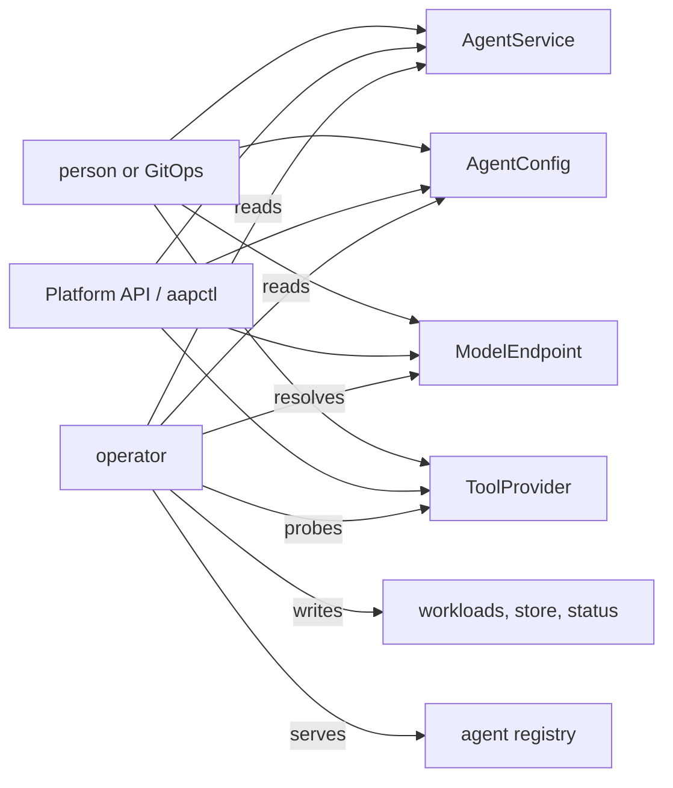

# Concepts

The platform runs **agent services**: a stable logical service with a name, a configuration, a model, tools and a store, which the
operator turns into Kubernetes workloads. An agent is not a pod, a model or a process: its pods are disposable, and the objects are
the truth. A person or GitOps writes the objects; the operator reads them and writes the workloads, the store and the status; the
Platform API and `aapctl` write the same objects for a dashboard.



## The four kinds

**`AgentService`** is the service a caller addresses: its name, the interfaces it serves (A2A), its store, who may reach it
(`access.allowFrom`) and who may use it (`access.audience`), and how the registry lists it.

**`AgentConfig`** is what runs: the harness and its settings, the model, the tools, the environment and the coder's tunables. It
names its model and its tool servers by reference (or writes them inline), and the operator resolves either form to the same
workload and the same digest.

**`ModelEndpoint`** is one model gateway: its base URL and API key (both Secret references) and the model aliases it offers, with
the reasoning levels each alias accepts. **`ToolProvider`** is one MCP server: its URL, its headers (Secret references) and the
tools an agent may use. Both are shared objects, and their `status` says which agents name them.

::: in-depth The four objects, minimal

```yaml
apiVersion: agents.vymalo.com/v1alpha1
kind: AgentService
metadata: { name: coder-me, namespace: another-agentic-system }
spec:
  configRef: { name: coder-me }
  interfaces: { a2a: { enabled: true, bearerTokensSecretRef: { name: coder-me-secrets, key: A2A_BEARER_TOKENS } } }
  store: { postgres: { cnpg: { instances: 1, storage: { size: 5Gi } } } }
  access: { audience: ["agent.use:coder-me"] }
---
apiVersion: agents.vymalo.com/v1alpha1
kind: AgentConfig
metadata: { name: coder-me, namespace: another-agentic-system }
spec:
  harness: { type: adam-rs, adam: { binary: adam-coder, agent: { embedded: {} }, coder: { workers: 2 } } }
  model: { endpointRef: { name: gateway }, model: coding-model }
  tools: { mcpServers: { websearch: { providerRef: { name: websearch } } } }
  environment: {}
---
apiVersion: agents.vymalo.com/v1alpha1
kind: ModelEndpoint
metadata: { name: gateway, namespace: another-agentic-system }
spec:
  baseUrl: { secretRef: { name: agent-models, key: GATEWAY_BASE_URL } }
  apiKeySecretRef: { name: agent-models, key: GATEWAY_API_KEY }
  models: [coding-model, chat-model]
---
apiVersion: agents.vymalo.com/v1alpha1
kind: ToolProvider
metadata: { name: websearch, namespace: another-agentic-system }
spec:
  mcp:
    url: http://another-agentic-websearch.another-agentic-system.svc:8080/mcp
    headers: { Authorization: { prefix: "Bearer ", secretRef: { name: agent-tools, key: SEARCH_MCP_TOKEN } } }
    tools: []
```

:::

## The two harnesses

`harness.type: adam-rs` runs the adam-rs agent (`adam-coder` or `adam-agent`) with the settings of §59a: workers, a GitHub App,
the coder's tunables. `harness.type: a2a` runs **an image that serves A2A itself**, with its own port, card path and health path,
and no variable the config did not list (AD-054). The operator gives both the same pod hardening, store and registry entry.

## The registry

The operator serves an **`agent-registry/v1`** document — a linkset of agent cards — for the orchestrator, with one bearer token
and per-caller filtering by `audience` (AD-021). The contract is in [the registry page](extensions/agent-registry-v1.md).

## Run pods, the egress proxy and the git sandbox

A coder can run the commands of a run in **run pods of their own** instead of its own container: a template, an account, a quota,
a deny-by-default NetworkPolicy and an admission policy that stops the account making any other pod (AD-061). Their one way out is
the **egress proxy**, a deployment made from the agent's own image with the deployment's allow-list (D15c, adam-rs ADR 0042). The
coder's own `git` runs in a **git sandbox** sidecar that holds no secret (D15d, adam-rs ADR 0041).

## The Platform API and `aapctl`

The **Platform API** (`bin/api`, §60a) is the dashboard's server: one table of routes and permissions, problem details, conditional
writes, and a second mutual-TLS listener for workload certificates (AD-065, AD-068). **`aapctl`** (`bin/cli`, §60b) is the command
line of the same API: `validate` and `render` offline, and `get`, `apply`, `delete`, `export`, `whoami`, `login` and `logout` over
the API.

## Glossary

| Term | What it is | Where |
|---|---|---|
| `AgentService` | The service a caller addresses: interfaces, store, access, registry entry | [§59a](architecture/10-control-plane-and-crds.md#59a-operator-v0-adam-rs-agents), AD-022 |
| `AgentConfig` | What runs: harness, model, tools, environment, coder tunables | [§59a](architecture/10-control-plane-and-crds.md#59a-operator-v0-adam-rs-agents), AD-022 |
| `ModelEndpoint` | One model gateway, by Secret reference, with its aliases and reasoning levels | [§60a](architecture/10-control-plane-and-crds.md#60a-admin-dashboard-v0), AD-029 |
| `ToolProvider` | One MCP server, by Secret reference, with the tools an agent may use | [§60a](architecture/10-control-plane-and-crds.md#60a-admin-dashboard-v0), AD-024 |
| Harness | `adam-rs` or `a2a`: what serves the agent | [§59a](architecture/10-control-plane-and-crds.md#59a-operator-v0-adam-rs-agents), AD-054 |
| Registry | The `agent-registry/v1` linkset the operator serves | [§12b](architecture/03-interfaces.md#12b-agent-registry), AD-021 |
| Run pod | A pod a coder runs one run's commands in, under a quota and an admission policy | [§60a](architecture/10-control-plane-and-crds.md#60a-admin-dashboard-v0), AD-061 |
| Egress proxy | The one way out of a run pod, with the deployment's allow-list | [§60a](architecture/10-control-plane-and-crds.md#60a-admin-dashboard-v0), D15c |
| Git sandbox | The sidecar that runs the coder's `git` with no secret in reach | [§60a](architecture/10-control-plane-and-crds.md#60a-admin-dashboard-v0), D15d |
| Platform API | The dashboard's server over the four kinds | [§60a](architecture/10-control-plane-and-crds.md#60a-admin-dashboard-v0), AD-032 |
| `aapctl` | The command line of the Platform API | [§60b](architecture/10-control-plane-and-crds.md#60b-cli) |
| Permission | A `platform:*` string the API checks, never a role name | [§60a](architecture/10-control-plane-and-crds.md#60a-admin-dashboard-v0), AD-032 |
| Workload certificate | A service's client certificate, mapped to a permission set | [AD-065](architecture/11-decisions.md#ad-065--the-platform-api-gains-a-second-authenticator-seam-for-workload-certificates-and-reads-the-uri-san-with-x509-parser), AD-068 |
