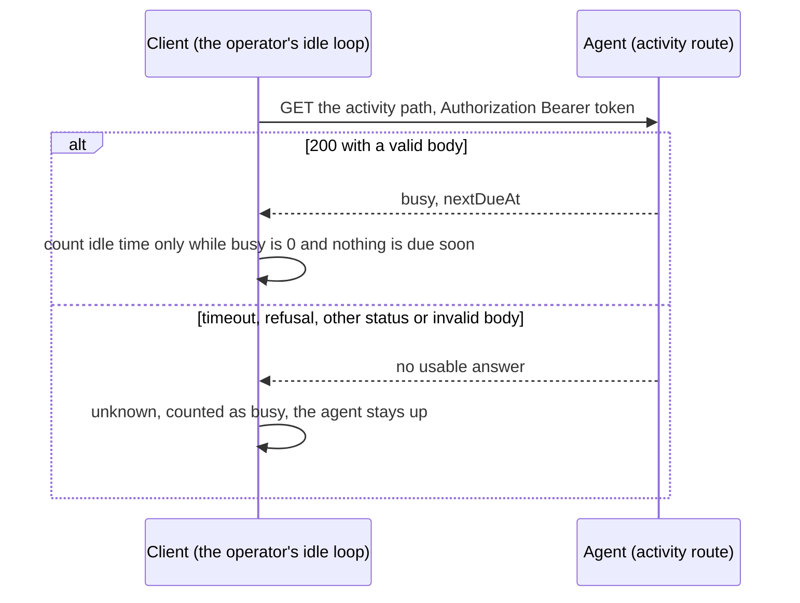
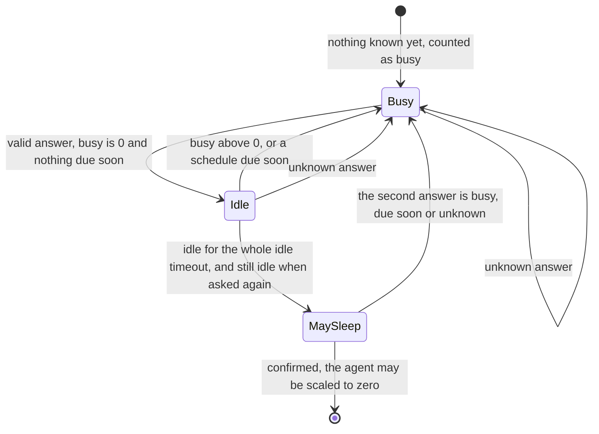

# Activity (v1)

- **URI:** `https://agents.vymalo.com/activity/v1`
- **Status:** draft (2026-11-28)
- **Build status:** 🚧 planned as a contract that a deployment can point at any agent. What exists: adam-rs's listener and the operator's client ([Implementation](#implementation)). The custom resource field that names a probe is not built ([AD-075](../architecture/11-decisions.md#ad-075--workingness-an-agent-is-asked-whether-it-holds-work-over-activityv1-and-unknown-is-busy), ANR-1177)
- **Implemented by:** the agent. The first implementation is adam-rs's `GET /internal/activity` ([adam ADR 0083](https://github.com/vymalo/another-adam-rs/blob/main/docs/decisions/0083-the-activity-route-has-a-listener-and-tokens-of-its-own.md))
- **Consumed by:** the platform operator's idle loop, which decides whether an agent may scale to zero ([architecture §21a](../architecture/05-runtime.md#21a-sleep-when-idle-the-plan), [AD-058](../architecture/11-decisions.md#ad-058--an-agent-sleeps-when-the-agent-says-it-is-idle-and-an-activator-wakes-it))

The URI is a **profile identifier**: it names this contract and its version. It does not have to
resolve, and neither the request nor the answer carries it.

## Purpose

Let a caller ask an agent **whether it holds work** and **when its next parked schedule fires**, so
that an idle agent may be scaled to zero. A connection cannot say this: an agent may go on working
on a run after the call that started it has returned.

It is not a liveness or readiness probe. Those ask "is the process up, and may it take traffic?".
This asks "**does the agent hold a run?**". A healthy, ready agent may be idle, and a busy one may
be failing its readiness probe. Nothing restarts a pod or removes it from a Service because of
this answer.

What the contract is not:

- It is not an A2A extension. No agent card lists it, and no A2A client reads it.
- It carries no run content, task id, prompt, caller or secret.
- It does not wake, stop or drain an agent. It only answers.

## The request

```http
GET /internal/activity HTTP/1.1
Host: coder.agents.svc:8081
Authorization: Bearer <token>
```

| Part | Rule |
|---|---|
| Method | `GET`, with no body. Asking changes nothing in the agent |
| Path | The agent's choice. adam's is `/internal/activity`; the contract does not fix it |
| Port and listener | The agent's choice. An agent SHOULD serve the route apart from the interface its users call, so that the caller needs no access to that interface |
| Authorization | `Authorization: Bearer <token>`, one bearer per deployment: one value that the caller sends to every agent it asks. It SHOULD NOT be a token that lets its holder do anything else with the agent |
| URL | No credential in it: no user information and no token in the path or the query |
| Transport | HTTPS outside a trusted cluster network. Inside one, plain HTTP is allowed, with network rules that let only the caller reach the route |

An agent MAY accept more than one token, for example while the bearer is rotated.

A client sets a time limit on the whole request, does not need to follow redirects (a redirect is
not an answer) and SHOULD NOT send the request through a proxy.

## The answer

```http
HTTP/1.1 200 OK
Content-Type: application/json
```

```json
{ "busy": 0, "nextDueAt": "2026-11-28T14:00:00Z" }
```

| Member | Required | Type | Meaning |
|---|---|---|---|
| `busy` | yes | integer, `0` or more | The runs the agent holds: claimed, or being stepped. `0` is idle |
| `nextDueAt` | no | string (RFC 3339 timestamp) or `null` | When the next parked schedule fires. `null` or absent: nothing is scheduled |

Rules:

1. **No other member is required, and a client ignores members it does not know.**
2. **`busy` and `nextDueAt` are read together.** `busy: 0` alone does not mean the agent may sleep:
   a schedule may be about to fire.
3. **Work that waits for a worker is not hidden.** A run that is due and that nobody holds yet
   (queued, or released by a worker that stopped) is counted in `busy`, or shows as a `nextDueAt`
   that is now or in the past. A client reads a past `nextDueAt` as "due now", never as "nothing
   scheduled".
4. **The timestamp** is written with an upper-case `T`, and with `Z` or a numeric offset such as
   `+01:00`. It may carry a fraction of a second. A client may drop the fraction.
5. **The answer is small.** An agent keeps the body under 4096 bytes. A client may stop reading a
   longer one, and then the answer is unknown.
6. **It is a snapshot.** It promises nothing about the next instant: a run can arrive right after.

## Unknown counts as busy

**This is the contract's most important rule.** A client that does not have a valid answer does
not know whether the agent is idle, so it **must not scale the agent down**. It never turns a
failure into "idle", and it never scales down on a guess.

The answer is **unknown** in every one of these cases:

| Case | Example |
|---|---|
| No answer in time, or no connection | a timeout, a refused connection, a name that does not resolve, packets a network rule drops |
| A status other than `200` | `401`, `403`, `404`, `503`, any other `2xx`, a redirect |
| A body that is not this JSON | empty, cut off, not JSON, not an object |
| A bad `busy` | missing, a string, negative, a fraction, or a number too large for the client to hold |
| A bad `nextDueAt` | not a string and not `null`, or a string that is not an RFC 3339 timestamp |

The rule holds at every step of a client's decision. If a client asks twice before it scales
down, an unknown answer to either question keeps the agent up. A client also does not carry idle
time across an unknown answer: it starts counting again from the next idle one.

An agent that cannot read its own work answers with an error status (adam: `503`), never with
`busy: 0`.

## Authentication and errors

| Status | Meaning | What the client does |
|---|---|---|
| `200` | An answer | Reads it. A body that breaks the rules above is unknown |
| `401`, `403` | A refusal: the token or the policy is wrong | Unknown, **never idle**. It says so to whoever runs it, because retrying will not fix it |
| anything else | No answer | Unknown |

The error body has no meaning in this contract. A client never logs the token.

## Client flow



How a client sees an agent:



How long "idle" must last and how soon is "due soon" are the client's policy. For the platform
they are `scaling.idleTimeout` and `scaling.wakeAhead` ([§21a](../architecture/05-runtime.md#21a-sleep-when-idle-the-plan)).

## Implementation

### The agent: adam-rs

adam-rs serves `GET /internal/activity` from its run store. With `ACTIVITY_LISTEN_ADDR` set, the
route has a listener of its own that serves nothing else, behind the tokens in
`ACTIVITY_BEARER_TOKENS` (adam ADR 0083). The table was read from the source of adam-rs's
`adam-service` crate on 2026-11-28.

Where adam is narrower than the contract, or does something the contract leaves open:

| Point | adam |
|---|---|
| Nothing scheduled | **Omits `nextDueAt`**. It never sends `null`. The contract allows both |
| What `nextDueAt` covers | The earliest due time of any open run that no worker holds: a parked schedule's wake time, and also a run that is ready now and waits for a worker, whose time may be in the past |
| What `busy` counts | The open runs a worker holds a live lease on, for the agents of that service |
| The store cannot say | `503`, also for a store that does not report its activity |
| Tokens | A comma-separated list, none of them an A2A token. A missing or wrong one is `401` with `WWW-Authenticate: Bearer` and a JSON error body |
| Without `ACTIVITY_LISTEN_ADDR` | The route stays on the A2A listener behind the A2A tokens. adam marks this form deprecated |
| Other paths on the activity listener | `404` |

### The consumer: the platform

The operator's idle loop (`crates/controller/src/sleeper.rs`) asks through
[`aap-activity-http`](../../crates/activity-http/README.md). An unknown answer keeps the agent up,
and the loop asks a second time right before it proposes a sleep. When the operator asks at all is
in [§21a](../architecture/05-runtime.md#21a-sleep-when-idle-the-plan). An agent with no activity
listener, such as a bring-your-own A2A image today, is not asked and does not sleep.

The client today differs from this contract in these ways:

| Point | The client today |
|---|---|
| Status | It reads the body of **any `2xx`**, not only `200`. The contract says another status is unknown. adam answers only `200` on success, so the two do not differ with adam |
| Path | Fixed at `/internal/activity` on the service's cluster address and one deployment-wide port |
| Content type | Not checked |
| Timestamp | A lower-case `t` or `z`, or a space instead of `T`, is unknown |

A probe that a custom resource names (path, port, token reference and timing) is **not built**; see
[AD-075](../architecture/11-decisions.md#ad-075--workingness-an-agent-is-asked-whether-it-holds-work-over-activityv1-and-unknown-is-busy).

## Versioning

The URI carries the version. An additive change, such as a new optional member of the answer,
stays `v1`, because clients ignore members they do not know. A breaking change gets a new URI
(`…/activity/v2`) and a new file, `activity-v2.md`; this file stays. Nothing on the wire names the
version, so a `v2` has to say how a client knows which one an agent serves.
