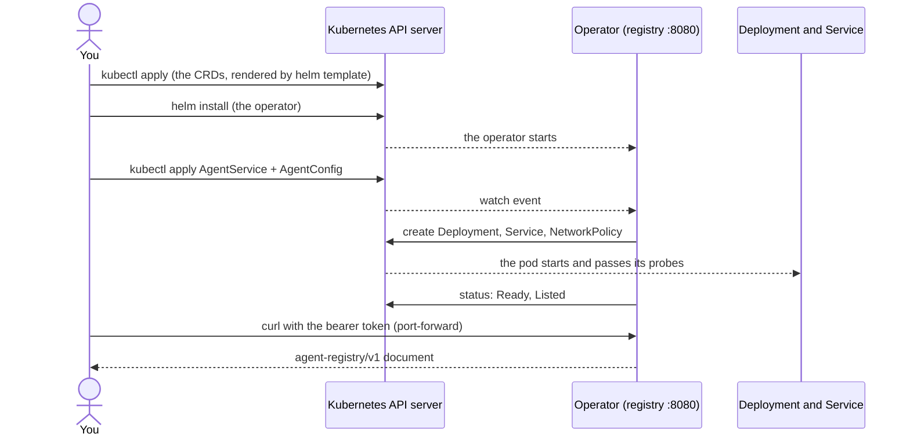
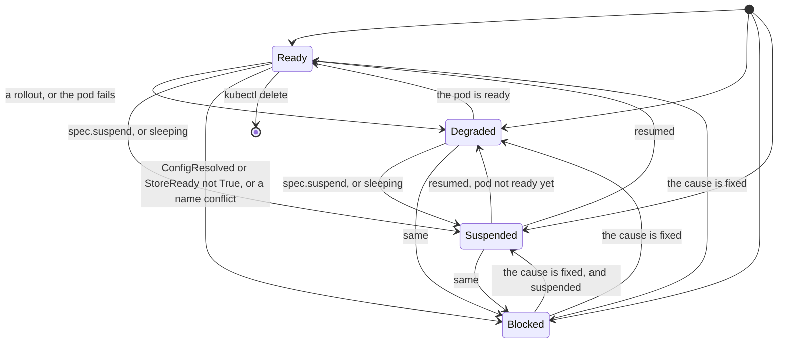

# Get started

This page takes you from a laptop to one agent that is `Ready` and listed in the operator's agent registry. It runs on a
throwaway [kind](https://kind.sigs.k8s.io/) cluster and needs no model key and no account.

Use one terminal, from the repository root, throughout: later steps use shell variables and files made by earlier ones.

The steps are adapted from step 12b of
[`namespaces-e2e.sh`](https://github.com/vymalo/another-agentic-platform/blob/main/deploy/operator/tests/e2e/namespaces-e2e.sh)
(an agent that serves A2A itself) and the operator chart's [README](../deploy/operator/README.md). They share the stand-in agent
image, the kind node image pin and the chart with that CI job. They differ from it in four ways:

- the page installs the published operator image, and CI uses its own build of it;
- it reads the registry through a `kubectl port-forward`, and CI uses a curl pod in the cluster;
- it uses one namespace, and CI uses three;
- the agent `hello` has one plain environment variable and no `secretKeyRef`.

The agent is adapted from [`examples/a2a.yaml`](../examples/a2a.yaml). It differs in the namespace, the Secret names, the defaults left
out, the `API_TOKEN` entry dropped, and the object name, the description, the title and the tags.

## What you will do



The operator recomputes the agent's state on every pass. These are the four states and the moves the code allows:



The diagram draws only the delete this walk makes: an agent can be deleted from any state. `Blocked` is tested first, so it wins over
`Suspended`. `Blocked` means the operator did not apply the desired state and left what runs untouched. `Suspended` is healthy. `Ready` needs the
config resolved, the store ready and the runtime ready. `Listed` is a separate condition: it says the agent is in the registry and never
decides `Ready`. This walk goes only `[*] --> Ready` (observed 2026-11-27 on one run on a warm cluster, about 4 seconds after
`kubectl apply`; not a guarantee). The other states are read from `crates/controller/src/derive.rs` and were not seen here.

## Prerequisites

| Tool | Used here | Why |
|---|---|---|
| `docker` | 29.10.0 | kind runs the node as a container; you build one tiny image |
| `kind` | 0.33.0 | the cluster |
| `kubectl` | 1.35.10 | talks to it |
| `helm` | 3.16.1 | installs the two charts |
| `git`, `curl`, `jq`, `openssl` | any | clone, query, read JSON, make a token |

CI pins the kind node image to `kindest/node:v1.35.8` (with its digest). The steps below use the same one. The operator needs
Kubernetes 1.30 or later only for run pods, which this page does not use.

## 1. Get the repository and make a cluster

```sh
git clone https://github.com/vymalo/another-agentic-platform.git
cd another-agentic-platform

kind create cluster --name aap-start \
  --image kindest/node:v1.35.8@sha256:07b2536e30b803ed61d1677a79df6115f798ce64c80f9e22f6ed45afd09323c0
kubectl config current-context
```

The last command prints `kind-aap-start`. Every command below acts on that cluster.

Ran this before? Run `kind delete cluster --name aap-start` first.

## 2. Make the agent's image available

The operator image comes from `ghcr.io` and the chart pins it, so you build nothing for it. The **agent** needs an image that
answers `/healthz` and serves an A2A card. CI uses a stand-in for that, a few lines of BusyBox, built from the repository. It does
nothing else, which is why no model key is needed.

```sh
docker build -t aap-stub:ci bin/operator/tests/stub
kind load docker-image aap-stub:ci --name aap-start
```

## 3. Install the CRDs, then the operator

The CRDs are a chart of their own and go first.

```sh
helm template aap-operator-crds deploy/operator-crds | kubectl apply --server-side -f -
kubectl wait --for=condition=Established crd/agentservices.agents.vymalo.com crd/agentconfigs.agents.vymalo.com --timeout=60s
```

The operator serves its registry only with a bearer token, and it reads the token from a mounted Secret (a file). It never reads a Secret through the API. Make the namespace, the token and
the two Secrets the agent refers to. The agent's store is a **referenced Secret**: the operator is given the Postgres URI the agent
should use and never reads it. The stand-in never opens it, so any text will do here.

```sh
kubectl create namespace aap

REGISTRY_TOKEN=$(openssl rand -hex 24)
kubectl -n aap create secret generic registry-token --from-literal=token="$REGISTRY_TOKEN"
kubectl -n aap create secret generic hello-secrets --from-literal=A2A_BEARER_TOKENS="$(openssl rand -hex 24)"
kubectl -n aap create secret generic hello-db --from-literal=uri=postgres://unused.invalid/hello
```

Now the operator. The chart refuses an empty `networkPolicy.registry.allowFrom` while the registry has a token, so the values say who
may read it: any pod of the release's namespace. (`kubectl port-forward`, used below, does not go through that policy.)

```sh
cat > operator.values.yaml <<'YAML'
registry:
  tokenSecret:
    name: registry-token
    key: token
networkPolicy:
  registry:
    allowFrom:
      - podSelector: {}
YAML

helm upgrade --install aap-operator deploy/operator --namespace aap -f operator.values.yaml --wait --timeout 300s
```

The operator image is the chart's default pin, `ghcr.io/vymalo/another-agentic-platform/operator:<tag>`. The chart watches its own
namespace unless `watchNamespaces` says otherwise. For a list of every value, see the chart's [README](../deploy/operator/README.md#values).

## 4. Apply an agent

An agent is two objects: an `AgentService` (what runs, its store, who may reach it, how it is listed) and an `AgentConfig` (what it is made of).
This one is an `a2a` harness: an image that serves A2A itself, with no model.

```sh
cat > hello.yaml <<'YAML'
apiVersion: agents.vymalo.com/v1alpha1
kind: AgentService
metadata:
  name: hello
  namespace: aap
spec:
  description: A stand-in agent for the Get started page.
  configRef:
    name: hello
  interfaces:
    a2a:
      enabled: true
      bearerTokensSecretRef:
        name: hello-secrets
        key: A2A_BEARER_TOKENS
  scaling:
    topology: combined
    workers: 1
  store:
    postgres:
      secretRef:
        name: hello-db
        key: uri
  access:
    allowFrom:
      - namespaceSelector:
          matchLabels:
            kubernetes.io/metadata.name: aap
  registry:
    title: Hello
    tags: [get-started]
---
apiVersion: agents.vymalo.com/v1alpha1
kind: AgentConfig
metadata:
  name: hello
  namespace: aap
spec:
  harness:
    type: a2a
    a2a:
      image:
        ref: aap-stub:ci
      env:
        - name: LOG_LEVEL
          value: info
  environment:
    resources:
      requests:
        cpu: 10m
        memory: 32Mi
      limits:
        memory: 64Mi
YAML

kubectl apply -f hello.yaml
```

## 5. Wait for Ready

```sh
kubectl -n aap wait agentservice/hello --for=condition=Ready --timeout=300s
kubectl -n aap get agentservice hello
kubectl -n aap get deployment,service,pod -l app.kubernetes.io/instance=hello
```

The `get agentservice` line looked like this on a real run:

```text
NAME    STATE   CONFIG   REPLICAS   AGE
hello   Ready   hello    1          4s
```

If it does not become `Ready`, read why. The operator writes the reason into the conditions:

```sh
kubectl -n aap get agentservice hello -o jsonpath='{range .status.conditions[*]}{.type}={.status} {.reason}{"\n"}{end}'
```

## 6. Read the registry

The registry is a Service of the operator, `aap-operator-registry`, on port 8080. Forward it and ask with the token:

```sh
kubectl -n aap port-forward service/aap-operator-registry 18080:8080 >/dev/null 2>&1 &
PF_PID=$!
for i in $(seq 1 30); do curl -s -o /dev/null http://127.0.0.1:18080/ && break; sleep 1; done
curl -s -o /dev/null http://127.0.0.1:18080/ || echo "port-forward not up" >&2

STATUS=$(curl -s -o registry.json -w '%{http_code}' -H "Authorization: Bearer $REGISTRY_TOKEN" -H 'Accept: application/linkset+json' \
  http://127.0.0.1:18080/registry/v1/agents)
echo "status: $STATUS"
jq . registry.json
```

The loop waits up to 30 seconds for the forwarded port and says `port-forward not up` if it never opened. The status line tells you what
went wrong if there is no document:

- `status: 200`: the document follows.
- `status: 000`: no connection, so the port-forward is down. Run it again without the `>/dev/null 2>&1` to see why.
- `status: 401`: the token is wrong or empty. In a new shell, read it back with
  `REGISTRY_TOKEN=$(kubectl -n aap get secret registry-token -o jsonpath='{.data.token}' | base64 -d)` (older macOS spells it `base64 -D`).
- `status: 503`: the registry is not ready yet. Wait a few seconds and run the `curl` again.

The answer is an `agent-registry/v1` linkset document: one `item` per listed agent, with its `service` id, its `title` and the `href` of
its agent card. Without the token the registry answers `401`:

```sh
curl -s -o /dev/null -w '%{http_code}\n' http://127.0.0.1:18080/registry/v1/agents
```

The same document is what an orchestrator reads to find agents. Its format is the contract
[`agent-registry-v1`](extensions/agent-registry-v1.md).

## 7. Clean up

If you keep the cluster, remove what you made in this order. The operator's finalizers need the agent deleted first, while the operator
still runs, and the CRDs last:

```sh
[ -n "${PF_PID:-}" ] && kill "$PF_PID"
kubectl -n aap delete agentservice hello --wait=true --timeout=120s
kubectl -n aap delete agentconfig hello
helm uninstall aap-operator --namespace aap
kubectl delete namespace aap
kubectl delete -f deploy/crds/agents.vymalo.com.yaml
```

Then remove the cluster. This alone removes everything inside it:

```sh
kind delete cluster --name aap-start
```

Two things stay on your machine. `docker rmi aap-stub:ci` removes the local image. `operator.values.yaml`, `hello.yaml` and `registry.json`, which the
steps wrote in the current directory, remain until you delete them.

## Next

- [Architecture §59a](architecture/10-control-plane-and-crds.md): what the operator does, slice by slice.
- [The registry contract](extensions/agent-registry-v1.md): the document you just read.
- [The operator chart](../deploy/operator/README.md): every value, the rights it holds, the Platform API and run pods.
- [CRDs](reference/crds.md) and [the Platform API](reference/openapi.md): the objects, and the REST API over them.
- For a real agent, replace the stand-in with a real A2A image, or use the adam-rs coder (`examples/coder.yaml`) with a model.
