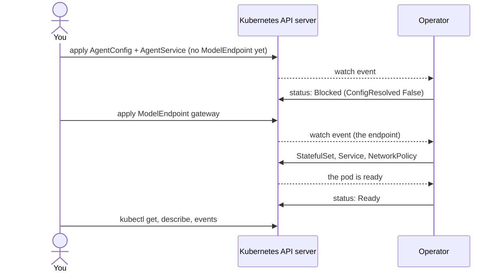

# Get started: a coder

This page makes a coder agent (`adam-coder`, the agent that turns a coding task into a pull request) on kind, with its model named by
reference to a Secret key, and reads its state, its conditions and its Events. It runs on the stand-in image that CI uses, so it
pulls no 3 GB coder image, needs no model key and makes no GitHub request. The coder it runs does nothing: the page is about what the
operator makes of the objects, and how to read it.

Start with [Get started](../get-started.md) if you have not made a cluster with the operator before. This page repeats only what
differs.

## Where it comes from

The objects are adapted from [`examples/coder.yaml`](../../examples/coder.yaml), whose model is inline, and
[`examples/coder-me.yaml`](../../examples/coder-me.yaml), which names a shared `ModelEndpoint` (`endpointRef`). The token variant of the
GitHub settings, the dummy Secrets and the checks come from [`coder-e2e.sh`](../../deploy/operator/tests/e2e/coder-e2e.sh) with its
[`coder.yaml`](../../deploy/operator/tests/e2e/coder.yaml), and the stand-in coder (`"githubMcp": {"sidecar": false}`, a 1 GiB claim per
replica, the stand-in image) from the `coder` fixture of [`bin/operator/tests/cluster.rs`](../../bin/operator/tests/cluster.rs). They
differ from those in these ways:

- the image is the stand-in `aap-stub:ci` (a few lines of BusyBox that answer `/healthz`), where `coder-e2e.sh` runs the real image;
- the GitHub side is a token with a dummy value, not the GitHub App of `examples/coder.yaml` (an App key file with no run pods makes a
  current coder image exit 78, see the comment at the end of that example), and the GitHub MCP sidecar is off;
- the model is a `ModelEndpoint` by reference, as in `coder-me.yaml`, whose base URL points nowhere (`model.invalid`): nothing calls it;
- there is no web search, no Context7, no `longhorn` storage class and no audience; the claim uses kind's default storage class;
- one namespace, `aap`, and a Postgres URI that is never opened.

## What you will do



The states are the four of [Get started](../get-started.md#what-you-will-do) (`Ready`, `Degraded`, `Blocked`, `Suspended`). This walk
meets `Blocked` first and then `Ready`; the move between them is "the cause is fixed" in that diagram. `Blocked` means the operator
did not apply the desired state, and it names the cause in a condition.

## Prerequisites

| Tool | Version | Why |
|---|---|---|
| `docker`, `kind`, `kubectl`, `helm`, `git`, `jq`, `openssl` | as in [Get started](../get-started.md#prerequisites) | the cluster, the charts, the Secrets |

## 1. A cluster, the stand-in image, the CRDs and the operator

Steps 1 to 3 of [Get started](../get-started.md), minus the registry token, and with all four CRDs awaited:

```sh
# Ran this before? Run `kind delete cluster --name aap-start` first.
kind create cluster --name aap-start \
  --image kindest/node:v1.37.0@sha256:a1ed56cfb0e7b93589bdf97c8cd566405a265939e3620fc4f5de89adff580ae5

docker build -t aap-stub:ci bin/operator/tests/stub
kind load docker-image aap-stub:ci --name aap-start

helm template aap-operator-crds deploy/operator-crds | kubectl apply --server-side -f -
kubectl wait --for=condition=Established --timeout=60s \
  crd/agentconfigs.agents.vymalo.com crd/agentservices.agents.vymalo.com \
  crd/modelendpoints.agents.vymalo.com crd/toolproviders.agents.vymalo.com

kubectl create namespace aap
helm upgrade --install aap-operator deploy/operator --namespace aap --wait --timeout 300s
```

## 2. The Secrets

A referenced Secret is never read by the operator: it is named in the pod, and the kubelet reads it. So the keys must exist before the
pod starts, and their values can be anything for the stand-in. The model's key lives in a Secret of its own, which a `ModelEndpoint`
names; the agent never sees a value in a file.

```sh
kubectl -n aap create secret generic agent-models --from-literal=GATEWAY_API_KEY=not-a-real-key
kubectl -n aap create secret generic coder-secrets \
  --from-literal=A2A_BEARER_TOKENS="$(openssl rand -hex 24)" \
  --from-literal=GITHUB_TOKEN=not-a-real-token
kubectl -n aap create secret generic coder-db --from-literal=uri=postgres://unused.invalid/coder
```

## 3. Apply the coder before its model

The `AgentConfig` names the model by `endpointRef: gateway`. The `ModelEndpoint` does not exist yet, so the operator can not resolve the
config. This is on purpose: it is the commonest reason for a `Blocked` agent, and the page shows how to read it.

```sh
cat > coder.yaml <<'YAML'
apiVersion: agents.vymalo.com/v1alpha1
kind: AgentConfig
metadata:
  name: coder
  namespace: aap
spec:
  harness:
    type: adam-rs
    adam:
      binary: adam-coder
      agent:
        embedded: {}
      coder:
        workers: 1
        allowedRepoHosts: [github.com]
        githubApiUrl: https://api.github.com
        prDraft: true
        gitAuthor:
          name: "get-started[bot]"
          email: "get-started@example.invalid"
        opencodeModel: coding-model
        github:
          token:
            secretRef:
              name: coder-secrets
              key: GITHUB_TOKEN
  model:
    endpointRef:
      name: gateway
    model: coding-model
  tools:
    githubMcp:
      sidecar: false
  environment:
    image:
      ref: aap-stub:ci
    resources:
      requests:
        cpu: 10m
        memory: 16Mi
      limits:
        memory: 64Mi
    volumes:
      - name: work
        scope: agent
        mountPath: /work
        source:
          persistent:
            size: 1Gi
            perReplica: true
    terminationGracePeriodSeconds: 1
  security:
    runAsUser: 10001
    runAsGroup: 10001
    fsGroup: 10001
---
apiVersion: agents.vymalo.com/v1alpha1
kind: AgentService
metadata:
  name: coder
  namespace: aap
spec:
  description: Coding task to verified pull request (a stand-in).
  configRef:
    name: coder
  interfaces:
    a2a:
      enabled: true
      bearerTokensSecretRef:
        name: coder-secrets
        key: A2A_BEARER_TOKENS
  scaling:
    topology: combined
    workers: 1
  store:
    postgres:
      secretRef:
        name: coder-db
        key: uri
  access:
    allowFrom:
      - namespaceSelector:
          matchLabels:
            kubernetes.io/metadata.name: aap
  registry:
    title: Coder
    tags: [coding, git]
  deletionPolicy: Delete
YAML

kubectl apply -f coder.yaml
sleep 10
kubectl -n aap get agentservice coder
kubectl -n aap get agentservice coder \
  -o jsonpath='{range .status.conditions[*]}{.type}={.status} {.reason}: {.message}{"\n"}{end}'
```

Expect the state `Blocked` and a condition `ConfigResolved` that is not `True`. The operator's code
([`crates/domain/src/refs.rs`](../../crates/domain/src/refs.rs)) words a missing referent as
`ModelEndpoint "gateway" was not found in namespace "aap": create it, or ...`, ending in what to do instead. That text was read from the
source, not seen on a run for this page.
Nothing is made for the agent while it is `Blocked`: `kubectl -n aap get statefulset,service,pod` lists nothing of the coder.

## 4. Apply the model and wait for Ready

```sh
cat > gateway.yaml <<'YAML'
apiVersion: agents.vymalo.com/v1alpha1
kind: ModelEndpoint
metadata:
  name: gateway
  namespace: aap
spec:
  title: Gateway
  baseUrl:
    value: http://model.invalid/v1
  apiKeySecretRef:
    name: agent-models
    key: GATEWAY_API_KEY
  models: [coding-model]
YAML

kubectl apply -f gateway.yaml
kubectl -n aap wait agentservice/coder --for=condition=Ready --timeout=300s
kubectl -n aap get agentservice coder
```

The operator watches `ModelEndpoint`s, so it needs no nudge. A coder with a claim per replica is a `StatefulSet`; a folder agent, as
in [the folder agent page](folder-agent.md), is a `Deployment`.

## 5. Read its status, conditions and Events

```sh
kubectl -n aap get agentservice coder -o jsonpath='{.status.state}{"\n"}'
kubectl -n aap get agentservice coder \
  -o jsonpath='{range .status.conditions[*]}{.type}={.status} {.reason}{"\n"}{end}'
kubectl -n aap get statefulset,service,pod,networkpolicy,persistentvolumeclaim -l app.kubernetes.io/instance=coder
kubectl -n aap get modelendpoint gateway \
  -o jsonpath='{range .status.conditions[*]}{.type}={.status} {.reason}{"\n"}{end}{.status.usedBy}{"\n"}'
kubectl -n aap get events --sort-by=.lastTimestamp
```

- The conditions of the agent are `ConfigResolved`, `StoreReady`, `RuntimeReady` and `Ready`, and `Listed` once a registry is on
  ([Get started](../get-started.md#5-wait-for-ready) reads the same ones).
- The model endpoint says `Accepted`, `InUse` and `AgentsReady`, and `usedBy` lists `["coder"]`: the operator writes the shared object's
  status too.
- The Events are the cluster's: the operator's and the kubelet's about the agent's objects. If an agent is stuck, read them first.
  [Find why an agent is not Ready](../guides/operate/not-ready.md) goes through the five conditions, their reasons and the route of
  the Platform API that serves the same Events.

## 6. Clean up

```sh
kubectl -n aap delete agentservice coder --wait=true --timeout=180s
kubectl -n aap delete agentconfig coder
kubectl -n aap delete modelendpoint gateway
helm uninstall aap-operator --namespace aap
kubectl delete namespace aap
kind delete cluster --name aap-start
docker rmi aap-stub:ci
rm -f coder.yaml gateway.yaml
```

`deletionPolicy: Delete` is why the claim goes with the agent. `examples/coder.yaml` says `Retain`, which keeps it.

## What this does not cover

- The real coder image, a real model, GitHub and a pull request. Nothing speaks A2A to the stand-in, and the coder never opens its
  model. Running the real image is `coder-e2e.sh`, which pulls 2.9 GB; `run-pods-e2e.sh` runs it with run pods.
- A GitHub App (`github.app`). It needs a real key file and, on a current coder image, run pods or an explicit risk acceptance.
- Run pods, the egress proxy and the git sandbox: see [Run pods](../guides/deploy/run-pods.md).
- An audience and the registry: the registry needs its own token, see [Get started](../get-started.md#6-read-the-registry) and
  [Install](../guides/deploy/install.md).
- A CloudNativePG store (`store.postgres.cnpg`): it needs CloudNativePG installed.

## Run status

**Not run end to end.** The machine this page was written on had Docker but no `kind`, `kubectl` or `helm`, and under 2 GB of free
disk. The objects are the ones of [`coder-e2e.sh`](../../deploy/operator/tests/e2e/coder-e2e.sh) at `275a01c` (the real image) and of the
stand-in `coder` fixture of `bin/operator/tests/cluster.rs` (the stand-in), joined by hand. The first passed in CI as the job
`operator-coder-e2e` (run 37307542288, *verified 2026-10-15* with `gh run view`), which is older than Helm 4 and Kubernetes 1.37 (AD-067).
The second is covered by the `kind` job of `operator.yml`, which passed on `main`: job 140420663650 of run 45973874487 at `36ca2e0`,
*verified 2026-11-27* in the job's log. Whether this exact join, with a `ModelEndpoint` applied after the config, becomes `Ready`, and what the `Blocked`
state says, was not run.

## Next

- [The Platform API with aapctl](platform-api.md): make the same kind of objects through the API.
- [A tool server](tool-server.md): give an agent a tool.
