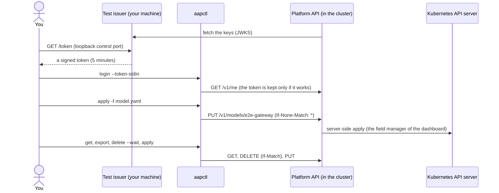

# Get started: the Platform API with aapctl

This page installs the operator with the Platform API on, starts a throwaway OIDC issuer on your machine, signs `aapctl` in with a
token from it, and then makes, reads, exports and deletes a model and an agent through the API. It needs no model key and no account.

Start with [Get started](../get-started.md) if you have not made a cluster with the operator before. This page repeats only what
differs. It needs a Rust toolchain: `aapctl` and the issuer ship in no image.

## Where it comes from

The commands are adapted from [`api-e2e.sh`](../../deploy/operator/tests/e2e/api-e2e.sh), steps 1 to 4 (the issuer, the Secrets, the
chart with the API on, the port-forward, the model and the agent made through the API) and step 6b (`aapctl`), with its
[`api.values.yaml`](../../deploy/operator/tests/e2e/api.values.yaml) and
[`api-offer.yaml`](../../deploy/operator/tests/e2e/api-offer.yaml). The command line is described in
[`bin/cli/README.md`](../../bin/cli/README.md) and the API in [the Platform API guide](../guides/deploy/platform-api.md). They differ
from the script in these ways:

- the page runs the issuer, `aapctl` and `kubectl port-forward` by hand, where the script supervises them, mints a token per call
  and cleans up after itself;
- the API and the operator run the chart's pinned images, which the chart pulls from `ghcr.io`, and CI loads its own builds;
- the page makes one model and one agent, and the script also checks every refusal (`401`, `403`, `412`, `428`, `422`) and the
  network policy, which this page skips;
- the page uses one token with four permissions and signs in once, and the script mints a token per command;
- the agent is made with one `curl` call and a JSON form (the API takes forms, not custom resources), then exported by `aapctl`,
  deleted and made again from the export, as step 6b does.

## What you will do



The API holds no right of its own beyond its `Role`: every call is checked against the permissions in the token's roles claim, and
a write is conditional (`If-None-Match: *` creates, `If-Match` replaces and deletes).

## Prerequisites

| Tool | Version | Why |
|---|---|---|
| `docker`, `kind`, `kubectl`, `helm`, `git`, `curl`, `jq`, `openssl` | as in [Get started](../get-started.md#prerequisites) | the cluster, the charts, the token |
| `cargo` and a Rust toolchain | Rust 1.94 or later (`rust-version` in `Cargo.toml`) | builds `aapctl` and the test issuer |

The first `cargo build` compiles a large workspace, and its `target/` directory needs several GB of disk, more than the cluster itself. This page is for **Linux**: step 2 finds your machine's address on kind's Docker network, and on Docker Desktop (macOS, Windows) a pod cannot reach it, so `helm --wait` would time out. The operator and the API images are pulled by the kubelet from `ghcr.io`.

## 1. A cluster, the stand-in image and the CRDs

The agent runs the stand-in image, which the API admits because its registry is `docker.io` (the page's values say so). The API reads
the offered Secret keys from an `ExternalSecret`, so its CRD goes in too.

```sh
# Ran this before? Run `kind delete cluster --name aap-start` first.
kind create cluster --name aap-start \
  --image kindest/node:v1.37.0@sha256:a1ed56cfb0e7b93589bdf97c8cd566405a265939e3620fc4f5de89adff580ae5

docker build -t aap-stub:ci bin/operator/tests/stub
kind load docker-image aap-stub:ci --name aap-start

helm template aap-operator-crds deploy/operator-crds | kubectl apply --server-side -f -
kubectl apply --server-side -f crates/objects-kubernetes/tests/crds/external-secrets.io_externalsecrets.yaml
kubectl wait --for=condition=Established --timeout=60s \
  crd/agentconfigs.agents.vymalo.com crd/agentservices.agents.vymalo.com \
  crd/modelendpoints.agents.vymalo.com crd/toolproviders.agents.vymalo.com crd/externalsecrets.external-secrets.io
kubectl create namespace aap
```

## 2. Build `aapctl` and start the issuer

The issuer is the testkit's: RS256 with throwaway keys made when it starts, a flat roles claim and tokens that last five minutes.
It is **test tooling**. The pod of the API must reach it, so it listens on all interfaces at the address your machine has on
kind's Docker network. Anyone on your network can read its public keys; only your loopback address can ask it for a token.

```sh
cargo build --locked -p aap-cli
cargo build --locked -p aap-auth-oidc --example test-issuer --features testkit

HOST_ADDR=$(docker network inspect kind --format '{{range .IPAM.Config}}{{println .Gateway}}{{end}}' \
  | grep -E '^[0-9]+\.[0-9]+\.[0-9]+\.[0-9]+$' | head -n 1)
echo "$HOST_ADDR"

target/debug/examples/test-issuer --bind 0.0.0.0:0 --public-host "$HOST_ADDR" \
  --audience aap-start-api --roles-claim agentic_roles > issuer.log 2>&1 &
ISSUER_PID=$!
for i in $(seq 1 30); do grep -qx ready issuer.log && break; sleep 1; done
grep -qx ready issuer.log || { echo "the issuer did not start" >&2; cat issuer.log >&2; }
cat issuer.log

ISSUER=$(sed -n 's/^issuer=//p' issuer.log)
CONTROL=$(sed -n 's/^control=//p' issuer.log)
ISSUER_PORT=${ISSUER##*:}
```

If `HOST_ADDR` is empty, the Docker network is not called `kind` on your machine. Set `HOST_ADDR` to an address of your machine that
a container can reach. A host firewall (firewalld, ufw) can block the issuer's port from the pod; if `helm --wait` times out in step 4 and the API's log says it could not fetch the keys, open that port to the Docker network. `issuer.log` ends with `ready` and names the issuer, the audience, the roles claim and the control address.

## 3. The Secrets and the offer

The API makes a model that names a Secret key and an agent that names two more. It never reads a value: an `ExternalSecret` that
carries the label `agents.vymalo.com/offer` tells the forms which keys a person may pick.

```sh
kubectl -n aap create secret generic e2e-agent-models --from-literal=GATEWAY_API_KEY=not-a-real-key
kubectl -n aap create secret generic e2e-a2a-bearer --from-literal=AGENT_REGISTRY_AGENT_TOKEN="$(openssl rand -hex 24)"
kubectl -n aap create secret generic e2e-chat-db-app --from-literal=uri=postgres://unused.invalid/e2e-chat

kubectl -n aap apply -f deploy/operator/tests/e2e/api-offer.yaml
```

The names are the script's, because [`api.values.yaml`](../../deploy/operator/tests/e2e/api.values.yaml) says a new agent's ledger is
the Secret `{name}-db-app` (the agent below is `e2e-chat`) and `api-offer.yaml` offers the key `GATEWAY_API_KEY` of `e2e-agent-models`.

## 4. Install the operator with the API on

The script's values file says what is the same for every run. This one adds what you only know now: the issuer, the audience, the
roles claim, the Secret a new agent reads its A2A bearer from, and the one egress rule that lets the API reach the issuer.

```sh
cat > api-start.values.yaml <<YAML
api:
  config:
    oidc:
      issuer: $ISSUER
      audiences: [aap-start-api]
      rolesClaim: agentic_roles
    defaults:
      a2aBearer:
        name: e2e-a2a-bearer
        key: AGENT_REGISTRY_AGENT_TOKEN
      allowFrom:
        - namespaceSelector:
            matchLabels:
              kubernetes.io/metadata.name: aap
  networkPolicy:
    issuer:
      to:
        - ipBlock:
            cidr: $HOST_ADDR/32
      ports: [$ISSUER_PORT]
YAML

helm upgrade --install aap-operator deploy/operator --namespace aap \
  -f deploy/operator/tests/e2e/api.values.yaml -f api-start.values.yaml --wait --timeout 300s
kubectl -n aap get deployment
```

`--wait` returns when the API is ready, and the API's `/readyz` says so only after it fetched the issuer's keys and listed
`ModelEndpoint`s under its own `Role`. If the install times out, `kubectl -n aap logs deployment/aap-operator-api` says which. The
refusals of `_validate.tpl` name the missing value: the chart gives no default for the issuer, the audience, the roles claim or the
allowed image registries (`api.values.yaml` sets the last to `docker.io`, which is where `aap-stub:ci` is from).

## 5. Reach the API and sign in

The API is a Service in the cluster. Forward it, and ask the issuer for a token whose roles are the permissions you want (the roles
claim holds permission names). Then give it to `aapctl`, from standard input, never as an argument.

```sh
kubectl -n aap port-forward service/aap-operator-api 18081:8080 >/dev/null 2>&1 &
PF_PID=$!
sleep 3
curl -s -o /dev/null -w '%{http_code}\n' http://127.0.0.1:18081/v1/me     # 401: no token, and that is the answer

PERMS=platform:agents.read,platform:agents.write,platform:models.write,platform:secrets.pick
tok() { curl -sSf --noproxy '*' -G --data-urlencode "sub=$1" --data-urlencode "roles=$2" "$CONTROL/token"; }

# ctl mints a fresh token for every call, as api-e2e.sh does: the issuer's tokens last five minutes and have no refresh token.
ctl() {
  env -u HTTPS_PROXY -u https_proxy -u HTTP_PROXY -u http_proxy -u ALL_PROXY -u all_proxy NO_PROXY=127.0.0.1,localhost \
    AAPCTL_TOKEN="$(tok alice "$PERMS")" \
    target/debug/aapctl "$@" --server http://127.0.0.1:18081 --config ./aapctl.yaml
}

# Signing in once keeps a token in the file (it expires in five minutes); the calls below use their own.
tok alice "$PERMS" | env -u HTTPS_PROXY -u https_proxy -u HTTP_PROXY -u http_proxy -u ALL_PROXY -u all_proxy \
  NO_PROXY=127.0.0.1,localhost AAPCTL_TOKEN= \
  target/debug/aapctl login --token-stdin --server http://127.0.0.1:18081 --config ./aapctl.yaml
ctl whoami
ls -l aapctl.yaml
```

`aapctl` keeps the token in `aapctl.yaml`, mode `0600`, and refuses a file others can read. `whoami` lists the four permissions.
**The token lasts five minutes** and the issuer gives no refresh token, so the saved one stops working after that (exit 4). That is why `ctl` passes a fresh token in `AAPCTL_TOKEN` on every call. The proxy variables
are dropped because `aapctl` sends a plain-`http` request to a loopback address only without a proxy, and `kubectl port-forward` is one.

## 6. A model, from a file

A model that names a Secret key needs `platform:secrets.pick`, which the token has.

```sh
cat > model.yaml <<'YAML'
apiVersion: agents.vymalo.com/v1alpha1
kind: ModelEndpoint
metadata:
  name: e2e-gateway
  namespace: aap
spec:
  title: Gateway
  baseUrl:
    value: http://model.invalid/v1
  apiKeySecretRef:
    name: e2e-agent-models
    key: GATEWAY_API_KEY
  models:
    - e2e-model
YAML

ctl apply -f model.yaml
ctl apply -f model.yaml
ctl get models
```

The first `apply` prints `model/e2e-gateway created`, the second `model/e2e-gateway unchanged` and writes nothing: `apply` reads the
object first and sends a write only when the form differs. (The script asserts both lines; the exact `get` table was not read for this
page.)

## 7. An agent, an export, a delete and an apply

The API takes the agent as a JSON form, not as custom resources. `aapctl apply` of an agent needs a file with the deployment part the
server would write, so the page lets the API make the agent once, exports it and works from the export, as step 6b does.

```sh
cat > agent-form.json <<'JSON'
{
  "name": "e2e-chat",
  "title": "E2E chat",
  "description": "An agent made through the Platform API.",
  "tags": ["e2e"],
  "model": {"endpoint": "e2e-gateway", "model": "e2e-model"},
  "image": "aap-stub:ci",
  "audience": ["agent.use:e2e-chat"],
  "agent": {"kind": "folder", "files": {"instructions.md": "---\nname: e2e-chat\ndescription: A stand-in.\ncard:\n  name: e2e-chat\n---\nYou are e2e-chat.\n"}}
}
JSON

curl -s --noproxy '*' -o /dev/null -w '%{http_code}\n' -X PUT -H "Authorization: Bearer $(tok alice "$PERMS")" \
  -H 'If-None-Match: *' -H 'Content-Type: application/json' -d @agent-form.json http://127.0.0.1:18081/v1/agents/e2e-chat
```

`201` means created. Without `If-None-Match: *` or `If-Match` the API answers `428`, a second create is `409`, and an image from a
registry the deployment does not list is `422` on the field `image`.

```sh
for i in $(seq 1 60); do
  STATE=$(ctl get agent e2e-chat -o json | jq -r .state)
  echo "$STATE"; [ "$STATE" = ready ] && break; sleep 5
done

ctl get agents
ctl export agent e2e-chat > e2e-chat.yaml
head -n 20 e2e-chat.yaml

ctl delete agent e2e-chat --wait --timeout 120
ctl apply -f e2e-chat.yaml
ctl apply -f e2e-chat.yaml
```

`get agent -o json` reports `state` in lower case (`ready`). `delete --wait` reads the agent every two seconds until it is gone, which
needs the operator's finalizer to finish. The export is the AgentConfig and the AgentService as the operator holds them; applying it
back says `agent/e2e-chat created` and, the second time, `agent/e2e-chat unchanged`. The agent then becomes `ready` again, which takes the
same time as the first time.

`ctl get agent e2e-chat -o etag` prints the tag of the object. `ctl apply -f e2e-chat.yaml --if-match <an old tag>` is refused with
exit 3 (stale) if somebody changed the agent in between, which is how a pipeline notices.

## 8. Clean up

Delete through the API, then take down what you started, in this order. The agent goes first so that the operator, which is still
running, completes its finalizer.

```sh
ctl delete agent e2e-chat --wait --timeout 120
# A delete the API answered with 202 leaves the AgentConfig behind as an orphan: remove it before the model, as api-e2e.sh does.
kubectl -n aap delete agentconfig e2e-chat --ignore-not-found
ctl delete model e2e-gateway
ctl logout
kill "$PF_PID"
helm uninstall aap-operator --namespace aap
kill "$ISSUER_PID"
kubectl delete namespace aap
kind delete cluster --name aap-start
docker rmi aap-stub:ci
rm -f issuer.log aapctl.yaml aapctl.yaml.lock api-start.values.yaml model.yaml agent-form.json e2e-chat.yaml
```

## What this does not cover

- A real identity provider. The issuer is the testkit's. A real Keycloak, the audience mapper, `offline_access` and a client that
  requires PKCE are *unverified*; `aapctl login` without `--token-stdin` (the browser) was not used.
- The edge: TLS, a JWT check in front, a rate limit. The API listens in plain `http` in the cluster, and the port-forward bypasses its
  `NetworkPolicy`.
- The Events route (`GET /v1/agents/{name}/events`), the OpenAPI document (`GET /v1/openapi.json`), the workload-certificate listener
  and the tracing and metrics of the API. [Platform API](../reference/openapi.md) and [the guide](../guides/deploy/platform-api.md)
  cover them.
- Production values: `apiServer.cidrs`, `issuer.to` as a real peer, the allowed registries, CORS and the ingress.

## Run status

**Not run end to end.** The machine this page was written on had Docker but no `kind`, `kubectl`, `helm` or built binaries, and under
2 GB of free disk, so nothing was built or applied. The commands are copied from [`api-e2e.sh`](../../deploy/operator/tests/e2e/api-e2e.sh)
at `275a01c`, steps 1 to 4 and 6b. That script's job (`api-e2e` of `operator-image.yml`) passed on `main`: run 45973874969 at
`36ca2e0`, job 140423890484, *verified 2026-11-27* in the job's log; step 6b first passed in run 43706119020 at `970afa0`, *verified
2026-11-15*. What this page changes from the script was not run: the values file written by hand, the fixed local port `18081`, the
single long-lived token, the JSON form written as a file and the loop that waits for `ready`.

## Next

- [The Platform API guide](../guides/deploy/platform-api.md): install, permissions, the NetworkPolicy and the edge.
- [Reference: the Platform API](../reference/openapi.md): every route.
- [A tool server](tool-server.md): give an agent a tool.
