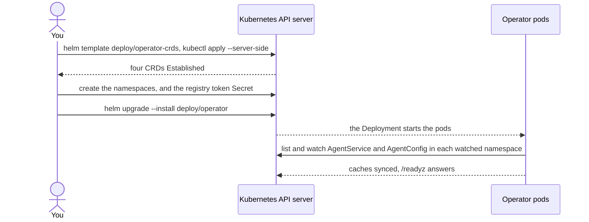
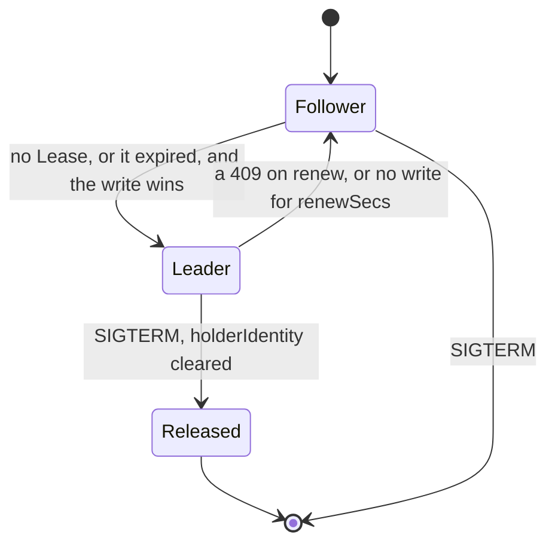

# Install the CRDs and the operator

This page takes you from an empty cluster to an operator that is `Ready` in the namespaces you name. You install two Helm charts from this repository, in this order: the CRDs, then the operator. It ends with the CI jobs that prove each choice, and a list of what nothing proves yet.

To try the operator on a laptop first, use [Get started](../../get-started.md). This page is for a cluster you keep.

## Before you start

- A Kubernetes cluster. The operator chart asks for `>=1.29.0-0`. CI runs Kubernetes v1.35.8 in kind, and no other version is tested in CI. Run pods need 1.30 or later (see [Turn on run pods](run-pods.md)).
- `kubectl` and Helm 3, with the repository checked out. Nothing publishes either chart: you install them from their paths. The chart's own note says so ([Known limitations](../../../deploy/operator/README.md#known-limitations)).
- Namespaces for the agents. The operator is namespaced and has no `ClusterRole`. The chart makes a `Role` in each namespace you list, so each one must exist before you install.

## The order



Install the CRDs first. An operator expects all four kinds (`agentservices`, `agentconfigs`, `modelendpoints`, `toolproviders`). Without the last two it still runs, but an agent whose config names a shared object stays `ConfigInvalid` until they exist ([Upgrading](../../../deploy/operator/README.md#upgrading)).

```sh
helm template aap-operator-crds deploy/operator-crds | kubectl apply --server-side -f -
kubectl wait --for=condition=Established --timeout=60s \
  crd/agentservices.agents.vymalo.com crd/agentconfigs.agents.vymalo.com \
  crd/modelendpoints.agents.vymalo.com crd/toolproviders.agents.vymalo.com
```

The apply is server-side because the CRDs are large. A client-side apply keeps a copy of the manifest in an annotation, which has a size limit ([the CRDs chart](../../../deploy/operator-crds/README.md)).

## The values

Put these in a file. Replace the namespace names and the peer in `allowFrom`.

```yaml
watchNamespaces:            # one Role and one RoleBinding in each, never a ClusterRole
  - agents                  # the first is the primary
  - agents-two
replicas: 2                 # more than 1 elects a leader through a Lease
registry:
  tokenSecret:
    name: aap-registry-token   # an existing Secret in the release namespace
    key: token
networkPolicy:
  registry:
    allowFrom:                 # who may read the registry: required once there is a token
      - namespaceSelector:
          matchLabels:
            kubernetes.io/metadata.name: orchestrator
```

Then create the namespaces and the token, and install:

```sh
kubectl create namespace aap-system
kubectl create namespace agents
kubectl create namespace agents-two
kubectl -n aap-system create secret generic aap-registry-token --from-literal=token="$(openssl rand -hex 32)"

helm upgrade --install aap-operator deploy/operator --namespace aap-system -f values.yaml --wait
```

The chart has many more values. This page names only the ones this task needs. The rest are in the chart's [Values](../../../deploy/operator/README.md#values) section and in [`values.yaml`](../../../deploy/operator/values.yaml), which has a comment on each.

The chart pins the operator's image by a `sha-<7 hex>` tag that CI bumps on every green build of `main`. Never set `latest`: the chart refuses it.

### `watchNamespaces`

The operator watches every namespace in the list. The chart makes one `Role` and one `RoleBinding` in each, bound to the operator's account. It never makes a `ClusterRole`, and no value asks it to.

The first namespace is the primary. Three things follow it: the leader-election `Lease` lives there, the Platform API's `defaults.namespace` is it, and the run pods' cluster-scoped names use it.

`watchNamespace` (singular) is the shorthand for one namespace. Setting both is refused. With both empty, the operator watches the release's own namespace.

### `defaultAgentImage`

An `AgentConfig` that names no `environment.image` runs `defaultAgentImage`. It is a pin of its own: a `repository:tag@sha256:...` string, with both a tag and a digest. CI's tag bump never touches it, because the operator's image and the coder's image have two release trains. Move it by hand, after reading the digest from the registry ([The default agent image](../../../deploy/operator/README.md#the-default-agent-image)).

The chart's pin is older than two things the run pods need. **It does not contain `adam-egress` or `adam-git-sandbox`** (`values.yaml` says so beside both blocks). An agent with run pods that names no image of its own gets an egress proxy that cannot start and a coder pod that never becomes ready. The operator cannot tell, so it does not refuse. Give such an agent its own `environment.image`. See [Turn on run pods](run-pods.md).

### The store

Each agent's `AgentService` names its Postgres. This is the agent's own setting, not a chart value:

- `store.postgres.secretRef` points at a Secret key that holds the connection string. The operator never reads a Secret.
- `store.postgres.cnpg` asks the operator to make a CloudNativePG `Cluster` named `<service>-db`. **CloudNativePG must be installed.** Without it the agent says `StoreReady: False`, reason `CNPGNotInstalled` ([`aap-store-cnpg`](../../../crates/store-cnpg/README.md)).

The chart's `storeCnpg` (true by default) gives the operator its rights on `Cluster`s. Set it to `false` on a cluster that has no CloudNativePG at all.

### The registry token

`operator run` serves the agent registry on port 8080 only with a token. With no `registry.tokenSecret.name` and no `externalSecrets.enabled`, the chart renders no registry, and every service says `Listed: False`, reason `RegistryDisabled`.

The token reaches the pod as a mounted file, never as a variable. The operator reads it once, at start: after you change the Secret, restart the pods. Use at least 32 random bytes.

`networkPolicy.registry.allowFrom` says who may read the registry. It is required while there is a token and the policy is on, because an empty list would make the registry unreachable. A peer with only a `podSelector` means the pods of the watched namespace.

### `replicas`

With `replicas: 1` (the default) there is one pod, with strategy `Recreate`, and no election. With more than one, the replicas campaign for a `coordination.k8s.io/v1` `Lease` named `aap-operator` in the primary namespace. Only the holder reconciles. The others keep their caches, answer `/readyz` and serve the registry, so all pods show ready while one writes. A `PodDisruptionBudget` of `maxUnavailable: 1` is added. The timers are `leaderElection.leaseSecs`, `.renewSecs` and `.retrySecs` (15, 10 and 2).



A follower's passes write nothing. A leader that has not written for `renewSecs` demotes itself before another replica may take over. A pass that began before the loss can still write until it ends, so the overlap is bounded, not zero ([`aap-leader-kubernetes`](../../../crates/leader-kubernetes/README.md#the-loop)).

## What the chart refuses

`_validate.tpl` stops a render that would deploy something other than what the values say. Three refusals on the values above, each run with `helm template`:

| Change | The chart says |
|---|---|
| a registry token and no `networkPolicy.registry.allowFrom` | `networkPolicy.registry.allowFrom is required while the registry has a token and networkPolicy is enabled` |
| `watchNamespace` set beside `watchNamespaces` | `watchNamespace and watchNamespaces are both set: use one` |
| `defaultAgentImage` with a tag and no digest | `defaultAgentImage must be repository:tag@sha256:<64 hex> (a tag and a digest)` |

## What proves it

| CI job | Workflow | What it runs |
|---|---|---|
| `operator-e2e` | [`operator.yml`](../../../.github/workflows/operator.yml) | The operator binary against a kind cluster (Kubernetes v1.35.8): its cluster tests, and the leader election's own cases against a real API server |
| `operator-coder-e2e` | [`operator-image.yml`](../../../.github/workflows/operator-image.yml) | Installs both charts in kind and runs the real coder image. `push` needs it |
| `namespaces-e2e` | `operator-image.yml` | Two watched namespaces: one `Role` and `RoleBinding` in each and no `ClusterRole`, an agent `Ready` in each, a service id shared by two namespaces listed for neither. `push` needs it |
| `leader-e2e` | `operator-image.yml` | Two replicas and one `Lease`: a killed holder is replaced only after the lease, a stopped one releases it at once, and the survivor serves the registry throughout. `push` needs it |
| `store-cnpg` | `operator.yml` | The CloudNativePG store against a kind cluster with CloudNativePG 1.30.1 installed |

Where the chart is concerned, [`render-check.sh`](../../../deploy/operator/tests/render-check.sh) holds the `Role` rule by rule, the absence of a `ClusterRole`, and every refusal above, each broken on purpose. It runs in the `chart` job of `operator-image.yml`.

*Verified 2026-11-27* with `gh run view`: on `main` at `1d17e42`, run 45922615534 of `operator.yml` (including `operator-e2e` and `store-cnpg`) and run 45922615533 of `operator-image.yml` (including `operator-coder-e2e`, `namespaces-e2e`, `leader-e2e` and `push`) ended in success.

### What was walked

On 2026-11-27, on a throwaway kind cluster (Kubernetes v1.35.8), the commands of this page were run: the CRDs, the three namespaces, the token, and the install with the values above. The published operator image at the chart's tag (`sha-1d17e42`) started. Two pods were ready, one `Lease` named `aap-operator` was held by one of them in `agents`, and the budget existed. There was one `Role` and one `RoleBinding` in each of `agents` and `agents-two`, none in `aap-system`, and no `ClusterRole` or `ClusterRoleBinding` of the operator. As the operator's account, `create statefulsets` was `yes` in the two watched namespaces and `no` in `aap-system`, and `get secrets` and `create pods` were `no` in all three. No agent was created, so no agent was reconciled in this walk. The cluster was deleted afterwards.

### What is unverified

- **Argo CD.** Installing the charts from the registry on a real cluster with Argo CD (slice S10) is unverified ([CLAUDE.md](../../../CLAUDE.md)). That Argo CD syncs the CRDs before the operator is unverified too ([What is not proven](../../../deploy/operator/README.md#what-is-not-proven)).
- **Kubernetes other than v1.35.8.** The chart's floor is 1.29, and CI tests one version.
- **Leader election.** `leader-e2e` does not prove that two writers never overlap, and it does not prove the budget under a real drain.
- **The registry token from External Secrets** (`externalSecrets.enabled`). The chart renders it, but no job is written down that installs External Secrets and reads the registry through it.
- **CloudNativePG.** The job installs one version, 1.30.1. A production install of it is not covered.
