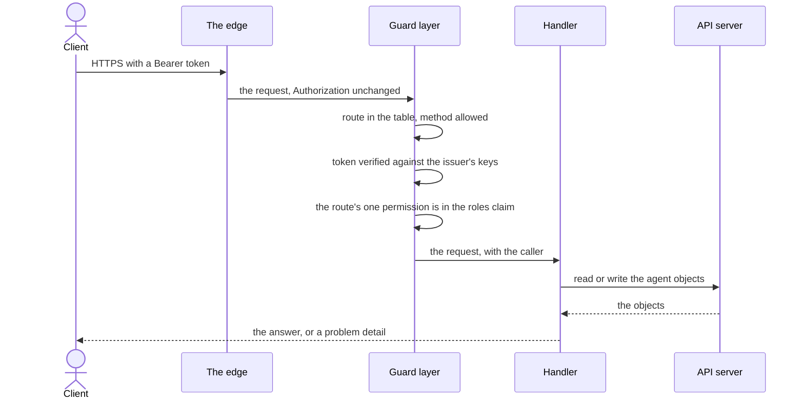
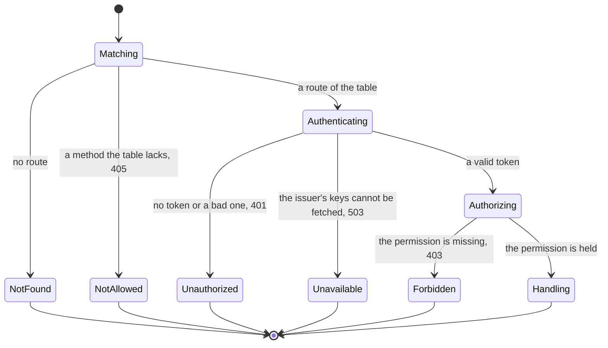

# Turn on the Platform API

The Platform API is the REST API of the admin dashboard and of `aapctl`. It is a Deployment of its own, beside the operator, and it is **off by default**. This page turns it on with `api.enabled`, points it at your OIDC issuer, and closes its network to what it needs.

You need the operator installed first: [Install the CRDs and the operator](install.md).

## What you must provide

The chart gives no default for these, and refuses to render without them:

| You provide | Value |
|---|---|
| The issuer of the tokens | `api.config.oidc.issuer`, an `http(s)` URL |
| At least one audience | `api.config.oidc.audiences`, matched against `aud` |
| The claim that holds the permissions | `api.config.oidc.rolesClaim` |
| The registries an agent may pin its own image from | `api.config.defaults.allowedImageRegistries`, **required**, at least one |
| Who may reach the API | `api.networkPolicy.from`, while the policy is on |

No secret value is configured. The API reads the issuer's public keys, and the two secrets it handles are references: `defaults.a2aBearer` names a Secret key, and the store's connection string is a Secret key too. The API mounts no Secret.

Two more defaults need your attention, because they work only if you act:

- **`defaults.a2aBearer`** defaults to the Secret `agent-a2a-bearer`, key `AGENT_REGISTRY_AGENT_TOKEN`. **You must create that Secret in each namespace an agent is made in**, holding the orchestrator's `AGENT_REGISTRY_AGENT_TOKEN`. Without it the orchestrator lists an agent and cannot call it.
- **`defaults.store`** defaults to `cnpg`, an operator-owned CloudNativePG `Cluster` per agent. **Without CloudNativePG installed, every agent made through the API is `StoreReady: False`, reason `CNPGNotInstalled`.** To use a Secret per agent instead, switch the store; exactly one of `cnpg` and `secretRef` may be set, so null the first:

```yaml
api:
  config:
    defaults:
      store:
        cnpg: null
        secretRef:
          name: "{name}-db-app"   # {name} is required: a name without it would share one ledger
          key: uri
```

With `secretRef` you create the Secret `<agent>-db-app`, with the key `uri`, yourself, for each agent. The name only mimics CloudNativePG's; nothing makes the Secret for you.

With run pods on, a third value is required: `api.config.defaults.coder.workVolume`. See [Turn on run pods](run-pods.md#the-values).

`allowedImageRegistries` matters because a person who may write agents can name a folder agent's image, and that pod is handed the model endpoint's API key and the A2A bearer. An entry is a registry host. It does not limit repositories: `ghcr.io` admits every image on `ghcr.io`. Name only registries whose images you trust.

## The values

Add these to the file you used for the operator, or keep them in a second file and pass both with `-f`. **Do not paste a second top-level `api:` block** into one file: YAML keeps the last, and the first is dropped without a warning. This page has two `api:` snippets, the store switch above and the values below: if you use both, they merge under **one** `api:`, or pasting both loses the store override. (A second top-level `networkPolicy:`, the install page's, at least fails loudly, on the registry `allowFrom` check.) All names are placeholders.

```yaml
api:
  enabled: true
  config:
    oidc:
      issuer: https://issuer.example/realms/platform
      audiences: [platform-api]
      rolesClaim: platform_roles
    defaults:
      allowedImageRegistries: [registry.example]
      allowFrom:                       # who may call a NEW agent; empty means nobody
        - namespaceSelector:
            matchLabels:
              kubernetes.io/metadata.name: orchestrator
  networkPolicy:
    from:                              # the pods of your Ingress controller
      - namespaceSelector:
          matchLabels:
            kubernetes.io/metadata.name: ingress
        podSelector:
          matchLabels:
            app.kubernetes.io/name: ingress-controller
    apiServer:
      cidrs: [192.0.2.10/32]           # from: kubectl get endpoints kubernetes
    issuer:
      to:
        - ipBlock:
            cidr: 203.0.113.10/32      # where the issuer's keys are fetched from
  ingress:                             # optional
    enabled: true
    className: edge
    host: api.example
    annotations:
      edge.example/rate-limit: "per-address"
```

`jwksUrl` is optional: add it under `oidc` for an issuer whose discovery document does not name its keys. The other `api.*` values are in the chart's [Platform API](../../../deploy/operator/README.md#the-platform-api) section and in [`values.yaml`](../../../deploy/operator/values.yaml).

### The issuer, the audiences and the roles claim

The API checks a bearer token against the keys of your issuer. The `iss` must equal `issuer` exactly, as a string. The chart accepts a trailing slash when you deploy; if the tokens' `iss` has none, every token is then refused with `401`. Copy `issuer` from the `issuer` field of the issuer's `/.well-known/openid-configuration`. `aud` must hold one of `audiences`. The values of the `rolesClaim` are the person's permissions. The algorithms accepted are RS256, RS384, ES256 and EdDSA ([§60a, slice D6](../../architecture/10-control-plane-and-crds.md#60a-admin-dashboard-v0)). Run `GET /v1/me` to see what a token grants: it lists the claim's values that start with `platform:`.

One thing to know before you rely on it: the API accepts a token that carries a `cnf` claim as a plain bearer. It does not check proof of possession (no DPoP). The record keeps this as a question for the owner ([CLAUDE.md](../../../CLAUDE.md), slice D6).

### The network policy peers

Ingress to the API is closed except `api.networkPolicy.from`. Egress has three rules: the API server, DNS, and the issuer. Two of them default to something wide, because the chart cannot know your addresses:

- **`apiServer.cidrs` empty** means any address on 443 and 6443. Set it to the addresses in `kubectl get endpoints kubernetes`, one `/32` each.
- **`issuer.to` empty** means any address on the issuer's ports, 443 by default. Set it to the issuer's CIDR, or to pod peers for an issuer inside the cluster, with its own port in `issuer.ports`.

The policy also opens the metrics port to `api.metrics.allowFrom` (nobody, by default), and adds an egress rule to `api.otel.to` when `api.otel` is on. The default DNS rule names `kube-dns` in `kube-system`. On a cluster with a node-local DNS cache, set `api.networkPolicy.dns.to`. A policy binds only where the CNI enforces `NetworkPolicy`.

### The edge, and the rate limit

TLS, a check of the JWT, and rate limits belong to the edge. **The API implements no rate limit.** The chart makes an `Ingress` when `api.ingress.enabled` is set, with a `host` (required) and the path `/v1`. `className` and `annotations` pass through: **`annotations` is where you attach the edge's rate limit.**

A limit per token only means something behind a check of the JWT. A limit keyed by the raw `Authorization` header is dodged by sending a new forged value each time. Keep a per-address limit as well, or verify the JWT at the edge before it counts. The edge must pass `Authorization` through unchanged, and let `OPTIONS` through to the API, which answers its own CORS preflights ([The edge](../../../deploy/operator/README.md#the-edge)). Browser origins go in `api.config.cors.allowedOrigins`, exact origins only, never a wildcard.

::: in-depth The request path

Every route is in one table, with the permission it needs. One layer over the whole router reads the table and decides before any handler runs, so a handler never decides who may call it ([`aap-platform-api`](../../../crates/platform-api/README.md#authorization-one-layer-applied-last)).





A route that is not in the table is never served. The permission of each route is in the [OpenAPI document](../../reference/openapi.md) (`x-permission`).

:::
## The API pod is not ready until it can reach the issuer

::: in-depth The checks behind it

`/readyz` answers `503` until the API has fetched the issuer's keys, and it also makes one call that needs the API's own rights on the cluster. So with a placeholder issuer, or when `issuer.to` or the NetworkPolicy blocks the issuer, the pod runs but never becomes ready, and `helm upgrade --wait` times out. Check:

```sh
kubectl -n aap-system logs deploy/aap-operator-api     # the chart sets fullnameOverride: aap-operator, so the Deployment is aap-operator-api
kubectl -n <release-namespace> get serviceaccount   # if you changed the name, find yours
```

then `api.networkPolicy.issuer.to` and `.ports`, `api.networkPolicy.dns`, and the issuer's URL. With `maxUnavailable: 0`, old pods keep serving during a failed rollout. The chart's `/readyz` behaviour is described in [The pod](../../../deploy/operator/README.md#the-pod).

:::
## Check the file before you deploy it

The chart cannot check everything the binary checks. Run the API's own `--check` on the configuration your values render. It needs no cluster and no issuer.

```sh
# the tag is api.image.tag in values.yaml
cid=$(docker create ghcr.io/vymalo/another-agentic-platform/api:sha-<7 hex>)
docker cp "$cid:/api" ./api && docker rm "$cid"

sh deploy/operator/tests/api-config.sh config.yaml -f values.yaml
./api --config config.yaml --check
```

The extracted binary is dynamically linked: at `sha-1d17e42` it needs glibc 2.39 or newer (the highest symbol version, read with `objdump -T`); the image's base is `distroless/cc-debian13`. Check again for the tag you use. `api-config.sh` renders the chart with `api.enabled=true` and writes the `config.yaml` of the API's ConfigMap to a file. The binary refuses an unknown key at every level. Then install:

```sh
helm upgrade --install aap-operator deploy/operator --namespace aap-system -f values.yaml --wait
```

## What the chart and the binary refuse

Each row was run, with the values above and one change. The checks live in `_validate.tpl`, which `templates/servicemonitor.yaml` includes, and every chart refusal prints that template's location — ignore it, the message after it is the one that matters; the exact line it prints is in [the agent page](../../../.agents/docs/guides/deploy/platform-api.md).

| Change | Who refuses | Message |
|---|---|---|
| no `audiences` | the chart | `api.config.oidc.audiences is required: at least one audience` |
| no `allowedImageRegistries` | the chart | `api.config.defaults.allowedImageRegistries is required, at least one registry host` |
| no `networkPolicy.from` | the chart | `api.networkPolicy.from is required while api.networkPolicy.enabled` |
| `ingress.enabled` with no `host` | the chart | `api.ingress.host is required with api.ingress.enabled` |
| `allowedOrigins: ["*"]` | the chart | `a wildcard is refused: name each origin` |
| run pods on with no `api.config.defaults.coder.workVolume` | the chart | `api.config.defaults.coder.workVolume is required while runPods.enabled` |
| a misspelt key in the **file** (`oidcc`) | the binary, `--check` | excerpt: `unknown field oidcc, expected one of listen, healthListen, metricsListen, oidc, cors, defaults`, exit 1 |

A misspelt key under `api.config` in your **values** is refused first by the chart (`api.config.<key> is not a setting of the chart`); the binary's refusal is for a file you edited by hand. The chart cannot check the types below `defaults` (`coder`, `folder`, `security`). The binary refuses what is wrong in them at start: the new pod exits and never becomes ready, and with `maxUnavailable: 0` the old pods keep serving.

## What proves it

| CI job | Workflow | What it runs |
|---|---|---|
| `api-e2e` | [`operator-image.yml`](../../../.github/workflows/operator-image.yml) | The chart's `api` component in kind with the API's image. The testkit's issuer runs as a program on the runner. A folder agent is made, read, replaced and deleted through the deployed API, and the operator makes it `Ready`. `push` needs it |
| `api-image` | `operator-image.yml` | Builds and smoke-tests the API image, and runs `api --check` on the files the chart renders for the shapes it is tested in |
| `chain-e2e` | `operator-image.yml` | The API makes a coder with an audience, and a pinned orchestrator lists it. `push` does not need it |

*Verified 2026-11-27* with `gh run view`: on `main` at commit `1d17e42` (tag `sha-1d17e42`), checked on 2026-11-27, run 45922615533 of `operator-image.yml`, with `api-e2e`, `api-image` and `chain-e2e` among its jobs, ended in success.

Also run for this page: `helm template` with only the values block above (and the chart's defaults) rendered 15 objects, and with the install page's values and the run pods page's values added it rendered 24. Every object was valid under `kubeconform` in both. The published API image at `api.image.tag` (`sha-1d17e42` when this was written) was pulled, and its `--check` accepted the rendered file (exit 0).

On 2026-11-27 the API was also installed on a kind cluster with a placeholder issuer (`issuer.example`) and `--wait --timeout 120s`. The API pod stayed `0/1` with `Readiness probe failed ... statuscode: 503`, its log said `the token issuer's keys cannot be fetched; tokens are refused until they can`, and `helm upgrade` ended `context deadline exceeded` with the release `failed`. That is what an unreachable issuer looks like. No token was checked, because no issuer was reachable.

### What is unverified

- **A real Keycloak.** The issuer in CI is the testkit's, a small program that signs test tokens. Whether a real Keycloak's keys, its roles claim (composite roles expanded), and its `aud` work as described is unverified until the realm is tried ([CLAUDE.md](../../../CLAUDE.md), slices D6 and K9b).
- **A real edge.** TLS, a JWT check and a rate limit at the edge are not run by any job. That grouping by the `Authorization` header gives a limit per token was not tried.
- **`preStop.sleep` under a rollout.** The pod has the hook, and nothing measures it under a rolling update. The gate behind it is GA from Kubernetes 1.34, so it is on at the platform's floor of 1.37 ([The pod that leaves](../../../deploy/operator/README.md#a-pod-that-leaves)).
- **An issuer behind a private CA or a proxy.** The recipe is in the README and is unverified. `render-check.sh` holds only that the values render.
- **The `NetworkPolicy` on a real cluster you run.** kind's CNI enforces it in `api-e2e`. Your CNI may not.
