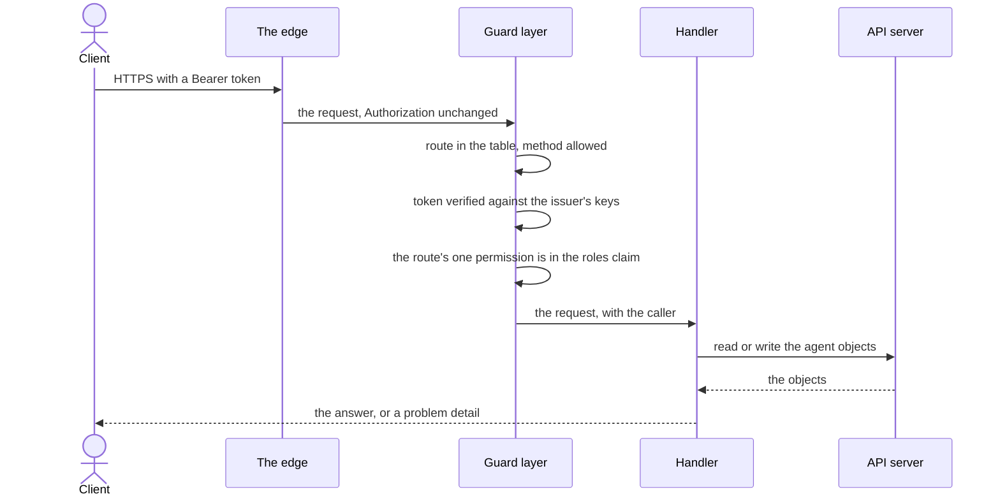
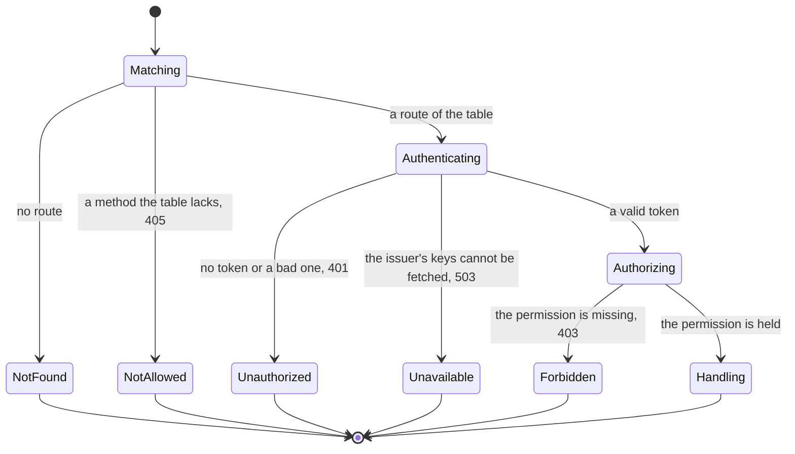

# Turn on the Platform API

The Platform API is the REST API of the admin dashboard and of `aapctl`. It is a Deployment of its own, beside the operator, and it is **off by default**. This page turns it on with `api.enabled`, points it at your OIDC issuer, and closes its network to what it needs.

You need the operator installed first: [Install the CRDs and the operator](install.md).

## What you must provide

The chart gives no default for these, and refuses to render without them:

| You provide | Value |
|---|---|
| The issuer of the tokens | `api.config.oidc.issuer`, an `http(s)` URL |
| At least one audience | `api.config.oidc.audiences`, matched against `aud` |
| The claim that holds the permissions | `api.config.oidc.rolesClaim` |
| The registries an agent may pin its own image from | `api.config.defaults.allowedImageRegistries`, **required**, at least one |
| Who may reach the API | `api.networkPolicy.from`, while the policy is on |

The API only reads the issuer's public keys. No secret is configured, and the API mounts no Secret.

`allowedImageRegistries` matters because a person who may write agents can name a folder agent's image, and that pod is handed the model endpoint's API key and the A2A bearer. An entry is a registry host. It does not limit repositories: `ghcr.io` admits every image on `ghcr.io`. Name only registries whose images you trust.

## The values

Add these to the file you used for the operator. All names are placeholders.

```yaml
api:
  enabled: true
  config:
    oidc:
      issuer: https://issuer.example/realms/platform
      audiences: [platform-api]
      rolesClaim: platform_roles
    defaults:
      allowedImageRegistries: [registry.example]
      allowFrom:                       # who may call a NEW agent; empty means nobody
        - namespaceSelector:
            matchLabels:
              kubernetes.io/metadata.name: orchestrator
  networkPolicy:
    from:                              # the pods of your Ingress controller
      - namespaceSelector:
          matchLabels:
            kubernetes.io/metadata.name: ingress
        podSelector:
          matchLabels:
            app.kubernetes.io/name: ingress-controller
    apiServer:
      cidrs: [192.0.2.10/32]           # from: kubectl get endpoints kubernetes
    issuer:
      to:
        - ipBlock:
            cidr: 203.0.113.10/32      # where the issuer's keys are fetched from
  ingress:                             # optional
    enabled: true
    className: edge
    host: api.example
    annotations:
      edge.example/rate-limit: "per-address"
```

`jwksUrl` is optional: add it under `oidc` for an issuer whose discovery document does not name its keys. The other `api.*` values are in the chart's [Platform API](../../../deploy/operator/README.md#the-platform-api) section and in [`values.yaml`](../../../deploy/operator/values.yaml).

### The issuer, the audiences and the roles claim

The API checks a bearer token against the keys of your issuer. The `iss` must equal `issuer` exactly. `aud` must hold one of `audiences`. The values of the `rolesClaim` are the person's permissions. The algorithms accepted are RS256, RS384, ES256 and EdDSA ([§60a, slice D6](../../architecture/10-control-plane-and-crds.md#60a-admin-dashboard-v0)). Run `GET /v1/me` to see what a token grants: it lists the claim's values that start with `platform:`.

One thing to know before you rely on it: the API accepts a token that carries a `cnf` claim as a plain bearer. It does not check proof of possession (no DPoP). The record keeps this as a question for the owner ([CLAUDE.md](../../../CLAUDE.md), slice D6).

### The network policy peers

Ingress to the API is closed except `api.networkPolicy.from`. Egress has three rules: the API server, DNS, and the issuer. Two of them default to something wide, because the chart cannot know your addresses:

- **`apiServer.cidrs` empty** means any address on 443 and 6443. Set it to the addresses in `kubectl get endpoints kubernetes`, one `/32` each.
- **`issuer.to` empty** means any address on the issuer's ports, 443 by default. Set it to the issuer's CIDR, or to pod peers for an issuer inside the cluster, with its own port in `issuer.ports`.

The default DNS rule names `kube-dns` in `kube-system`. On a cluster with a node-local DNS cache, set `api.networkPolicy.dns.to`. A policy binds only where the CNI enforces `NetworkPolicy`.

### The edge, and the rate limit

TLS, a check of the JWT, and rate limits belong to the edge. **The API implements no rate limit.** The chart makes an `Ingress` when `api.ingress.enabled` is set, with a `host` (required) and the path `/v1`. `className` and `annotations` pass through: **`annotations` is where you attach the edge's rate limit.**

A limit per token only means something behind a check of the JWT. A limit keyed by the raw `Authorization` header is dodged by sending a new forged value each time. Keep a per-address limit as well, or verify the JWT at the edge before it counts. The edge must pass `Authorization` through unchanged, and let `OPTIONS` through to the API, which answers its own CORS preflights ([The edge](../../../deploy/operator/README.md#the-edge)). Browser origins go in `api.config.cors.allowedOrigins`, exact origins only, never a wildcard.

## The request path

Every route is in one table, with the permission it needs. One layer over the whole router reads the table and decides before any handler runs, so a handler never decides who may call it ([`aap-platform-api`](../../../crates/platform-api/README.md#authorization-one-layer-applied-last)).





A route that is not in the table is never served. The permission of each route is in the [OpenAPI document](../../reference/openapi.md) (`x-permission`).

## Check the file before you deploy it

The chart cannot check everything the binary checks. Run the API's own `--check` on the configuration your values render. It needs no cluster and no issuer.

```sh
# the tag is api.image.tag in values.yaml
cid=$(docker create ghcr.io/vymalo/another-agentic-platform/api:sha-<7 hex>)
docker cp "$cid:/api" ./api && docker rm "$cid"

sh deploy/operator/tests/api-config.sh config.yaml -f values.yaml
./api --config config.yaml --check
```

`api-config.sh` renders the chart with `api.enabled=true` and writes the `config.yaml` of the API's ConfigMap to a file. The binary refuses an unknown key at every level. Then install:

```sh
helm upgrade --install aap-operator deploy/operator --namespace aap-system -f values.yaml --wait
```

## What the chart and the binary refuse

Each row was run, with the values above and one change:

| Change | Who refuses | Message |
|---|---|---|
| no `audiences` | the chart | `api.config.oidc.audiences is required: at least one audience` |
| no `allowedImageRegistries` | the chart | `api.config.defaults.allowedImageRegistries is required, at least one registry host` |
| no `networkPolicy.from` | the chart | `api.networkPolicy.from is required while api.networkPolicy.enabled` |
| `ingress.enabled` with no `host` | the chart | `api.ingress.host is required with api.ingress.enabled` |
| `allowedOrigins: ["*"]` | the chart | `a wildcard is refused: name each origin` |
| a misspelt key in the file (`oidcc`) | the binary, `--check` | `unknown field oidcc, expected one of listen, healthListen, metricsListen, oidc, cors, defaults`, exit 1 |

The chart cannot check the types below `defaults` (`coder`, `folder`, `security`). The binary refuses what is wrong in them at start: the new pod exits and never becomes ready, and with `maxUnavailable: 0` the old pods keep serving.

## What proves it

| CI job | Workflow | What it runs |
|---|---|---|
| `api-e2e` | [`operator-image.yml`](../../../.github/workflows/operator-image.yml) | The chart's `api` component in kind with the API's image. The testkit's issuer runs as a program on the runner. A folder agent is made, read, replaced and deleted through the deployed API, and the operator makes it `Ready`. `push` needs it |
| `api-image` | `operator-image.yml` | Builds and smoke-tests the API image, and runs `api --check` on the files the chart renders for the shapes it is tested in |
| `chain-e2e` | `operator-image.yml` | The API makes a coder with an audience, and a pinned orchestrator lists it. `push` does not need it |

*Verified 2026-11-27* with `gh run view`: on `main` at `1d17e42`, run 45922615533 of `operator-image.yml`, with `api-e2e`, `api-image` and `chain-e2e` among its jobs, ended in success.

Also run for this page: `helm template` of the values above rendered 15 objects, all valid under `kubeconform`. The published API image at `api.image.tag` (`sha-1d17e42`) was pulled, and its `--check` accepted the rendered file (exit 0).

### What is unverified

- **A real Keycloak.** The issuer in CI is the testkit's, a small program that signs test tokens. Whether a real Keycloak's keys, its roles claim (composite roles expanded), and its `aud` work as described is unverified until the realm is tried ([CLAUDE.md](../../../CLAUDE.md), slices D6 and K9b).
- **A real edge.** TLS, a JWT check and a rate limit at the edge are not run by any job. That grouping by the `Authorization` header gives a limit per token was not tried.
- **`preStop.sleep` under a rollout.** The pod has the hook, and nothing measures it under a rolling update. The gate behind it is alpha and off in Kubernetes 1.29, and on from 1.30 ([The pod that leaves](../../../deploy/operator/README.md#a-pod-that-leaves)).
- **An issuer behind a private CA or a proxy.** The recipe is in the README and is unverified. `render-check.sh` holds only that the values render.
- **The `NetworkPolicy` on a real cluster you run.** kind's CNI enforces it in `api-e2e`. Your CNI may not.
