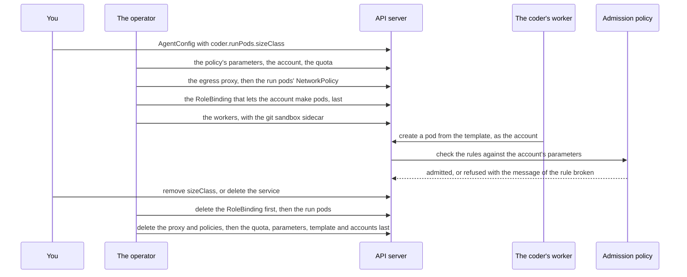
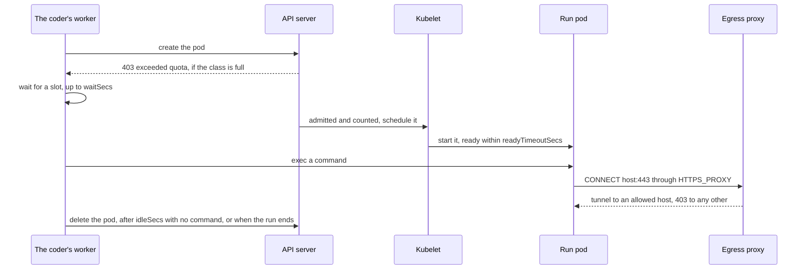
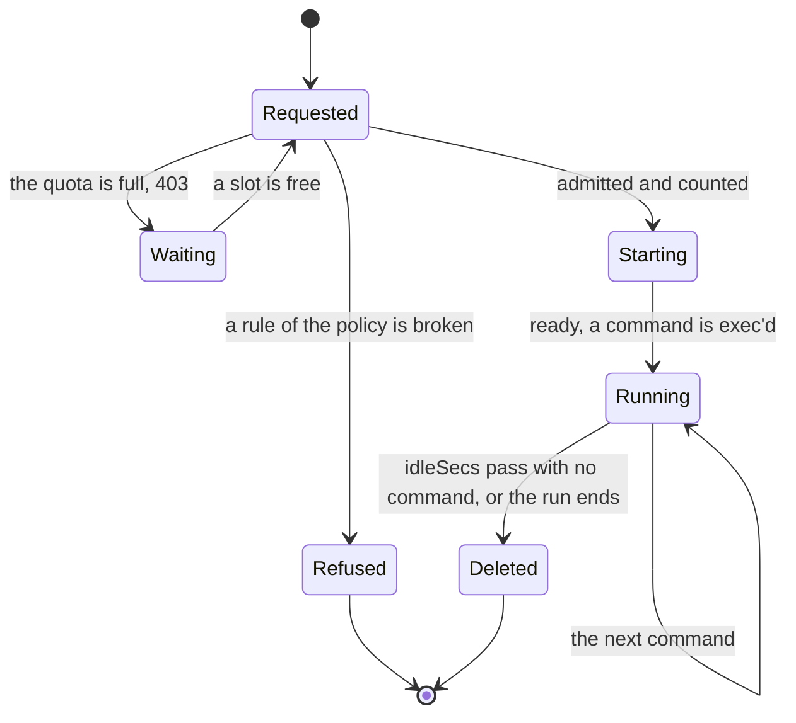

# Turn on run pods

A coder can run the commands of a run (`run_command`, `run_checks`, OpenCode) in a pod of their own, instead of in its own container. The coder holds the model key and the GitHub App's private key. A repository's commands should not be able to read them. With run pods on, each run's commands go to a pod that sees only its own run.

Run pods are **off by default**. With `runPods.enabled: false`, nothing of them is rendered or checked, and an `AgentConfig` that asks for them is `ConfigInvalid`, saying the operator has no run pods. This page turns them on.

Install the operator first: [Install the CRDs and the operator](install.md).

## What you need first

- **Kubernetes 1.30 or later.** The guard is a `ValidatingAdmissionPolicy`, which is GA there. It uses `params` in a match condition, which was *verified 2026-10-26* on v1.35.8 and **not on an older version** ([What a person must know](../../../deploy/operator/README.md#what-a-person-must-know)).
- **A CNI that enforces `NetworkPolicy`.** The run pods' network is deny by default, and a policy is only as real as the plugin behind it. On a cluster whose CNI does not enforce it, you get the proxy and no deny.
- **A coder image that carries `adam-egress` and `adam-git-sandbox`.** See the next two sections. The chart's `defaultAgentImage` has neither. CLAUDE.md and the chart say so.
- **With the Platform API on:** `api.config.defaults.coder.workVolume`, because run pods mount the coder's work volume. The chart refuses the render without it.

## The values

```yaml
runPods:
  enabled: true
  runtimeClassName: gvisor        # optional: the sandbox, see below
  quota:
    pods: 4                       # run pods per agent, at once
    limitsMemory: 8Gi
  egressProxy:
    replicas: 2
    extraAllow:                   # hosts a run pod may reach, besides the defaults
      - models.example
  gitSandbox:
    resources:
      limits:
        memory: 1Gi               # required
    maxCommands: 64
runPodClasses:                    # the size classes an agent picks by name
  standard:
    requests: { cpu: 250m, memory: 512Mi, ephemeral-storage: 1Gi }
    limits:   { cpu: "2",  memory: 2Gi,   ephemeral-storage: 4Gi }
```

The values not shown (the run image, the idle and ready timeouts, node placement, `nodeType`) keep their defaults. They are in the chart's [Run pods](../../../deploy/operator/README.md#run-pods) section and in [`values.yaml`](../../../deploy/operator/values.yaml). The run image is pinned by tag and digest, and `latest` is refused.

An agent then asks for them by naming a class. The agent also needs a work volume, and an image from the right adam-rs revision (below):

```yaml
kind: AgentConfig
spec:
  harness:
    type: adam-rs
    adam:
      coder:
        runPods:
          sizeClass: standard
  environment:
    image:
      ref: ghcr.io/vymalo/another-adam-rs/coder:<tag>@sha256:<digest>
    volumes:
      - { name: work, scope: agent, mountPath: /work, source: { persistent: { size: 20Gi, perReplica: true } } }
```

An existing coder that gets `runPods` is rolled once: its pod template changes. A coder without run pods does not move by one byte.

## What the operator makes for an agent

The chart makes four things once: the `PriorityClass` (unless you name one), the admission policy and its binding over every watched namespace, and the `Role` run pods use (one in each watched namespace). For each agent that sets `sizeClass`, the operator makes the rest.



The order matters. The operator makes the parameters before the right to make pods, and removes the right first. The operator itself holds `bind` on that one `Role` and no right to make a pod, `exec` or read a Secret. It can bind the `Role` to any account in the namespace ([What a person must know](../../../deploy/operator/README.md#what-a-person-must-know), items 1 to 4, say what follows from that).

## A run pod, from request to deletion





The files stay on the volume when the pod goes. A pod that no command used for `idleSecs` is deleted; `0` keeps it until its run ends.

## The egress proxy

A run pod reaches the internet through one proxy, or not at all. The network policy of a run pod has no ingress and only three egress targets: DNS, the proxy's pods on port 3128, and `runPods.networkPolicy.extraEgress`. There is no switch to turn it off: `runPods.networkPolicy.enabled: false` is refused.

The operator makes one proxy per agent with run pods: a `Deployment`, `Service`, `ServiceAccount`, `PodDisruptionBudget`, `NetworkPolicy` and a `ConfigMap` that holds the allow-list. The template sets `HTTPS_PROXY`, `HTTP_PROXY` and `NO_PROXY`. The proxy accepts `CONNECT host:443` to the hosts you allow, resolves the name itself, and connects to public IPv4 addresses only.

**The allow-list is the deployment's.** `runPods.egressProxy.allow` holds the defaults (npm, PyPI, crates.io, Go, GitHub, pub.dev). `extraAllow` adds yours and survives a change of the defaults. An `AgentConfig` cannot extend either list. `example.com` is that host, and `.example.com` is every subdomain of it and not the apex. A bare suffix such as `.com` is refused. A model gateway outside the cluster that run pods call goes in `extraAllow`. An in-cluster target the proxy cannot serve goes in `networkPolicy.extraEgress`, with its host in `egressProxy.extraNoProxy`.

**The proxy runs the agent's own coder image, and that image must contain `adam-egress`** (adam-rs `ff10395` or later). With an older image the proxy's pod cannot start, and a run pod reaches nothing. The operator cannot tell, because an image tag has no order, so it does not refuse. The proxy is not a workload of the service, so a proxy that does not start does not make the service `Failed`. Look at it directly:

```sh
kubectl -n <namespace> get pods -l app.kubernetes.io/component=egress-proxy
```

## The git sandbox

With run pods, the coder's pod gets a second container, `git-sandbox`, and the coder sends its local `git` commands to it over a Unix socket. A repository's own configuration can name a program for git to run (a `filter` or an `fsmonitor`), and the run writes those repositories. In the sandbox that program can read none of the coder's token, key or model key. The sandbox has no Secret, no service-account token, a read-only root file system and a `/tmp` of its own. The coder container alone mounts the account's token. Commands that carry a credential (`fetch`, `push`, `ls-remote`) stay in the coder.

`runPods.gitSandbox.resources`, `.tmpSize` and `.maxCommands` tune it. A memory limit is required, `tmpSize` must be above zero, and there is no switch: it is on with run pods.

**The agent's image must contain `adam-git-sandbox`** (adam-rs `05cda7f` or later). With an older one the sidecar cannot start, and neither does the coder's pod: its startup probe never passes. This failure is loud (`Init:0/2`, the service never `Ready`), and the operator still does not refuse it.

## The sandboxed runtime

A run pod shares the node's kernel unless a `RuntimeClass` puts a kernel in user space between them. Name one with `runPods.runtimeClassName`. Empty (the default), no trace of it is rendered.

**You make the `RuntimeClass`. The chart never does.** The operator has no right on the kind. gVisor's handler is `runsc`, not `runsc-kvm`, because the nodes are virtual machines ([AD-052](../../architecture/11-decisions.md#ad-052--gvisor-a-sandboxed-runtime-class-for-run-pods-and-for-the-agents-own-pods), decisions 4 and 5):

```yaml
apiVersion: node.k8s.io/v1
kind: RuntimeClass
metadata:
  name: gvisor
handler: runsc
```

Once named, the class is **required**: the admission policy refuses a run pod of the agent's account that names another class, or none. A class the cluster does not have is a pod that never starts, and the operator cannot tell that from a bad image tag. A size class may name its own: `runPodClasses.<name>.runtimeClassName` replaces the deployment's for the pods of that class.

`agent.runtimeClassName` is the same setting for the agents' own pods. **Leave it empty.** The owner's order is run pods first, and the agents' pods only after a run pod has started under `runsc` on a real node ([AD-052](../../architecture/11-decisions.md#ad-052--gvisor-a-sandboxed-runtime-class-for-run-pods-and-for-the-agents-own-pods), amended 2026-11-24). Whether the k3d run below counts as a real node is open for the owner.

### What gVisor measured (ANR-404)

The record is [§59c, row K14](../../architecture/10-control-plane-and-crds.md#59c-operator-increments-kagent-grade-minimum) and the paragraph after the K14a table, *Measured 2026-11-26 in a local k3d cluster*, with [AD-052](../../architecture/11-decisions.md#ad-052--gvisor-a-sandboxed-runtime-class-for-run-pods-and-for-the-agents-own-pods). Its words, which this page does not improve on:

- The shim was told `ignore-cgroups = "true"` in a file containerd names in the runtime's options. In the record: "that is how runsc starts at all on this node ... this log does not show a start without it". K14b measured, on a kind node, that runsc's device cgroup is refused (`configuring device cgroup: loading device filter: operation not permitted`) and the pod never starts.
- With that setting, a run pod made from the operator's own template, as the agent's service account, "was admitted by the policy and ran".
- **"So a run pod's memory and CPU limits are not enforced under this runsc configuration, and the sandbox start on a container node is not production-equivalent."** A pod with `limits.memory: 64Mi` held 256 MiB and completed under runsc, and was `OOMKilled` under runc. A loop under `limits.cpu: 100m` ran as fast as with 2 CPUs under runsc.
- On that setup `hostUsers: false` beside the class did not start. The runc control failed there too, so a real node is untested.

The node was a container on a rootless Docker. The run was on one machine, and the workflow `gvisor-k3d` also ran on a hosted runner (PR #112, run 45889453084, kernel 7.0.0-1020-azure), with the same results for the start, the admission cases and the limits.

**Read this before you rely on it.** On a node where runsc needs `ignore-cgroups`, the quota's `limits.memory` and the template's limits do not protect you from a run pod. Whether limits are enforced on a node where runsc can use the cgroups is unverified.

## What the chart refuses

Five refusals on the values above, each run with `helm template`:

| Change | The chart says |
|---|---|
| `egressProxy.extraAllow: [".com"]` | `entry ".com" is a bare suffix, which would allow every host of a top-level domain` |
| `gitSandbox.resources.limits` removed | `runPods.gitSandbox.resources.limits.memory is required` |
| `runPods.networkPolicy.enabled: false` | `runPods.networkPolicy.enabled is no longer a choice` |
| `runtimeClassName: Not_A_Name` | `must be the name of a RuntimeClass (a DNS subdomain) or empty` |
| a size class with no `limits.cpu` | `runPodClasses.standard.limits.cpu is required (AD-061)` |

## Check a cluster

After an agent with run pods is `Ready`:

```sh
sh deploy/operator/tests/run-pods-admission.sh <namespace> <service>
kubectl auth can-i create pods --as system:serviceaccount:<namespace>:aap-operator -n <namespace>     # no
kubectl auth can-i create pods --as system:serviceaccount:<namespace>:<service> -n <namespace>        # yes
kubectl auth can-i get secrets --as system:serviceaccount:<namespace>:<service> -n <namespace>        # no
```

The script asks the real policy with `--dry-run=server`, as the agent's account. It checks that the pod the coder would build is admitted and that each mutation is refused with its rule's message. It creates nothing.

## What proves it

| CI job | Workflow | What it runs |
|---|---|---|
| `run-pods-e2e` | [`operator-image.yml`](../../../.github/workflows/operator-image.yml) | Installs the chart in kind twice, without run pods and then with them. Runs the real coder, pinned by tag and digest. Shows the run pod, the quota, the network policy, the proxy, the git sandbox, `run-pods-admission.sh` in the cluster, and a deleted service leaving nothing. `push` does **not** need it |
| `gvisor-k3d` | [`gvisor-k3d.yml`](../../../.github/workflows/gvisor-k3d.yml) | A run pod of the operator's template under `runsc` in a k3d cluster, the admission cases, and the limits measure. A workflow of its own, **not** a required check, and `push` does not need it. It runs on a pull request only when its files or the chart templates change, and on demand |

Where the chart is concerned, `render-check.sh` holds the objects, the operator's `Role` rule by rule, and every refusal above, each broken on purpose.

*Verified 2026-11-27* with `gh run view`: `run-pods-e2e` ended in success in run 45922615533 of `operator-image.yml`, on `main` at `1d17e42`. Written down by the project: the run of 2026-10-27 in which a kubelet started the git sandbox and the coder, the sidecar held no token, key or Secret, and `curl` and `npm` went through the proxy (run 40520862547, job 122249371008). `gvisor-k3d` is cited as it is in the workflow's header: *verified 2026-11-26* on a hosted runner in run 45889453084 (PR #112). It was not re-run for this page.

### What was walked

On 2026-11-27, on a throwaway kind cluster (Kubernetes v1.35.8), the operator chart was upgraded with the values above. The real API server accepted the `ValidatingAdmissionPolicy`, its binding and the `PriorityClass`, the new operator pods became ready, and a `Role` for run pods appeared in the watched namespace. No `RuntimeClass` object was rendered. No coder ran, so no run pod was made. The cluster was deleted afterwards. With the Platform API on and a `workVolume`, the API's `--check` accepted the rendered file, which then lists the size class.

### What is unverified

- **The sandbox on a real node.** The sandbox start is proven on a container node only, with `ignore-cgroups` and unenforced limits. A real node, the Talos nodes with gVisor's extension, and the cost of a real build under runsc are unproven.
- **The agent's pods under the class.** The coder's own pod with its git sandbox, projected token, egress proxy and store's connections under `runsc` is unverified (slice K14d). That is why `agent.runtimeClassName` stays empty.
- **`hostUsers: false` beside the class.** Untested on a real node.
- **Kubernetes older than 1.35.** The match-condition `params` are unverified there.
- **Tools other than `curl` and `npm` through the proxy.** git, cargo, pip and go are documented to read the proxy variables and are not tried.
- **Pod Security admission, and an agent whose image lacks `adam-egress` or `adam-git-sandbox`.**
- **What the proxy does not cover.** Domain fronting, what an allowed host accepts, DNS as a channel, and the proxy's lack of authentication (its policy says who may reach it).
- **A CNI that does not enforce `NetworkPolicy`.** `run-pods-e2e` requires kindnet to refuse. Yours may not.
