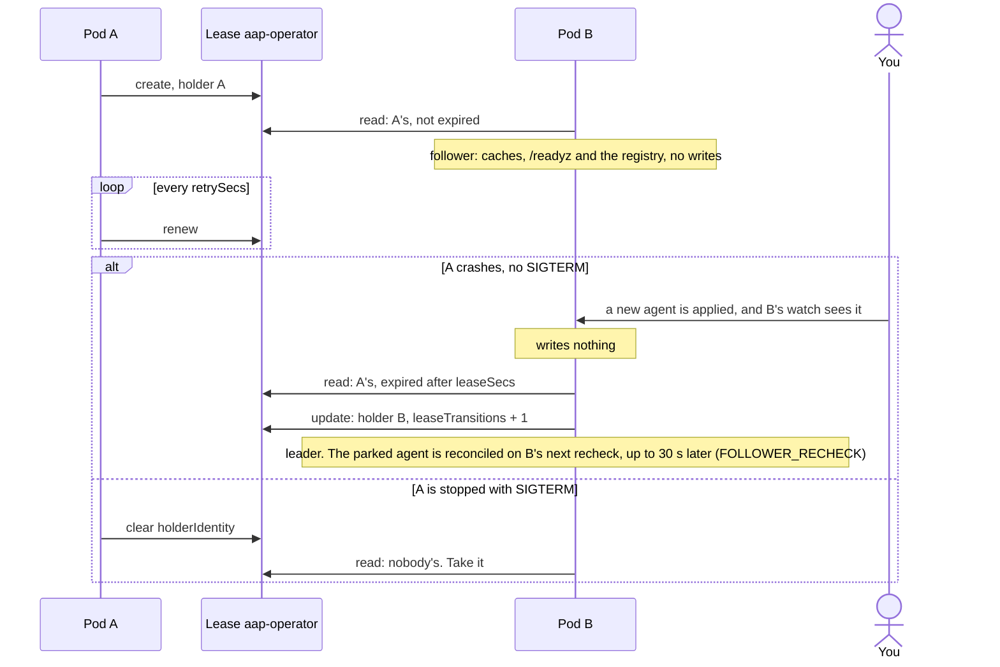
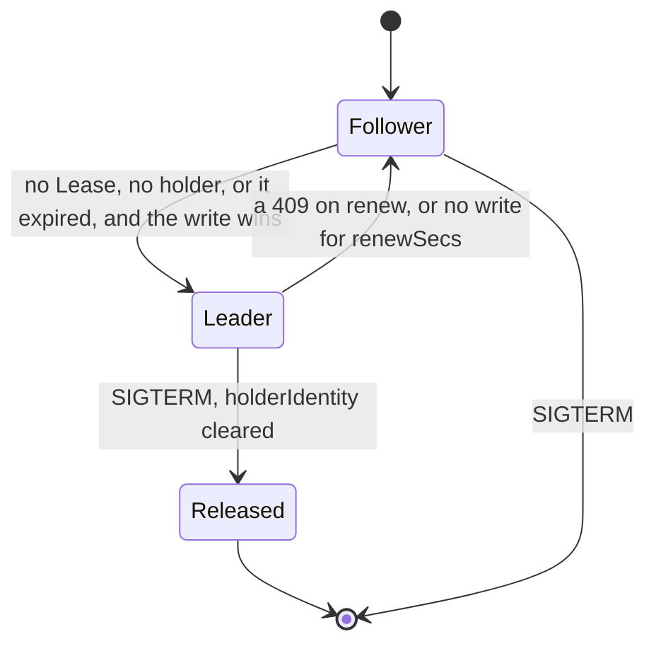

# Run two replicas

One operator pod is a single point of failure for reconciling. When it goes, nothing is reconciled until the next one is ready. With more than one replica, the pods elect one leader through a Kubernetes `Lease`. Only the leader writes. The others wait, and one of them takes over when the leader goes.

This does not give you more write capacity. It shortens the pause.

With `replicas: 1`, which is the default, there is one pod, the `Recreate` strategy and no election. This page is for `replicas: 2` or more.

Install the operator first: [Install the CRDs and the operator](../deploy/install.md).

## The values

```yaml
replicas: 2
leaderElection:        # the defaults, in seconds; retry < renew < lease
  leaseSecs: 15
  renewSecs: 10
  retrySecs: 2
```

`replicas` is the only value you need. The `leaderElection` block shows the defaults, and you can leave it out. The key is `replicas`, not `replicaCount`.

With more than one replica, the chart changes five things:

| Object | What changes |
|---|---|
| `Deployment` `aap-operator` | `RollingUpdate`, `maxSurge: 1`, `maxUnavailable: 0`. At one replica it is `Recreate` |
| `PodDisruptionBudget` `aap-operator` | `maxUnavailable: 1`. At one replica there is none, because a budget of 1 of 1 would block every drain |
| The operator's file | `leaderElection.enabled: true`, with the `Lease`'s name and namespace and the three timers |
| The `Role` in the primary namespace | `get` and `update` on the `Lease` named `aap-operator`, and `create` on `leases`. No `delete`, and no `list` |
| The pass timeout | 4 s, unless `tuning.reconcileTimeoutSecs` says otherwise. With `toolProbe.to` set, the probe runs inside a pass that keeps 5 s for its other steps, so the pass timeout must be at least `toolProbe.timeoutSecs` + 5, and the chart refuses it otherwise (`toolProbe.timeoutSecs (...) does not fit the pass`, naming the values that fit). The pass must also stay below `leaseSecs - renewSecs`, so the lease must be at least `renewSecs` + the pass + 1. **The chart's defaults fail the probe rule:** the lease rule holds at the defaults (a 4 s pass is below 15 - 10), but the default 5 s probe needs a pass of 10 s, so with `toolProbe.to` set the chart always refuses them. With the default `renewSecs: 10`, the smallest block that renders for the default 5 s probe is `leaseSecs: 21`, `renewSecs: 10`, `tuning.reconcileTimeoutSecs: 10`, `toolProbe.timeoutSecs: 5`; a shorter probe fits a shorter pass: `toolProbe.timeoutSecs: 1`, `tuning.reconcileTimeoutSecs: 6`, `leaseSecs: 17` (also with the default `renewSecs: 10`). A longer lease slows the takeover after a crash |

The `Lease` is named `aap-operator` and lives in the **primary** namespace: the first of `watchNamespaces`. Every pod campaigns for the same one.

::: in-depth What each replica does

| | The leader | A follower |
|---|---|---|
| Reconciles and writes | Yes | **No.** Its passes write nothing |
| Keeps its caches of the watched objects | Yes | Yes |
| Answers `/readyz` | Yes | **Yes.** It is ready, so all replicas show ready while one writes |
| Serves the registry on 8080 | Yes | **Yes**, from its own caches |
| Counts reconcile passes in `/metrics` | Yes | No. On the walk for the metrics page it showed only `aap_runtime_signals_total` ([Scrape metrics](metrics.md)) |

The registry stays up through a failover because each replica builds it from its own caches.

:::
::: in-depth How the election works

Every `retrySecs`, a follower and the leader alike read the `Lease` and act on it. The leader renews at that pace, so one failed renewal is retried. `renewSecs` is not a period: it is the deadline after which a leader that could not write demotes itself. The rules are in [`aap-leader-kubernetes`](../../../crates/leader-kubernetes/README.md#the-loop):

- No `Lease`: create it, naming yourself in `holderIdentity`. Another pod may win the create (a `409`): you are a follower.
- It is yours: renew it. A `409` means someone took it: you are a follower at once.
- It has **no holder** (`holderIdentity` is empty, because the last leader stopped cleanly): take it at once. Nobody waits for the old `renewTime` to pass.
- It is someone else's and **expired**, that is `renewTime` plus `leaseSecs` is past, by your own clock: take it over, and add one to `leaseTransitions`.
- Anything else: you are a follower.

A leader that has not **written** for `renewSecs` demotes itself. That is before any other pod may take over, because `retry < renew < lease`. The margin is `leaseSecs - renewSecs`, 5 s by default, and a pass is capped below it. On a clean stop the leader clears `holderIdentity`.



If A's pod is gone, the `Deployment` makes a new one. It joins as a follower, and it may win the election instead of B: the two followers race, and either can win.



These two follow `leader-e2e.sh` and the crate's README. The state diagram is the one [the install page](../deploy/install.md#replicas) used to carry, which now links here.

:::
## Look at it

```sh
kubectl -n aap-system get pod
kubectl -n agents get lease aap-operator -o jsonpath='{.spec.holderIdentity} {.spec.leaseDurationSeconds} {.spec.leaseTransitions}{"\n"}'
```

The second line names the leader's pod, 15, and how many times the `Lease` changed hands. Replace `agents` with your primary namespace. A healthy first line shows **both pods `1/1`**: a follower is ready too, so ready does not say which one writes.

::: in-depth How long a failover takes

There are two ways a leader goes, and they differ by about 15 seconds.

- **A crash or a lost node.** The pod leaves no word. The `Lease` keeps its name until it expires, `leaseSecs` after the last renewal, so nothing writes for about that long. Agents keep running, because each is a `Deployment` of its own. Only reconciling pauses. This is for a pod that is gone. A container that the kubelet restarts inside the same pod finds the `Lease` under its own name and renews it, so there is no failover (a comment in `leader-e2e.sh` says so; it was not run here).
- **A clean stop** (SIGTERM, a drain, a rolling update). The leader clears `holderIdentity` and the next pod takes it on its next try.
- **Then the agents catch up.** A replica that is not the leader asks again every 30 s whether it has become one (`FOLLOWER_RECHECK`, in `crates/controller/src/operator.rs`). So an agent that was applied while nobody wrote, a parked one, is reconciled by the new leader up to 30 s after the takeover. That is consistent with the parked agent in the table below being `Ready` 21 s after the takeover and not at once. No run isolated the cause: the recheck gives an upper bound of 30 s, not the figure.

What was measured, as dated records:

| Record | A holder killed with SIGKILL | A parked agent | A holder stopped with SIGTERM |
|---|---|---|---|
| CI, 2026-11-27, run 45932723504 at `2c16326`, job `leader-e2e` 140288981731, kind v1.35.8 | the `Lease` moved 14 s after the kill, not before 10 s, `leaseTransitions` 0 to 1 | an agent applied meanwhile was `Ready` 21 s after the takeover | the `Lease` passed to another pod 1 s after the SIGTERM, `leaseTransitions` 1 to 2 |
| CI and a local run, 2026-11-19, as [CLAUDE.md](../../../CLAUDE.md) records them (K7b; CI runs 44458607529 and 44460925046) | 15 to 16 s | 21 s | 0 to 1 s |
| This page's walk, 2026-11-27, kind v1.35.8, the operator at `sha-2c16326` | 15 s after the dead holder's last renewal (04:11:58 to 04:12:13) | its `Deployment` was there within 16 s of the takeover | `holderIdentity` was clear 0.1 s after `kubectl delete pod` returned, `leaseTransitions` unchanged |

The CI script reads the clock in whole seconds, so each figure is good to about a second. In the 2026-11-27 CI log and on the walk, the new leader was the `Deployment`'s replacement pod and not the surviving one. That is a race between two followers: CLAUDE.md records a run where the survivor won.

**Why `leaseTransitions` differs in the SIGTERM column.** CI read it after another pod had taken the released `Lease` (1 to 2). The walk read it 0.1 s after the release, before anyone had taken it, so it had not moved. Clearing `holderIdentity` does not add one. The next takeover does.

On the walk, in each of the 12 samples taken in the 13 s after the kill (about one a second), the new agent had **no** `Deployment`. The follower saw the event and wrote nothing, as it should.

### How to make a real crash

`kubectl delete pod` is not a crash. The pod still gets its SIGTERM and releases the `Lease`. On the walk, `kubectl delete pod --grace-period=0 --force` also moved the `Lease` within 1 s. To kill the process without a word, as `leader-e2e.sh` does on kind, SIGKILL it from the node (`crictl inspect` for its pid, then `kill -9`), and then force-delete the pod so the kubelet does not restart the container in place.

### A rolling update

One `helm upgrade` that changed `logLevel` on two replicas, read on the walk: it took about 6 s by the sampling loop. The new pod became ready before an old one stopped (that is `maxSurge: 1`), the pods were replaced one at a time, and the `Lease` changed hands once (`leaseTransitions` 3 to 4), without waiting for an expiry.

:::
## What this does not give you

- **One writer, not two.** The `Lease` is the mechanism, and the crate's tests and the cluster suite hold it. A pass that began before the leader lost the `Lease` can still write until it ends. So the overlap is bounded by the pass timeout, which the chart keeps below `leaseSecs - renewSecs`. It is not zero.
- **Clocks.** The times are written from the local clock and compared with it. Two replicas whose clocks differ by more than the margin can overlap. That is yours to avoid, as with every Kubernetes leader election.
- **Spread.** The chart sets no anti-affinity of its own, so two replicas can land on one node and go together. The value `affinity` is passed to the pod if you want them apart.

## What the chart refuses

Each row was run with `helm template`, with `replicas: 2` and one change:

| Change | Exit | The chart says |
|---|---|---|
| `replicaCount: 2` | 1 | `the operator's replica count is `replicas`, not `replicaCount`` |
| `retrySecs: 10` (not below `renewSecs`) | 1 | `leaderElection needs retrySecs < renewSecs < leaseSecs` |
| `leaderElection.leaseSecs: 15.5` (a fraction, as a values file gives it) | 1 | `leaderElection.leaseSecs must be a whole number of seconds, at least 1, got 15.5` |
| `tuning.reconcileTimeoutSecs: 10.5` (a fraction, as a values file gives it) | 1 | `tuning.reconcileTimeoutSecs must be a whole number of at least 1, got 10.5` |
| `renewSecs: 15` (not below `leaseSecs`) | 1 | the same sentence |
| `tuning.reconcileTimeoutSecs: 6` | 1 | `tuning.reconcileTimeoutSecs must be below leaseSecs - renewSecs while replicas > 1: the margin between the renew deadline and the earliest takeover, or a pass could write after losing the lease` |
| `replicas: 0` | 1 | `replicas must be a whole number of at least 1, got 0` |
| `toolProbe.to` and `toolProbe.dns.to` set, at the defaults | 1 | `toolProbe.timeoutSecs (5) does not fit the pass: the pass keeps 5 s for its other steps, so the probe needs tuning.reconcileTimeoutSecs of at least 10, but the pass is 4 s and the controller would give the probe 1 s. With the election on the pass must stay below leaderElection.leaseSecs - leaderElection.renewSecs, so that needs leaderElection.leaseSecs of at least 21 (renewSecs is 10): for example leaseSecs: 21, renewSecs: 10, tuning.reconcileTimeoutSecs: 10. Or lower toolProbe.timeoutSecs.` |

Every refusal prints the location of the template that includes `_validate.tpl`, not the check's — the exact line it prints is in [the agent page](../../../.agents/docs/guides/operate/replicas.md). The control is the values block above, which renders and passes kubeconform. With one replica, the `leaderElection` keys are not read: `retrySecs: 99` at one replica renders, exit 0. A fraction is refused at any replica count: with more than one it would be written as `15.5` into a `u64` of the operator's file, which `operator run --check` refuses at start, and the chart keeps one rule for the key whether it is written or not. A fraction given with `--set` is a *string* to Helm and is refused for that reason; the shape a values file gives is `--set-json`.

## What proves it

| CI job | Workflow | What it runs |
|---|---|---|
| `leader-e2e` | [`operator-image.yml`](../../../.github/workflows/operator-image.yml) | Two replicas in kind. A killed holder is replaced only after the lease and never before 10 s. The survivor writes nothing meanwhile and serves the registry every second. A parked agent is reconciled by the new holder. A stopped holder releases the `Lease`. The `leases` rule is asked of the real API server (`resourceNames` narrows `get` and `update`, and no `delete`). No secret is in any log. `push` needs it |
| `operator-e2e` | [`operator.yml`](../../../.github/workflows/operator.yml) | The election's own cases against a real API server: a `409` on a stale `resourceVersion`, a killed holder replaced |
| `render-check.sh` | the `chart` job | The rolling update, the budget, the election keys and the refusals, each broken on purpose |

*The run this page was checked against, with its ids, is recorded in [the agent page](../../../.agents/docs/guides/operate/replicas.md).*

Run for this page, on 2026-11-27: the values block rendered with `helm template`, alone and with the install page's, and kubeconform, strict, found 8 and 11 objects valid. The walk above ran on a kind cluster, Kubernetes v1.35.8, named for it and deleted afterwards.

### What is unverified

- **Two writers never overlap.** `leader-e2e` holds the timing: no takeover inside the lease and a release at once. It does not hold that two pods never write together ([`leader-e2e.sh`](../../../deploy/operator/tests/e2e/leader-e2e.sh)).
- **The `PodDisruptionBudget` under a real drain.** The object is rendered and exists. No job drains a node with it.
- **A partition** between the replicas and the API server. A killed pod is not one.
- **More than two replicas,** and the operator's per-pass decision to write or not. The e2e infers it from the `Lease` and from a write that only a holder makes. It is not logged.
