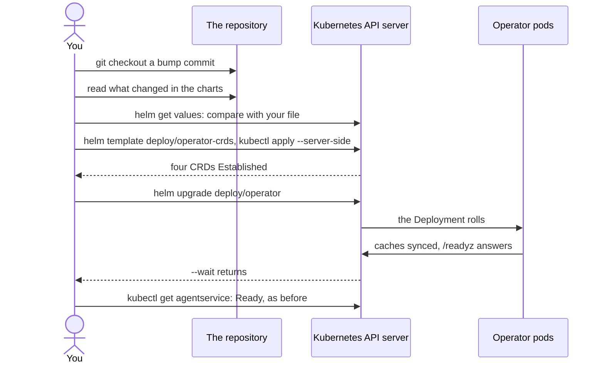
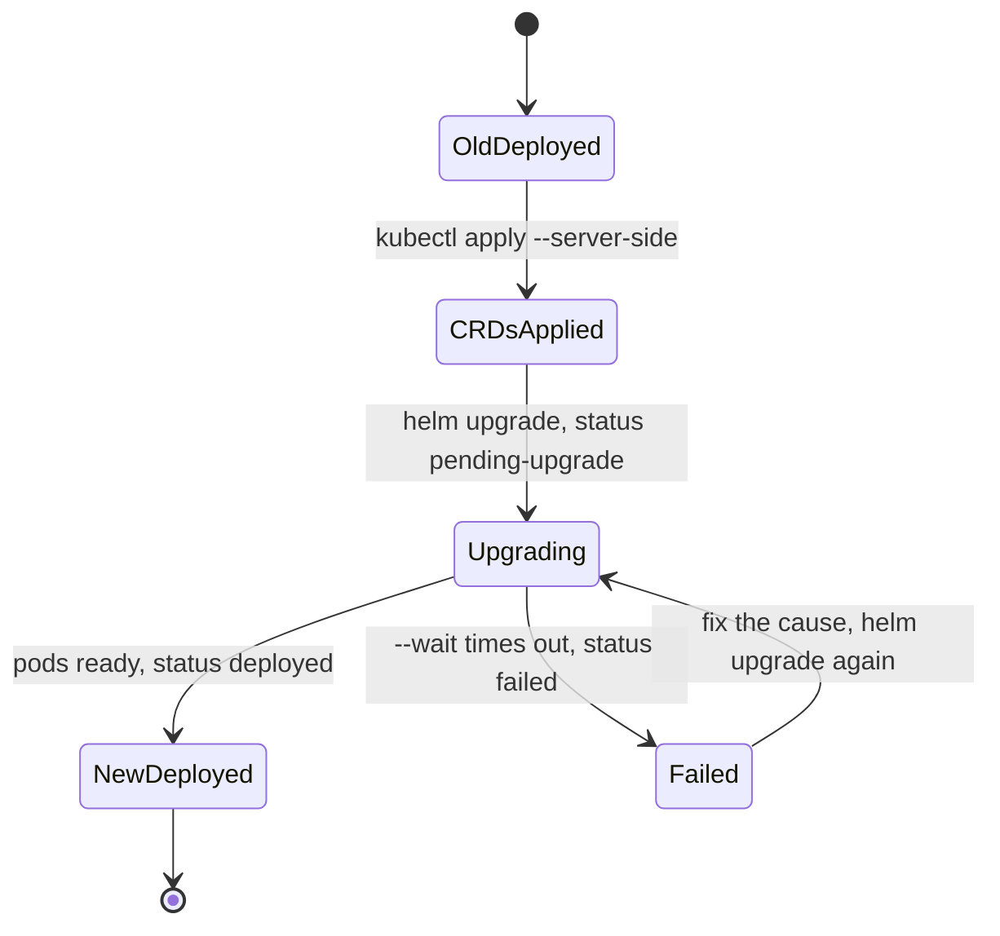

# Upgrade

You upgrade by moving the repository to a newer revision, then applying two charts from it: the CRDs first, then the operator. Nothing publishes either chart, so a new version is a new commit of this repository.

If you turn on the activity source (`activity.to`, ANR-1030b), read [Activity](../../../deploy/operator/README.md#upgrading) (the paragraph "Activity (ANR-1030b)") in the chart's upgrade notes first.

Install first: [Install the CRDs and the operator](../deploy/install.md). With the Platform API on, it is upgraded by the same command.

## Which revision

The operator's images are built and pushed by CI. After a green build of a commit that changes what is built, unless a newer one has landed, a last CI job writes the new image tags into `deploy/operator/values.yaml` and pushes **one commit** with the subject `chore(deploy): bump operator and api to sha-<7 hex>`. That commit is the revision to use. At it, `image.tag` and `api.image.tag` name the images CI built and tested for the commit the subject names.

```sh
git fetch origin
git log --format='%h %ad %s' --date=short --grep='^chore(deploy): bump' origin/main -5
git checkout <the hash of one of those commits>
```

A commit between a source change and its bump has a newer chart than its image. The chart and the image are meant to move together. With run pods on, the README says to upgrade the chart and the operator's image in one release, because the new admission policy reads a parameter that the new operator writes ([the chart's README](../../../deploy/operator/README.md#upgrading)).

### What `bump-tag.sh` is

`deploy/operator/bump-tag.sh` is **CI's tool, not yours**. The `bump` job of [`operator-image.yml`](../../../.github/workflows/operator-image.yml) runs it on `main`, and a dry run shows its edit on pull requests. It rewrites one `tag:` key in `values.yaml` and refuses a tag that is not `sha-` and seven hex digits. The chart's `values.yaml` calls the tag "a plain key, written by that script only", and the chart's README says "written by CI only, never by hand". Do not run it, and do not edit `image.tag` in a checkout.

What you do instead is pick a revision, as above. If you must run an image that no revision of the chart names, set the tag in **your own** values file, never in the repository's:

```yaml
image:
  tag: sha-<7 hex>
api:
  image:
    tag: sha-<the same 7 hex>   # one commit builds the images: keep the tags in step
```

The chart refuses `latest` for the operator and the API (`image.tag must not be latest: a moving tag would roll the operator out without a commit`, exit 1) and a digest that is not `sha256:` and 64 hex digits. It accepts any other tag, so a tag that no registry has gives `ImagePull` on the pods. That the chart and an image from another commit work together is a case the repository does not test.

`defaultAgentImage`, the coder image an agent gets when it names none, is a pin of its own. CI's bump never moves it. Move it by hand, after reading the digest from the registry ([Install](../deploy/install.md#defaultagentimage)).

## The order



The release itself goes through these states. `pending-upgrade`, `deployed` and `failed` are the statuses `helm status` shows. The CRDs are applied with `kubectl`, outside the release:



A template error fails before any new revision exists, so there is nothing to roll. After a successful upgrade the old revision becomes `superseded`.

1. **Read what changed.** The charts are the diff of one path. Your own values may name a value that moved or went:

   ```sh
   git diff <old>..<new> --stat -- deploy/operator deploy/operator-crds deploy/crds
   git diff <old>..<new> -- deploy/operator/values.yaml
   ```

2. **Compare your values with the release.** `helm get values aap-operator --namespace aap-system` prints what the running release was installed with. Compare it with your file: a value given with `--set` at install time is lost on an upgrade that passes only `-f`. And a tag you pinned yourself (`image.tag` or `api.image.tag`, above) **keeps winning** after you check out a newer bump commit: remove it, or move it.

3. **Render before you apply.** `helm template aap-operator deploy/operator --namespace aap-system -f values.yaml` must succeed, and its output should pass `kubeconform`. With the API on, run the new image's own `--check` on the file you render ([Turn on the Platform API](../deploy/platform-api.md#check-the-file-before-you-deploy-it)).

4. **The CRDs, server-side.**

   ```sh
   helm template aap-operator-crds deploy/operator-crds | kubectl apply --server-side -f -
   kubectl wait --for=condition=Established --timeout=60s \
     crd/agentservices.agents.vymalo.com crd/agentconfigs.agents.vymalo.com \
     crd/modelendpoints.agents.vymalo.com crd/toolproviders.agents.vymalo.com
   ```

5. **The operator.**

   ```sh
   helm upgrade aap-operator deploy/operator --namespace aap-system -f values.yaml --wait
   ```

6. **Check.** `kubectl -n aap-system get pod`, and `kubectl get agentservice -A`. Every agent that was `Ready` should be. If one is not, read [Find why an agent is not Ready](not-ready.md).

::: in-depth If it goes wrong

A `--wait` that times out leaves the release `failed`, and the old pods may still be serving. Read, in this order:

```sh
helm status aap-operator --namespace aap-system
kubectl -n aap-system get pod
kubectl -n aap-system describe pod -l app.kubernetes.io/instance=aap-operator
kubectl -n aap-system logs deploy/aap-operator
```

Fix the cause and run `helm upgrade` again.

**There is no supported rollback.** None was run. `helm rollback` reverts the operator's release, and it does **not** undo the CRDs: `kubectl apply` owns them, outside any release. So a rollback of the operator can leave it over newer CRDs.

- **The only documented bound** is the CRDs README's pre-D1 rule: the CRDs over an operator older than D1 are safe as long as nobody has stored a reference (`endpointRef`, `providerRef`), and an operator older than D1 must never run against CRDs that store one (it types `baseUrl` as required and cannot decode such an `AgentConfig`). That README also says the Platform API "is not built", which is stale.
- **Unverified:** rolling back one bump across a CRD change, for example K11a (`model` optional, `harness.type: a2a`), over objects stored under the newer CRDs. Nothing shows that an older operator decodes those objects.

([The CRDs chart's README](../../../deploy/operator-crds/README.md#upgrading) has both.)

:::
::: in-depth Why the CRDs go first

An operator from slice D2 on expects all four kinds. Reasons the chart's README gives:

- **A missing kind.** Without `modelendpoints` and `toolproviders`, the operator still runs, but an agent whose config names a shared object stays `ReferentMissing`, saying the kind is not installed, until they exist. The operator retries on the pending timer (15 s); no human action is needed for the condition to clear.
- **A missing status subresource.** Since K2 the operator writes the `status` of `modelendpoints` and `toolproviders`. Only a CRDs chart from K2 on gives them that subresource. With an older one, the API server answers `404` to every such write. The operator logs a warning that says to install the CRDs chart, retries with the back-off of an internal error (30 s, doubling, 10 minutes at most: `backoff` in `crates/controller/src/context.rs`), and reconciles every agent as before. Nothing is lost but the status, until the chart is there.
- **The other order was withdrawn.** The CRDs README says an older operator is safe over newer CRDs only while nothing stored a reference, and it warns never to run an operator older than D1 against CRDs that store one (`endpointRef`, `providerRef`): it cannot read such an `AgentConfig`. So if you roll the operator back, check that first.

The CRDs chart is **additive for what is stored**. The `kind` job of [`operator.yml`](../../../.github/workflows/operator.yml) installs the CRDs of the previous commit, stores the two examples under them, applies the new CRDs over the old ones server-side, and updates those objects. They are still accepted.

**Never delete the CRDs release to upgrade it.** Deleting the CRDs deletes every `AgentService`, `AgentConfig`, `ModelEndpoint` and `ToolProvider` with them, and the operator's finalizers no longer run ([the CRDs chart's README](../../../deploy/operator-crds/README.md#removing-it)).

:::
::: in-depth How the pods roll

| | One replica (the default) | `replicas` above 1 |
|---|---|---|
| Operator strategy | `Recreate` | `RollingUpdate`, `maxSurge: 1`, `maxUnavailable: 0` |
| During the swap | The old pod stops, then the new one starts. Nothing reconciles, and the registry has no pod behind it, until the new pod is ready. Agents keep running, because each is a `Deployment` of its own ([§59a](../../architecture/10-control-plane-and-crds.md), the risk table: "a short reconcile gap on upgrade; agents keep running") | A new pod is ready before an old one stops. The leader hands over through the `Lease`: [Run two replicas](replicas.md) |
| Budget | none | `PodDisruptionBudget`, `maxUnavailable: 1` |

The **Platform API** is a separate `Deployment`. It always uses `RollingUpdate` with `maxSurge: 1` and `maxUnavailable: 0`, with a `preStop` sleep of 5 s and a grace period of 40 s by default. A new pod that never becomes ready, because its file is wrong or it cannot reach the issuer, leaves the old pods serving: the rollout stalls, and `helm upgrade --wait` times out. [Turn on the Platform API](../deploy/platform-api.md#the-api-pod-is-not-ready-until-it-can-reach-the-issuer) says how to see why.

Any change to the operator's rendered file rolls its pods: the pod template carries a checksum of it. A change in what an agent is made from can roll that agent too. `agent.runtimeClassName` rolls every agent once, and a new `defaultAgentImage` rolls the agents that name no image of their own, and no other.

:::
::: in-depth What a change of v1alpha1 can be

The CRDs are `agents.vymalo.com/v1alpha1`, served and stored, with **no conversion webhook**. [§62](../../architecture/10-control-plane-and-crds.md#62-api--crd-versioning) plans the path `v1alpha1`, then `v1beta1`, then `v1`, with a conversion webhook where one is needed. The record is plain about where that leaves you today: breaking changes are made while no deployment is proven, and a conversion path comes with `v1beta1` ([§59a's risk table](../../architecture/10-control-plane-and-crds.md)).

So read it this way. A change today is meant to be additive: a new optional field, a new rule that old objects pass. The `kind` job holds that for the stored examples. A breaking change would be a new version and a conversion path. Before any upgrade, read the diff of `deploy/crds/agents.vymalo.com.yaml` for the rules your objects must pass.

:::
## What proves it

| CI job | Workflow | What it runs |
|---|---|---|
| `kind` | [`operator.yml`](../../../.github/workflows/operator.yml) | The previous CRDs and two stored agents; the new CRDs applied over them; the stored objects still accepted and updated |
| `crds-drift` | `operator.yml` | The CRDs chart holds the same file as `deploy/crds`, and `crdgen` produces it |
| `chart` | `operator-image.yml` | `render-check.sh`: the strategy, the budget, the refusals of `latest` and a bad digest, each broken on purpose |
| `bump` | `operator-image.yml` | `bump-tag.sh` on `main`. Its dry run on pull requests is `bump-dry-run`, and `bump-tag-test.sh`, in the shell scripts job, holds that it edits only the key it is asked to |
| `leader-e2e` | `operator-image.yml` | Two replicas and a handover, as above |

*The run this page was checked against, with its ids, is recorded in [the agent page](../../../.agents/docs/guides/operate/upgrade.md).*

### What was walked

On 2026-11-27, on a kind cluster (Kubernetes v1.35.8), this was run **by an upgrade across the move of the operator's settings from environment variables to one configuration file**:

1. The CRDs and the operator were installed from the revision at `9e4fe93`, the bump to `sha-cac5bc7`, with one replica and one agent, `hello`, which became `Ready`.
2. The CRDs were applied from this commit, server-side: four lines `serverside-applied`, no conflict, all four `Established`. The agent stayed `Ready`.
3. `helm upgrade --wait` ran from this commit's chart, with the same values file and `replicas: 2` added. The pods went from the `Recreate` pod to two on `RollingUpdate`, on `sha-2c16326`. A `PodDisruptionBudget` and a `Lease` appeared. The `Lease` was held by one pod, `leaseTransitions` 0.
4. `hello` was `Ready` before and after, with the same config digest, and its pod was not restarted (its age kept counting).

So one upgrade across that change, from one replica to two, was uneventful for a running agent. It proves one path, from one revision to another, with one agent that has a referenced Secret for its store. It does not prove other revisions.

### What is unverified

- **Any other starting revision,** and an agent that uses a model endpoint, a tool server, run pods or a CloudNativePG store across the upgrade.
- **A rollback.** `helm rollback` and an older operator over newer CRDs were not run.
- **The upgrade through Argo CD.** An Argo CD that syncs the CRDs before the operator is unverified ([What is not proven](../../../deploy/operator/README.md#what-is-not-proven)).
- **The API's rolling update** under load, and `preStop.sleep` during it. The strategy is rendered. Nothing measures it ([the README](../../../deploy/operator/README.md#what-is-not-proven)).
- **The `PodDisruptionBudget` under a real drain.**
- **The headers key of the operator's traces** across that upgrade, on a cluster ([Send traces to a collector](traces.md)).
